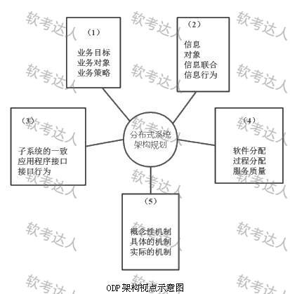
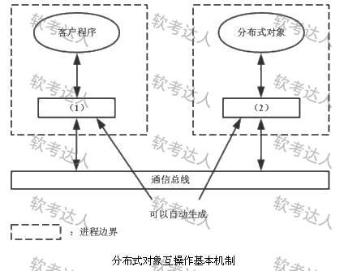

# 电信分布式系统-ODP视点与互操作案例

## 原题（网站题号 139：分布式系统ODP，分值未标）

**试题**　阅读以下关于分布式系统设计的叙述，回答问题。

【说明】某软件公司开发电信领域分布式系统：后台多模块计算负载大、需控制分散安装在多台计算机上的特定电信硬件设备、提供7×24小时不间断服务、单次接入需后台多模块协作。项目组决定基于ISO的开放分布进程(ODP)规范进行系统架构设计。

| 小问 | 内容 | 分值 |
|---|---|---|
| 问题1 | ODP五个标准视点填图（备选：技术选择架构/企业业务架构/分布式工程架构/计算接口架构/逻辑信息架构） | 未标 |
| 问题2 | 400字内从构件管理支持、互操作支持、公共服务支持三方面说明现有分布式基础设施的基本支撑 | 未标 |
| 问题3 | 填分布式对象互操作机制图（ ）～（2），并300字内说明一次分布式对象调用的详细步骤 | 未标 |

## 图示（原图，未覆盖）

## 来源答案与解析（网站原文）

- 问题1：(1)企业业务架构；(2)逻辑信息架构；(3)计算接口架构；(4)分布式工程架构；(5)技术选择架构。
- 问题2：构件管理支持（构件容器提供运行环境、管理实例生命周期与元信息）；互操作支持（高层通信协议屏蔽物理特性与处理器/OS/语言异构性，开发调用分布式对象无需编写底层通信代码）；公共服务支持（命名服务、事务服务、安全服务、持久性服务等）。
- 问题3：(1)存根/桩 (2)框架；或(1)代理 (2)存根。八步调用过程。解析：略。
- 【注意】三问均未标分值，按无分值pending口径处理。

## 核验答案（考场作答）

### 【问题1】ODP五视点填图

**考场答案**：(1)企业业务架构；(2)逻辑信息架构；(3)计算接口架构；(4)分布式工程架构；(5)技术选择架构。

**采分要点**：五空各1/5分值（推定）。

**详细解析**：ODP五视点记忆（自上而下）：企业业务（为什么做）→信息（什么数据）→计算（怎么交互）→工程（放在哪）→技术（用什么实现）。与图各空标注的核心内容对号。

**常见失分表达**：计算接口与工程架构错位。

**知识点链接**：[信息系统架构设计理论与实践（ODP）](https://github.com/Goodyzhang/ruankao.skill/blob/main/materials/%E7%B3%BB%E7%BB%9F%E6%9E%B6%E6%9E%84%E8%AE%BE%E8%AE%A1%E5%B8%88/%E7%AC%94%E8%AE%B0/%E7%9F%A5%E8%AF%86%E7%82%B9/12-%E4%BF%A1%E6%81%AF%E7%B3%BB%E7%BB%9F%E6%9E%B6%E6%9E%84%E8%AE%BE%E8%AE%A1%E7%90%86%E8%AE%BA%E4%B8%8E%E5%AE%9E%E8%B7%B5.md)

### 【问题2】分布式基础设施三方面支撑

**考场答案**（400字内）：①构件管理支持——现有分布式基础设施一般通过构件容器为构件提供基本运行环境，具体功能包括管理构件的实例及其生命周期、管理构件的元信息等；②互操作支持——提供高层通信协议屏蔽节点物理特性及处理器、操作系统、程序设计语言等异构性，开发与调用分布式对象时无需自己编写底层通信代码；③公共服务支持——将分布式软件的通用支持集成于一身，以公共服务形式提供给应用程序，常见公共服务包括命名服务、事务服务、安全服务、持久性服务等。

**采分要点**：三方面各1/3分值（推定）：名称+机制半句+例子。

**详细解析**：三方面对应“运行环境（容器）→通信（协议屏蔽异构）→通用能力（公共服务）”。与题109/110（REST/容器化）、题63（统一代理层）的微服务支撑体系同构，可对照记忆。

**常见失分表达**：公共服务漏“命名/事务/安全/持久”清单词。

**知识点链接**：[信息系统架构设计理论与实践（分布式基础设施）](https://github.com/Goodyzhang/ruankao.skill/blob/main/materials/%E7%B3%BB%E7%BB%9F%E6%9E%B6%E6%9E%84%E8%AE%BE%E8%AE%A1%E5%B8%88/%E7%AC%94%E8%AE%B0/%E7%9F%A5%E8%AF%86%E7%82%B9/12-%E4%BF%A1%E6%81%AF%E7%B3%BB%E7%BB%9F%E6%9E%B6%E6%9E%84%E8%AE%BE%E8%AE%A1%E7%90%86%E8%AE%BA%E4%B8%8E%E5%AE%9E%E8%B7%B5.md)

### 【问题3】分布式对象调用机制

**考场答案**：填空：(1)存根/桩（Stub）；(2)框架（Skeleton）——或(1)代理 (2)存根。一次远程调用八步：①客户程序将调用请求发送给客户端桩（对客户程序而言桩就是服务程序在客户端的代理）；②客户端桩将远程调用请求编组并发送给通信总线；③调用请求经通信总线传送到服务端框架；④服务端框架将调用请求解组并分派给真正的远程对象实现（服务程序）；⑤服务程序完成调用请求，将结果返回给服务端框架；⑥服务端框架将调用结果编组并发送给通信总线；⑦调用结果经通信总线传送到客户端桩；⑧客户端桩将调用结果解组并返回给客户程序。

**采分要点**：两部件填空+八步链路（推定）；编组/解组与桩/框架角色是给分锚点。

**详细解析**：RPC经典机制：桩负责客户端编组与服务端解组分派，框架在服务端承接。与题111（服务网格Sidecar剥离通信）对照：从手动桩/框架演进到自动Sidecar，通信治理的职责分离思想一脉相承。

**常见失分表达**：八步漏“编组/解组”；桩与框架角色颠倒。

**知识点链接**：[信息系统架构设计理论与实践（互操作机制）](https://github.com/Goodyzhang/ruankao.skill/blob/main/materials/%E7%B3%BB%E7%BB%9F%E6%9E%B6%E6%9E%84%E8%AE%BE%E8%AE%A1%E5%B8%88/%E7%AC%94%E8%AE%B0/%E7%9F%A5%E8%AF%86%E7%82%B9/12-%E4%BF%A1%E6%81%AF%E7%B3%BB%E7%BB%9F%E6%9E%B6%E6%9E%84%E8%AE%BE%E8%AE%A1%E7%90%86%E8%AE%BA%E4%B8%8E%E5%AE%9E%E8%B7%B5.md)

## 来源与身份（待核验记录说明）

- 题源：软考达人·第二十二章 案例分析/第一节 案例分析，网站题号139（网站分类“第二十二章 案例分析”保留为来源位置，章节路由按实际考点匹配教材章（第2版20章体系）。）
- **三问均未标分值**：按 pending 保存，不构造 max_score、不导出实验室；内容已完整核验。
- 图示：ODP五视点图与互操作机制图原图已下载（题面图）。
