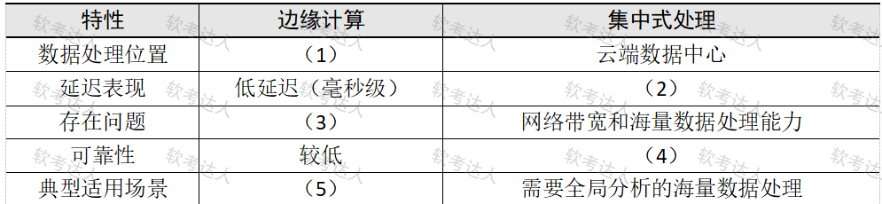

# 物流管理系统-MVVM与MyBatis及边缘计算案例

## 原题（网站题号 78～80 合并：试题五，25分）

**试题五（25分）**　阅读以下关于Web应用开发的描述，在答题纸上回答问题1至问题3。

【说明】某传统物流企业开发新一代物流管理系统：实时货物追踪、路径优化、多平台订单接入、大数据分析；需应对高并发订单、海量传感器数据实时分析、跨平台（Web/移动端/IoT）兼容。团队面临问题：表现层代码紧耦合业务逻辑维护成本高；持久层需支持复杂查询与高性能读写；实时货物数据导致数据库大量写操作占满磁盘I/O延迟明显。

| 网站题号 | 小问 | 分值 |
|---|---|---|
| 78 | 问题1（8分）：200字以内比较MVC与MVVM模式优缺点 | 8 |
| 79 | 问题2（7分）：从性能、灵活性、复杂查询支持三维度选择Hibernate或MyBatis并阐述依据（300字内） | 7 |
| 80 | 问题3（10分）：比较边缘计算与集中式处理在物流系统中的差异填表 | 10 |

## 图示（原图，未覆盖）

## 来源答案与解析（网站原文）

- 题78：MVC优缺点+MVVM优缺点。（解析：无）
- 题79：选MyBatis，三维度理由。（解析：无）
- 题80：（1）边缘节点；（2）较高延迟（秒级）；（3）有限的硬件资源和恶劣的部署环境；（4）很高；（5）实时性要求高的本地决策。（解析：无）

## 核验答案（考场作答）

### 【问题1】（8分）

**考场答案**（200字内）：MVC优势：分层简单（模型/视图/控制器），各层专注自身职责，允许多种用户界面扩展，易于维护；缺点：视图层与模型层存在直接耦合，绕过控制器。MVVM优势：通过数据绑定（ViewModel）实现视图与模型自动同步，防止视图与模型直接耦合，减少控制器层代码，适合富客户端；缺点：出现问题不易定位来源。

**采分要点**：MVC优缺2+1分、MVVM优缺3+2分（推定，各半）。

**详细解析**：MVC的“缺点”是关键差异点——View可直接读Model（绕过Controller）；MVVM用双向数据绑定把这条通路封死，代价是绑定链路调试难（问题不易定位）。场景映射：物流管理多端（Web/移动/IoT）界面富交互→MVVM的数据绑定优势正对题干“表现层与业务逻辑紧耦合”痛点。

**常见失分表达**：MVVM漏“数据绑定”机制词；MVC缺点漏“绕过控制器”。

**知识点链接**：[表现层框架设计（MVC/MVVM）](https://github.com/Goodyzhang/ruankao.skill/blob/main/materials/%E7%B3%BB%E7%BB%9F%E6%9E%B6%E6%9E%84%E8%AE%BE%E8%AE%A1%E5%B8%88/%E7%AC%94%E8%AE%B0/%E7%9F%A5%E8%AF%86%E7%82%B9/13-%E5%B1%82%E6%AC%A1%E5%BC%8F%E6%9E%B6%E6%9E%84%E8%AE%BE%E8%AE%A1%E7%90%86%E8%AE%BA%E4%B8%8E%E5%AE%9E%E8%B7%B5.md)

### 【问题2】（7分）

**考场答案**（300字内）：应选择**MyBatis**。①性能：Hibernate全自动ORM映射可能引入额外开销，在复杂查询或大数据量场景尤甚；MyBatis允许手动优化SQL，减少不必要的数据库交互，更适合高并发读写场景；②灵活性：MyBatis支持原生SQL和动态SQL，可灵活支持不同数据库特性（如随机数等特殊函数）；Hibernate的HQL虽跨数据库，但复杂业务逻辑较难实现，灵活性较低；③复杂查询支持：MyBatis直接编写多表关联、子查询等复杂SQL更直观高效；Hibernate的HQL对复杂查询支持有限，处理多表关联时可能生成不优化的SQL。

**采分要点**：结论1分＋三维度各2分（推定）。

**详细解析**：选型题落点在题干痛点：“持久层需支持复杂查询与高性能读写”+实时货物数据海量写入→SQL可控、可调优的MyBatis胜出。与题35（投票系统选Hibernate）、题74（支持矩阵）构成同族三题：三家答案不同全因题干需求不同——选型题永远“需求定方案”。

**常见失分表达**：三维度缺一；只写“灵活”没有原生SQL/动态SQL机制词。

**知识点链接**：[Hibernate vs MyBatis 选型](https://github.com/Goodyzhang/ruankao.skill/blob/main/materials/%E7%B3%BB%E7%BB%9F%E6%9E%B6%E6%9E%84%E8%AE%BE%E8%AE%A1%E5%B8%88/%E7%AC%94%E8%AE%B0/%E7%9F%A5%E8%AF%86%E7%82%B9/06-%E6%95%B0%E6%8D%AE%E5%BA%93%E8%AE%BE%E8%AE%A1%E5%9F%BA%E7%A1%80%E7%9F%A5%E8%AF%86.md)

### 【问题3】（10分）

**考场答案**：数据处理位置——边缘计算在边缘节点 vs 集中式处理在云端数据中心；延迟表现——边缘计算低延迟（毫秒级）vs 集中式较高延迟（秒级）；存在问题——边缘计算有限的硬件资源和恶劣的部署环境 vs 集中式网络带宽和海量数据处理能力；可靠性——边缘计算较低 vs 集中式很高；典型适用场景——边缘计算实时性要求高的本地决策 vs 集中式需要全局分析的海量数据处理。

**采分要点**：五空各2分（推定）。

**详细解析**：边缘计算的画像：近数据源（位置）、毫秒级（延迟）、但节点硬件弱环境差（代价）、单点可靠性较低（代价）、本地实时决策（场景）；集中式恰好互补。物流场景映射：车载/分拣设备的实时路径决策走边缘，全网大数据分析走云端——题干“实时货物追踪+大数据分析”双需求正好对应两列。

**常见失分表达**：(3)只写“资源有限”漏“恶劣部署环境”；(5)漏“本地决策”。

**知识点链接**：[未来信息综合技术（边缘计算）](https://github.com/Goodyzhang/ruankao.skill/blob/main/materials/%E7%B3%BB%E7%BB%9F%E6%9E%B6%E6%9E%84%E8%AE%BE%E8%AE%A1%E5%B8%88/%E7%AC%94%E8%AE%B0/%E7%9F%A5%E8%AF%86%E7%82%B9/11-%E6%9C%AA%E6%9D%A5%E4%BF%A1%E6%81%AF%E7%BB%BC%E5%90%88%E6%8A%80%E6%9C%AF.md)、[物联网层次架构](https://github.com/Goodyzhang/ruankao.skill/blob/main/materials/%E7%B3%BB%E7%BB%9F%E6%9E%B6%E6%9E%84%E8%AE%BE%E8%AE%A1%E5%B8%88/%E7%AC%94%E8%AE%B0/%E7%9F%A5%E8%AF%86%E7%82%B9/13-%E5%B1%82%E6%AC%A1%E5%BC%8F%E6%9E%B6%E6%9E%84%E8%AE%BE%E8%AE%A1%E7%90%86%E8%AE%BA%E4%B8%8E%E5%AE%9E%E8%B7%B5.md)

## 来源与身份

- 题源：软考达人·第二十二章 案例分析/第一节 案例分析，网站题号78～80（网站分类“第二十二章 案例分析”保留为来源位置，章节路由按实际考点匹配教材章（第2版20章体系）。）
- 年份/卷别未核实，按 web-bank 处理；分值加和 8+7+10=25 与“试题五（25分）”一致。
- 图示：边缘计算对比表原图已下载并实际看图核对五空行列（行名=数据处理位置/延迟表现/存在问题/可靠性/典型适用场景）。
