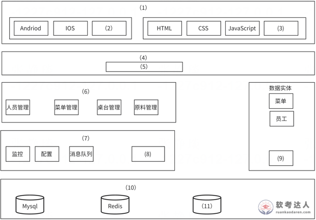

# 连锁餐厅点餐系统-DDD与架构填图案例

## 原题（网站题号 62～64 合并：试题二，25分）

**试题二（25分）**　某连锁餐厅计划开发一套分布式Web应用点餐系统，采用“终端+云端”双层架构：终端层部署各门店智能点餐设备（扫码登录、浏览菜品、下单支付、加菜退单），云端层为管理中枢（菜品信息维护、订单全生命周期管理、菜品动态配置、员工权限管理）。

| 网站题号 | 小问 | 分值 |
|---|---|---|
| 62 | 问题1（6分）：领域驱动中限界上下文的定义及作用 | 6 |
| 63 | 问题2（11分）：从(a)~(n)中为架构图(1)~(11)空白选择相应内容补充架构设计图 | 11 |
| 64 | 问题3（8分）：云端到终端及终端间同步出现数据丢失、冲突等问题时的解决方案 | 8 |

## 图示（原图，未覆盖）

## 来源答案与解析（网站原文）

- 题62：限界上下文定义与作用（解析补充DDD拆解与电商示例，见台账 analysis-62.json）。
- 题63：网站答案列表为 (1)(c)、(2)(l)、(3)(g)、(4)(d)、(5)(k)、(6)(m)、(8)(h)、(9)(f)、(10)(a)、(11)(i)——**缺(7)且(6)存疑**；其解析段落明确“(6)提供各个管理功能属于业务层、(7)为上层提供监控、配置、消息队列等系统支撑功能属于基础配置层”。
- 题64：丢失/冲突/延迟三套方案（解析含详细机制，见台账 analysis-64.json）。

## 核验答案（考场作答）

### 【问题1】（6分）

**考场答案**：限界上下文指通过限制边界的方法确定业务的上下文，是一种划分业务边界的方法。作用：①帮助分解业务复杂度，确保每个模块聚焦特定业务逻辑；②确保开发人员、产品经理和业务方在特定边界内对领域模型达成一致理解，从而构建可维护、可扩展的系统。

**采分要点**：定义3分＋两层作用3分（推定）。

**详细解析**：DDD以业务领域为核心，复杂业务拆成多个限界上下文，每个上下文有专属语言/模型/规则（通用语言）。判别：题目问“定义及作用”，答题结构=一句定义+两条作用，再补一句点餐系统实例（菜品/订单/员工权限各成上下文）更稳。

**常见失分表达**：只答“划分边界”没有“业务上下文”语义；漏“达成一致理解”这条协作作用。

**知识点链接**：[微服务与DDD限界上下文](https://github.com/Goodyzhang/ruankao.skill/blob/main/materials/%E7%B3%BB%E7%BB%9F%E6%9E%B6%E6%9E%84%E8%AE%BE%E8%AE%A1%E5%B8%88/%E7%AC%94%E8%AE%B0/%E7%9F%A5%E8%AF%86%E7%82%B9/14-%E4%BA%91%E5%8E%9F%E7%94%9F%E6%9E%B6%E6%9E%84%E8%AE%BE%E8%AE%A1%E7%90%86%E8%AE%BA%E4%B8%8E%E5%AE%9E%E8%B7%B5.md)

### 【问题2】（11分）

**考场答案**：(1)→(c)表示层；(2)→(l)Ktor；(3)→(g)Ajax；(4)→(d)统一代理层；(5)→(k)Spring Security；(6)→(e)业务层；(7)→(m)基础配置层；(8)→(h)日志操作；(9)→(f)桌台；(10)→(a)数据持久层；(11)→(i)Sqllite。

> 勘误说明：网站答案列表将(6)写作(m)且缺(7)——与其自身解析段落“（6）提供各个管理功能属于业务层、（7）为上层提供监控、配置、消息队列等系统支撑功能属于基础配置层”矛盾；架构图(6)框内为人员/菜单/桌台/原料管理等管理功能、(7)框内为监控/配置/消息队列，故按解析与图修正为(6)→(e)、(7)→(m)。来源记录保留网站原文。

**采分要点**：11空各1分（推定）；(6)(7)按修正口径给分。

**详细解析**：填图法自上而下对层：客户端技术→表示层；网关入口+安全→统一代理层(Spring Security)；管理功能→业务层；监控/配置/消息队列/日志→基础配置层；数据实体（菜单/员工/桌台）右侧独立列；MySQL/Redis/SQLite→数据持久层。(11)的陷阱是Realm——虽是数据库但专为移动设备设计，不具备MySQL/Redis/SQLite的通用性。(2)Ktor是Kotlin轻量框架，与(5)Spring Security同处代理层但职责一接一防。

**常见失分表达**：(6)(7)照抄网站错表；(11)误选Realm；(9)误选“原料管理”（原料管理是业务功能不是数据实体）。

**知识点链接**：[层次式架构案例分析](https://github.com/Goodyzhang/ruankao.skill/blob/main/materials/%E7%B3%BB%E7%BB%9F%E6%9E%B6%E6%9E%84%E8%AE%BE%E8%AE%A1%E5%B8%88/%E7%AC%94%E8%AE%B0/%E7%9F%A5%E8%AF%86%E7%82%B9/13-%E5%B1%82%E6%AC%A1%E5%BC%8F%E6%9E%B6%E6%9E%84%E8%AE%BE%E8%AE%A1%E7%90%86%E8%AE%BA%E4%B8%8E%E5%AE%9E%E8%B7%B5.md)

### 【问题3】（8分）

**考场答案**：①数据丢失：任何操作先写本地数据库，再经后台消息队列与自动重试机制在网络恢复后异步同步至云端；同步对用户透明，网络中断也可继续操作，最终保证数据一致（先本地存活、再云端同步）。②数据冲突：订单主要修改权限绑定创建终端、其他终端只读或受限（权限分级，如支付仅收银终端）；订单实体附带版本号，修改请求必须携带当前版本号、云端验证匹配才更新（版本校验）；冲突按业务规则自动合并（如多终端同时加菜）或提示用户人工裁决（如备注冲突提供“保留我的/接受他人”选项）。③操作延迟：用户操作后界面立即响应、后台异步同步不阻塞；为每个操作分配临时ID，服务器确认后替换为正式ID，失败时回滚（如库存不足按临时ID清除临时订单并提示原因）。

**采分要点**：丢失3分＋冲突3分＋延迟2分（推定）；每套方案须“机制+效果”。

**详细解析**：三问题的对应武器：丢失→本地优先+异步补偿（最终一致性）；冲突→预防（权限分级）+检测（版本号/CAS）+解决（自动合并/人工裁决）三层；延迟→乐观UI+临时ID+回滚。与题22消息队列、题15最终一致性互相印证——分布式同步题的答案套路高度模式化。

**常见失分表达**：冲突方案漏“版本号”机制；延迟方案只写“加缓存”。

**知识点链接**：[分布式Web应用同步（课程笔记）](https://github.com/Goodyzhang/ruankao.skill/blob/main/materials/%E7%B3%BB%E7%BB%9F%E6%9E%B6%E6%9E%84%E8%AE%BE%E8%AE%A1%E5%B8%88/%E7%AC%94%E8%AE%B0/%E7%9F%A5%E8%AF%86%E7%82%B9/05-%E8%BD%AF%E4%BB%B6%E5%B7%A5%E7%A8%8B%E5%9F%BA%E7%A1%80%E7%9F%A5%E8%AF%86.md)

## 来源与身份

- 题源：软考达人·第二十二章 案例分析/第一节 案例分析，网站题号62～64（网站分类“第二十二章 案例分析”保留为来源位置，章节路由按实际考点匹配教材章（第2版20章体系）。）
- 年份/卷别未核实，按 web-bank 处理；分值加和 6+11+8=25 与“试题二”口径一致（网站未标总分）。
- 图示：点餐系统架构图原图已下载并实际看图核对——(6)框=管理功能（业务层）、(7)框=监控/配置/消息队列（基础配置层）、数据实体=菜单/员工/(9)、(10)层含MySQL/Redis/(11)，与核验答案一致并支持勘误。
