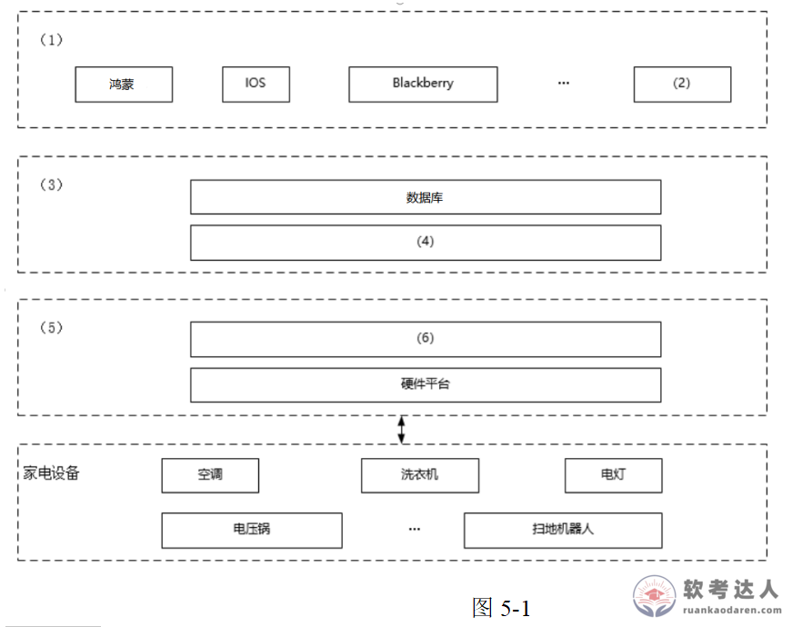

# 智能家居云平台-架构填图与云原生模式案例

## 原题（网站题号 171～173 合并：试题五，25分）

**试题五（25分）**　阅读以下关于Web系统架构设计的叙述，在答题纸上回答问题1至问题3。

【说明】某公司开发智能家居管理系统：①客户端控制家居设备并接收实时状态反馈；②家居设备数据实时存储和查询；③基于用户数据挖掘生活习惯，提供智能化使用建议。张工提出基于家庭网关的传统方案，李工提出基于云平台的方案，公司采用李工思路。

| 网站题号 | 小问 | 分值 |
|---|---|---|
| 171 | 问题1（12分）：从(a)~(j)选择填图5-1空(1)~(6) | 12 |
| 172 | 问题2（8分）：列举主要云原生架构模式并简要解释 | 8 |
| 173 | 问题3（5分）：300字内分析层次型架构优势 | 5 |

## 图示（原图，未覆盖）

## 来源答案与解析（网站原文）

- 题171：(1)(h)用户终端；(2)(i)Android；(3)(f)云平台；(4)(d)软件系统；(5)(e)家庭网关；(6)(c)驱动程序。（解析：无）
- 题172：七种云原生架构模式（服务化/Mesh化/Serverless/存储计算分离/分布式事务/可观测/事件驱动）。（解析：无）
- 题173：层次架构优势五条。（解析：无）

## 核验答案（考场作答）

### 【问题1】（12分）

**考场答案**：(1)=（h）用户终端；(2)=（i）Android；(3)=（f）云平台；(4)=（d）软件系统；(5)=（e）家庭网关；(6)=（c）驱动程序。

**采分要点**：六空各2分（推定）。

**详细解析**：读图定层：(1)层含鸿蒙/IOS/Blackberry等终端OS→用户终端层，(2)与之并列→Android；(3)层含数据库→云平台层，(4)与数据库并列→软件系统；(5)层含硬件平台→家庭网关层，(6)在硬件平台之上→驱动程序。干扰项Wi-Fi/蓝牙/TCP-IP是通信方式、微服务是部署风格，图中无对应空位。

**常见失分表达**：(4)误填微服务；(6)误填TCP/IP。

**知识点链接**：[层次式架构（端-云-网关分层）](https://github.com/Goodyzhang/ruankao.skill/blob/main/materials/%E7%B3%BB%E7%BB%9F%E6%9E%B6%E6%9E%84%E8%AE%BE%E8%AE%A1%E5%B8%88/%E7%AC%94%E8%AE%B0/%E7%9F%A5%E8%AF%86%E7%82%B9/13-%E5%B1%82%E6%AC%A1%E5%BC%8F%E6%9E%B6%E6%9E%84%E8%AE%BE%E8%AE%A1%E7%90%86%E8%AE%BA%E4%B8%8E%E5%AE%9E%E8%B7%B5.md)

### 【问题2】（8分）

**考场答案**：主要云原生架构模式：①服务化架构模式——典型代表微服务和小服务模式，通过服务拆分降低维护压力；②Mesh化架构模式——把中间件框架（RPC、缓存、异步消息）从业务进程中分离，由Mesh进程完成；③Serverless模式——非常适合事件驱动的数据计算任务；④存储计算分离模式——各类暂态数据（如session）用云服务保存；⑤分布式事务模式——解决微服务模式中多数据源事务问题；⑥可观测架构——包括Logging、Tracing、Metrics三个方面；⑦事件驱动架构——本质上是一种应用/组件间的集成架构模式。

**采分要点**：七种各约1.1分（推定）：模式名+特点半句。

**详细解析**：与教程§14.2.3七种模式一一对应，是本章必背清单。与题110/141/142（容器/Serverless实例）形成“模式→实例”对照。

**常见失分表达**：漏“存储计算分离”或“可观测架构”。

**知识点链接**：[云原生架构模式](https://github.com/Goodyzhang/ruankao.skill/blob/main/materials/%E7%B3%BB%E7%BB%9F%E6%9E%B6%E6%9E%84%E8%AE%BE%E8%AE%A1%E5%B8%88/%E7%AC%94%E8%AE%B0/%E7%9F%A5%E8%AF%86%E7%82%B9/14-%E4%BA%91%E5%8E%9F%E7%94%9F%E6%9E%B6%E6%9E%84%E8%AE%BE%E8%AE%A1%E7%90%86%E8%AE%BA%E4%B8%8E%E5%AE%9E%E8%B7%B5.md)

### 【问题3】（5分）

**考场答案**（300字内）：层次架构的优势：①良好的复用性——只要接口不变，同一层次可用在其它处；②可维护性好；③可扩展性好——支持递增设计；④经过合理分层，能让系统整体耦合性降低，达到解耦的效果；⑤可把相同逻辑与抽象级别的内容放在同一层次，更利于理解。

**采分要点**：五条各1分（推定）。

**详细解析**：与题4/6（Java三层框架）、题171架构图呼应：智能家居的终端-云-网关-设备分层正是层次架构优势的实例化。

**常见失分表达**：漏“递增设计”或“利于理解”。

**知识点链接**：[层次式体系结构概述](https://github.com/Goodyzhang/ruankao.skill/blob/main/materials/%E7%B3%BB%E7%BB%9F%E6%9E%B6%E6%9E%84%E8%AE%BE%E8%AE%A1%E5%B8%88/%E7%AC%94%E8%AE%B0/%E7%9F%A5%E8%AF%86%E7%82%B9/13-%E5%B1%82%E6%AC%A1%E5%BC%8F%E6%9E%B6%E6%9E%84%E8%AE%BE%E8%AE%A1%E7%90%86%E8%AE%BA%E4%B8%8E%E5%AE%9E%E8%B7%B5.md)

## 来源与身份

- 题源：软考达人·第二十二章 案例分析/第一节 案例分析，网站题号171～173（网站分类“第二十二章 案例分析”保留为来源位置，章节路由按实际考点匹配教材章（第2版20章体系）。）
- 年份/卷别未核实，按 web-bank 处理；分值加和 12+8+5=25 与“试题五（25分）”一致。
- 图示：架构图原图已下载并实际看图核对六空层位。
