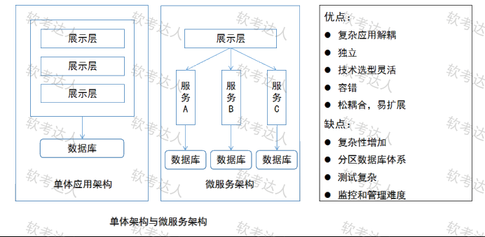
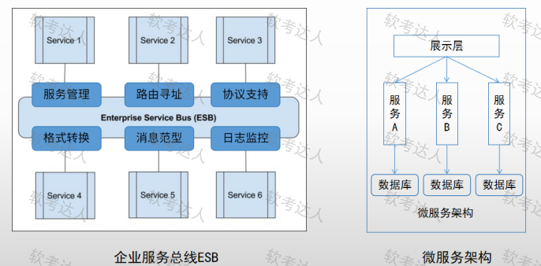
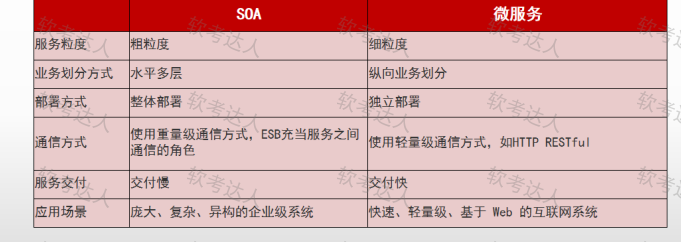

# 架构设计评估问答-微服务与效用树缺失题案例

## 原题（网站题号 128～130 合并：第1题 软件架构设计与评估 问答组，25分）

**第1题 软件架构设计与评估（25分）**　微服务模式 / SOA与微服务。题干正文以图片形式给出（三张参考图：单体vs微服务架构对比、ESB架构图、SOA vs 微服务对比表）；**网站解析自述“本题图片缺失，图裂了”**——质量效用树本体与“可用性的两个场景”题面缺失（另附一张16px宽裂图gif）。

| 网站题号 | 小条 | 分值 |
|---|---|---|
| 128 | 1、微服务的介绍，并说明微服务的优缺点 | 7 |
| 129 | 2、质量效用树，填空 | 6 |
| 130 | 3、质量属性场景中，使用六元素来描述题目中可用性的两个场景 | 12 |

## 参考图（题面附件，original）

## 来源答案与解析（网站原文）

- 题128：微服务介绍与优缺点+SOA对比（网站自述按现有内容回答；参考图1给出优缺点清单：优点=复杂应用解耦/独立/技术选型灵活/容错/松耦合易扩展，缺点=复杂性增加/分区数据库体系/测试复杂/监控和管理难度）。
- 题129：网站未给出精确填空答案（自述图片缺失），仅给SOA vs 微服务六维对比与效用树一般结构说明。
- 题130：网站仅给六要素定义，未给出“可用性两个场景”的六元素展开（场景正文缺失）。

## 核验答案（考场作答；题129/130题面缺失部分不构造答案）

### 【题128】微服务介绍与优缺点（7分）

**考场答案**：微服务是一种架构风格，将单体应用划分为一组小的服务，每个服务运行在独立进程中，服务间通过轻量级通信机制（通常HTTP/REST或JSON）协作，每个服务围绕业务能力构建、可独立部署。优点：①复杂性分解——庞大单体应用分解为多个小服务（复杂应用解耦）；②独立开发部署——每个服务可独立开发、部署、扩展；③技术多样性——不同服务可采用不同技术栈（技术选型灵活）；④故障隔离与容错——单个服务故障不影响整体；⑤松耦合、易扩展。缺点：①分布式复杂性——服务间通信、分布式事务、数据一致性；②运维复杂——需管理大量服务实例（监控和管理难度）；③测试困难——跨服务集成测试复杂；④网络开销——服务间通信带来延迟；⑤分区数据库体系带来的数据管理复杂度。

**采分要点**：介绍约2分＋优缺点约5分（推定）；与参考图1优缺点清单对齐。

**知识点链接**：[微服务权衡](https://github.com/Goodyzhang/ruankao.skill/blob/main/materials/%E7%B3%BB%E7%BB%9F%E6%9E%B6%E6%9E%84%E8%AE%BE%E8%AE%A1%E5%B8%88/%E7%AC%94%E8%AE%B0/%E7%9F%A5%E8%AF%86%E7%82%B9/14-%E4%BA%91%E5%8E%9F%E7%94%9F%E6%9E%B6%E6%9E%84%E8%AE%BE%E8%AE%A1%E7%90%86%E8%AE%BA%E4%B8%8E%E5%AE%9E%E8%B7%B5.md)

### 【题129】质量效用树填空（6分）——题面缺失，待核验

效用树本体图片缺失，无法确定填空项；网站亦未给出精确答案。仅记录效用树标准结构供复习：树根（效用）→质量属性→属性分类→质量属性场景（叶，标H/M/L优先级对）。**不构造答案。**

### 【题130】六元素描述可用性两场景（12分）——场景题面缺失，待核验

六要素定义完整（刺激源/刺激/环境/制品/响应/响应度量，见台账 analysis-130.json），但“题目中可用性的两个场景”正文在裂图中缺失，无法对应展开。**不构造场景答案。**

## 来源与身份（待核验记录说明）

- 题源：软考达人·第二十二章 案例分析/第一节 案例分析，网站题号128～130（网站分类“第二十二章 案例分析”保留为来源位置，章节路由按实际考点匹配教材章（第2版20章体系）。）
- **题面缺失**：效用树与可用性场景正文在网站裂图中（网站自认），题128内容完整可训练；题129/130保存待核验，不构造缺失部分答案，不导出实验室。
- 三张参考图（original）已下载并实际看图：确认其为教学参考图（含微服务优缺点清单与SOA对比表），非效用树本体。
