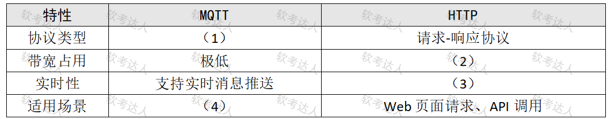

# 物联网设备管理平台-边云协同与MQTT案例

## 原题（网站题号 153～155 合并：试题五，25分）

**试题五（25分）**　阅读以下关于物联网设备管理平台Web架构设计的描述，回答下列问题。

【说明】某智能家居公司构建全球化设备管理平台：支持百万级传感器与智能设备实时数据采集与控制。需求：(1)低延迟——设备指令响应≤1秒；(2)高可用——设备控制不可中断；(3)本地化计算——部分数据处理需在本地完成。团队采用边缘计算节点+中心云架构，使用MQTT协议实现设备通信。

| 网站题号 | 小问 | 分值 |
|---|---|---|
| 153 | 问题1（12分）：300字内简述边云协同包括哪些内容 | 12 |
| 154 | 问题2（8分）：MQTT与HTTP在物联网设备通信中的优缺点填表 | 8 |
| 155 | 问题3（5分）：如何确保物联网设备的身份认证与指令安全性 | 5 |

## 图示（原图，未覆盖）

## 来源答案与解析（网站原文）

- 题153：六类协同（资源/数据/智能/应用管理/业务管理/服务，见台账 analysis-153.json）。（解析：无）
- 题154：（1）轻量级发布-订阅协议；（2）较高（需频繁建立TCP连接）；（3）基于轮询，延迟高；（4）设备状态监控、传感器数据上报。（解析：无）
- 题155：X.509双向认证/OAuth 2.0 Token验证/TLS加密/HMAC或数字签名/黑白名单五条。（解析：无）

## 核验答案（考场作答）

### 【问题1】（12分）

**考场答案**（300字内）：①资源协同——边缘节点提供本地计算、存储及网络资源管理，同时接受云端统一调度，实现资源动态分配；②数据协同——边缘采集并初步处理终端数据，按规则筛选上传云端，云端负责长期存储与深度分析，形成分层数据流转路径降低传输成本；③智能协同——边缘执行AI模型推理，云端进行模型训练并更新边缘端，形成分布式智能闭环；④应用管理协同——边缘部署应用并管理运行，云端提供开发、测试及全局应用生命周期管理；⑤业务管理协同——边缘承载模块化应用或数字孪生实例，云端按需编排跨边缘-云业务流程；⑥服务协同——边缘按云端策略提供部分服务，云端统筹服务分布策略与核心能力，实现按需服务供给。

**采分要点**：六类各2分（推定）。

**详细解析**：边云协同六分法（资源/数据/智能/应用/业务/服务）。判别锚点：凡“边缘做初步、云端做全局”的双层分工描述都归入对应协同类。与题80（边缘vs集中式）、题140（Service Mesh）共同构成云边体系。

**常见失分表达**：只答“资源+数据”两类；漏“智能协同”。

**知识点链接**：[云边协同架构](https://github.com/Goodyzhang/ruankao.skill/blob/main/materials/%E7%B3%BB%E7%BB%9F%E6%9E%B6%E6%9E%84%E8%AE%BE%E8%AE%A1%E5%B8%88/%E7%AC%94%E8%AE%B0/%E7%9F%A5%E8%AF%86%E7%82%B9/14-%E4%BA%91%E5%8E%9F%E7%94%9F%E6%9E%B6%E6%9E%84%E8%AE%BE%E8%AE%A1%E7%90%86%E8%AE%BA%E4%B8%8E%E5%AE%9E%E8%B7%B5.md)、[物联网层次架构](https://github.com/Goodyzhang/ruankao.skill/blob/main/materials/%E7%B3%BB%E7%BB%9F%E6%9E%B6%E6%9E%84%E8%AE%BE%E8%AE%A1%E5%B8%88/%E7%AC%94%E8%AE%B0/%E7%9F%A5%E8%AF%86%E7%82%B9/13-%E5%B1%82%E6%AC%A1%E5%BC%8F%E6%9E%B6%E6%9E%84%E8%AE%BE%E8%AE%A1%E7%90%86%E8%AE%BA%E4%B8%8E%E5%AE%9E%E8%B7%B5.md)

### 【问题2】（8分）

**考场答案**：协议类型——MQTT轻量级发布-订阅协议 vs HTTP请求-响应协议；带宽占用——MQTT极低 vs HTTP较高（需频繁建立TCP连接）；实时性——MQTT支持实时消息推送 vs HTTP基于轮询、延迟高；适用场景——MQTT设备状态监控、传感器数据上报 vs HTTP Web页面请求、API调用。

**采分要点**：四空各2分（推定）。

**详细解析**：MQTT三板斧：发布订阅模型（解耦）、极小报文（省带宽）、长连接推送（实时）。IoT选型判据=设备资源受限+弱网+海量连接。

**常见失分表达**：(1)漏“发布-订阅”；(3)漏“轮询”机制词。

**知识点链接**：[消息协议（MQTT）](https://github.com/Goodyzhang/ruankao.skill/blob/main/materials/%E7%B3%BB%E7%BB%9F%E6%9E%B6%E6%9E%84%E8%AE%BE%E8%AE%A1%E5%B8%88/%E7%AC%94%E8%AE%B0/%E7%9F%A5%E8%AF%86%E7%82%B9/06-%E6%95%B0%E6%8D%AE%E5%BA%93%E8%AE%BE%E8%AE%A1%E5%9F%BA%E7%A1%80%E7%9F%A5%E8%AF%86.md)

### 【问题3】（5分）

**考场答案**：①X.509证书——设备与边缘节点双向认证；②OAuth 2.0——中心云通过Token验证设备身份；③TLS加密——传输层加密指令数据；④指令签名——使用HMAC或数字签名验证指令来源；⑤黑白名单机制——限制设备仅访问特定API端点。

**采分要点**：五条各1分（推定）。

**详细解析**：IoT安全纵深：设备身份（证书/Token）→通道（TLS）→内容（签名防篡改防伪造）→访问控制（黑白名单）。

**常见失分表达**：漏“双向”认证或“HMAC签名”。

**知识点链接**：[安全架构设计理论与实践（IoT安全）](https://github.com/Goodyzhang/ruankao.skill/blob/main/materials/%E7%B3%BB%E7%BB%9F%E6%9E%B6%E6%9E%84%E8%AE%BE%E8%AE%A1%E5%B8%88/%E7%AC%94%E8%AE%B0/%E7%9F%A5%E8%AF%86%E7%82%B9/18-%E5%AE%89%E5%85%A8%E6%9E%B6%E6%9E%84%E8%AE%BE%E8%AE%A1%E7%90%86%E8%AE%BA%E4%B8%8E%E5%AE%9E%E8%B7%B5.md)

## 来源与身份

- 题源：软考达人·第二十二章 案例分析/第一节 案例分析，网站题号153～155（网站分类“第二十二章 案例分析”保留为来源位置，章节路由按实际考点匹配教材章（第2版20章体系）。）
- 年份/卷别未核实，按 web-bank 处理；分值加和 12+8+5=25 与“试题五（25分）”一致。
- 图示：MQTT vs HTTP对比表原图已下载并实际看图核对四空行列。
