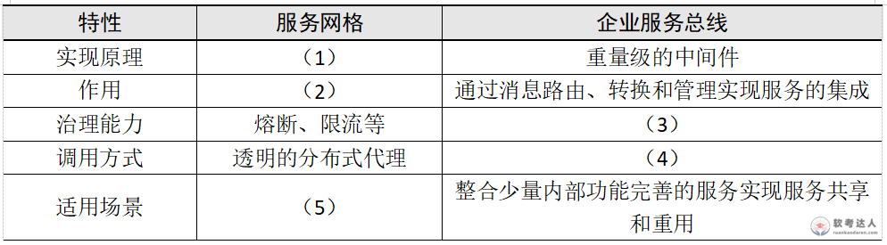

# 电商在线购物-REST容器化与服务网格案例

## 原题（网站题号 109～111 合并：试题五，25分）

**试题五（25分）**　阅读以下关于Web应用开发的描述，在答题纸上回答问题1至问题3。

【说明】某大型电商平台开发全新在线购物系统（商品选择、购物流程、智能推荐、物流跟踪），应对高并发、海量数据、快速业务变化，采用微服务架构（用户中心/商品管理/订单处理/支付/物流跟踪/推荐系统等服务）。团队遇到微服务间通信与数据一致性管理、高性能下快速迭代扩展的挑战。王工提出RESTful API通信+分布式缓存优化性能；张工建议引入服务治理框架和容器化技术增强稳定性与可扩展性。

| 网站题号 | 小问 | 分值 |
|---|---|---|
| 109 | 问题1（10分）：200字以内说明微服务架构中RESTful API的优势 | 10 |
| 110 | 问题2（10分）：300字以内阐述容器化技术在微服务架构中的作用 | 10 |
| 111 | 问题3（5分）：服务网格与ESB差异填表 | 5 |

## 图示（原图，未覆盖）

## 来源答案与解析（网站原文）

- 题109：RESTful优势五条。（解析：无）
- 题110：容器化作用五条（环境一致性/资源隔离/快速部署伸缩/简化运维/提升效率）。（解析：无）
- 题111：（1）轻量级的基础设施层；（2）剥离并确保微服务间的通信、安全、监控和治理；（3）服务注册与管理、负载均衡、容错等；（4）指定的调用接口；（5）服务数量众多、通信复杂且需要高可靠性和安全性的云应用。（解析：无）

## 核验答案（考场作答）

### 【问题1】（10分）

**考场答案**（200字内）：①提供了标准的通信方式，微服务间基于HTTP协议通信，简化服务间集成；②使用统一的资源标识和操作方法（GET/POST/PUT/DELETE），服务间交互直观易懂；③支持无状态通信，每个请求包含足够信息供服务器处理，无需跨请求维护状态；④支持缓存，通过HTTP头信息控制缓存行为，提高系统性能；⑤易于扩展，可随业务发展轻松添加新的资源和方法。

**采分要点**：五条各2分（推定）。

**详细解析**：与题14（REST vs gRPC）互补：REST的本命优势=标准HTTP+无状态+缓存+生态。无状态与水平伸缩直接挂钩题干“快速迭代扩展”。

**常见失分表达**：漏“无状态”或“缓存”两条机制点。

**知识点链接**：[微服务通信](https://github.com/Goodyzhang/ruankao.skill/blob/main/materials/%E7%B3%BB%E7%BB%9F%E6%9E%B6%E6%9E%84%E8%AE%BE%E8%AE%A1%E5%B8%88/%E7%AC%94%E8%AE%B0/%E7%9F%A5%E8%AF%86%E7%82%B9/14-%E4%BA%91%E5%8E%9F%E7%94%9F%E6%9E%B6%E6%9E%84%E8%AE%BE%E8%AE%A1%E7%90%86%E8%AE%BA%E4%B8%8E%E5%AE%9E%E8%B7%B5.md)

### 【问题2】（10分）

**考场答案**（300字内）：①环境一致性——将微服务及其所有依赖打包成独立运行单元，确保开发/测试/生产环境一致；②资源隔离——每个微服务封装在自己的容器中，实现CPU、内存、网络等资源隔离，避免服务间资源竞争冲突；③快速部署与伸缩——部署和扩展简单高效，借助容器编排工具实现自动化部署、伸缩和管理；④简化运维——通过编排工具轻松监控服务、重启、日志收集、故障排查，提高运维效率；⑤提升效率——相比物理主机和虚拟主机，减少资源开销、优化资源利用，提升微服务效率。

**采分要点**：五条各2分（推定）。

**详细解析**：容器化的本质是“标准化交付单元+隔离”，前两条对应稳定（一致+隔离），后三条对应高效（部署/运维/资源）。与题110张工“稳定性与可扩展性”立场对应。

**常见失分表达**：漏“资源隔离”或“编排工具”。

**知识点链接**：[容器技术](https://github.com/Goodyzhang/ruankao.skill/blob/main/materials/%E7%B3%BB%E7%BB%9F%E6%9E%B6%E6%9E%84%E8%AE%BE%E8%AE%A1%E5%B8%88/%E7%AC%94%E8%AE%B0/%E7%9F%A5%E8%AF%86%E7%82%B9/14-%E4%BA%91%E5%8E%9F%E7%94%9F%E6%9E%B6%E6%9E%84%E8%AE%BE%E8%AE%A1%E7%90%86%E8%AE%BA%E4%B8%8E%E5%AE%9E%E8%B7%B5.md)

### 【问题3】（5分）

**考场答案**：实现原理——服务网格轻量级的基础设施层 vs ESB重量级的中间件；作用——服务网格剥离并确保微服务间的通信、安全、监控和治理 vs ESB通过消息路由、转换和管理实现服务的集成；治理能力——服务网格熔断、限流等 vs ESB服务注册与管理、负载均衡、容错等；调用方式——服务网格透明的分布式代理 vs ESB指定的调用接口；适用场景——服务网格服务数量众多、通信复杂且需要高可靠性和安全性的云应用 vs ESB整合少量内部功能完善的服务实现服务共享和重用。

**采分要点**：五空各1分（推定）。

**详细解析**：Mesh与ESB的本质差异：侵入方式（Sidecar透明代理 vs 中心化总线指定接口）与体量（轻量基础设施层 vs 重量中间件）。与题111前文ESB（题40 SOA）对照：ESB适合少量完善服务的集成共享，Mesh适合大量微服务的云原生治理。

**常见失分表达**：(2)漏“剥离”（Sidecar剥离业务逻辑的核心语义）；(4)写成“透明代理”（那是服务网格列）。

**知识点链接**：[Service Mesh](https://github.com/Goodyzhang/ruankao.skill/blob/main/materials/%E7%B3%BB%E7%BB%9F%E6%9E%B6%E6%9E%84%E8%AE%BE%E8%AE%A1%E5%B8%88/%E7%AC%94%E8%AE%B0/%E7%9F%A5%E8%AF%86%E7%82%B9/14-%E4%BA%91%E5%8E%9F%E7%94%9F%E6%9E%B6%E6%9E%84%E8%AE%BE%E8%AE%A1%E7%90%86%E8%AE%BA%E4%B8%8E%E5%AE%9E%E8%B7%B5.md)、[ESB](https://github.com/Goodyzhang/ruankao.skill/blob/main/materials/%E7%B3%BB%E7%BB%9F%E6%9E%B6%E6%9E%84%E8%AE%BE%E8%AE%A1%E5%B8%88/%E7%AC%94%E8%AE%B0/%E7%9F%A5%E8%AF%86%E7%82%B9/15-%E9%9D%A2%E5%90%91%E6%9C%8D%E5%8A%A1%E6%9E%B6%E6%9E%84%E8%AE%BE%E8%AE%A1%E7%90%86%E8%AE%BA%E4%B8%8E%E5%AE%9E%E8%B7%B5.md)

## 来源与身份

- 题源：软考达人·第二十二章 案例分析/第一节 案例分析，网站题号109～111（网站分类“第二十二章 案例分析”保留为来源位置，章节路由按实际考点匹配教材章（第2版20章体系）。）
- 年份/卷别未核实，按 web-bank 处理；分值加和 10+10+5=25 与“试题五（25分）”一致。
- 图示：Mesh vs ESB 对比表原图已下载并实际看图核对五空行列。
