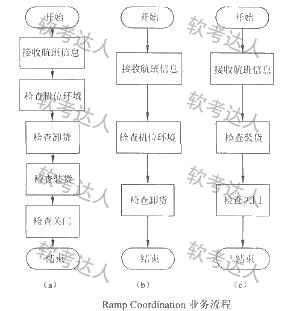
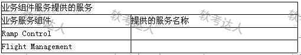
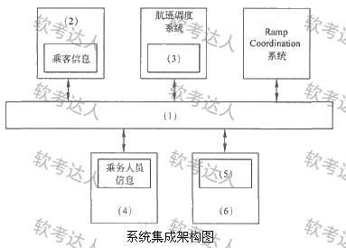
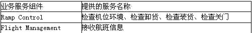

# Ramp Coordination ESB集成案例

## 原题（网站题号 214：Ramp Coordination ESB集成）

**试题**　阅读以下关于企业应用系统集成架构设计的说明，回答问题。
【说明】
某航空公司希望对构建于上世纪七八十年代的主要业务系统进行改造与集成，提高企业的竞争力。由于集成过程非常复杂，公司决定首先以Ramp Coordination系统为例进行集成过程的探索与验证。
在航空业中，Ramp Coordination是指飞机从降落到起飞过程中所需要进行的各种业务活动的协调过程。通常每个航班都有一位员工负责Ramp Coordination（Ramp Coordinator），协调的业务活动包括检查机位环境、卸货和装货等。
由于航班类型、机型的不同，Ramp Coordination的流程有很大差异（短期中转航班/到达航班/离港航班三类流程，可进一步细分）。
为完成上述业务，Ramp Coordination信息系统需要从乘务人员管理系统中提取航班乘务员的信息、从订票系统中提取乘客信息、从机务人员管理系统中提取机务人员信息、接收来自航班调度系统的航班到达事件。其中乘务人员管理系统和航班调度系统运行在大型主机系统中，机务人员管理系统运行在Unix操作系统之上，订票系统基于Java语言，具有Web界面，运行在Linux操作系统之上。
目前Ramp Coordination信息系统主要由人工完成所有协调工作，效率低且容易出错。公司领导要求集成后的系统能够针对不同需求迅速开展业务流程，灵活、高效地完成协调任务。架构师最终采用面向服务的架构，以服务为中心进行集成。

| 网站题号 | 小问 | 分值 |
|---|---|---|
| 214 | 问题1（分值未标） | 1 |
## 图示（原图，未覆盖）

## 来源答案与解析（网站原文）
- 题214问题1：答案区文字未给出（解析提示按题干总结两组件对外服务并归类）。
问题2：ESB定义（传统中间件技术与XML、Web服务结合的产物，支持异构系统集成；基于内容的路由和过滤，具备复杂数据传输能力，提供标准接口）；五功能（服务位置透明性/传输协议转换/消息格式转换/消息路由/消息增强/安全性/监控与管理中取五）；图中：(1)企业服务总线 (2)订票系统 (3)航班到达事件 (4)乘务人员系统 (5)机务人员信息 (6)机务人员管理系统。

## 核验答案（考场作答）
### 【问题1】服务建模填表

**考场答案要点**（网站答案区文字未给出，按解析提示与题干整理）：Ramp Control组件提供的服务：检查机位环境、卸货和装货、航班协调等业务活动服务；Flight Management组件提供的服务：航班日程管理、乘客信息管理、乘务/机务人员信息提取、航班到达事件接收等信息类服务。（网站以表图承载，权威填表内容以原题为准。）

**详细解析**：SOA服务建模=从业务流程提取服务组件并整理对外服务清单。两组件按“业务活动（Ramp Control）/信息管理（Flight Management）”分野，与题40服务粒度原则呼应。

**知识点链接**：[SOA服务建模](https://github.com/Goodyzhang/ruankao.skill/blob/main/materials/%E7%B3%BB%E7%BB%9F%E6%9E%B6%E6%9E%84%E8%AE%BE%E8%AE%A1%E5%B8%88/%E7%AC%94%E8%AE%B0/%E7%9F%A5%E8%AF%86%E7%82%B9/15-%E9%9D%A2%E5%90%91%E6%9C%8D%E5%8A%A1%E6%9E%B6%E6%9E%84%E8%AE%BE%E8%AE%A1%E7%90%86%E8%AE%BA%E4%B8%8E%E5%AE%9E%E8%B7%B5.md)

### 【问题2】ESB定义、功能与填图

**考场答案**（200字内定义）：企业服务总线（ESB）是传统中间件技术与XML、Web服务等技术结合的产物，主要支持异构系统集成；ESB基于内容的路由和过滤，具备复杂数据的传输能力，并可以提供一系列的标准接口。五个主要功能：①服务位置透明性；②传输协议转换；③消息格式转换；④消息路由；⑤消息增强（另有安全性、监控与管理可答）。填图：(1)企业服务总线；(2)订票系统；(3)航班到达事件；(4)乘务人员系统；(5)机务人员信息；(6)机务人员管理系统。

**采分要点**：定义约1/3分值＋五功能约1/3＋填图约1/3（未标分值，训练推定）。

**详细解析**：ESB七功能取五即可；填图按数据流向：订票系统(2)提供乘客信息、航班调度(3)航班到达事件、乘务人员系统(4)与机务人员系统(6)分别供乘务/机务信息(5)，均经ESB(1)接入。与题40/111三题互证。

**常见失分表达**：五功能漏“位置透明性”；填图(3)误填“航班调度系统”（该空要的是数据“航班到达事件”）。

**知识点链接**：[ESB定义与功能](https://github.com/Goodyzhang/ruankao.skill/blob/main/materials/%E7%B3%BB%E7%BB%9F%E6%9E%B6%E6%9E%84%E8%AE%BE%E8%AE%A1%E5%B8%88/%E7%AC%94%E8%AE%B0/%E7%9F%A5%E8%AF%86%E7%82%B9/15-%E9%9D%A2%E5%90%91%E6%9C%8D%E5%8A%A1%E6%9E%B6%E6%9E%84%E8%AE%BE%E8%AE%A1%E7%90%86%E8%AE%BA%E4%B8%8E%E5%AE%9E%E8%B7%B5.md)

## 来源与身份（待核验记录说明）

- 题源：软考达人·第二十二章 案例分析/第一节 案例分析，网站题号214（网站分类“第二十二章 案例分析”保留为来源位置，章节路由按实际考点匹配教材章（第2版20章体系）。）
- 年份/卷别未核实，按 web-bank 处理。两问分值未标。
