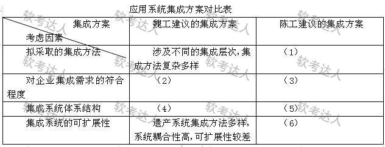

# 企业应用集成-EAI与SOA方案对比案例

## 原题（网站题号 40～42 合并：试题一，25分）

**试题一（25分）**　阅读以下关于企业应用集成的叙述，根据要求回答问题。

【说明】某大型企业随着信息化的进展，积累了许多异构的遗产信息系统，这些系统分别采用J2EE、.NET等技术进行开发，分布在不同的地理位置，采用不同的协议进行数据传输。企业要求集成后的系统能够实现功能整合，并在组织现有功能的基础上提供增值服务。FT软件开发公司承接了某大型企业应用系统集成任务。项目组提出两种集成思路：魏工建议采用传统的应用集成方法，将应用集成分为多个层次，并采用消息代理中间件连接遗产系统；陈工建议采用基于SOA的方法进行应用集成，将现有遗产系统采用Web Service的方式进行包装，暴露统一格式的接口，并采用企业服务总线(ESB)进行连接。项目组认为两种建议都合理，结合当前项目实际情况，最后决定采用陈工的建议。

| 网站题号 | 小问 | 分值 |
|---|---|---|
| 40 | 问题1（12分）：分析比较两种集成方案的优点和不足，填表（ ）～（6） | 12 |
| 41 | 问题2（9分）：300字以内列举3种基于SOA的企业集成“数据整合——信息服务”并简要说明 | 9 |
| 42 | 问题3（4分）：300字以内说明构建SOA架构时服务构建需重点关注的问题 | 4 |

## 图示（原图，未覆盖）

## 来源答案与解析（网站原文）

- 题40：网站“正确答案”区为空、解析为“略”——问题1六空由模型按教程核验作答（见下方核验答案与rubric来源标注）。
- 题41：联邦服务/复制服务/转换服务/搜索服务四种，任选三条（解析：略）。
- 题42：服务构建两点注意：①服务粒度的控制；②无状态服务的设计（解析：略）。

## 核验答案（考场作答）

### 【问题1】（12分）

**考场答案**：填表六空——(1)陈工拟采取的集成方法：基于SOA的应用集成方法，将遗产系统用Web Service包装、暴露统一格式接口，并采用ESB连接；(2)魏工方案对企业集成需求符合程度：能实现功能整合，但集成层次多、方法复杂多样，增值服务能力弱，符合程度一般；(3)陈工方案对企业集成需求符合程度：既实现功能整合，又能在现有功能基础上提供增值服务，符合程度高；(4)魏工方案集成系统体系结构：以消息代理中间件为中心连接各遗产系统的中心化（星型）架构；(5)陈工方案集成系统体系结构：基于ESB的总线型体系结构，服务松耦合接入；(6)陈工方案集成系统可扩展性：统一接口+总线连接，耦合度低，新增服务只需接入ESB，可扩展性好。

**采分要点**：六空各2分（推定）；方法/符合度×2/体系结构×2/可扩展性成对作答。

**详细解析**：EAI vs SOA 对比的四把尺子——集成方法（层次多样消息代理 vs Web Service统一接口+ESB）、需求符合（功能整合 vs 功能整合+增值服务）、体系结构（中心化星型 vs 总线型）、可扩展性（耦合高差 vs 耦合低好）。魏工方案的星型结构里消息代理是单点与性能瓶颈；ESB总线上服务即插即用，这正是“增值服务”与“可扩展”的来源。

**常见失分表达**：(2)(3)只写“符合/不符合”没有展开增值服务差异；(4)(5)体系结构词缺失（星型/总线）；(6)漏“耦合度低”机制句。

**知识点链接**：[企业服务总线模式](https://github.com/Goodyzhang/ruankao.skill/blob/main/materials/%E7%B3%BB%E7%BB%9F%E6%9E%B6%E6%9E%84%E8%AE%BE%E8%AE%A1%E5%B8%88/%E7%AC%94%E8%AE%B0/%E7%9F%A5%E8%AF%86%E7%82%B9/15-%E9%9D%A2%E5%90%91%E6%9C%8D%E5%8A%A1%E6%9E%B6%E6%9E%84%E8%AE%BE%E8%AE%A1%E7%90%86%E8%AE%BA%E4%B8%8E%E5%AE%9E%E8%B7%B5.md)、[企业应用集成 EAI](https://github.com/Goodyzhang/ruankao.skill/blob/main/materials/%E7%B3%BB%E7%BB%9F%E6%9E%B6%E6%9E%84%E8%AE%BE%E8%AE%A1%E5%B8%88/%E7%AC%94%E8%AE%B0/%E7%9F%A5%E8%AF%86%E7%82%B9/06-%E6%95%B0%E6%8D%AE%E5%BA%93%E8%AE%BE%E8%AE%A1%E5%9F%BA%E7%A1%80%E7%9F%A5%E8%AF%86.md)

### 【问题2】（9分）

**考场答案**（300字内，任选三种）：①**联邦服务**：提供将各种类型的数据聚合的能力，既支持关系型数据，也支持XML、文本和内容数据等非关系型数据，所有数据仍按自身方式管理；②**复制服务**：提供远程数据的本地访问能力，通过自动的实时复制和数据转换在本地维护数据源副本，本地数据和数据源在技术实现上可以独立；③**转换服务**：用于数据源格式到目标格式的转换，可以是批量的或基于记录的。（备选④**搜索服务**：提供对企业数据的查询和检索服务，既支持数据库等结构化数据，也支持PDF等非结构化数据。）

**采分要点**：任答三条各3分（推定）：服务名+能力描述。

**详细解析**：四种信息服务的判别词——聚合异构源=联邦；本地副本=复制；格式变换=转换；查检索=搜索。答题时“服务名+一句机制”即可，注意联邦的“数据仍按自身方式管理”（不动原库）与复制的“维护副本”（动了存储）区别。

**常见失分表达**：只写服务名没有说明；四种混写定义（复制与联邦混淆）。

**知识点链接**：[SOA 参考架构（信息服务）](https://github.com/Goodyzhang/ruankao.skill/blob/main/materials/%E7%B3%BB%E7%BB%9F%E6%9E%B6%E6%9E%84%E8%AE%BE%E8%AE%A1%E5%B8%88/%E7%AC%94%E8%AE%B0/%E7%9F%A5%E8%AF%86%E7%82%B9/15-%E9%9D%A2%E5%90%91%E6%9C%8D%E5%8A%A1%E6%9E%B6%E6%9E%84%E8%AE%BE%E8%AE%A1%E7%90%86%E8%AE%BA%E4%B8%8E%E5%AE%9E%E8%B7%B5.md)

### 【问题3】（4分）

**考场答案**（300字内）：基于SOA构建企业级系统架构时，除细致分析整理原有系统架构中的集成需求外，服务构建还需重点关注两点：①对**服务粒度**的控制；②对**无状态服务**的设计。

**采分要点**：两点各2分（推定）。

**详细解析**：粒度过粗→复用性差灵活性低，过细→调用开销与治理复杂度激增，须按业务能力切分；无状态→任意实例可处理任意请求，支撑水平扩展与故障迁移，状态外置到数据库/缓存。这两点与教程§15.7设计原则、§14微服务“单一职责+无状态”一脉相承。

**常见失分表达**：只写“注意服务划分”没有“粒度”术语；漏“无状态”。

**知识点链接**：[SOA 设计原则](https://github.com/Goodyzhang/ruankao.skill/blob/main/materials/%E7%B3%BB%E7%BB%9F%E6%9E%B6%E6%9E%84%E8%AE%BE%E8%AE%A1%E5%B8%88/%E7%AC%94%E8%AE%B0/%E7%9F%A5%E8%AF%86%E7%82%B9/15-%E9%9D%A2%E5%90%91%E6%9C%8D%E5%8A%A1%E6%9E%B6%E6%9E%84%E8%AE%BE%E8%AE%A1%E7%90%86%E8%AE%BA%E4%B8%8E%E5%AE%9E%E8%B7%B5.md)

## 来源与身份

- 题源：软考达人·第二十二章 案例分析/第一节 案例分析，网站题号40～42（网站分类保留为来源位置，章节路由按实际考点匹配教材章）
- 年份/卷别未核实，按 web-bank 处理；分值加和 12+9+4=25 与“试题一（25分）”一致。
- **问题1六空为模型核验作答**（网站正确答案区空、解析“略”），rubric逐点标注来源等级；问题2/3为网站参考答案。
- 图示：对比表原图未覆盖；本记录为v2更新（v1仅含问题1且为pending），问题2/3来自网站题号41/42（同案扩展）。
