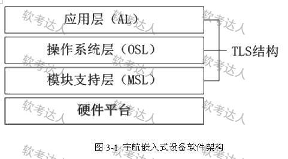
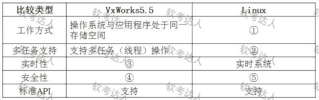

# 宇航嵌入式-TLS三层栈架构案例

## 原题（网站题号 37～39 合并：试题三，25分）

**试题三（25分）**　阅读以下关于嵌入式软件体系架构的叙述，在答题纸上回答问题1至问题3。

【说明】某公司承担宇航嵌入式设备研制任务，要求支持：（ ）设备由多个处理机模块组成，需要时外场可快速更换（LRM结构）；（ ）应用软件与硬件无关，便于软硬件升级；（ ）支持不同功能任务间的数据隔离；（ ）可靠性要求高，系统要有故障处理能力。公司经论证提出三层栈（TLS）软件总体架构（图3-1），并将软件设计工作交给李工。

| 网站题号 | 小问 | 分值 |
|---|---|---|
| 37 | 问题1（8分）：150字以内说明TLS架构层次特点，并针对功能需求说明各层内涵 | 8 |
| 38 | 问题2（10分）：VxWorks vs Linux差异填表3-1（①～⑤），并200字以内说明选择操作系统类型和理由 | 10 |
| 39 | 问题3（7分）：150字以内说明嵌入式系统故障分类，并分别给出两种常用故障滤波算法和容错算法 | 7 |

## 图示（原图，未覆盖）

## 来源答案与解析（网站原文）

- 题37：TLS四条特点+三层内涵。（解析：无）
- 题38：选择Linux三条理由；表3-1五空网站答案文字未含表格内容（“见下表”），五空按表图行目与教材核验作答，已在台账 analysis-38.json 标注来源。（解析：无）
- 题39：故障三分类+滤波算法四种+容错算法四种。（解析：无）

## 核验答案（考场作答）

### 【问题1】（8分）

**考场答案**（150字内）：TLS特点：应用软件仅与操作系统服务相关、不直接操作硬件；操作系统经模块支持层访问硬件、与具体硬件无关；模块支持层将硬件抽象成标准操作；三层栈实现硬件快速更改升级且应用升级不引起硬件变更。各层内涵：应用层完成设备具体工作、多功能任务间隔离由OS层实现；操作系统层隔离应用与硬件、提供标准API（POSIX）；模块支持层以抽象标准接口统一管理硬件资源、支持外场快速更换。

**采分要点**：特点2分＋三层层涵各2分（推定）；各层内涵须挂钩题干需求（LRM/软硬件无关/数据隔离/故障处理）。

**详细解析**：需求→层的映射是本题灵魂：LRM快速更换→模块支持层抽象接口；应用与硬件无关→OS层标准API；数据隔离→OS层任务隔离；故障处理→分层容错。TLS本质是把“变化的方向”分层隔离——硬件变只动MSL，应用变只动AL。

**常见失分表达**：只背三层名称不挂需求；把“数据隔离”答到应用层（隔离由OS实现）。

**知识点链接**：[嵌入式系统架构设计理论与实践（TLS三层栈）](https://github.com/Goodyzhang/ruankao.skill/blob/main/materials/%E7%B3%BB%E7%BB%9F%E6%9E%B6%E6%9E%84%E8%AE%BE%E8%AE%A1%E5%B8%88/%E7%AC%94%E8%AE%B0/%E7%9F%A5%E8%AF%86%E7%82%B9/16-%E5%B5%8C%E5%85%A5%E5%BC%8F%E7%B3%BB%E7%BB%9F%E6%9E%B6%E6%9E%84%E8%AE%BE%E8%AE%A1%E7%90%86%E8%AE%BA%E4%B8%8E%E5%AE%9E%E8%B7%B5.md)

### 【问题2】（10分）

**考场答案**：表3-1：①Linux工作方式=操作系统与应用程序处于不同存储空间（内核态/用户态）；②Linux多任务支持=支持多任务（进程/线程）操作；③VxWorks实时性=实时系统（硬实时）；④VxWorks安全性=OS与应用程序同一存储空间、无隔离；⑤Linux安全性=内核态与用户态隔离、安全性较强。选择：类似Linux的嵌入式操作系统。理由：①Linux安全性较强，内核工作在系统态、应用软件工作在用户态，有效防止应用软件破坏操作系统；②Linux调度最小单位是线程、线程归属进程，进程具有独立资源，通过MMU实现多功能应用间隔离；③嵌入式Linux支持硬件抽象，可实现TLS结构并将硬件抽象与OS分离，方便硬件外场快速更换。

**采分要点**：五空各1分＋结论1分＋理由4分（推定）。

**详细解析**：分歧的实质是“实时性优先 vs 隔离安全优先”。VxWorks是微内核单地址空间（快但无隔离），Linux有用户态/内核态+MMU进程隔离（慢但安全）。本案例四条需求里“数据隔离”+“故障处理”直接指向隔离能力，故总工程师的Linux方案胜出——选型必须落回题干需求，这是案例题不变的判卷逻辑。

**常见失分表达**：表格五空答反列（①④⑤张冠李戴）；理由不挂钩题干四条需求。

**知识点链接**：[嵌入式操作系统（VxWorks vs Linux）](https://github.com/Goodyzhang/ruankao.skill/blob/main/materials/%E7%B3%BB%E7%BB%9F%E6%9E%B6%E6%9E%84%E8%AE%BE%E8%AE%A1%E5%B8%88/%E7%AC%94%E8%AE%B0/%E7%9F%A5%E8%AF%86%E7%82%B9/16-%E5%B5%8C%E5%85%A5%E5%BC%8F%E7%B3%BB%E7%BB%9F%E6%9E%B6%E6%9E%84%E8%AE%BE%E8%AE%A1%E7%90%86%E8%AE%BA%E4%B8%8E%E5%AE%9E%E8%B7%B5.md)

### 【问题3】（7分）

**考场答案**（150字内）：故障分类：①硬件故障（如CPU、存储器、定时器等）；②应用软件故障（如数值越界、异常、超时等）；③操作系统故障（如越权访问、死锁、资源枯竭等）。滤波算法（两种）：门限算法、周期滤波算法（另有递减/递增算法）。容错算法（两种）：N+1备份、热备（另有冷备/温备）。

**采分要点**：分类3分（三类各1）＋滤波2分＋容错2分（推定）。

**详细解析**：滤波算法处理“数据级毛刺”（门限限幅、递增/递减限速、周期平均），容错算法处理“部件级失效”（备份切换四档：冷备最慢但省资源、热备最快）。题面要求“分别给出两种”，清单背全再任选即可。

**常见失分表达**：滤波与容错算法互相串场；故障分类漏“操作系统故障”。

**知识点链接**：[嵌入式系统故障处理（滤波与容错）](https://github.com/Goodyzhang/ruankao.skill/blob/main/materials/%E7%B3%BB%E7%BB%9F%E6%9E%B6%E6%9E%84%E8%AE%BE%E8%AE%A1%E5%B8%88/%E7%AC%94%E8%AE%B0/%E7%9F%A5%E8%AF%86%E7%82%B9/16-%E5%B5%8C%E5%85%A5%E5%BC%8F%E7%B3%BB%E7%BB%9F%E6%9E%B6%E6%9E%84%E8%AE%BE%E8%AE%A1%E7%90%86%E8%AE%BA%E4%B8%8E%E5%AE%9E%E8%B7%B5.md)、[软件可靠性基础知识](https://github.com/Goodyzhang/ruankao.skill/blob/main/materials/%E7%B3%BB%E7%BB%9F%E6%9E%B6%E6%9E%84%E8%AE%BE%E8%AE%A1%E5%B8%88/%E7%AC%94%E8%AE%B0/%E7%9F%A5%E8%AF%86%E7%82%B9/09-%E8%BD%AF%E4%BB%B6%E5%8F%AF%E9%9D%A0%E6%80%A7%E5%9F%BA%E7%A1%80%E7%9F%A5%E8%AF%86.md)

## 来源与身份

- 题源：软考达人·第二十二章 案例分析/第一节 案例分析，网站题号37～39（网站分类“第二十二章 案例分析”保留为来源位置，章节路由按实际考点匹配教材章（第2版20章体系）。）
- 年份/卷别未核实，按 web-bank 处理；分值加和 8+10+7=25 与“试题三（25分）”一致。
- 图示：TLS架构图与OS对比表原图已下载并实际看图核对；表3-1五空为模型按教材核验作答（网站未给文字答案），已在台账与rubric标注来源等级。
