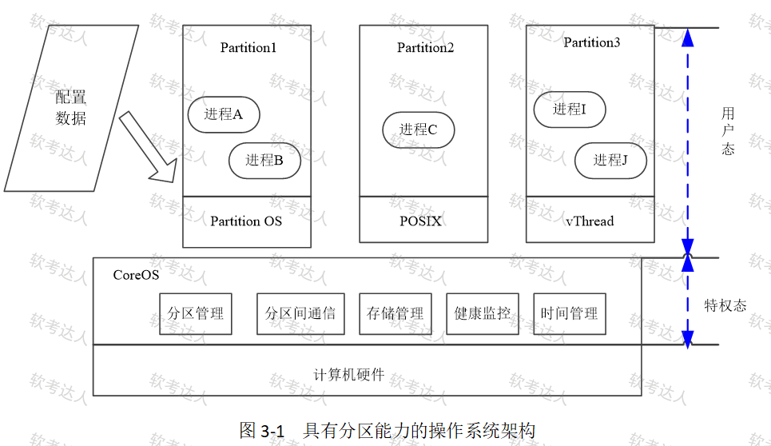
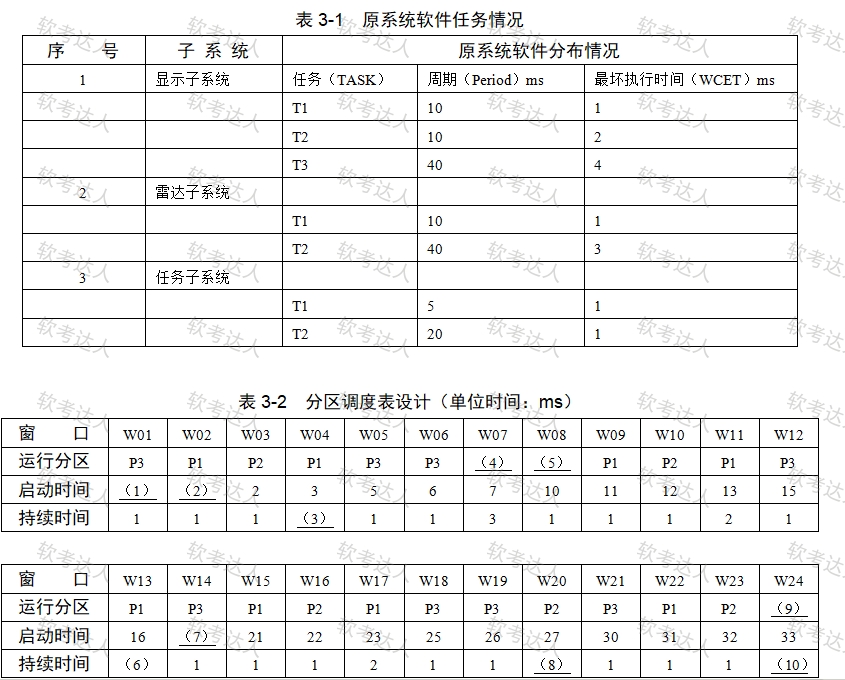

# 宇航计算机-分区化操作系统案例

## 原题（网站题号 107～108：分区化操作系统，分值未标）

**试题**　请详细阅读有关嵌入式实时操作系统方面的描述，回答问题1至问题2。

【说明】分区化（Partitioning）技术广泛应用于大型嵌入式系统，解决多类应用软件共享计算机资源的安全性问题。某公司承担宇航计算机系统研制任务：多处理机精简为单处理器、功能不变、可灵活扩展、原应用软件快速移植。王工认为宇航系统强调安全性，应采用具有分区能力的操作系统（如VxWorks653）。

| 网站题号 | 小问 | 分值 |
|---|---|---|
| 107 | 问题1：300字内说明分区化技术的主要特点 | 未标 |
| 108 | 问题2：根据表3-1任务周期与WCET数据完善表3-2分区调度表，填空(1)～(10)（Tick=1ms，主时间框架40ms） | 未标 |

## 图示（原图，未覆盖）

## 来源答案与解析（网站原文）

- 题107：六特点（特权级隔离/分区空间隔离/多API便于移植/时间表调度窗口/健康监控/不同安全等级共享与验证最小化局部化）。（解析：无）
- 题108：可调度性条件+十空答案（详见台账 analysis-108.json）。（解析：无）

## 核验答案（考场作答）

### 【问题1】分区化技术主要特点

**考场答案**（300字内）：①应用软件代码和操作系统代码工作在处理器的不同特权级别上，应用软件的失效不会影响操作系统的运行；②每一个分区有自己私有存储资源，分区所占空间相互隔离，分区内某进程的失效仅影响所在分区；③操作系统可为分区内应用软件提供多种类型的API服务，原有应用软件可方便地移植到分区内运行；④分区的调度按预先配置好的时间表进行，任何分区只能在分配给它的时间窗口内运行，不能占用其他分区的窗口时间；⑤操作系统提供健康监控管理能力，通过故障监测机制将应用、分区和系统的错误经注入机制报告健康监控系统统一处理；⑥允许不同安全等级的应用软件共享计算机资源，可实现软件验证的最小化和局部化。

**采分要点**：六特点（分值未标，训练口径六等分）。

**详细解析**：分区化两隔离：空间隔离（内存分区）+时间隔离（时间窗调度），再加健康监控。与题38（VxWorks5.5无隔离 vs Linux）、题175（TLS）构成宇航OS三题族。需求映射：LRM/数据隔离/故障处理←时间空间隔离；快速移植←多API。

**常见失分表达**：漏“健康监控”或“不同安全等级共享”。

**知识点链接**：[分区化操作系统（ARINC653/VxWorks653）](https://github.com/Goodyzhang/ruankao.skill/blob/main/materials/%E7%B3%BB%E7%BB%9F%E6%9E%B6%E6%9E%84%E8%AE%BE%E8%AE%A1%E5%B8%88/%E7%AC%94%E8%AE%B0/%E7%9F%A5%E8%AF%86%E7%82%B9/16-%E5%B5%8C%E5%85%A5%E5%BC%8F%E7%B3%BB%E7%BB%9F%E6%9E%B6%E6%9E%84%E8%AE%BE%E8%AE%A1%E7%90%86%E8%AE%BA%E4%B8%8E%E5%AE%9E%E8%B7%B5.md)

### 【问题2】可调度性分析与调度表填空

**考场答案**：可调度性判据：在主时间框架（40ms）内，系统中所有任务的最坏执行时间（WCET）均被执行至少一次。约束：1(P3T1)≤5ms；1(P1T1)+1(P2T1)≤10ms；2(P1T2)+1(P3T2)≤20ms；1(P3T1)×8+1(P1T1)×4+1(P2T1)×4+2(P1T2)×2+1(P3T2)×2+5(P1T3)×1+3(P2T2)≤40ms。调度表填空：(1)0；(2)1；(3)2；(4)P2；(5)P3；(6)4；(7)20；(8)1；(9)null；(10)7。

**采分要点**：分析约1/3分值＋十空约2/3分值（未标分值，训练推定）。

**详细解析**：ARINC653静态调度表填空法：周期越短的任务在40ms主框架内出现次数越多（P3T1周期5ms出现8次、P1T1周期10ms出现4次……），把各次执行按周期约束铺进时间线，分区间严格按窗口切换，空闲填null。空(1)~(3)是首个小窗口起点序列，(9)null是空闲窗口。

**常见失分表达**：只给填空不写可调度性约束分析；WCET合计不等式漏项。

**知识点链接**：[分区调度表](https://github.com/Goodyzhang/ruankao.skill/blob/main/materials/%E7%B3%BB%E7%BB%9F%E6%9E%B6%E6%9E%84%E8%AE%BE%E8%AE%A1%E5%B8%88/%E7%AC%94%E8%AE%B0/%E7%9F%A5%E8%AF%86%E7%82%B9/16-%E5%B5%8C%E5%85%A5%E5%BC%8F%E7%B3%BB%E7%BB%9F%E6%9E%B6%E6%9E%84%E8%AE%BE%E8%AE%A1%E7%90%86%E8%AE%BA%E4%B8%8E%E5%AE%9E%E8%B7%B5.md)

## 来源与身份（待核验记录说明）

- 题源：软考达人·第二十二章 案例分析/第一节 案例分析，网站题号107～108（网站分类“第二十二章 案例分析”保留为来源位置，章节路由按实际考点匹配教材章（第2版20章体系）。）
- **两问均未标分值**：按 pending 保存，不构造 max_score、不导出实验室；内容已完整核验（调度表答案与约束分析自洽）。
- 图示：分区OS架构图与调度表原图已下载（题面附件）。
