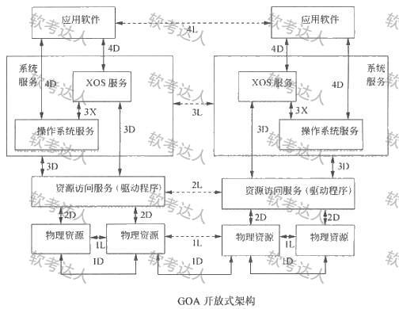
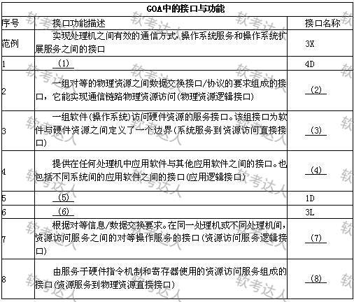
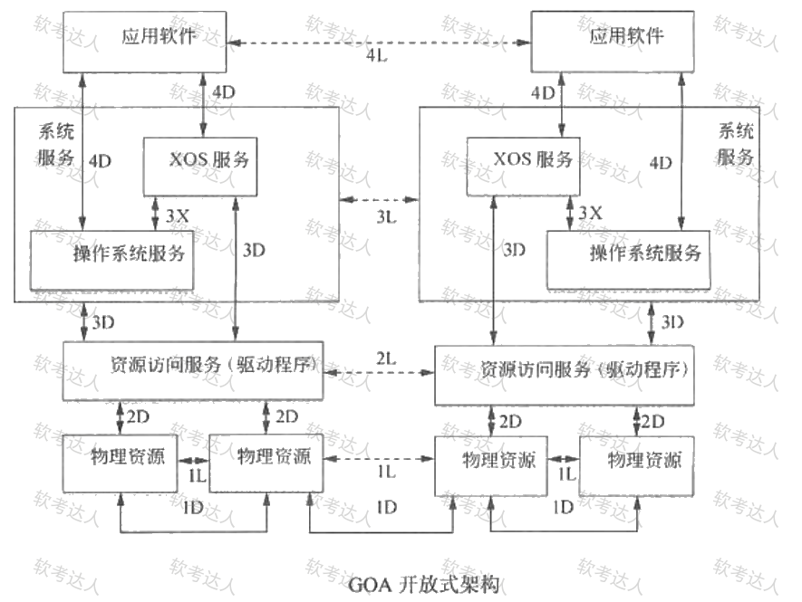
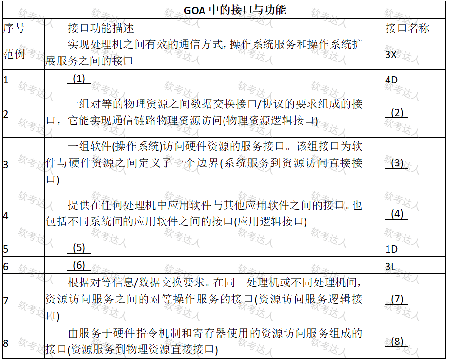
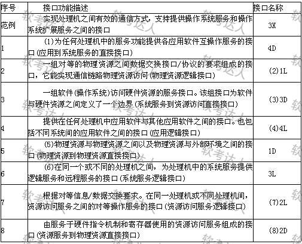

# 宇航软件-GOA开放式架构案例

## 原题（网站题号 121/131～132：GOA开放式架构，试题三25分）

**试题三（25分）**　请详细阅读有关嵌入式软件架构设计方面的描述，回答问题。

【说明】在嵌入式系统中，软件采用开放式架构已成为新的发展趋势。某软件公司主要从事宇航领域嵌入式软件研发，积累众多成熟软件但因当初未充分考虑架构而无法再利用。决策层成立宇航嵌入式软件开放式架构研究小组，研究重点集中在SAE AS4893《通用开放式架构(GOA)框架》标准。

| 网站题号 | 小问 | 分值 |
|---|---|---|
| 131（121为未标分值版本） | 问题1：300字以内说明开放式架构四个基本特点 | 9 |
| 132（121同） | 问题2：GOA接口表填空（1）～（8） | 16 |

## 图示

### GOA架构图（原图，未覆盖）

### GOA接口与功能表（题面原图，空白版）

### 带分值版的架构图与接口表（原图，未覆盖）

### 参考答案表（题121版答案载体，role=answer，不进公开题包）

## 来源答案与解析（网站原文）

- 题131（=题121问题1）：四特点（可移植/可互操作/可剪裁/易获得），原文见台账 analysis-131.json。解析：无。
- 题132（=题121问题2）：(1)为任何处理机中的服务功能提供各应用软件互操作服务的接口（应用到系统服务的直接接口）；(2)1L；(3)3D；(4)4L；(5)物理资源与物理资源之间以及物理资源与外部环境之间的接口（物理资源到物理资源直接接口）；(6)在同一个或不同的处理机之间，为处理机中的系统服务提供逻辑服务和远程服务的接口（系统服务逻辑接口）；(7)2L；(8)2D。解析：无。
- 题121：未标分值版本，其答案表图片与题132文字答案互证一致。

## 核验答案（考场作答）

### 【问题1】（9分）

**考场答案**（300字内）：①**可移植性**——各种计算机应用系统可在具有开放架构特性的各种计算机系统间进行移植，不论这些计算机是否同种型号、同种机型；②**可互操作性**——如计算机网络中的各结点机都具有开放架构特性，则网上各结点机间可相互操作和资源共享；③**可剪裁性**——低档机上运行的应用系统应能在高档机上运行，原在高档机上运行的应用系统经剪裁后也可在低档机上运行；④**易获得性**——在具有开放架构特性的机器上所运行的软件环境易于从多方获得，不受某个来源所控制。

**采分要点**：四特点各2.25分（推定）；特点名+机制半句。

**详细解析**：记忆锚——跨机器（移植）、跨结点（互操作）、跨档位（剪裁）、跨来源（易得）。与题43 AUTOSAR开放架构优点、题55 GENESYS接口互为开放式架构家族题。

**常见失分表达**：漏“可剪裁性”；与“可移植”混写。

**知识点链接**：[开放式架构（GENESYS/GOA）](https://github.com/Goodyzhang/ruankao.skill/blob/main/materials/%E7%B3%BB%E7%BB%9F%E6%9E%B6%E6%9E%84%E8%AE%BE%E8%AE%A1%E5%B8%88/%E7%AC%94%E8%AE%B0/%E7%9F%A5%E8%AF%86%E7%82%B9/16-%E5%B5%8C%E5%85%A5%E5%BC%8F%E7%B3%BB%E7%BB%9F%E6%9E%B6%E6%9E%84%E8%AE%BE%E8%AE%A1%E7%90%86%E8%AE%BA%E4%B8%8E%E5%AE%9E%E8%B7%B5.md)

### 【问题2】（16分）

**考场答案**：(1)为任何处理机中的服务功能提供各应用软件互操作服务的接口（应用到系统服务的直接接口）；(2)1L；(3)3D；(4)4L；(5)物理资源与物理资源之间以及物理资源与外部环境之间的接口（物理资源到物理资源直接接口）；(6)在同一个或不同的处理机之间，为处理机中的系统服务提供逻辑服务和远程服务的接口（系统服务逻辑接口）；(7)2L；(8)2D。

**采分要点**：八空各2分（推定）；(1)(5)(6)为描述空、(2)(3)(4)(7)(8)为名称空。

**详细解析**：D/L判别钥匙——题干“直接接口定义了信息传输方式；逻辑接口定义了对等数据交换的要求，其传输发生在一个或多个直接接口”。对照架构图：应用软件间互操作=4D/4L、物理资源直连=1D/1L、系统服务↔资源访问服务=3D/3L、资源访问服务↔物理资源=2D/2L。描述空看两端实体与“对等/直接”措辞。

**常见失分表达**：D/L判反（“对等数据交换要求”判iL）；(5)漏“与外部环境之间”。

**知识点链接**：[开放式架构接口](https://github.com/Goodyzhang/ruankao.skill/blob/main/materials/%E7%B3%BB%E7%BB%9F%E6%9E%B6%E6%9E%84%E8%AE%BE%E8%AE%A1%E5%B8%88/%E7%AC%94%E8%AE%B0/%E7%9F%A5%E8%AF%86%E7%82%B9/16-%E5%B5%8C%E5%85%A5%E5%BC%8F%E7%B3%BB%E7%BB%9F%E6%9E%B6%E6%9E%84%E8%AE%BE%E8%AE%A1%E7%90%86%E8%AE%BA%E4%B8%8E%E5%AE%9E%E8%B7%B5.md)

## 来源与身份

- 题源：软考达人·第二十二章 案例分析/第一节 案例分析，网站题号121（未标分值版）与131～132（计分版9+16=25）（网站分类保留为来源位置，章节路由按实际考点匹配教材章）
- 年份/卷别未核实，按 web-bank 处理；两版本答案互证一致。
- 图示：五张原图（v1架构图/空白表/答案表 + v2架构图/接口表）均已下载并实际看图核对；答案表以answer角色隔离。
