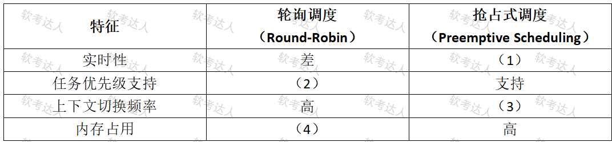

# 嵌入式实时系统机械臂案例

## 原题（网站题号 104～105～106：嵌入式实时系统机械臂）

**试题**　阅读以下关于嵌入式实时系统设计的描述，回答下列问题。
【说明】
某工业自动化公司正在开发一款基于嵌入式实时操作系统的智能控制设备，用于工厂生产线的高精度机械臂控制。系统需要满足以下要求：（ ）机械臂的运动控制任务需在10ms内响应外部传感器信号；（ ）系统需同时管理30个任务，包括高优先级的电机控制、中优先级的数据采集和低优先级的日志记录；（ ）系统内存资源有限，需合理分配任务的堆栈空间以避免溢出。
开发团队在任务调度和资源管理方案上产生分歧：张工主张采用轮询调度（Round-Robin），认为其简单易实现；李工认为应采用基于优先级的抢占式调度（Priority-based Preemptive Scheduling），以保障高实时性任务。

| 网站题号 | 小问 | 分值 |
|---|---|---|
| 104 | 问题1（9分） | 9 |
| 105 | 问题2（8分） | 8 |
| 106 | 问题3（8分） | 8 |

## 图示（原图，未覆盖）

## 来源答案与解析（网站原文）
- 题104：RTOS定义+确定性/快速中断响应/多任务调度三特性+抢占式调度/减少上下文切换开销/优先级继承/硬件加速。（解析：无）
- 题105：(1)好；(2)不支持；(3)中到高；(4)低。（解析：无）
- 题106：静态分配优缺点+动态扩展优缺点（详见台账 analysis-106.json）。（解析：无）

## 核验答案（考场作答）
### 【问题1】（9分）

**考场答案**：嵌入式实时操作系统RTOS是当外界事件或数据产生时，能够接受并以足够快的速度予以处理，其处理结果又能在规定的时间之内来控制生产过程或对处理系统作出快速响应，并控制所有实时任务协调一致运行的嵌入式操作系统。核心特性：①确定性——任务执行时间可预测；②快速中断响应——中断延迟一般低于1μs；③多任务调度——支持任务优先级和抢占式调度。提高实时性的关键技术：抢占式调度（高优先级任务可中断低优先级任务）；减少上下文切换开销（优化任务切换代码）；优先级继承协议（避免优先级反转）；硬件加速（使用专用中断控制器降低延迟）。

**采分要点**：定义3分＋三特性3分＋关键技术3分（推定）。

**详细解析**：定义句式“足够快处理+规定时间内响应+协调一致运行”；三特性与题干需求(1)(2)对应（10ms响应→确定性、30任务→多任务调度）。

**常见失分表达**：特性漏“确定性”；关键技术漏“优先级继承”。

**知识点链接**：[嵌入式实时操作系统](https://github.com/Goodyzhang/ruankao.skill/blob/main/materials/%E7%B3%BB%E7%BB%9F%E6%9E%B6%E6%9E%84%E8%AE%BE%E8%AE%A1%E5%B8%88/%E7%AC%94%E8%AE%B0/%E7%9F%A5%E8%AF%86%E7%82%B9/16-%E5%B5%8C%E5%85%A5%E5%BC%8F%E7%B3%BB%E7%BB%9F%E6%9E%B6%E6%9E%84%E8%AE%BE%E8%AE%A1%E7%90%86%E8%AE%BA%E4%B8%8E%E5%AE%9E%E8%B7%B5.md)

### 【问题2】（8分）

**考场答案**：(1)实时性——抢占式调度=好；(2)任务优先级支持——轮询调度=不支持；(3)上下文切换频率——抢占式=中到高；(4)内存占用——轮询调度=低。

**采分要点**：四空各2分（推定）。

**详细解析**：与表图行序核对：实时性（轮询差/抢占好）、优先级（轮询不支持）、切换频率（轮询高/抢占中到高）、内存（轮询低/抢占高）。轮询“切换频率高”是因为按时间片轮转空转切换多。

**常见失分表达**：(3)写成“低”（抢占仅在任务切换时发生，频率中到高）。

**知识点链接**：[任务调度机制](https://github.com/Goodyzhang/ruankao.skill/blob/main/materials/%E7%B3%BB%E7%BB%9F%E6%9E%B6%E6%9E%84%E8%AE%BE%E8%AE%A1%E5%B8%88/%E7%AC%94%E8%AE%B0/%E7%9F%A5%E8%AF%86%E7%82%B9/16-%E5%B5%8C%E5%85%A5%E5%BC%8F%E7%B3%BB%E7%BB%9F%E6%9E%B6%E6%9E%84%E8%AE%BE%E8%AE%A1%E7%90%86%E8%AE%BA%E4%B8%8E%E5%AE%9E%E8%B7%B5.md)

### 【问题3】（8分）

**考场答案**（300字内）：静态堆栈分配优点：①内存占用确定，避免动态分配的碎片化；②可预测堆栈使用，降低堆栈溢出风险。缺点：①内存浪费（任务实际使用可能远小于分配空间）；②灵活性差，难以适应任务运行时变化的需求。动态堆栈扩展优点：①内存利用率高，按需分配；②适应任务执行时的动态需求。缺点：①可能引发堆栈碎片化或溢出（需复杂管理机制）；②调度开销增加，影响实时性。

**采分要点**：两策略各4分（推定）：优点两条+缺点两条。

**详细解析**：与题干需求(3)“内存资源有限、避免溢出”呼应：静态可预测但费内存，动态省内存但有碎片与开销——实时系统倾向静态分配。

**常见失分表达**：动态缺点漏“影响实时性”。

**知识点链接**：[堆栈管理](https://github.com/Goodyzhang/ruankao.skill/blob/main/materials/%E7%B3%BB%E7%BB%9F%E6%9E%B6%E6%9E%84%E8%AE%BE%E8%AE%A1%E5%B8%88/%E7%AC%94%E8%AE%B0/%E7%9F%A5%E8%AF%86%E7%82%B9/16-%E5%B5%8C%E5%85%A5%E5%BC%8F%E7%B3%BB%E7%BB%9F%E6%9E%B6%E6%9E%84%E8%AE%BE%E8%AE%A1%E7%90%86%E8%AE%BA%E4%B8%8E%E5%AE%9E%E8%B7%B5.md)

## 来源与身份

- 题源：软考达人·第二十二章 案例分析/第一节 案例分析，网站题号104～105～106（网站分类“第二十二章 案例分析”保留为来源位置，章节路由按实际考点匹配教材章（第2版20章体系）。）
- 年份/卷别未核实，按 web-bank 处理。分值加和 9+8+8=25 与“试题三（25分）”一致。
