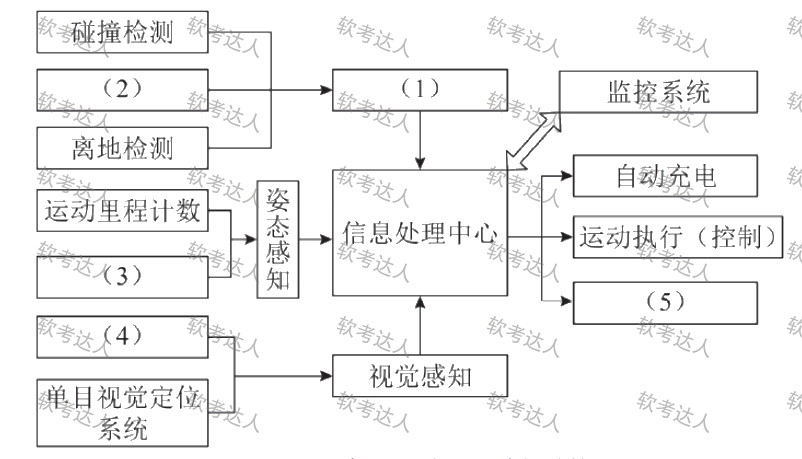
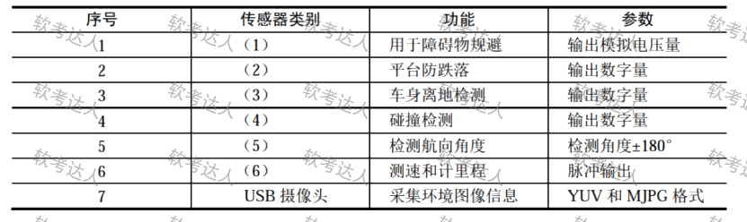

# 扫地机器人-功能结构与传感器选型案例

## 原题（网站题号 115～117 合并：试题五，25分）

**试题五（25分）**　服务型智能扫地机器人需具备自主运动规划与导航功能，通过环境信息融合感知进行行为决策。主要功能：紧急状态感知（碰撞/跌落/离地检测）、姿态感知（运动里程计数、航向测量）、视觉感知（单目视觉避障与定位系统）、自动充电、扫地及吸尘单元、运动执行、监控系统（PC/手机客户端）、信息处理中心。硬件采用ARM+STM32双核架构：STM32F103VET6负责非图像传感器驱动采集与车轮电机控制；S5PV210负责图像采集、无线网络接入、综合处理生成运动决策。

| 网站题号 | 小问 | 分值 |
|---|---|---|
| 115 | 问题1（5分）：填写功能结构图（ ）～（5） | 5 |
| 116 | 问题2（12分）：7种传感器按功能完成表3-1（ ）～（6） | 12 |
| 117 | 问题3（8分）：串口传输计算——9600b/s每秒有效字节数；累计误差≤1/4bit时时钟最大误差 | 8 |

## 图示（原图，未覆盖）

## 来源答案与解析（网站原文）

- 题115：（1）紧急状态感知；（2）跌落检测；（3）航向测量；（4）单目视觉避障系统；（5）扫地及吸尘单元。（解析：无）
- 题116：（1）红外测距传感器；（2）数字式防跌落传感器；（3）开关式传感器；（4）槽型光耦模块；（5）GGPM01A单轴角度陀螺仪；（6）霍尔码盘传感器。或编号：(1)5 (2)4 (3)2 (4)3 (5)6 (6)7。（解析：无）
- 题117：（1）960字节；（2）累计最大误差(8+1+1)Δ≤1/4，最大误差2.5%。（解析：无）

## 核验答案（考场作答）

### 【问题1】（5分）

**考场答案**：(1)紧急状态感知；(2)跌落检测；(3)航向测量；(4)单目视觉避障系统；(5)扫地及吸尘单元。

**采分要点**：五空各1分（推定）。

**详细解析**：结构图填空法——(1)是碰撞检测/(2)/离地检测三条输入的汇合框→“紧急状态感知”；(2)与碰撞、离地并列→“跌落检测”；(3)与运动里程计数并列进姿态感知→“航向测量”；(4)与单目视觉定位系统并列进视觉感知→“单目视觉避障系统”；(5)与自动充电、运动执行并列在信息处理中心输出侧→“扫地及吸尘单元”。

**常见失分表达**：(1)写成“信息处理中心”（那是已有框）；(5)写成“运动执行”。

**知识点链接**：[嵌入式硬件体系（传感器融合）](https://github.com/Goodyzhang/ruankao.skill/blob/main/materials/%E7%B3%BB%E7%BB%9F%E6%9E%B6%E6%9E%84%E8%AE%BE%E8%AE%A1%E5%B8%88/%E7%AC%94%E8%AE%B0/%E7%9F%A5%E8%AF%86%E7%82%B9/16-%E5%B5%8C%E5%85%A5%E5%BC%8F%E7%B3%BB%E7%BB%9F%E6%9E%B6%E6%9E%84%E8%AE%BE%E8%AE%A1%E7%90%86%E8%AE%BA%E4%B8%8E%E5%AE%9E%E8%B7%B5.md)

### 【问题2】（12分）

**考场答案**：(1)红外测距传感器（避障/测距，辅助视觉探测障碍物）；(2)数字式防跌落传感器（跌落检测）；(3)开关式传感器（碰撞检测）；(4)槽型光耦模块（运动里程计数）；(5)GGPM01A单轴角度陀螺仪（航向测量）；(6)霍尔码盘传感器（里程/速度测量）。（亦可填编号：(1)5 (2)4 (3)2 (4)3 (5)6 (6)7）

**采分要点**：六空各2分（推定）。

**详细解析**：传感器-功能映射逻辑：碰撞=接触式开关；跌落=红外三角测距/数字防跌落；里程=码盘/光耦计数脉冲；航向=陀螺仪角度；USB摄像头=视觉。题干说明段每句话都有对应传感器提示词（“航向测量”→陀螺仪，“里程计数”→码盘/光耦）。

**常见失分表达**：混淆槽型光耦与霍尔码盘（都计数，但光耦测 wheels 转动遮挡、码盘测位移方向）。

**知识点链接**：[传感器选型](https://github.com/Goodyzhang/ruankao.skill/blob/main/materials/%E7%B3%BB%E7%BB%9F%E6%9E%B6%E6%9E%84%E8%AE%BE%E8%AE%A1%E5%B8%88/%E7%AC%94%E8%AE%B0/%E7%9F%A5%E8%AF%86%E7%82%B9/16-%E5%B5%8C%E5%85%A5%E5%BC%8F%E7%B3%BB%E7%BB%9F%E6%9E%B6%E6%9E%84%E8%AE%BE%E8%AE%A1%E7%90%86%E8%AE%BA%E4%B8%8E%E5%AE%9E%E8%B7%B5.md)

### 【问题3】（8分）

**考场答案**：(1)波特率9600b/s，每字符=1起始位+8数据位+1停止位=10位，每秒传送的有效数据=9600÷10=**960字节**。(2)设收发双方时钟误差为Δ，一个字节的累计误差最大为(8+1+1)×Δ=10Δ，要求不大于1/4位：10Δ≤1/4，Δ≤1/40位，即**最大误差2.5%**。

**采分要点**：计算4分＋误差分析4分（推定）；列式与结果各占其半。

**详细解析**：串口计算两板斧：①有效吞吐=波特率÷每字符总位数（别忘起始/停止位！）；②时钟容差=允许累计误差÷总位数（采样在最后一位停止位前完成，累计误差覆盖全部10位）。这是嵌入式串口通信的经典计算模板。

**常见失分表达**：按8位算得1200字节（漏起始停止位）；误差公式漏“累计”概念写成1/4%。

**知识点链接**：[嵌入式通信接口](https://github.com/Goodyzhang/ruankao.skill/blob/main/materials/%E7%B3%BB%E7%BB%9F%E6%9E%B6%E6%9E%84%E8%AE%BE%E8%AE%A1%E5%B8%88/%E7%AC%94%E8%AE%B0/%E7%9F%A5%E8%AF%86%E7%82%B9/16-%E5%B5%8C%E5%85%A5%E5%BC%8F%E7%B3%BB%E7%BB%9F%E6%9E%B6%E6%9E%84%E8%AE%BE%E8%AE%A1%E7%90%86%E8%AE%BA%E4%B8%8E%E5%AE%9E%E8%B7%B5.md)

## 来源与身份

- 题源：软考达人·第二十二章 案例分析/第一节 案例分析，网站题号115～117（网站分类“第二十二章 案例分析”保留为来源位置，章节路由按实际考点匹配教材章（第2版20章体系）。）
- 年份/卷别未核实，按 web-bank 处理；分值加和 5+12+8=25 与“试题五”口径一致（网站未标总分）。
- 图示：功能结构图、传感器表、串口图三张原图已下载并实际看图核对（五空位置、六空行序、串口连接）。
