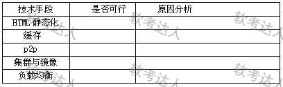
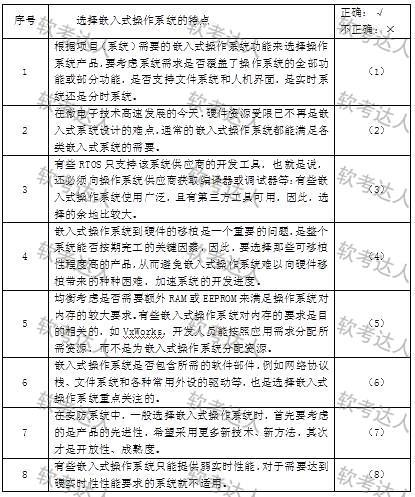

# 智能安防系统案例

## 原题（网站题号 212：智能安防系统）

**试题**　阅读以下关于智能安防应用的叙述，在答题纸上回答问题1至问题3。
【说明】
随着人们生活水平的提高，人们对于居家安全也越来越重视。某软件公司长期从事智能移动应用开发，现决定开发一套适用于家庭使用的便捷式智能安防系统。系统包括两个层面：其一为硬件层面，基于嵌入式操作系统实现动态拍摄并上传到视频服务器；其二为用户软件层面，基于Web界面，用户通过安全认证后可在线查看监控视频。项目组重点讨论的需求：（ ）系统终端用户的界面呈现较丰富，包括图片、视频及语音消息。（ ）付费VIP客户视频可以保存18个月，普通用户视频只能保存1个月，滚动覆盖。（ ）系统上线后需应对大量客户端并发请求处理，并发用户数可能会有上万人的规模；系统预期用户呈明显地域集中分布特征。

| 网站题号 | 小问 | 分值 |
|---|---|---|
| 212 | 问题1（12分） | 12 |
## 图示（原图，未覆盖）

## 来源答案与解析（网站原文）
- 题212问题1：(1)HTML静态化不适合（页面需按数据库用户信息与用户选择动态显示）；(2)缓存适合（频繁访问数据建缓存提高并发效率）；(3)P2P适合（边下边播节省带宽降低成本断点续传多源下载）；(4)集群与镜像适合（地域集中+原则b热备份+原则c可追加）；(5)负载均衡适合（大型Web高负荷常用手段，集群镜像必须配合）。综上除HTML静态化外四种均可用。
问题2：七特点（专用性强/实时性强/软硬件依赖强/处理器专用/多技术紧密结合/系统透明性/资源受限）。
问题3：(1)√ (2)× (3)√ (4)√ (5)√ (6)√ (7)× (8)√。

## 核验答案（考场作答）
### 【问题1】（12分）

**考场答案**：(1)HTML静态化——不适合：系统页面通常需根据数据库中的用户信息及用户选择动态显示；(2)缓存——适合：对频繁访问的数据建立缓存，提高并发访问效率；(3)P2P视频播放——适合：边下边播完善用户体验、节省服务器带宽降低成本、支持断点续传与多源下载提高并发效率；(4)集群与镜像——适合：用户地域集中分布特征下用集群与镜像提高并发访问效率，镜像机制满足热备份原则(b)，软硬件投入可按原则(c)追加；(5)负载均衡——适合：大型Web应用解决高负荷访问和大量并发请求的常用有效方法，采用集群和镜像时的必须配合手段。综上除HTML静态化外四种技术手段均可应用于本系统。

**采分要点**：五手段各2.4分（推定）：结论+理由。

**详细解析**：HTML静态化与“动态显示用户信息”矛盾（唯一不适合项）；负载均衡与集群镜像是“必须配合”关系。理由须挂技术原则(a)(b)(c)。

**常见失分表达**：五项全判适合；理由未挂技术原则。

**知识点链接**：[Web高并发技术](https://github.com/Goodyzhang/ruankao.skill/blob/main/materials/%E7%B3%BB%E7%BB%9F%E6%9E%B6%E6%9E%84%E8%AE%BE%E8%AE%A1%E5%B8%88/%E7%AC%94%E8%AE%B0/%E7%9F%A5%E8%AF%86%E7%82%B9/13-%E5%B1%82%E6%AC%A1%E5%BC%8F%E6%9E%B6%E6%9E%84%E8%AE%BE%E8%AE%A1%E7%90%86%E8%AE%BA%E4%B8%8E%E5%AE%9E%E8%B7%B5.md)、[智能安防嵌入式](https://github.com/Goodyzhang/ruankao.skill/blob/main/materials/%E7%B3%BB%E7%BB%9F%E6%9E%B6%E6%9E%84%E8%AE%BE%E8%AE%A1%E5%B8%88/%E7%AC%94%E8%AE%B0/%E7%9F%A5%E8%AF%86%E7%82%B9/16-%E5%B5%8C%E5%85%A5%E5%BC%8F%E7%B3%BB%E7%BB%9F%E6%9E%B6%E6%9E%84%E8%AE%BE%E8%AE%A1%E7%90%86%E8%AE%BA%E4%B8%8E%E5%AE%9E%E8%B7%B5.md)

### 【问题2】（5分）

**考场答案**（300字内）：嵌入式系统主要特点：①系统专用性强——针对具体应用的专门系统，软硬件结合紧密，需针对硬件开发移植；②系统实时性强——限定时间内响应外部事件，大部分为实时嵌入式系统；③软硬件依赖性强——必须协同设计满足性能、成本和可靠性要求；④处理器专用——功耗低、体积小、集成度高；⑤多种技术紧密结合——计算机、半导体、电力电子、机械与行业应用结合；⑥系统透明性——形态与通用计算机差距大，用户可能感觉不到其存在；⑦系统资源受限——存储容量、I/O设备数量和处理能力有限。

**采分要点**：七特点各约0.7分（推定）。

**详细解析**：七特点是教程§16.1标准清单，与题189简单/复杂任务特征题同章。

**常见失分表达**：漏“透明性”或“资源受限”。

**知识点链接**：[嵌入式系统特点](https://github.com/Goodyzhang/ruankao.skill/blob/main/materials/%E7%B3%BB%E7%BB%9F%E6%9E%B6%E6%9E%84%E8%AE%BE%E8%AE%A1%E5%B8%88/%E7%AC%94%E8%AE%B0/%E7%9F%A5%E8%AF%86%E7%82%B9/16-%E5%B5%8C%E5%85%A5%E5%BC%8F%E7%B3%BB%E7%BB%9F%E6%9E%B6%E6%9E%84%E8%AE%BE%E8%AE%A1%E7%90%86%E8%AE%BA%E4%B8%8E%E5%AE%9E%E8%B7%B5.md)

### 【问题3】（8分）

**考场答案**：(1)√；(2)×；(3)√；(4)√；(5)√；(6)√；(7)×；(8)√。

**采分要点**：八判各1分（推定）。

**详细解析**：依据表5-2原图逐条对照（原图已下载），(2)(7)为错误观点。训练时结合OS选型方法（功能/硬件/实时性/资源约束）理解。

**常见失分表达**：未按表图逐条对照。

**知识点链接**：[嵌入式OS选型](https://github.com/Goodyzhang/ruankao.skill/blob/main/materials/%E7%B3%BB%E7%BB%9F%E6%9E%B6%E6%9E%84%E8%AE%BE%E8%AE%A1%E5%B8%88/%E7%AC%94%E8%AE%B0/%E7%9F%A5%E8%AF%86%E7%82%B9/16-%E5%B5%8C%E5%85%A5%E5%BC%8F%E7%B3%BB%E7%BB%9F%E6%9E%B6%E6%9E%84%E8%AE%BE%E8%AE%A1%E7%90%86%E8%AE%BA%E4%B8%8E%E5%AE%9E%E8%B7%B5.md)

## 来源与身份

- 题源：软考达人·第二十二章 案例分析/第一节 案例分析，网站题号212（网站分类“第二十二章 案例分析”保留为来源位置，章节路由按实际考点匹配教材章（第2版20章体系）。）
- 年份/卷别未核实，按 web-bank 处理。分值加和 12+5+8=25 与“试题二（25分）”一致。
