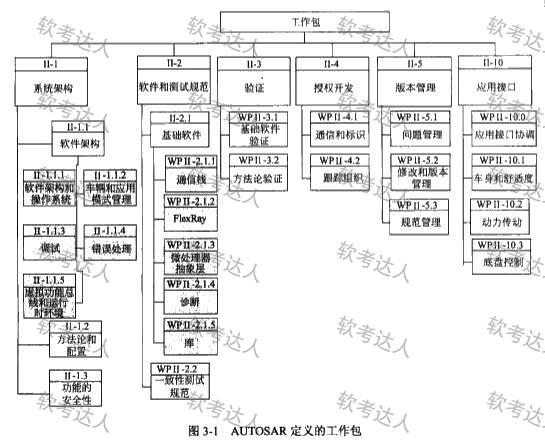
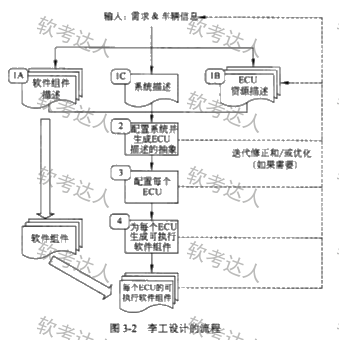
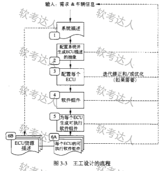
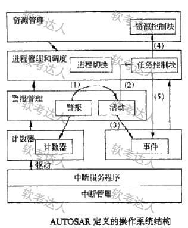

# 汽车电子-AUTOSAR架构案例

## 原题（网站题号 43～45 合并：试题三，25分）

**试题三（25分）**　阅读以下关于汽车电子基础软件架构的说明，在对应栏内回答问题1至问题3。

【说明】某软件公司承担某项国家重点项目研制工作，任务重点是参考国外汽车电子发展趋势，开发某汽车公司的企业汽车电子基础软件架构。公司提出遵照国际组织最新推出的AUTOSAR规范，按统筹规划、分步骤实施的原则实现基础软件架构设计。图3-1给出了AUTOSAR规范所定义的工作包，图中灰色部分代表本项目工作所包含的内容（软件架构和基础软件）。

| 网站题号 | 小问 | 分值 |
|---|---|---|
| 43 | 问题1（9分）：李工/王工两种开发流程（图3-2/图3-3）谁更符合AUTOSAR规定并说明理由 | 9 |
| 44 | 问题2（10分）：图3-4操作系统功能模块层次结构中（ ）～（5）箭头所标的具体操作含义 | 10 |
| 45 | 问题3（6分）：150字以内说明采用AUTOSAR架构的主要优点，并说明ECU覆盖汽车的三个领域 | 6 |

## 图示（原图，未覆盖）

## 来源答案与解析（网站原文）

- 题43：李工流程符合；理由三条（三描述并行定义/王工缺组件描述仅第4步集成/李工顶层定义明确并行度高迭代清晰），解析为完整段落。
- 题44：五箭头含义＋解析（读图题；系统从下至上=中断管理、事件管理、警报管理、进程管理和调度、资源管理）。
- 题45：优点三条＋三大领域（动力、底盘、车身），解析补充"厂商独立性/重用性/全生存周期"表述。

## 核验答案（考场作答）

### 【问题1】（9分）

**考场答案**：李工定义的流程更符合AUTOSAR规定。理由：①AUTOSAR要求开发流程满足并发、可多次迭代特性，李工流程将软件组件描述、系统描述和ECU资源描述**同时定义**，而王工流程仅仅只做系统描述；②王工流程没有考虑软件组件的描述，只是简单将软件组件作为第4步被集成；③李工流程明确了顶层定义阶段，**并行度高、迭代清晰**。

**采分要点**：结论3分＋三描述并行3分＋组件缺失与并行迭代优势3分（推定）。

**详细解析**：读图对比法——李工图3-2中1A软件组件描述/1C系统描述/1B ECU资源描述三个框**并列起步**，且"软件组件"贯穿到每个ECU的可执行软件；王工图3-3先做系统描述（步骤1），软件组件到步骤4才出现，6A ECU资源描述被甩到最后，串行且缺顶层并行。审题锚点是题干"**并发、可多次迭代**"两个词——凡是流程图对比题，先回规范要求再逐环节对照。

**常见失分表达**：只写"李工好"没有对照规范原文；漏"并行度高、迭代清晰"这条总括。

**知识点链接**：[GENESYS 与汽车电子架构案例](https://github.com/Goodyzhang/ruankao.skill/blob/main/materials/%E7%B3%BB%E7%BB%9F%E6%9E%B6%E6%9E%84%E8%AE%BE%E8%AE%A1%E5%B8%88/%E7%AC%94%E8%AE%B0/%E7%9F%A5%E8%AF%86%E7%82%B9/16-%E5%B5%8C%E5%85%A5%E5%BC%8F%E7%B3%BB%E7%BB%9F%E6%9E%B6%E6%9E%84%E8%AE%BE%E8%AE%A1%E7%90%86%E8%AE%BA%E4%B8%8E%E5%AE%9E%E8%B7%B5.md)、[嵌入式系统架构模式](https://github.com/Goodyzhang/ruankao.skill/blob/main/materials/%E7%B3%BB%E7%BB%9F%E6%9E%B6%E6%9E%84%E8%AE%BE%E8%AE%A1%E5%B8%88/%E7%AC%94%E8%AE%B0/%E7%9F%A5%E8%AF%86%E7%82%B9/16-%E5%B5%8C%E5%85%A5%E5%BC%8F%E7%B3%BB%E7%BB%9F%E6%9E%B6%E6%9E%84%E8%AE%BE%E8%AE%A1%E7%90%86%E8%AE%BA%E4%B8%8E%E5%AE%9E%E8%B7%B5.md)

### 【问题2】（10分）

**考场答案**：(1)操作系统的警报管理发现ECU系统出错时，启动错误处理程序；(2)错误处理程序将具体动作交由进程管理，完成对发生错误的任务进行处理；(3)错误处理程序产生一个错误事件；(4)任务控制块处理程序调用资源管理功能，实现硬件资源重分配；(5)任务控制块处理程序通知事件管理，对错误事件进行应答。

**采分要点**：五箭头各2分（推定）：主语（谁发起）+动作（对谁做什么）。

**详细解析**：OS层次从下至上=中断管理→事件管理→警报管理→进程管理和调度→资源管理。读图口诀：箭头从警报出发的是"发现错误启动处理"，错误处理程序向下交给进程管理（处理任务）、向右产生事件（记录），任务控制块向上找资源管理（重分配）、向事件管理回送应答。每个箭头答"主语+动作"两个半句。

**常见失分表达**：箭头(2)漏"完成对发生错误的任务进行处理"的落点；箭头(4)漏"硬件资源重分配"；主语写错（(4)(5)的主语是任务控制块处理程序）。

**知识点链接**：[嵌入式操作系统（AUTOSAR OS）](https://github.com/Goodyzhang/ruankao.skill/blob/main/materials/%E7%B3%BB%E7%BB%9F%E6%9E%B6%E6%9E%84%E8%AE%BE%E8%AE%A1%E5%B8%88/%E7%AC%94%E8%AE%B0/%E7%9F%A5%E8%AF%86%E7%82%B9/16-%E5%B5%8C%E5%85%A5%E5%BC%8F%E7%B3%BB%E7%BB%9F%E6%9E%B6%E6%9E%84%E8%AE%BE%E8%AE%A1%E7%90%86%E8%AE%BA%E4%B8%8E%E5%AE%9E%E8%B7%B5.md)

### 【问题3】（6分）

**考场答案**（150字内）：采用AUTOSAR开放式架构的优点：①具有厂商独立性，可有效支持多厂家汽车电子基础软件的研制；②有利于软件重用，可根据不同的ECU结构通过数据配置自动生成各种ECU软件组件；③其软件框架支持汽车电子软件的全生存周期（构架、开发、测试、验证、授权、版本和接口）。AUTOSAR规范覆盖汽车电子三大领域：**动力、底盘、车身**。

**采分要点**：优点三条各2分；三大领域含在分值内（漏答酌扣）。

**详细解析**：优点与工作包图呼应：厂商独立（接口标准化）、重用（配置生成）、全生存周期（II-5版本管理等）。三大领域是送分记忆点：动力/底盘/车身（信息娱乐不在三大经典领域内，是易混干扰项）。

**常见失分表达**：三大领域写成"动力、底盘、信息娱乐"；优点只答"开放、标准"没有展开。

**知识点链接**：[嵌入式系统发展（汽车电子）](https://github.com/Goodyzhang/ruankao.skill/blob/main/materials/%E7%B3%BB%E7%BB%9F%E6%9E%B6%E6%9E%84%E8%AE%BE%E8%AE%A1%E5%B8%88/%E7%AC%94%E8%AE%B0/%E7%9F%A5%E8%AF%86%E7%82%B9/16-%E5%B5%8C%E5%85%A5%E5%BC%8F%E7%B3%BB%E7%BB%9F%E6%9E%B6%E6%9E%84%E8%AE%BE%E8%AE%A1%E7%90%86%E8%AE%BA%E4%B8%8E%E5%AE%9E%E8%B7%B5.md)

## 来源与身份

- 题源：软考达人·第二十二章 案例分析/第一节 案例分析，网站题号43～45（网站分类“第二十二章 案例分析”保留为来源位置，章节路由按实际考点匹配教材章（第2版20章体系）。）
- 年份/卷别未核实，按 web-bank 处理；分值加和 9+10+6=25 与"试题三（25分）"一致。
- 图示：四张原图（工作包/李工流程/王工流程/OS结构）均已下载并实际看图核对：李工=三描述并行、王工=先系统描述后组件，箭头①～⑤位置与答案一致。
