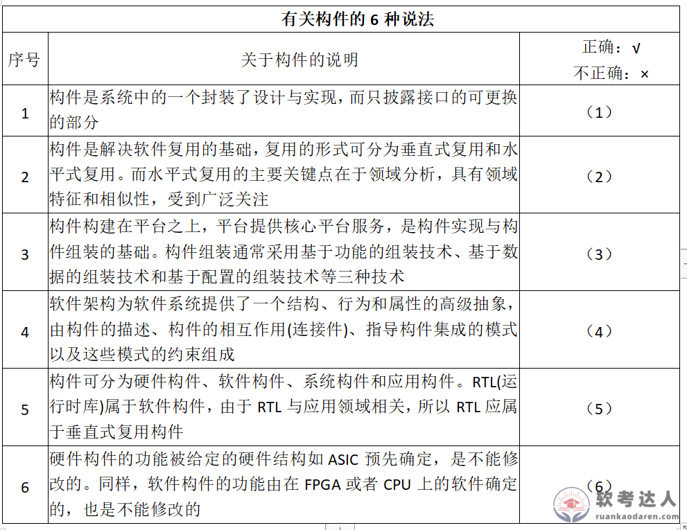
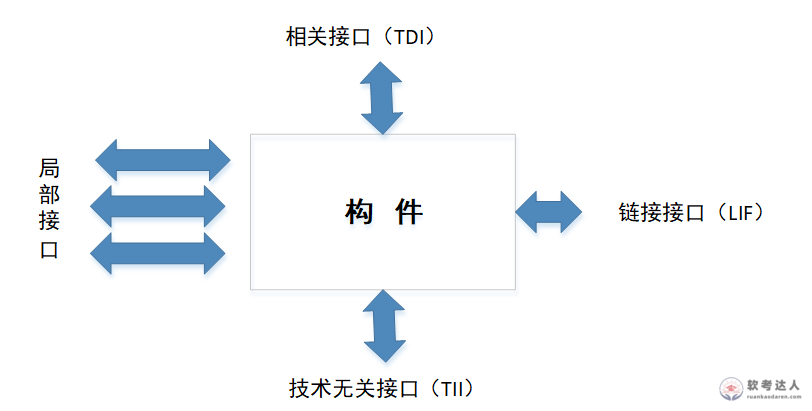

# 飞行器电子设备-嵌入式构件库与GENESYS接口案例

## 原题（网站题号 53～55 合并：试题三，25分）

**试题三（25分）**　请详细阅读有关嵌入式构件设计方面的说明，回答下列问题。

【说明】构件（component）也称为组件，是一个功能相对独立的具有可复用价值的软硬件单元。某公司长期从事飞行器电子设备研制，积累大量成熟软件但因管理和设计原因不能复用。领导层决定改造成熟软件、建立公司可复用软件构件库，任务交技术部门王工程师组织实施。两个月后实施方案获肯定，但实施中在**公司软件架构的变更**和**构件抽取的界面**等方面遇到许多困难。

| 网站题号 | 小问 | 分值 |
|---|---|---|
| 53 | 问题1（9分）：200字以内说明获取构件的方法、开发构件策略，列举两种主流构件标准 | 9 |
| 54 | 问题2（6分）：判断表中有关构件的6种说法是否正确 | 6 |
| 55 | 问题3（10分）：按GENESYS规范为RS-232串行驱动程序可复用软构件说明四类接口的具体功能 | 10 |

## 图示（原图，未覆盖）

## 来源答案与解析（网站原文）

- 题53：获取4方法+开发3策略+主流标准（CORBA/COM-DCOM/EJB）。（解析：无）
- 题54：（1）√（2）×（3）×（4）√（5）×（6）×，解析给出(2)(3)(5)(6)错误理由。
- 题55：RS-232驱动构件四类接口完整定义。（解析：无）

## 核验答案（考场作答）

### 【问题1】（9分）

**考场答案**（200字内）：获取构件4种方法：①从现有构件中获得符合要求的构件，直接使用或适应性修改；②通过遗留工程将具有潜在复用价值的软件提取出来；③从市场购买现成商业构件（COTS）；④开发新的符合要求的构件。开发构件3种策略：①分区（partitioning）——将问题空间分割成几乎可独立研究的部分；②抽象（abstraction）——对给定实践内执行指定计算的软/硬件单元的抽象；③分割（segmentation）——将结构引入构件行为，支持时序推理。主流构件标准（任举两种）：CORBA（OMG）、COM/DCOM（Microsoft）、EJB（SUN）。

**采分要点**：4方法4分＋3策略3分＋标准2分（推定）。

**详细解析**：方法按“改旧→提旧→买→造”记忆；策略三词是固定搭配（分区/抽象/分割），注意“分割（segmentation）”与“分区（partitioning）”是两个不同策略，译名相近极易混。标准对应组织：CORBA-OMG、COM/DCOM-Microsoft、EJB-SUN，考“标准+组织”配对。

**常见失分表达**：漏COTS或遗留工程；把“分割”写成“分区”的别名；标准漏组织名。

**知识点链接**：[构件和构件模型](https://github.com/Goodyzhang/ruankao.skill/blob/main/materials/%E7%B3%BB%E7%BB%9F%E6%9E%B6%E6%9E%84%E8%AE%BE%E8%AE%A1%E5%B8%88/%E7%AC%94%E8%AE%B0/%E7%9F%A5%E8%AF%86%E7%82%B9/05-%E8%BD%AF%E4%BB%B6%E5%B7%A5%E7%A8%8B%E5%9F%BA%E7%A1%80%E7%9F%A5%E8%AF%86.md)、[构件组装](https://github.com/Goodyzhang/ruankao.skill/blob/main/materials/%E7%B3%BB%E7%BB%9F%E6%9E%B6%E6%9E%84%E8%AE%BE%E8%AE%A1%E5%B8%88/%E7%AC%94%E8%AE%B0/%E7%9F%A5%E8%AF%86%E7%82%B9/05-%E8%BD%AF%E4%BB%B6%E5%B7%A5%E7%A8%8B%E5%9F%BA%E7%A1%80%E7%9F%A5%E8%AF%86.md)

### 【问题2】（6分）

**考场答案**：（1）√；（2）×——垂直式复用才与领域特性相关（关键点在领域分析），水平式复用是公用服务、不与特殊领域相关，题述正好说反；（3）×——构件组装技术是基于功能的组装、基于数据的组装、面向对象的组装三种，“配置”只是构件功能组合的动态方法而非组装技术；（4）√；（5）×——RTL（数学库、stdio等运行时库）可服务多种应用、与领域需求无关，属水平式复用构件；（6）×——硬件构件功能被ASIC等预先确定不可修改，而软件构件功能由加载其上的软件（作业）确定，在寿命期中可以修改。

**采分要点**：六判各1分；判×的须给理由（阅卷惯例）。

**详细解析**：判断题的四个陷阱词：**垂直vs水平**（领域相关与否）、**配置vs组装**（动态组合≠组装技术）、**RTL归属**（通用库→水平）、**软硬件构件可改性**（硬件不可改、软件可改）。(1)(4)是教材定义原句，直接判对。

**常见失分表达**：只写√×不写理由；把(6)判√（被“硬件不能改”带偏到软件）。

**知识点链接**：[基于构件的软件工程](https://github.com/Goodyzhang/ruankao.skill/blob/main/materials/%E7%B3%BB%E7%BB%9F%E6%9E%B6%E6%9E%84%E8%AE%BE%E8%AE%A1%E5%B8%88/%E7%AC%94%E8%AE%B0/%E7%9F%A5%E8%AF%86%E7%82%B9/05-%E8%BD%AF%E4%BB%B6%E5%B7%A5%E7%A8%8B%E5%9F%BA%E7%A1%80%E7%9F%A5%E8%AF%86.md)

### 【问题3】（10分）

**考场答案**：RS-232驱动构件完成RS-232芯片初始化及数据发送、接收和控制。四类接口：①**链接接口（LIF）**——构件使用者是上层操作系统或应用软件，提供串行数据服务：Send()（向RS-232芯片输出数据）、Receive()（经RS-232芯片从外部接收数据）、Init232()（初始化RS-232芯片）；②**局部接口**——RS-232芯片为编程提供的寄存器与CPU对外围芯片的支持，与硬件紧密相关：Intconnect()（将外部中断向量连接到CPU）、Read()（读取寄存器内容）、Write()（写入控制信息或数据）；③**技术相关接口（TDI）**——为维护人员提供的芯片诊断接口：Datacheck()（诊断数据传输校验错误）；④**技术无关接口（TII）**——为编程人员提供的运行时配置接口：Reset()（复位）、Restart()（重启动）、Rateconfigure()（配置/重新配置传输速率）。

**采分要点**：四类接口各2~3分（推定）：定位半句+具体功能函数。

**详细解析**：四接口判别锚：LIF=对外服务（给谁用→上层软件）；局部=硬件寄存器级（与硬件紧相关）；TDI=诊断（维护人员看内部）；TII=配置复位重启（与硬件技术无关的运行控制）。答题模板“接口定位一句+2~3个函数”，函数名照题干风格给英文+括号说明。

**常见失分表达**：四类接口定位句缺失（只列函数）；把Send/Receive放错到局部接口。

**知识点链接**：[GENESYS 构件接口规范](https://github.com/Goodyzhang/ruankao.skill/blob/main/materials/%E7%B3%BB%E7%BB%9F%E6%9E%B6%E6%9E%84%E8%AE%BE%E8%AE%A1%E5%B8%88/%E7%AC%94%E8%AE%B0/%E7%9F%A5%E8%AF%86%E7%82%B9/16-%E5%B5%8C%E5%85%A5%E5%BC%8F%E7%B3%BB%E7%BB%9F%E6%9E%B6%E6%9E%84%E8%AE%BE%E8%AE%A1%E7%90%86%E8%AE%BA%E4%B8%8E%E5%AE%9E%E8%B7%B5.md)、[嵌入式软件层次（BSP）](https://github.com/Goodyzhang/ruankao.skill/blob/main/materials/%E7%B3%BB%E7%BB%9F%E6%9E%B6%E6%9E%84%E8%AE%BE%E8%AE%A1%E5%B8%88/%E7%AC%94%E8%AE%B0/%E7%9F%A5%E8%AF%86%E7%82%B9/16-%E5%B5%8C%E5%85%A5%E5%BC%8F%E7%B3%BB%E7%BB%9F%E6%9E%B6%E6%9E%84%E8%AE%BE%E8%AE%A1%E7%90%86%E8%AE%BA%E4%B8%8E%E5%AE%9E%E8%B7%B5.md)

## 来源与身份

- 题源：软考达人·第二十二章 案例分析/第一节 案例分析，网站题号53～55（网站分类“第二十二章 案例分析”保留为来源位置，章节路由按实际考点匹配教材章（第2版20章体系）。）
- 年份/卷别未核实，按 web-bank 处理；分值加和 9+6+10=25 与“试题三（25分）”一致。
- 图示：6种说法判断表与构件四接口图原图已下载并实际看图核对（表图6行与题号对应；接口图四方向与GENESYS定义一致）。
