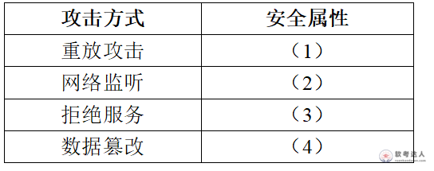

# 证券公司网络-DDoS攻击与安全属性案例

## 原题（网站题号 143～145 合并：试题二，25分）

**试题二（25分）**　阅读以下关于系统安全架构的叙述，在答题纸上回答问题1至问题3。

【说明】某证券公司更新网络架构提高安全服务能力。技术总监王工发现公司网络经常遭受同一种网络攻击，现象：(1)被攻击主机上有大量等待的TCP连接；(2)网络中充斥大量无用数据包、源地址为假；(3)高流量无用数据造成网络拥塞，受害主机无法正常与外界通讯；(4)严重攻击时主机系统崩溃死机。

| 网站题号 | 小问 | 分值 |
|---|---|---|
| 143 | 问题1（6分）：哪些行为属于被动攻击（九选项） | 6 |
| 144 | 问题2（8分）：四种攻击方式破坏的安全属性填表 | 8 |
| 145 | 问题3（11分）：判断攻击类型并给出抵抗方式 | 11 |

## 图示（原图，未覆盖）

## 来源答案与解析（网站原文）

- 题143：C、E、I（解析含主动/被动攻击定义，见台账 analysis-143.json）。
- 题144：（1）完整性；（2）保密性；（3）可用性；（4）完整性。（解析：无）
- 题145：DDoS攻击（3分）；抵抗方式五种（每答对1空得2分最高8分）；解析注明无完全防御手段。

## 核验答案（考场作答）

### 【问题1】（6分）

**考场答案**：属于被动攻击的是：C网络监听、E信息截取、I流量分析。判别依据：被动攻击中攻击者目的只是获取信息，不篡改信息或直接危害系统，系统可不中断正常运行（威胁机密性）；主动攻击会改变信息或危害系统（威胁完整性和有效性）。网络监听、信息截取、流量分析都属于“获取信息”而不影响系统正常运行，故为被动攻击；被动攻击可通过加密避免。

**采分要点**：三选项各2分（推定）。

**详细解析**：主动/被动一线分：动没动信息。重放（重发）、假冒（伪装身份）、病毒（破坏）、DoS（瘫痪）、篡改（改内容）、抵赖（行为否认）都动了系统或信息→主动；监听/截取/流量分析只“看”→被动。

**常见失分表达**：把“流量分析”当主动攻击（它只分析包特征不碰内容）。

**知识点链接**：[信息安全攻击分类](https://github.com/Goodyzhang/ruankao.skill/blob/main/materials/%E7%B3%BB%E7%BB%9F%E6%9E%B6%E6%9E%84%E8%AE%BE%E8%AE%A1%E5%B8%88/%E7%AC%94%E8%AE%B0/%E7%9F%A5%E8%AF%86%E7%82%B9/04-%E4%BF%A1%E6%81%AF%E5%AE%89%E5%85%A8%E6%8A%80%E6%9C%AF%E5%9F%BA%E7%A1%80%E7%9F%A5%E8%AF%86.md)、[安全架构设计理论与实践](https://github.com/Goodyzhang/ruankao.skill/blob/main/materials/%E7%B3%BB%E7%BB%9F%E6%9E%B6%E6%9E%84%E8%AE%BE%E8%AE%A1%E5%B8%88/%E7%AC%94%E8%AE%B0/%E7%9F%A5%E8%AF%86%E7%82%B9/18-%E5%AE%89%E5%85%A8%E6%9E%B6%E6%9E%84%E8%AE%BE%E8%AE%A1%E7%90%86%E8%AE%BA%E4%B8%8E%E5%AE%9E%E8%B7%B5.md)

### 【问题2】（8分）

**考场答案**：(1)重放攻击——破坏完整性；(2)网络监听——破坏保密性；(3)拒绝服务——破坏可用性；(4)数据篡改——破坏完整性。

**采分要点**：四空各2分（推定）。

**详细解析**：攻击→属性映射：重放把旧消息当新消息用（破坏“新旧/顺序”语义→完整性口径，网站答案如此）、监听偷看（保密性）、DoS瘫痪（可用性）、篡改改内容（完整性）。注意重放通常也被认为威胁机密性之外的完整性/新鲜性，考试按网站口径答完整性。

**常见失分表达**：(1)误答保密性；(3)误答完整性。

**知识点链接**：[安全属性与攻击映射](https://github.com/Goodyzhang/ruankao.skill/blob/main/materials/%E7%B3%BB%E7%BB%9F%E6%9E%B6%E6%9E%84%E8%AE%BE%E8%AE%A1%E5%B8%88/%E7%AC%94%E8%AE%B0/%E7%9F%A5%E8%AF%86%E7%82%B9/04-%E4%BF%A1%E6%81%AF%E5%AE%89%E5%85%A8%E6%8A%80%E6%9C%AF%E5%9F%BA%E7%A1%80%E7%9F%A5%E8%AF%86.md)

### 【问题3】（11分）

**考场答案**：该攻击为**DDoS攻击（分布式拒绝服务攻击）**（3分）——依据：大量等待的TCP连接（SYN洪泛特征）、大量假源无用数据包、高流量造成拥塞、主机崩溃。抵抗方式（每空2分最高8分）：①关闭不必要的服务；②及时更新系统补丁；③限制同时打开的SYN半连接数目；④缩短SYN半连接的timeout时间；⑤限制特定IP地址的访问。

**采分要点**：判定3分＋方式最高8分（网站给分明示）。

**详细解析**：四条现象精准指向DDoS（SYN洪泛变体）：半连接堆积=SYN_COOKIE要解的问题——限制半连接数目与缩短timeout正对着打。解析强调“无完全防御、只能缓解”，答题时写“缓解”比“防御”更严谨。

**常见失分表达**：只写“DoS攻击”没写“分布式”；方式不足四条。

**知识点链接**：[安全架构设计理论与实践（抗攻击）](https://github.com/Goodyzhang/ruankao.skill/blob/main/materials/%E7%B3%BB%E7%BB%9F%E6%9E%B6%E6%9E%84%E8%AE%BE%E8%AE%A1%E5%B8%88/%E7%AC%94%E8%AE%B0/%E7%9F%A5%E8%AF%86%E7%82%B9/18-%E5%AE%89%E5%85%A8%E6%9E%B6%E6%9E%84%E8%AE%BE%E8%AE%A1%E7%90%86%E8%AE%BA%E4%B8%8E%E5%AE%9E%E8%B7%B5.md)、[可用性抗攻击设计](https://github.com/Goodyzhang/ruankao.skill/blob/main/materials/%E7%B3%BB%E7%BB%9F%E6%9E%B6%E6%9E%84%E8%AE%BE%E8%AE%A1%E5%B8%88/%E7%AC%94%E8%AE%B0/%E7%9F%A5%E8%AF%86%E7%82%B9/08-%E7%B3%BB%E7%BB%9F%E8%B4%A8%E9%87%8F%E5%B1%9E%E6%80%A7%E4%B8%8E%E6%9E%B6%E6%9E%84%E8%AF%84%E4%BC%B0.md)

## 来源与身份

- 题源：软考达人·第二十二章 案例分析/第一节 案例分析，网站题号143～145（网站分类“第二十二章 案例分析”保留为来源位置，章节路由按实际考点匹配教材章（第2版20章体系）。）
- 年份/卷别未核实，按 web-bank 处理；分值加和 6+8+11=25 与“试题二（25分）”一致。
- 图示：攻击属性表原图已下载并实际看图核对四空行序（重放/监听/拒绝服务/篡改）。
