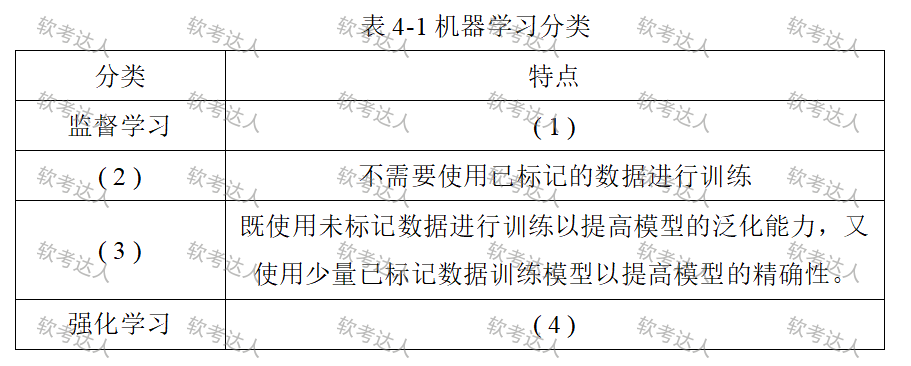

# 电商用户行为分析-Lambda架构与机器学习案例

## 原题（网站题号 28～30 合并：试题四，25分）

**试题四（25分）**　阅读以下关于数据库设计的叙述，在答题纸上回答问题1至问题3。

【说明】某电子商务网站为做市场预测和商品精准推荐，决定对用户访问记录进行分析。网站拥有海量用户访问数据（浏览商品详情页、搜索关键词、加购、下单支付、退货等行为），希望分析用户行为模式、购买意向和喜好，支持市场预测、商品推荐与实时推荐。张工建议使用传统Hadoop框架进行分析和计算，李工建议使用Lambda架构，团队最终接受李工意见。

| 网站题号 | 小问 | 分值 |
|---|---|---|
| 28 | 问题1（9分）：300字以内分析Lambda架构优缺点，说明为什么采用 | 9 |
| 29 | 问题2（8分）：200字以内解释NoSQL数据库有哪些优点 | 8 |
| 30 | 问题3（8分）：根据机器学习的分类填写表4-1中的空格 | 8 |

## 图示（原图）

## 来源答案与解析（网站原文）

- 题28：优点四条+缺点三条+Hadoop对比。（解析：无）
- 题29：NoSQL优点四条。（解析：无）
- 题30：（1）监督学习特点、（2）无监督学习、（3）半监督学习、（4）强化学习特点。（解析：无）

## 核验答案（考场作答）

### 【问题1】（9分）

**考场答案**（300字内）：优点：①容错性好——出错可修复算法或从头重算视图；②查询灵活度高——批处理层允许针对任何数据临时查询；③易伸缩——批处理层、加速层、服务层都是完全分布式系统，加机器即可扩规模；④易扩展——添加视图只需给主数据集添加几个新函数。缺点：①全场景覆盖带来编码开销；②针对具体场景重新离线训练一遍益处不大；③重新部署和迁移成本很高。采用理由：Hadoop主要工作在离线批处理模式，实时数据处理能力不足；本系统既要历史行为分析又要实时推荐，Lambda架构能同时处理离线和实时数据，故更适合。

**采分要点**：优点4条4分+缺点3条2分+对比理由3分（推定）。

**详细解析**：Lambda的核心是“批处理层（全量准确）+加速层（实时快速）+服务层（合并响应）”三层分工。选型题落点在题干“快速处理+实时推荐”双需求：只看离线选Hadoop、只要流式选Kappa，两者都要选Lambda——这是§19.5设计选择的标准逻辑。

**常见失分表达**：优点缺点混写不分类；漏“为什么不用Hadoop”的对比半句（题面明确“说明为什么要采用”）。

**知识点链接**：[Lambda 架构优缺点](https://github.com/Goodyzhang/ruankao.skill/blob/main/materials/%E7%B3%BB%E7%BB%9F%E6%9E%B6%E6%9E%84%E8%AE%BE%E8%AE%A1%E5%B8%88/%E7%AC%94%E8%AE%B0/%E7%9F%A5%E8%AF%86%E7%82%B9/19-%E5%A4%A7%E6%95%B0%E6%8D%AE%E6%9E%B6%E6%9E%84%E8%AE%BE%E8%AE%A1%E7%90%86%E8%AE%BA%E4%B8%8E%E5%AE%9E%E8%B7%B5.md)

### 【问题2】（8分）

**考场答案**（200字内）：①支持高并发数据访问，性能较高；②数据存储结构松散，能灵活支持多种类型的数据格式；③支持海量数据存储，且易于横向扩展；④基于分布式数据存储，不存在单点故障和性能瓶颈，系统可用性高。

**采分要点**：四条各2分（推定）。

**详细解析**：四条对应NoSQL四大设计取向：内存/索引结构→高并发；Schemaless→多格式；分片→海量+横向扩展；多副本无单点→高可用。与题17（列式数据库存交易记录）联动：HBase优点即列族NoSQL优点的具体化。

**常见失分表达**：答成“不支持SQL”等特征而非优点；漏“无单点故障”可用性条。

**知识点链接**：[NoSQL 优点与选型](https://github.com/Goodyzhang/ruankao.skill/blob/main/materials/%E7%B3%BB%E7%BB%9F%E6%9E%B6%E6%9E%84%E8%AE%BE%E8%AE%A1%E5%B8%88/%E7%AC%94%E8%AE%B0/%E7%9F%A5%E8%AF%86%E7%82%B9/06-%E6%95%B0%E6%8D%AE%E5%BA%93%E8%AE%BE%E8%AE%A1%E5%9F%BA%E7%A1%80%E7%9F%A5%E8%AF%86.md)

### 【问题3】（8分）

**考场答案**：（1）监督学习：通过对已有标记数据进行学习，训练模型能够从未标记数据中进行预测和分类；（2）无监督学习（不需要使用已标记的数据进行训练）；（3）半监督学习（既使用未标记数据训练以提高泛化能力，又使用少量已标记数据训练以提高精确性）；（4）强化学习：通过让模型与环境进行交互并从中学习，以实现最优策略的目标。

**采分要点**：四空各2分（推定）。

**详细解析**：机器学习四分法判别锚点：有没有标记数据（全有=监督、全无=无监督、少量有=半监督）；奖励反馈试错=强化。图4-1中(2)(3)两空给的是特点反推名称，(1)(4)给名称反推特点，双向都要会。

**常见失分表达**：把半监督答成“监督+无监督混合训练”说不清目的（提高泛化+提高精确性两个目的缺一不可）；强化学习漏“与环境交互”。

**知识点链接**：[大数据架构设计理论与实践（机器学习分类补充）](https://github.com/Goodyzhang/ruankao.skill/blob/main/materials/%E7%B3%BB%E7%BB%9F%E6%9E%B6%E6%9E%84%E8%AE%BE%E8%AE%A1%E5%B8%88/%E7%AC%94%E8%AE%B0/%E7%9F%A5%E8%AF%86%E7%82%B9/19-%E5%A4%A7%E6%95%B0%E6%8D%AE%E6%9E%B6%E6%9E%84%E8%AE%BE%E8%AE%A1%E7%90%86%E8%AE%BA%E4%B8%8E%E5%AE%9E%E8%B7%B5.md)

## 来源与身份

- 题源：软考达人·第二十二章 案例分析/第一节 案例分析，网站题号28～30（网站分类“第二十二章 案例分析”保留为来源位置，章节路由按实际考点匹配教材章（第2版20章体系）。）
- 年份/卷别未核实，按 web-bank 处理；分值加和 9+8+8=25 与“试题四（25分）”一致。
- 图示：机器学习分类表原图已下载并实际看图核对空位。
