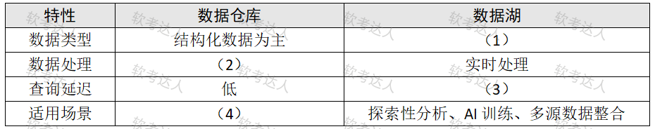

# 社交媒体平台-数据湖与图数据库案例

## 原题（网站题号 71～73 合并：试题四，25分）

**试题四（25分）**　阅读以下关于某社交媒体平台数据架构的说明，回答下列问题。

【说明】某社交媒体公司需优化用户行为分析系统，支持每日PB级的用户点击流、评论和点赞数据。当前使用Oracle做数据库和数据仓库，面临问题：(1)存储成本高——非结构化评论文本占用大量结构化存储空间；(2)数据延迟——用户行为分析需等待ETL完成，无法实时响应。团队计划采用数据湖（如Delta Lake或直接采用HDFS）和图数据库（如Neo4j）替代Oracle。

| 网站题号 | 小问 | 分值 |
|---|---|---|
| 71 | 问题1（8分）：数据仓库与数据湖差异填表 | 8 |
| 72 | 问题2（5分）：Delta Lake相比传统HDFS的优势及解释 | 5 |
| 73 | 问题3（12分）：将用户社交关系数据从Oracle迁移至Neo4j，说明为何选择图数据库 | 12 |

## 图示（原图，未覆盖）

## 来源答案与解析（网站原文）

- 题71：（1）结构化/半结构化/非结构化数据类型；（2）ETL（提前清洗）；（3）高；（4）固定报表与分析。（解析：无）
- 题72：Delta Lake四优势（ACID事务/元数据优化查询/时间旅行/流批一体）。（解析：无）
- 题73：七条理由答6条即满分。（解析：无）

## 核验答案（考场作答）

### 【问题1】（8分）

**考场答案**：数据类型——数据仓库以结构化数据为主 vs 数据湖结构化/半结构化/非结构化数据类型；数据处理——数据仓库ETL（提前清洗）vs 数据湖实时处理；查询延迟——数据仓库低 vs 数据湖高；适用场景——数据仓库固定报表与分析 vs 数据湖探索性分析、AI训练、多源数据整合。

**采分要点**：四空各2分（推定）。

**详细解析**：数仓与数据湖的分野是“先建模后存数据（schema-on-write）vs 先存数据后建模（schema-on-read）”：ETL提前清洗换来查询延迟低但牺牲灵活性；数据湖什么都先存下来，灵活且实时写入，但查询延迟高。与题29（NoSQL优点）、题59（Cassandra）同属存储选型家族题。

**常见失分表达**：(2)写成“ELT”（方向反了，数仓经典是ETL）；(4)漏“固定报表”。

**知识点链接**：[大数据处理系统架构特征](https://github.com/Goodyzhang/ruankao.skill/blob/main/materials/%E7%B3%BB%E7%BB%9F%E6%9E%B6%E6%9E%84%E8%AE%BE%E8%AE%A1%E5%B8%88/%E7%AC%94%E8%AE%B0/%E7%9F%A5%E8%AF%86%E7%82%B9/19-%E5%A4%A7%E6%95%B0%E6%8D%AE%E6%9E%B6%E6%9E%84%E8%AE%BE%E8%AE%A1%E7%90%86%E8%AE%BA%E4%B8%8E%E5%AE%9E%E8%B7%B5.md)、[数据仓库与OLAP](https://github.com/Goodyzhang/ruankao.skill/blob/main/materials/%E7%B3%BB%E7%BB%9F%E6%9E%B6%E6%9E%84%E8%AE%BE%E8%AE%A1%E5%B8%88/%E7%AC%94%E8%AE%B0/%E7%9F%A5%E8%AF%86%E7%82%B9/06-%E6%95%B0%E6%8D%AE%E5%BA%93%E8%AE%BE%E8%AE%A1%E5%9F%BA%E7%A1%80%E7%9F%A5%E8%AF%86.md)

### 【问题2】（5分）

**考场答案**：Delta Lake相比传统HDFS的优势：①事务支持——支持ACID事务，避免数据不一致；②优化查询——内置元数据管理，加速格式数据查询；③时间旅行（Time Travel）——通过版本回滚恢复误删数据；④流批一体——同时支持批处理和流数据写入。

**采分要点**：四条各1.25分（推定）。

**详细解析**：HDFS是裸的分布式文件系统（无事务、无元数据层），Delta Lake在其上加了一层事务与元数据管理——“湖仓一体”的核心卖点。时间旅行=保留数据版本快照，误删可回滚；流批一体=同一存储同时服务离线与实时作业（呼应Lambda的双层需求）。

**常见失分表达**：只写“Delta Lake更快”没有机制词；漏“时间旅行”或“流批一体”。

**知识点链接**：[Lambda 架构与流批一体](https://github.com/Goodyzhang/ruankao.skill/blob/main/materials/%E7%B3%BB%E7%BB%9F%E6%9E%B6%E6%9E%84%E8%AE%BE%E8%AE%A1%E5%B8%88/%E7%AC%94%E8%AE%B0/%E7%9F%A5%E8%AF%86%E7%82%B9/19-%E5%A4%A7%E6%95%B0%E6%8D%AE%E6%9E%B6%E6%9E%84%E8%AE%BE%E8%AE%A1%E7%90%86%E8%AE%BA%E4%B8%8E%E5%AE%9E%E8%B7%B5.md)

### 【问题3】（12分）

**考场答案**（七条答出6条即满分）：①嵌套关系查询——快速查找“用户A的朋友的朋友”等嵌套关系，Oracle此类查询性能非常低；②路径查询——原生支持路径查询（如推荐共同好友关注的帖子），低查询延迟；③动态模式——无需预定义schema，支持新增关系类型（关注、屏蔽等）；④社交网络分析——易于计算用户影响力、社区发现；⑤实时更新——支持用户关系的实时变更（如好友添加）；⑥可视化支持——通过Cypher查询直接生成社交关系图谱；⑦轻量级存储——仅存储必要关系，减少冗余。

**采分要点**：八选七答六，每条2分（推定）。

**详细解析**：图数据库选型的核心论据是“关系遍历的代价差”：关系库多表JOIN的代价随深度指数增长，图库沿边遍历常数级。与题65（Neo4j患者关系）、题73本条构成同族题——图库七大卖点背全即可通吃。

**常见失分表达**：答不足6条；漏“动态模式/实时更新”这类冷门条。

**知识点链接**：[NoSQL（图数据库）](https://github.com/Goodyzhang/ruankao.skill/blob/main/materials/%E7%B3%BB%E7%BB%9F%E6%9E%B6%E6%9E%84%E8%AE%BE%E8%AE%A1%E5%B8%88/%E7%AC%94%E8%AE%B0/%E7%9F%A5%E8%AF%86%E7%82%B9/06-%E6%95%B0%E6%8D%AE%E5%BA%93%E8%AE%BE%E8%AE%A1%E5%9F%BA%E7%A1%80%E7%9F%A5%E8%AF%86.md)

## 来源与身份

- 题源：软考达人·第二十二章 案例分析/第一节 案例分析，网站题号71～73（网站分类“第二十二章 案例分析”保留为来源位置，章节路由按实际考点匹配教材章（第2版20章体系）。）
- 年份/卷别未核实，按 web-bank 处理；分值加和 8+5+12=25 与“试题四（25分）”一致。
- 图示：数仓vs数据湖对比表原图已下载并实际看图核对四空行列。
