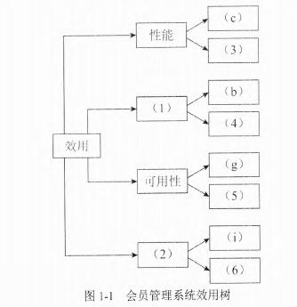
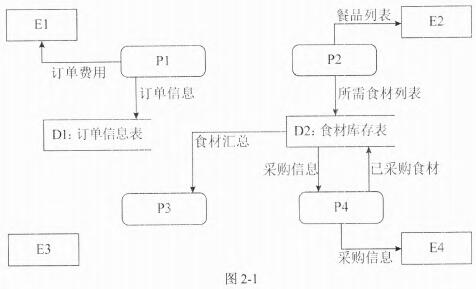
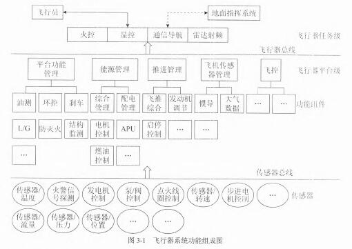
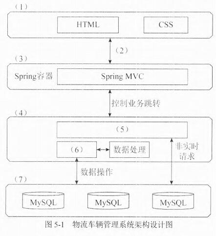

# 2019年下半年 系统架构设计师 · 下午题

> 卷面信息：考试时间 13:30~15:00 共 90 分钟。本试卷共五道题。试题一为必答题；试题二至试题四中任选两道进行解答（原卷封面如此印，与第 3 页页末"注意：从试题二至试题五中，选择两题解答"不一致，两处均照录）；如果解答超过两道，则以题号小的两道进行计分；每题 25 分，满分 75 分。答题纸指定位置填写省/自治区/直辖市/计划单列市名称、准考证号、出生年月日和姓名；答题纸除填写上述内容外只能写解答；字迹不清不评分。
> 卷面例题：2019 年下半年全国计算机技术与软件专业技术资格（水平）考试日期是 (88) 月 (89) 日。因为正确的解答是"11 月 5 日"，故在答题纸的对应栏内写上"11"和"5"。

## 题号目录

| 题号 | 考点 | 教程章节 |
|------|------|----------|
| Q1（试题一，必答） | 架构风格比较（面向对象 vs 基于规则）、质量属性效用树 | 08 质量属性与评估、07 架构设计基础 |
| Q2（试题二） | 结构化分析：0 层数据流图补全（外部实体/加工/数据流）、DFD 与系统流程图区别 | 05 软件工程 |
| Q3（试题三） | CPS 信息物理系统定义与三层结构、功能归属、三层安全威胁 | 16 嵌入式 |
| Q4（试题四） | 分布式数据库缓存一致性、缓存穿透空值方案、缓存雪崩 | 06 数据库 |
| Q5（试题五） | Web 分布式架构（Spring MVC/Kafka/Redis/MySQL）分层填空、质量属性归类、SQL 注入 | 12 信息系统架构、18 安全架构 |

## 原题转录（视觉核验）

---

## Q1（试题一，必答题，25 分）

阅读以下关于软件架构设计与评估的叙述，在答题纸上回答问题 1 和问题 2。

**【说明】**

某电子商务公司为了更好地管理用户，提升企业销售业绩，拟开发一套用户管理系统。该系统的基本功能是根据用户的消费级别、消费历史、信用情况等指标将用户划分为不同的等级，并针对不同等级的用户提供相应的折扣方案。在需求分析与架构设计阶段，电子商务公司提出的需求、质量属性描述和架构特性如下：

- (a) 用户目前分为普通用户、银卡用户、金卡用户和白金用户四个等级，后续需要能够根据消费情况进行动态调整；
- (b) 系统应该具备完善的安全防护措施，能够对黑客的攻击行为进行检测与防御；
- (c) 在正常负载情况下，系统应在 0.5 秒内对用户的商品查询请求进行响应；
- (d) 在各种节假日或公司活动中，针对所有级别用户，系统均能够根据用户实时的消费情况动态调整折扣力度；
- (e) 系统主站点断电后，应在 5 秒内将请求重定向到备用站点；
- (f) 系统支持中文昵称，但用户名要求必须以字母开头，长度不少于 8 个字符；
- (g) 当系统发生网络失效后，需要在 15 秒内发现错误并启用备用网络；
- (h) 系统在展示商品的实时视频时，需要保证视频画面具有 1024×768 像素的分辨率，40 帧/秒的速率；
- (i) 系统要扩容时，应保证在 10 人·月内完成所有的部署与测试工作；
- (j) 系统应对用户信息数据库的所有操作都进行完整记录；
- (k) 更改系统的 Web 界面接口必须在 4 人·周内完成；
- (l) 系统必须提供远程调试接口，并支持远程调试。

在对系统需求、质量属性描述和架构特性进行分析的基础上，该系统架构师给出了两种候选的架构设计方案，公司目前正在组织相关专家对系统架构进行评估。

**【问题 1】（13 分）**

针对用户级别与折扣规则管理功能的架构设计问题，李工建议采用面向对象的架构风格，而王工则建议采用基于规则的架构风格。请指出该系统更适合采用哪种架构风格，并从用户级别、折扣规则定义的灵活性、可扩展性和性能三个方面对这两种架构风格进行比较与分析，填写表 1-1 中的 (1)～(3) 空白处。

表 1-1 两种架构风格的比较与分析

| 架构风格名称 | 灵活性 | 可扩展性 | 性能 |
|------|------|------|------|
| 面向对象 | 将用户级别、折扣规则等封装为对象，在系统启动时加载 | (2) | (3) |
| 基于规则 | (1) | 加入新的用户级别和折扣规则时只需要定义新的规则，解释规则即可进行扩展 | 需要对用户级别与折扣规则进行实时解释、性能较差 |

**【问题 2】（12 分）**

在架构评估过程中，质量属性效用树（Utility Tree）是对系统质量属性进行识别和优先级排序的重要工具。请将合适的质量属性名称填入图 1-1 中 (1)、(2) 空白处，并选择题干描述的 (a)～(l) 填入 (3)～(6) 空白处，完成该系统的效用树。

**来源所列答案**（问题 1）：该系统更适合采用基于规则的虚拟机架构风格。（1）根据用户级别建立用户级别-折扣规则矩阵，在系统启动时加载并支持运行过程中动态更新，灵活性好；（2）加入新的用户级别和折扣规则时需要增加相应的类来扩展，可通过系统重启、动态反射或动态加载扩展，扩展性较差；（3）可根据类型判断或策略模式直接获得用户级别对应的折扣规则对象实时计算，性能很好。

**来源所列答案**（问题 2）：（1）安全性（2）可修改性（3）h（4）j（5）e（6）k

**来源解析**（问题 1）：面向对象设计模式中的策略模式和虚拟机中的基于规则的架构风格是动态规则场景中两种组常用的解决方案。从灵活性、可扩展性和性能方面综合比较来看，基于规则的虚拟机风格在灵活性和可扩展性两个方面均具备较大优势，而从性能方面会比面向对象处理速度差一些。

**来源解析**（问题 2）：质量属性效用树时对质量属性进行分类、权衡、分析的架构分析工具，主要关注系统的性能、可用性、可修改性和安全性四个方面。根据对相关质量属性的定义和含义，题干中：(c) 在正常负载情况下，系统应在 0.5 秒内对用户的商品查询请求进行响应和 (h) 系统在展示商品的实时视频时，需要保证视频画面具有 1024×768 像素的分辨率，40 帧/秒的速率，描述的是系统的性能属性；(e) 系统主站点断电后，应在 5 秒内将请求重定向到备用站点和 (g) 当系统发生网络失效后，需要在 15 秒内发现错误并启用备用网络，描述的是系统的可用性属性；(i) 系统要扩容时，应保证在 10 人·月内完成所有的部署与测试工作和 (k) 更改系统的 Web 界面接口必须在 4 人·周内完成，描述的是系统的可修改性属性；(b) 系统应该具备完善的安全防护措施，能够对黑客的攻击行为进行检测与防御和 (j) 系统应对用户信息数据库的所有操作都进行完整记录，描述的是系统的安全性属性。

> 校核注：另源（2019年11月系统架构设计师真题及解析.pdf 第 25 页）问题 1 答案作"用户级别与折扣规则管理功能更适合采用基于规则的架构风格。（1）将用户级别、折扣规则等描述为可动态改变的规则数据；（2）加入新的用户级别和折扣规则时需要重新定义新的对象，并需要重启系统；（3）用户级别和折扣规则已经在系统内编码，可直接运行，性能较好。"结论与主来源一致，表述不同。

---

## Q2（试题二，25 分）

阅读下列说明，回答问题 1 至问题 3，将解答填入答题纸的对应栏内。

**【说明】**

某软件企业为快餐店开发一套在线订餐管理系统，主要功能包括：

1. 在线订餐：已注册客户通过网络在线选择快餐店所提供的餐品种类和数量后提交订单，系统显示订单费用供客户确认，客户确认后支付订单所列各项费用。
2. 厨房备餐：厨房接收到客户已付款订单后按照订单餐品列表选择各类食材进行餐品加工。
3. 食材采购：当快餐店某类食材低于特定数量时自动向供应商发起采购信息，包括食材类型和数量，供应商接收到采购信息后按照要求将食材送至快餐店并提交已采购的食材信息，系统自动更新食材库存。
4. 生成报表：每个周末利月末，快餐店经理会自动收到系统生成的统计报表，报表中详细列出了本周或本月订单的统计信息以及库存食材的统计信息。

现采用数据流图对上述订餐管理系统进行分析与设计，系统未完成的 0 层数据流图如图 2-1 所示。

**【问题 1】（8 分）**

根据订餐管理系统功能说明，请在图 2-1 所示数据流图中给出外部实体 E1～E4 和加工 P1～P4 的具体名称。

**【问题 2】（8 分）**

根据数据流图规范和订餐管理系统功能说明，请说明在图 2-1 中需要补充哪些数据流可以构造出完整的 0 层数据流图。

**【问题 3】（9 分）**

根据数据流图的含义，请说明数据流图和系统流程图之间有哪些方面的区别。

**来源所列答案**（问题 1）：E1 客户，E2 厨房，E3 快餐店经理，E4 供应商；P1 订餐，P2 备餐，P3 生成报表，P4 采购食材

**来源所列答案**（问题 2）：1) E1-->P1 餐品订单；2) P1-->P2 餐品订单；3) D1-->P3 订单汇总；4) P3-->E3 统计报表

**来源所列答案**（问题 3）：（1）数据流图中的处理过程可并行；系统流程图在某个时间点只能处于一个处理过程。（2）数据流图展现系统的数据流；系统流程图展现系统的控制流。（3）数据流图展现全局的处理过程，过程之间遵循不同的计时标准；系统流程图中处理过程遵循一致的计时标准。

**来源解析**（问题 1）：外部实体，是指系统之外的人员、事物或组织。外部实体指出系统的边界，即系统输入数据的发源地或系统所产生的数据的目标去处，如题目中的客户、厨房、供应商和快餐店经理均属于外部实体。加工，又称处理或过程，描述输入数据流到输出数据之间的变换，也就是输入数据流经过什么处理过程后变成了输出数据。作用是把输入数据加工成所要的输出数据。每个加工都有一个名字和编号，加工的名字一般采用动宾结构短语，偶尔使用动词，如题目中提交订单、支付订单费用、加工餐品、采购食材、生成报表等均属于加工。

**来源解析**（问题 2、3）：外部实体、加工、数据存储和数据流四要素在数据流图中常见的错误：外部实体作为数据来源和数据去处，常见错误主要集中在孤立的外部实体和实体命名方面。孤立外部实体既没有输入任何数据给系统，系统也没有为其提供任何数据，而实体命名一般采用代表人群、事物或组织名称的名词。加工常见的错误集中在加工的输入和输出，常见的错误包括有输入而没有输出的加工，有输出而没有输入的加工，输入和输出不守恒的加工。同样的数据存储常见的错误也集中在输入和输出，包括有输入无输出的存储，有输出无输入的存储和输入输出不守恒的存储。而数据流的常见错误主要集中在命名方面，数据流名称应该是数据流中传递的数据内容，不要使用处理、传递、变换相关的内容来命名数据流。

> 校核注：另源（2019年11月系统架构设计师真题及解析.pdf 第 27 页）问题 1 答案作"E1：客户 E2：厨房 E3：经理 E4：供应商；P1：在线订餐 P2：厨房备餐 P3：生成报表 P4：食材采购"，与主来源实质一致（命名详略不同）；问题 2、3 答案与主来源一致。说明 (4) 中"每个周末利月末"源件字形如此（疑为"和"误植），照录。

---

## Q3（试题三，25 分）

阅读以下关于嵌入式系统开放式架构相关技术的描述，在答题纸上回答问题 1 至问题 3。

**【说明】**

信息物理系统（CyberPhysicalSystems，CPS）技术已成为未来宇航装备发展的重点关键技术之一。某公司长期从事嵌入式系统的研制工作，随着公司业务范围不断扩展，公司决定进入宇航装备的研制领域。为了做好前期准备，公司决定让王工程师负责编制公司进军宇航装备领域的战略规划。王工经调研和分析，认为未来宇航装备将向着网络化、智能化和综合化的目标发展，CPS 将会是宇航装备的核心技术，公司应构建基于 CPS 技术的新产品架构，实现超前的技术战略储备。

**【问题 1】（9 分）**

通常 CPS 结构分为感知层、网络层和控制层，请用 300 字以内文字说明 CPS 的定义，并简要说明各层的含义。

**【问题 2】（10 分）**

王工在提交的战略规划中指出：飞行器中的电子设备是一个大型分布式系统，其传感器、控制器和采集器分布在飞机各个部位，相互间采用高速总线互连，实现子系统间的数据交换，而飞行员或地面指挥系统根据飞行数据的汇总决策飞行任务的执行。图 3-1 给出了飞行器系统功能组成图。

请参考图 3-1 给出的功能图，依据你所掌握的 CPS 知识，说明以下所列的功能分别属于 CPS 结构中的哪层，哪项功能不属于 CPS 任何一层。

1. 飞行传感器管理
2. 步进电机控制
3. 显控
4. 发电机控制
5. 环控
6. 配电管理
7. 转速传感器
8. 传感器总线
9. 飞行员
10. 火警信号探测

**【问题 3】（6 分）**

王工在提交的战略规划中指出：未来宇航领域装备将呈现网络化、智能化和综合化等特征，形成集群式的协同能力，安全性尤为重要。在宇航领域的 CPS 系统中，不同层面上都会存在一定的安全威胁。请用 100 字以内文字说明 CPS 系统会存在哪三类安全威胁，并对每类安全威胁至少举出两个例子说明。

**来源所列答案**（问题 1）：信息物理系统作为计算进程和物理进程的统一体，是集成计算、通信与控制于一体的下一代智能系统，通过人机交互接口实现和物理进程的交互，使用网络化空间以远程的、可靠的、实时的、安全的、协作的方式操控一个物理实体。感知层主要是由传感器、控制器和采集器等设备组成，主要是通过传感器获取环境的信息数据，定时发送给服务器，并接收服务器处理结果数据后进行相应的控制器变化；网络层是连接信息世界和物理世界的桥梁，主要实现数据传输，为系统提供实时的网络服务，保证网络分组的实时可靠；控制层根据感知层的认知结果，根据物理设备传回来的数据进行相应的分析，将分析结果通过客户端以可视化的界面呈现给客户。

**来源所列答案**（问题 2）：感知层：2，4，7，10；网络层：8；控制层：1，3，5，6；非 CPS：9

**来源所列答案**（问题 3）：1. 感知层威胁：信息窃听：通过搭线或电磁泄漏造成数据隐私泄露；感知破坏：未经授权对感知层信息篡改、增删或破坏。2. 网络层威胁：拒绝服务：发送大量请求迫使服务器停止接受新请求；选择性转发：恶意节点接收数据后有选择性的转发，破坏数据完整性。3. 控制层威胁：非授权访问：未经授权情况下不合理进入系统执行恶意操作；恶意代码：注入对系统造成不良影响的恶意代码，对系统造成破坏。

**来源解析**（问题 1）：信息物理系统（CyberPhysicalSystems，CPS）作为计算进程和物理进程的统一体，是集成计算、通信与控制于一体的下一代智能系统。信息物理系统通过人机交互接口实现和物理进程的交互，使用网络化空间以远程的、可靠的、实时的、安全的、协作的方式操控一个物理实体。信息物理系统包含了将来无处不在的环境感知、嵌入式计算、网络通信和网络控制等系统工程，使物理系统具有计算、通信、精确控制、远程协作和自治功能。它注重计算资源与物理资源的紧密结合与协调，主要用于一些智能系统上如设备互联、物联传感、智能家居、机器人、智能导航等。信息物理系统主要分为 3 个部分，分别是感知层、网络层和控制层，感知层主要是由传感器、控制器和采集器等设备组成。感知层中的传感器作为信息物理系统中的末端设备，主要采集的是环境中的具体信息，感知层主要是通过传感器获取环境的信息数据，并定时地发送给服务器，服务器接收到数据之后进行相应的处理，再返回给物理末端设备相应的信息，物理末端设备接收到数据之后要进行相应的变化；网络层主要是连接信息世界和物理世界的桥梁，主要实现的是数据传输，为系统提供实时的网络服务，保证网络分组的实时可靠；控制层主要是根据认知层的认知结果，根据物理设备传回来的数据进行相应的分析，将相应的结果返回给客户端以可视化的界面呈现给客户。

**来源解析**（问题 2）：根据 CPS 感知层、网络层、控制层定义，2 步进电机控制和 4 发电机控制属于控制器，7 转速传感器和 10 火警信号探测属于传感器，因此 2，4，7，10 归类为感知层设备；8 传感器总线属于数据传输通讯链路设备，归类为网络层设备；3 显控属于飞行器任务级功能，1 飞行传感器管理属于飞行器平台级功能，5 环控和 6 配电管理属于飞行器平台级下的功能组件，因此 1，3，5，6 归类为控制层；而 9 飞行员属于系统使用者，不属于 CPS 系统。

**来源解析**（问题 3）：感知执行层安全威胁：感知执行层主要由各种物理传感器等组成，是整个物理信息系统中信息的来源。为了适应多变的环境，网络节点多布置在无人监管的环境中，因此易被攻击者攻击。常见的针对感知执行层的攻击方式有：1) 感知数据破坏：攻击者未经授权，对感知层获取的信息进行篡改、增删或破坏等；2) 信息窃听：攻击者通过搭线或利用传输过程中的电磁泄露获取信息，造成数据隐私泄露等问题；3) 节点捕获：攻击者对部分网络节点进行控制，可能导致密钥泄露，危及整个系统的通信安全。数据传输层安全威胁：数据传输层一般要接入网络，而接入网络本身就会给整个物理信息系统带来威胁。一方面，作为链接感知层和控制层的数据传输的通道，其中传输的信息易成为攻击者的目标；另一方面，由于接入网络，数据传输层易受攻击。数据传输层的主要安全威胁如下：1) 拒绝服务攻击：攻击者通过先向服务器发送大量请求，使得服务器缓冲区爆满而被迫停止接受新的请求，使系统崩溃从而影响合法用户的使用；2) 选择性转发：恶意节点在接收到数据后，不全部转发所有信息，而是将部分或全部关键信息在转发过程中丢掉，破坏了数据的完整性；3) 方向误导攻击：恶意节点在接收到数据包后，对其源地址和目的地址进行修改，使得数据包沿错误路径发送出去，造成数据丢失或网络混乱。应用控制层安全威胁：应用控制层中数据库中存放着大量用户的隐私数据，因此在这一层中一旦发生攻击就会出现大量隐私泄漏的问题。针对应用层的主要威胁有：1) 用户隐私泄漏：用户的所有的数据都存储在应用控制层中的数据库中，其中包含用户的个人资料等隐私的数据都存放在数据库中，一旦数据库被攻陷，就会导致用户的隐私产生泄漏，造成很严重的影响；2) 恶意代码：恶意代码是指在运行过程中会对系统造成不良影响的代码库，攻击者一般会将这些代码嵌入到注释中，脚本一旦在系统中运行，就会对系统造成严重的后果；3) 非授权访问：对于一个系统来说，会有各种权限的管理者，比如超级管理员，对该系统有着最高的操作权限，一般管理员对该系统有部分的操作权限。非授权访问指的就是攻击者在未经授权的情况下不合理的访问本系统，攻击者欺骗系统，进入到本系统中对本系统执行一些恶意的操作就会对本系统产生严重的影响。

> 校核注：另源（2019年11月系统架构设计师真题及解析.pdf 第 28-29 页）问题 1、2 答案与主来源一致（问题 2 另源另注明"不属于 CPS 结构中的功能：9"）；问题 3 另源作"（1）感知层安全威胁：感知数据破坏、信息窃听、节点捕获。（2）网络层安全威胁：拒绝服务攻击、选择性转发、方向误导攻击。（3）控制层安全威胁：用户隐私泄露、恶意代码、非授权访问。"，三层结构与主来源一致，例子列举更全（主来源参考答案每层举两例，解析中另含节点捕获、方向误导攻击、用户隐私泄漏）。

---

## Q4（试题四，25 分）

阅读以下关于分布式数据库缓存设计的叙述，在答题纸上回答问题 1 至问题 3。

**【说明】**

某初创企业的主营业务是为用户提供高度个性化的商品订购业务，其业务系统支持 PC 端、手机 APP 等多种访问方式。系统上线后受到用户普遍欢迎，在线用户数和订单数量迅速增长，原有的关系数据库服务器不能满足高速并发的业务要求。

为了减轻数据库服务器的压力，该企业采用了分布式缓存系统，将应用系统经常使用的数据放置在内存，降低对数据库服务器的查询请求，提高了系统性能。在使用缓存系统的过程中，企业碰到了一系列技术问题。

**【问题 1】（11 分）**

该系统使用过程中，由于同样的数据分别存在于数据库和缓存系统中，必然会造成数据同步或数据不一致性的问题。该企业团队为解决这个问题，提出了如下解决思路：

应用程序读数据时，首先读缓存，当该数据不在缓存时，再读取数据库；应用程序写数据时，先写缓存，成功后再写数据库；或者先写数据库，再写缓存。

王工认为该解决思路并未解决数据同步或数据不一致性的问题，请用 100 字以内的文字解释其原因。

王工给出了一种可以解决该问题的数据读写步骤如下：

读数据操作的基本步骤：

1. 根据 key 读缓存；
2. 读取成功则直接返回；
3. 若 key 不在缓存中时，根据 key (a)；
4. 读取成功后，(b)；
5. 成功返回。

写数据操作的基本步骤：

1. 根据 key 值写 (c)；
2. 成功后 (d)；
3. 成功返回。

请填写完善上述步骤中 (a)～(d) 处的空白内容。

**【问题 2】（8 分）**

缓存系统一般以 key／value 形式存储数据，在系统运维中发现，部分针对缓存的查询，未在缓存系统中找到对应的 key，从而引发了大量对数据库服务器的查询请求，最严重时甚至导致了数据库服务器的宕机。

经过运维人员的深入分析，发现存在两种情况：

1. 用户请求的 key 值在系统中不存在时，会查询数据库系统，加大了数据库服务器的压力；
2. 系统运行期间，发生了黑客攻击，以大量系统不存在的随机 key 发起了查询请求，从而导致了数据库服务器的宕机。

经过研究，研发团队决定，当在数据库中也未查找到该 key 时，在缓存系统中为 key 设置空值，防止对数据库服务器发起重复查询。

请用 100 字以内文字说明该设置空值方案存在的问题，并给出解决思路。

**【问题 3】（6 分）**

缓存系统中的 key 一般会存在有效期，超过有效期则 key 失效；有时也会根据 LRU 算法将某些 key 移出内存。当应用软件查询 key 时，如 key 失效或不在内存，会重新读取数据库，并更新缓存中的 key。

运维团队发现在某些情况下，若大量的 key 设置了相同的失效时间，导致缓存在同一时刻众多 key 同时失效，或者瞬间产生对缓存系统不存在 key 的大量访问，或者缓存系统重启等原因，都会造成数据库服务器请求瞬时爆量，引起大量缓存更新操作，导致整个系统性能急剧下降，进而造成整个系统崩溃。

请用 100 字以内文字，给出解决该问题的两种不同思路。

**来源所列答案**（问题 1）：在高并发条件下存在不同线程间网络延迟不同的情况，且缓存和数据库数据不同写入请求的速度也存在差异，并且缓存和数据库删除和写入均存在失败的可能性，这些会导致解决思路无法解决数据同步和不一致性问题。(a) 读数据库，(b) 写缓存，(c) 数据库，(d) 更新缓存 key 值/删除缓存 key 值/使缓存 key 值失效

**来源所列答案**（问题 2）：存在问题：空值缓存需要更多的键，浪费内存空间。解决思路：查询缓存前，对 key 值进行过滤，只允许系统中存在的 key 进行后续操作（例如采用 key 的 bitmap 进行过滤）。

**来源所列答案**（问题 3）：1. 搭建高可用 Redis 集群，正式部署前提前进行数据预热，在大并发访问前加载缓存键并尽量均匀分布缓存过期时间；2. 将热点数据设置为永不过期，开启 Redis 的持久化功能，当 Redis 启动时，从磁盘恢复数据到缓存中。

**来源解析**（问题 1）：在缓存和数据库双写过程中：如果是先修改数据库，再删除缓存的方案，当删除缓存失败时数据库中是新数据，缓存中是旧数据，出现数据不一致。如果先删除缓存，再修改数据库。缓存读不到数据，查数据库更新缓存的时候就拿到了最新的库存数据。如果删除缓存成功了，而修改数据库失败了，那么数据库中依旧是旧数据，缓存中是空的，那么数据不会不一致。

**来源解析**（问题 2）：缓存穿透是指缓存和数据库中都没有的数据，而用户或攻击者不断发起请求会导致缓存数据库压力过大。缓存穿透的常规策略有：1. 接口层增加校验，如用户鉴权校验，键校验；2. 缩短无效键有效时间，以防止攻击用户的暴力攻击。

**来源解析**（问题 3）：缓存雪崩是指缓存中数据大批量到过期时间，而查询数据量巨大，引起数据库压力过大甚至宕机。缓存雪崩的常见策略有：1. 缓存数据的过期时间随机设置，防止同一时间大量数据过期现象发生；2. 在分布式缓存数据库部署条件下，将热点数据均匀分布在不同的缓存数据库中；3. 热点数据设置为永不过期。

> 校核注：另源（2019年11月系统架构设计师真题及解析.pdf 第 30 页）问题 1 原因说明作"存在双写不一致问题，在写数据时，可能存在缓存写成功，数据库写失败，或者反之，从而造成数据不一致。当多个请求发生时，也可能产生读写冲突的并发问题。"，(a)～(d) 作"（a）从数据库中读取数据或读数据库（b）更新缓存中 key 值或更新缓存（c）数据库（d）删除缓存 key 或使缓存 key 失效或更新缓存（key 值）"，与主来源结论一致、表述不同；问题 2 另源作"存在问题：不在系统中的 key 值是无限的，如果均设置 key 值为空，会造成内存资源的极大浪费，引起性能急剧下降。解决思路"与主来源一致；问题 3 另源作"思路 1：缓存失效后，通过加排它锁或者队列方式控制数据库写缓存的线程数量，使得缓存更新串行化；思路 2：给不同 key 设置随机或不同的失效时间，使失效时间的分布尽量均匀；思路 3：设置两级或多级缓存，避免访问数据库服务器。"，与主来源思路不同。

---

## Q5（试题五，25 分）

阅读以下关于 web 系统架构设计的叙述，在答题纸上回答问题 1 至问题 3。

**【说明】**

某公司拟开发一个物流车辆管理系统，该系统可支持各车辆实时位置监控、车辆历史轨迹管理、违规违章记录管理、车辆固定资产管理、随车备品及配件更换记录管理、车辆寿命管理等功能需求。其非功能性需求如下：

1. 系统应支持大于 50 个终端设备的并发请求；
2. 系统应能够实时识别车牌，识别时间应小于 1s；
3. 系统应 7×24 小时工作；
4. 具有友好的用户界面；
5. 可抵御常见 SQL 注入攻击；
6. 独立事务操作响应时间应小于 3s；
7. 系统在故障情况下，应在 1 小时内恢复；
8. 新用户学习使用系统的时间少于 1 小时。

面对系统需求，公司召开项目组讨论会议，制订系统设计方案，最终决定基于分布式架构设计实现该物流车辆管理系统，应用 Kafka、Redis 数据缓存等技术实现对物流车辆自身数据、业务数据进行快速、高效的处理。

**【问题 1】（4 分）**

请将上述非功能性需求 (1)～(8) 归类到性能、安全性、可用性、易用性这四类非功能性需求。

**【问题 2】（14 分）**

经项目组讨论，完成了该系统的分布式架构设计，如图 5-1 所示。请从下面给出的 (a)～(j) 中进行选择，补充完善图 5-1 中 (1)～(7) 处空白的内容。

- (a) 数据存储层
- (b) Strut2
- (c) 负载均衡层
- (d) 表现层
- (e) HTTP 协议
- (f) Redis 数据缓存
- (g) Kafka 分发消息
- (h) 分布式通信处理层
- (i) 逻辑处理层
- (j) CDN 内容分发

**【问题 3】（7 分）**

该物流车辆管理系统需抵御常见的 SQL 注入攻击，请用 200 字以内的文字说明什么是 SQL 注入攻击，并列举出两种抵御 SQL 注入攻击的方式。

**来源所列答案**（问题 1）：性能：(1)、(2)、(6)；安全性：(5)；可用性：(3)、(7)；易用性：(4)、(8)

**来源所列答案**（问题 2）：(1) d (2) e (3) i (4) h (5) g (6) f (7) a

**来源所列答案**（问题 3）：SQL 注入攻击，就是通过把 SQL 命令插入到 Web 表单提交或输入域名或页面请求的查询字符串，最终达到欺骗服务器执行恶意的 SQL 命令。可以通过以下方式抵御 SQL 注入攻击：1、使用 PreparedStatement；2、使用存储过程；3、验证输入/过滤输入；4、专业的安全产品

**来源解析**（问题 1）：质量属性归类，是需求分析和架构设计阶段的主要工作之一。根据对相关质量属性的定义和含义，题干中：(1) 系统应支持大于 50 个终端设备的并发请求，(2) 系统应能够实时识别车牌，识别时间应小于 1s，(6) 独立事务操作响应时间应小于 3s，描述的是系统的性能属性；(5) 可抵御常见 SQL 注入攻击，描述的是系统的安全性属性；(3) 系统应 7×24 小时工作，(7) 系统在故障情况下，应在 1 小时内恢复，描述的是系统的可用性属性；(4) 具有友好的用户界面，(8) 新用户学习使用系统的时间少于 1 小时，描述的是系统的易用性属性。

**来源解析**（问题 2）：三层架构就是为了符合"高内聚，低耦合"思想，把各个功能模块划分为表示层（UI）、业务逻辑层（BLL）和数据访问层（DAL）三层架构。由于在高并发环境下，由于无法及时完成同步处理，请求往往会发生堵塞而直接导致无数的行锁表锁，甚至最后请求会堆积过多触发连接数超过上限的错误。通过使用消息队列可以异步处理请求，从而缓解系统的压力。该案例中采用 Kafka 分布式消息队列。缓存是分布式系统中的重要组件，主要解决高并发、大数据场景下，热点数据访问的性能问题。提供高性能的数据快速访问。本案例中采用 Redis 键值数据库缓存。

**来源解析**（问题 3）：SQL 注入即是指应用程序对用户输入数据的合法性没有判断或过滤不严，攻击者可以在应用程序中事先定义好的查询语句的结尾上添加额外的 SQL 语句，在管理员不知情的情况下实现非法操作，以此来实现欺骗数据库服务器执行非授权的任意查询，从而进一步得到相应的数据信息。SQL 注入的主要防范措施包括：分级管理：对用户进行分级管理，严格控制用户的权限。参数校验：编写 SQL 时禁止直接传值入 SQL，必须通过设置参数传递变量值。参数过滤：对参数值预过滤敏感内容，如 and、or、select、分号、双引号等。安全参数：使用编程语言中提供的数据库操作安全参数的强制执行检查特性。漏洞扫描：利用 SQL 漏洞扫描工具及时扫描系统存在的相应漏洞。被访数据输入必须经过严格的验证才能进入系统，拒绝未通过验证的输入直接和不；对数据库敏感信息进行加密，传统加密方法包括对称加密、非对称加密和不可逆加密。

> 校核注：另源（2019年11月系统架构设计师真题及解析.pdf 第 31 页）问题 2 选项 (b) 印作"Spuct2"（主来源作"Strut2"，两者均疑为"Struts2"之误植）；问题 1、问题 2 答案与主来源一致；问题 3 另源（第 33 页）作"可以通过以下方式抵御 SQL 注入攻击：·使用正则表达式；使用参数化的过滤性语句；检查用户输入的合法性；用户相关数据加密处理；存储过程来执行所有的查询；使用专业的漏洞扫描工具。"，与主来源所列四种方式不同。

---

## 缺口清单

- 无缺题、无缺答案。主来源（2019-2024系统架构设计师真题-案例分析.pdf 第 1-10 页）本卷题目页缺"图 3-1 飞行器系统功能组成图"，已按合并来源（2019年11月系统架构设计师真题及解析.pdf 第 28 页）补图并标注来源；除此图外两来源题目文字一致。
- 原卷封面"试题二至试题四中任选两道"与第 3 页"从试题二至试题五中，选择两题解答"两处表述不一致，均照录（封面疑为"五"误印为"四"）。
