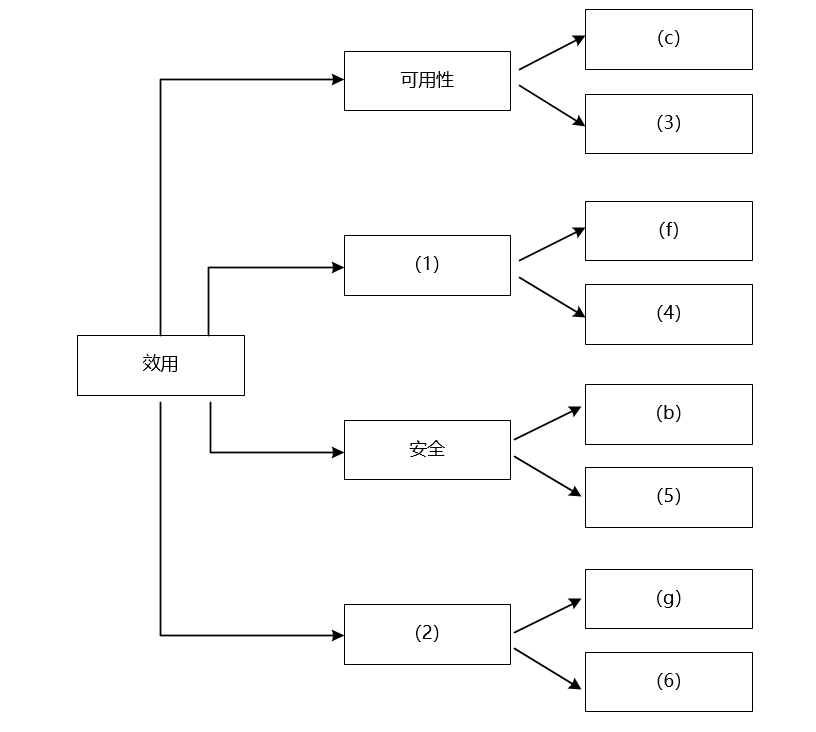
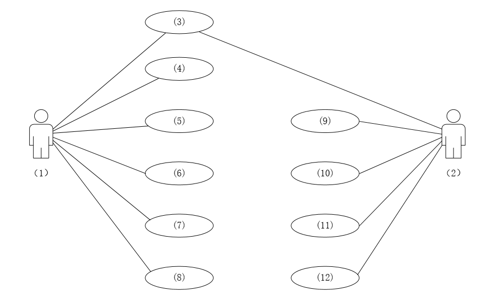
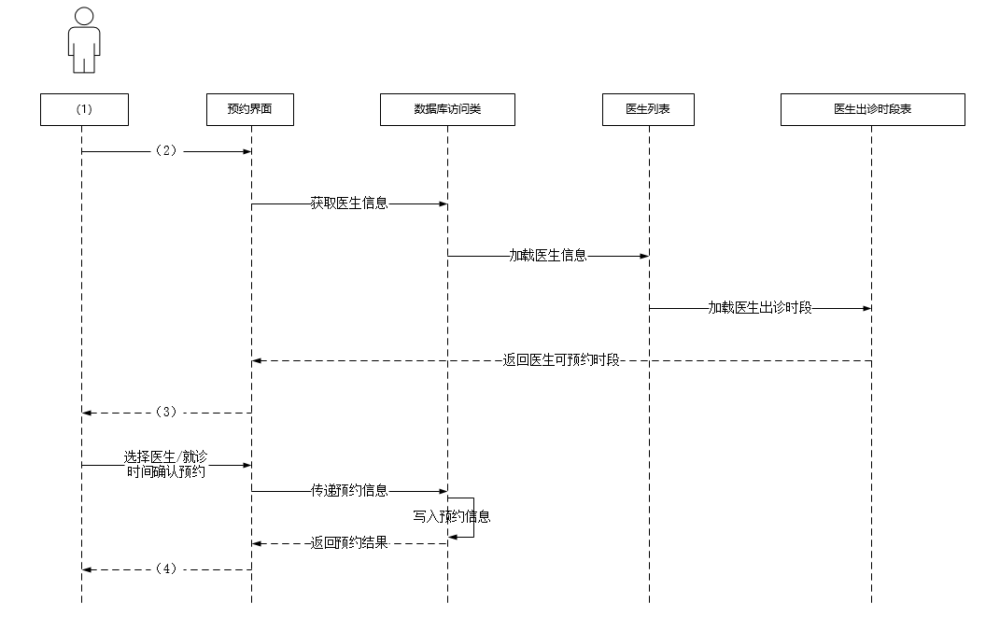
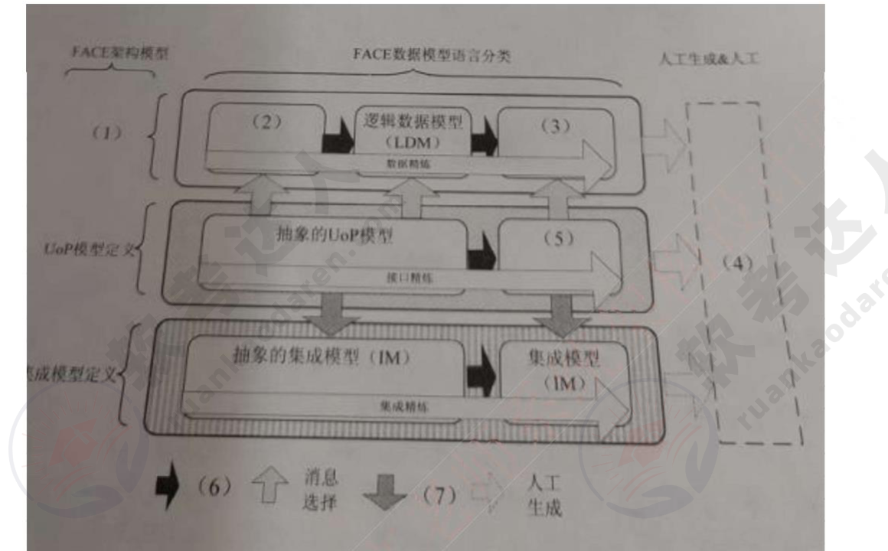
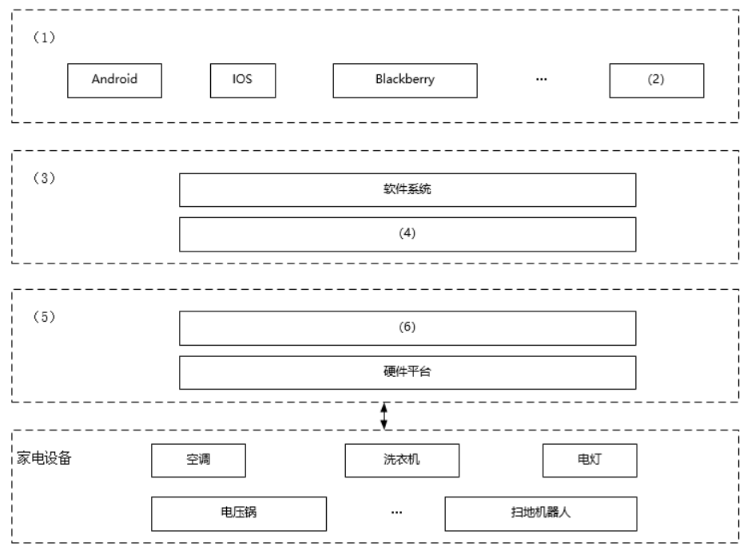
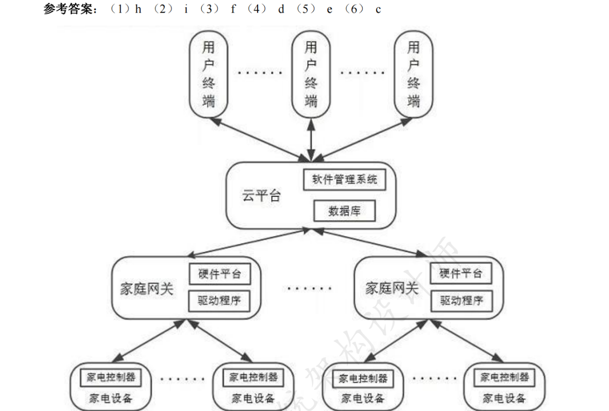

# 2021年下半年 系统架构设计师 · 下午题

> 卷面信息（试卷首页）：考试时间 13:30~15:00，共 90 分钟。本试卷共五道题。试题一为必答题；试题二至试题四中任选两道进行解答，如果解答超过两道，则以题号小的两道进行计分；每题 25 分，满分 75 分。答题纸指定位置填写所在省、自治区、直辖市、计划单列市的名称，准考证号、出生年月日和姓名；答题纸上除填写上述内容外只能写解答；解答时字迹务必清楚，字迹不清时将不评分。
>
> 首页例题：2021 年下半年全国计算机技术与软件专业技术资格（水平）考试日期是（88）月（89）日。正确解答为“11 月 5 日”，对应栏内写“11”和“5”。

## 题号目录

| 题号 | 考点 | 教程章节 |
|------|------|----------|
| Q1–Q2（试题一、二） | 软件架构评估（质量属性效用树）、架构风格对比；UML 用例图/顺序图、对象模型/动态模型/功能模型 | 08 质量属性与架构评估、07 系统架构设计 |
| Q3（试题三，题目不全，转录自合并来源） | 嵌入式数据架构设计、FACE 架构数据模型语言 | 16 嵌入式系统架构 |
| Q4（试题四） | 数据库反规范化设计、Redis 缓存与 MySQL 实时同步 | 06 数据库设计 |
| Q5（试题五） | Web 系统架构（云平台智能家居）、TCP/UDP | 07 系统架构设计 |

## 原题转录（视觉核验）

---

## Q1（试题一，25 分）

阅读以下关于软件架构设计与评估的叙述，在答题纸上回答问题 1 和问题 2。

【说明】

某公司拟开发一套机器学习应用开发平台，支持用户使用浏览器在线进行基于机器学习的智能应用开发活动。该平台的核心应用场景是用户通过拖拽算法组件灵活定义机器学习流程，采用自助方式进行智能应用设计、实现与部署，并可以开发新算法组件加入平台中。在需求分析与架构设计阶段，公司提出的需求和质量属性描述如下：

（a）平台用户分为算法工程师、软件工程师和管理员等三种角色，不同角色的功能界面有所不同；

（b）平台应该具备数据库保护措施，能够预防核心数据库被非授权用户访问；

（c）平台支持分布式部署，当主站点断电后，应在 20 秒内将请求重定向到备用站点；

（d）平台支持初学者和高级用户两种界面操作模式，用户可以根据自己的情况灵活选择合适的模式；

（e）平台主站点宕机后，需要在 15 秒内发现错误并启用备用系统；

（f）在正常负载情况下，机器学习流程从提交到开始执行，时间间隔不大于 5 秒；

（g）平台支持硬件扩容与升级，能够在 3 人天内完成所有部署与测试工作；

（h）平台需要对用户的所有操作过程进行详细记录，便于审计工作；

（i）平台部署后，针对界面风格的修改需要在 3 人天内完成；

（j）在正常负载情况下，平台应在 0.5 秒内对用户的界面操作请求进行响应；

（k）平台应该与目前国内外主流的机器学习应用开发平台的界面风格保持一致；

（l）平台提供机器学习算法的远程调试功能，支持算法工程师进行远程调试。

在对平台需求、质量属性描述和架构特性进行分析的基础上，公司的架构师给出了三种候选的架构设计方案，公司目前正在组织相关专家对平台架构进行评估。

【问题 1】（9 分）

在架构评估过程中，质量属性效用树（utility tree）是对系统质量属性进行识别和优先级排序的重要工具。请将合适的质量属性名称域入图 1-1 中（1）、（2）空白处，并从题干中的（a）~（l）中选择合适的质量属性描述，填入（3）~（6）空白处，完成该平台的效用树。

> 校核注：题干“名称域入”两个来源均如此印，疑为“填入”之误，照录原文。

【问题 2】（16 分）

针对该系统的功能，赵工建议采用解释器（interpreter）架构风格，李工建议采用管道-过滤器（pipe-and-filter）的架构风格，王工则建议采用隐式调用（implicit invocation）架构风格。请针对平台的核心应用场景，从机器学习流程定义的灵活性和学习算法的可扩展性两个方面对三种架构风格进行对比与分析，并指出该平台更适合采用哪种架构风格。

**来源所列答案**（【问题 1】参考答案）：（1）性能　（2）可修改性　（3）e　（4）j　（5）h　（6）i

**来源解析**（【问题 1】答案解析）：架构评估是软件开发过程的重要环节，在架构评估中的质量属性有：性能、可用性、可修改性、安全性、可靠性、易用性。质量属性效用树（Utility Tree）是对质量属性进行分类、权衡、分析的架构分析工具，它主要关注系统的性能、可用性、可修改性和安全性这四个方面的质量属性。本题中，（b）（h）属于安全性；（f）（g）属于性能；（c）（e）属于可用性；（g）（i）属于可修改性；

> ⚠️ 待核验：来源解析中（g）同时被归入“性能”与“可修改性”，且解析未解释答案（4）=j 的归属；按参考答案与效用树结构，应为（f）（j）属性能、（g）（i）属可修改性，解析原文疑有排版错误。

**来源所列答案**（【问题 2】）：未单列答案句，来源解析结论为“只有解释器风格……适合本题中的机器学习应用”，即应采用解释器风格。

**来源解析**（【问题 2】答案/答案解析）：管道-过滤器风格具备高内聚低耦合、支持软件重用、扩展性好、支持并发等优点，但它有编写复杂、不适合处理交互应用等缺点；

隐式调用基于事件触发思想，具备支持软件重用、改进系统方便等优点，但它有构件放弃了对系统计算的控制、事件传递中的数据交换存在问题、语义依赖于被触发事件的上下文约束等缺点。

解释器通常包括解释引擎、代码存储区、记录解释引擎当前工作状态的数据结构、记录源代码被解释执行进度的数据结构。它含有一个虚拟机，可以仿真硬件的执行过程和一些关键应用，其缺点是执行效率比较低。优点：语法由很多类（每个规则对应一个类）表示，容易改变及扩展；缺点：如果语法规则数量太多，会增加系统复杂度，性能下降。

本题中，由于需要交互操作，显然管道-过滤器风格不合适；基于事件触发的隐式调用风格也不合适；只有解释器风格通过灵活自定义规则，具备较强的灵活性和可扩展性，适合本题中的机器学习应用。

> 校核注：另源（2021.11系统架构设计师真题及解析.pdf 第20-21页）【问题 2】答案表述不同：结论“应采取解释器风格”，并分述“（1）解释器风格是自定义了一套规则供使用者使用，使用者基于这个规则来开发构件，能够跨平台适配”“（2）管道-过滤器风格每个构件都有一组输入和输出，构件读取输入的数据流，经过内部处理（计算或增值），产生输出数据流……过滤器就是构件，连接件就是管道”“（3）隐式调用风格是构件不直接调用一个过程，而是触发或广播一个或多个事件……”，另附按语“本题的题型和我考前发布的案例冲刺题预测类似……整体拿 18 分应该没问题”。两源结论一致，文字详略不同。

---

## Q2（试题二，25 分）

阅读以下关于软件系统设计与建模的叙述，在答题纸上回答问题 1 至问题 3。

【说明】

某医院拟委托软件公司开发一套预约挂号管理系统，以便为患者提供更好的就医体验，为医院提供更加科学的预约管理。本系统的主要功能描述如下：（a）注册登录，（b）信息浏览，（c）账号管理，（d）预约挂号，（e）查询与取消预约，（f）号源管理，（g）报告查询，（h）预约管理，（i）报表管理，（j）信用管理等。

【问题 1】（6 分）

若采用面向对象方法对预约挂号管理系统进行分析，得到如图 2-1 所示的用例图。请将合适的参与者名称填入图 2-1 中的（1）和（2）处，使用题干给出的功能描述（a）~（j），完善用例（3）~（12）的名称，将正确答案填在答题纸上。

【问题 2】（10 分）

预约人员（患者）登录系统后发起预约挂号请求，进入预约界面。进行预约挂号时使用数据库访问类获取医生的相关信息，在数据库中调用医生列表，并调取医生出诊时段表，将医生出诊时段反馈到预约界面，并显示给预约人员；预约人员选择医生及就诊时间后确认预约，系统反馈预约结果，并向用户显示是否预约成功。

采用面向对象方法对预约挂号过程进行分析，得到如图 2-2 所示的顺序图，使用题干中给出的描述，完善图 2-2 中对象（1），及消息（2）~（4）的名称，将正确答案填在答题纸上，请简要说明在描述对象之间的动态交互关系时，协作图与顺序图存在哪些区别。

【问题 3】（9 分）

采用面向对象方法开发软件，通常需要建立对象模型、动态模型和功能模型，请分别介绍这 3 种模型，并详细说明它们之间的关联关系，针对上述模型，说明哪些模型可用于软件的需求分析？

**来源所列答案**（【问题 1】参考答案）：（1）系统操作员（系统管理员）　（2）预约人（患者）　（3）（a）注册登录　（4）-（8）（c）、（f）、（h）、（i）、（j）［注意：与次序无关］　（9）-（12）（b）、（d）、（e）、（g）［注意：与次序无关］

**来源解析**（【问题 1】答案解析）：分析图 2-1，该系统主要有两类使用者，一类是医院内部的操作人员，另一类是预约人员或患者，再结合题干描述的功能介绍，不难得出两类人员所使用的功能模块。

左边是系统操作者，使用功能包括：（a）注册登录、（c）账号管理、（f）号源管理、（h）预约管理、（j）信用管理。从字面上看，含有“\*\*管理”的功能应该属于系统操作者。

右边是预约人员（患者），使用功能包括：（a）注册登录、（b）信息浏览、（d）预约挂号、（e）查询与取消预约、（g）报告查询。

其中，（a）注册登录属于两者都需要的功能。

> 校核注：另源（2021.11系统架构设计师真题及解析.pdf 第23页）【问题 1】答案将（1）作“系统管理员”、（2）作“患者”，其余相同。

**来源所列答案**（【问题 2】）：（1）预约人员（患者）　（2）发起预约挂号请求　（3）显示医生出诊时段　（4）显示是否预约成功

**来源解析**（【问题 2】）：序列图强调交互的消息时间顺序。

协作图强调接受和发送消息的对象的结构组织，强调通信的方式。

**来源所列答案**（【问题 3】）：未单列答案句。

**来源解析**（【问题 3】答案/答案解析）：对象模型描述系统中对象的静态结构、对象之间的关系、属性和操作，主要用对象图来实现。

动态模型描述与时间和操作顺序有关的系统特征，例如，激发事件、事件序列、确定事件先后关系的状态等，主要用状态图来实现。

功能模型描述一个计算如何从输入值得到输出值，它不考虑计算的次序，主要用 DFD 来实现。

功能模型指发生了什么，动态模型确定什么时候发生，而对象模型确定发生的客体。上述模型均可用于需求分析。

> 校核注：另源（2021.11系统架构设计师真题及解析.pdf 第23页）【问题 3】末句作“对象设计建立基于分析模型的设计模型并考虑实现细节，可用于软件的需求分析。”，与主来源“上述模型均可用于需求分析”表述不同，两源结论有出入，照录备查。

---

## Q3（试题三，25 分）

> 校核注（来源说明）：主来源（2019-2024 案例分析卷第19-25页）不含试题三，试题二之后直接为试题四；答案解析卷（第72-76页）同样无试题三。本题转录自合并来源（2021.11系统架构设计师真题及解析.pdf 第24-25页），该来源注明“题目不全，暂无答案，待补充”。问题 3 未见于该来源。

阅读以下关于嵌入式数据架构设计的相关描述，在答题纸上回答问题 1 至问题 3。

【说明】

数据架构（Data architecture）是系统架构设计的主要工作之一。它主要用于描述业务数据以及数据间的关系。数据架构着重考虑“数据需求”，关注的是持久化数据的组织，数据架构的设计过程主要包括：数据定义、数据分布与数据管理。某公司为了适应宇航装备的持续发展，提升本公司的核心竞争力，改变原来事件驱动的架构设计模式。公司领导将新产品架构规划工作交给张工。张工经过分析、调研给出了本企业宇航产品的未来架构规划方案。

【问题 1】（9 分）

张工在规划方案中指出：宇航装备要实现以数据为中心的架构设计模式，就应改变传统的各个子系统独立设计方式，打破原宇航装备的生产关系。为了达到这个目标，我们首先要解决装备数据的共享、管理和存储等问题，做好顶层的数据架构规划工作。请用 300 字以内的文字说明数据定义、数据分布与数据管理的具体内涵。

【问题 2】（7 分）

张工在规划方案中提出公司未来产品设计要遵从一种开放式的架构体系，并在此基础上完善数据架构的设计工作，形成一套规格化的数据模型语言。张工给出了基于 FACE（Future Airborne Capability Environment）架构的新产品架构，其中，图 3-1 说明了数据模型语言在架构模型中作用。

【问题 3】：该来源未提供（原卷应有，缺失）。

**来源所列答案**：题目不全，暂无答案，待补充。（该来源原注）

**来源解析**：题目不全，暂无答案，待补充，从已有信息来看，本题不应该选。（该来源原注）

---

## Q4（试题四，25 分）

阅读以下关于数据库设计的叙述，在答题纸上回答问题 1 至问题 3。

【说明】

某医药销售企业因业务发展，需要建立线上药品销售系统，为用户提供便捷的互联网药品销售服务、该系统除了常规药品展示、订单、用户交流与反馈功能外，还需要提供当前热销产品排名、评价分类管理等功能。

通过对需求的分析，在数据管理上初步决定采用关系数据库（MySQL）和数据库缓存（Redis）的混合架构实现。

经过规范化设计之后，该系统的部分数据库表结构如下所示。

供应商（供应商 ID，供应商名称，联系方式，供应商地址）；

药品（药品 ID，药品名称，药品型号，药品价格，供应商 ID）；

药品库存（药品 ID，当前库存数量）；

订单（订单号码，药品 ID，供应商 ID，药品数量，订单金额）；

【问题 1】（9 分）

在系统初步运行后，发现系统数据访问性能较差。经过分析，刘工认为原来数据库规范化设计后，关系表过于细分，造成了大量的多表关联查询，影响了性能。例如当用户查询商品信息时，需要同时显示该药品的信息、供应商的信息、当前库存等信息。

为此，刘工认为可以采用反规范化设计来改造药品关系的结构，以提高查询性能。修改后的药品关系结构为：

药品（药品 ID，药品名称，药品型号，药品价格，供应商 ID，供应商名称，当前库存数量）；

请用 200 字以内的文字说明常见的反规范化设计方法，并说明用户查询商品信息应该采用哪种反规范化设计方法。

【问题 2】（9 分）

王工认为，反规范化设计可提高查询的性能，但必然会带来数据的不一致性问题。请用 200 字以内的文字说明在反规范化设计中，解决数据不一致性问题的三种常见方法，并说明该系统应该采用哪种方法。

【问题 3】（7 分）

该系统采用了 Redis 来实现某些特定功能（如当前热销药品排名等），同时将药品关系数据放到内存以提高商品查询的性能，但必然会造成 Redis 和 MySQL 的数据实时同步问题。

（1）Redis 的数据类型包括 String、Hash、List、Set 和 ZSet 等，请说明实现当前热销药品排名的功能应该选择使用哪种数据类型。

（2）请用 200 字以内的文字解释说明解决 Redis 和 MySQL 数据实时同步问题的常见方案。

**来源所列答案**（【问题 1】）：未单列答案句，来源解析结论为“本题中用到了重新组表的方式”。

**来源解析**（【问题 1】答案/答案解析）：常见的反规范化技术有增加冗余列、增加派生列、重新组表和分割表。

（1）增加冗余列：增加冗余列是指在多个表中具有相同的列，它常用来在查询时避免连接操作。

（2）增加派生列指增加的列可以通过表中其他数据计算生成。它的作用是在查询时减少计算量，从而加快查询速度。

（3）重新组表指如果许多用户需要查看两个表连接出来的结果数据，则把这两个表重新组成一个表来减少连接而提高性能。

（4）表分割有水平分割、垂直分割两种。

水平分割表，按记录进行分割，把数据放到多个独立的表中，主要用于表数据规模很大、表中数据相对独立或数据需要存放到多个介质上时使用。

垂直分割表，对表进行分割，将主键与部分列放到一个表中，主键与其它列放到另一个表中，在查询时减少 I/O 次数。

本题中用到了重新组表的方式。

> ⚠️ 待核验：另源（2021.11系统架构设计师真题及解析.pdf 第26-27页）同题答案结论为“用户查询商品信息采用的是增加冗余列的方式”，与本来源“重新组表”不一致；按题干（将供应商名称、当前库存数量并入药品表）两种说法各有依据，此处照录两源差异，不改答案。

**来源所列答案**（【问题 2】）：批处理维护、应用逻辑和触发器（来源“答案/答案解析”首句所列出者；未再单列结论句，按来源解析，该系统应采用触发器）。

**来源解析**（【问题 2】答案/答案解析）：解决数据不一致性问题的三种常见方法，有批处理维护、应用逻辑和触发器。

（1）批处理维护：通过定期运行一批处理作业或存储过程对数据库进行修改，适用于对实时性要求不高的情况。

（2）应用逻辑：在同一事务中对所有涉及的表进行增、删、改操作。同一逻辑必须在所有的应用中使用和维护，容易遗漏，特别是在需求变化时，不易于维护。

（3）触发器：对数据的任何修改立即触发对数据库某些列的相应修改。触发器实时性好，也易于维护。

**来源所列答案**（【问题 3】）：（1）ZSet

**来源解析**（【问题 3】答案/答案解析）：（1）ZSet

Redis 数据类型：

String：基本类型。可用于缓存层或计数器，如视频播放量、文章浏览量等。

Hash：代替 string 类型，节省空间。描述用户信息较为方便。

Set：无序集合，每个值不能重复。可用于去重、抽奖、初始化用户池等。

List：双向链表结构，可以模拟栈、队列等形式。可用于回复评论、点赞。

ZSet：有序集合、每个元素有一个分数。如首页推荐 10 个最热门的帖子。

（2）Redis 和 MySQL 数据实时同步方案有下面三种：

①引用 Mysql 的事务，因为事务有一致性保证，事务提交成功后再更新缓存；

②在缓存里面引用一些访问控制位，数据库数据变化后，同步变更对应的访问控制位，然后从缓存查询时，率先判断该访问控制位，有变化就从数据库查，无变化直接从缓存返回数据；

③三是通过数据库中间件产品保证缓存和数据库数据时时同步。

> 校核注：另源（2021.11系统架构设计师真题及解析.pdf 第27页）对（2）给出四种方案：①实时同步方案（查询缓存查不到再从 DB 查询并保存到缓存；更新时先更新数据库，再将缓存设置过期）；②并发程度较高时采用异步队列方式同步，可采用 kafka 等消息中间件处理消息生产和消费；③使用阿里的同步工具 canal（模拟 mysql slave 和 master 的同步机制，监控 DB bitlog 的日志更新来触发缓存的更新）；④采用 UDF 自定义函数的方式，面对 mysql 的 API 进行编程，利用触发器进行缓存同步。与主来源三种方案表述不同，照录备查。

---

## Q5（试题五，25 分）

阅读以下关于 Web 系统架构设计的教述，在答题纸上回答问题 1 至问题 3。

【说明】

某公司拟开发一个智能家居管理系统，该系统的主要功能需求如下：1）用户可使用该系统客户端实现对家居设备的控制，且家居设备可向客户端反馈实时状态；2）支持家居设备数据的实时存储和查询；3）基于用户数据，挖掘用户生活习惯，向用户提供家居设备智能化使用建议。

基于上述需求，该公司组建了项目组，在项目会议上，张工给出了基于家庭网关的传统智能家居管理系统的设计思路，李工给出了基于云平台的智能家居系统的设计思路。经过深入讨论，公司决定采用李工的设计思路。

【问题 1】（8 分）

请用 400 字以内的文字简要描述基于家庭网关的传统智能家居管理系统和基于云平台的智能家居管理系统在网关管理、数据处理和系统性能等方面的特点，以说明项目组选择李工设计思路的原因。

【问题 2】（12 分）

请从下面给出的（a）~（j）中进行选择，补充完善图 5-1 中空（1）~（6）处的内容，协助李工完成该系统的架构设计方案。

（a）Wi-FI　（b）蓝牙　（c）驱动程序　（d）数据库　（e）家庭网关　（f）云平台　（g）微服务　（h）用户终端　（i）鸿蒙　（j）TCP/IP

> 校核注：选项（a）原文印作“Wi-FI”、图 5-1 中第一个框原文印作“Adroid”，均疑为“Wi-Fi”“Android”之误，照录原文。

【问题 3】（5 分）

该系统需实现用户终端与服务端的双向可靠通信，请用 300 字以内的文字从数据传输可靠性的角度对比分析 TCP 和 UDP 通信协议的不同，并说明该系统应采用哪种通信协议。

**来源所列答案**（【问题 1】）：未单列答案句。

**来源解析**（【问题 1】答案/答案解析）：在网关管理方面，基于云平台的智能家居管理系统可以将分散的智能家居网关数据集中起来，实现对智能家居网关的远程高效管理。

在数据处理方面，云端服务器对智能家居网关数据进行备份存储，当家庭网关由于故障等原因导致数据丢失时，可以通过云端管理系统对网关数据进行恢复，从而提高数据的容灾性。

在系统性能方面，基于云服务平台的智能家居管理系统将数据信息存储在云端，减少了数据请求时间，提高了通信效率。

**来源所列答案**（【问题 2】参考答案）：（1）h　（2）i　（3）f　（4）d　（5）e　（6）c

**来源解析**（【问题 2】答案解析）：分析图 5-1 可知，系统为典型的分层架构：

（1）层为用户交互层；（3）层为平台层；（5）层为通信网关层。

（1）层包含多种移动 app 操作系统，推知（2）为鸿蒙 OS。

（3）层为云平台层，包含各种软件系统、数据库等。

（5）层为网关层，包含硬件系统及其驱动或通信协议。

**来源所列答案**（【问题 3】）：未单列答案句，来源解析结论为“该系统应采用 TCP 协议”。

**来源解析**（【问题 3】答案/答案解析）：TCP 在 IP 协议提供的不可靠数据服务的基础上，采用了重发技术，为应用程序提供了一个可靠的、面向连接的、全双工的数据传输服务。TCP 协议一般用于传输数据量比较少，且对可靠性要求高的场合。

UDP 是一种不可靠的、无连接的协议，可以保证应用程序进程间的通信，与 TCP 相比，UDP 是一种无连接的协议，它的错误检测功能要弱得多。

该系统应采用 TCP 协议。

> 校核注：另源（2021.11系统架构设计师真题及解析.pdf 第29页）【问题 2】答案将字母与名称并写作“（1）h 用户终端（2）i 鸿蒙（3）f 云平台（4）d 数据库（5）e 家庭网关（6）c 驱动程序”，并附按语“本题应该选，典型的选图填空题……整体可以拿 15 分以上”，与主来源参考答案一致。

---

## 缺口清单

- **Q3（试题三）题目不全**：仅转录自合并来源（2021.11 真题及解析第24-25页），该来源自身标注“题目不全，暂无答案，待补充”；问题 3 缺失，无答案解析。主来源（2019-2024 案例分析卷及答案解析卷）整题缺失。
- 其余题目（Q1、Q2、Q4、Q5）题干、问题、答案解析在主来源题目页 19-25、答案页 72-76 中完整，已逐页视觉核验。
