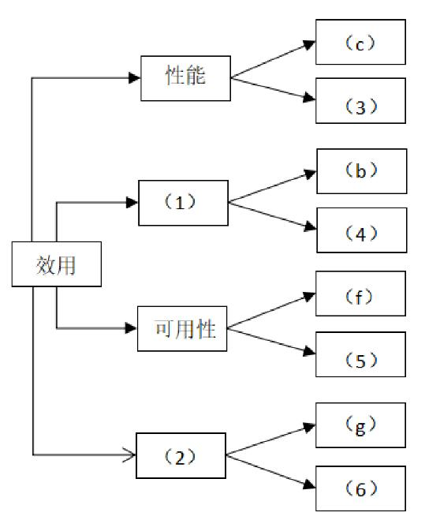
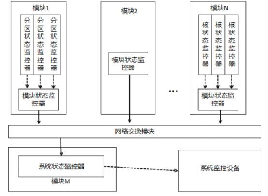
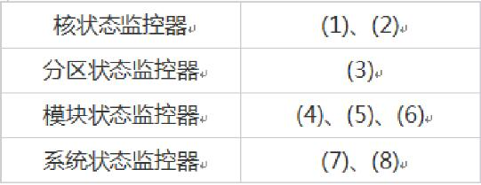
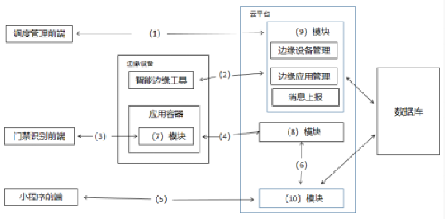

# 2022年下半年 系统架构设计师 · 下午题

> 卷面信息：考试时间 13:30~15:00 共 90 分钟。本试卷共 5 道题。试题一为必答题；试题二至试题四中任选两道进行解答，如果解答超过两道，则以题号小的两道进行计分；每题 25 分，满分 75 分。（说明 16-20 照录：17. 在答题纸的指定位置填写你所在的省、自治区、直辖市、计划单列市的名称。18. 解在答题纸的指定位置填写准考证号、出生年月日和姓名。19. 答题纸上除填写上述内容外只能写解答。20. 解答时字迹务必清楚，字迹不清时，将不评分。）
>
> 卷面例题：2022 年下半年全国计算机技术与软件专业技术资格（水平）考试日期是 (88) 月 (89) 日。因为正确的解答是"11 月 5 日"，故在答题纸的对应栏内写上"11"和"5"（参看下表）。

| 例题 | 解答栏 |
|------|--------|
| (1) | 11 |
| (2) | 5 |

> 校核注：另源（2022.11系统架构设计师真题及解析.pdf，第 23 页）将选答说明印作"从下列的 4 道试题（试题二至试题五）中任选 2 道解答。请在答题纸上的指定位置处将所选择试题的题号框涂黑。若多涂、少涂或者未涂题号框，则对题号最小的两道试题进行评分"，与主来源本页说明 16 措辞不同（本卷实有试题二至试题五共 4 道选答题）。

## 题号目录

| 题号 | 考点 | 教程章节 |
|------|------|----------|
| Q1（试题一，必答，25 分） | 质量属性效用树、面向对象与解释器架构风格对比 | 08 质量属性与评估 |
| Q2（试题二，25 分） | 数据流图 DFD 补全、总体 E-R 图实体、数据流图与数据字典作用 | 05 软件工程 |
| Q3（试题三，25 分） | 嵌入式分布式系统故障检测（心跳/超时探测）、故障分类监控、数据驱动诊断 | 16 嵌入式 |
| Q4（试题四，25 分） | 数据库缓存一致性（实时同步 vs 异步准实时）、哈希与一致性哈希分片、布隆过滤器 | 06 数据库 |
| Q5（试题五，25 分） | 边缘计算智能门禁系统、HTTP/MQTT 协议选型、边缘计算优势 | 11 未来信息综合技术 |

## 原题转录（视觉核验）

---

## Q1（试题一，必答题，共 25 分）

阅读以下关于软件架构设计与评估的叙述，在答题纸上回答问题 1 和问题 2。

**【说明】**

某电子商务公司拟升级其会员与促销管理系统，向用户提供个性化服务，提高用户的粘性。在项目立项之初，公司领导层一致认为本次升级的主要目标是提升会员管理方式的灵活性，由于当前用户规模不大，业务也相对简单，系统性能方面不做过多考虑。新系统除了保持现有的四级固定会员制度外，还需要根据用户的消费金额、偏好、重复性等相关特征动态调整商品的折扣力度，并支持在特定的活动周期内主动筛选与活动主题高度相关的用户集合，提供个性化的打折促销活动。

在需求分析与架构设计阶段，公司提出的需求和质量属性描述如下：

- (a) 管理员能够在页面上灵活设置折扣力度规则和促销活动逻辑，设置后即可生效；
- (b) 系统应该具备完整的安全防护措施，支持对恶意攻击行为进行检测与报警；
- (c) 在正常负载情况下，系统应在 0.3 秒内对用户的界面操作请求进行响应；
- (d) 用户名是系统唯一标识，要求以字母开头，由数字和字母组合而成，长度不少于 6 个字符；
- (e) 在正常负载情况下，用户支付商品费用后在 3 秒内确认订单支付信息；
- (f) 系统主站点电力中断后，应在 5 秒内将请求重定向到备用站点；
- (g) 系统支持横向存储扩展，要求在 2 人天内完成所有的扩展与测试工作；
- (h) 系统宕机后，需要在 10 秒内感知错误，并自动启动热备份系统；
- (i) 系统需要内置接口函数，支持开发团队进行功能调试与系统诊断；
- (j) 系统需要为所有的用户操作行为进行详细记录，便于后期查阅与审计；
- (k) 支持对系统的外观进行调整和配置，调整工作需要在 4 人天内完成。

在对系统需求、质量属性描述和架构特性进行分析的基础上，系统架构师给出了两种候选的架构设计方案，公司目前正在组织相关专家对系统架构进行评估。

**【问题 1】（12 分）**

在架构评估过程中，质量属性效用树（utility tree）是对系统质量属性进行识别和优先级排序的重要工具。请将合适的质量属性名称填入图 1-1 中 (1)、(2) 空白处，并选择题干描述的 (a)～(k) 填入 (3)～(6) 空白处，完成该系统的效用树。

**【问题 2】（13 分）**

针对该系统的功能，李工建议采用面向对象的架构风格，将折扣力度计算和用户筛选分别封装为独立对象，通过对象调用实现对应的功能；王工则建议采用解释器（interpreters）架构风格，将折扣力度计算和用户筛选条件封装为独立的规则，通过解释规则实现对应的功能。请针对系统的主要功能，从折扣规则的可改性、个性化折扣定义灵活性和系统性能三个方面对这两种架构风格进行比较与分析，并指出该系统更适合采用哪种架构风格。

**来源所列答案**：

【问题 1】（1）安全性（2）可修改性（3）e（4）j（5）h（6）k

【问题 2】来源以"答案/答案解析"合写，见下。

**来源解析**：

【问题 1】架构评估是软件开发过程的重要环节，在架构评估中的质量属性有：性能、可用性、可修改性、安全性、可靠性、易用性。质量属性效用树（Utility Tree）是对质量属性进行分类、权衡、分析的架构分析工具，它主要关注系统的性能、可用性、可修改性和安全性这四个方面的质量属性。本题中，（c）（e）属于性能；（b）（j）属于安全性；（f）（h）属于可用性；（g）（k）属于可修改性。

【问题 2】面向对象风格通过编写新的规则实现代码，并通过应用重启或热加载添加规则，可修改性稍差；解释器风格通过编写新的规则文件，并通过导入资源文件或外部配置添加规则，可修改性较好。面向对象风格通过策略模式定义规则对象，规则以程序逻辑实现，灵活性较差，解释器风格可灵活定义规则计算表达式，灵活性更好。面向对象风格以编译后代码运算规则，性能好；而虚拟机风格需要加载规则，解析规则，规则运算，再得出结果，性能较差。面向对象风格：效率高质量高易维护，可修改性高，灵活性稍差，性能好；解释器风格：可修改性高，个性化和灵活性强，性能较差；由于本项目的目标是提升灵活性，并且规模不大，因此建议采用解释器风格。

> 校核注：另源（2022年系统架构师考试科目二：案例分析真题及解析.pdf 第 3 页；2022.11系统架构设计师真题及解析.pdf 第 22-23 页）图 1-1 印刷标签与主来源**不同**：另源图中 (1)(2) 上方两个已给分支印作"可用性"（对应 (c)(3)）与"安全"（对应 (f)(5)），而主来源（及两另源答案）为"性能""可用性"。按两源答案 ((c)(e) 属性能、(f)(h) 属可用性) 推断，主来源图 1-1 印刷与答案自洽，另源（科目二 pdf 第 3 页）该图印刷标签疑有误。另源【问题 2】解析文字与主来源不同（结论一致，均为"应采用解释器架构风格"），其表述为："应该选择解释器架构风格。折扣规则的可修改性：解释器风格比面向对象方式实现强。因为解释器风格折扣规则是独立的语法规则，由解释器可对变化的规则进行解析，修改更容易。而面向对象相对固定，有变化需要修改具体的类。个性化折扣定义灵活性：解释器强于面向对象，解释器可以根据用户灵活解释执行规则，做到千人千面。系统性能：面向对象优于解释器。面向对象的实现相对固定，而解释器是运行期动态绑定执行。"

---

## Q2（试题二，共 25 分）

阅读以下关于软件系统设计与建模的叙述，在答题纸上回答问题 1 至问题 3。

**【说明】**

煤炭生产是国民经济发展的主要领域之一，其煤矿的安全非常重要。某能源企业拟开发一套煤矿建设项目安全预警系统，以保护煤矿建设项目从业人员生命安全。本系统的主要功能包括如下 (a)~(h) 所述。

- (a) 项目信息维护
- (b) 影响因素录入
- (c) 关联事故录入
- (d) 安全评价得分
- (e) 项目指标预警分析
- (f) 项目指标填报
- (g) 项目指标审核
- (h) 项目指标确认

**【问题 1】（9 分）**

王工根据煤矿建设项目安全预警系统的功能要求，设计完成了系统的数据流图，如图 2-1 所示。请使用题干中描述的功能 (a)~(h)，补充完善空 (1)~(6) 处的内容，并简要介绍数据流图在分层细化过程中遵循的数据平衡原则。

**【问题 2】（9 分）**

请根据【问题 1】中数据流图表示的相关信息，补充完善煤矿建设项目安全预警系统总体 ER 图（见图 2-2）中实体 (1)~(6) 的具体内容，将正确答案填在答题纸上。

**【问题 3】（7 分）**

在结构化分析和设计过程中，数据流图和数据字典是常用的技术手段，请用 200 字以内的文字简要说明它们在软件需求分析和设计阶段的作用。

**来源所列答案**：

【问题 1】(1)f (2)g (3)h (4)d (5)b (6)e

【问题 2】(1) 项目管理员 (2) 项目经理 (3) 项目指标 (4) 项目信息 (5) 影响因素 (6) 关联事故

**来源解析**：

【问题 1】层间平衡：数据流个数一致，方向一致；图内平衡：有输入无输出的黑洞，有输出无输入的奇迹，输入不足的灰洞。观察图 2-1，(1) 输入的是指标数据，输出的包含项目指标数据表，显然该功能是 f；(2) 由安全副经理操作并输入审核信息，由此可知该功能是 g；同理，(3) 的功能为 h；再来看 (5)，由于输出为事故及影响因素表，可知 (5) 为 b；(6) 输出有指标预警分析表，可知该项功能为 e；最后看 (4)，输入是预警分析的结果，推知因为 d。数据平衡原则有两个，一是父图与子图之间数据要平衡；二是每张子图内数据要平衡，避免奇迹（无入有出）、黑洞（有入无出）、灰洞（无法出）。

【问题 2】结合问题 2，安全员填报的是项目指标表，因此 (3) 应该就是项目指标；又因为项目指标表由项目经理确认，因而 (2) 为项目经理；项目管理员需要维护三类信息，即项目信息、关联事故、影响因素参数，推知 (1) 为项目管理员，(4)、(5)、(6) 为项目信息、关联事故、影响因素参数，注意此三者次序无关。

【问题 3】在分析阶段，数据流图用于界定系统上下文范围和建立业务流程的加工说明，自顶向下对系统进行功能分解；指明数据在系统内移动变换；描述功能及加工规约。数据字典用于建立业务概念有组织的集合，是模型核心库，有组织的系统相关数据元素列表，使涉众对模型中元素有共同的理解。在设计阶段，结构化设计根据概不同的数据流图类别分别做变换和事务映射来初始化系统结构图；根据数据字典中的数据存储描述来建立数据库存储设计。

> 校核注：另源（2022.11系统架构设计师真题及解析.pdf 第 24-25 页）【问题 2】答案作"(1) 项目管理员 (2) 项目经理 (3) 项目指标数据 (4)~(6) 指标参数、项目信息、事故及影响因素参数"，实体 (3) 及 (4)~(6) 表述与主来源略异，所指相同。另源该题另附数据平衡原则展开（父图与子图之间平衡、子图内部加工的输入和输出需要平衡），与主来源解析一致。
> 校核注：另源（2022年系统架构师考试科目二：案例分析真题及解析.pdf 第 4-5 页）图 2-1、图 2-2 扫描退化，图形内文字缺失（图 2-1 下方仅有手写批注"(1)f (2)g"），无法据该源核对图内容；本题图形以主来源为准。

---

## Q3（试题三，共 25 分）

阅读以下关于嵌入式系统故障检测和诊断的相关描述，在答题纸上回答问题 1 至问题 3。

**【说明】**

系统的故障检测和诊断是宇航系统提高装备可靠性的主要技术之一，随着装备信息化的发展，分布式架构下的资源配置越来越多、资源布局也越来越分散，这对系统的故障检测和诊断方法提出了新的要求，为了适应宇航装备的分布式综合化电子系统的发展，解决由于系统资源部署的分散性，造成系统状态的综合和监控困难的问题，公司领导安排张工进行研究。张工经过分析、调研提出了针对分布式综合化电子系统架构的故障检测和诊断的方案。

**【问题 1】（8 分）**

张工提出：宇航装备的软件架构可采用四层的层次化体系结构，即模块支持层、操作系统层、分布式中间件层和功能应用层。为了有效、方便地实现分布式系统的故障检测和诊断能力，方案建议将系统的故障检测和诊断能力构建在分布式中间件内，通过使用心跳或者超时探测技术来实现故障检测器。请用 300 字以内的文字分别说明心跳检测和超时探测技术的基本原理及特点。

**【问题 2】（8 分）**

张工针对分布式综合化电子系统的架构特征，给出了初步设计方案，指出每个节点的故障监测与诊断器主要负责监控系统中所有的故障信息，并将故障信息进行综合分析判断，使用故障诊断器分析出故障原因，给出解决方案和措施。系统可以给模块的每个处理机器核配置核状态监控器、给每个分区配置分区状态监控器、给每个模块配置模块状态监控器、给系统配置系统状态监控器，如图 3-1 所示。

请根据下面给出的分布式综合化电子系统可能产生的故障 (a)~(h)，判断这些故障分别属于哪类监控器检测的范围，完善表 3-1 的 (1)~(8) 的空白。

- (a) 应用程序除零
- (b) 看门狗故障
- (c) 任务超时
- (d) 网络诊断故障
- (e) BIT 检测故障
- (f) 分区堆栈溢出
- (g) 操作系统异常
- (h) 模块掉电

| 监控器类型 | 故障编号 |
|------------|----------|
| 核状态监控器 | (1)、(2) |
| 分区状态监控器 | (3) |
| 模块状态监控器 | (4)、(5)、(6) |
| 系统状态监控器 | (7)、(8) |

**【问题 3】（9 分）**

张工在方案中指出，本系统的故障诊断采用故障诊断器实现，它可综合多种故障信息和系统状态，依据智能决策数据库提供的决策策略判定出故障类型和处理方法。智能决策数据库中的策略可以对故障开展定性或定量分析。通常，在定量分析中，普遍采用基于解析模型的方法和数据驱动的方法，张工在方案中提出该系统定量分析时应采用基于解析模型的方法。但是此提议受到王工的反对，王工指出采用数据驱动的方法更适合分布式综合化电子系统架构的设计。请用 300 字以内的文字，说明数据驱动方法的基本概念，以及王工提出采用此方法的理由。

**来源所列答案**：

【问题 1】（来源以"答案/答案解析"合写，见解析）

【问题 2】(1)a (2)b (3)f (4)c (5)e (6)h (7)d (8)g

**来源解析**：

【问题 1】顾名思义，心跳检测技术是节点以固定频率向其他节点发送心跳信息，表示自己存活。如果一段时间之后仍然没有收到来自此节点的心跳，就认定该节点已失效，其资源和服务就会被接管。优点是可以快速反应，缺点是容易产生误判。超时探测技术是节点主动向被探测节点发出 PING 信号，被探测节点则在收到 PING 信号后回复一个 ECHO 信号，表示自己的健康状态良好，还可以附加一些状态信息。如果在预定的时间之后仍然收不到 ECHO 信号，则判定被探测节点失效。优点是可以获得更详细的探测结果，缺点是判断的周期较长。

【问题 2】(a) 应用程序除零，属于核状态 (b) 看门狗是定期查看芯片内部的情况，一旦发送错误就发出重启信号，属于核状态 (c) 任务超时，属于模块状态 (d) 网络诊断故障，属于系统状态 (e) BIT 检测故障，BIT（Build-in Test）内装测试属于模块状态 (f) 分区堆栈溢出，属于分区状态 (g) 操作系统异常，属于系统状态 (h) 模块掉电，属于模块状态。

【问题 3】数据驱动方法是一种问题求解方法。从初始的数据或观测值出发，运用启发式规则，寻找和建立内部特征之间的关系，从而发现一些定理或定律。通常也指基于大规模统计数据的自然语言处理方法。在本题中，由于是分布式环境，需要综合多种故障信息和系统状态，依据智能决策数据库的决策策略判定，如果采用预先定制的解析模型，这个模型可能会非常复杂。因此采用数据驱动方法能通过已有的数据去训练模型，可以达到逐渐精细化，并兼容未来的变化。

> 校核注：【问题 2】答案存在来源冲突。两个另源（2022年系统架构师考试科目二：案例分析真题及解析.pdf 第 7 页；2022.11系统架构设计师真题及解析.pdf 第 27 页）均作"(1)b (2)e (3)f (4)a (5)d (6)h (7)g (8)c"，与主来源答案在 (1)(2)(4)(5)(7)(8) 上不同。主来源答案与其自身逐条解析（上录）自洽，故正文保留主来源答案；另源答案照录于此备核。
> 校核注：另源【问题 1】心跳解析文字与主来源不同（大意相同："心跳是一种用于故障检测的手段。分布式系统中，各种异常，如：宕机、磁盘损坏、网络故障等，时有发生，通过心跳可以快速有效的定位集群中的错误结点，并做及时的处理保证集群正常服务通常探针会不断发送健康检查来检查服务是否健康。当远程节点没有响应时，我们只能猜测数据包在过程中的某个地方丢失了。下一个操作将是重试或等待一段时间，直到超时。"——该源未单列超时探测段）。另源【问题 3】答案为："通过对系统运行过程中的监测数据进行分析，从而在无精准系统数学模型情况下，对系统进行故障诊断，具体方法包括机器学习、统计分析法和信号分析法。因为宇航系统是一个非常复杂的系统，如果采用张工的方案（基于解析模型的方法），这一类方法需要建立在精准数学模型的基础上来进行故障诊断。但是对于宇航系统这种非常复杂的系统难以精确建模。所以王工提出了数据驱动的方法，不需要精准系统数学模型。"与主来源结论一致、表述不同。

---

## Q4（试题四，共 25 分）

阅读以下关于数据库缓存的叙述，在答题纸上回答问题 1 至问题 3。

**【说明】**

某大型电商平台建立了一个在线 B2B 商店系统，并在全国多地建设了货物仓储中心，通过提前备货的方式来提高货物的运送效率。但是在运营过程中，发现会出现很多跨仓储中心调货从而延误货物运送的情况。为此，该企业计划新建立一个全国仓储货物管理系统，在实现仓储中心常规管理功能之外，通过对在线 B2B 商店系统中订单信息进行及时的分析和挖掘，并通过大数据分析预测各地仓储中心中各类货物的配置数量，从而提高运送效率，降低成本。

当用户通过在线 B2B 商店系统选购货物时，全国仓储货物管理系统会通过该用户所在地址、商品类别以及仓储中心的货物信息和地址，实时为用户订单反馈货物起运地（某仓储中心）并预测送达时间。反馈送达时间的响应时间应小于 1 秒。

为满足反馈送达时间功能的性能要求，设计团队建议在全国仓储货物管理系统中采用数据缓存集群的方式，将仓储中心基本信息、商品类别以及库存数量放置在内存的缓存中，而仓储中心的其它商品信息则存储在数据库系统。

**【问题 1】（9 分）**

设计团队在讨论缓存和数据库的数据一致性问题时，李工建议采取数据实时同步更新方案，而张工则建议采用数据异步准实时更新方案。请用 200 字以内的文字，简要介绍两种方案的基本思路，说明全国仓储货物管理系统应该采用哪种方案，并说明采取该方案的原因。

**【问题 2】（9 分）**

随着业务的发展，仓储中心以及商品的数量日益增加，需要对集群部署多个缓存节点，提高缓存的处理能力。李工建议采用缓存分片方法，把缓存的数据拆分到多个节点分别存储，减轻单个缓存节点的访问压力，达到分流效果。缓存分片方法常用的有哈希算法和一致性哈希算法，李工建议采用一致性哈希算法来进行分片。请用 200 字以内的文字简要说明两种算法的基本原理，并说明李工采用一致性哈希算法的原因。

**【问题 3】（7 分）**

全国仓储货物管理系统开发完成，在运营一段时间后，系统维护人员发现大量黑客故意发起非法的商品送达时间查询请求，造成了缓存击穿，张工建议尽快采用布隆过滤器方法解决。请用 200 字以内的文字解释布隆过滤器的工作原理和优缺点。

**来源所列答案**：（三个问题来源均以"答案/答案解析"合写，见解析）

**来源解析**：

【问题 1】李工同步方案思路，更新数据时在同一事务内依此完成删除缓存，更新数据库，再写入缓存。张工异步准实时方案思路，更新数据时在同一事务内首先通过消息队列发布待更新数据的消息给缓存更新服务，再更新数据库；缓存更新服务订阅消息队列，待收到更新事件执行缓存更新。本项目数据量极大，且性能要求高，较适合采用张工提出的异步准实时方案较好。

【问题 2】哈希算法是把任意长的输入通过某种哈希算法变换成固定长度的一个哈希值，简言之就是按照某种算法散列得到一个值。由于不同的输入可能会有相同的哈希值，所以不能从哈希值来确定唯一的输入值。一致性哈希算法是一种特殊的哈希算法，它将整个哈希值空间映射成一个按顺时针方向组织的虚拟圆环，使用哈希算法算出数据哈希值，然后根据哈希值的位置沿圆环顺时针查找，将数据分配到第一个遇到的集群节点进行缓存。一致性哈希能尽可能小地改变已存在的服务请求与处理请求服务器之间的映射关系，解决了简单哈希算法在分布式哈希表中存在的动态伸缩问题。一致性哈希算法有两大优点，1）可扩展性。一致性哈希算法保证了增加或减少服务器时，数据存储的改变最少，相比传统哈希算法大大节省了数据移动的开销；2）更好地适应数据的快速增长。

【问题 3】布隆过滤器本质上是一种数据结构，比较巧妙的概率型数据结构，特点是高效地插入和查询，告诉你"某个元素一定不存在或者可能存在"。布隆过滤器的原理是当一个元素被加入集合时，通过 K 个散列函数将这个元素映射成一个位数组中的 K 个点，把它们置为 1。检索时，只要看看这些点是不是都是 1 就大概知道集合中有没有它了；如果这些点有任何一个 0，则被检元素一定不在；如果都是 1，则被检元素很可能在。优点：占用内存小；增加和查询元素的时间复杂度为：O(K)，（K 为哈希函数的个数，一般比较小），与数据量大小无关；哈希函数相互之间没有关系，方便硬件并行运算；布隆过滤器不需要存储元素本身，在某些对保密要求比较严格的场合有很大优势；数据量很大时，布隆过滤器可以表示全集，其他数据结构不能；使用同一组散列函数的布隆过滤器可以进行交、并、差运算。缺点：有误判率，即存在假阳性（False Position），不能准确判断元素是否在集合中（概率较小）；不能获取元素本身；一般情况下不能从布隆过滤器中删除元素；如果采用计数方式删除，可能会存在计数回绕问题。

> 校核注：另源（2022.11系统架构设计师真题及解析.pdf 第 28-29 页）本题答案结论与主来源一致（问题 1 建议采用准实时/异步方案，理由为题中性能要求 1 秒内完成、实时同步并发性能不可控），文字表述不同；其【问题 2】作"哈希分片：通过对 key 进行 hash 操作，可以把数据分配到不同实例，这类似于取余操作，余数相同的，放在一个实例上。一致性哈希分片：哈希分片的改进，把存储结点和需要存储的数据都存放在一个 hash 环上，数据根据 hash 值在 hash 环上按正时针方向找到对应的数据存储结点上。一致性哈希分片的方式在扩充缓存结点时，只需要对少量数据进行存储位置的更新，而哈希分片需要对几乎所有数据进行存储位置更新。"【问题 3】作"布隆过滤器通过一个很长的二进制向量和一系列随机映射函数来记录与识别某个数据是否在一个集合中。如果数据不在集合中，能被识别出来，不需要到数据库中进行查找，所以能将数据库查询返回值为空的查询过滤掉。优点：1、占用内存小 2、查询效率高 3、不需要存储元素本身，在某些对保密要求比较严格的场合有很大优势。缺点：1、有一定的误判率，即存在假阳性，不能准确判断元素是否在集合中。2、不能获取元素本身 3、一般情况下不能从布隆过滤器中删除元素"。

---

## Q5（试题五，共 25 分）

阅读以下关于 Web 系统架构设计的叙述，在答题纸上回答问题 1 至问题 3。

**【说明】**

某公司拟开发一套基于边缘计算的智能门禁系统，用于如园区、新零售、工业现场等存在来访、被访业务的场景。来访者在来访前，可以通过线上提前预约的方式将自己的个人信息记录在后台，被访者在系统中通过此请求后，来访者在到访时可以直接通过"刷脸"的方式通过门禁，无需做其他验证。此外，系统的管理员可对正在运行的门禁设备进行管理。

基于项目需求，该公司组建项目组，召开了项目讨论会。会上，张工根据业务需求并结合边缘计算的思想，提出本系统可由访客注册模块、模型训练模块、端侧识别模块与设备调度平台模块等四项功能组成，李工从技术层面提出该系统可使用 Flask 框架与 SSM 框架为基础来开发后台服务器，将开发好的系统通过 Docker 进行部署，并使用 MQTT 协议对 Docker 进行管理。

**【问题 1】（5 分）**

MQTT 协议在工业物联网中得到广泛的应用，请用 300 字以内的文字简要说明 MQTT 协议。

**【问题 2】（14 分）**

在会议上，张工对功能模块进行了更进一步的说明：访客注册模块用于来访者提交申请与被访者确认申请，主要处理提交来访申请、来访申请审核业务，同时保存访客数据，为训练模块准备训练数据集；模型训练模块用于使用访客数据进行模型训练，为端侧设备的识别业务提供模型基础；端侧识别模块在边缘门禁设备上运行，使用训练好的模型来识别来访人员，与云端服务协作完成访客来访的完整业务；设备调度平台模块用于对边缘门禁设备进行管理，管理人员能够使用平台对边缘设备进行调度管理与状态监控，实现云端协同。

图 5-1 给出了基于边缘计算的智能门禁系统架构图，请结合 HTTP 协议和 MQTT 协议的特点，为图 5-1 中 (1)~(6) 处选择合适的协议；并结合张工关于功能模块的描述，补充完善图 5-1 中 (7)~(10) 处的空白。

**【问题 3】（6 分）**

请用 300 字以内的文字，从数据通信、数据安全和系统性能等方面简要分析在传统云计算模型中引入边缘计算模型的优势。

**来源所列答案**：

【问题 2】(1)HTTP (2)HTTP (3)MQTT (4)HTTP (5)HTTP (6)HTTP (7) 端侧识别模块 (8) 模型训练模块 (9) 设备调度平台模块 (10) 访客注册模块

**来源解析**：

【问题 1】MQTT 是一个物联网传输协议，它被设计用于轻量级的发布/订阅式消息传输，旨在为低带宽和不稳定的网络环境中的物联网设备提供可靠的网络服务。MQTT 是专门针对物联网开发的轻量级传输协议。MQTT 协议针对低带宽网络，低计算能力的设备，做了特殊的优化，使得其能适应各种物联网应用场景。

【问题 2】根据 MQTT 的协议特征可知，只有 (3) 才适合，其他均为 HTTP。

【问题 3】传统云计算模型中引入边缘计算模型的优势如下。(1) 速度：如果使用边缘计算，则物联网设备将在边缘数据中心或本地处理数据。因此，数据无需传输回中央服务器，速度优势明显；(2) 安全：边缘计算将在不同的数据中心和设备之间分配数据处理工作。黑客无法通过攻击一台设备来影响整个网络；(3) 可扩展性：通过购买具有足够计算能力的设备来扩展边缘网络。企业无需为其数据需求建立自己的私有或集中式数据中心；(4) 可靠性：所有的边缘数据中心和物联网设备都位于用户附近。因此，网络中断的可能性非常小。

> 校核注：【问题 2】(1)~(6) 存在来源冲突。两个另源（2022年系统架构师考试科目二：案例分析真题及解析.pdf 第 9 页；2022.11系统架构设计师真题及解析.pdf 第 31 页）均作"(1)HTTP (2)MQTT (3)MQTT (4)MQTT (5)HTTP (6)HTTP"，即 (2)(4) 选 MQTT，与主来源（(2)(4) 为 HTTP）不同；(7)~(10) 三源一致。正文保留主来源答案，另源答案照录备核。另源【问题 1】答案文字为："MQTT（消息队列遥测传输）是一个基于发布/订阅模式的消息协议。它工作在 TCP/IP 协议族上，是为硬件性能低下的远程设备以及网络状况糟糕的情况下而设计的发布/订阅型消息协议。MQTT 协议是轻量、简单、开放和易于实现的。"另源【问题 3】答案按数据通信（通信更快捷，数据量更少）、数据安全（数据以加密方式存储在需要用到的边缘设备上，本地化处理比对，减少原始信息在网上传递带来的安全隐患，黑客也无法通过攻破一个结点使整个系统瘫痪）、系统性能（以人脸识别为例，只在本地进行比对，不用把人脸数据传递到远程服务器对比）三方面作答，与主来源四点（速度/安全/可扩展性/可靠性）表述不同、大意相当。

---

## 缺口清单

- 无。本卷试题一至试题五题目、答案、解析均已从主来源逐页视觉转录。
- 合并来源 1（2022年系统架构师考试科目二：案例分析真题及解析.pdf）第 4、5、9 页图 2-1、图 2-2、图 5-1 扫描退化（图形内文字缺失），第 8、10 页内容大面积空白，该源图内容无法辨认；本卷图形一律以主来源为准。
