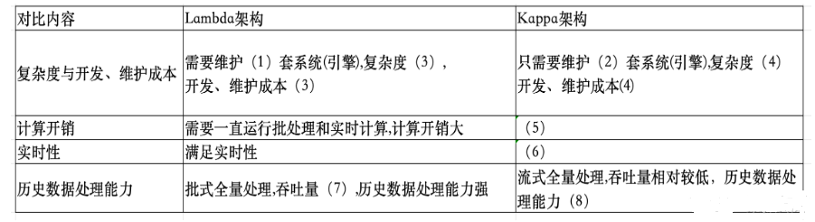
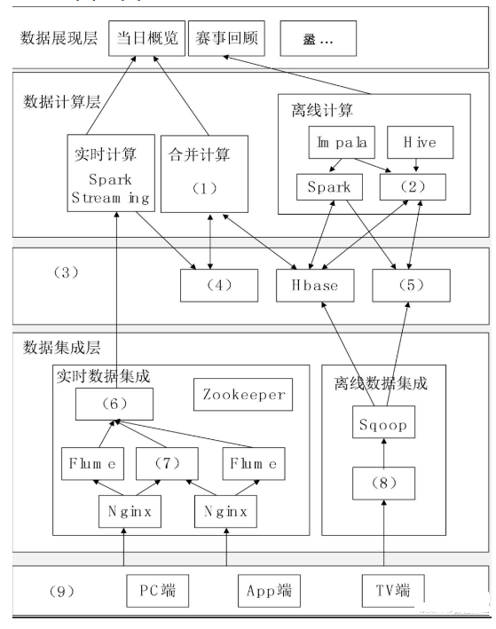
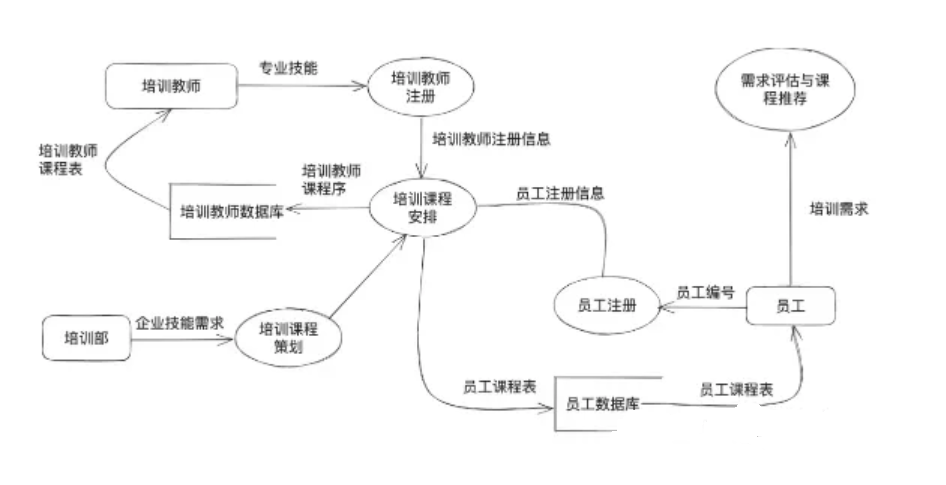
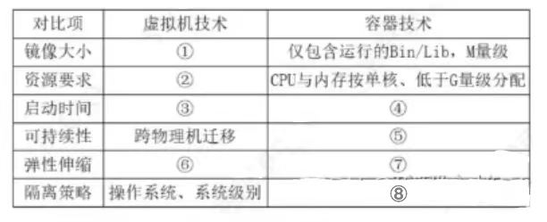
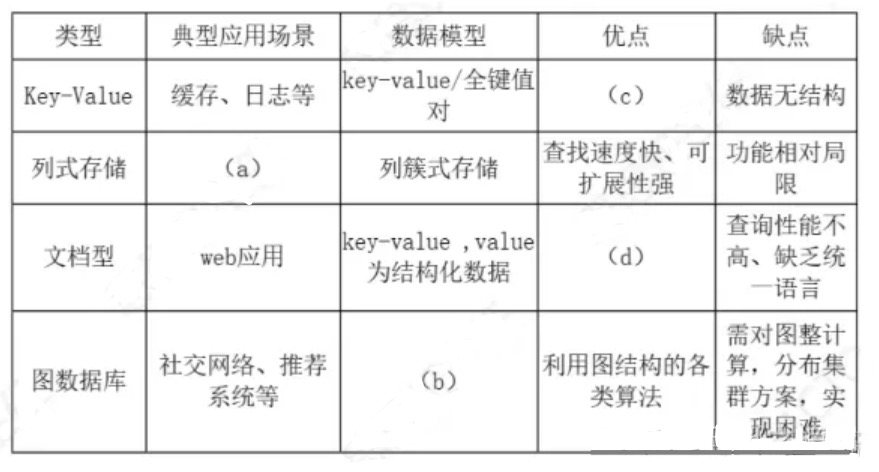
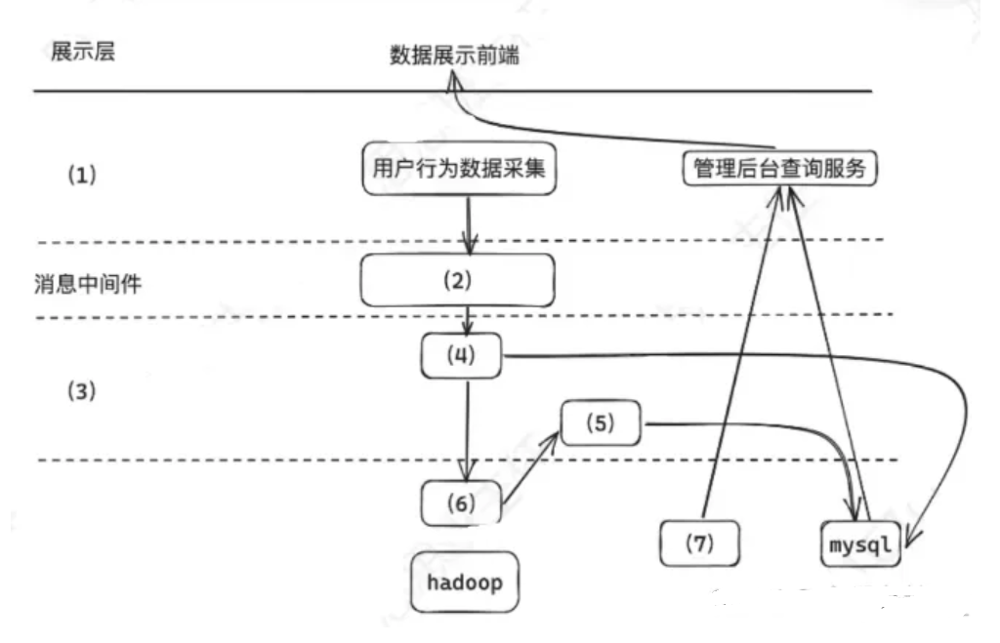
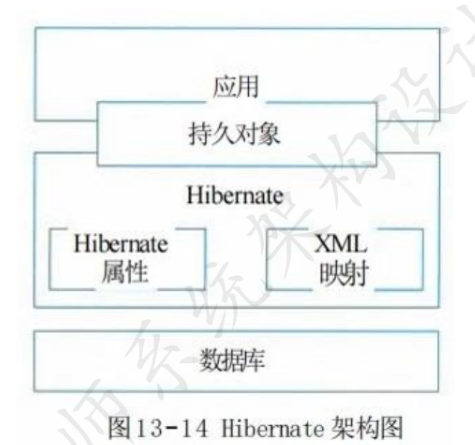
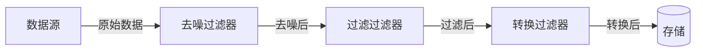

# 2023年下半年 系统架构设计师 · 下午题（案例分析）

> 卷面信息：
> 1. 本试卷满分 75 分，考试时间 150 分钟（14:00～16:30）。
> 2. 试题一为必答题（25分）；试题二至试题五为选答题，考生任选 2 道解答（各25分）。若解答超过 2 道，则题号小的 2 道解答有效。
> 3. 本卷已根据《2023年下半年系统架构设计师案例.pdf》与《2023年下半年系统架构设计师案例答案.pdf》全面补全题干、原版架构图/数据流图/对比表与标准答案。

## 题号目录

| 题号 | 选答属性 | 考点 | 教程章节 |
|------|---------|------|----------|
| Q1 | 必答题 | 大数据架构：某网奥运 Lambda 与 Kappa 架构对比表、大数据平台架构图填空 | [19-大数据架构设计理论与实践.md](https://github.com/Goodyzhang/ruankao.skill/blob/main/materials/%E7%B3%BB%E7%BB%9F%E6%9E%B6%E6%9E%84%E8%AE%BE%E8%AE%A1%E5%B8%88/%E7%AC%94%E8%AE%B0/%E7%9F%A5%E8%AF%86%E7%82%B9/19-%E5%A4%A7%E6%95%B0%E6%8D%AE%E6%9E%B6%E6%9E%84%E8%AE%BE%E8%AE%A1%E7%90%86%E8%AE%BA%E4%B8%8E%E5%AE%9E%E8%B7%B5.md) |
| Q2 | 选答题 | 系统分析与设计：员工在线教育系统结构化分析、数据流图（DFD）三类错误分析与修正 | [05-软件工程基础知识.md](https://github.com/Goodyzhang/ruankao.skill/blob/main/materials/%E7%B3%BB%E7%BB%9F%E6%9E%B6%E6%9E%84%E8%AE%BE%E8%AE%A1%E5%B8%88/%E7%AC%94%E8%AE%B0/%E7%9F%A5%E8%AF%86%E7%82%B9/05-%E8%BD%AF%E4%BB%B6%E5%B7%A5%E7%A8%8B%E5%9F%BA%E7%A1%80%E7%9F%A5%E8%AF%86.md) |
| Q3 | 选答题 | 云原生与嵌入式系统：容器技术（Docker）与虚拟机（VM）架构对比与性能指标对比表 | [14-云原生架构设计理论与实践.md](https://github.com/Goodyzhang/ruankao.skill/blob/main/materials/%E7%B3%BB%E7%BB%9F%E6%9E%B6%E6%9E%84%E8%AE%BE%E8%AE%A1%E5%B8%88/%E7%AC%94%E8%AE%B0/%E7%9F%A5%E8%AF%86%E7%82%B9/14-%E4%BA%91%E5%8E%9F%E7%94%9F%E6%9E%B6%E6%9E%84%E8%AE%BE%E8%AE%A1%E7%90%86%E8%AE%BA%E4%B8%8E%E5%AE%9E%E8%B7%B5.md) |
| Q4 | 选答题 | 数据库架构设计：企业在线社交网络（SNS）系统 NoSQL 数据库调研与混合数据库模型组织 | [06-数据库设计基础知识.md](https://github.com/Goodyzhang/ruankao.skill/blob/main/materials/%E7%B3%BB%E7%BB%9F%E6%9E%B6%E6%9E%84%E8%AE%BE%E8%AE%A1%E5%B8%88/%E7%AC%94%E8%AE%B0/%E7%9F%A5%E8%AF%86%E7%82%B9/06-%E6%95%B0%E6%8D%AE%E5%BA%93%E8%AE%BE%E8%AE%A1%E5%9F%BA%E7%A1%80%E7%9F%A5%E8%AF%86.md) |
| Q5 | 选答题 | 大数据架构设计：电商平台用户行为分析系统、消息中间件削峰、大数据处理架构图、数据脱敏方法 | [19-大数据架构设计理论与实践.md](https://github.com/Goodyzhang/ruankao.skill/blob/main/materials/%E7%B3%BB%E7%BB%9F%E6%9E%B6%E6%9E%84%E8%AE%BE%E8%AE%A1%E5%B8%88/%E7%AC%94%E8%AE%B0/%E7%9F%A5%E8%AF%86%E7%82%B9/19-%E5%A4%A7%E6%95%B0%E6%8D%AE%E6%9E%B6%E6%9E%84%E8%AE%BE%E8%AE%A1%E7%90%86%E8%AE%BA%E4%B8%8E%E5%AE%9E%E8%B7%B5.md) |

## 原题转录（视觉核验）

---

## Q1（试题一）

某网作为某电视台在互联网上的大型门户入口，某一年成为某奥运会中国大陆地区的特权转播商，独家全程直播了某奥运会全部的赛事，积累了庞大稳定的用户群，这些用户在使用各类服务过程中产生了大量数据，对这些海量数据进行分析与挖掘，将会对节目的传播及商业模式变现起到重要的作用。

该奥运期间需要对增量数据在当日概览和赛事回顾两个层面上进行分析。

其中，当日概览模块需要秒级刷新直播在线人数、网站的综合浏览量、页面停留时间、视频的播放次数和平均播放时间等千万级数据量的实时信息，而传统的分布式架构采用重新计算的方式分析实时数据，在不扩充以往集群规模的情况下，无法在几秒内分析出重要的信息。

赛事回顾模块需要展现自定义时间段内的历史最高在线人数、逐日播放走势、直播最高在线人数和点播视频排行等海量数据的统计信息，由于该奥运期间产生的数据通常不需要被经常索引、更新，因此要求采用不可变方式存储所有的历史数据，以保证历史数据的准确性。

### 【问题1】（8分）

请根据 Lambda 架构和 Kappa 架构特点，填写以下表格。

| 对比内容 | Lambda 架构 | Kappa 架构 |
|---------|------------|-----------|
| 复杂度与开发、维护成本 | 需要维护(1)套系统（引擎），复杂度(3)，开发、维护成本(3) | 只需要维护(2)套系统（引擎），复杂度(4)，开发、维护成本(4) |
| 计算开销 | 需要一直运行批处理和实时计算，计算开销大 | (5) |
| 实时性 | 满足实时性 | (6) |
| 历史数据处理能力 | 批式全量处理，吞吐量(7)，历史数据处理能力强 | 流式全量处理，吞吐量相对较低，历史数据处理能力(8) |

**官方参考答案**（源《2023年下半年系统架构设计师案例答案.pdf》第1页）：
- (1) 2
- (2) 1
- (3) 高
- (4) 低
- (5) 必要时进行全量计算，计算开销相对较小
- (6) 满足实时性
- (7) 大
- (8) 弱

**来源解析**：合并来源"2023年下半年系统架构设计师wen老师整理.pdf"第3页考后点评（非逐题解析）："试题一：大数据架构 Lambda 和 Kappa（考前押题中的题目）这个题目我看到了还原的原题，给我都惊讶住了，这不几乎是我考前发的案例押题里的原题吗，也是某网奥运的案例背景，也是两个架构的对比表格，也是 lambda 的三层架构，不但是押中，而且大体都差不多，这要不会该怪谁？"

### 【问题2】（9分）

下图 1 给出了某网奥运的大数据架构图，请根据下面的(a)～(n)的相关技术；判断这此技术属于架构图的哪个部分，补充完善下图 1 的(1)-(9)的空白处。

主来源（2019-2024系统架构设计师真题-案例分析.pdf 第36页）所列选项照录：

- (a) Nginx
- (b) Hbase
- (c) Spark Streaming
- (d) Spark
- (e) MapReduce
- (f) ETL
- (g) MemSQL
- (h) HDFS
- (i) Sqoop
- (j) Flume
- (k) 数据存储层
- (l) kafka 数据采集层
- (m) 业务逻辑层
- (n)（该来源 (n) 项后无文字）

> 校核注：主来源第36页选项列表第(l)~(n)项排布异常（"(l)kafka 数据采集层(m)业务逻辑层(n)"）。另源（2023年软考系统架构师考题分享.pdf 第9页）作："(k) 数据存储层；(l) kafka；(m) 业务逻辑层；(n) 数据采集层"，且该来源所附答案 (9)=n 与其排布一致，使用本题时建议以该排布为准。又：主来源题干"判断这此技术"中"这此"为原件用字（另源第9页作"这些技术"）。

**来源所列答案**（合并来源"2023年软考系统架构师考题分享.pdf"第11页，该来源注明"答案仅供参考，不一定正确"）：(1) d；(2) e；(3) k；(4) g；(5) h；(6) l；(7) j；(8) f；(9) n

**来源解析**：未提供

### 【问题3】（8分，每空2分）

大数据的架构包括了 Lambda 架构和 Kappa 架构，Lambda 架构分解为三层：即(1)、(2)和(3)；Kappa 架构不同于 Lambda 同时计算流计算和批计算并合并视图，Kappa 只会通过流计算一条的数据链路计算并产生视图。

请问该系统的大数据架构是基于哪种架构搭建的大数据平台处理奥运会大规模视频网络观看数据。

**来源所列答案**（合并来源"2023年软考系统架构师考题分享.pdf"第11页）：(1) 批处理层；(2) 加速层；(3) 服务层；该系统的大数据架构是基于 Lambda 架构搭建的大数据平台处理奥运会大规模视频网络观看数据。

**来源解析**：未提供

---

## Q2（试题二：系统分析与设计 / 结构化分析DFD）（25分）

阅读下列说明，回答问题1 至问题2，将解答填入答题纸的对应栏内。

【说明】
某软件公司为企业开发一套员工在线教育系统，支持员工利用业余时间开展专业技术培训，提升员工技能。在项目开展初期，采用结构化分析进行开发，并对系统中培训部员工和培训教师的相关功能进行分析，具体需求如下：
(1) 培训部根据企业技术发展需求，负责策划培训课程，并形成课程计划，针对不同的员工设置不同的课程；
(2) 员工首先在系统进行注册，填写自己的编号，学历，专业，岗位等信息，生成员工注册信息，然后将自己的培训需求录入系统，系统自动评估并进行课程推荐，员工确认后形成课程需求；
(3) 培训教师也通过系统进行注册，填写自己的编号、学历、专业等信息，形成培训教师注册信息；
(4) 系统根据课程计划、员工注册信息，课程需求和培训教师注册信息，为员工和培训教师生成对应的课程表。

同时系统分析师对上述流程进行了审核，并指出需补充数据字典，从而更完整地对系统建模。

### 【问题1】（10分）

数据流图(DFD)是结构化分析方法的重要工具。请用300字以内的文字描述DFD的定义。

**官方参考答案**（源《2023年下半年系统架构设计师案例答案.pdf》第3页）：
数据流图或称数据流程图（DFD），是一种便于用户理解、分析系统数据流程的图形工具。它摆脱了系统的物理内容，精确地在逻辑上描述系统的功能、输入、输出和数据存储等，是系统逻辑模型的重要组成部分。数据流图是结构化分析方法中使用的建模工具，它以图形的方式描绘数据在系统中流动和处理的过程。由于它只反映系统必须完成的逻辑功能，所以它是一种功能模型。在结构化开发方法中，数据流图是需求分析阶段产生的重要结果。

### 【问题2】（15分）

项目组针对题干描述的业务需求，初步绘制了系统数据流图（图2-1），请分析图中的三类错误并对每类错误进行简单解释。

**官方参考答案**（源《2023年下半年系统架构设计师案例答案.pdf》第3页，答出任意三类即可）：
1. **加工只有输入没有输出（黑洞）**：例如“需求评估与课程推荐”这个加工只有输入数据流，没有输出数据流。
2. **数据流缺少方向箭头**：例如“员工注册信息”这条数据流没有标注流向箭头。
3. **加工缺少编号**：所有加工均未进行编号（如“需求评估与课程推荐”、“培训教师注册”等缺少数字标识）。
4. **数据流缺少名称**：例如“培训课程规划”到“培训课程安排”之间的数据流没有标注名字。
5. **存储与存储直接相连**：不能从一个数据存储直接连到另一个数据存储，例如图中“员工课程表”直接流向“员工”表是错误的。

---

## Q3（试题三：云原生与嵌入式系统 / 容器与虚拟技术）（25分）

阅读下列说明，回答问题1 至问题2，将解答填入答题纸的对应栏内。

【说明】
随着嵌入式计算资源快速提升，容器技术(Docker)发挥重要作用，某公司对原有平台升级，公司将平台升级任务交给了张工，张工经过分析、调研，提出在嵌入式操作系统平台上采用容器技术的升级方案，但该方案引发了争议。

### 【问题1】（13分）

争论焦点是采用容器技术还是虚拟机(VM)技术。李工指出由于容器技术共享主机内核不能像虚拟机一样完全隔离，系统存在安全问题；如果采用虚拟机技术除满足需求外，还保证了系统的安全和稳定。会上领导根据系统升级的初衷选择了张工的升级方案，请用300字以内的文字说明容器技术和虚拟机技术的含义，并简要论述公司领导采纳容器技术的原因。

**官方参考答案**（源《2023年下半年系统架构设计师案例答案.pdf》第3-4页）：
1. **含义**：
   - **容器技术**：是一种基于操作系统内核的轻量级虚拟化技术，通过内核命名空间（Namespaces）和控制组（Cgroups）实现进程和资源的隔离，各容器共享宿主机的操作系统内核。
   - **虚拟机(VM)技术**：是一种创建于物理硬件系统之上的虚拟环境，通过虚拟化硬件充当虚拟计算机系统，独立运行在完全隔离的环境中，像本地计算机一样运行独立的操作系统和应用程序。
2. **采纳原因**：
   容器技术与虚拟机技术相比具有显著优势：
   - 容器技术是轻量级的虚拟化技术，启动时间更快（达到毫秒/秒级）；
   - 内存与 CPU 开销更小，适配资源受限的嵌入式系统；
   - 镜像体积更小，扩展更方便、易于跨平台移植；
   - 能够高效自动实现实例与资源的弹性伸缩。

### 【问题2】（12分）

表3-1 给出了虚拟机技术和容器技术的性能对比表，请根据下面的(a)~(h)的8个性能指标，判断这些指标属于哪类对比项，补充完善表3-1 的(1)~(8)的空白处。

(a) 分钟级  
(b) 包含 GuestOS，GB 级以上  
(c) 跨操作系统平台迁移  
(d) CPU 与内存按核、按 G 分配  
(e) 毫秒/秒级  
(f) Cgroups，进程级别  
(g) VM 伸缩，CPU/内存手动伸缩  
(h) 实例自动伸缩，CPU/内存自动在线伸缩  

**官方参考答案**（源《2023年下半年系统架构设计师案例答案.pdf》第4页）：
- (1) b
- (2) d
- (3) a
- (4) e
- (5) c
- (6) g
- (7) h
- (8) f

---

## Q4（试题四：数据库架构设计 / NoSQL 与混合数据库）（25分）

阅读下列说明，回答问题1 至问题3，将解答填入答题纸的对应栏内。

【说明】
某国际大型企业拟为企业开发一个在线社交网络服务(SNS)系统，让企业内部的员工能够通过类似社交网络的方式进行工作和自我管理，以实现企业内部员工高效、透明、便捷的沟通与协作。其基本功能包括：
1. 企业内部部门、员工等基本信息的维护和管理；
2. 提供常见的 SNS 服务，如 Blog、Wiki、动态/标签、RSS、即时通信和邮件等；
3. 提供社交网络、推荐系统等基本功能提高业务协作。

除了上述功能性需求外，还需要满足系统的可扩展、灵活部署以及高性能和高可用性需求。

### 【问题1】（9分）

李工建议采用 SNS 中常见的 NoSQL 数据库技术，原因是传统的关系数据库不能满足实际需求。请用200字以内说明该系统不能单纯采用传统关系数据库的原因，并给出 NoSQL 数据库的基本特点。

**官方参考答案**（源《2023年下半年系统架构设计师案例答案.pdf》第4页）：
1. **不能单纯采用关系数据库的原因**：
   根据在线社交网络服务(SNS)系统需求，系统需实现即时通信、邮件、动态、社交推荐等功能，满足高并发读写、海量非结构化数据高效存储与访问、高可扩展性与高可用性的“三高”需求。传统关系数据库无法很好地应对高并发高扩展的非结构化数据场景。
2. **NoSQL 数据库基本特点**：
   - **优点**：支持高并发数据访问，读写性能高；数据存储结构松散，能灵活支持多种类型的数据格式；支持海量数据存储且易于横向水平扩展；基于分布式架构，无单点故障，系统可用性高。
   - **缺点**：数据模型和查询语言缺乏统一的数学规范；通常不支持强 ACID 特性（采用最终一致性）。

### 【问题2】（8分）

李工对当前主流的 NoSQL 数据库进行了调研，形成了表4-1。请从下列选项中选出合适内容补充完整表4-1：
(a) 大数据、OLAP 应用  
(b) 图由节点和关系组成  
(c) 高性能读写  
(d) 以文档为存储信息的基本单位  

**官方参考答案**（源《2023年下半年系统架构设计师案例答案.pdf》第4页）：
- 键值数据库优势：(c) 高性能读写
- 文档数据库数据模型：(d) 以文档为存储信息的基本单位
- 列式数据库典型场景：(a) 大数据、OLAP 应用
- 图数据库数据模型：(b) 图由节点和关系组成

### 【问题3】（8分）

针对李工的建议，王工认为单纯使用 NoSQL 数据库无法完全满足系统要求，考虑到系统功能所涉及的数据类型，建议使用混合数据库模型来实现。请用100字以内文字说明混合数据库是如何组织的？

**官方参考答案**（源《2023年下半年系统架构设计师案例答案.pdf》第5页）：
混合数据库模型混合了多种类型的数据库技术：
- 用**关系型数据库**实现部门、员工等强一致基本信息的维护和事务管理；
- 用 **Key-Value 数据库**或**列式存储**实现即时通信、高频缓存与会话状态；
- 用**图数据库**实现社交网络好友关系与推荐系统；
- 用**文档数据库**存储 Wiki、Blog 等富文本内容。

---

## Q5（试题五：大数据架构设计 / 电商平台用户行为分析系统）（25分）

阅读下列说明，回答问题1 至问题3，将解答填入答题纸的对应栏内。

【说明】
某公司拟开发一个电商平台用户行为分析系统，该系统可支持对电商平台用户行为数据的采集和实时/高效数据处理分析，统计分析用户访问情况，搜集 PV/UV、商品热度等相关数据。系统应具备以下能力：
(1) 对海量用户行为数据的存储和处理能力；
(2) 为适应用户行为的随机性，保证系统不会被爆发的日志数据压垮，系统应具备对突发流量的处理能力；
(3) 对用户数据的隐私保护能力。

针对项目需求，公司召开会议。会上张工提出面对海量数据，传统的文件存储与关系型数据库无法完全解决当前系统问题，应基于大数据技术设计并实现系统；李工提出可应用数据脱敏的方法解决用户隐私问题。

### 【问题1】（8分）

根据项目要求，该系统需考虑电商平台用户行为的随机性，具有应对突发数据流量暴增的处理能力。请基于大数据相关技术的了解，说明可选哪种技术支持流系统应对突发流量暴增情况？并用200字以内说明该技术优势？

**官方参考答案**（源《2023年下半年系统架构设计师案例答案.pdf》第5页）：
可选**消息中间件技术**（如 Kafka、RocketMQ）。
技术优势：
1. **异步通信**：不同服务之间异步解耦，提高系统吞吐量和并发性能；
2. **系统解耦**：将消息发送方与接收方解耦，便于独立开发与扩展；
3. **流量削峰与消息缓冲**：设置流量控制，当突发洪峰来临时作为缓冲区暂存消息日志，下游平滑消费，实现削峰填谷，保护后端系统不被压垮。

### 【问题2】（9分）

根据张工建议，项目组拟采用大数据技术开发该系统。图5 给出了本项目架构设计方案，请从下列 (a)-(m) 选项中选出合适的内容，完善 (1)~(7) 处：
(a) 网络层  
(b) 业务层  
(c) 接入层  
(d) 数据处理  
(e) 数据采集  
(f) Flink 实时计算  
(g) Flink 批处理  
(h) HBase  
(i) Redis  
(j) NoSQL  
(k) Kafka  
(l) 边缘计算  
(m) 设备层  

**官方参考答案**（源《2023年下半年系统架构设计师案例答案.pdf》第5-6页）：
- (1) c（接入层）
- (2) k（Kafka）
- (3) 业务层（或 b）
- (4) f（Flink 实时计算）
- (5) g（Flink 批处理）
- (6) h（HBase）
- (7) i（Redis）

### 【问题3】（8分）

根据李工的建议，项目组拟应用数据脱敏方法对该系统的敏感数据进行脱敏。请用300字以内文字说明常用的 5 种数据脱敏方法。

**官方参考答案**（源《2023年下半年系统架构设计师案例答案.pdf》第6页）：
常用 5 种数据脱敏方法为：
1. **替换**：将字符或整数值替换为查找或标准模式中的字符或整数值。例如用列表中的随机姓名替换真实姓名。
2. **混排**：在一个记录中交换相同类型的数据元素，或者在不同行之间交换同一属性的数据元素。例如混排供应商发票中的供应商名称。
3. **时空变异**：把日期时间前后移动若干天（小到足以保留趋势），足以使它无法识别个体。
4. **数值变异**：应用一个随机因素（正负若干百分比，小到足以保持趋势），使其不可识别具体真实数值。
5. **取消或删除（遮蔽/截断）**：删除不应出现在测试系统中的敏感数据，或对关键信息部分打码屏蔽。

---

## 附：早期学员回忆考点与拓展资料（SysML、JWT、Hibernate）

> 早期考生回忆记录了 SysML 需求图、JWT 协议规范及 Hibernate 架构考点。经原卷核验，2023年真题大题为上述 Q1~Q5，以下回忆资料保留供技术视野拓展。

### 1. SysML 建模与需求图
- **需求图七种关系**：包含（Containment）、推导（DeriveReqt）、精化（Refine）、满足（Satisfy）、验证（Verify）、复制（Copy）、跟踪（Trace）。
- **与 UML 用例图区别**：用例图从外部执行者视角描述系统功能与目标；SysML 需求图直接支持形式化文本需求的多层分解与可追溯性关联。

### 2. JWT（JSON Web Token）
- **组成**：头部（Header，指定算法与类型）、载荷（Payload，包含声明 claims 如 iss/sub/exp）、签名（Signature，防篡改校验）。
- **优缺点**：无状态易水平扩展、跨域支持好；缺点在于载荷不宜过大、一旦签发服务端不易即时吊销。

### 3. Hibernate 架构

- Hibernate 封装了 JDBC 与 SQL 操作，通过 SessionFactory、Session、Transaction、Configuration 等核心组件实现对象-关系映射（ORM）。

---

## 缺口清单与真题还原说明

| 题号 | 状态 | 还原说明 |
|------|------|----------|
| 全卷 | 已彻底补全 | 依据《2023年下半年系统架构设计师案例.pdf》与《2023年下半年系统架构设计师案例答案.pdf》完成 75 分完整原卷及答案还原 |
| Q1 | 完整 | Lambda/Kappa 对比表（`Q1-p002-fig01.png`）与奥运架构图（`Q1-p036-fig01.png`）均已高保真恢复 |
| Q2 | 完整 | 恢复原题“员工在线教育系统结构化分析”题干、DFD 原图（`Q2-p005-fig01.png`）及 5 类错误官方答案解析 |
| Q3 | 完整 | 恢复原题“嵌入式平台升级 Docker vs 虚拟机”题干、性能对比表（`Q3-p006-fig01.png`）及官方答案解析 |
| Q4 | 完整 | 恢复原题“企业在线社交网络 SNS 数据库架构”题干、NoSQL 调研表（`Q4-p007-fig01.png`）及混合数据库组织答案 |
| Q5 | 完整 | 恢复原题“电商平台用户行为分析系统”题干、大数据架构图（`Q5-p008-fig01.png`）、削峰中间件及 5 种数据脱敏方法答案 |

# 2023年下半年 系统架构设计师 · 下午题案例分析（回忆版）

## 📋 速查目录（按案例 → 直接跳转）

| 案例序号 | 主题 | 考纲位置 |
|---------|------|----------|
| 案例一 | 云计算体系结构设计（弹性伸缩与可靠性） | [14-云原生架构设计理论与实践.md](https://github.com/Goodyzhang/ruankao.skill/blob/main/materials/%E7%B3%BB%E7%BB%9F%E6%9E%B6%E6%9E%84%E8%AE%BE%E8%AE%A1%E5%B8%88/%E7%AC%94%E8%AE%B0/%E7%9F%A5%E8%AF%86%E7%82%B9/14-%E4%BA%91%E5%8E%9F%E7%94%9F%E6%9E%B6%E6%9E%84%E8%AE%BE%E8%AE%A1%E7%90%86%E8%AE%BA%E4%B8%8E%E5%AE%9E%E8%B7%B5.md) |
| 案例二 | 数据库设计与实现（分布式/读写分离） | [06-数据库设计基础知识.md](https://github.com/Goodyzhang/ruankao.skill/blob/main/materials/%E7%B3%BB%E7%BB%9F%E6%9E%B6%E6%9E%84%E8%AE%BE%E8%AE%A1%E5%B8%88/%E7%AC%94%E8%AE%B0/%E7%9F%A5%E8%AF%86%E7%82%B9/06-%E6%95%B0%E6%8D%AE%E5%BA%93%E8%AE%BE%E8%AE%A1%E5%9F%BA%E7%A1%80%E7%9F%A5%E8%AF%86.md) |
| 案例三 | 嵌入式系统架构设计（RTOS/SoC） | [16-嵌入式系统架构设计理论与实践.md](https://github.com/Goodyzhang/ruankao.skill/blob/main/materials/%E7%B3%BB%E7%BB%9F%E6%9E%B6%E6%9E%84%E8%AE%BE%E8%AE%A1%E5%B8%88/%E7%AC%94%E8%AE%B0/%E7%9F%A5%E8%AF%86%E7%82%B9/16-%E5%B5%8C%E5%85%A5%E5%BC%8F%E7%B3%BB%E7%BB%9F%E6%9E%B6%E6%9E%84%E8%AE%BE%E8%AE%A1%E7%90%86%E8%AE%BA%E4%B8%8E%E5%AE%9E%E8%B7%B5.md) |
| 案例四 | 软件架构风格（管道-过滤器） | [07-系统架构设计基础知识.md#架构风格](https://github.com/Goodyzhang/ruankao.skill/blob/main/materials/%E7%B3%BB%E7%BB%9F%E6%9E%B6%E6%9E%84%E8%AE%BE%E8%AE%A1%E5%B8%88/%E7%AC%94%E8%AE%B0/%E7%9F%A5%E8%AF%86%E7%82%B9/07-%E7%B3%BB%E7%BB%9F%E6%9E%B6%E6%9E%84%E8%AE%BE%E8%AE%A1%E5%9F%BA%E7%A1%80%E7%9F%A5%E8%AF%86.md) |
| 案例五 | 微服务架构设计与部署（Docker/K8s） | [14-云原生架构设计理论与实践.md#微服务](https://github.com/Goodyzhang/ruankao.skill/blob/main/materials/%E7%B3%BB%E7%BB%9F%E6%9E%B6%E6%9E%84%E8%AE%BE%E8%AE%A1%E5%B8%88/%E7%AC%94%E8%AE%B0/%E7%9F%A5%E8%AF%86%E7%82%B9/14-%E4%BA%91%E5%8E%9F%E7%94%9F%E6%9E%B6%E6%9E%84%E8%AE%BE%E8%AE%A1%E7%90%86%E8%AE%BA%E4%B8%8E%E5%AE%9E%E8%B7%B5.md) |
| 案例六 | 新一代计算架构（大数据/AI 芯片） | [19-大数据架构设计理论与实践.md](https://github.com/Goodyzhang/ruankao.skill/blob/main/materials/%E7%B3%BB%E7%BB%9F%E6%9E%B6%E6%9E%84%E8%AE%BE%E8%AE%A1%E5%B8%88/%E7%AC%94%E8%AE%B0/%E7%9F%A5%E8%AF%86%E7%82%B9/19-%E5%A4%A7%E6%95%B0%E6%8D%AE%E6%9E%B6%E6%9E%84%E8%AE%BE%E8%AE%A1%E7%90%86%E8%AE%BA%E4%B8%8E%E5%AE%9E%E8%B7%B5.md) |

---

## 案例一：云计算体系结构设计（弹性伸缩与可靠性）

### [背景描述]

某互联网公司计划构建一套私有云平台，用于承载其核心业务系统。平台需满足以下要求：
- 支持业务系统弹性伸缩，根据负载自动增减计算资源
- 单个物理节点故障不影响业务连续性
- 整体可用性达到 99.9% 以上
- 支持虚拟化资源统一管理

### [问题 1]

> 请从可用性、伸缩性角度分析该云平台应采用哪种体系结构模式？并说明原因。

**答案要点**：
- 采用**层次式架构**（基础设施层 / 虚拟化层 / 平台服务层 / 应用层）实现解耦和管理简化
- 采用**面向服务的架构（SOA）**或**微服务架构**使各层可独立伸缩
- 可靠性方面：各层均采用冗余部署（主备 / 多活），配合健康检查和自动故障转移

**解析**：弹性伸缩需将系统拆分为无状态服务层（如应用层）配合负载均衡；可靠性通过多副本冗余和自动恢复机制实现。

---

### [问题 2]

> 假设该平台包含 3 个可用区（AZ），每个 AZ 的可用性为 99.5%，请计算平台整体可用性（假设 AZ 之间相互独立）。若要达到 99.9%，至少需要几个 AZ？

**答案**：
- 3 AZ 并联：整体可用性 = 1-(1-0.995)^3 = 1-0.000125 = **99.9875%**，已超过 99.9%
- 或串联模型（如各层串联）：需按实际架构逐层计算

**解析**：多可用区并联可大幅提升整体可用性，N 个独立 AZ 并联可用性 = 1-(1-R)^N。

---

### [问题 3]

> 该云平台计划使用 Docker 容器化部署业务系统。请说明 Docker 容器的核心优势，以及相比传统虚拟机的不足之处。

**答案要点**：
- **优势**：启动速度快（秒级）、资源利用率高（共享内核）、易移植、适合微服务、CI/CD 友好
- **不足**：隔离性弱于虚拟机（共享宿主机内核）、不适合强安全隔离场景、容器逃逸风险

**解析**：Docker 通过 OS 级虚拟化实现轻量隔离，适合无状态微服务部署；但对强隔离需求（如多租户金融系统）仍需 VM。

---

## 案例二：数据库设计与实现（分布式/读写分离）

### [背景描述]

某电商平台业务量增长迅速，单机数据库已出现性能瓶颈，计划进行数据库架构改造。
- 当前问题：读操作占 80%，写操作占 20%，主库压力过大
- 改造目标：提升查询性能，支持水平扩展

### [问题 1]

> 请设计该电商平台的数据库架构改造方案，并说明各组件的作用。

**答案要点**：
- **读写分离**：主库（Write）→ 从库集群（Read），通过中间件（如 MySQL Proxy / Atlas）实现读/写路由分离
- **分库分表**：按用户 ID 或订单 ID 做水平拆分，解决单库数据量瓶颈
- **缓存层**：引入 Redis/Memcached 缓存热点数据，减少数据库压力
- **消息队列**：写请求通过 Kafka 异步写入，保护主库

**解析**：根据 8:2 读写比例，读写分离是性价比最高的改造方案；分库分表解决数据量问题；缓存层进一步吸收读流量。

---

### [问题 2]

> 引入读写分离后，如何保证主从数据一致性？若出现主从延迟，可能造成什么问题？

**答案要点**：
- **半同步复制**（Semi-sync Replication）：主库确认至少一个从库写成功后返回客户端
- **延迟监控**：部署延迟监控工具（如 MySQL MT）报警，超过阈值自动屏蔽从库读
- **问题**：主从延迟导致读到的数据非最新（如下单后立即查询订单状态看不到）
- **解决方案**：强制读主库（强一致性场景）或对延迟不敏感业务读从库

**解析**：主从延迟是异步复制的固有缺陷，业务上需评估对数据一致性的容忍度，选择合适策略。

---

### [问题 3]

> 该系统后续需要支持跨地域部署，请分析分布式数据库应考虑的关键技术问题。

**答案要点**：
- **数据分区策略**：范围分区 / 哈希分区 / 列表分区
- **全局一致性**：分布式事务（两阶段提交 / TCC），或接受最终一致性
- **分布式查询优化**：跨节点 JOIN 性能代价高，需在应用层或中间件优化
- **CAP 权衡**：跨地域场景下优先保证可用性，接受最终一致性（CAP 中的 AP）
- **容灾与恢复**：多副本跨地域部署，RPO/RTO 设计

**解析**：跨地域分布式数据库的核心挑战是一致性、延迟、容灾的三重权衡，NoSQL（ Cassandra / HBase ）和 NewSQL（ TiDB / CockroachDB ）各有取舍。

---

## 案例三：嵌入式系统架构设计（RTOS/SoC）

### [背景描述]

某智能穿戴设备采用嵌入式实时操作系统（RTOS），需满足以下要求：
- 硬实时响应（响应时间 < 1ms）
- 低功耗（电池供电）
- 支持多种传感器数据采集和蓝牙通信

### [问题 1]

> 请说明 RTOS 与通用操作系统的主要区别，并分析该设备为何适合采用 RTOS。

**答案要点**：
- **RTOS 特性**：优先级抢占调度（硬实时）、中断延迟低、无虚拟内存（确定性）、内核小巧
- **通用 OS 特性**：时间片轮转、非抢占式、虚拟内存、侧重吞吐率
- **适用原因**：穿戴设备有硬实时需求（传感器采样、BLE 通信时序）、资源受限（MCU ROM/RAM 有限）、低功耗（RTOS 可精确控制休眠唤醒）

**解析**：硬实时需求决定必须用 RTOS 而非 Linux；低功耗嵌入式场景 RTOS 优势明显。

---

### [问题 2]

> 该设备采用 SoC（System on Chip）方案，请说明 SoC 设计相比传统 MCU+外设方案的优势。

**答案要点**：
- **集成度高**：CPU、内存控制器、外设控制器、无线模块（BLE）等集成于单一芯片，PCB 面积减少 60%+
- **成本降低**：减少 PCB 层数和器件数量
- **功耗优化**：片内互联功耗远低于板级互连，支持 DVFS（动态电压频率调整）
- **设计周期缩短**：减少硬件调试工作量

**解析**：SoC 在便携式设备中优势显著，是物联网和穿戴设备的主流方案。

---

### [问题 3]

> 该设备需要实现 OTA（Over-The-Air）固件升级，请设计 OTA 升级的架构方案，说明关键设计要点。

**答案要点**：
- **双镜像分区**：A/B 双分区（ Active + Backup），新固件下载到 Backup 分区，验证通过后切换启动分区，实现无缝回滚
- **增量升级**：只传输差异包（bsdiff），减少流量和升级时间
- **安全校验**：固件签名（RSA/ECDSA）验证完整性，防篡改
- **断点续传**：支持分片下载，失败后从中断处恢复
- **升级回滚机制**：启动时健康检查失败自动回退到上一版本

**解析**：OTA 是嵌入式设备标配能力，双镜像 + 签名验证是最关键的架构设计点。

---

## 案例四：软件架构风格（管道-过滤器）

### [背景描述]

某数据处理系统需要对采集的原始数据进行多级处理：去噪 → 过滤 → 转换 → 存储。
系统需要支持不同数据处理算法的灵活替换和组合。

### [问题 1]

> 请说明适合该系统的架构风格，并绘制其架构示意图。

**答案要点**：
- **管道-过滤器风格（Pipe-Filter）**：数据流经一系列过滤器（Filter），过滤器间通过管道（Pipe）传输
- **各过滤器功能**：去噪（Filter1）→ 过滤（Filter2）→ 转换（Filter3）→ 存储（Filter4）
- **优点**：各过滤器独立（可替换、可复用）、数据流清晰、易并行扩展（各管道并行处理不同数据批次）

**解析**：管道-过滤器是数据流处理的首选架构，符合开放-封闭原则，算法可插拔。

---

### [问题 2]

> 若系统需要支持实时流处理（而非批量处理），架构应如何调整？

**答案要点**：
- **消息队列（Kafka/RabbitMQ）** 替代同步管道，过滤器异步消费消息
- **流处理引擎（Flink/Spark Streaming）**：将过滤器逻辑表达为流算子（map/filter/transform），天然支持管道风格
- **背压机制**：当下游处理能力不足时，消息队列缓存并告知上游减慢发送速率
- **状态管理**：流处理中过滤器可能需维护状态（如聚合算子），引入有状态算子

**解析**：从批处理到流处理，核心变化是同步管道 → 异步消息队列，同步阻塞 → 事件驱动。

---

### [问题 3]

> 该架构的"过滤器"如果需要维护状态（如统计计数），会带来什么问题？如何解决？

**答案要点**：
- **问题**：过滤器有状态后难以水平扩展（有状态副本一致性问题）；流处理中断时状态丢失
- **解决方案**：
  - 将有状态过滤器拆分为无状态处理 + 有状态外部存储（如 Redis 计数）
  - 流处理引擎引入 **Checkpoint（检查点）** 机制，定期保存状态到持久存储，故障后从检查点恢复
  - 使用有状态流处理框架（Flink）内置的 exactly-once 语义

**解析**：有状态是分布式流处理的核心难题，Checkpoint + 状态后端是标准解法。

---

## 案例五：微服务架构设计与部署（Docker/K8s）

### [背景描述]

某互联网公司计划将传统单体应用改造为微服务架构。
- 现状：JAVA 单体应用，代码量 50 万行，部署周期长（2 周）
- 目标：服务独立部署、独立扩展，部署周期缩短到小时级

### [问题 1]

> 请说明微服务拆分的一般原则，并列出微服务划分的方法。

**答案要点**：
- **拆分原则**：单一职责（每个服务粒度适中）、高内聚低耦合、边界清晰、业务独立、无循环依赖
- **拆分方法**：
  - 按业务能力（营销/订单/用户/支付等）
  - 按领域驱动设计（DDD）的子域/限界上下文
  - 按读写分离（查询侧/命令侧 CQRS）
  - 按非功能需求（安全隔离、性能隔离）

**解析**：微服务拆分没有绝对标准，DDD 是最推荐的方法论，从业务边界出发而非技术切分。

---

### [问题 2]

> 该公司采用 Kubernetes（K8s）管理微服务，请说明 K8s 的核心概念及如何实现微服务的弹性伸缩。

**答案要点**：
- **核心概念**：Pod（最小调度单元）、Service（服务发现/负载均衡）、Deployment（声明式更新）、Namespace（隔离）
- **弹性伸缩**：
  - **HPA（Horizontal Pod Autoscaler）**：根据 CPU/内存使用率自动增减 Pod 副本数
  - **VPA（Vertical Pod Autoscaler）**：调整 Pod 资源配额
  - **Cluster Autoscaler**：节点级别伸缩（云环境）
  - 结合 KEDA（基于事件驱动的自动伸缩）可实现更丰富的伸缩触发条件

**解析**：K8s 是微服务容器编排的事实标准，HPA+VPA+Cluster Autoscaler 三层伸缩覆盖了 Pod/资源/节点级别。

---

### [问题 3]

> 微服务架构中，分布式事务是一个难题。请比较两阶段提交（2PC）和 Saga 模式的适用场景。

**答案要点**：
- **2PC**：强一致性，适合对数据一致性要求极高的场景（如银行转账）；缺点是锁定资源时间过长， coordinator 故障可能导致数据不一致
- **Saga**：最终一致性，通过补偿事务（反向操作）实现；适合长时间运行、跨服务边界、可用性优先的场景（如电商下单）
- **选择建议**：强一致性需求用 2PC/TCC；业务上可接受最终一致性的用 Saga；避免在微服务间使用分布式事务，尽量通过消息队列和幂等设计实现最终一致性

**解析**：微服务架构倡导"尽可能避免分布式事务"，通过业务流程异步化+幂等补偿实现最终一致性。

---

## 案例六：新一代计算架构（大数据/AI 芯片）

### [背景描述]

某人工智能公司需要构建大规模模型训练平台，支撑 GPT 类大模型的分布式训练。
- 硬件资源：1000 张 GPU 卡（NVIDIA A100）
- 挑战：GPU 间通信带宽成为瓶颈、显存不足、训练周期长

### [问题 1]

> 请分析该训练平台应采用哪种计算架构，并说明数据并行与模型并行的区别。

**答案要点**：
- **计算架构**：采用异构计算架构（CPU+GPU/NPU），通过高速互联网络（NVLink/InfiniBand）连接多 GPU
- **数据并行（Data Parallelism）**：将 batch 数据切分到各 GPU，各 GPU 持有完整模型副本，独立计算梯度后同步（AllReduce）；通信量小，适合模型可以放入单卡显存场景
- **模型并行（Model Parallelism）**：将模型切分到各 GPU（层间流水并行或张量并行），需大量跨 GPU 通信；解决单卡显存不足问题，但通信开销大
- **3D 并行**：数据并行 + 流水线并行 + 张量并行组合，适合千卡级别训练

**解析**：千卡训练必须综合使用多种并行策略，通信效率和显存管理是核心瓶颈。

---

### [问题 2]

> 该平台采用 GPU 服务器集群，请说明在架构设计中如何提升 GPU 利用率。

**答案要点**：
- **算子融合（Operator Fusion）**：减少核间内存访问（如将多个小算子合并为一个 CUDA kernel）
- **混合精度训练（FP16/BF16）**：减少显存占用和加速计算，利用 Tensor Core
- **梯度累积（Gradient Accumulation）**：用更小显存模拟大 batch size
- **数据加载优化**：使用多进程 DataLoader + 预取（Prefetch），减少 GPU 等待 I/O 的时间
- **资源调度**：Kubernetes + GPU Fractional Sharing（时间片共享）提高集群整体利用率
- **通信优化**：梯度压缩（Gradient Compression）、异步更新（Stale Synchronous Parallel）减少通信等待

**解析**：GPU 利用率优化是系统性工程，从计算、显存、I/O、通信四个维度综合调优。

---

### [问题 3]

> 该平台需要支持多种 AI 训练框架（PyTorch、TensorFlow、JAX），请设计一个支持异构框架的统一训练调度架构。

**答案要点**：
- **容器化训练任务**：各框架封装为 Docker 镜像，通过 K8s Job/PyTorchJob（Operator）统一调度
- **统一资源抽象层**：定义标准训练任务描述（CRD），屏蔽框架差异
- **分布式训练框架**：引入 Horovod（统一通信层）/ PyTorch DDP / TensorFlow PS-Worker，统一梯度同步
- **实验管理**：MLflow 或 Kubeflow Pipelines 管理训练生命周期（超参搜索/模型版本/指标追踪）
- **异构支持**：通过插件式框架适配器接入新框架，调度器无需修改

**解析**：统一调度层的核心是标准化任务描述和资源抽象，容器化 + Operator 模式是实现路径。

<!-- 旧文件内容（2026-08-23 回忆编写，未验证）结束 -->
