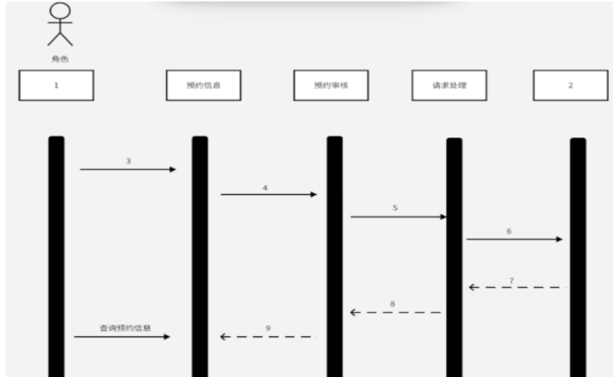
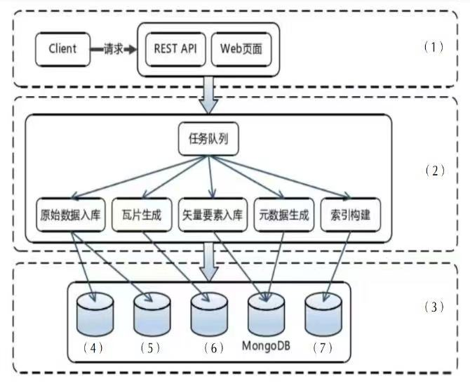
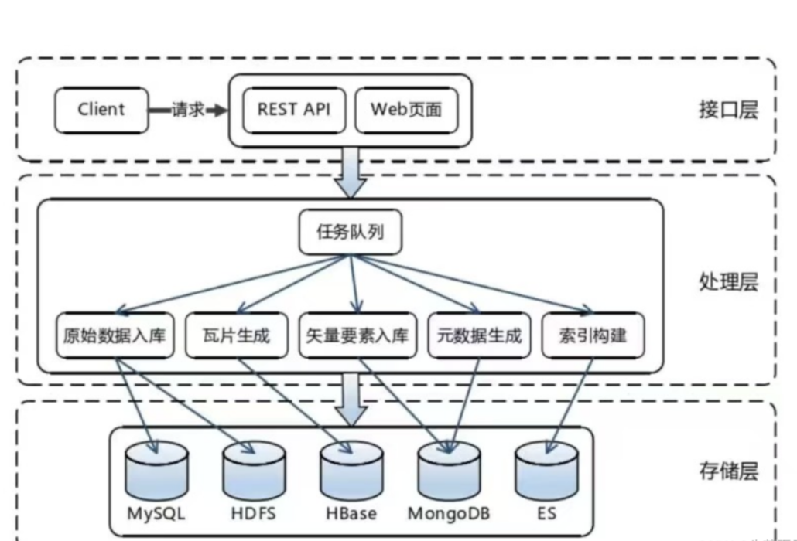

# 2024年上半年 系统架构设计师 · 下午题（回忆版）

> 卷面信息：主来源为网友回忆版 DOCX，无正式卷面说明；按来源"第一题～第五题"编号（对应本文件 Q1–Q5），每题 25 分（合并来源试题一～五均标 25 分）。主来源第五题标题作"Web 架构"，合并来源作"系统设计"，校核注见 Q5。
>
> 卷身份核验说明：合并来源（合订本）第 39 页页眉印"2024下半年 系统架构设计师 案例分析"，但其五道试题（微服务优缺点7分/质量效用树6分/6要素场景12分；UML建模；分布式锁9+10+6；嵌入式SOME/IP；瓦片地图/MongoDB/冷热数据）与主来源（自标"24年5月"）下午题**逐题一致**，判定该合订本页眉误标，实际为 2024 年上半年（5月）真题。本卷按实际身份归档为上半年。

## 题号目录

| 题号 | 考点 | 教程章节 |
|------|------|----------|
| Q1 | 软件架构设计与评估：微服务架构优缺点、质量效用树填空、质量属性 6 要素场景描述（可用性） | [08-系统质量属性与架构评估.md](https://github.com/Goodyzhang/ruankao.skill/blob/main/materials/%E7%B3%BB%E7%BB%9F%E6%9E%B6%E6%9E%84%E8%AE%BE%E8%AE%A1%E5%B8%88/%E7%AC%94%E8%AE%B0/%E7%9F%A5%E8%AF%86%E7%82%B9/08-%E7%B3%BB%E7%BB%9F%E8%B4%A8%E9%87%8F%E5%B1%9E%E6%80%A7%E4%B8%8E%E6%9E%B6%E6%9E%84%E8%AF%84%E4%BC%B0.md) |
| Q2 | 系统设计与建模（UML）：序列图三种消息、序列图补全、交互图选取原则、条件分支片段 | [05-软件工程基础知识.md](https://github.com/Goodyzhang/ruankao.skill/blob/main/materials/%E7%B3%BB%E7%BB%9F%E6%9E%B6%E6%9E%84%E8%AE%BE%E8%AE%A1%E5%B8%88/%E7%AC%94%E8%AE%B0/%E7%9F%A5%E8%AF%86%E7%82%B9/05-%E8%BD%AF%E4%BB%B6%E5%B7%A5%E7%A8%8B%E5%9F%BA%E7%A1%80%E7%9F%A5%E8%AF%86.md) |
| Q3 | 数据库缓存/分布式锁：基于数据库（MySQL）分布式锁的缺陷、Redis 死锁场景、Redis ZSet 命令 | [06-数据库设计基础知识.md](https://github.com/Goodyzhang/ruankao.skill/blob/main/materials/%E7%B3%BB%E7%BB%9F%E6%9E%B6%E6%9E%84%E8%AE%BE%E8%AE%A1%E5%B8%88/%E7%AC%94%E8%AE%B0/%E7%9F%A5%E8%AF%86%E7%82%B9/06-%E6%95%B0%E6%8D%AE%E5%BA%93%E8%AE%BE%E8%AE%A1%E5%9F%BA%E7%A1%80%E7%9F%A5%E8%AF%86.md) |
| Q4 | 嵌入式系统：车载以太网 SOME/IP 协议及特点、DDS 与 SOME/IP 分工、规控 AP 模块流程 | [16-嵌入式系统架构设计理论与实践.md](https://github.com/Goodyzhang/ruankao.skill/blob/main/materials/%E7%B3%BB%E7%BB%9F%E6%9E%B6%E6%9E%84%E8%AE%BE%E8%AE%A1%E5%B8%88/%E7%AC%94%E8%AE%B0/%E7%9F%A5%E8%AF%86%E7%82%B9/16-%E5%B5%8C%E5%85%A5%E5%BC%8F%E7%B3%BB%E7%BB%9F%E6%9E%B6%E6%9E%84%E8%AE%BE%E8%AE%A1%E7%90%86%E8%AE%BA%E4%B8%8E%E5%AE%9E%E8%B7%B5.md) |
| Q5 | 系统设计（Web 架构）：瓦片地图系统架构图 (1)-(7) 填空、MongoDB 存储非结构化数据、热/温/冷数据分级存储 | [06-数据库设计基础知识.md](https://github.com/Goodyzhang/ruankao.skill/blob/main/materials/%E7%B3%BB%E7%BB%9F%E6%9E%B6%E6%9E%84%E8%AE%BE%E8%AE%A1%E5%B8%88/%E7%AC%94%E8%AE%B0/%E7%9F%A5%E8%AF%86%E7%82%B9/06-%E6%95%B0%E6%8D%AE%E5%BA%93%E8%AE%BE%E8%AE%A1%E5%9F%BA%E7%A1%80%E7%9F%A5%E8%AF%86.md) |

## 原题转录（视觉核验）

---

## Q1（第一题：软件架构设计与评估）（25分）

### 1.1 微服务的介绍，并说明微服务的优缺点。（7分）

**来源所列答案**（主来源 docx_2024s 第16页，原文照录）：

微服务是一种软件架构风格，将应用程序拆分为多个小型、独立部署的服务，每个服务负责特定功能，通过轻量级通信协议（如 HTTP/REST）进行交互。这种架构允许各服务独立开发、测试、部署和扩展，促进敏捷开发和持续交付。

优点：

1. 独立部署：各服务可独立部署，减少对其他模块的影响，提升发布频率和灵活性。
2. 技术多样性：不同服务可以使用不同的技术栈，最适合解决各自的问题。
3. 可扩展性：根据需要单独扩展某个服务，提高资源利用效率。

缺点（第17页续）：

1. 复杂性增加：系统拆分成多个服务后，增加了运维和管理复杂度。
2. 网络通信开销：服务之间的通信依赖网络，可能带来延迟和性能问题。
3. 数据一致性：分布式系统的数据一致性管理更加复杂，需要额外的机制保障数据同步。

**来源所列答案**（合并来源 hj_al 第39页，原文照录）：

微服务架构是一种分布式系统架构，将一个应用程序拆分为一组小型、独立的服务，每个服务都围绕特定的业务功能构建，并通过轻量级通信机制进行通信。相比之下，单体架构将整个应用程序作为一个单一的单元构建和部署。

微服务架构的优点：灵活性和可扩展性：每个微服务都是独立的，可以独立部署和扩展，使系统更具弹性。技术多样性：每个微服务可以使用不同的技术栈，使开发团队可以选择最适合其需求的技术。易于理解和维护：微服务的小型化和聚焦性使得代码更易于理解、开发和维护。

微服务架构的缺点：复杂性：微服务架构涉及到分布式系统，需要处理分布式事务、服务发现、服务治理等复杂问题。部署和测试：由于微服务的数量增加，部署和测试变得更加复杂。运维成本：微服务架构需要更多的运维工作，包括监控、日志收集、故障排查等。

> 校核注：两来源答案表述不同、要点互有补充（主来源列"独立部署/技术多样性/可扩展性"三条优点与"复杂性/网络通信开销/数据一致性"三条缺点；合并来源列三条优点与"复杂性/部署和测试/运维成本"三条缺点），均照录保留。

### 1.2 质量效用树，填空。（6分）

> 主来源注（原文）：这题答案很简单，填入哪些属于可用性，安全性，可修改性等。
>
> 合并来源（试题一·2，原文）：质量属性及其场景(质量效用树)，填空 6 个。(6分) 考查质量效用树，如安全性，可用性，功能性，可修改性等。

**来源所列答案**：未提供具体填法（仅上述提示）。

### 1.3 质量属性场景中，使用六（6）要素来描述题目中可用性的两个场景。（12分）

六要素定义（主来源第17页，原文照录）：

- 刺激源：某个生成该刺激的实体（人，计算机，其它任何刺激器）
- 刺激：指当刺激达到系统时需要考虑的条件。
- 环境：指该刺激在某些条件哪发生，
- 制品：某个制品被激励，可能是整个系统，也可能是系统的一部分。
- 响应：指在激励达到后所采取的行动。
- 响应度量：当响应发生时，应当能够以某种方式对其进行度量。

**来源所列答案**（合并来源 hj_al 第39-40页，原文照录）：

c）可连续运行时间不少于 240h，断电或故障后 10s 内应重启

- 刺激源：断电或故障
- 刺激：系统故障或断电
- 制品：系统
- 环境：运行环境
- 响应：重启
- 响应度量：10 秒内

h）网络失效后，10s 内应发起重新连接

- 刺激源：网络失效
- 刺激：网络失效
- 制品：系统
- 环境：网络环境
- 响应：重新连接
- 响应度量：10 秒内

> 校核注：两来源一致（题型、分值 6分/12分 均吻合，"六要素"即"6要素"）；合并来源给出 c)/h) 两条可用性场景的完整 6 要素作答，主来源仅给出要素定义，故答案以合并来源为准。

---

## Q2（第二题：系统设计与建模 / UML 建模）（25分）

> 说明：题面背景与问题转录自《2024年上半年系统架构设计师案例.pdf》第3-4页及合并来源 hj_al 第40-41页。
> 
> 【业务背景说明】
> 访问者从微信公众号进入某系统，发送预约申请，预约通过审核后，自动发送给被访者，被访者处理完毕后，处理完毕消息会通知访问者和门禁管理人员。

### 1. 序列图的哪三种消息和概念。（6分）

**来源所列答案**（原文）：序列图的三种消息和概念：同步消息、异步消息、返回消息。

### 2. 请根据这个业务场景，补充序列图中标数字部分。（9分）

> 校核注：序列图已从《2024年上半年系统架构设计师案例.pdf》第3页高清提取补齐（原DOCX回忆版缺图）。

### 3. 系统分析设计过程中两种交互图的选取原则。（4分）

**来源解析**（原文）：在 UML 中，交互图（Interaction Diagrams）主要用于描述在特定语境中对象之间的交互，它们可以在分析和设计阶段使用。交互图主要包括两种类型：序列图（Sequence Diagrams）和协作图（Collaboration Diagrams）。

- 序列图：强调消息的时间顺序，展示对象之间的动态合作关系，常用于分析阶段。
- 协作图：强调参与交互的对象以及它们如何相互关联，常用于设计阶段。

在分析阶段，你可能想要创建序列图来捕捉对象之间的动态合作，并且能够清晰地展示时序和并发。

在设计阶段，你可能想要创建协作图来定义交互模式，并且能够清晰地展示对象之间的静态关系和它们之间的关联。

### 4. 顺序图表示条件分支序列片段有哪些。

**来源所列答案**（原文）：顺序图表示条件分支序列片段包括：Alt(Alternative)、Opt(Option)、Loop(循环)、Break(中断)、Par(并行)。

区别总结（原文）：

- Alt：用于条件分支，有多个互斥的条件。
- Opt：用于可选行为，只有一个条件。
- Loop：用于循环操作，根据条件重复执行。
- Break：用于中断行为，根据条件跳出当前片段。
- Par：用于并行操作，多个消息序列同时执行。
- Critical：用于临界区，确保操作的原子性。
- Neg：用于不应发生的行为，表示错误情况。
- Ref：用于引用其他序列图，实现模块化和重用。

---

## Q3（第三题：数据库缓存 / 分布式锁）（25分）

> 主来源本题为"第三题.数据库缓存"，下设 3.1/3.2/3.3；合并来源为"试题三：分布式锁"，下设 3 小问。两处逐问对应关系与差异见各小问校核注。

### 3.1 使用基于数据库（MySQL）的分布式锁所存在的缺陷。（9分）

**来源所列答案**（合并来源 hj_al 第41页，原文照录；标注"答对 5 项即可"）：

1. 性能瓶颈：MySQL 数据库本身可能成为性能瓶颈，特别是在高并发情况下，大量的锁请求和释放可能导致数据库性能下降。
2. 单点故障：MySQL 单点的特性使得其成为系统的单点故障，如果数据库出现故障，将导致整个系统的分布式锁失效。
3. 锁粒度问题：MySQL 的锁粒度可能过大或者过小，过大的锁粒度会导致并发性能降低，而过小的锁粒度可能会增加锁冲突的概率，影响系统的并发性能。
4. 数据一致性问题：分布式系统中，不同的数据库节点之间的数据同步可能存在延迟或者不一致的情况，这可能导致分布式锁的有效性受到影响。
5. 扩展性差：随着系统规模的扩大，单个 MySQL 数据库可能无法满足系统的性能和容量需求，需要进行垂直或者水平扩展，这会增加系统的复杂性和成本。
6. 容错性差：MySQL 数据库本身的容错性可能不如专门设计的分布式锁方案，例如基于 ZooKeeper 或者 Redis 的分布式锁方案，因此在面对网络分区或者其他故障时可能无法提供可靠的锁服务。

> 校核注：主来源仅有题面（第18页"3.1 使用基于数据库的分布式锁所存在的缺陷(9分)"），答案取自合并来源。

### 3.2 Redis 的几种操作命令。（6分）

> 主来源题面（原文）：redis 写入命令是什么，redis 查询命令是什么，redis 删除命令是什么。
>
> 合并来源题面（试题三·3）：填写 Redis 命令，基于 ZSet。(6分)

**来源所列答案**（合并来源，原文）：

- 存入秒杀的分数命令：ZADD
- 获取分数范围的命令：ZRANGE
- 获取分数：ZSCORE

**来源解析**（合并来源"Redis zset 扩展学习"，原文照录）：

在 Redis 中，ZSet（有序集合）是一种数据结构，用于存储带有分数（score）的成员（member）。以下是针对 ZSet 的常用操作命令：

1. ZADD key score member [score member ...]：将一个或多个成员元素及其分数值加入到有序集合中。
2. ZCARD key：返回有序集合中的成员数量。
3. ZSCORE key member：返回有序集合中指定成员的分数。
4. ZRANGE key start stop [WITHSCORES]：返回有序集合中指定索引范围内的成员，可选择返回成员的分数。
5. ZRANGEBYSCORE key min max [WITHSCORES] [LIMIT offset count]：返回有序集合中分数范围内的成员，可选择返回成员的分数，并可指定返回结果的偏移量和数量。
6. ZREM key member [member ...]：移除有序集合中的一个或多个成员。
7. ZINCRBY key increment member：将有序集合中指定成员的分数增加增量 increment。
8. ZCOUNT key min max：计算有序集合中分数范围内的成员数量。
9. ZREVRANGE key start stop [WITHSCORES]：返回有序集合中指定逆序索引范围内的成员，可选择返回成员的分数。
10. ZREVRANGEBYSCORE key max min [WITHSCORES] [LIMIT offset count]：返回有序集合中指定逆序分数范围内的成员，可选择返回成员的分数，并可指定返回结果的偏移量和数量。

> 校核注：主来源此问为泛问（写入/查询/删除命令），合并来源为"基于 ZSet 的秒杀场景"三空（ZADD/ZRANGE/ZSCORE）；按合并来源补足，分值同为 6 分。

### 3.3 Redis 分布式锁死锁场景举例。（10分）

> 主来源题面（原文）：问题一：基于 redis 的数据库锁也会存在死锁场景，举例说明。问题二：基于数据库的分布式锁和基于 redis 的分布式锁都存在问题，还有哪些其它的分布式锁的类型？

**来源所列答案**（合并来源 hj_al 第41-42页，原文照录；标注"描述清楚即可"）：

一个可能导致 Redis 分布式锁死锁的场景是：假设有两个客户端同时请求获取同一把分布式锁，并且两个客户端的请求几乎同时到达 Redis 服务器。此时，两个客户端都成功地获取了锁，并开始执行各自的任务。然而，由于某些原因（例如网络延迟、服务器负载等），其中一个客户端在执行任务时花费的时间较长，导致其持有锁的时间超过了预期。在此期间，另一个客户端一直在等待获取锁，因为它无法在锁被释放之前执行任务。

当第一个客户端最终完成任务并释放锁时，第二个客户端会立即获取到锁并开始执行任务。但此时第一个客户端可能又尝试获取锁以执行另一个任务，由于第二个客户端已经获取到了锁，因此第一个客户端将被阻塞等待获取锁，导致死锁的发生。

这种情况下，由于两个客户端的请求在一段时间内交替执行，每个客户端都等待另一个客户端释放锁，最终导致了死锁的产生。为避免这种情况，需要在设计分布式锁的使用场景时考虑合理的超时机制和重试策略，以及确保释放锁的操作能够及时执行。

> 校核注：主来源"3.3"所含问题二（其它分布式锁的类型）无合并来源对应内容，本来源未给出答案（见缺口清单）。

---

## Q4（第四题：嵌入式系统）（25分）

> 主来源（docx_2024s 第18页）仅有"第四题.嵌入式系统 略"；以下全部内容转录自合并来源 hj_al 第43-44页（试题四：嵌入式系统）。

### 1. 简要分析 SOME/IP 协议及其特点。（9分）

**来源所列答案**（原文照录）：

SOME/IP 是一种应用层协议，它允许在车辆内部网络中实现高效的服务交换和远程调用。这种协议支持车辆各组件之间的复杂通信需求，特别适用于具有高数据吞吐量的场景。基于 TCP/IP，支持 TCP 和 UDP。

特点：

- 服务导向架构（Service-Oriented Architecture，SOA）：SOME/IP 实现了一种服务导向架构，允许车辆的各个电子控制单元（ECUs）以服务提供者或服务消费者的身份互动。这种架构使得车辆内部的软件组件可以更加灵活地通信和交互。
- 远程过程调用（Remote Procedure Call，RPC）：通过 RPC，SOME/IP 支持跨网络的函数或过程调用，实现不同 ECU 之间的紧密协作。
- 高度可伸缩性和灵活性（Scalability and Flexibility）：SOME/IP 协议的设计考虑到了未来车辆网络可能的扩展，支持从小型车辆到大型车队的不同规模应用。

SOME/IP 与传统车载网络协议（如 CAN、LIN 等）的对比如下表所示：

| 特性 | SOME/IP | 传统车载网络协议 |
|------|---------|------------------|
| 数据传输 | 高吞吐量，适合大数据传输 | 适合小规模数据交换 |
| 网络结构 | 服务导向，适应性强 | 较为固定的消息格式和网络结构 |
| 扩展性 | 易于扩展和升级 | 扩展性相对有限 |
| 应用领域 | 适合复杂、高数据需求的现代车辆系统 | 适用于传统、功能单一的车辆系统 |

### 2. 填写 DDS 协议和 SOME/IP 协议到以下框图。（6分）

**来源所列答案**（原文）：一般 DDS 用于框架模块内部之间通信，SOME/IP 用于外部设备间通信。

> 校核注：来源题干称"以下框图"，但两来源均未给出该框图图片（见缺口清单）。

### 3. 规控 AP 模块的流程框图。（10分）

**来源所列答案**（原文）：地图先定位，结合感知模块进行感知，对当前实时环境中的其他目标进行预测，然后规划路径，路径会考虑道路中其他参与者，有路径后交给控制决策车怎么走，然后控制信息传递给交互界面。

> 校核注：题干所称"流程框图"图片本身两来源均未提供（见缺口清单）。

---

## Q5（第五题：系统设计 / Web 架构）（25分）

> 主来源标题作"第五题.Web 架构"，下设 5.1/5.2/5.3；合并来源作"试题五：系统设计"，下设 3 小问。题型与分值（11+10+4）两来源一致。

### 1.（5.1）系统架构图填空：数据库类型选择。（11分）

从下列选择中填入 (1) 到 (7)。

可供选择的选项有（主来源原文）：接口层、处理层、数据层；MySQL、HDFS、HBase、ES。（注：来源文字作"数据层"，其附"网上标准答案"图作"存储层"。）

> 主来源注（原文）：下面是网上找到的标准答案。
>
> 合并来源（hj_al 第44页）附同一空白架构图（Client→REST API/Web页面→任务队列→原始数据入库/瓦片生成/矢量要素入库/元数据生成/索引构建→(4)(5)(6)MongoDB(7)），经比对与主来源图一致，复用上方裁剪文件。
>
> 合并来源解析（原文）：这道题来自华中科技大学的硕士论文。标准答案可能按照论文里的来。瓦片地图一般有两种。一般我们理解的瓦片地图是栅格瓦片。这块的瓦片数据没有说明是栅格瓦片还是矢量瓦片。如果是栅格瓦片，HDFS 应该优先使用。矢量瓦片可能是以 JSON 结构组装，用 Hbase。瓦片数据和相关的存储方案在选择时确实需要根据数据类型（栅格瓦片或矢量瓦片）来决定。

**来源所列答案**（网上标准答案，见图二）：(1) 接口层；(2) 处理层；(3) 存储层；(4) MySQL；(5) HDFS；(6) HBase；(7) ES（图中 MongoDB 已给出）。

### 2.（5.2）MongoDB 如何存储非结构化数据，MongoDB 矢量化存储（处理复杂数据结构）的优点。（10分）

> 主来源题面（原文）：首先说明 MongoDB 是如何把非关系型数据存入的。其次说明 MongoDB 对于存储非关系型数据的优势。

**来源所列答案**（合并来源 hj_al 第45-46页，原文照录）：

MongoDB 是一个基于分布式文件存储的 NoSQL 数据库，它使用一种灵活的、面向文档的数据模型来存储非结构化数据。以下是 MongoDB 存储非结构化数据的方式及其矢量化存储（虽然 MongoDB 官方并没有直接使用"矢量化存储"这一术语，但我们可以理解为处理和存储复杂数据结构的能力）的一些优点：

MongoDB 存储非结构化数据的方式：

1. 文档存储：MongoDB 以 BSON（Binary JSON）格式存储数据，这是一种类 JSON 的二进制格式，支持更丰富的数据类型（比如 Date、ObjectId 等），比传统的 JSON 更高效。每个文档可以包含任意数量的字段，字段值可以是数组、嵌套文档等多种复杂数据结构，非常适合存储半结构化和非结构化数据。
2. 灵活的数据模型：MongoDB 不强制要求数据遵循固定的模式，同一个集合（相当于关系数据库中的表）中的文档可以有不同的字段和结构。这使得 MongoDB 能轻松适应不断变化的数据需求，特别适合存储那些模式不固定或经常演变的数据。
3. 动态模式：MongoDB 的集合不需要预先定义结构，字段可以随时添加或删除，这为非结构化数据的存储提供了极大的灵活性。
4. 索引支持：尽管数据是非结构化的，MongoDB 仍然支持对文档中的任何字段创建索引，包括嵌套字段，这大大提升了查询性能。

MongoDB 矢量化存储（处理复杂数据结构）的优点：

1. 高效存储与查询：BSON 格式不仅支持复杂数据类型，还能高效地存储和查询这些数据。通过利用索引，即使是嵌套文档和数组也能实现快速查询。
2. 简化数据模型：通过文档嵌套和数组，可以将相关数据聚合在一个文档中，减少了数据的连接操作，简化了数据模型，提高了查询效率。
3. 易于扩展与演变：由于数据模型的灵活性，MongoDB 能够轻松应对数据结构的变化，无需进行复杂的模式迁移，简化了系统升级和扩展的过程。
4. 高性能：MongoDB 使用内存映射文件技术，能够将热数据加载到内存中，提高读写性能。同时，支持水平扩展和分片，能够处理大量数据和高并发请求。
5. 数据处理能力：对于非结构化数据的分析和处理，MongoDB 提供了丰富的聚合框架，支持复杂的数据转换和分析操作，如聚合管道、地图 Reduce 等，便于从非结构化数据中提取有价值的信息。

### 3.（5.3）使用热数据、温数据和冷数据存储的原因。（4分）

> 主来源题面（原文）：说明使用热数据，温数据，冷数据分级存储的原因。

**来源所列答案**（合并来源 hj_al 第46-47页，原文照录；标注"答出原因或者优点，任意 4 点即可"）：

原因：

1. 资源优化：不同数据的访问频率差异巨大，将数据按照热度分类可以更合理地分配存储资源。热数据通常需要快速访问，因此存储在高性能、高成本的媒介上；而冷数据访问较少，可以存储在低成本、低速的媒介上。
2. 成本效率：通过区分数据的访问频率，企业可以将有限的预算投入到最关键的数据存储上，如使用 SSD 或 RAM 存储热数据，而冷数据则存储在磁带或蓝光光盘上，这样既能保证关键业务的性能，又能控制存储成本。
3. 性能提升：将频繁访问的热数据放置在快速存储设备上，如 SSD 或内存，可以显著减少数据访问延迟，提高应用响应速度。而冷数据存储在低速设备上对整体系统性能影响较小。
4. 数据保护：对于冷数据，虽然访问频率低，但可能需要长期保存，使用耐久性高的存储介质可以确保数据的安全与持久。
5. 扩展性和灵活性：随着数据量的增长，分层存储策略提供了更好的扩展性，可以根据数据增长和访问模式的变化灵活调整存储策略。

优点：

1. 提升效率：确保高访问频度的数据能够迅速被获取，提升用户体验和业务处理速度。
2. 降低成本：通过将不常访问的数据转移到成本较低的存储介质，减少整体存储成本。
3. 资源利用率最大化：高效利用存储资源，避免高性能存储资源被低访问频度数据占用。
4. 增强数据管理能力：便于数据生命周期管理，如数据归档、备份和恢复策略的实施。
5. 适应业务变化：灵活调整数据存储布局，快速响应业务需求变化，支持业务的持续创新与发展。

综上所述，依据数据热度进行分类存储是一种策略，旨在通过智能地分配存储资源，平衡成本与性能，确保关键业务数据的高效访问，同时合理管理数据生命周期，从而实现整体 IT 架构的优化。

---

## 缺口清单

- Q1：1.2 质量效用树填空的 6 个具体空位与答案未提供（仅"填入哪些属于可用性，安全性，可修改性等"提示）；1.3 题面中"两个场景"的原始场景描述文字（c/h 条）主来源未录，合并来源答案中可见 c）"可连续运行时间不少于 240h…"与 h）"网络失效后…"两条。
- Q2：主来源仅有标题无题目；序列图补全填空（第2问）已从《2024年上半年系统架构设计师案例.pdf》第3页高保真提取原始时序图并补充业务场景题干（`Q2-p003-fig01.png`）。
- Q3：3.3 之"问题二（其它分布式锁的类型）"无答案；主来源 3.2 与合并来源 3 的对应关系为按分值推定。
- Q4：主来源整题为"略"；DDS/SOME/IP"以下框图"与"规控 AP 模块流程框图"两图均未随文提供。
- Q5：架构图填空 (1)-(7) 的答案为来源所附"网上标准答案"，非考生亲历作答；MongoDB 答案由合并来源提供。
