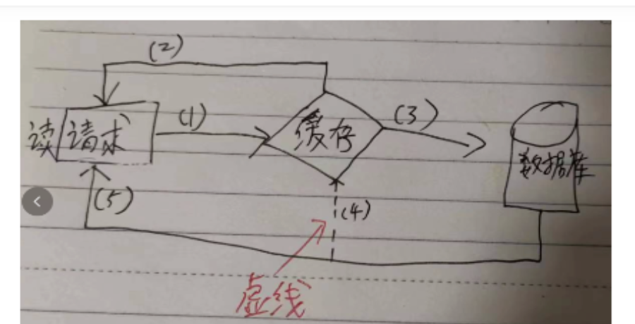
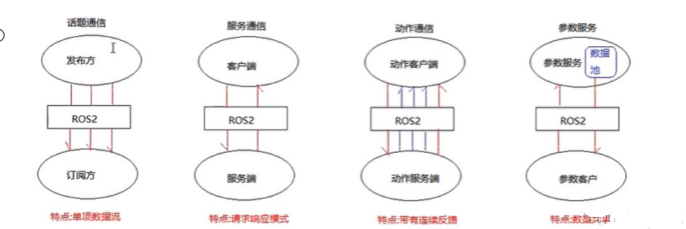
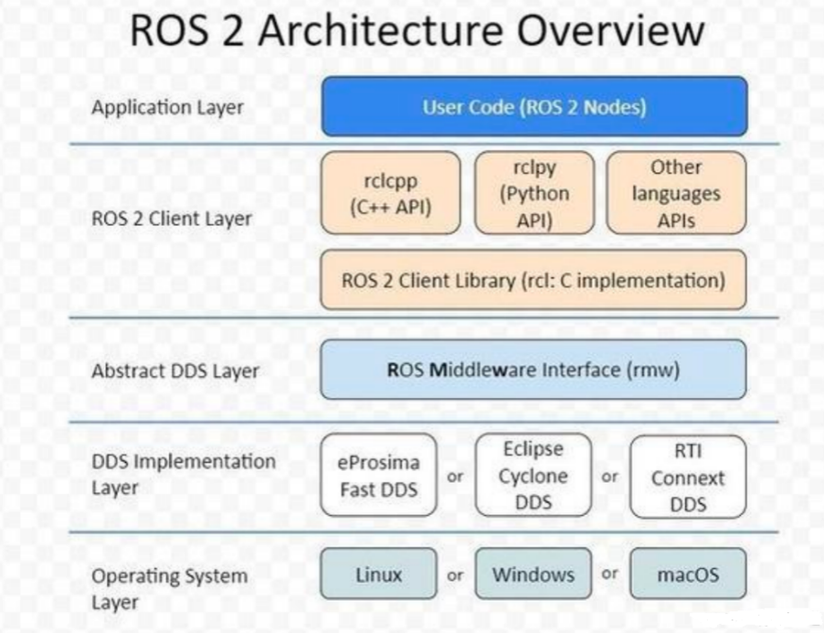
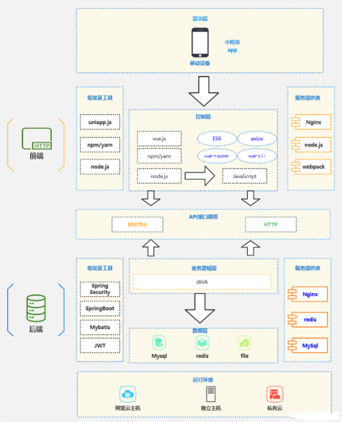
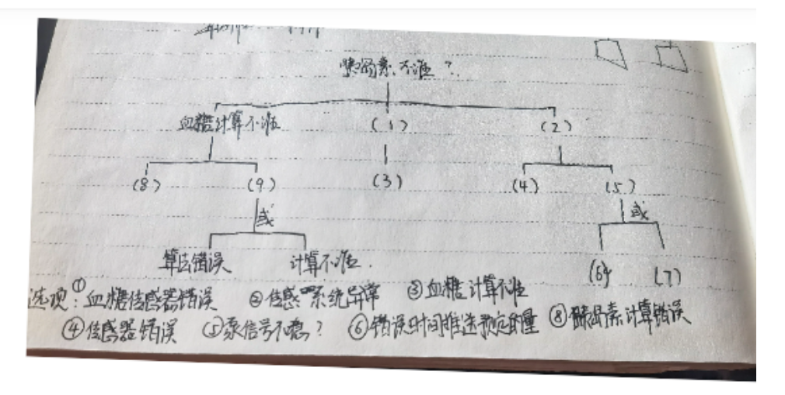

# 2024年下半年 系统架构设计师 · 下午题（回忆版）

> 卷面信息：源文件为网友回忆版，无正式卷面（考试时间/总分/答题要求）说明。下午题共 5 道案例大题（来源按"1.架构 / 2.数据库 / 3.嵌入式 / 4.Web / 5.软件设计"编号，对应本文件 Q1–Q5），每题约 25 分；其中 Q1 问题1 为 14 分、问题2 为 11 分；Q4 三个小问为 6+12+7 分；Q5 三个小问为 10+9+6 分；Q2、Q3 各小问分值回忆未完整标注。
>
> ⚠️ 合并来源核验：`2019-2024系统架构设计师真题-案例分析.pdf` 第 39-47 页页眉印作"2024下半年 系统架构设计师 案例分析"，但其内容（微服务优缺点7分/质量效用树/UML序列图/分布式锁/SOME-IP/瓦片地图MongoDB）与主来源本题卷**完全不是同一套题**，却与 `24年5月系统架构设计师真题(回忆)+答案.docx` 的下午题逐题一致，判定其实际为 **2024年上半年（5月）** 案例题（合订本页眉误标）。该来源已并入《2024-上半年-下午.md》，本题卷未合并其内容。

## 题号目录

| 题号 | 考点 | 教程章节 |
|------|------|----------|
| Q1 | 软件架构评估：质量属性/功能性场景填空（表格形式）、ping/echo 与心跳机制的可用性故障检测原理 | [08-系统质量属性与架构评估.md](https://github.com/Goodyzhang/ruankao.skill/blob/main/materials/%E7%B3%BB%E7%BB%9F%E6%9E%B6%E6%9E%84%E8%AE%BE%E8%AE%A1%E5%B8%88/%E7%AC%94%E8%AE%B0/%E7%9F%A5%E8%AF%86%E7%82%B9/08-%E7%B3%BB%E7%BB%9F%E8%B4%A8%E9%87%8F%E5%B1%9E%E6%80%A7%E4%B8%8E%E6%9E%B6%E6%9E%84%E8%AF%84%E4%BC%B0.md) |
| Q2 | 数据库：cache-aside（旁路缓存）架构读/写流程填空图、多线程读写一致性风险与解决 | [06-数据库设计基础知识.md](https://github.com/Goodyzhang/ruankao.skill/blob/main/materials/%E7%B3%BB%E7%BB%9F%E6%9E%B6%E6%9E%84%E8%AE%BE%E8%AE%A1%E5%B8%88/%E7%AC%94%E8%AE%B0/%E7%9F%A5%E8%AF%86%E7%82%B9/06-%E6%95%B0%E6%8D%AE%E5%BA%93%E8%AE%BE%E8%AE%A1%E5%9F%BA%E7%A1%80%E7%9F%A5%E8%AF%86.md) |
| Q3 | 嵌入式系统：机器人操作系统 ROS 定义与特点、ROS2 对 ROS1 的改进、四种通信模型选词填空、ROS2 架构分层含义 | [16-嵌入式系统架构设计理论与实践.md](https://github.com/Goodyzhang/ruankao.skill/blob/main/materials/%E7%B3%BB%E7%BB%9F%E6%9E%B6%E6%9E%84%E8%AE%BE%E8%AE%A1%E5%B8%88/%E7%AC%94%E8%AE%B0/%E7%9F%A5%E8%AF%86%E7%82%B9/16-%E5%B5%8C%E5%85%A5%E5%BC%8F%E7%B3%BB%E7%BB%9F%E6%9E%B6%E6%9E%84%E8%AE%BE%E8%AE%A1%E7%90%86%E8%AE%BA%E4%B8%8E%E5%AE%9E%E8%B7%B5.md) |
| Q4 | Web 架构：Elasticsearch 四种分词器特点、商品推荐系统（微信小程序）分层架构图 8 空填写、RESTful 特点与前后端分离 | [13-层次式架构设计理论与实践.md](https://github.com/Goodyzhang/ruankao.skill/blob/main/materials/%E7%B3%BB%E7%BB%9F%E6%9E%B6%E6%9E%84%E8%AE%BE%E8%AE%A1%E5%B8%88/%E7%AC%94%E8%AE%B0/%E7%9F%A5%E8%AF%86%E7%82%B9/13-%E5%B1%82%E6%AC%A1%E5%BC%8F%E6%9E%B6%E6%9E%84%E8%AE%BE%E8%AE%A1%E7%90%86%E8%AE%BA%E4%B8%8E%E5%AE%9E%E8%B7%B5.md) |
| Q5 | 安全攸关系统：胰岛素泵——危险驱动的安全分析 4 步骤、故障树填空、形式化开发与软件测试特点 | [09-软件可靠性基础知识.md](https://github.com/Goodyzhang/ruankao.skill/blob/main/materials/%E7%B3%BB%E7%BB%9F%E6%9E%B6%E6%9E%84%E8%AE%BE%E8%AE%A1%E5%B8%88/%E7%AC%94%E8%AE%B0/%E7%9F%A5%E8%AF%86%E7%82%B9/09-%E8%BD%AF%E4%BB%B6%E5%8F%AF%E9%9D%A0%E6%80%A7%E5%9F%BA%E7%A1%80%E7%9F%A5%E8%AF%86.md)、[18-安全架构设计理论与实践.md](https://github.com/Goodyzhang/ruankao.skill/blob/main/materials/%E7%B3%BB%E7%BB%9F%E6%9E%B6%E6%9E%84%E8%AE%BE%E8%AE%A1%E5%B8%88/%E7%AC%94%E8%AE%B0/%E7%9F%A5%E8%AF%86%E7%82%B9/18-%E5%AE%89%E5%85%A8%E6%9E%B6%E6%9E%84%E8%AE%BE%E8%AE%A1%E7%90%86%E8%AE%BA%E4%B8%8E%E5%AE%9E%E8%B7%B5.md) |

## 原题转录（视觉核验）

---

## Q1（案例1：架构——质量属性与可用性故障检测）

h. 系统采用了云服务器，要求 1 分钟以内检测出故障，并且 1 个小时以内恢复。

**【问题1】（14分）质量属性与功能性填空（给出场景填质量属性\功能性）**

> 来源注：没有质量属性效用树，是以 table 表格的形式。并且这次可靠性和可用性同时出现（虽然没有需要填空），这次功能性也需要填空了。表格长下面这样：

| 序号 | 应填质量属性/功能性 |
|------|---------------------|
| a | 功能性 |
| b | 可靠性 |
| c | （1） |
| d | （2） |
| e | （3） |
| f | （空） |
| g | 操作不同任务导入支持不同模型 |
| h | 可用性 |

问题 1 给出的各场景描述（a–m）：

- a. 系统发生业务故障时，3 秒内启动 XXX，属于可靠性
- b. 系统可以对数据进行导入导出，要求在 1 分钟内完成数据导出导出，属于可用性？——是性能，规定时间完成任务，前半句是功能，加了时间限制就是性能，以前的真题有类似的题干
- c. 质量属性描述，XXX，属于____
- d. 质量属性描述，XXX，属于可用性
- e. 质量属性描述，XXX，属于____
- f. 系统根据用户量访问量的增加，需要拓展空间还是啥，要求在 3 天完成，属于__可修改性__（来源讨论：我觉得是可伸缩性）
- g. 系统分为三个不同的国家语言，支持搜索自动填充补全等，完成 XXXX 功能，属于__易用性？__（来源讨论：考虑可扩展性、自动扩展多语言功能）
- l. 系统使用 XX 检测云服务器故障，需要在 2 秒切换
- m. 系统提供根据历史搜索记录的功能，搜索时应在 3 秒以内完成，属于？

> 来源讨论（原文）：填质量属性，应该有 7 个空：功能性、性能、安全性、可修改性、易用性（应该没有易用性-> g 就是易用性啊→应该是功能性吧？→就是易用性，那个是涉及多语化的设计，这个描述后半句是能够提供输入自动补全、检索联想什么的，所以应该是易用性更多一点）是易用性。质量属性没有易用性-支持什么语言，能完成什么功能，都是功能性 — 明显有易用性，看下面。这个空是易用性。只是平时都不讲。哎，反正我也错了。答案确实应该是 易用性。

来源随附"质量属性"参考表（属性 / 作用及要点 / 设计策略）：

| 属性 | 作用及要点 | 设计策略 |
|------|-----------|----------|
| 性能 | 处理任务所需时间或单位时间内的处理量 | 控制资源的使用、并发机制、增加资源、先来先服务、设定优先级 |
| 可用性 | 正常运行的时间比例，出现故障多久能启用备用系统 | 心跳、Ping/Echo、异常、冗余/故障转移、检查点/回滚、事务、进程监控器 |
| 安全性 | 系统向合法用户提供服务并阻止非法用户的能力 | 用户授权、维护数据机密性与完整性、限制访问、入侵检测系统、追踪审计 |
| 可修改性·可维护性 | 错误发生后进行局部性修改，对其他构件负面影响最小 | 信息隐藏、维持现有接口、限制通信路径、使用中介、运行时注册 |
| 可修改性·可扩展性 | 使用新构件、改进或删除原有构件或特性 | （同上） |
| 可修改性·结构重组 | 重新组织构件及构件关系、灵活配置构件 | （同上） |
| 可修改性·可移植性 | 多样的环境（硬件平台、语言、操作系统等） | （同上） |
| 易用性 | 在指定条件下使用时，软件产品被理解、学习、使用和吸引用户的能力 | （表中未列） |

**【问题2】（11分）** 针对质量属性可以使用 ping/echo 和心跳模式实现，分别简述 ping/echo 和心跳的实现原理，张工认为从资源利用率的角度来看心跳比较适合，简述为什么？

> 来源所列答案（问题2随附）：ping/echo 是应答机制，心跳无需应答。

**【问题2 展开】（2.1）** 说明 ping/echo，心跳两种方式怎么进行可用性的故障检测的。**（2.2）** 从资源利用率问为啥心跳更好。（题目中说了李工觉得认为从系统资源利用率的角度来说，然后这一题又问李工为什么觉得心跳机制好，应该就是从题目给的提示回答）

**来源解析**（来源第20页所附 AI 生成内容，原文照录）：

ping/echo 和心跳机制是两种常用的网络故障检测方法，它们在可用性检测中各有特点和适用场景。

**ping/echo 机制**：ping/echo 机制是通过发送 ICMP（Internet Control Message Protocol）回显请求报文来检测网络连通性。具体来说，ping 命令会构建一个 ICMP 回显请求数据包，并将其发送到目标主机。如果目标主机收到这个请求，它会回复一个 ICMP 回显应答数据包。通过检查这个应答数据包，可以判断目标主机是否可达，并且可以获取连接的丢包率和平均往返时间等信息。

**心跳机制**：心跳机制通常用于分布式系统中，通过定期发送心跳信号来检测系统组件的状态。心跳信号通常由一个组件主动发送到另一个组件，如果接收方在一定时间内没有收到心跳信号，则认为发送方出现了故障。心跳机制的具体实现方式包括：1. 主动心跳：发送方定期发送心跳信号，接收方确认收到后回复确认信号。如果发送方在一定时间内没有收到确认信号，则认为接收方故障。2. 被动心跳：接收方定期发送心跳信号，发送方确认收到后回复确认信号。如果接收方在一定时间内没有收到确认信号，则认为发送方故障。

**适用场景和优缺点**：ping/echo 机制适用于简单的网络连通性检测，能够快速检测网络层的故障。其优点是简单易用，缺点是只能检测网络层的连通性，无法检测应用层的故障。心跳机制适用于复杂的分布式系统，能够检测系统组件的状态。其优点是能够实时监测系统组件的状态，及时发现故障并进行处理；缺点是需要额外的通信开销，且需要设计合理的超时时间和确认机制。综上所述，ping/echo 机制适用于简单的网络连通性检测，而心跳机制适用于复杂的分布式系统状态监测。

> 校核注：第21页顶部另有来源讨论："这题好像没有说从资源利用率的角度问为啥心跳机制更好吧，心跳机制好，应该也不是在资源利用率方面""确实是从资源利用率角度问的"。

---

## Q2（案例2：数据库——cache-aside 架构）

**（1）读取填图（10分）**【读取请求】【cache】【数据库】

> 来源注：缓存是棱形，(4) 和 (5) 我不记得顺序了。

（实线箭头：请求→cache，cache→数据库，cache→请求，数据库→请求；虚线箭头：数据库→cache）

来源所列答案（读取流程 1–5）：

1. 查询缓存是否有目标数据 → 向缓存请求读取该商品信息
2. 有缓存目标数据则直接返回 → 若命中则返回该商品信息
3. 没有则转发给数据库进行查询 → 若未命中则访问数据库查询该商品信息
4. 将查询到的数据库数据更新到缓存
5. 将查询到的商品目标数据返回

**（2）写入填图（5分）**【写入请求】【数据库】【cache】

（实线箭头：请求→数据库，数据库→cache）

来源所列答案（写入流程 1–2）：

1. 更新数据库中的目标商品信息
2. 剔除缓存中的目标商品信息 → 应该是：将数据库中更新的商品信息写入到缓存中（来源高亮批注：确保数据一致性）

**（3）** 线程 1 负责写入，线程 2 负责读取，有一致性风险，为什么，如何解决（3 点及以上）。

> 来源题干补述：王工使用了多线程技术进行缓存处理，线程 1 负责写入，线程 2 负责读取，可能存在数据一致性问题，请解释其原因，并给出 3 个以上的解决办法。
>
> 来源所列答案/讨论（原文）：无法同时达到 100% 可用和 100% 一致的，题目需要一致就牺牲可用，所以方法有：数据库加互斥锁、采用消息队列串行读写，最终一致性。1. 延时双删，无法 100% 解决一致性 → 题目没有强调要 100% 一致性，应该不会这么严谨；2. 同步删除；3. 互斥锁（分布式锁）；4. 消息队列；5. 基于缓存更新策略。这个答案可以按照读穿透模式、写穿透模式、后写模式这三种机制实现。外加缓存删除策略和淘汰机制，定期删除和惰性删除机制。

**来源解析**（来源第23页所附 AI 生成内容，原文照录）：

Cache-aside 架构，也称为旁路缓存模式，是一种常见的缓存使用策略。以下是对 Cache-aside 架构的详细解释：

- 基本概念：在此架构中，缓存和数据库是两个独立的存储系统，它们之间没有直接的交互。应用程序代码负责管理缓存和数据库之间的数据一致性。
- 读操作流程：1. 应用程序首先尝试从缓存中读取数据。2. 如果数据存在于缓存中（缓存命中），则直接将缓存的数据返回给应用程序。3. 如果数据不存在于缓存中（缓存未命中），则应用程序从数据库中检索数据，将数据写入缓存，并返回给用户。
- 写操作流程：1. 应用程序更新数据库中的数据。2. 然后，应用程序可以选择删除缓存中的旧数据（缓存失效）或更新缓存中的数据。3. 为了确保数据一致性，通常推荐在更新数据库后删除或更新缓存中的相关数据。

---

## Q3（案例3：嵌入式——机器人操作系统 ROS）

**问题1**

（1）ROS 定义和特点。
（2）ROS2 与 ROS1 相比哪些地方做了改进。

**问题2** 四种通信服务选词填空。

> 图上方来源原文：不同的通信对象（节点）通过（话题）关联到一起之后，以何种方式实现通信呢？在 ROS2 中，常用的通信模型有四种：

来源所列答案（问题2，原文）：

1. 话题通信：是一种单向通信模型，在通信双方中，发布方发布数据，订阅方订阅数据，数据流单向的由发布方传输到订阅方。
2. 服务通信：是一种基于请求响应的通信模型，在通信双方中，客户端发送请求数据到服务端，服务端响应结果给客户端。
3. 动作通信：是一种带有连续反馈的通信模型，在通信双方中，客户端发送请求数据到服务端，服务端响应结果给客户端，但是在服务端接收到请求到产生最终响应的过程中，会发送中间连续的反馈（进度）信息到客户端。
4. 参数服务：是一种基于共享的通信模型，在通信双方中，服务端可以设置数据，而客户端可以连接服务端并操作服务端数据。

**问题3** 解析 Ros2 架构每一层含义。

> 图中附注（原文）：DDS = Data Distribution Service is a decentralized, publish-subscribe communication protocol. rmw = ROS Middleware Interface hides the details of the DDS implementations. Use rclcpp for efficiency and fast response times, use rclpy for prototyping and shorter development time.
>
> 校核注：本来源对问题1、问题3未附作答内容（见缺口清单）。

---

## Q4（案例4：Web——基于 Elasticsearch 分词的商品推荐系统（微信小程序接入））

**（1）** Standard、Simple、Whitespace、Keyword 分词引擎的特点差异（几种分词器怎么分词）。（6分）

**（2）架构图填写，各层，支持框架（12分，8个空）**

> 校核注：来源在图下方有勘误批注（原文）："根据记忆，上图勘误：JWT 应该是 ES；后端服务提供者那里，Nginx 也是 ES"。第28页另有同图的手绘回忆草图（未单独裁剪），其上所记选项清单照录如下：
>
> 选项：网络层、接入层、显示层、控制层、业务逻辑层、数据层、Flink、Elasticsearch、kafka、Mybatis、Nginx、javascript、nodejs、restful（来源草图旁注："选项：只能回忆这些，但选空的部分是哪些不确定"）
>
> 第29页来源补充（原文）：下面的选项：层：接入层、显示层、应用层、业务逻辑层、控制层、数据层，还有一个不记得，还有一个应该是网络层。相关技术：Mybatis、Nginx、Flink、Javascript、Node.js、RESTful、Elasticsearch、kafka 等等。
>
> 第27页来源讨论（原文）：上图勘误：JWT 应该是 ES；后端服务提供者那里，Nginx 也是 ES。前端服务提供者是不是应该选 Elasticsearch 吗？Nginx 下面已经有了，你说的跟题目无关，不用填。这个图我感到很糟烂，建议把挖空的地方都圈出来，忘记是哪几个挖空了。（图中从上到下：移动端（挖空写哪个层）、前端（挖空写服务提供，nodejs 横向指了个箭头到一个空）、API（这个里面两个，一个是 http，另一个是空，让选择填写）、后端（Java 单独一层让填是什么层，旁边的技术工具与框架挖了一个空）、数据库：这里让填 w 是什么层）

**（3）RESTful 架构有什么特点，如何实现前后端分离的。（7分）**

> 来源所列答案（原文关键词）：无状态模式；声明式 api 设计；Get、put、Post、Del 操作；资源状态转移；采用标准格式如 json 和 xml 进行通信。
>
> 来源讨论（原文）：这个题目应该是：该方案中使用了 restful，和前端分离如何实现的？并没有问 restful 的特点。这里如果不按照 restful 的特点，有啥思路去写么？

**来源解析**（来源第29页所附 AI 生成内容，原文照录）：

RESTful 架构实现前后端分离主要依赖于其设计理念和一些技术实践。以下是实现前后端分离的关键步骤和方法：

1. 定义清晰的 API 接口：· 使用 RESTful 原则定义接口（如 OpenAPI/Swagger），定义 API 的端点、请求方法、参数、响应格式等。· 确保 API 文档化、清晰，以便前端和后端开发者能够独立开发和协作。
2. 使用 HTTP 方法：· 利用 HTTP 动词方法（GET、POST、PUT、DELETE 等）来执行资源的操作。这有助于将前端请求与后端资源清晰分离，因为前端只需要知道如何通过 HTTP 方法与后端服务交互。
3. 状态无状态（Stateless）：· 每个请求必须包含所有必要的信息，以便服务器可以理解请求并独立处理，不依赖于之前的请求。

---

## Q5（案例5：软件设计——安全编程·高可靠性编程·医用血糖监测系统/胰岛素泵）

题目大体是说有一个打胰岛素泵的系统，首先通过血糖仪测量的数据，然后自动计算出要使用的胰岛素剂量，再通过这个泵系统自动打胰岛素给病人。

**（1）危险驱动的安全分析的 4 个步骤，及简要说明。（10分）**

来源所列答案（原文）：确定系统、识别危险、评估风险、确定风险控制措施、监控和复查。

> 校核注：来源称"4 个步骤"但列出了 5 项，照录原文存疑。

**（2）胰岛素泵系统的填空图。（9分）**

图中故障树结构：顶事件"胰岛素不准？"下分三支——"血糖计算不准"、(1)、(2)；其中"血糖计算不准"下分 (8)、(9)（或门），再下为"算法错误""计算不准"；(2) 下分 (4)、(5)，(5) 下为或门 → (6)、(7)。

图下方选项（原文照录）：①血糖传感器错误 ②传感系统异常 ③血糖计算不准 ④传感器错误 ⑤泵信号不稳？ ⑥错误时间推送预定剂量 ⑧胰岛素计算错误。

> 来源注（第30页原文）：(1) 和 (2) 在"传输系统异常"和"在错误的时间传输预定的剂量"填空。
>
> 来源注（第31页原文）：注意：上面图的（3）是"定时器失效"，打错字了，（6）和（7）是可以交换顺序的。
>
> 来源讨论（第31-32页原文摘录）：——错误时间推送预定剂量，这个有的，没说是正确的量，题目带单位的都可以填。按说的写可能不需要打这么多随机变量，但是机器就按自己给算了一个量给打过来了。=== 上图是我填的，你这么一分析确实还是比较认可你的说法，修改一下。第一个错题扣 0.4 分吗。文心一言：胰岛素计算错误，会导致传输系统异常。我也用的文心一言查的，胰岛素累计错误会导致在错误的时间传输预定的剂量，但是没说会导致传输系统异常。你查的是系统传输异常，传输系统异常重点在系统，系统传输异常重点在传输。
>
> 校核注：选项编号缺⑦（原件即如此）；第31、32页另有同一故障树的红色标注重绘版与文心一言截图（内容一致，未单独裁剪）。

**（3）形式化开发和软件测试技术各自的特点。（6分）**

> 本来源对本小问未附作答内容（见缺口清单）。

---

## 缺口清单

- Q1：各场景（c、e、l、m 等）的具体描述文字回忆不全（以 XXX/____ 表示）；场景清单中 h–k 四条来源未录（h 即卷首"云服务器1分钟检测故障、1小时恢复"一条，i/j/k 缺失）；表格中 (1)(2)(3) 空格的来源答案未给出；问题2"资源利用率角度心跳更好"的完整作答仅有提示性结论。
- Q2：(4)(5) 箭头顺序来源自称"不记得顺序"；第 (3) 小问分值未标注；答案为网友讨论性质，无标答。
- Q3：问题1（ROS 定义和特点、ROS2 对 ROS1 的改进）与问题3（ROS2 各层含义）均无来源作答内容；全题各小问分值未标注。
- Q4：8 个空的具体位置与对应答案来源未回忆完整（仅有勘误批注与选项清单）；分词器小问无展开答案。
- Q5：故障树选项缺⑦（原件如此）；(1)(2) 以外的空位答案未给出；第 (3) 小问（形式化开发与软件测试特点）全缺。
