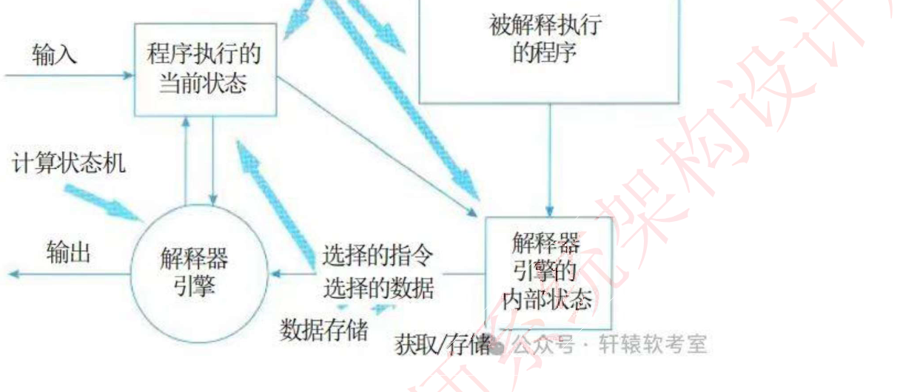
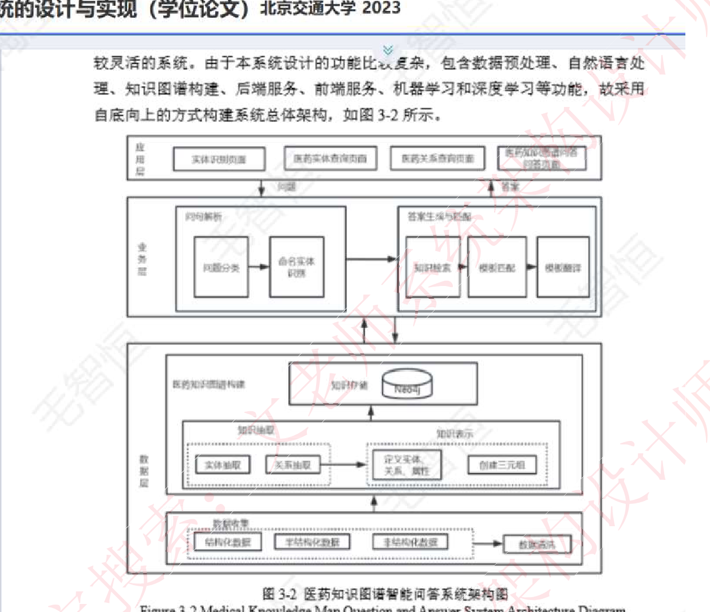
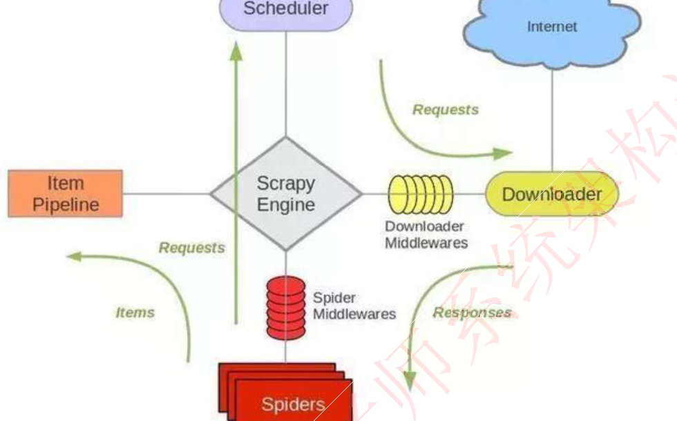
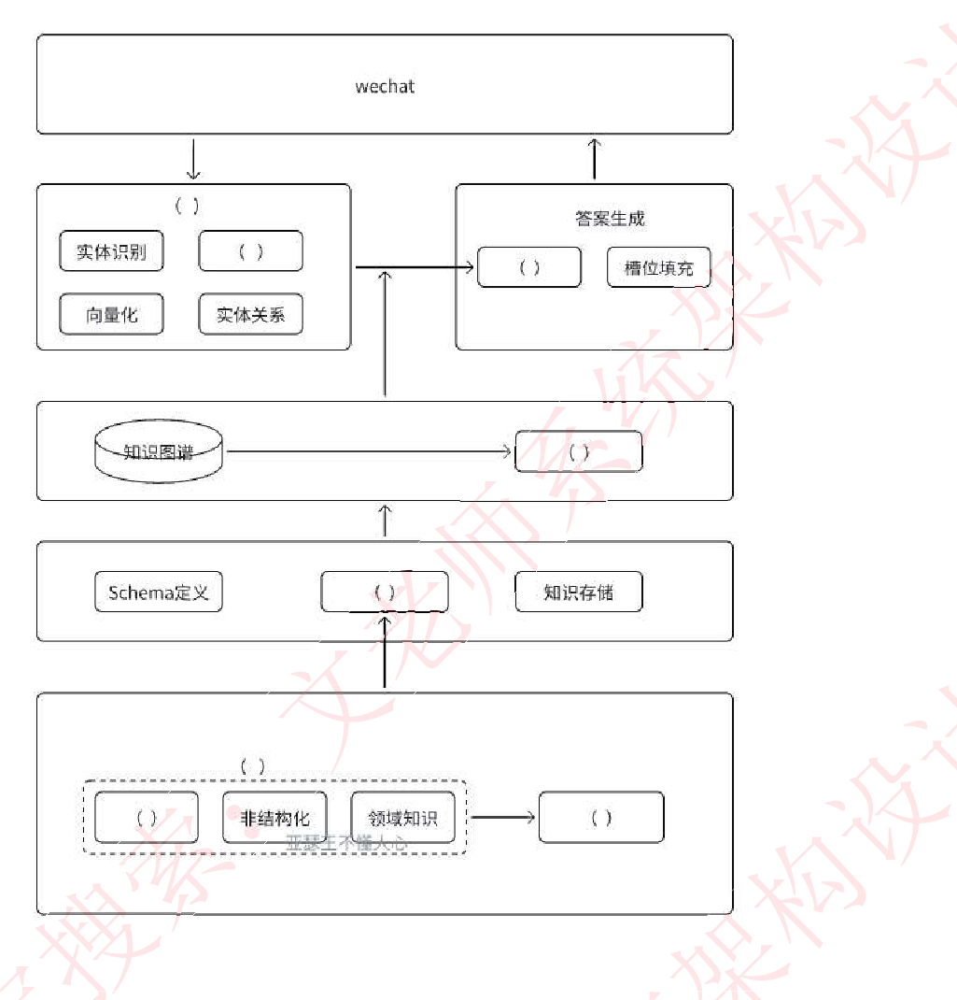
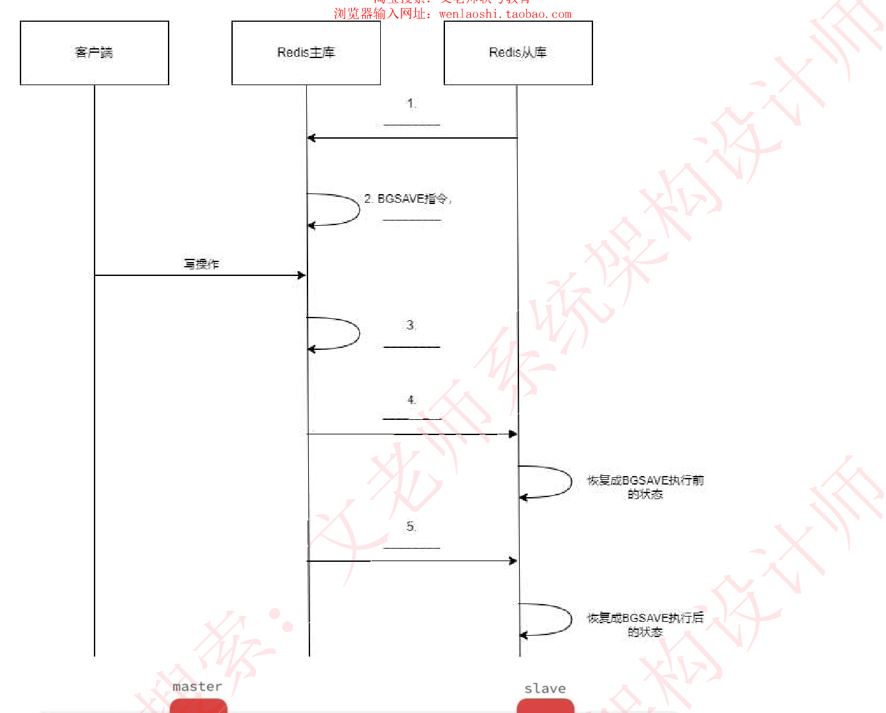
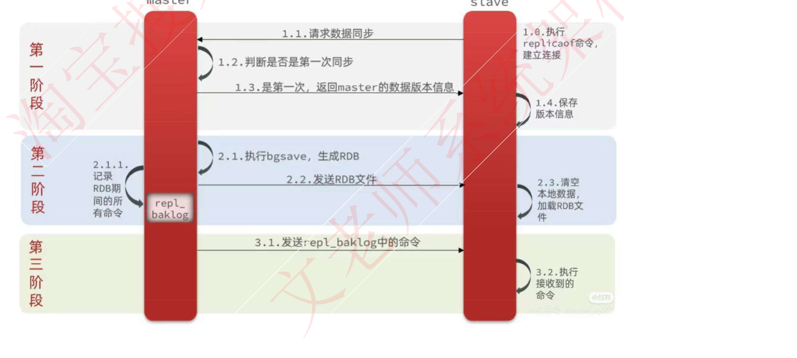
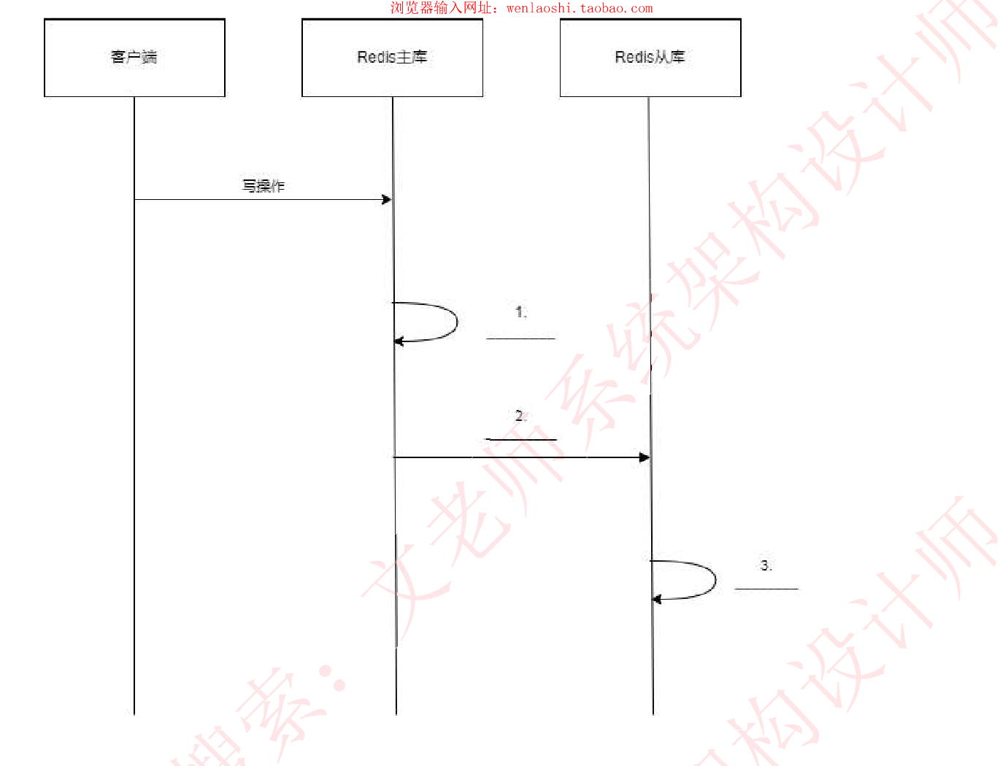
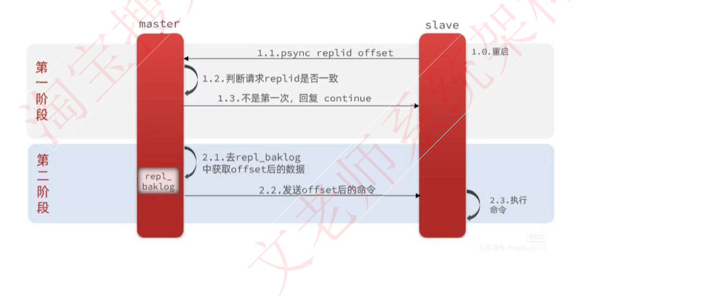
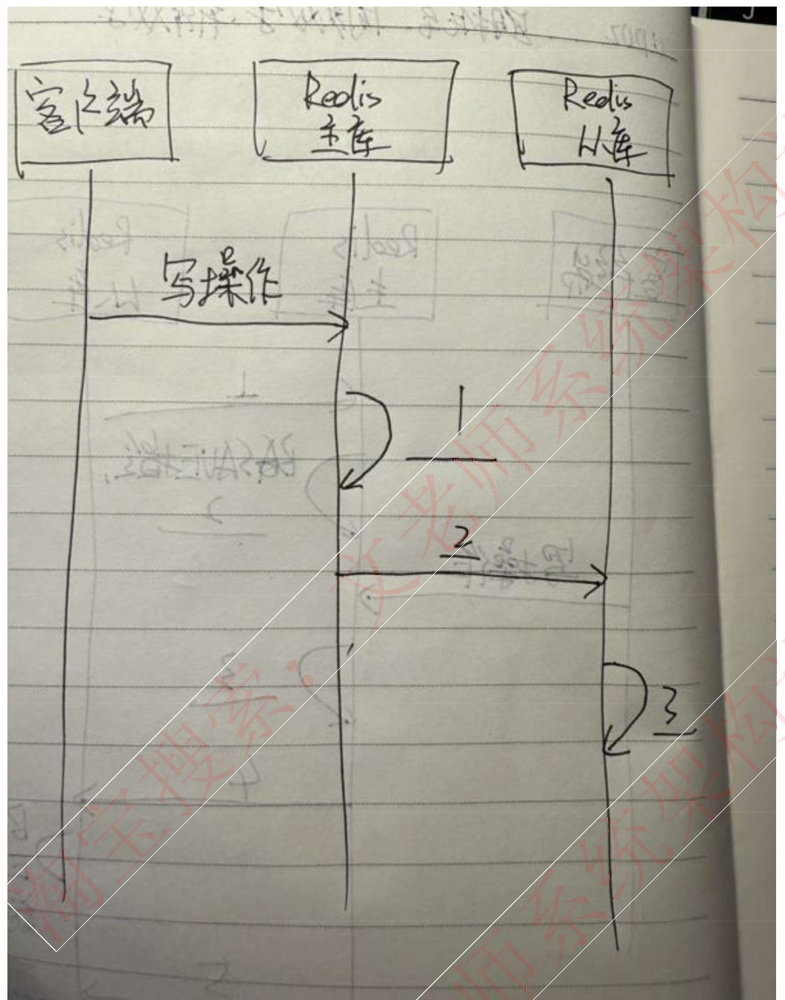
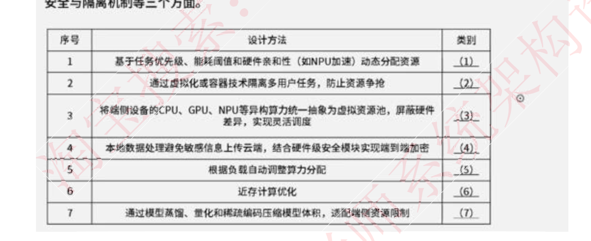

# 2025上半年 系统架构设计师 · 下午题

> 卷面信息：本卷为学员回忆版，无正式卷面。据来源第 2 页总结，本次案例 5 题分别为：系统架构设计（质量属性填空+解释器风格教材图填空+为什么适合解释器风格）、Web 架构（医疗知识图谱架构图填空+爬虫 scrapy 填空+异步 I/O）、数据库（Redis 主从复制第一次同步架构图填空+后续同步架构图填空+两种持久化技术）、嵌入式（云侧 AI 和端侧 AI 定义+资源池的核心架构设计考虑 3 个方面+资源池对比）、Web 架构（区块链六个层次+区块链三种不同人员操作流程+智能合约包含三个方面）。来源自评“本次案例比较偏，除了试题一……其他都是超纲”。
>
> ⚠️ 本卷为回忆版：题目以“题目背景大意+小问+分值+来源所附参考图”形式记录，多数原卷图以填图题形式回忆（图中空位用下划线/括号标出）；答案标注均来自来源（含 DeepSeek/豆包 AI 作答），非官方答案。

## 题号目录

| 题号 | 考点 | 教程章节 |
|------|------|----------|
| Q1 | 在线大模型训练平台：质量属性分类（12 空）＋解释器风格填图＋解释器风格适用理由 | |
| Q2 | 医疗知识图谱问答：架构图填空（约 10 空）＋scrapy 架构填图＋异步 I/O 概念＋知识图谱存储 | |
| Q3 | Redis 主从复制：第一次全量同步填图＋后续增量同步填图＋两种持久化技术对比 | |
| Q4 | 端侧 AI/云侧 AI：定义与优势＋资源池核心架构设计 7 空归类＋资源池类型对比与选型缺陷 | |
| Q5 | 区块链农产品溯源：六个层次＋三种人员操作流程＋智能合约三方面 | |

## 原题转录（视觉核验）

---

## Q1 系统架构设计（在线大模型训练平台）

题目背景大意：

某公司开发一个在线大模型训练平台，支持 Python 代码编写、模型训练和部署，用户通过 python 编写模型代码，将代码交给系统进行模型代码的解析，最终由系统匹配相应的计算机资源进行输出。用户不需要关心底层硬件平台。

回忆出的质量属性场景条目（原卷为 a–k 编号列表，共 12 条，用于第一问归类）：

- a. 系统发生错误时，不影响正常运行时发送一个消息给系统管理员　（鲁棒性　容错性　可靠性　健壮性）
- b. 方便用户操作，满足一般用户使用的快捷键设置　（易用性）
- c. 系统界面适配用户提供的屏幕尺寸比例　（功能性）
- d. 用户提交训练任务时应该在一分钟内提供硬件和资源　（性能）
- e. 数据库发生故障时，可以切换到备用库，时间在 20 分钟内　（可用性）
- f. 系统发生故障时，要能提供操作日志、？、？、调试日志（三个还是四个日志，忘了）
- g. 发生故障时应在 15 分钟内修复　（可靠性）
- h. 提供远程测试，供远程用户进行连接操作，仅提供给系统注册用户使用　（不知道是不是安全性）（安全性　后面改成了互操作性）　（这是测试性呀）（人家明明问的是供多个用户远程同时修改，只给注册用户使用，感觉第一句像互操作，后一句像安全性，今年题目是不是有病啊）
- i. 服务对功能进行扩展，什么功能的修改需要在 3 天内完成　（后面加功能修改需要 3 天完成，有点误导？我写可修改性）
- j. 系统支持切换不同的语言　（不确定是不是这个，反正是易用性）
- k. 服务器发生故障后，立即切换到备用服务，保证业务的连续，不影响业务连续性啥的，没有提到多长时间恢复（不确定是不是考可靠性，有记得的帮忙补充一下）（这明显是可用性）有提到时间，15 分钟好像　上面 g 的时间。

**第一问 12 分：**

(1) 质量属性分类，12 个空。

**第二问 13 分：**

(2) 根据题目描述，解释器风格书上那个图（挖空的部分：程序执行的当前状态、解释器引擎、解释器引擎的内部状态），6 分。（回忆者按题目信息填的三个空：用户编写的 Python 模型代码、系统解析模型代码、适合的硬件资源）

(3) 该平台为什么适合用解释器风格？7 分（来源自注：这个分数分解是哪里看的？）

**来源所列答案**：未提供（来源未给本题的参考答案；仅第二问图回忆了自己的三空填写）。
**来源解析**：未提供

> 校核注：f 条日志个数、h 条质量属性归属、k 条是否有时间限制等，回忆者均在原文中存疑；第一问 12 条质量属性条目的原卷措辞为回忆大意。

---

## Q2 Web 架构（医疗知识图谱问答）

第二题　医疗知识图谱问答

知识图谱一张填空的图，9 分（来源另处记作“10 个空 9 分，后面两问 8/8，可能允许错一个？还是错一个就要扣…”）。

来源说明（页 28）：已经找到类似原图，但有差异，猜测这个论文图也是抄别人论文里改的，所以真正原图还有待寻找。PS 本人上中国知网搜关键词只看了一篇论文就找到此类架构图了，经验就是去年案例题也是论文里的，所以猜测出题老头就是喜欢找论文里的图，要求：硕士学位论文，学校是 985。

来源所附“类似原图”（北京交通大学 2023 年硕士学位论文《…智能问答系统的设计与实现》图 3-2 医药知识图谱智能问答系统架构图）：

来源转述的论文原图文字：“较灵活的系统。由于本系统设计的功能比较复杂，包含数据预处理、自然语言处理、知识图谱构建、后端服务、前端服务、机器学习和深度学习等功能，故采用自底向上的方式构建系统总体架构，如图 3-2 所示。”（图内自上而下为应用层、业务层、数据层：应用层含实体识别页面、医药实体查询页面、医药关系查询页面、医药知识图谱问答页面；业务层含问句解析（问题分类→命名实体识别）与答案生成与匹配（知识检索→模板匹配→模板翻译）；数据层含医药知识图谱构建（知识存储/Neo4j、知识抽取（实体抽取、关系抽取）、知识表示（定义实体关系属性、创建三元组））与数据收集（结构化数据、半结构化数据、非结构化数据→数据清洗）。）

概念题：解释一下什么是异步 I/O（7 分）。

的图是写爬虫框架 scrapy，使用的是下面的原图，3 分：

1. 挖了三个空让填空，对应图中的 scheduler、scrapy engine、Item Pipeline。（来源第 33 页同图再现，注记：“填上图 Scheduler、Item Pipeline、scrapy Engine 3 个空”）

2. 知识图谱该如何存储，6 分。

来源给出的题目填空架构图（回忆版重绘，含空位）：

来源对填空图的文字说明：

- 知识图谱下面有横排三个框：框 1 是个英文（schema 啥的，设计？）；框 2 需要填；框 3 知识存储。
- （7 下面那个格子错了，是实体链接，7 选项里当时卡在实体获取和关系获取，不知道怎么选）
- 选项（16 个）：网络层、数据层、业务层、知识层、关系获取、实体获取、网页采集、知识管理、知识检索、知识清洗、数据清洗、结构化数据、数据采集、语句解析、意图识别、知识存储。
- 有“答案生成”不？我记得没有。（有人找到原图或者能分享下做的答案不）（找到类似的了，部分答案已确定）
- 从上到下 4 层应该是应用层、业务层、知识层、数据层（题目没标出）。

豆包 AI 参考答案（来源注明“个人觉得靠谱”）：

1. 最底层（数据层，标注在左侧括号）
   - 虚线框内左：数据采集（包含网页采集，选项有数据采集，作为数据来源的核心步骤）
   - 虚线框外（隐含处理）：数据清洗（对采集的数据进行清洗，选项有数据清洗）
   - 输出到右侧框：结构化数据（处理后生成结构化数据，选项有结构化数据）
2. 知识层（标注在左侧括号，上一层）
   - 中间框：知识管理（管理 Schema 定义和知识存储，选项有知识管理，连接 Schema 与存储）
3. 知识图谱层
   - 知识图谱右侧：知识检索（从知识图谱中检索相关知识，选项有知识检索）
4. 业务层（标注在左侧括号，中间 NLP 处理层）
   - 模块中间：意图识别（NLP 任务中的意图理解，选项有意图识别，与实体识别、向量化、实体关系共同构成业务逻辑处理）
5. 答案生成层
   - 左侧框：语句解析（解析用户输入语句，配合槽位填充，选项有语句解析）

DeepSeek 参考答案（来源注明“应该有误”）：

2. 业务层（从左到右流程）

| 模块顺序 | 已填项/选项匹配 |
|------|------|
| 第一空（左1） | ✅ 实体获取 — 补充实体识别前的数据准备 |
| 第二空（左2） | 已填：向量化 |
| 第三空（中间） | ✅ 关系获取 — 实体关系的子流程 |
| 第四空（右1） | 已填：答案生成 |
| 第五空（右2） | ✅ 意图识别 — 槽位填充的前提条件 |

3. 知识层（核心功能模块）

| 模块顺序 | 已填项/选项匹配 |
|------|------|
| 第一空（左1） | 已填：知识图谱 |
| 第二空（左2） | 已填：Schema 定义 |
| 第三空（中间） | 已填：知识存储 |
| 第四空（右1） | ✅ 知识管理 — 统筹清洗、存储等操作 |
| 第五空（右2） | ✅ 知识清洗 — 数据清洗的升级版 |
| 第六空（右3） | ✅ 结构化数据 — 知识存储的输出格式 |

4. 数据层（数据输入与预处理）

| 模块顺序 | 已填项/选项匹配 |
|------|------|
| 第一空（左1） | 已填：网页采集 |
| 第二空（左2） | 已填：数据采集 |
| 第三空（右1） | 已填：非结构化数据处理 |
| 剩余项适配 | ⚠️ 数据清洗 未使用（知识层已覆盖） |

另有“2. 爬虫 scrapy 架构及异步 I/O”小节：scrapy 架构图填空，scrapy 中 NIO 原理（确定有这个小问吗，我记得只问了异步 io，我记的没有问 NIO 只问了 I/O，就是没问），什么是异步 io 更新。

第三问（来源第 33 页补充）：问医药行业的数据规模大、具有数据繁杂的特性，（好像说用什么存储方式，我回答用非关系型数据库存储。）应该怎么解决（具体问法忘记了）适合使用什么样的数据存储方法。补充：问的是知识图谱的知识用什么来存储比较好，并说明原因？我回答的是 neo4j。补充 2：向量数据库。

**来源所列答案**：见上豆包 AI 参考答案与 DeepSeek 参考答案（来源注明前者较靠谱、后者应该有误）；其余小问未提供。
**来源解析**：未提供

> 校核注：本题为全卷回忆最零散的题，填图原卷图未能找到（来源明确说明真正原图有待寻找），异步 I/O 小问是否考 NIO 原理存疑；填空数 9 空还是 10 空来源前后不一（“9 分”“10 个空 9 分”两说）。

---

## Q3 数据库（Redis 主从复制）

第三题 Redis

**第一问 10 分：**

redis 主从库第一次同步架构图填空。redis 主从同步的流程，填图：全量同步过程，bgsave 指令，增量同步过程。

来源所附全量同步参考流程图（三阶段）：

**第二问 6 分：**

主从库第一次同步完成之后，后面是如何同步的，看图填空。

来源所附后续同步参考流程图（两阶段）：

来源另附手写回忆时序图（客户端/Redis 主库/Redis 从库，写操作后 1、2、3 空，与第 24 页打印版同题）：

**第三问 9 分：**

Redis 的两种持久化技术。数据持久化在系统非常重要，系统发生故障的时候需要进行数据恢复，请列举出数据持久化的两种方式，并论述其优缺点。

**来源所列答案**：未提供（来源未给本题的参考答案）。
**来源解析**：未提供

---

## Q4 嵌入式（云侧 AI 与端侧 AI／资源池）

第四题（来源未给大标题；内容为云侧 AI、端侧 AI 与资源池）

**第一问 6 分：**

云侧 AI（我印象中题目写的是云端（侧）AI，但问题一，问的是云侧 AI 和端侧 AI）AI 和端侧 AI 的定义以及端侧 AI 相比云端 AI 的优势是什么。

**第二问 7 分：**

请将 abc 填入对应的描述后面的 1-7 空

- a) 异构计算和资源虚拟化
- b) 动态资源调度和能效优化（好像不太对）（我记得是个数据抽象资源）
- c) 安全机制和隔离（大致是这个意思）

描述 A　1；描述 B　2；描述 C　3；描述 D　4；描述 E　5；描述 F　6；描述 G　7。

来源说明文字：“资源池的核心架构设计需要考虑（a）资源抽象与异构计算、（b）动态调度与能效优化、（c）安全与隔离机制等三个方面。”

表内 7 条设计方法（照录）：1. 基于任务优先级、能耗阈值和硬件亲和性（如 NPU 加速）动态分配资源；2. 通过虚拟化或容器技术隔离多用户任务，防止资源争抢；3. 将端侧设备的 CPU、GPU、NPU 等异构算力统一抽象为虚拟资源池，屏蔽硬件差异，实现灵活调度；4. 本地数据处理避免敏感信息上传云端，结合硬件级安全模块实现端到端加密；5. 根据负载自动调整算力分配；6. 近存计算优化；7. 通过模型蒸馏、量化和稀疏编码压缩模型体积，适配端侧资源限制。

**第三问 12 分：**

集中式资源池、分布式资源池以及混合型资源池对比。集中式资源池的缺点是什么。对比有 6 个空，前三个填写高中低，后三个填写集中式资源池、分布式资源池、混合型资源池的适用场景。控制面（单一控制面　还有两个忘记了）

1. 扩容能力（高中低）
2.（这里是什么忘记了）应该是管理复杂性
3. 规模（填高中低）
4. 适用场景（填空）

李工基于目前的场景，因为集中式资源池实时性高，并且目前系统规模一定，所以李工决定采用集中式资源池，但是王工说李工的方案有三个缺陷。请你描述一下李工说的三个缺陷是什么？

（来源第 25 页另有第三问早稿：“表格对比：集中式资源池　分布式资源池　混合云资源池；复杂度　中；可扩展性　高；（这里还有一个）规模大小？；应用场景（后面三个空）；写出集中式资源池的三个弊端。”）

**来源所列答案**：未提供。
**来源解析**：未提供

> 校核注：第一问题干到底是“云侧 AI 和端侧 AI”还是“云端 AI”回忆者存疑；b) 的措辞（动态资源调度和能效优化／数据抽象资源）未记准；第三问对比维度之一遗忘。

---

## Q5 Web 架构（区块链农产品溯源）

区块链的题目：农产品溯源使用区块链。

1) 区块链的六个层次分别是什么，并简单介绍（12 分）

**DeepSeek 答案仅供参考：（6 个层次是正确的）**

区块链技术体系可分为六个层级，通过多层协作实现去中心化特性与安全可信的运行机制：

- **数据层**：封装底层数据结构与安全技术，包含区块的链式结构、哈希函数、Merkle 树、时间戳及非对称加密技术，确保数据不可篡改性和完整性。区块通过保存前序哈希值形成链式存储，交易数据采用双重加密保障隐私。
- **网络层**：采用 P2P 组网技术构建分布式自治系统，节点通过传播机制同步新区块数据，依靠验证机制确认交易合法性。公有链、联盟链和私有链在该层实现不同级别的中心化控制。
- **共识层**：集成 PoW、PoS、DPoS 等算法解决分布式网络记账权分配问题，通过超过 51% 节点验证机制确保全网络账本一致性。共识机制直接影响系统的吞吐量与安全性。
- **激励层**：设计经济模型驱动节点参与验证，如比特币的挖矿奖励和交易手续费机制。通过代币发行与分配规则维护网络生态的可持续性。
- **合约层**：部署智能合约实现自动化执行，通过预编程脚本在满足条件时触发资产转移、合约清算等操作。以太坊等平台在该层扩展了图灵完备的编程能力。
- **应用层**：面向具体场景开发 DApp，涵盖金融支付（跨境结算）、供应链管理（农产品溯源）、数字身份等垂直领域。该层直接承载用户交互与业务逻辑实现。

2) 有三种人员：信息填写人员、核对人员、审核人员，请用 400 字以内文字说明三种不同人员的操作流程（9 分）

**DeepSeek 答案仅供参考：**

1. 信息填写人员：① 登录区块链系统录入农产品基础数据（批次、产地、检测报告等）；② 上传原始凭证（如检测机构盖章文件）至 IPFS 分布式存储；③ 调用智能合约生成初始哈希值，将关键信息上链；④ 系统自动生成带时间戳的区块链存证编号。
2. 核对人员：① 接收系统推送的待核验数据包；② 比对上链数据与原始凭证的一致性（通过哈希值校验）；③ 实地抽查或视频核验生产环节真实性；④ 使用多重签名钱包对通过核验的数据包进行二级加密签名，触发智能合约进入审核队列。
3. 审核人员：① 调取前两级操作的全流程区块链日志；② 复核数据修改记录（需超过 2/3 节点共识）；③ 最终确认时激活时间锁功能，使该批次数据进入只读状态；④ 颁发可验证数字凭证（VC），同步至农业监管链节点。所有操作痕迹均通过非对称加密永久上链。

3) 介绍下什么是智能合约，并说明智能合约包含哪三方面（4 分）

**DeepSeek 答案仅供参考：**

智能合约是一种以代码形式编写的程序，存储在区块链上，用于自动执行合约条款，无需第三方介入。其核心作用包括自动化履约、确保交易透明性和不可篡改性。智能合约包含以下三方面：

1. **自动化履约**：智能合约可以在满足预设条件时自动执行交易或协议，减少人工干预和信任成本。例如，在预付式消费场景中，消费者预付的资金可以通过智能合约锁定，按照服务进度分阶段释放给商家，确保资金安全。
2. **透明性和不可篡改性**：智能合约的代码是公开的，任何人都可以验证其内容和执行结果。此外，由于区块链的分布式账本和共识机制，一旦合约被记录在区块上，其内容就无法被篡改，保证了交易的不可篡改性。
3. **去中心化和安全性**：智能合约依赖于区块链的去中心化架构和加密技术，确保交易的安全性和可信度。合约代码部署在链上节点，满足条件时由网络节点通过共识机制验证并执行，将结果记录至区块。

**来源所列答案**：见上 DeepSeek 参考答案（来源明确标注“仅供参考”）。
**来源解析**：未提供（来源未附解析）。

---

## 缺口清单

- 全卷：5 道题均无来源提供的官方式参考答案；Q1、Q3、Q4 来源未给任何答案。
- Q1：f 条日志个数（三个还是四个）、h 条质量属性归属、k 条恢复时间限制均存疑；第二问图三个空的回忆填写未必是标答。
- Q2：原卷填图未找到（来源自述真正原图有待寻找）；填空数 9/10 两说；异步 I/O 是否考 NIO 存疑；第三问具体问法忘记。
- Q3：第一问 10 分的空位标准答案未提供（仅附参考流程图）；第三问两种持久化优缺点无来源答案。
- Q4：第一问题干（云侧/云端）与 b) 措辞未记准；第三问一个对比维度遗忘；李工方案三缺陷无来源答案。
- Q5：来源仅有 DeepSeek 参考答案（自注“仅供参考”），非回忆者亲历作答。
