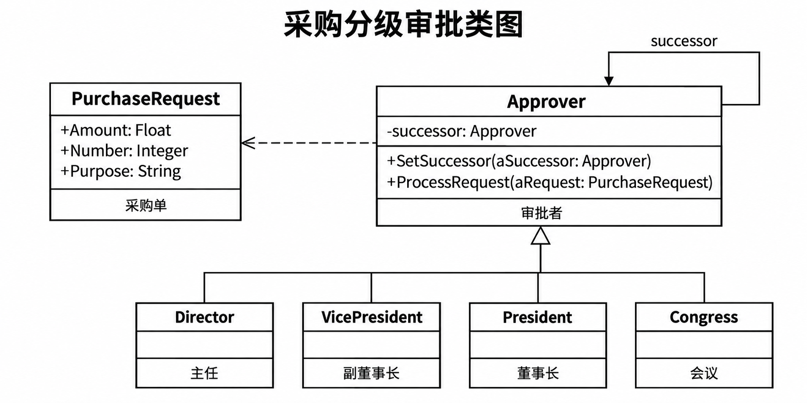
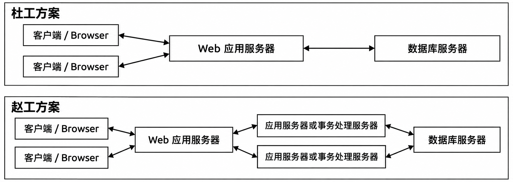
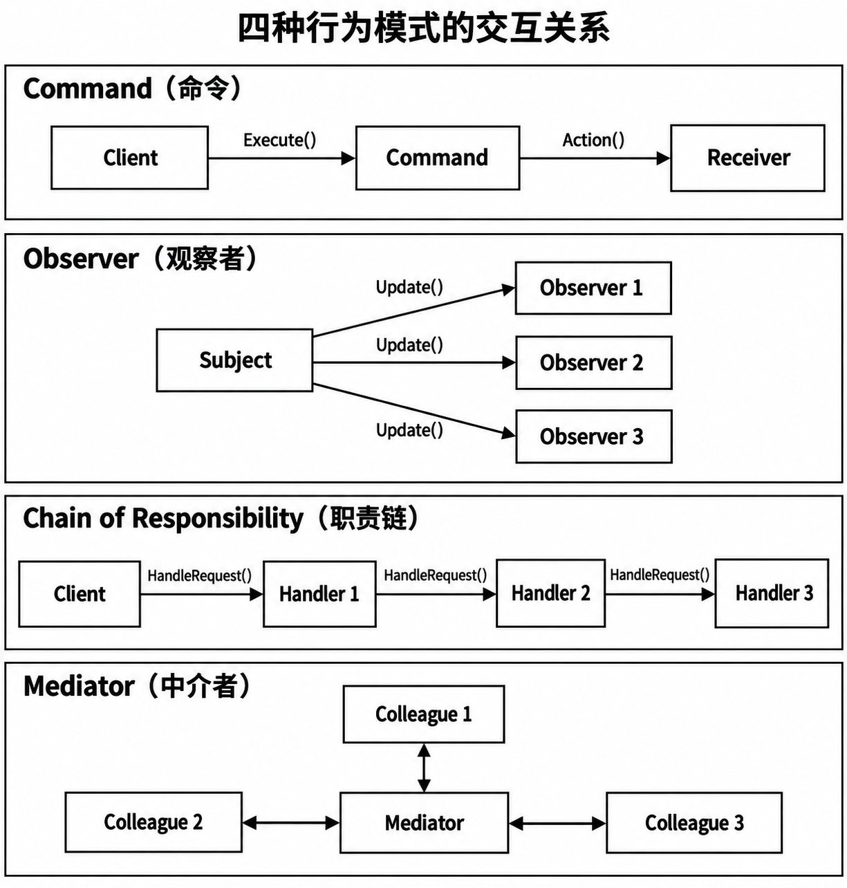
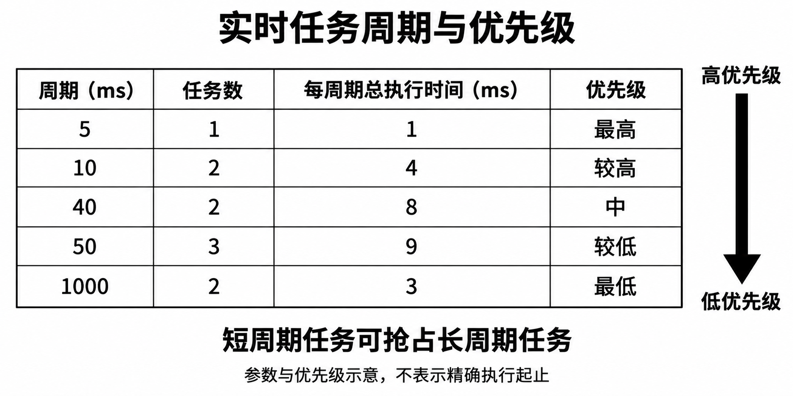

# 高级系统架构设计师下午试题押题密卷1

原件：[PDF](../assets/d5a8e1dcd189cd72.pdf)。各小问后已内嵌冲刺速记核心作答（彩色高亮代码块）；卷末保留原完整参考答案与详细解析。

排印修订和原卷歧义见 转换记录。

## 试题一

阅读以下关于设计模式应用的叙述，根据要求回答下面问题。

**说明**

PH 软件公司承接了某企业二期信息化软件开发项目，工程项目的研发任务之一是建设采购分级审批系统。该企业采购审批是根据采购金额的不同由不同层次的主管人员来审批，主任可以审批8万元以下(不包含8万元)的采购单，副董事长可以审批8～15万元(不包含15万元)的采购单，董事长可以审批15～45万元(不包含45万元)的采购单，45万元及以上的采购单就需要企业高层开会讨论决定。PH 公司架构师采用某种设计模式设计的类图如下图所示。

某企业采购分级审批类图

### 问题 1

请用350字以内的文字指出该公司架构师所采用的设计模式的具体名称、设计意图及其优缺点。

### 问题 2

请用300字以内的文字指出该公司架构师所采用的设计模式的适用性，以及图中需要考虑哪些实现问题?

### 问题 3

结合你的系统架构经验，请用300字以内的文字指出 command 模式、Observer 模式、Chain of Responsibility 模式和 Mediator 模式在发送者和接收者解耦方面的区别。

## 试题二

阅读以下关于面向服务架构的应用叙述，根据要求回答下面问题。

**说明**

某航空公司的主要业务系统(如订票系统、航班调度系统等)始建于二十世纪七八十年代，之后随着信息化的进展，陆续积累了许多异构的遗产信息系统。这些系统部分采用了 J2EE、.NET 等技术进行开发，分布在不同的地理位置，采用不同的协议进行数据传输。近年来，该公司在企业集成方面也是煞费苦心，已经在几个主要的核心系统之间构建了用于信息集成的信息 Hub(Information Hub), 其他业务应用之间也有不少点到点的集成。尽管这些企业集成技术在一定程度上增进了系统间的信息共享，但是面对历史异构的遗产信息系统，企业的业务整合、功能整合仍是困难重重，主要表现如下。

- 由于大部分核心应用构建在主机之上，因此 Information Hub 是基于主机技术开发，很难被开放系统使用。

- Information Hub 对事件支持不强，被集成的系统间的事件以点到点流转为主，被集成系统间耦合性强。

- 牵扯到多个系统间的业务协作以硬编码为主，将业务活动自动化的成本高，周期长，被开发的业务活动模块重用性差。

某软件开发公司承接了该航空公司应用系统的集成任务，项目组经过多方讨论和论证之后，决定采用以面向服务为中心的企业集成技术，一步步解决该公司所面临的企业集成问题。

### 问题 4

项目组在讨论架构方案时，某位架构师提出采用企业服务总线(ESB) 架构模式，通过 ESB 的事件服务(Event Service)完成订阅发布，使应用程序间的事件集成不再需要原来的点到点方式，从而解耦组件之间的依赖关系，降低软件系统互连的复杂性。结合你的系统架构设计经验，请用400字以内的文字简要说明在 ESB 环境中组件之间典型的交互过程，以及 ESB 具有的核心功能。

### 问题 5

将彼此关联的业务活动组成自动化流程可以进一步提高该航空公司业务活动的效率。以服务为中心的企业集成通过流程服务来完成业务流程集成。结合你的系统架构设计经验，请用300字以内的文字列举出3种 SOA 架构中的流程服务内容，并给出简要说明。

### 问题 6

若项目组采用 Web Service 作为基于 SOA 集成方法的实现技术，请根据该航空公司目前的实际情况，用300字以内的文字说明系统应该分为哪几个层次，并简要说明每个层次的功能。

## 试题三

阅读以下关于数据库应用系统性能分析方面的说明，根据要求回答下面问题。

**说明**

某大中型企业采用 Oracle 数据库建立一个经济信息统计方面的大型数据库应用系统。尽管配置了比较良好的硬件和网络环境，但该数据库应用系统实施后的整体性能表现较差。特别是随着业务量与信息量的迅速扩大，数据库系统的存取速度显著减慢，存储效率也明显下降。

该企业通过反复实践与摸索，并邀请数据库专家一起会诊，认为可以从以下4个方面进一步优化数据库应用系统。

- 由于数据库应用中最主要的查询与修改数据操作大多需通过 I/O 来完成，因此需要通过调整服务器配置(即对硬件设备进行升级)、操作系统配置与数据库管理系统的有关参数，优化系统的 I/O性能，尤其是改进磁盘 I/O 的效率与性能。

- 优化“索引”的建立与使用机制，尽可能提高数据查询的速度或效率。

- 合理使用聚类(Cluster), 改进查询响应时间和系统的综合性能。其中，“聚类”是指把单独组织的，但在逻辑上经常需要连接的，较为稳定的几个基本表聚集在一起(在物理上实现邻近存放),可以显著减少数据的搜索时间，从而提高性能。

- 对应用系统中使用的 SQL 语句进行调优，针对每条 SQL 语句都建立对应的索引等。

### 问题 7

许多开发技术人员由于缺乏经验，通常在建立实体(如基本表、索引或表空间等)时，都习惯于使用 DBMS 提供的“缺省参数”,结果常常会引起数据库应用系统性能较差的隐患。结合你的系统架构设计经验，请用200字以内的文字简要说明使用 DBMS 缺省参数的缺点。

### 问题 8

在该企业所邀请的数据库专家的会诊建议中，选取合适的“索引字段”,对于索引实现的效率具有相当重要的作用。结合你的系统架构设计经验，请用200字以内的文字，指出选用具有哪些特征的字段作为索引手段较为合适。

### 问题 9

#### （1）

在该企业所邀请的数据库专家会诊意见中，针对每条 SQL 语句都建立索引的建议是否合适？请简要说明理由。

#### （2）

结合你的系统架构设计经验，请列举出4条 SQL 语句优化的基本策略。

### 问题 10

在数据库中，当某个业务表中的数据量很大且急速膨胀时，为了保持较高的数据响应速度，可以对该数据表进行分片设计。请用300字以内的文字简要说明对数据表分片需要满足的条件，以及常见的数据表分片方法。

## 试题四

阅读以下关于嵌入式实时操作系统软件的选型分析方面的叙述，回答下面问题。

**说明**

某研究所承担了一项宇航嵌入式系统的研制任务，本项任务技术难度大，可靠性要求高，进度要求紧，预计软件规模约在一万行以上。而该所原先承担的相关项目均是用汇编语言编写的(软件规模较小，一般是几百行)。项目主管工程师将软件开发的论证工作分别布置给了架构师阮工和刘工，要求他们根据本项目的技术要求，在一周内分别提出软件的实施方案。

- 该宇航嵌入式系统由数据处理机、信号处理机及数据采集模块组成。信号处理机主要通过数据采集模块将大量不固定时间周期的外部数据采集进来，进行预处理(如 FFT 变换)后提交给数据处理机；数据处理机根据功能要求完成各种计算处理工作，并将结果输出。为了达到数据处理机和信号处理机的标准化，这两类处理机均采用同种处理机的体系结构(如 PowerPC 7410)。整个系统工作的最大周期为1s,最小周期为5ms。数据处理机上的任务分布如下表所示。

**数据处理机上的任务分布表**

| 工作周期 | 任务数(个) | 共占时间(ms) |
| --- | --- | --- |
| 5 | 1 | 1 |
| 10 | 2 | 4 |
| 40 | 2 | 8 |
| 50 | 3 | 9 |
| 1000 | 2 | 3 |

- 一周后，架构师阮工和刘工提交了各自的实施方案，其共同之处在于二者均提出采用操作系统及相应的软件开发环境。但是，阮工和刘工在选择什么样的操作系统及开发环境方面出现了较大分歧。阮工的实施方案指出，为了满足本项目的技术要求，并有利于本所软件的长期发展，应选用具有硬实时处理能力的嵌入式实时操作系统及开发环境(例如 Vxworks 等);而刘工的实施方案指出，操作系统主要完成对计算机资源的管理与分配工作，考虑到人们对操作系统及软件开发工具的熟悉程度，本项目应选用具有大众化的，开发人员容易上手的嵌入式操作系统(例如 windows CE、Linux等)。

- 在两人争执不下的情况下，项目主管工程师组织了相关专家对阮工和刘工提交的实施方案进行了评审。最后，专家组一致认为阮工的方案切实可行，操作系统的选型论证充分、客观，可以作为本所未来几年中相关项目的软件开发的基本环境。同时专家组还就具体实施选择嵌入式实时操作系统及开发环境产品时应着重考虑的相关问题提出了几点建议。

### 问题 11

为什么专家组一致认为阮工的实施方案切实可行?请用200字以内的文字简要说明。

### 问题 12

选择实时嵌入式操作系统及开发环境时应考虑哪几方面的问题?请用200字以内的文字简要论证。

### 问题 13

根据本项目中任务的时间性能参数，请用200字以内的文字(也可用图示)描述任务的被调度关系，并分析系统是否可调度(暂不考虑操作系统的时间开销)?

## 试题五

阅读以下关于体系结构设计的叙述， 根据要求回答下面问题。

**说明**

某大中型电子商务公司的主要业务是在线购物，包括书籍、服装、家电和日用品等。随着公司业务规模不断增大，公司决策层决定重新设计并实现其网上交易系统。 PH 软件公司承担了该项目软件开发任务，负责系统开发的杜工和赵工分别给出了两种不同的设计方案，分别如下图上、下两部分所示。

公司的架构师和开发者针对这两种设计方案，从服务器负载情况、业务逻辑的分离性、系统可靠性，以及实现简单性等方面进行讨论与评估，综合考虑后最终采用了赵工给出的方案。

### 问题 14

结合你的系统架构设计经验，请分析比较杜工、赵工两种方案的优点和不足，将下表中(1)～(6)空缺处的内容填写完整。

架构方案对比表

| 评价因素 | 杜工建议的体系结构方案 | 赵工建议的体系结构方案 |
| --- | --- | --- |
| 服务器负载 | （1） | （2） |
| 业务逻辑的分离性 | （3） | （4） |
| 系统的可靠性 | 采用单台 Web 服务器，整个系统的可靠性较差 | （5） |
| 实现简单性 | （6） | 需要将脚本语言与面向对象编程语言相结合，相对复杂 |

### 问题 15

如何架构高性能 Web 应用系统是 PH 公司项目组面临的另一个问题。结合你的系统架构设计经验，请用200字以内的文字列举两个主要影响着 Web 应用系统服务端执行效率的技术因素，并针对每个因素提出相应的解决方案以提高系统性能。

### 问题 16

REST(REpresentational State Transfer)是从几种基于网络的架构风格中衍生出来的一种混合架构风格。采用这种方法设计的 Web 应用系统能够结合 REST 风格和面向服务思想的优点。结合你的系统架构设计经验，请用300字以内的文字简要说明与传统的 Web 服务相比，采用 REST 服务构建的 Web 应用具有哪些优势和不足。

## 参考答案与解析

### 试题一

#### 第 1 题

名称：Chain of Responsibility(职责链)模式

设计意图：使多个对象都有机会处理请求，从而避免请求的发送者和接收者之间的耦合关系：将这些对象连成一条链，并沿着这条链传递该请求，直到有一个对象处理它为止。

优缺点：①降低了耦合度；②增加了给对象指定责任的灵活性：③类的集合可以作为一个整体；

- ④不保证被接收等

**解析**  Chain of Responsibility(职责链)模式可以在系统中建立一个链，这样消息就可以在首先接收到它的级别处被处理，或者可以定位到可以处理它的对象。依题意，该企业的采购审批是分级进行的，可以采用职责链(Chain of Responsibility)设计模式对该采购审批过程进行设计，设计后得到的类图如图所示。

Chain of Responsibility(职责链)模式的设计意图是：使多个对象都有机会处理请求，从而避免请求的发送者和接收者之间的耦合关系；将这些对象连成一条链，并沿着这条链传递该请求，直到有一个对象处理它为止。换而言之，其目的是为了将一个请求发送给一个对象集合，对象被组织成一条链，而负责处理该请求的对象将获取请求消息并加以处理，其余对象则仅仅负责将该请求消息按照责任链的顺序传递到下一个对象。因此责任链模式的关键在于组织不同的对象成为一条链并传递消息。根据题干给出的不同层次主管人员的审批额度“主任：8万元以下，副董事长：8万元～15万元，董事长：15万元～45万元，开会讨论：45万元及以上”,对象在职责链中的顺序应该为：Director→Vicepresident→Presiden→Congress Meeting。由于主任的审批额度最小，因此审批的请求应该从主任(Director) 开始。

Chain of Responsibility 模式具有以下一些优点和缺点。

(1)降低了耦合度。该模式使得一个对象无须知道是其他哪一个对象处理其请求。对象仅需知道该请求会被“正确”地处理。接收者和发送者都没有对方的明确的信息，且链中的对象不需要知道链的结构。结果是，职责链可简化对象的相互连接。它们仅需要保持一个指向其后继者的引用，而不需要保持它所有的候选接收者的引用。

(2)增加了给对象指定责任(Responsibility) 的灵活性。当在对象中分派职责时，职责链给出更多的灵活性。可以通过在运行时刻对该链进行动态的增加或修改来增加或改变处理一个请求的那些职责。可以将这种机制与静态的特例化处理对象的继承机制结合起来使用。

(3)由于在一个类中产生的事件可以被发送到组成中的其他类处理器上，因此类的集合可以作为一个整体。

(4)不保证被接收。既然一个请求没有明确的接收者，那么就不能保证它一定会被处理—该请求可能一直到链的末端都得不到处理。一个请求也可能因为该链没有被正确配置而得不到处理。

#### 第 2 题

适用性：①多个对象可以处理一个请求，而其处理器却是未知的；②想要在不指定确切的请求接收对象的情况下，向几个对象中的一个发送请求：③可以动态地指定能够处理请求的对象集等。

考虑的实现问题：①实现后继者；②连接后继者：③表示请求；④在 Smalltalk 中自动转发

**解析** 在以下情况中，应该使用 Chain of Responsibility 模式。

(1)多个对象可以处理一个请求，而其处理器却是未知的。

(2)想要在不指定确切的请求接收对象的情况下，向几个对象中的一个发送请求。

(3)可以动态地指定能够处理请求的对象集等。

依题意，在图中，需要考虑以下一些职责链模式的实现问题。

(1)实现后继者。链有两种方法可以实现后继者链：①定义新的链接(通常在类 Approver 中定义，但也可由类 Director、 类 Vicepresident、 类 Presiden 和类 Congress 来定义);②使用已有的链接。

通常情况下，可使用已有的对象引用来形成后继者链。例如，在一个部分一整体层次结构中，父构件引用可定义一个部件的后继者，窗口组件(Widget) 结构可能早已有这样的链接。在Composite 模式中更详细地讨论了父构件引用。当已有的链接能够支持所需的链时，完全可以使用它们。这样就不需要明确定义链接，而且可以节省空间。但如果该结构不能反映应用所需的职责链，那么就必须定义额外的链接。

(2)连接后继者。如果没有己有的引用可定义～个链，那么就必须自己引入它们。这种情况下类Approver 不仅定义该请求的接口，通常也维护后继链接。类 Approver 就提供了ApproverRequest, 的缺省实现，ApproverRequest 向后继者(如果有的话)转发请求。如果类Director 的子类对该请求不感兴趣，它不需要重定义转发操作，因为它的缺省实现可进行无条件的转发。

(3)表示请求。可以用不同的方法表示请求。最简单的形式是：请求是一个硬编码的(hard-coded) 操作调用。这种形式方便而且安全，但只能转发 Approver 类定义的固定的一组请求。

另一选择是使用一个处理函数，这个函数以一个请求码(如一个整型常数或一个字符串)为参数。这种方法支持请求数目不限。唯一的要求是发送方和接收方在请求如何编码问题上应达成一致。该方法更为灵活，但它需要用条件语句来区分请求代码以分派请求。另外，无法用类型安全的方法来传递请求参数，因此它们必须被手工打包和解包。显然，相对于直接调用一个操作而言，它不太安全。为解决参数传递问题，可以使用独立的请求对象来封装请求参数。Request 类可明确地描述请求，而新类型的请求可用它的子类来定义。这些子类可定义不同的请求参数。处理者必须知道请求的类型(即它们正使用哪一个 Request 子类)以访问这些参数。为了标识请求，Request 可定义一个访问器(Accessor) 函数以返回该类的标识符。或者，如果实现语言支持的话，接收者可使用运行时的类型信息。

(4)在 Smalltalk 中自动转发。你可以使用 Smalltalk 中的 doseNotUnderstand 机制转发请求。没有相应方法的消息被 doseNotUnderstand 的实现捕捉(Trap In),此实现可被重定义，从而可向一个对象的后继者转发该消息。这样就不需要手工实现转发；类仅处理它感兴趣的请求，而依赖 doesNotUnderstand 转发其他所有的请求。

#### 第 3 题

Command 模式使用一个 Command 对象来定义一个发送者和一个接收者之间的绑定关系，从而支持解耦。

Observer 模式通过定义一个接口来通知目标中发生的改变，从而将发送者(目标)与接收者(观察者)解耦。

Chain of Responsibility 模式通过沿一个潜在接收者链传递请求而将发送者与接收者解耦。

Mediator 模式让对象通过一个 Mediator 对象间接的互相引用，从而对它们解耦。

**解析** 当合作的对象直接互相引用时，它们变得互相依赖，这可能会对一个系统的分层和重用性产生负面影响。Command 模式、Observer 模式、Chain of Responsibility 模式和 Mediator 模式都涉及如何对发送者和接收者解耦，但它们又各有不同的权衡考虑。

命令模式使用一个 Command 对象来定义一个发送者和一个接收者之间的绑定关系，从而支持解耦，如下图所示。Command 对象提供了一个提交请求的简单接口(即 Execute 操作)。将发送者和接收者之间的连接定义在一个单独的对象，使得该发送者可以与不同的接收者一起工作。这就将发送者与接收者解耦，使发送者更易于复用。此外，可以复用 Command 对象，用不同的发送者参数化一个接收者。虽然 Command 模式描述了避免使用生成子类的实现技术，但是每一个发送者一接收者连接都需要一个子类。

观察者模式通过定义一个接口来通知目标中发生的改变，从而将发送者(目标)与接收者(观察者)解耦，见上方对应分图。Observer 定义了一个比 Command 更松的发送者一接收者绑定，因为一个目标可能有多个观察者，并且其数目可以在运行时变化。观察者模式中的 Subject 和 Observer 接口是为了处理 Subject 的变化而设计的，因此当对象间有数据依赖时，最好用观察者模式来对它们进行解耦。

职责链模式通过沿一个潜在接收者链传递请求而将发送者与接收者解耦，见上方对应分图。因为发送者和接收者之间的接口是固定的，职责链可能也需要一个定制的分发策略。因此它与 Mediator 一样存在类型安全的问题。如果职责链已经是系统结构的一部分，同时在链上的多个对象中总有一个可以处理请求，那么职责链将是一个很好地将发送者和接收者解耦的方法。此外，因为链可以被简单的改变和扩展，从而为该模式提供了更大的灵活性。

中介者模式让对象通过一个 Mediator 对象间接的互相引用，从而对它们解耦，见上方对应分图。 一个 Mediator 对象为各 Colleague 对象间的请求提供路由并集中它们的通信。因此各 Colleague 对象仅能通过 Mediator 接口相互交谈。因为这个接口是固定的，为了增加灵活性，Mediator 可能不得不实现它自己的分发策略。可以用一定的方式对请求编码并打包参数，使得 Colleague 对象可以请求的操作数目不限。中介者模式可以减少一个系统中的子类生成，因为它将通信行为集中到一个类中而不是将其分布在各个子类中。然而，特别的分发策略通常会降低类型安全性。

aCo

(发送Mediator 模式解耦示意图

### 试题二

#### 第 4 题

交互过程：先由服务请求者触发一次交互过程，产生一个服务请求消息，并将该消息按照 ESB 的要求标准化，然后将标准化的消息发送给服务总线。ESB 根据请求消息中的服务名(或接口名)进行目的组件查找，将消息转发至目的组件，并最终将处理结果逆向返回给服务请求者。

核心功能：

- ①提供位置透明性的消息路由和寻址服务。

- ②提供服务注册和命名的管理功能。

- ③支持多种消息传递范型。

- ④传输协议转换。

- ⑤支持多种数据格式及其相互转换。

- ⑥提供日志和监控功能等

**解析** 企业服务总线(Enterprise Service Bus,ESB)是由中间件技术实现的支持面向服务架构(SOA) 的基础软件平台，支持异构环境中的服务以基于消息和事件驱动模式的交互，并且具有适当的服务质量和可管理性。ESB 技术的基本思想是：提供一种标准的软件底层架构，各种程序组件能够以服务单元的方式“插入”到该平台上运行，并且组件之间能够以标准的消息通信方式来进行交互。

在 ESB 环境中组件之间的典型交互过程是：首先由服务请求者触发十次交互过程，产生一个服务请求消息，并将该消息按照 ESB 的要求标准化，然后标准化的消息被发送给服务总线。ESB 根据请求消息中的服务名或者接口名进行目的组件查找，将消息转发至目的组件，并最终将处理结果逆向返回给服务请求者。

这种交互过程不再是点对点的直接交互模式，而是由事件驱动的消息交互模式。通过这种方式，ESB 在最大限度上解耦了组件之间的依赖关系，降低了软件系统互连的复杂性。连接在总线上的组件无须了解其他组件和应用系统的位置及交互协议，只需要向服务总线发出请求，消息即可获得所需服务。服务总线事实上实现了组件和应用系统的位置透明和协议透明。技术人员可以通过开发符合 ESB标准的组件(适配器)将外部应用连接至服务总线，实现与其他系统的互操作。同时，ESB 以中间件的方式，提供服务容错、负载均衡、QoS 保障和可管理功能。

对 ESB 的基本核心功能归纳如下。

(1)提供位置透明性的消息路由和寻址服务。

(2)提供服务注册和命名的管理功能。

(3)支持多种消息传递范型(如请求/响应、发布/订阅等)。

(4)支持多种可以广泛使用的传输协议(即传输协议转换)。

(5)支持多种数据格式及其相互转换(即多种平台下多种集成方式的支持)。

(6)提供日志和监控功能。

#### 第 5 题

(1)编排服务：通过预定义的流程逻辑控制流程中业务活动的执行，并帮助业务流程从错误中恢复。

(2)事务服务：用于保证流程执行中的事务特性(ACID)。 对于短流程，通常采用传统的两阶段提交技术：对于长流程，一般采用补偿的方法。

(3)人工服务：用于将人工的活动集成到流程中，即通过关联的交互服务使得人工可以参与到流程执行中，并且管理由于人工参与而带来的管理任务(如任务分派、授权和监管等)。

**解析** 企业部门内部的 IT 系统通过将业务活动自动化来提高业务活动的效率。但是这些部门的业务活动并不是独立的，而是和其他部门的活动彼此关联的。将彼此关联的业务活动组成自动化流程可以进一步提高业务活动的效率。以服务为中心的企业集成通过流程服务来完成业务流程集成。在业务流程集成中，粒度的业务逻辑被组合成业务流程，流程服务提供自动执行这些业务流程的能力。在参考架构中，流程服务包括以下内容。

(1)编排服务(Choreography service): 通过预定义的流程逻辑控制流程中业务活动的执行，并帮助业务流程从错误中恢复。

(2)事务服务(Transaction Service): 用于保证流程执行中的事务特性(ACID)。 对于短流程，通常采用传统的两阶段提交技术；对于长流程，一般采用补偿的方法。

(3)人工服务(Staff Service): 用于将人工的活动集成到流程中。一方面，它通过关联的交互服务使得人工可以参与到流程执行中；另一方面，它需要管理由于人工参与带来的管理任务，如任务分派、授权和监管等。

#### 第 6 题

(1)底层传输层，主要负责消息的传输机制。

(2)服务通信协议层，用于描述并定义服务之间进行消息传递所需的技术标准。

(3)服务描述层，负责以一种统一的方式描述服务的接口与消息交换方式。

(4)服务层，负责将遗产系统进行包装，并通过发布的 WSDL 接口描述被定位和调用。

(5)业务流程层，支持服务发现、服务调用和点到点的服务调用，并将业务流程从 Web Service的底层调用抽象出来。

(6)服务注册层，使服务提供者能够通过 WSDL 发布服务定义，并支持服务请求者查找所需的服务信息

**解析** 在采用 Web Service 作为 SOA 的实现技术时，根据该航空公司目前的实际情况，从功能角度考虑，该系统应该至少分为6个层次，分别为底层传输层、服务通信协议层、服务描述层、服务层、业务流程层和服务注册层，如下表所示。

**Web Service 各层次功能及相关标准**

| 层次 | 功能 | 相关标准 |
| --- | --- | --- |
| 底层传输层(Transport) | 主要负责消息的传输机制 | HTTP、SMTP、FTP 和 JMS 等 |
| 服务通信协议层(ServiceCommunicationProtocol) | 描述并定义服务之间进行消息传递所需的技术标准 | SOAP 和 REST 协议 |
| 服务描述层(ServiceDescription) | 主要以一种统一的方式描述服务的接口与消息交换方式 | WSDL |
| 服务层(Service) | 将遗产系统进行包装，并通过发布的 WSDL 接口描述被定位和调用 | ____ |
| 业务流程层(BusinessProcess) | 支持服务发现、服务调用和点到点的服务调用，并将业务流程从 Web Service 的底层调用中抽象出来 | WS-BPEL(BPEL4WS) |
| 服务注册层(ServiceRegistry) | 使服务提供者能够通过 WSDL 发布服务定义，并支持服务请求者查找所需的服务信息 | UDDI |

### 试题三

#### 第 7 题

①若使用默认参数，在进行查询时会产生大量不必要的记录项。在进行数据传输和处理时，由于数据过多可能会导致 I/O 阻塞。

- ②在合理分布各类存储空间时，由于默认参数导致记录分配不均匀，将降低存储空间的利用度

**解析** 目前，大多数的大、中型信息系统都使用数据库作为数据存储，而信息系统的性能优化是一个综合性的问题，需要综合考虑硬件设备、操作系统、数据库和应用系统。基于数据库的业务系统，一般在进行调优时，需要具体问题具体分析。全面的分析方案应该包括以下3方面的内容。

(1)对系统中的业务数据进行搜集，判断当前硬件设备是否足够。判断数据库管理系统和操作系统的相应参数设置是否合理。例如数据库中 SGA 中的参数、操作系统中共享内存等参数、数据库中数据与索引物理存储的分离等。

(2)对应用系统进行分析，对业务系统的类型进行确认，如联机事务处理和数据仓库对数据库的要求差异很大。 OLTP 和 OLAP 的类型也有很大的差异。

(3)对应用系统中的 SQL 语句和索引等进行分析。

题干中数据库专家已指出，系统 I/O 经常会成为制约数据库应用系统性能的瓶颈。减少 I/O 资源的争用，以及合理分布各类存储空间，通常能有效地提高全系统的运行效率。例如，可以使应用系统的存储空间与系统表空间分离；在不同的盘驱动器上设立数据表空间与索引表空间；自动整理与减少空间碎片等。

若使用 DBMS 的默认参数，在进行查询时会产生大量不必要的记录项。在进行数据传输和处理时，可能由于小数据文件过多而导致 I/O 阻塞。另外在合理分布各类存储空间时，由于默认参数导致记录分配不均匀，降低存储空间的利用率。

#### 第 8 题

①该字段作为数据表中的主关键字或候选关键字。

- ②该字段能够唯一地标识记录或将记录进行较多细目分类。

- ③该字段与其他字段组合能唯一地标识记录或将记录进行分组。

- ④该字段是其他表的外键

**解析** 对于大型数据库系统来说，索引机制可以在很大程度上提高数据查询的效率。但是索引是以空间为代价来换取时间的，而且一般仅当表的容量较大时，才能显现出索引的作用。通常情况下，优化索引的使用有以下两条主要途径。

(1)尽可能充分地去理解索引的基本原理和在本系统中使用索引时的一些规则，从而为正确使用索引奠定基础。比如，在某些谓词后不使用索引(如 OR、NOT IN 等),查询的记录数超过表总记录数的20 以上时不适宜使用索引，在另一些谓词后出现的索引字段会使用索引等。

(2)在有很多基本表的场合下，由多名开发人员大量创建不尽合理的索引，可能会显著降低系统的性能。根据应用的实际需要，合理地创建“索引”,在本数据库应用系统中可以考虑一些创建索引的原则或指导性规则。例如，原则上，对记录数较多的表，应尽可能考虑创建索引的可行性；在连接多个表的场合下，最好考虑采用索引；无相同值的字段可建立起“唯一性索引”(这时查询代化性能特别出色);对于只读的表可建立较多的索引，对于更新频度较高的表只能建立较少的索引；尽可能在数据加载之后再建立索引，以避免重新索引的开销；建立并设置复合索引时，应把最常用的索引字段放在前面，即保持相对合理的索引字段次序。

选取合适的“索引字段”,对于索引实现的效率具有相当重要的作用。通常情况下，选用具有以下特征的字段作为索引手段较为合适：①该字段作为数据表中的主关键字或候选关键字；②该字段能够唯一地标识记录或通过将记录进行较多细目分类；③该字段与其他字段组合能唯一地标识记录或将记录进行分组；④该字段是其他表的外键等。

#### 第 9 题

(1)不适当，理由如下(包含但不限于以下内容，列举出其中4个小点即可，。

- ①如果建立索引不当，数据库管理系统将不利用已经建立的索引，而采取全表扫描。

- ②当更新操作成为系统瓶颈时，因为每次更新操作会重建表的索引，则需要考虑删除某些索引。

- ③应该针对不同应用情况选择适当的索引类型。例如，如果经常使用范围查询，则 B 树索引比散列索引更加高效。

- ④应该将有利于大多数据查询和更新的索引设为聚类索引。

- ⑤需要对建立的索引进行实际的测试，因为索引的使用是由数据库管理系统(数据库优化器)决定的。

(2)SQL 语句优化的常见策略如下。

- ①建立物化视图或尽可能减少多表查询。

- ②以不相干子查询替代相干子查询。

- ③只检索需要的列。

- ④用带 IN 的条件子句等价替换 OR 子句。

- ⑤经常提交 COMMIT, 以尽早释放锁。

- ⑥避免嵌套的游标(Cursor) 和多重循环等

**解析** 在该企业所邀请的数据库专家会诊意见中，针对每条 SQL 语句都建立索引的建议是不适当的。通常隋况下，应针对查询语句，建立适当的索引以提高查询效率。但是索引调整时还需要考虑以下原则。

(1)如果更新操作成为系统瓶颈(因为每次更新操作会重建表的索引),则需要考虑删除某些索引。

(2)应该针对不同应用情况选择适当的索引类型。例如，如果经常使用范围查询，则 B 树索引比散列索引更加高效。

(3)将有利于大多数据查询和更新的索引设为聚类(Cluster) 索引。

同时需要对建立的索引进行实际的测试，因为索引的使用是由数据库管理系统(数据库优化器)决定的。如果建立索引不当，数据库管理系统将不利用已经建立的索引，而采取全表扫描。

SQL 语句优化在信息系统调优中所占比例较大。通常情况下，一个信息系统中不同 SQL 语句的数目往往在200～400条，在优化时，需要对每条 SQL 语句的性能进行测量，对性能表现不佳的 SQL 语句进行调整。当前也已经出现了专门的 SQL 语句优化的工具，可以辅助开发人员。SQL 语句优化的常见策略如下。

(1)优化相应的表连接，建立物化视图或尽可能减少多表查询。

(2)以不相干子查询替代相干子查询，即优化嵌套子查询。

(3)只检索需要的列，无须将表中所有的列全部检索，即避免全表的反复查询。

(4)用带 IN 的条件子句等价替换 OR 子句。

(5)避免嵌套的游标(Cursor) 和多重循环。

(6)经常提交 COMMIT, 以尽早释放锁等。

注意，对于不同类型的应用系统，在数据库操作中，可采用的优化方法也有所不同。

#### 第 10 题

数据表分片满足的条件

(1)完备性条件：必须把全局关系的所有数据映射到片段中，决不允许有属于全局关系的数据却未被映射到任何一个片段。

(2)可重构条件：必须保证能够由同一个全局关系的各个片段来重建该全局关系。

(3)不相交条件：要求一个全局关系被分割后所得的各个数据片段互不重叠。

数据表分片方法：水平分片和垂直分片

**解析** 在数据库中，某个业务表中的数据量很大，急速膨胀，在这样的情况下，为了保持高的数据响应速度，根据数据的时间局部性和空间局部性原则，可以对数据表进行分片设计。一般有两种分片方法，分别为水平分片和垂直分片。

对数据表分片需要满足完备性条件、可重构条件和不相交条件。其中，完备性条件是指必须把全局关系的所有数据映射到片段中，决不允许有属于全局关系的数据却未被映射到任何一个片段。可重构条件是指必须保证能够由同一个全局关系的各个片段来重建该全局关系。对于水平分片可用并操作重构全局关系；对于垂直分片可用连接操作重构全局关系。不相交条件是指要求一个全局关系被分割后所得的各个数据片段互不重叠(对垂直分片的主键除外)。

### 试题四

#### 第 11 题

①宇航嵌入式系统是一种硬实时系统，要求对外部事件做出快速响应，因此，阮工提出的选用具有硬实时操作系统在实时处理和相应的方面优于一般嵌入式操作系统。

- ②从资源的约束性来讲，宇航嵌入式系统由于受空间和重量的限制，操作系统代码不宜过于庞大，选择具有可剪裁功能的操作系统更适应本项目。

- ③宇航嵌入式系统要求软件可靠性较高，而阮工选择的操作系统已经过相关部门验证，其可靠性高于刘工所选的操作系统

**解析** 这是一道要求读者通过对题目的理解，根据题目给出的技术参数说明选择操作系统的依据的综合分析题。本试题的解答思路如下。

(1)嵌入式操作系统的使用与具体的应用方向紧密相关。目前，根据不同的应用领域，嵌入式操作系统分为嵌入式操作系统和嵌入式实时操作系统，实时又分为强实时和弱实时。

(2)强实时、资源约束和可靠性是宇航软件必须考虑的三大因素。强实时将是本题首要关注的选型内容之一；而可靠性则是宇航系统极为重要的考虑内容；可剪裁、开放和可扩展是嵌入式系统的公共特性。

(3)在宇航系统中，由于航天航空飞行器速度非常快，需要各个控制设备应具有快速的反应和处理能力(一般工作周期为 ms 级),即该宇航系统的各周期任务的工作时序必须在规定的时间期限内完成，偶尔出现违反某些应用的时间需求将对系统运行造成严重影响。具有硬实时处理能力的嵌入式实时操作系统提供的任务调度功能，可以有效地管理本系统多周期任务的调度，并且操作系统提供的事件、信号和任务间的通信机制，可以有效地解决本系统中资源共享中的互斥问题。因此，结合题干给出的技术指标要求，应重点考虑强实时操作系统。由于硬实时操作系统在实时处理和相应的方面优于一般嵌入式操作系统，因此阮工提出的选用具有硬实时处理能力的嵌入式操作系统方案可行。

(4)从资源约束性的角度来讲，宇航嵌入式系统由于受空间和重量的限制，操作系统代码不宜过于庞大，选择具有可剪裁功能的操作系统更适应本项目。

(5)宇航嵌入式系统要求软件可靠性较高，而“具有硬实时处理能力的嵌入式实时操作系统及开发环境(例如 VxWorks 等)”在上市之前需要经过相关部门验证，因此阮工选择的操作系统的可靠性高于刘工所选的操作系统(例如，Windows CE、Linux 等)。

#### 第 12 题

①硬实时性，即要具有很高的外部事件的响应能力。

- ②可扩展性，即要支持多种目标机、多种 API 标准接口，以利于软/硬件的升级。

- ③接口的开放性。提供了丰富的应用软件接口服务，使用户可根据自己的需要定制专用系统。

- ④可靠性要高。应长期被许多厂家应用过，或已通过权威机构认证。

- ⑤可剪裁性。可根据具体项目要求进行功能模块的剪裁，操作系统内核要尽量小。

- ⑥环境的可用性。要求开发环境集成具有丰富的工具，使用方便，符合习惯。

- ⑦兼容性。开发环境应支持多种常用的文件格式，以利于环境间的数据交换。

**解析** 这是一道要求读者在嵌入式实时操作系统及开发环境选型时需要考虑哪些方面的简答分析题。本试题所涉及的知识点如下。

(1)题干的第1段描述信息说明了问题所在，虽然估计到新项目程序代码将达到一万行(过去只有几百行),但这些数据在本题中没有实质性应用，只表明代码规模发生了实质性变化，这一点是选择使用操作系统的考虑因素之一。

(2)硬实时性，即操作系统是否具有很高的外部事件的响应能力。

(3)可扩展性，即操作系统是否支持多种目标机和多种 API 标准接口，今后软/硬件的升级是否简便可行。

(4)接口的开放性，即操作系统是否提供了丰富的应用软件接口服务，使用户可根据自己的需要定制专用系统(有利于灵活使用)。

(5)可靠性，即所选的操作系统的可靠性是否长期被许多厂家应用过，或已通过权威机构认证。通常要求嵌入式操作系统对可靠性有较强的保障支持能力。

(6)可剪裁性，即要求操作系统可根据具体项目要求，进行功能模块的剪裁，操作系统内核要尽量小。

(7)操作系统的硬件支持是否支持目标硬件平台，开发环境是否集成有丰富的工具，使用是否方便、符合日常的操作习惯(环境的可用性)。

(8)开发环境的兼容性，即开发环境应支持多种常用的文件格式，以利于环境间的数据交换。

(9)具体应用环境对操作系统性能的要求，是否需要中文内核支持，与应用环境标准的兼容性，以及技术支持程度等。

#### 第 13 题

任务的调度关系描述

- ①根据实时任务调度的小周期任务优先原则，任务的优先级排列如图所示。

- ②系统最小调度周期不能大于5ms。在5ms 时间点到达时，5ms 任务可以终止低优先级任务，处理机优先执行5ms 的所有任务；当5ms 任务完成或被阻塞，可以执行其他低优先级任务：同样，10ms任务可以终止40ms、50ms、1000ms 的任务；依次类推，1000ms 的任务只能在处理机空闲时被执行。

- ③同周期任务的优先级可根据任务间的关系采用同等优先级，也可采用不同优先级，但是，同周期最低优先级的任务，其优先级不能低于其他大周期任务的优先级。

(2)可调度性分析

- ①系统的最大周期为1000ms, 其中，5ms 周期任务共执行200次、10ms 周期任务共执行100次、40ms 周期任务共执行25次、50ms 周期任务共执行20次，1000ms 周期任务共执行1次。

- ②在1000ms 的最大周期内，所有任务共需执行的时间是：T=200×1+100×4+25×8+20×9+1×3=983ms。

- ③完成所有任务共需时间为983ms, 小于最大周期数，因此，系统是可调度的

**解析** 这是一道要求读者根据题目内容完成在操作系统控制下，对本项目算法设计的考虑及完成可调度性分析的综合理解题。

对于“任务的调度关系描述”问题的解答思路如下。

(1)题干的第2段描述了所开发的宇航项目的技术需求。其中，1s 和5ms 分别被定义为该宇航项目系统的最小时间框架和最大时间框架，并给出了各个周期任务的需求参数。

(2)根据实时任务调度的小周期任务优先原则，任务的优先级排列如下图所示。

5ms 任务 10ms 任务 40ms 任务 50ms 任务 1000ms 任务

高 · 低

任务优先级排列图

(3)在5ms 时间点到达时，5ms 任务可以终止低优先级任务，处理机优先执行5ms 的所有任务；当5ms 任务完成或被阻塞，可以执行其他低优先级任务；同理，10ms 任务可以终止40ms、50ms 或1000ms 的任务；依次类推，1000ms 的任务只需在处理机空闲时被执行。

(4)同周期任务的优先级可根据任务间的关系采用同等优先级，也可采用不同优先级，但是，同周期最低优先级的任务，其优先级不能低于其他大周期任务的优先级。

对于“系统可调度性分析”问题的解答思路如下。

(1)将该宇航系统的最小时间节拍定义为5ms, 即系统最小调度周期不能大于5ms。系统最大工作周期(或称主时间框架)为1000ms。

(2)在每个5ms 起点，5ms 任务首先运行，占1ms 时间，完成后转入处理被终止的任务；如果这个时刻时间到达10ms 的起点，则启动2个10ms 任务运行，各占2ms 时间(共占4ms), 完成后转入处理被终止的任务；依次类推，确保在1s 周期内所有任务按规定的时间序列执行，如下图所示。

各周期任务参数与优先级示意。原图细条的起止无法唯一恢复，本图不表示精确执行时间。

(3)由于系统的最大周期为1000ms, 因此5ms 周期任务共执行200次，10ms 周期任务共执行100次，40ms 周期任务共执行25次，50ms 周期任务共执行20次，1000ms 周期任务共执行1次。

(4)在1000ms 的最大周期内，所有任务共需执行时间是：

T=200×1+100×4+25×8+20×9+1×3=983ms

暂不考虑操作系统的时间开销，完成所有任务共需时间为983ms, 小于最大周期数(1000ms),因此，该系统是可调度的。

### 试题五

#### 第 14 题

(1)Web 服务器需要同时处理业务逻辑与数据库访问，负担较重

(2)Web 服务器处理用户请求，应用服务器处理业务逻辑与数据库访问，负载较为均衡。

(3)业务逻辑与数据库访问都位于 Web 服务器中。业务与逻辑没有分离。

(4)采用多个应用服务器专门进行业务逻辑处理，做到业务逻辑与其他代码分离。

(5)采用多台应用服务器，系统的可靠性较高。

(6)主要采用 JSP、ASP 等脚本语言实现系统，比较简单。

**解析** 本问题主要考查体系结构设计需要注意的问题。根据第一个图和第二个图给出的拓扑结构可知，第一个图给出的体系结构代表了一种典型的基于数据库服务器的动态内容发布结构，这种结构在服务器端设置了一台 Web 服务器和一台数据库服务器。在这种体系架构下，用户工作界面是通过 WWW浏览器来实现，极少部分事务逻辑在前端(Browser) 实现，但是主要事务逻辑在 Web 应用服务器端(Server) 实现。Web 服务器通过应用程序的支持(通常采用 ASP、JSP 等脚本语言，比较简单),就可以给用户提供动态的信息服务，通过定制页面模板，添加到后台数据库中的信息可以及时发布给客户。这种将浏览器与 Web 服务器、应用服务器三者分开的架构风格，可跨平台操作，具有良好的开放性和可扩充性，便于系统升级、扩展和维护。但是，在这种架构下，Web 服务器需要同时负责业务逻辑的处理和数据库访问，负载较重；业务逻辑代码和其他程序代码全部在 Web 服务器中，不能做到业务逻辑代码与其他代码分离，且其中任何一个环节出错，都会导致 Web 服务器宕机，系统可靠性较差。

第二个图给出的是一种分布式的 Web 应用架构。与第一个图的架构风格相比，在 Web 服务器和后台数据库服务器之间增加了一层应用服务器。这是一种比较先进的架构模式，通过 Web 服务器处理用户请求，应用服务器处理业务逻辑与数据库访问，负载较为均衡。但是这种架构模式需要将脚本语言与面向对象编程语言相结合，相对复杂。由于增加了中间层应用服务器，因此可以将业务逻辑和数据库连接等放置到中间层上，不但减轻了 Web 应用服务器的负担，而且还可以做到业务逻辑代码与其他程序代码之间的分离。多个应用服务器的存在也可以提高访问性能，并增加系统的可靠性。

整理以上分析内容，可得到如下表所示的两种架构方案各自的优点和不足。

完整的架构方案对比表

**架构方案对比表（按同页解析补全原表右侧截断文字）**

| 评价因素 | 杜工建议的体系结构方案 | 赵工建议的体系结构方案 |
| --- | --- | --- |
| 服务器负载 | Web 服务器需要同时处理业务逻辑与数据库访问，负担较重 | Web 服务器处理用户请求，应用服务器处理业务逻辑与数据库访问，负载较轻 |
| 业务逻辑的分离性 | 业务逻辑与数据库访问都位于 Web 服务器中，业务逻辑与其他代码没有分离 | 采用多个应用服务器专门处理业务逻辑，能够做到业务逻辑与其他代码分离 |
| 系统的可靠性 | 采用单台 Web 服务器，整个系统的可靠性较差 | 采用多台应用服务器，系统可靠性较高 |
| 实现简单性 | 主要采用 JSP、ASP 等脚本语言实现系统，比较简单 | 需要将脚本语言与面向对象编程语言相结合，相对复杂 |

#### 第 15 题

(1)数据库的连接与销毁。可以采用数据池的方式缓存数据库链接，实现数据库链接复用，提高系统的数据访问效率。

(2)构件或中间件的加载与卸载。可以采用分布式对象池的方式缓存创建开销大的对象，实现对象复用，提高效率。

(3)线程的创建与销毁。可以采用线程池的方式缓存已经创建的线程，提高系统的反应速度

**解析** 本问题主要考查 Web 应用系统的性能优化问题。性能是 Web 应用系统的一个重要质量属性。主要有如下一些重要的技术因素影响着 Web 应用系统服务端的执行效率。

(1)数据库的连接与销毁。可以采用数据池的方式缓存数据库链接，实现数据库链接复用，提高系统的数据访问效率。

(2)构件或中间件的加载与卸载。可以采用分布式对象池的方式缓存创建开销大的对象，实现对象复用，提高效率。

(3)线程的创建与销毁。可以采用线程池的方式缓存已经创建的线程，提高系统的反应速度。

#### 第 16 题

优势：①基于 W3C/IETF 的标准与规范，实现技术简单、成熟；②基于 URI 和超链接技术，无须通过集中式的服务信息仓库即可发现服务资源；③支持缓存，具有无状态的特性，能够支持大量客户端，所构建的应用系统具有较强的伸缩性：④基于轻量级的 Web 框架，仅仅需要基本的开发工具支持，构建过程简单且成本较低；⑤测试相对简单，采用浏览器即可完成服务功能测试等。

不足：①所倡导的 REST 风格与实际实现尚存在一定差距；②所有的输入参数都必须在 URI 中传递，参数容量受限，易导致 HTTP 协议错误；③在 URI 中表达复杂类型的参数比较困难，且目前对 URI中的参数不存在一种公认的编组(Marshalling) 和解编(Un-Marshalling) 方法等

**解析**  REST(REpresentational State Transfer)是从几种基于网络的架构风格中衍生出来的一种混合架构风格，它是目前因特网的核心架构风格。REST 风格中的特点是客户端/服务器、无状态、缓存、统一接口、分层系统和按需代码。REST 组件通过以一种数据格式转移资源的表述进行通信，可以基于接收者的能力和期待的内容，以及资源的性质动态地选择不同的表述。

基于 REST 服务(RESTful Service)的 Web 应用系统设计任务主要包括识别并设计 REST 风格的服务和采用面向服务的思想进行 REST 服务集成。采用这种方法设计的 Web 应用系统能够结合 REST风格和面向服务思想的优点，近年来受到了广泛的关注。

与传统的 Web 服务相比，REST 服务主要有以下几点优势。

(1)REST 服务基于 W3C/IETF 的标准与规范(包括 HTTP、XML、URI 和 MIME 等),其实现技术简单且成熟。

(2)REST 服务基于 URI 和超链接技术，不需要通过集中式的服务信息仓库即可发现服务资源。

(3)REST 服务支持缓存，具有无状态的特性，这些使得 REST 服务能够支持大量客户端，构建的应用系统具有较强的伸缩性。

(4)REST 服务基于轻量级的 Web 框架，仅仅需要基本的开发工具支持，构建过程简单且成本较低。

(5)REST 服务的测试相对简单，采用浏览器即可完成服务功能测试。

与传统的 Web 服务相比，REST 服务主要存在如下不足。

(1)REST 服务倡导的 REST 风格与实际实现尚存在十定差距。例如高层 REST 服务倡导使用 GET、PUT、POST 和 DELETE 共4个统一接口，在 REST 实现部分通常只能采用 GET 和 POST 接口，因为大多数的代理和防火墙会屏蔽其他接口；XHTML 表单中只能使用 GET 和 POST 接口。

(2)REST 服务要求所有的输入参数都必须在 URI 中传递，这样会产生对参数容量大小的限制(目前的大小是4KB)。如果超出该数量，会导致 HTTP 协议错误(错误代码414: Request-URI too long)。

(3)在 URI 中表达复杂类型的参数比较困难，且目前对 URI 中的参数不存在一种公认的编组(Marshalling) 和解编(Un-Mar shalling) 方法。
