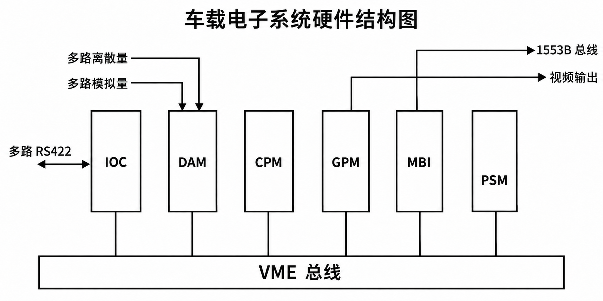
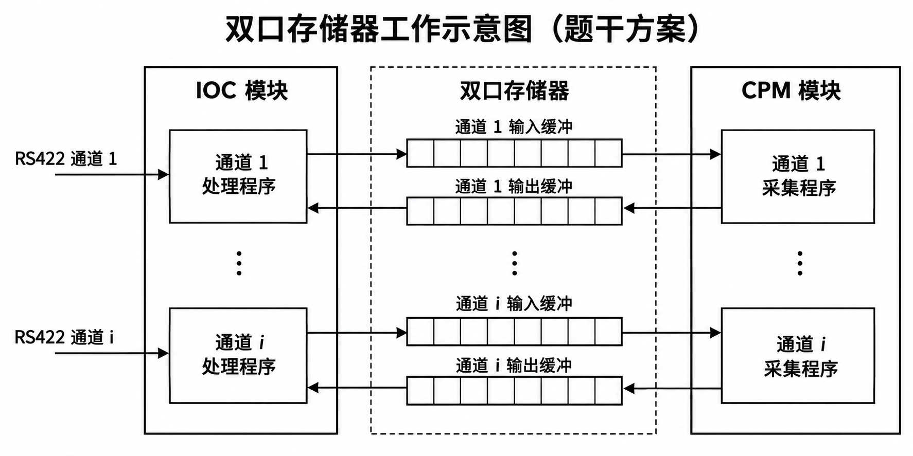

# 高级系统架构设计师下午试题押题密卷2

原件：[PDF](../assets/d4cf3371ad5e7e90.pdf)。各小问后已内嵌冲刺速记核心作答（彩色高亮代码块）；卷末保留原完整参考答案与详细解析。

排印修订和原卷歧义见 转换记录。

## 试题一

阅读以下软件架构设计的叙述，根据要求回答下面问题。

**说明**

某大型电子商务企业的主要业务之一是网上书城，其主要功能是通过 Internet 为用户提供各种图书信息的在线查询、浏览及订购相关图书等多种服务。PH 软件公司承接了该大型网上书城系统的升级改造开发任务。该软件公司的领域专家对需求进行深入分析后，得到的部分系统需求如下。

- 用户可能频繁地进行书目查询操作，网上书城需要返回众多符合条件的书目并且分页显示，而且可能每次查询的内容都不一样。

- 网站管理员需要批量对相关书目信息进行修改，并且将更新信息记录到数据库。

- 随着该网上书城知名度的不断提升，每天的业务量非常多，网站的用户访问量越来越大，因此对业务有持续性要求，且要求有限的资源更加合理地规划和使用。

- 随着该企业业务规模的不断扩展，网上书城并购了多家其他同类的网上书城，需要将后台异构数据库系统进行整合。

该软件公司的系统架构师经过多方的研究和论证，集体提出了采用层次式架构风格设计该大型网上书城系统，包括表现层、业务逻辑层和数据访问层。

### 问题 1

数据访问层负责与应用中的各种数据源打交道，并将它们整合起来，/为业务逻辑层提供统一的数据服务。请对该大型网上书城的4个需求进行分析，结合你的系统架构经验，将下表中每个需求适合选用的数据访问模式及选择理由填充完整。

**网上书城数据访问层设计**

| 系统需求 | 数据访问模式 | 选择理由 |
| --- | --- | --- |
| ① | (1) | (2) |
| ② | (3) | (4) |
| ③ | (5) | (6) |
| ④ | 专用产品(如 WebSphereInformationIntegration 等) | (7) |

### 问题 2

业务逻辑的千变万化，使信息系统的开发和维护都变得越来越困难，如何构建灵活高度可扩展性的业务层便成为亟待解决的问题。结合你的系统架构经验，请用200字以内的文字说明该网上书城业务逻辑层采用业务容器(Business Container)架构方式的优点。

### 问题 3

该网上书城表示层框架的设计，采用基于 XML 的界面管理技术，实现灵活的界面配置、界面动态生成和界面定制。结合你的系统架构经验，请用350字以内的文字说明基于 XML 的界面管理技术的基本思想及其主要组成部分的功能。

## 试题二

阅读以下关于某国有大型煤化集团数据中心的叙述，根据要求回答下面问题。

**说明**

近年来，云计算技术的蓬勃发展为整个 IT 行业带来了巨大变革。传统数据中心已经难以满足新形势下日益增长的高性能及高性价比需求，并且无法支持云环境下更加灵活的按带宽租赁数据中心网络的运营方式。该集团随着信息系统业务的不断扩展上线，对高密度服务器及高度自动化管理系统的需求不断增长，建设云数据中心的需求应运而生。

### 问题 4

云数据中心是指以客户为中心、以服务为导向，基于高效、低能耗的 IT 与网络基础架构，利用云计算技术，自动化地按需提供各类云计算服务的新一代数据中心。云数据中心是传统数据中心的升级，是新一代数据中心的演进方向。

#### （1）

请简述云数据中心的特点。

#### （2）

云计算的关键技术有虚拟化技术、分布式计算技术、安全与隐私保护技术等，请简要说明云数据中心在 IT 基础设施虚拟化技术方面主要包括哪些技术。

### 问题 5

假设当地城市工程视频监控系统是该云数据中心的应用之一。该视频监控系统可以提供实时监控、存储和随时调看 CIF 格式(352×288)和 D1格式(720×576)分辨率的图像，支持 MPEG-2、MPEG-4和 H.264 等编码格式。

#### （1）

当地城市某行政区内预计共有监控点600个，如果保存的是 CIF 格式的图像，码流为512kbps, 请计算每小时保存该行政区内全部监控点视频流需要多大的存储空间(B 或 GB.。 请将计算结果保留小数点之后3位数。

如果保存的是 D1格式的图像，码流为2048kbps, 请计算每小时保存该行政区内全部监控点视频流需要多大的存储空间(B 或 GB.。

#### （2）

全部监控视频流信息保存在 IP SAN 设备 S2600 中，S2600 控制框(双控，220V 交流，4GB内存，8个 isCSI 主机接口，磁盘数量12个/框，最大支持附加7个磁盘扩展框)。假设在本项目中采用 SATA 1.5 TB 7.2K RPM 硬盘，在 IP SAN 配置的 RAID 组级别为 RAID10。

若该视频监控系统实施时，图像格式采用了 CIF, 码流为512 kbps, 请计算保存该行政区内全部监控点30天视频流需要的存储空间(B、GB 或 TB., 并计算出保存30天视频流至少需要的硬盘数，以及至少需要配置的 S2600 控制框数量。

### 问题 6

该集团数据存储量巨大，生产数据、安全数据以及测试数据等需要进行频繁的快速读写，为保障这种应用的需求，该集团希望在数据中心的数据存储方式上既要保证存储的可扩展性，还要保证数据的快速访问，同时对新服务器的部署也要考虑快速部署。

数据中心采用的数据存储方式主要有 DAS、NAS、SAN 三种，请分别简要描述三种存储方式的原理，并根据集团要求设计在该集团的数据中心建设中应采用的存储方式，叙述采用这种方式的优点。

## 试题三

阅读以下关于软件体系结构方面的叙述，根据要求回答下面问题。

**说明**

某大中型企业在全国各城市共有15个左右的分支机构，这些机构已经建设了相关的关系型数据库管理系统，每天负责独立地处理本区域内的业务并实时存储业务数据。PH 软件公司承接了该大中型企业信息管理系统的升级改造开发任务。该软件公司的领域专家对需求进行深入分析后，得到的部分系统需求如下。

- 开发一个网络财务程序，使各地员工能在 Internet 上通过 VPN 技术进行财务单据报销和处理。

- 为了加强管理，实现对下属分支机构业务数据的异地存储备份，保证数据的安全及恢复，同时对全国业务数据进行挖掘分析，拟在该企业总部建设数据中心。

PH 公司在设计该财务程序的体系结构时，开发项目组产生了以下分歧。

- 架构师许工认为应该采用客户机/服务器(C/S) 架构风格，各分支机构财务部要安装一个软件客户端，通过这个客户端连接到总公司财务部主机。如果员工在外地出差，需要报销账务的，也需要安装这个客户端才能进行。

- 架构师郭工认为应该采用浏览器/服务器(B/S) 架构风格，各分支机构及出差员工直接通过Windows 操作系统自带的 IE 浏览器就可以连接到总公司的财务部主机。

在架构评估会议上，专家对这两种方案进行综合评价，最终采用了 c/S 和 B/S 相结合的混合架构风格。

### 问题 7

结合你的系统架构经验，请用400字以内的文字简要讨论 c/S 和 B/S 两种架构风格各自的优点和缺点。

### 问题 8

结合你的系统架构经验，请用600字以内的文字简要说明该工程项目采用 C/S 和 B/S 相结合的混合架构风格的设计要点及其优点。

### 问题 9

为保证各分支机构可靠、高效地向数据中心汇总业务数据，避免单点故障，对该企业总部数据中心架构设计时，应该采用哪些相关的技术?

## 试题四

阅读以下关于嵌入式系统软件架构设计方面的叙述，根据要求回答下面问题。

**说明**

PH 软件公司承接了一项嵌入式系统软件研发项目。该项目主要用于车载电子系统中监视发动机及燃油系统等系统工作状况，并通过综合仪表显示给驾驶员。经过多次与用户沟通，形成以下技术要求。

- 本项目的硬件平台由主处理机模块和多种接口模块组成，底板采用标准 VME 总线(硬件结构图如下图所示),具体硬件模块配置如下。

- ①主处理机模块(CPM) 采用 PowerPC755, 主频266MHz, 配有 SDRAM 存储器和 Flash 存储器；提供一个定时/计数器；支持16级中断和二级 Cache。

- ②输入/输出模块(IOC) 支持16路 RS422 接口信号，传输速率不低于115.2kbps,IOC 模块与CPM 模块的数据交换采用64KB 端口存储器。

- ③离散量接口模块(DAM) 支持64路开关型离散量输入/输出接口；2路频率量输入；12位 AID 转换器和12位 D/A 转换器。

- ④图形处理模块(GPM) 用于显示图形，支持 OpenGL 标准接口软件。

- ⑤MBI 模块主要提供1553B 外总线接口，PSM 为电源支持模块。

车载电子系统硬件结构图

- 本项目软件主要工作在 cPM 模块中，完成对外部设备的数据采集、分析和相应的控制，将监视结果以图形方式显示给驾驶员。该系统的软件主要包括外部接口驱动软件、VME 数据传输软件、处理软件、图形显示和外总线(1553B)数据交换软件。要求数据的采集必须确保每帧数据无丢失，并在本帧内完成数据的处理工作，本帧信息显示给驾驶员的时刻最晚不能超过下帧。详细的技术要求如下。

- ①16路 RS422 接口主要完成对汽车燃油系统、动力系统和驾驶员命令的数据采集与控制。RS422数据传输格式将以32B 为基本数据块，分别以20ms、40ms、60ms 和1s 这4个不同周期交换数据。

- ②64路离散量数据主要监控发动机的工作状态，要求每10ms 采集一次，并在下一个10ms 周期内将发动机状况显示到驾驶员座舱。

- ③多路模拟量数据主要采集发动机转速、油量，以及汽车的其他数据，为驾驶员监控汽车状态提供必要的量化数据。模拟量数据的刷新频率为1s。

- ④外总线(1553B)主要完成该系统与汽车其他电子系统的数据交换。

PH 公司将本项目交给项目主管郭工实施，要求郭工按技术要求完成本项目的软件设计工作，公司根据合同关于“数据的采集必须确保每帧数据无丢失，并在本帧内完成数据的处理工作，本帧信息显示给驾驶员的时刻最晚不能超过下帧”的要求，提醒郭工在设计中要重点考虑整个系统的实时性问题。郭工完成设计后，提交公司评审，会上就郭工设计中存在的缺陷展开了激烈讨论，最终达成一致。

### 问题 10

郭工在设计 IOC 模块软件时指出为了使 CPM 模块能够及时处理 RS422 数据，在 IOC 与 CPM 间的双端口存储器中为每个422通道设计一级缓冲，当某通道接收一个字节时，就将数据放入缓冲，由 CPM接收(其结构如下图所示)。这样的好处在于每当有数据输入时，CPM 模块可立即读取，而增大双口缓冲的目的是在 CPM 来不及处理时可防止数据的丢失。同时，IOC 中的程序相对简单，实时性好，可以不考虑422通道的数据传输周期，只要按查询方式对16路422通道输入进行查询读取即可。双口存储器

双口存储器工作示意图

会上，柳工提出了强烈的反对意见，认为这种设计方法绝对不可取，这种方法只考虑了软件的简单与便利，而没有针对软件特点考虑问题，在设计中对实时性、负载平衡分配，以及实现算法上均存在缺陷，必须改进。

#### （1）

结合你的系统架构设计经验，请分析郭工的设计方案在实时性、负载平衡分配和实现算法上存在怎样的缺陷?并用400字以内的文字详细说明理由。

#### （2）

请用350字以内的文字给出 IOC 模块和 CPM 模块之间双口存储器数据交换的方法。

### 问题 11

如果 CPM 模块中采用了嵌入式实时操作系统，请根据本项目的需求，用350字以内的文字说明 CPM模块中数据采集任务应如何划分?系统对任务调度的最小调度周期如何计算?各个任务周期及优先级如何定义?

### 问题 12

请用200字以内的文字说明针对 IOC 模块的多路 RS422 接口的数据采集，其驱动程序分别使用中断方式和查询方式的主要差别是什么?这两种方式的主要优缺点有哪些?

## 试题五

阅读以下关于数据库系统架构方面的叙述，根据要求回答下面问题。

**说明**

随着政府职能的转型， xx 行业职能主管部门(国家相关部委，各省、市的相关厅、局、委等)机构日趋精简，但随着国家现代化的发展，业务量反而越来越大。为保证本行业管理工作的质量和效率，提高对宏观经济管理与决策的支持能力、对社会公众的公共服务能力，该行业主管部门委托 MBI 软件开发公司开发一个 xx 行业宏观经济数据库管理系统。通过统计业务系统和相关部委自身的行业系统的信息化建设，提高各自核心业务的应用能力和管理水平，特别是数据中心的建设，对基础业务信息实施有效管理和有效利用；通过宏观经济数据库应用系统的建设，建立起包括宏观经济管理决策支持和宏观经济基础信息的发布查询等在内的支撑子系统；通过存储备份系统(现场级)的建设，为本行业宏观经济基础信息资源实施安全、可靠的技术管理。

### 问题 13

由于对政府数据的需求是多层次的，从而也要求政府部门信息系统具有较丰富的层次。但是，随着系统结构、层次的增多，层次间的界限越来越模糊，信息系统建设及维护的成本也就越高。结合你的系统架构经验，请用500字以内的文字简要讨论基于数据库(DB)、 数据仓库(DW)和操作数据存储(ODS) 技术的政府信息系统的各自特点。

### 问题 14

元数据库的建设与管理是数据仓库概念下数据中心工作模式中的重要环节，它关系到整个数据中心系统的结构和运行。结合你的系统架构经验，请用400字以内的文字简要说明元数据库系统所定义和管理的处理包括哪些内容。

### 问题 15

该行业主管部门对待建的数据库应用系统提出了明确的审计要求，要求保留5年左右的审计跟踪信息。MBI 公司的架构师老张建议，直接在待建的数据库中插入审计跟踪信息以满足这一应用需求，架构师老郭则建议采用按月分区(Partitioning) 和段空间压缩技术来满足这一应用需求。请用400字以内的文字简要说明这两种数据库审计方案的基本原理。

## 参考答案与解析

### 试题一

#### 第 1 题

(1)在线访问模式和离线数据模式相结合

(2)用户的每次书目查询操作需要与后台的数据源进行交互，需要响应的数据量比较大且较为频繁，通过离线数据的缓存来提高查询性能

(3)离线数据模式或 DTO 模式

(4)与数据库交互的次数并不频繁，但每次操作的数据量较大；同时能使本地操作有较好的交互体验

(5)连接池模式

(6)这是一个多用户并发访问的需求，使用连接池模式能够处理更多的用户请求

(7)这是一个整合异构数据源的需求，后台数据系统种类繁多且配置各异，可能需要对各种关系型数据源及非关系型数据源的数据整合

**解析** 在层次式架构风格中，数据访问层(数据持久层)主要负责和应用中的各种数据源(如1382或Oracle 等关系型数据源、XML 数据及其他类型的非关系型数据、Web 服务，以及各种特别的遗留系统等)打交道，并将它们整合起来，为业务逻辑层提供统一的数据服务。架构师在不同的应用场合下可能会选择不同的数据访问模式，并且还会不断地推陈出新，这里不会也不可能穷尽所有的数据访问模式，而只是列举了其中最为典型的几个。在线访问模式、Data Access Object 模式、DataTransfer Object 模式、离线数据模式，以及对象/关系映射(Object/Relation Mapping)模式是数据访问层设计中典型的数据访问模式。各种数据访问模式的说明如下表所示。

**各种数据访问模式**

| 数据访问模式 | 说明 |
| --- | --- |
| 在线访问模式 | 是最基本和最常用的数据访问模式，该数据访问模式会占用一个数据库连接，读取数据，每个数据库操作都会通过这个连接不断地与后台的数据源进行交互 |
| DAO 模式 | 是标准 J2EE 设计模式之一，常用这种模式将底层数据访问操作与高层业务逻辑分离开。一个典型的 DAO 实现通常具有以下组件：①一个 DAO 工厂类；②一个 DAO 接口；③一个实现了 DAO 接口的具体类(包含访问特定数据源的数据的逻辑);④数据传输对象(或称为值对象) |
| DTO 模式 | 是经典 EJB 设计模式之一。DTO 本身是这样一组对象或是数据的容器，它需要跨不同的进程或是网络的边界来传输数据。这类对象本身应该不包含具体的业务逻辑，并且通常这些对象内部只能进行一些诸如内部一致性检查和基本验证之类的方法，而且这些方法最好不要再调用其他的对象行为 |
| 离线数据模式 | 以数据为中心：数据从数据源获取之后，将按照某种预定义的结构(如 ISDO 中的 Data 图表结构、ADO.NET 中的关系结构)存放在系统中，成为应用的中心：离线：对数据的各种操作独立于各种与后台数据源之间的连接或是事务；与 XML 集成：离线数据集所维护的数据可以方便地与 XML 格式的文档之间互相转换；独立于数据源：该模式的不同实现定义了数据各异的存放结构和规则，这些都是独立于具体的某种数据源的 |
| o/R 映射 | 其指导思想来源于这样一种现实：大多数应用中的数据都是依据关系模型存储在关系型数据库中：很多应用程序中的数据在开发或是运行时则是以对象的形式组织起来的。0/R 映射就提供了这样一种工具或是平台，能够帮助将应用程序中的数据转换成关系型数据库中的记录；或是将关系数据库中的记录转换成应用程序中的代码便于操作的对象 |

依题意，在网上书城系统应用中，第1个系统需求是用户根据检索条件查询相关的书目，返回符合条件的书目列表(可能内容非常多，数据量较大),而且可能每次查询的内容都不一样。通常情况下，针对用户书目查询这一业务应用，如果查询返回的数据量并不是很大，同时也不频繁，则可以考虑采用在线访问的模式：如果返回的数据量较大(例如返回众多符合条件的书目并且分页显示)而且较为频繁，则需要考虑在线访问模式和离线数据模式相结合，通过离线数据的缓存来提高查询性能。

第2个系统需求是网站管理员可能需要批量对相关书目信息进行修改，并且需要将更新的信息返回至数据库。此类数据应用的特点表现为：与数据库交互的次数并不频繁，但是每次操作的数据量相对较大：同时，也希望能够使得本地操作有较好的交互体验。针对这种应用情况，往往适合采用离线数据访问的模式，DTO 模式也是不错的选择。如果该网上书城应用系统采用的是 IBMWebSphere 平台，则可以使用 SDO 技术，或者使用 Java 中的 CachedRowSet 技术；如果采用的是基于微软的应用系统平台，则可以采用 ADO.NET 技术。

第3个系统需求是一个关于“多用户并发访问”的需求，如何让网上书城应用系统能够处理大规模的并发用户访问是一个很复杂的问题，涉及应用的架构、采用的软件、相应的配置和应用程序的调优等方面的问题。对于数据访问层设计，一个常见的方法是使用连接池的模式，以便能够处理更多的用户请求。如果在网上书城应用系统中使用了 IBM webSphere Application Server(或BEAWebLogic、Tomcat 等)应用服务器，则这些应用服务器都提供了连接池的机制。

第4个系统需求是一个关于“整合异构数据源”的需求，因为有了新的、不同类型的数据库系统的加入，需要和旧的数据库系统进行整合。后台数据系统种类繁多，配置复杂的情况是随处可见的。可能这个网上书城在刚刚起步的时候只是用了 MS SQL Server 2000来作为后台数据源。后来随着业务的增加，又有了新的 Oracle (或 DB2)系统。除此之外，可能还有很多诸如 xML 文档等需要和已有的系统集成起来，这些都是令人头痛的问题。在很多实际项目中，经常需要软件开发公司花很大的力气开发一些导入/导出工具来集成此类数据，而现在已经有了专门的产品来完成这些任务。例如，IBM WebSphere Information Integration 等产品就可以用来支持各种关系型数据源及非关系型数据源的数据整合。

#### 第 2 题

表示层代码只需将业务参数传递给业务容器，之后就无须业务层多余的干预，所有业务代码均是在业务容器中运行，可以有效地防止业务层代码渗透到表示层，从而实现了业务层相对于表示层的透明化，便于系统功能的开发、代码重用和管理

**解析** 业务逻辑层框架位于系统架构的中间层，是实现系统功能的核心组件。业务逻辑层采用业务容器(Business Container) 架构方式，便于系统功能的开发、代码重用和管理。业务层采用业务容器的方式存在于整个系统当中，可以大大降低业务层和相邻各层的耦合。表示层和业务层的交流是通过业务请求来实现的，表示层代码只需要将业务参数传递给业务容器，之后就不需要业务层多余的干预，所有业务代码均是在业务容器中运行。如此一来，可以有效地防止业务层代码渗透到表示层，从而实现了业务层相对于表示层的透明化。

#### 第 3 题

基本思想：用 XML 生成配置文件及界面所需的元数据，按不同需求生成界面元素及软件界面，从而实现用户界面描述信息与功能实现代码的分离。

该技术包括界面配置、界面动态生成和界面定制3部分。

界面配置：是对用户界面的静态定义，通过读取配置文件的初始值对界面配置。由界面配置对软件功能进行裁剪、重组和扩充，以实现特殊需求。

界面定制：是对用户界面的动态修改过程，在软件运行过程中，用户可按需求和使用习惯，对界面元素的属性进行修改；软件运行结束，界面定制的结果被保存。

界面动态生成：系统通过 DOM API 读取 XML 配置文件的表示层信息，通过数据存取类读取数据库中的数据层信息，运行时由界面元素动杰生成界面

**解析** 基于 XML 的界面管理技术的基本思想是：用 XML 生成配置文件及界面所需的元数据，按不同需求生成界面元素及软件界面。该技术包括界面配置、界面动态生成和界面定制3部分。

界面配置是对用户界面的静态定义，通过读取配置文件的初始值对界面进行配置。由界面配置对软件功能进行裁剪、重组和扩充，以实现特殊需求。

界面定制是对用户界面的动态修改过程，在软件运行过程中，用户可按需求和使用习惯，对界面元素(如菜单、工具栏、键盘命令)的属性(如文字、图标、大小、位置等)进行修改。软件运行结束，界面定制的结果被保存。

系统通过 DOMAPI 读取 XML 配置文件的表示层信息(初始界面大小、位置等),通过自定义的数据存取类读取数据厍中的数据层信息，在运行时循环生成界面元素，动态生成界面。界面配置和定制模块在软件运行前后，通过修改相应的配置文件，就可以达到更改界面内容的目标。

基于 XML 的界面管理技术实现的管理信息系统，实现了用户界面描述信息与功能实现代码的分离，可针对不同用户需求进行界面配置和定制，能适应一定程度内的数据库结构改动，只需对 XML 文件稍加修改，即可实现系统的移植。

### 试题二

#### 第 4 题

(1)①资源池化；②高效智能；③面向服务；④按需供给；⑤绿色低碳

(2)①服务器虚拟化技术；②存储虚拟化技术；③网络虚拟化技术

**解析** (1)通常情况下，云数据中心具有以下5个特点(但不限于)。

- ①资源池化。云数据中心内的 IT 资源和网络资源将构成统一的资源池，实现物理资源与逻辑资源的去耦合，用户仅需对逻辑资源进行相关操作而无需关注底层实际物理设备。

- ②高效智能。基于虚拟化、分布式计算等技术，利用低成本的集群设备实现高效廉价的信息承载、存储与处理，同时通过管理平台实现自动化的资源监控、部署与调度以及业务生命周期的智能管理。

- ③面向服务。整体架构以服务为导向，通过松耦合的方式实现多服务的综合承载与提供，云数据中心由提供资源变成提供服务，用户通过服务目录选择相关的服务，对底层实际资源透明。

- ④按需供给。底层基础架构在资源池化的基础上根据实际需求实现资源的动态伸缩，并提供完备的、细颗粒的计费功能，云数据中心还将根据上层应用的发展趋势，实现对底层物理设备的智能容量规划。

- ⑤绿色低碳。通过模块化的设计以及虚拟化等绿色节能技术，降低云数据中心的设备投入成本以及运营维护成本，实现低 PUE(Power Usage Effectiveness)值的绿色低碳运营。

(2)广义的虚拟化是指计算元件在虚拟的基础上(而不是在真实的基础上)运行，是一个为了简化管理、优化资源的解决方案。其本质是实现底层物理设备与逻辑资源的去耦合。平常所讲的虚拟化是指服务器虚拟化，可以在相同的一套硬件上运行彼此独立的操作系统和应用软件。服务器虚拟化具有同质、高效、资源受控的特点。虚拟化后的虚拟机可以根据需求弹性增加或减少其分配的硬件资源，提高资源配置的灵活性，同时可以在单一物理服务器上运行多个虚拟机，提高了资源利用率，降低了能耗。通过服务器虚拟化可以将整个系统(包括硬件配置、操作系统以及应用等)封装在文件里，实现(虚拟机)系统的快速部署、软件发布和系统备份，同时在业务不中断的情况下，实现在不同物理服务器上的动态迁移，增强系统的可靠性和扩展性。

除服务器虚拟化外，虚拟化技术还包括存储虚拟化和网络虚拟化。存储虚拟化是指通过对存储(子)系统或存储服务的内部功能进行抽象、隐藏或隔离，使存储或数据的管理与应用、服务器、网络资源的管理分离，从而实现应用和网络的独立管理。存储虚拟化可以在系统的多个层面实现，如建立类似于 HSM(分级存储管理)的系统，同时，存储虚拟化技术的出现解决了系统异构的问题。网络虚拟化的狭义概念是传统虚拟专用网络，通过 VPN 或者 VLAN 的方式在公共网络上建立虚拟专用网。近年来，计算虚拟化“多对一”的特征对网络提出了与底层虚拟机相适配、互感知的新要求，充实了网络虚拟化的概念。

#### 第 5 题

(1)CIF 格式：138.24×109B 或128.746GB

D1格式：552.960×109B 或514.984GB

(2)99.533×1012B、92697.144GB 或90 .525TB

硬盘数：121块

控制框数：11个

**解析** (1)分辨率是数字监控产品中一项重要的技术指标，它在很大程度上决定了产品的性能(清晰度、存储量和带宽)和价格。目前监控行业中主要使用 OCIF(176×144)、CIF(352×288)、HALFD1(704×288) 和 D1(704×576) 等几种分辨率，CIF 是主流的录像分辨率格式。

通常情况下，监控图像硬盘存储容量的计算主要取决于“码流”这一参数，与图像格式的分辨率大小没有直接关系。CIF、OCIF、DCIF 和 D1等都有对应的码流范围，如果只是一味地将码流参数调高，图像质量也不会有明显的变化。依题意，若该行政区内视频监控系统保存的是 CIF 格式图像，码流为512kbps, 则每小时保存行政区内600个监控点视频流需要138.24×10913(128.746GB) 的存储空间。具体计算过程如下。

$M_1=512\times10^3\times3600\times600\div8=138.24\times10^9\ \mathrm{Byte}$

$$
\frac{138.24\times10^9\ \mathrm{Byte}}{2^{10}\times2^{10}\times2^{10}}\approx128.746\ \mathrm{GB}
$$

若监控系统保存的是 D1格式的图像，码流为2048kbps, 该码流为 CIF 格式图像码流512kbps的4倍，则每小时保存行政区内600个监控点视频流需要552.960×10⁹B(即138.24×10⁹×4 B) 或514.984GB (即128.746×4GB) 的存储空间。

(2)若该视频监控系统实施时，图像格式采用 CIF 格式，码流为512kbps, 则保存行政区内600个监控点30天视频流需要99.5328×10¹²B(或92697 . 144GB, 或90 . 525TB) 的存储空间。具体计算过程如下。

$$
M_2=138.24\times10^9\times24\times30\ \mathrm{Byte}=99532.8\times10^9\ \mathrm{Byte}=\frac{99532.8\times10^9}{2^{40}}\ \mathrm{TB}\approx90.525\ \mathrm{TB}
$$

廉价磁盘冗余阵列(RAID) 是利用一台磁盘阵列控制器来管理和控制一组磁盘驱动器，组成一个高度可靠的、快速的大容量磁盘系统。 RAID 级别是指磁盘阵列中硬盘的组合方式，不同级别的 RAID为用户提供的磁盘阵列在性能上和安全性的表现上也有不同。 RAIDO 也称为 Stripe (条带化),它把连续的数据分散到多个磁盘上存取，代表了所有 RAID 级别中最高的存储性能。其磁盘利用率为100%,但它不提供数据冗余。 RAID1 具有磁盘镜像和磁盘双工功能，可利用并行读/写特性，将数据块同时写入主盘和镜像盘，故比传统的镜像盘速度快，但其磁盘利用率只有50%。

RAID10 是建立在 RAID0 和 RAID1 基础上的高可靠性与高性能的组合，即利用了 RAID0 极高的读写效率和 RAID1 较高的数据保护和恢复能力。但 RAID10 的磁盘利用率只有50%。

依题意，该行政区内视频监控系统的全部监控视频流信息保存在 IP SAN 设备 S2600 中，采用存储容量为1 . 5TB 的 SATA 硬盘，且采用 RAID10 配置(磁盘利用率只有50%),因此保存30天视频流至少需要的硬盘数为121块。具体计算过程如下。

$$
N_1=\frac{90.525\ \mathrm{TB}}{1.5\ \mathrm{TB}\times50\%}\approx120.7
$$

,将计算结果向上取整数为121。

由于 IP SAN 设备 S2600 中，每个控制框仅支持12个磁盘，因此至少需要配置的 S2600 控制框数为11个(即121/12≈10.083,将计算结果向上取整数为11)。

#### 第 6 题

直接连接存储(DAS): 将磁盘阵列、磁带库等数据存储设备通过 SCSI 扩展接口直接连接到服务器或客户端。

网络附加存储(NAS); 将存储设备通过标准的网络拓扑结构(如以太网),连接到一群计算机上，提供数据和文件服务。 NAS 服务器通常由存储硬件、操作系统及其上的文件系统等几个部分组成。

存储区域网络(SAN): 通过高速网络将一个(或多个)网络存储设备和服务器连接起来的专用存储系统。它主要采取数据块的方式进行数据存储。

采用的存储方式： IP SAN。

该存储方式的优点：①整体部署成本低；②高传输速度；③高可靠性；④传输距离不受限制；

- ⑤具有强大的文件系统及数据管理功能

**解析** 直接连接存储(DAS) 也称为 SAS (服务器附加存储),它将磁盘阵列、磁带库等数据存储设备通过扩展接口(通常是 SCSI 接口)直接连接到服务器或客户端。它依赖于服务器，其本身是硬件的堆叠，不带有任何存储操作系统。

网络附加存储(NAS) 与 DAS 不同，它的存储设备不是直接连接到服务器，而是直接连接到网络，通过标准的网络拓扑结构连接到服务器。NAS 实际上是一个带有“瘦”服务的存储设备，其作用类似于一个专用的文件服务器，只不过省略了显示器、键盘、鼠标等设备。 NAS 用于存储服务，可以大大降低存储设备的成本。另外， NAS 中的存储信息都是采用 RAID 方式进行管理的，可以有效地保护数据。

存储区域网络(SAN) 是通过专用高速网络将一个(或多个)网络存储设备和服务器连接起来的专用存储系统。它主要采取数据块的方式进行数据存储，因此其数据存取速度比 NAS 快。目前， SAN 主要有 IP SAN 和 FC SAN 两种形式(分别使用 IP 和光纤通道)。光纤通道是一种高性能、高成本的技术，它实现了主机互连，企业间共享存储系统的需求。可以为存储网络用户提供高速、高可靠性及稳定安全性的传输。 IP SAN 技术继承了 FC SAN 技术的优点，并且通过 IP, 能利用廉价的以太网交换机、路由器和线缆实现低成本、低风险基于 IP 的 SAN 存储。isCSI 是实现 IP SAN 最重要的技术。由于isCSI 是运行在 TCP/IP 之上的块模式伪、议，因此它可将 IP 网络与块模式的优势很好地结合起来，且使 IP SAN 的成本低于 FC SAN。

依题意，由于该集团“数据存储量巨大”、所存储的数据“需要进行频繁的快速读写”,并且提出“存储的可扩展性”、“对新服务器要能快速部署”等要求，因此建议该数据中心采用 IP SAN 的存储方式建设。

### 试题三

#### 第 7 题

c/S 架构风格的优点：①客户机应用程序与服务器程序分离，二者的开发既可以分开进行，也可以同时进行；②技术成熟，允许网络分布操作，交互性强，具有安全的存取模式；③网络压力小，响应速度快，有利于处理大量数据；④模型思想简单，易于人们理解和接受等

C/S 架构风格的缺点：①客户机与服务器的通信依赖于网络，服务器的负荷过重：②无法实现快速部署和安装，维护工作量大，升级困难；③开发成本较高，客户端程序设计复杂，灵活性差；④用户界面风格不一，软件移植和数据集成困难；⑤数据库的安全性因客户机程序直接访问而降低等

B/S 架构风格的优点：①易于部署、维护和升级；②具有良好的开放性和可扩充性，可以应用在广域网上，方便了信息的全球传输、查询和发布；③可跨平台操作，无须开发客户端软件；④通过 JDBC等数据库连接接口，提高了动态交互性、服务器的通用性与可移植性等。

B/S 架构风格的缺点：①数据的动态交互性不强，不利于在线事务处理(OLTP) 应用；②数据查询等响应速度较慢；③系统的安全性较难以控制等

**解析** 客户机/服务器(C/S) 架构风格是基于资源不对等且实现共享而提出，它将应用一分为二，服务器负责数据管理，客户机完成与用户的交互任务。 C/S 架构风格的优点主要在于，系统的客户应用程序和服务器构件分别运行在不同的计算机上，系统中每台服务器都可以适合各构件的要求，这对于硬件和软件的变化显示出极大的适应性和灵活性，而且二者的开发既可以分开进行，也可以同时进行，易于对系统进行扩充和缩小。在 c/S 模式中，系统中的功能构件充分隔离，客户应用程序的开发集中于数据的显示和分析，而服务器的开发则集中于数据的管理，不必在每一个新的应用程序中都要对一个数据库管理系统(DBMS)进行编码。C/S 模式将大应用处理任务分布到许多通过网络连接的低成本计算机上，允许网络分布操作。 C/S 模式是一种较安全的存取模式，其交互性较强、网络压力小、响应速度快且利于处理大量数据。

C/S 架构风格具有强大的数据操作和事务处理能力，模型思想简单，易于人们理解和接受。但随着企业规模的日益扩大，软件的复杂程度不断提高， C/S 架构风格逐渐暴露了以下缺点。

(1)客户机与服务器的通信依赖于网络，可能成为整个系统运作的瓶颈。

(2)服务器的负荷过重，难以管理大量的客户机，系统的性能受到很大的影响。

(3)部署和维护成本较高。基于该架构风格开发的应用系统存在灵活性差、维护工作量大、升级困难等缺陷，并且每台客户机都需要安装客户端程序，无法实现快速部署和安装，具有较大的局限性。若要对采用 C/S 架构风格的软件升级，则需要开发人员到现场为每台客户机的软件升级和维护。

(4)采用单一服务器且以局域网为中心，难以将应用扩展至广域网或 Internet 环境中。

(5)客户机程序直接访问数据库服务器，使数据库的安全性受到威胁。

(6)开发成本较高。 C/S 架构风格对客户端软硬件配置要求较高，尤其是软件的不断升级，对硬件要求不断提高，增加了整个系统的成本，且客户端变得越来越臃肿。

(7)客户端程序设计复杂。采用 c/S 架构风格进行软件开发，大部分工作量放在客户端的程序设计上，客户端显得十分庞大。对软件进行的一个小小改动(例如只改动一个变量),则每一个客户端都必须更新。

(8)信息内容和形式单一。因为传统应用一般为事务处理，界面基本遵循数据库的字段解释，开发之初就已确定，而且不能随时截取办公信息和档案等外部信息，用户获得的只是单纯的字符和数字，既枯燥又死板。

(9)用户界面风格不一，使用复杂，不利于大范围推广使用。

(10)软件移植和数据集成困难。采用不同开发工具或平台开发的软件一般互不兼容，不能或很难移植到其他平台上运行。为了解决 c/S 模式中服务器端的问题，发展形成了三层(多层)C/S 模式，即多层应用架构。在三层 c/S 架构风格中，将应用功能分成表示层、功能层和数据层3个部分。通过对这3层进行明确分割，不同层构件相互独立，层间的接口简洁，适合复杂事务处理。新增加的应用服务器负责处理系统中所有的应用逻辑，而只有表示层存在于客户机上。

为了解决 c/S 模式中客户端的问题，发展形成了浏览器/服务器(B/S) 模式。其具体结构为浏览器—Web 服务器-数据库服务器。与三层 c/S 的解决方案相比，客户端采用 WWW 浏览器，应用服务器采用 Web 服务器。B/S 架构风格主要是利用不断成熟的 WWW 浏览器技术，结合浏览器的多种脚本语言，利用通用浏览器就实现了原来需要复杂的专用软件才能实现的强大功能，并节约了开发成本。除了数据库服务器外，应用程序以网页形式存放于 Web 服务器上，用户运行某个应用程序时只需在客户端上的浏览器中输入相应的网址(URL), 调用 Web 服务器上的应用程序并对数据库进行操作，从而完成相应的数据处理工作，最后将结果通过浏览器显示给用户。

基于 B/S 架构风格的软件，系统安装、修改和维护全在服务器端解决，用户在使用系统时，仅仅需要一个浏览器就可运行全部的模块，易于系统的升级和维护；可以应用在广域网上，方便了信息的全球传输、查询和发布；可跨平台操作，无须开发客户端软件，客户端只需通过浏览器就可以实现大部分的软件功能；通过 JDBC 等数据库连接接口，提高了动态交互性和服务器的通用性与可移植性；具有良好的开放性和可扩充性。

与 C/S 架构风格相比，B/S 架构风格也有许多不足之处，主要表现在以下几个方面。

(1)B/S 架构风格的数据提交一般以页面为单位，数据的动态交互性不强，不利于在线事务的处理 (OLTP) 应用。

(2)在数据查询等响应速度上，要低于 C/S 架构风格。

(3)系统的安全性较难以控制等。

#### 第 8 题

设计要点如下(包含但不限于以下内容)。

- ①在该企业总部局域网上部署财务 Web 服务器及其相关的数据库服务器，两种服务器之间采用C/S 架构：总部局域网上提供 C/S 和 B/S 两种并存的架构风格，根据不同的应用需求和客户需求进行灵活的选择。

- ②若项目资金充裕，则在各分支机构局域网中也采用类似于企业总部的部署风格；若项目资金不足，则在各分支机构财务部门局域网中采 c/S 架构，部署应用服务器及相关的数据库服务器，然后将集中处理的后期财务数据通过 VPN 技术上传至总部局域网的相应服务器中。

- ③在外出差的员工和各分支机构的普通员工通过 VPN 技术访问企业总部局域网上的 Web 服务器，查看相关的信息。

采用 C/S 和 B/S 混合架构的优点如下(包含但不限于以下内容):

- ①充分发挥了 B/S 与 C/S 体系结构的优势，弥补了二者的不足。

- ②客户请求和信息发布采 B/S 架构，保持了瘦客户端的优点，客户机只利用浏览器即可完成所有的应用需求。

- ③数据库的请求和响应操作采 c/S 架构，通过在 Web 应用程序和数据库之间建立 ODBC/JDBC 连接来完成数据库的连接和请求响应，能完成大量数据的批量录入请求。

- ④系统的部署、维护及数据更新方便，不存在完全采用 C/S 结构带来的客户端维护工作量大等缺点。

- ⑤将服务器端划分为 Web 服务器和 Web 应用程序两部分。Web 应用程序采用组件技术实现三层体系结构中的商业逻辑部分，达到封装源代码、保护知识产权的目的。

- ⑥对原基于 c/S 架构的应用，只需开发用于发布的 Web 界面，就能升级到这种混合架构系统中，从而最大限度地保护了原有投资

**解析** 依题意，该项目采用 C/S 和 B/S 相结合的混合架构风格的设计要点如下。

(1)在该企业总部的内部局域网上部署 Web 服务器(安装有网络财务程序)及其相关的数据库服务器，两种服务器之间采用 c/S 架构风格。总部内部的局域网上提供 c/S 和 B/S 两种并存的架构风格，根据不同的应用需求和客户需求进行灵活的选择。例如，针对总部的普通员工，选用 B/S 架构风格，允许这部分员工通过浏览器查看相关报销流程和报销结果；针对财务部专职工作人员，选用 C/S 架构风格，提高大批数据的处理速度和响应速度，提高数据审批等处理安全性。

(2)综合考虑项目的具体资金预算情况，如果在项目资金充裕的情况下，则各分支机构内部局域网中也采用类似于第(1)点企业总部的部署风格；若项目资金不足，则在各分支机构财务部门内部局域网中采用 c/S 架构风格部署一台应用服务器及其相关的数据库服务器，然后将集中处理的后期财务数据通过虚拟专用网(VPN) 技术，上传到企业总部局域网的相应服务器中。

(3)在外出差的员工和各分支机构的普通员工通过 VPN 技术访问企业总部的局域网上的 Web 服务器，查看相关报销流程和报销结果等内容。

采用 C/S 和 B/S 混合架构风格的优点如下。

(1)充分发挥了 B/S 与 c/S 体系结构的优势，弥补了二者的不足。充分考虑用户利益，保证浏览查询者方便操作的同时也使得系统更新简单，维护简单灵活，易于操作。

(2)客户请求和信息发布采用 B/S 架构，保持了瘦客户端的优点，客户机只利用浏览器即可完成所有的应用需求。装入客户机的软件可以采用统一的 WWW 浏览器，而且 WWW 浏览器和网络综合服务器都是基于工业标准，可以在所有的平台上工作。

(3)数据库的请求及响应操作采用 c/S 架构，通过在 Web 应用程序和数据库之间建立 ODBC/JDBC连接来完成数据库的连接和请求响应，能完成大量数据的批量录入请求。

(4)系统维护及数据更新方便，不存在完全采用 C/S 结构带来的客户端维护工作量大等缺点，并且在客户端可以构造非常复杂的应用，界面友好灵活，易于操作，能解决许多 B/S 存在的固有缺点。

(5)将服务器端划分为 Web 服务器和 Web 应用程序两部分。Web 应用程序采用组件技术实现三层体系结构中的逻辑部分，达到封装源代码，保护知识产权的目的。

(6)对原基于 c/S 体系架构的应用，可以保留原有的某些子系统，只需开发用于发布的 WWW 界面，就能很容易地升级到这种体系架构，使得原有系统或资源无须大的改造即可连接使用，从而使得原有系统的资源投资得到最大限度的保护。

(7)通过在浏览器中嵌入 ActiveX 控件，可以实现在浏览器中不能实现或实现起来比较困难的功能。例如通过浏览器进行报表的应答。

#### 第 9 题

①采用双链路连接 Internet 的备份方式。

- ②对数据中心的数据库服务器采用双机冗余热备方式(或多机集群 Cluster 和数据库并行处理技术等)。

- ③对存储设备采用 RAID10 级别(或全冗余的 SAN 结构，或全冗余的存储结构)等。

**解析** 依题意，为保证各分支机构可靠、高效地向数据中心汇总业务数据，避免数据中心的单点故障，通常采用的相关技术有：①对通信线路采用双备份链路(向 ISP 租用通信专线、ADSL 宽带接入等)连接 Internet 的方式提高了业务处理的可靠性；②对数据中心的数据库服务器采用双机冗余热备方式、多机集群 Cluster 和数据库并行处理技术；③对存储设备采用 RAID10 级别或全冗余的 SAN 结构(或全冗余的存储结构)等。

### 试题四

#### 第 10 题

(1)实时性：在 IOC 接收到一个字节后就发送给 CPM 模块，不但影响了 IOC 的实时性，同时也影响了 CPM 的实时性。

- ①负载平衡分酉芒：由于 IOC 是智能设备，可以独立完成 RS422 的数据采集，而郭工的设计方案中没有充分发挥 IOC 的处理能力，而加大了 CPM 模块负载量，使得两模块的负载不平衡。

- ②实现算法：基于前两个设计缺陷的存在，使得实现算法上软件的功能模块设计不完整，增大了 CPM 模块上的软件设计复杂度，没有有效地利用硬件资源。

(2)IOC 和 CPM 之间的数据交换设计办法如下(包含但不限于以下方法)。

- ①将 IOC 和 CPM 两模块的任务负载量划分均衡，具体使 IOC 按每个 RS422 通道的32B 为基本数据块进行接收，一次性地统一提交给 CPM 模块。

- ②在 IOC 模块中为每个通道设计1～2个32B 缓冲区。IOC 在接到一个字节后，将数据放入每个32B缓冲区，当一个完整的数据块接收完成后，一次性地将数据发送给 CPM 模块。

- ③IOC 的软件可以使用中断方式(或查询方式)进行数据接收， 一旦数据块的头字节到达后，使用查询方式连续将32个字节接收完成。

- ④CPM 模块的通道采集程序可一次性读取完成的数据块，从而降低了 CPM 的数据采集负载

**解析** 因为嵌入式实时系统与实际应用要求结合性很高，为了满足系统总的要求，设计软件时，应充分考虑硬件平台的配置和系统的实际技术特点，掌握好这一点尤其重要。本题给出的硬件平台结构根据系统的处理量，按功能划分成了多个处理单元，考生应从题中可以隐含看出。那么,在软件设计中应充分发挥本题所给出的条件，学会使用负载平衡方法分配每个处理机所承担的任务，达到各个处理单元的负载基本相同，以增强系统的实时性。

(1)依题意，本问题设计时应重点考虑 IOC 处理模块和主处理模块间的任务接口功能的划分问题。郭工给出的方案不是不可行，只能说不是最优方法。郭工设计方案中的缺陷主要体现在以下两个方面：①系统实时性不是太好；②IOC 和 CPM 工作负载不平衡。如果 CPM 能够有充分的处理能力(速度极快),完全可以按每个字节接收16路 RS422 数据，那么 IOC 就可以不用智能模块设计了，这样也可降低成本。但是，这样的设计要求 CPM 要不断响应 IOC 模块的数据到达请求，势必使 CPM 要消耗大量的时间处理此事务：从题干说明(2)中的技术要求①的描述可以看出， RS422 的数据是按32B 为基本数据块进行传输的，这说明数据块应是连续发送的。因此，郭工的设计方法是不可取的。R 有 CPM 模块按每帧32B 一次接收完成，才可以大大降低 CPM 模块任务负载，确保 CPM 的大部分时间处理自己的工作。基于前两个设计缺陷的存在，使得实现算法上软件的功能模块设计不完整，增大了 CPM 模块上的软件设计复杂度，没有有效地利用硬件资源。

(2)IOC 和 CPM 之间的数据交换设计办法如下。

- ①将 IOC 和 CPM 两模块的任务负载量均衡划分，具体使 IOC 按每个 RS422 通道的32B 为基本数据块进行接收，一次性的统一提交给 CPM 模块。

- ②在 IOC 模块中为每个通道设计1～2个32B 缓冲区。IOC 在接收到一个字节后，将数据放入每个32B 缓冲区，当一个完整的数据块接收完成后，一次性地将数据发送给 CPM 模块。

- ③IOC 的软件可以使用中断方式或查询方式进行数据接收，大旦数据块的头字节到达后，使用查询方式连续将32个字节接收完成。

- ④CPM 模块的通道采集程序可一次性读取完成的数据块，这样就降低了 CPM 的数据采集负载。

#### 第 11 题

(1)按照采集任务周期划分， CPM 模块中的软件应划分成一个10ms 任务、一个20ms 任务、一个40ms 任务、一个60ms 任务、两个1s 任务和一个非周期任务其中：

- 10ms 任务主要负责64路离散量数据的采集、处理和显示。

- 20ms 任务主要负责具有20ms 数据交换周期的 RS422 通道的数据采集。

- 40ms 任务主要负责具有40ms 数据交换周期的 RS4223 通道的数据采集。

- 60ms 任务主要负责具有60ms 数据交换周期的 RS422 通道的数据采集。

- 1s 任务有两个，一个任务主要负责具有1s 数据交换周期的 RS422 通道的数据采集；另一个任务主要负责多路模拟量的数据采集。

- 非周期任务主要负责该系统与汽车其他电子系统的数据交换。

(2)系统对任务调度的最小调度周期应为所有任务周期的最大公约数，即10ms、20ms、40ms、60ms、1s 的最大公约数是10ms。

(3)根据实时系统常用的小周期任务优先调度的算法，CPM 上7个任务的优先级顺片应为：

非周期任务<1s 任务 |=1s 任务2<60ms 任务<40ms 任务<20ms 任务<10ms 任务

(优先级最低)-------(优先级最高)

**解析** 实时系统必须保证在规定的时间范围内完成预先规定的处理工作。而本题给出的多个数据采样和处理时间要求，是嵌入式实时系统设计中主要面临的设计问题。对仅有一个处理器而言，如何安排好多个任务协调处理的顺序，即任务的优先顺序，是考查考生综合设计能力最有效的方法。

本问题主要考查考生针对本题提出的不同周期任务的周期要求，在采用操作系统的情况下，如何设计 CPM 中不同任务的工作时序，这就要求考生对操作系统有深入的掌握，理解操作系统中任务调度的抢占式优先级调度的基本原理，并根据具体任务的时间关系，画出任务的优先级分配图。

(1)根据题干说明第(2)点对数据采集的技术要求，按照采集任务周期划分， CPM 模块中的软件应划分成一个10ms 任务、一个20ms 任务、一个40ms 任务、一个60ms 任务、两个1s 任务和一个非周期任务。其中：

- 10ms 任务主要负责64路离散量数据的采集、处理和显示。

- 20ms 任务主要负责具有20ms 数据交换周期的 RS422 通道的数据采集。

- 40ms 任务主要负责具有40ms 数据交换周期的 RS422 通道的数据采集。

- 60ms 任务主要负责具有60ms 数据交换周期的 RS422 通道的数据采集。

- 1s 任务有两个，一个任务主要负责具有1s 数据交换周期的 RS422 通道的数据采集；另一个任务主要负责多路模拟量数据采集。

- 非周期任务主要负责该系统与汽车其他电子系统的数据交换。

(2)系统对任务调度的最小调度周期应为所有任务周期的最大公约数，即10ms、20ms、40ms、60ms、1s 的最大公约数是10ms。

(3)根据实时系统常用的小周期任务优先调度的算法，CPM 上7个任务的优先级顺序应为：非周期任务<1s 任务|=1s 任务2<60ms 任务<40ms 任务<20ms 任务<10ms 任务

(优先级最低)------------------( 优先级最高)

#### 第 12 题

(1)中断方式是在程序接收或发送每一个字节时，均产生中断信号，发送中断用于通知处理器一个字节已经发送完成：接收中断用于通知处理器在 RS422 接121中有一个字节数据达到。查询方式主要用程序读取 RS422 接口的寄存器，判别接口是否有数据到达或接口发送缓冲区是否为空。

(2)中断方式：及时响应数据，不会产生数据丢失；系统开销大，实现较复杂。杏询方式：软件实现简单，接收数据快，系统开销小；不能及时响应

**解析** 本问题要求考生理解中断方式和查询方式之间的差别，并能根据系统的具体技术要求进行综合考虑。

通常情况下，在进行嵌入式系统设计时，对于数据输入/输出处理的方法有中断驱动和查询驱动两种方式。中断方式是在程序接收或发送每一个字节时，均产生中断信号，发送中断主要通知处理器一个字节已经发送完成；接收中断主要通知处理器在 RS422 接口中有一个字节数据达到。中断方式具有及时响应数据，不会产生数据丢失等优点，但其系统开销大，实现较复杂。

查询方式主要用程序读取 RS422 接口的寄存器，判别接口是否有数据到达或接口发送缓冲区是否为空。查询方式具有软件实现简单、接收数据快，以及系统开销小等优点，但主要存在不能及时响应等缺点。例如，如果双口存储器和离散量接口是直接访问存储器，则采用查询驱动方式较合适。A/D和 D/A 这两种接口存在数据的转换时间，应在等待时交出处理机时间，因此选用定时查询驱动方式较合适。

由于嵌入式处理器的工作速度远远比数据传输速度快，在采集时不易消耗太多的时间，而查询驱动方式存在等待数据时间，需要消耗较多的处理机时间。因此 RS422 接口适合采用中断驱动方式，或者在实现时，可根据具体要求，将两种方式结合使用。

### 试题五

#### 第 13 题

(1)基于 DB 的政府信息系统：此类系统是面向应用和联机事务处理的，其处理的数据是当前各分散业务的微观数据，只能满足业务操作使用，数据共享程度低，不能提供决策支持环境

(2)基于 DW 政府信息系统：此类系统主要是面向分析和高层决策支持的，能够提供集成、统一和面向主题的数据环境。高数量级的数据源是建立数据仓库的基础，若系统内部没有积累足够数量，则 DW 的应用和投资将很难见效；同时由于追求高层决策能力最终会导致系统的使用率降低。

(3)基于 ODS 的政府信息系统：是基于数据仓库面向主题的全局一致的数据环境概念，为电子政务建设提供了多层次的信息处理环境，并建立起 DB-ODS-DW 3层体系结构，能最大限度地保护原有投资。其中， ODS 作为一个中间层，既包含全局一致的、微观的和当前的数据，可以进行全局联机操作型处理，又是一种面向主题的、集成的数据环境，且数据量小，适用于辅助完成日常决策的数据分析处理。

**解析** 随着电子政务建设的发展和外部竞争压力的增加，政府对于信息系统决策支持性能的需求也在逐步提高。由于对政府数据的需求是多层次的，从而也要求政府部门信息系统具有较丰富的层次。但是，随着系统结构及层次的增多，层次间的界限越来越模糊，信息系统建设及维护的成本也就越高。

尽管基于数据库(DB) 的系统、基于数据仓库(DW)的系统和基于操作数据存储(ODS) 的系统在软件供应商及开发商那里， 一般是组合提供，特别是广义的数据仓库一般都包含 ODS 和 DW, 但有必要对三者进行比较。

(1)基于 DB 的政府信息系统。此类系统是面向应用和联机事务处理的，其处理的数据是当前各分散业务的微观数据，如不经过特定的集成开发， 一般不能提供集成、统一的数据环境，数据共享程度低，不能将各业务数据之间的内在关联关系等信息发掘出来，只能满足业务操作使用，不能提供决策支持环境。

(2)基于 DW 的政府信息系统。此类系统主要是面向分析、高层决策支持的，能够提供集成、统一和面向主题的数据环境。高数量级的数据源是建立数据仓库的基础，如果系统内部没有积累足够数量或年限的数据(一般需要100万条记录或5～10年的数据),那么数据仓库的应用和投资将很难见效；同时由于追求高层决策能力最终会导致系统的使用率降低。而目前，政府信息系统在系统建设规模、及时的 OLAP 应用和数据要求等方面，都还没有完全具备采用完整的应用数据仓库方案的条件。因此，目前数据仓库系统并不一定是最佳方案。

(3)基于 ODS 的政府信息系统。ODS 是基于数据仓库所提出的面向主题的全局一致数据环境概念，为电子政务建设提供了多层次的信息处理环境，并建立起 DB-ODS-DW 3层体系结构，能最大限度地保护原有投资。其中，ODS 作为一个中间层，一方面包含全局一致的、微观的和当前(或接近当前)的数据，可以进行全局联机操作型处理；另一方面，它是一种面向主题的、集成的数据环境，且数据量小，适用于辅助完成日常决策的数据分析处理。目前，各级政府大都已经建立了较为完善的数据库应用系统，如果要完全放弃这些应用系统，需要很大的重复投资，所以从这些成功的应用系统中抽取数据来建立 ODS, 并最终形成一个完善的应用体系结构的技术路线更为可行。因此，当前政府信息系统的最佳选择是 ODS 解决方案。

#### 第 14 题

①信息属性定义：宏观经济统计数据和相关技术标准信息的定义和描述。

- ②数据结构定义：包括与数据抽取相关的原始业务数据结构和数据中心内各类数据存储的结构，同时也包括元数据自身的数据存储结构。

- ③应用环境定义：主要涉及数据中心运行所涉及的各类主机的相关信息，包括逻辑主机定义，以及数据存储主机、核心应用主机和 Web 应用主机等。

- ④处理过程定义：如处理对象、处理逻辑和执行者定义等。

- ⑤流程控制定义：定义各个处理过程的运行次序和相互依赖关系。

- ⑥用户角色定义：主要包括用户注册、身份认证、使用权限及维护权限管理等。

**解析** 元数据库系统是指基于国际标准和国家标准的统计数据及技术标准的元数据库系统。在本项目中，元数据库负责定义和描述宏观经济数据库中宏观经济数据和相关技术标准信息，主要包含关于信息属性、数据结构、应用环境、处理过程、流程控制和用户角色等定义描述信息。其中，数据结构包括与数据抽取相关的原始业务数据结构和数据中心内各类数据存储的结构，同时也包括元数据自身的数据存储结构：应用环境主要涉及数据中心运行所涉及的各类主机的相关信息，包括逻辑主机定义，以及数据存储主机、核心应用主机和 Web 应用主机等；处理过程定义是指诸如处理对象、处理逻辑和执行者定义等；流程控制定义是指定义各个处理过程的运行次序和相互依赖关系；用户角色定义主要包括用户注册、身份认证、使用权限及维护权限管理等。

#### 第 15 题

老张的方案：在数据库中只是插入审计跟踪信息，审计跟踪数据在正常操作期间从不获取，主要作为一种事后证据存放在磁盘上，通常占据很大的磁盘空间，且必须间隔一段时间(每个月或每年)对其净化(或归档)。老郭的方案：在第一个业务月中，只是向分区表中插入审计信息，该月结束后向表中增加一个新的分区，以容纳下个月的审计信息，并将上一个月的分区从可读写表空间移动到一个只读的表空间中。段压缩技术主要是对当年历史审计信息表空间和历年审计信息表空间中的数据进行压缩，以减少占用的存储空间

**解析** 对于架构师老张的建议，一般在数据库中只是插入审计跟踪信息。审计跟踪数据在正常操作期间(不管是 OLTP 还是数据仓库)从不获取，主要作为一种事后证据存放在磁盘上，占据一定甚至很大的磁盘空间，而且必须每个月或每年(或者间隔固定的一段时间)对其净化或归档。

对于架构师老郭的建议，分区(Partitioning) 是将一个表或索引物理地分解为多个更小、更可管理的部分。就访问数据库的应用而言，逻辑上只有一个表或一个索引，但在物理上这个表或索引可能由数十个物理分区组成。每个分区都是一个独立的对象，可以独自处理，也可以作为一个更大对象的一部分进行处理。例如，按月对审计跟踪信息分区的方法是：在第一个业务月中，只是向分区表中插入审计信息，这个月结束后，向表中增加一个新的分区，以容纳下个月的审计信息并将上一个月的分区从可读写表空间移动到一个只读的表空间中。采用这种方式，就可以一个月备份一次该只读表空间。

由于该项目要求保留5年左右的审计跟踪信息，因此表空间的创建内容包括当月审计信息表空间、当年历史审计信息表空间和历年审计信息表空间。其中，历年审计信息表空间为一年一个表空间。各个表空间的作用如下。

(1)当月审计信息表空间：一个当前在线的读写表空间，像系统中每一个正常表空间一样得到备份。审计跟踪信息不会被压缩，只是向其中插入当前月份的审计跟踪数据。

(2)当年历史审计信息表空间： 一个只读表空间，其中包含“当前一年”的审计跟踪信息分区，在此采用一种压缩格式。在每个月的月初，置该表空间为可读写，向这个表空间中移入上个月的审计信息并进行压缩，再使之成为只读表空间，并完成备份。

(3)历年审计信息表空间：用于去年和前年等的一系列表空间。这些都是只读表空间，甚至可以放在很慢的廉价存储介质上。如果出现介质故障，只需进行备份恢复即可。

段空间压缩技术主要用于当年历史审计信息表空间和历年审计信息表空间中，对数据进行压缩，以减少磁盘占用的空间，从而减少备份的工作量。

利用分区和段空间压缩技术，数据库审计不仅是可以忍受的，而且很容易管理，并且将占用更少的存储空间。在许多系统中，单个最大的数据集就是审计跟踪数据。如果可以从每天的备份中去掉某些或全部审计跟踪信息，可能会带来显著的差别。
