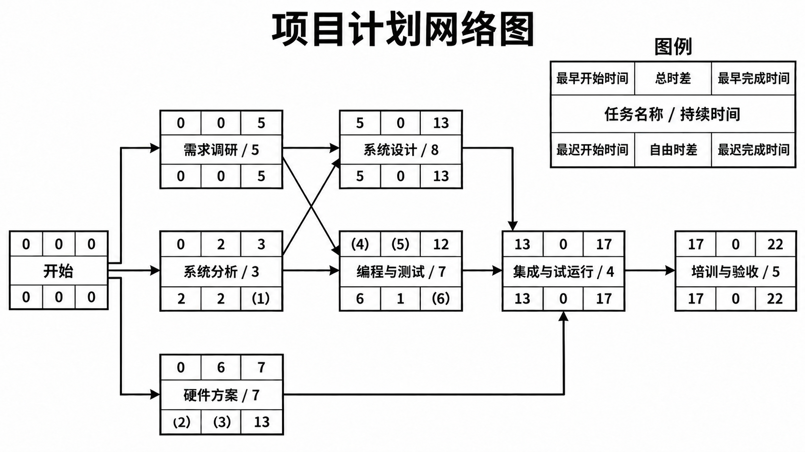
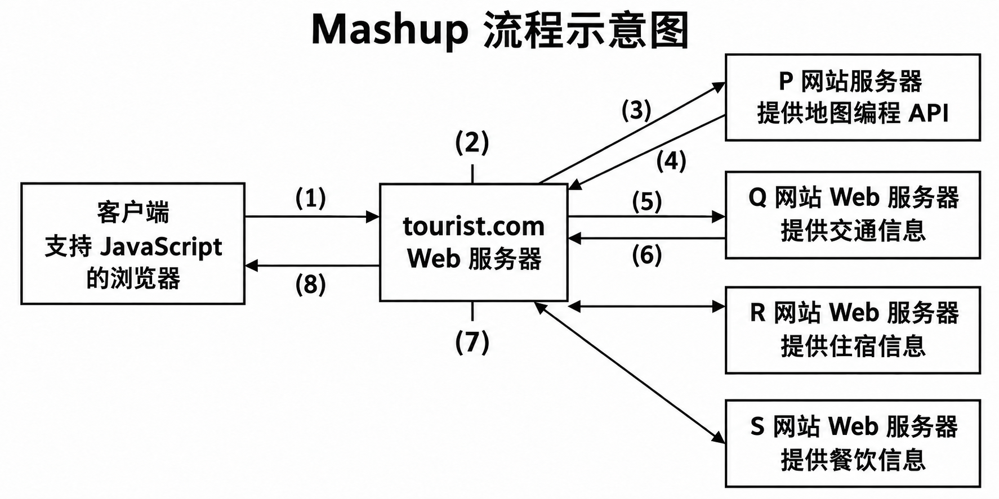

# 高级系统架构设计师下午试题押题密卷3

原件：[PDF](../assets/4b40af5235569c04.pdf)。各小问后已内嵌冲刺速记核心作答（彩色高亮代码块）；卷末保留原完整参考答案与详细解析。

排印修订和原卷歧义见 转换记录。

## 试题一

阅读以下说明，根据要求回答下面问题。

**说明**

系统集成公司 DX 承接了某家大型超市的电子商务信息系统项目。该超市近年收购了多家小型超市，目前需要进行电子商务平台横向联网的整合、升级改造原有网络系统和部分硬件设备、定制开发部分应用软件系统，以及进行软硬件系统的集成工作等。该项目计划从2011年1月1日开始，至2012年10月31日完成，持续22个月。该项目每项任务的持续时间和每月人员的需求数量如下表所示。每项任务的逻辑关系和部分时间信息如下图所示。

**每项任务持续时间和每月人员需求数表**

| 任务名称 | 持续时间(月) | 每月需求人数 |
| --- | --- | --- |
| 需求调研 | 5 | 8 |
| 系统分析 | 3 | 4 |
| 系统设计 | 8 | 3 |
| 编程与测试 | 7 | 2 |
| 硬件方案及配置 | 7 | 5 |
| 集成与试运行 | 4 | 9 |
| 培训与验收 | 5 | 7 |

项目计划网络图

### 问题 1

请根据图的项目任务逻辑关系，请计算并填写图中(1)～(6)处的空缺内容。

### 问题 2

根据图中的最早开始时间，请使用下方“问题 2 作答表”填写各项任务的起止月份，完成该项目甘特图的文字化作答。

### 问题 3

根据该项目最早开始时间的甘特图，请计算每月人工需求量并填写下表中空缺内容。若该项目进行人力资源平衡的优化，优化配置后每个月所需的最多人员数量至少为人。表中“***”表示此处的数据未给出。

**每项任务持续时间和每月人员需求数表**

| 序号 | 进度时间/月 | 人员需求量(人) |
| --- | --- | --- |
| 1 | 2011年1月 | ____ |
| 2 | 2011年2月 | \*\*\* |
| 3 | 2011年3月 | \*\*\* |
| 4 | 2011年4月 | \*\*\* |
| 5 | 2011年5月 | ____ |
| 6 | 2011年6月 | \*\*\* |
| 7 | 2011年7月 | ____ |
| 8 | 2011年8月 | \*\*\* |
| 9 | 2011年9月 | \*\*\* |
| 10 | 2011年10月 | ____ |
| 11 | 2011年11月 | \*\*\* |
| 12 | 2011年12月 | \*\*\* |
| 13 | 2012年1月 | ____ |
| 14 | 2012年2月 | \*\*\* |
| 15 | 2012年3月 | \*\*\* |
| 16 | 2012年4月 | ____ |
| 17 | 2012年5月 | \*\*\* |
| 18 | 2012年6月 | \*\*\* |
| 19 | 2012年7月 | \*\*\* |
| 20 | 2012年8月 | ____ |
| 21 | 2012年9月 | \*\*\* |
| 22 | 2012年10月 | \*\*\* |

### 问题 4

请简要叙述“滚动波浪式计划”方法的特点和确定滚动周期的依据。针对本试题说明中所述项目，说明采用多长的滚动周期比较恰当。

## 试题二

阅读以下关于软件复用技术应用的叙述，根据要求回答下面问题。

**说明**

随着政府职能的转型， xx 行业职能主管部门(国家相关部委，各省、市的相关厅、局、委等)机构日趋精简，但随着国家现代化的发展，业务量反而越来越大。为保证本行业管理工作的质量和效率，实现企业资质审批管理信息化、网络化和电子化，提高工作效率和质量，规范业务处理流程，提高管理工作的广度、深度、力度和速度，更有效地为相关企业和业主提供服务，该行业主管部门委托 FT软件开发公司开发一个 xx 行业管理信息系统。该系统由公共信息管理模块、系统管理维护模块、资质管理模块、企业信息管理模块和系统扩展接口模块等5大功能模块组成。

在该项目架构分析会上， FT 公司高层领导提出，为了使那些公共功能模块比较容易地被其他电子政务项目所复用，应充分利用领域分析和软件复用的知识，采用基于可复用的软件开发方式，在这些公共模块的实现中保持高度的独立性，即在实现的具体细节上与 xX 行业国家部委(或者其他的政府机构)无关。

### 问题 5

特定领域软件架构(Domain Specific Software Architecture,DSSA.是一种有效实现特定领域软件重用的手段。结合你的系统架构设计经验，请用300字以内的文字简要说明基于 DSSA的软件设计开发主要包含哪些阶段以及每个阶段的目标。

### 问题 6

结合你的系统架构设计经验，请用300字以内的文字简要说明该项目中的5个功能模块在软件复用方面的基本架构思路。

### 问题 7

软件复用包括两个相关过程：可复用软件(构件)的开发；基于可复用软件(构件)的应用系统构造(集成和组装)。软件构件技术是软件复用的核心技术。结合你的系统架构设计经验，请用200字以内的文字简要说明可复用构件应具备哪些属性，并给予简要的解释。

## 试题三

阅读以下关于企业应用集成的叙述，根据要求回答下面问题。

**说明**

某大型企业随着信息化的进展，积累了许多异构的遗产信息系统，这些系统分别采用 J2EE、.NET等技术进行开发，分布在不同的地理位置，采用不同的协议进行数据传输。企业要求集成后的系统能够实现功能整合，并在组织现有功能的基础上提供增值服务。 FT 软件开发公司承接了某大型企业应用系统的集成任务。为了按时保质的完成任务，选择合适的企业应用集成方法和架构非常重要。项目组在讨论方案时，提出了两种集成思路。

8魏工建议采用传统的应用集成方法，将应用集成分为多个层次，并采用消息代理中间件连接遗产系统。

9陈工建议采用基于 SOA 的方法进行应用集成，将现有遗产系统采用 Web Service 的方式进行包装，暴露统一格式的接口，并采用企业服务总线(ESB) 进行连接。

项目组仔细分析比较了两种方案的优点和不足后，认为魏工和陈工的建议都合理，但是结合当前项目的实际情况，最后决定采用陈工的建议。

### 问题 8

请分析比较两种集成方案的优点和不足，将下表中的空缺处的内容填写完整。

应用系统集成方案对比表

| 集成方案考虑因素 | 魏工建议的集成方案 | 陈工建议的集成方案 |
| --- | --- | --- |
| 拟采取的集成方法 | 涉及不同的集成层次，集成方法复杂多样 | ____ |
| 对企业集成需求的符合程度 | ____ | ____ |
| 集成系统体系结构 | ____ | ____ |
| 集成系统的可扩展性 | 遗产系统集成方法多样，系统耦合度高，可扩展性较差 | ____ |

### 问题 9

企业数据的分布性和异构性是应用系统方便访问企业数据和在企业数据之上提供增值服务的主要障碍。基于 sOA 的企业集成通过信息服务提供集成数据的能力，针对该企业的集成实际情况，请用300字以内的文字列举3种基于 SOA 的企业集成中的“数据整合—信息服务”,并给出简要说明。

### 问题 10

结合你的系统架构设计经验，请用300字以内的文字简要说明 FT 公司项目组在对该企业构建 SOA架构时，除了注意原有系统架构中的集成需求之外，还需要在服务构建时重点关注哪些问题。

## 试题四

阅读以下关于网上银行贷款业务的应用说明，根据要求回答下面问题。

**说明**

FZ 软件公司承接了某银行网上银行业务软件系统的开发任务。该银行所开通的网上银行业务中，网上贷款业务流程如下。

- 客户在网上填写姓名、电子邮件地址、贷款类型、贷款金额、身份证号和通信地址等信息，提交贷款申请。

12在指定的时间内，客户会收到银行的电子邮件，通知贷款是否被批准。

13银行根据客户提交的信息，创建贷款申请任务，创建工作由运行在主机上的 CICS (客户信息控制系统)完成，同时需要从第三方获得客户的信用审查信息。

- 由信贷员对该项贷款申请业务进行审批，然后由风险检查系统评估该项贷款的风险程度，风险大的贷款申请将被拒绝。15无论是批准或者拒绝，结果都会通过邮件系统递交给客户。对于拒绝的贷款申请，还要通知贷款申请任务进行有关操作。

- 除了信贷员审批环节需要人机交互外，业务是自动进行的。

### 问题 11

上述网上贷款业务采用 SOA 架构来实现。上述业务流程中涉及哪些功能单元?本题中的案例采用SOA 架构具有哪些优点?请用300字以内的文字简要说明。

### 问题 12

服务注册表(Service Registry)模式是 SOA 的架构模式之一。注册表支持驱动 SOA 治理的服务合同、策略和元数据的开发、发布和管理。结合你的系统架构经验，请用400字以内的文字简要说明大多数商用服务注册产品支持哪些 SOA 治理功能。

### 问题 13

上述网上贷款系统能够实际应用的基本前提之一是满足金融领域的安全性需求。该系统必须满足哪些安全方面的需求?请用200字以内的文字简要说明。

## 试题五

阅读以下关于 Web 应用的相关叙述，根据要求回答下面问题。

**说明**

tourist.com 是一家在线旅游信息服务公司，其主要业务是为了自助旅游者提供关于旅游线路及周边信息的服务。随着公司业务的不断发展，公司用户要求提供基于位置的增值旅游信息服务，即希望能够在给定位置(利用 GPS 全球定位系统获取)的情况下得到周边的地理位置、交通、住宿和餐饮等旅游相关信息。 FT 软件公司承接了 tourist.com 公司管理信息系统升级的开发任务。该软件公司的领域专家对需求进行深入分析，并结合需求对现有系统的架构和运行模式进行了认真分析，决定采用 Mashup ( 一种基于因特网的内容聚合技术)集成来自其合作网站(假设为 P、0、R、S) 的信息，满足用户的需求。具体实现方式是：

1 4 利用 P 网站提供的地图信息，得到用户位置相关的周边地理信息。

- Q 网站根据用户的位置信息向其提供周边的公交线路等信息。

- R 网站根据用户的位置信息向其提供周边的住宿信息。

- S 网站根据用户的位置信息向其提供周边的餐饮信息。

### 问题 14

下图是 tourist.com 公司进行 Mashup 的流程示意图，请阅读并补充图中数字标出部分的内容。

Mashup 流程示意图

#### （1）

用户向 Tourist 网站请求服务，请求页面提供用户的位置信息。

#### （2）

#### （3）

#### （4）

P 网站向 Tourist 网站返回用户所处位置周边的地图信息。

#### （5）

#### （6）

Q 网站向 Tourist 网站返回用户所处位置周边的交通信息。

#### （7）

#### （8）

Tourist 网站向用户返回用户所处位置周边整合的旅游信息。

### 问题 15

在该项目建设过程中，tourist.com 网站欲整合 Google 等网站提供的地图信息，为用户提供新的旅游信息增值服务。FT 公司负责网站建设的工程师提出了两种解决方案，第一种方案拟采用传统的应用系统集成方法，集成来自不同源的数据。另外一种采用基于 Web 2.0的 Mashup 技术，从不同的数据源抽取数据，聚合并转换数据，在不同的上下文中使用，具体如下表所示。请阅读并将表中空缺的内容填写完整。

两种集成方案对比表

| 解决方案考虑因素 | 传统的系统集成方案 | 基于 Web 2.0的 Mashup 技术 |
| --- | --- | --- |
| 对现有平台与系统的要求 | 需要传统平台 API 层的支持，如 Java 平台、Java EE 和.NET 等，集成过程复杂 | ____ |
| 新特性的支持与功能扩展 | 需要采用编程的方式完成系统功能扩展，涉及数据存储层、业务逻辑层和表现层 | ____ |
| 表现层支持 | ____ | ____ |
| 底层集成技术支持 | 使用传统的多层企业应用集成技术，涉及不同的集成层次 | ____ |

### 问题 16

基于 Web 2.0的 Web 应用十分强调用户的体验与感受，Ajax 是目前广泛使用的表现层技术。请用300字以内的文字简要介绍 Ajax 的核心思想，并列举两个在使用 Ajax 时需要关注的效率问题。

## 参考答案与解析

### 试题一

#### 第 1 题

5 6 6 5 1 13

**解析** 在如图所示的项目计划网络图中，根据表所给定的各项工作持续时间，顺着箭线方向可以逐项计算出各项工作的最早开始时间和最早完成时间。对于“编程与测试”工作的前面工作有两项(即“需求调研”工作和“系统分析”工作),该工作的最早开始时间等于各个紧前工作的最早完成时间的最大值，即“需求调研”工作的最早完成时间(5个月);或者是该工作的最早开始时间等于本工作的最早完成时间减去工作持续时间(即12-7=5个月)。

某工作的总时差等于该工作最迟完成时间与最早完成时间之差，或该工作最迟开始时间与最早开始时间之差。例如，在图中，“编程与测试”工作的总时差为6-5=1个月。

在如图所示的项目计划网络图中，从网络计划的终止节点，逆着箭线方向可以逐项计算出各项工作的最迟开始时间和最迟完成时间。某工作的最迟完成时间等于该工作的最早完成时间加上其总时差之和。例如，在图中，“编程与测试”工作的最迟完成时间为12+1=13个月。

某工作的最迟开始时间等于该工作的最早开始时间加上其总时差之和。例如，在图中，“硬件方案及配置”工作最迟开始时间为0+6=6个月。

对于有紧后工作的工作，其自由时差等于该工作的紧后工作最早开始时间减去本工作最早完成时间所得之差的最小值。例如，在图中，“硬件方案及配置”工作的紧后工作仅有“集成与试运行”工作，其自由时差为13-7=6个月。

#### 第 2 题

**最早开始计划（项目甘特图的文字化表示）**

| 任务 | 开始月份 | 结束月份 | 持续月数 |
| --- | --- | --- | --- |
| 需求调研 | 2011-01 | 2011-05 | 5 |
| 系统分析 | 2011-01 | 2011-03 | 3 |
| 系统设计 | 2011-06 | 2012-01 | 8 |
| 编程与测试 | 2011-06 | 2011-12 | 7 |
| 硬件方案及配置 | 2011-01 | 2011-07 | 7 |
| 集成与试运行 | 2012-02 | 2012-05 | 4 |
| 培训与验收 | 2012-06 | 2012-10 | 5 |

**解析** 根据项目计划网络图中各项工作的最早开始时间及其持续时间，可以得到上表。原甘特图以横轴表示时间、纵轴表示要安排的活动，用线条表示计划的（或实际的）活动完成情况；这里用可编辑表格列出相同的任务起止月份和持续月数。

#### 第 3 题

17 13 10 5 3 9 7 12

**解析** 根据上表中各项工作的最早开始时间，结合每项任务每月人员的需求数量，可以得到如下表所示的每月人员需求数量。

每月人员需求数量计算表

| 任务 | 开始月份 | 结束月份 | 持续月数 | 每月需求人数 |
| --- | --- | --- | --- | --- |
| 需求调研 | 2011-01 | 2011-05 | 5 | 8 |
| 系统分析 | 2011-01 | 2011-03 | 3 | 4 |
| 系统设计 | 2011-06 | 2012-01 | 8 | 3 |
| 编程与测试 | 2011-06 | 2011-12 | 7 | 2 |
| 硬件方案及配置 | 2011-01 | 2011-07 | 7 | 5 |
| 集成与试运行 | 2012-02 | 2012-05 | 4 | 9 |
| 培训与验收 | 2012-06 | 2012-10 | 5 | 7 |

| 月份 | 每月总人数 |
| --- | --- |
| 2011-01 | 17 |
| 2011-02 | 17 |
| 2011-03 | 17 |
| 2011-04 | 13 |
| 2011-05 | 13 |
| 2011-06 | 10 |
| 2011-07 | 10 |
| 2011-08 | 5 |
| 2011-09 | 5 |
| 2011-10 | 5 |
| 2011-11 | 5 |
| 2011-12 | 5 |
| 2012-01 | 3 |
| 2012-02 | 9 |
| 2012-03 | 9 |
| 2012-04 | 9 |
| 2012-05 | 9 |
| 2012-06 | 7 |
| 2012-07 | 7 |
| 2012-08 | 7 |
| 2012-09 | 7 |
| 2012-10 | 7 |

在如图所示的项目计划网络图中，关键路径为：开始→需求调研→系统设计→集成与试运行→培训与验收。为了考查该项目每月所需的最少人数，可以先安排关键路径上各项工作的人数，再优化调整具有自由时差的工作的启动时间。关键路径上各项工作的启动时间及人数的安排是确定的，在保证关键路径上作业及其紧前作业按时完成的情况下，“系统分析”、“编程与测试”、“硬件方案及配置”3个工作启动时间的安排就需要综合考虑平衡每个月所需的人数。下表给出了该项目每月人员需求数量优化配置的一种方案。该方案综合考虑到“硬件方案及配置”工作具有6个月的自由时差，将其安排在第7个月初开始，第13个月末结束。当然，在保证关键路径上作业及其紧前作业按时完成的情况下，在表中“系统分析”、“编程与测试”、“硬件方案及配置”3个工作启动时间的安排还可以有多种组合排列方式，但是不管何种组合排列方式，该项目工作优化配置后每个月所需的最多人员数量至少为12人。该项目每月人员需求数量优化配置方案之一

**优化后的任务安排**

本方案仅将“硬件方案及配置”延后至 2011-07～2012-01，其他任务的起止月份和每月需求人数保持原安排。

| 任务 | 开始月份 | 结束月份 | 持续月数 | 每月需求人数 |
| --- | --- | --- | --- | --- |
| 需求调研 | 2011-01 | 2011-05 | 5 | 8 |
| 系统分析 | 2011-01 | 2011-03 | 3 | 4 |
| 系统设计 | 2011-06 | 2012-01 | 8 | 3 |
| 编程与测试 | 2011-06 | 2011-12 | 7 | 2 |
| 硬件方案及配置 | 2011-07 | 2012-01 | 7 | 5 |
| 集成与试运行 | 2012-02 | 2012-05 | 4 | 9 |
| 培训与验收 | 2012-06 | 2012-10 | 5 | 7 |

| 月份 | 每月总人数 |
| --- | --- |
| 2011-01 | 12 |
| 2011-02 | 12 |
| 2011-03 | 12 |
| 2011-04 | 8 |
| 2011-05 | 8 |
| 2011-06 | 5 |
| 2011-07 | 10 |
| 2011-08 | 10 |
| 2011-09 | 10 |
| 2011-10 | 10 |
| 2011-11 | 10 |
| 2011-12 | 10 |
| 2012-01 | 8 |
| 2012-02 | 9 |
| 2012-03 | 9 |
| 2012-04 | 9 |
| 2012-05 | 9 |
| 2012-06 | 7 |
| 2012-07 | 7 |
| 2012-08 | 7 |
| 2012-09 | 7 |
| 2012-10 | 7 |

#### 第 4 题

①特点：近期的工作计划较详细，远期的工作计划较粗略

- ②依据：根据项目的规模、复杂度及项目生命周期的长短来确定

- ③滚动周期：1周、2周，或1～2周的时间里

**解析** 滚动波浪式计划是项目渐进明细的一种表现形式，其特点是近期的工作计划得细一些，远期的工作计划得相对粗略一些。换言之，近期要完成的工作为工作分解结构(WBS) 的最下层详细计划，而计划在远期完成的工作为工作分解结构的较高层计划。最近一两个报告期要进行的工作应在本期接近完成前更为详细地规划。

滚动波浪式计划中的滚动周期应根据项目的规模、复杂度及项目生命周期的长短来确定。项目生命周期中有3个与时间相关的重要概念，即检查点(Checkpoint)、 里程碑(Milestone) 和基线(Baseline)。 它们一起描述了在什么时候对项目进行什么样的控制。其中，检查点是指在规定的时间间隔内对项目进行检查，比较实际与计划之间的差异，并根据差异进行调整。可将检查点看作是一个固定间隔的“采样”时间点，而时间间隔根据项目周期长短的不同而不同。若频度太小会失去意义，而频度过大会增加管理成本。常见的间隔是每周一次，项目经理需要召开周例会并上交周报告。

在本案例中，该信息系统项目是对一个大型超市、涉及软硬件集成工作的较大型及复杂的项目，滚动波浪式计划中的滚动周期可确定为1周(或2周，或1～2周的时间周期)。

### 试题二

#### 第 5 题

| 阶段 | 目标 |
| --- | --- |
| 定义领域范围 | 确定领域应用需要满足的用户需求 |
| 定义领域特定的元素 | 制订领域字典和领域术语的同义词词典(或识别领域中各种应用间的共同性和差异性) |
| 定义领域特定的设计和实现需求约束 | 描述解空间中的特性，识别约束并记录其对设计和实现决定造成的后果，以及记录对处理这些问题时产生的所有问题的讨论 |
| 定义领域模型和构架 | 产生该领域的参考架构，并说明构件的语法和语义 |
| 产生和搜集可复用产品 | 为 DSSA 增加构件，为问题域实现新应用提供支持 |

**解析** 领域分析是分析和研究某个应用领域特性的活动，它是识别、收集、组织和描述一个领域相关信息，发现和记录领域中的共性和差异的过程，是系统化、形式化、有效复用的关键。通过领域分析，类似系统的公共特性将被提取，使用于该领域所有公共的、基本的对象及操作被标志出来，并且通过定义模型来描述他们之间的关系。领域分析的本质是以复用为目的，对具有若干共同特性的一群应用系统进行分析，对共同的部分开发出一系列公用的组件，对不同的部分进行参数化。

按照 Will Tracz 的说法，特定领域软件架构(DSSA) 就是一个特定的问题领域中由领域模型、参考需求和参考架构等组成的开发基础架构，其目标就是支持一个特定领域中多个应用的生成。DSSA的基本活动包括领域分析、领域设计和领域实现。领域分析的主要目的是获得领域模型，领域模型描述领域中系统之间的共同需求，即领域需求；领域设计的主要目标是获得 DSSA,DSSA 描述领域模型中表示需求的解决方案；领域实现的主要目标是依据领域模型和 DSSA 开发、组织可重用信息。

在最高的级别上， DSSA 方法共有5个阶段，每个阶段可以进一步划分为一些步骤或子阶段，每个阶段包括一组需要回答的问题、 一组需要的输入。该方法的领域工程过程是并发的、递归的和反复的，或者可以说，它是螺旋型的，完成该过程可能需要对每个阶段经历几遍，每次增加更多的细节。该领域工程过程的5个阶段如下。

(1)定义领域范围：重点是确定领域中包含哪些元素及领域工程过程到何时结束。这一阶段的一个主要输出是领域中的应用需要满足的一系列用户的需求。

(2)定义领域特定的元素：目标是制订领域字典和领域术语的同义词词典。在领域工程过程的前一个阶段产生的高层次块图中增加更多的细节，特别是识别领域中各种应用间的共同性和差异性。

(3)定义领域特定的设计和实现需求约束：目标是描述空间中的特性，不仅要识别约束，并且要记录约束对设计和实现决定造成的后果，还要记录对处理这些问题时产生的所有问题的讨论。

(4)定义领域模型和构架：目标是产生 DSSA, 并说明构成它的模块或构件的语法、语义。

(5)产生和搜集可复用的产品：目标是为 DSSA 增加构件，使得它可以被用来产生问题域中的新应用。

从软件实践上看，面对特定领域的系统开发，迫切需要一种好的开发方法来有效地支持软件重用性，而 DSSA 方法已经在实践中被证明是有效的，能显著加大重用的粒度，从而缩短整体开发周期，在提高产品品质的同时降低开发费用。

#### 第 6 题

公共信息管理模块和系统管理维护模块应该在具体的配置和使用上通过配置文件(或数据文件)加载建设方的相关信息，从而使这些公共功能模块易被其他电子政务项目所复用。

资质管理模块、企业信息管理模块和系统扩展接口模块等与建设方密切相关的功能模块，虽然在实现上无法完全和建设方信息分开，但要尽力降低和建设方的耦合度，使得今后复用时的代价最小化。

在具体实现上，应该充分采用在市场上广泛使用的技术与产品(诸如 Web 服务器、中间件(J2EE应用服务器等)、电子邮件系统、数据库系统、信息门户和系统安全解决方案等),同时采用 CMM 模型(或 CASE 工具等)来辅助、指导这些功能模块的软件开始工作

**解析** 在电子政务的建设过程中，应充分利用领域分析和软件复用的知识，采用基于可复用的软件开发方式，注重采用领域分析的方法，建立领域模型。例如，在领域分析时使用国际上通用的统一建模语言(UML)作为建模工具。在电子政务的建设过程中，应建立系统工程，建立行业范围内的一些标准，以利于确定复用的方案，使开发的系统可靠性高、成本低。

根据题干关键信息，并结合从事系统架构设计的历史经验，大致可以分析该系统5大功能模块中，公共信息管理模块是 Intern et 网络上的一个应用系统，这部分主要包括系统网站的相关功能，例如信息发布和浏览、资质等级标准查询、企业资质查询、网上调查、意见箱管理、问题解答，以及下载文档管理等。系统管理维护模块主要是系统管理员用户用来设置或设定系统的参数，管理和维护系统最基本的数据。主要功能包括用户及权限管理、工作流管理、企业管理、信息发布管理、系统维护、文档管理和基础数据管理等。对于这两个功能模块应该在具体的配置和使用上通过配置文件(或数据文件)把建设方的相关信息加入进来，从而使这些公共功能模块容易地被其他电子政务项目所复用。

根据行业经验，资质管理模块通常包括企业资质的网上申请、审批、年审、动态管理、变更、备案、资质证书管理，以及相关资质申请审批工作处理情况的查询、资质标准和等级的管理、分析统计等。企业信息管理模块主要是对具体企业信息的维护，包括企业相关信息的输入、输出、修改、删除、查询和打印等功能。其中，人员管理还包括人员的调离、年龄控制等。系统扩展接口模块用于本系统与其他信息系统的数据交换，保证了建设方的管理系统与其他行业部门已有或待建信息化系统的无缝链接等。对于这些与建设方密切相关的功能模块，即使在实现上无法完全和建设方的相关信息分开，也要尽力降低和建设方的耦合度，以便使得今后复用时的代价最小化。

在具体的实现上，应该充分采用在市场上广泛使用的技术与产品。例如， Web 服务器、J2EE 应用服务器、电子邮件系统、数据库系统、信息门户和系统安全解决方案等，建议使用已有的软件产品而不是自行开发。同时采用 CMM 模型或者 CASE 工具等指导所承接的软件系统的开发，以便高质量地完成项目的建设工作，使得所建成的软件系统具有良好的可复用性。

#### 第 7 题

有用性：构件必须提供有用的功能。

可用性：构件必须易于理解和使用。质量：构件及其变形必须能正确工作。

适应性：构件应该易于通过参数化等方式在不同语境中进行配置。

可移植性：构件应能在不同的硬件运行平台和软件环境中工作。

可变性(Variability): 构件应能针对不同的应用系统，只需对其可变部分进行适当的调节等

**解析** 构件(Component) 是指应用系统中可以明确辨识的构成成分。它是软件系统可替换的、物理的组成部分，它封装了实现体(实现某个职能),并提供了一组接口的实现方法。而可复用构件(Reusable Component)是指具有相对独立的功能和可复用价值的构件。软件构件技术是软件复用的核心技术。它是基于面向对象的，以即插即用型构件概念为中心，通过构件组合来建立应用的体系。其主要研究内容包括构件获取、构件模型、构件描述语言、构件分类与检索、构件复合组装和构件标准化。

可复用构件应具备以下属性。

(1)有用性(Usefulness), 构件必须提供有用的功能。

(2)可用性(Usability), 构件必须易于理解和使用。

(3)质量(Quality), 构件及其变形必须能正确工作。

(4)适应性(Adaptability), 构件应该易于通过参数化等方式在不同语境中进行配置。

(5)可移植性(Portability), 构件应能在不同的硬件运行平台和软件环境中工作。

(6)可变性(Variability), 构件除了向复用者提供一些公共“特性”外，还要提供可变的“特性”。针对不同的应用系统，只需对其可变部分进行适当的调节，复用者要根据复用的具体需要，改造构件的可变"特性”,即进行"客户化"工作等。

### 试题三

#### 第 8 题

(1)将现有系统看做抽象的服务提供者，集成方法统一明确。

(2)不同层次的集成方法关注点不同，功能组合方面能力较弱。

(3)强调功能的暴露与服务的组合，便于提供增值服务。

(4)一般为中心辐射型，系统的耦合程度较高。

(5)基于总线结构的体系结构，系统的耦合度低。

(6)集成系统具有模块化、松耦合的特点，可扩展性较强。

#### 第 9 题

(1)联邦服务：提供将各种类型的数据聚合的能力，它既支持关系型数据，也支持 XML 数据等非关系型数据，所有的数据仍然按照自己本身的方式管理。

(2)复制服务：提供远程数据的本地访问能力，它通过自动的实时复制和数据转换，在本地维护一个数据源的副本，本地数据和数据源在技术实现上可以是独立的。

(3)转换服务：用于数据源格式到目标格式的转换，可以是批量的或者是基于记录的。

(4)搜索服务：提供对企业数据的查询和检索服务，既支持数据库等结构化数据，也支持 PDF 等非结构化数据

**解析** 企业数据的分布性和异构性是应用系统方便访问企业数据和在企业数据之上提供增值服务的主要障碍。数据集成和聚合技术在这种背景下诞生，用于提供对分布式数据和异构数据的透明访问。以服务为中心的企业集成通过信息服务提供集成数据的能力，目前主要包括如下集中信息服务。

(1)联邦服务(Federation Service): 提供将各种类型的数据聚合的能力，它既支持关系型数据，也支持 XML 数据、文本数据和内容数据等非关系型数据。同时，所有的数据仍然按照自己本身的方式管理。

(2)复制服务(Replication Service): 提供远程数据的本地访问能力，它通过自动的实时复制和数据转换，在本地维护一个数据源的副本。本地数据和数据源在技术实现上可以是独立的。

(3)转换服务(Transformation Service): 用于数据源格式到目标格式的转换，可以是批量的或者是基于记录的。

(4)搜索服务(Search Service): 提供对企业数据的查询和检索服务，既支持数据库等结构化数据，也支持如 PDF 等非结构化数据。

#### 第 10 题

①对服务粒度的控制。通常情况下，对于将暴露在整个系统外部的服务推荐使用粗粒度的接口，而相对较细粒度的服务接口用于企业系统架构的内部，使用业务流程(BPEL) 来创建由细粒度操作组成的业务流程的粗粒度的服务接口

- ②对无状态服务的设计。架构中的具体服务应该都是独立的、自包含的请求(或是无状态的服务),当某一个服务需要依赖时，可将它定义成具体的业务流程

**解析** 当基于 SOA 来构建一个企业级的系统架构时，一定要注意对原有系统架构中的集成需求进行细致的分析和整理。而关于系统中最重要的元素，也就是 SOA 系统中服务的构建有两点需要特别注意的地方：①是对于服务粒度的控制；②是对于无状态服务的设计。

SOA 系统中服务粒度的控制是一项十分重要的设计任务。通常来说，对于将暴露在整个系统外部的服务推荐使用粗粒度的接口，而相对较细粒度的服务接口通常用于企业系统架构的内部。从技术上讲，粗粒度的服务接口可能是一个特定服务的完整执行，而细粒度的服务接口可能是实现这个粗粒度服务接口的具体的内部操作。虽然细粒度的接口能为服务请求者提供更加细化和更多的灵活性，但同时也意味着引入较难控制的交互模式易变性，也就是说服务的交互模式可能随着不同的服务请求者而不同。如果暴露这些易于变化的服务接口给系统的外部用户，就可能造成外部服务请求者难以支持不断变化的服务提供者所暴露的细粒度服务接口；而粗粒度服务接口保证了服务请求者将以一致的方式使用系统中所暴露出的服务。虽然 SOA 并不强制要求一定要使用粗粒度的服务接口，但是建议使用它们作为外部集成的接口。通常情况下，可以使用业务流程(BPEL) 来创建由细粒度操作组成的业务流程的粗粒度的服务接口。

SOA 系统架构中的具体服务应该都是独立的、自包含的请求，在实现这些服务的时候不需要前一个请求的状态，也就是说服务不应该依赖于其他服务的上下文和状态，即 SOA 架构中的服务应该是无状态的服务。当某一个服务需要依赖时，最好把它定义成具体的业务流程(BPEL)。 在服务的具体实现机制上，可以通过使用 EJB 组件来实现粗粒度的服务。通常情况下，可以利用无状态的 Session Bean 来实现具体的服务，如果基于 Web Service 技术，就可以将无状态的 Session Bean 暴露为外部用户可以调用到的 Web 服务，也就是把传统的 Session Facade 模型转化为 EJB 的 Web 服务端点。这样就可以向 Web 服务客户提供粗粒度的服务。

如果要在 J2EE 的环境下(基于 Web Sphere) 构建 Web 服务，Web 服务客户可以通过两种方式访问 J2EE 应用程序。客户可以访问用 JAX-RPC API 创建的 Web 服务(使用 Servlet 来实现); Web 服务客户也可以通过 EJB 的服务端点接口访问无状态的 Session Bean,但 Web 服务客户不能访问其他类型的企业 Bean, 如有状态的 Session Bean、实体 Bean 和消息驱动 Bean。 对于后一种访问方式(公开无状态 EJB 组件作为 Web 服务)的优势在于：基于已有的 EJB 组件，可以利用现有的业务逻辑和流程。在许多企业中，现有的业务逻辑可能已经使用 EJB 组件编写，通过 Web 服务公开它可能是实现从外界访问这些服务的最佳选择。EJB 端点是一种很好的选择，因为它使业务逻辑和端点位于同一层上。另外，EJB 容器会自动提供对并发的支持，作为无状态 Session Bean 实现的 EJB 服务端点不必担心多线程访问，因为 EJB 容器必须串行化对无状态会话 Bean 任何特定实例的请求。由于 EJB 容器都会提供对于 Security 和 Trans action 的支持，因此 Bean 的开发人员可以无须编写安全代码及事务处理代码。性能问题对于 Web 服务来说一直都是一个问题，由于几乎所有 EJB 容器都提供了对无状态会话Bean 群集的支持，以及对无状态 Session Bean 池与资源管理的支持，因此当负载增加时，可以向集群中增加服务器数目。Web 服务请求可以定向到这些不同的服务器，同时由于无状态 Session Bean 池改进了资源利用和内存管理，使 Web 服务能够有效地响应多个客户请求。由此可以看到，通过把 Web 服务模型化为 EJB 端点，可以使服务具有更强的可伸缩性，并增强了系统整体的可靠性。

### 试题四

#### 第 11 题

功能单元(包含但不限于以下内容):

- ①贷款申请；②信用审查；③信贷员审批；④风险检查；⑤电子邮件传送等

采用 SOA 架构的优点(包含但不限于以下内容):

- ①复用银行的各种应用资源。

- ②增强银行各个业务的集成性和灵活性。

- ③业务流程变更时便于快速构建应用系统

**解析** 面向服务架构体系结构(Service-Orient ed Architecture,SOA)作为一种架构模型，它将应用程序的不同功能单元(称为服务)通过服务之间的接口(和契约)联系起来。接口独立于实现服务的硬件平台、操作系统和编程语言。接口是采用中立的方式进行定义的，它独立于实现服务的硬件平台、操作系统和编程语言，使得构建的服务可以以一种统一的和通用的方式进行交互。这种具有中立的接口定义(没有强制绑定到特定的实现上)的特征称为服务之间的松耦合。松耦合系统的好处有两点：①灵活性；②当组成整个应用程序的每个服务的内部结构和实现逐渐地发生改变时，它能够继续存在。而与此相对，紧耦合意味着应用程序的不同组件之间的接口与其功能和结构是紧密相连的，因而当需要对部分或整个应用程序进行某种形式的更改时，它们就显得非常脆弱。

通过题干中关于网上银行贷款业务的说明不难找出相对独立的功能单元。这些功能单元为 SOA中的“服务”。由题干中给出的关键信息“(1)客户在网上填写姓名等信息，提交贷款申请”可知，该网上贷款业务流程中需要涉及“贷款申请”这一功能单元。

由题干中给出的关键信息"(3)银行根据客户提交的信息……同时需要从第三方获得客户的信用审查信息”可知，该网上贷款业务流程中涉及“信用审查”这一第三方功能单元。

由题干中给出的关键信息"(4)由信贷员对该项贷款申请业务进行审批，然后由风险检查系统评估该项贷款的风险程度”可知，该网上贷款业务流程中涉及“信贷员审批”和”风险检查(或风险评估)"这两个功能单元。其中，功能单元“信贷员审批”也可从题干中给出的关键信息"(6)除了信贷员审批环节需要人机交互外，业务是自动进行的”获得启发。

由题干中给出的关键信息“(5)无论批准或者拒绝，结果都会通过邮件系统递交给客户”可知，该网上贷款业务流程中涉及“电子邮件传送”这一功能单元。

从技术角度而言， SOA 带来了“松散耦合”的应用程序组件，在此类组件中，代码不一定绑定到某个特定的数据库(甚至不一定绑定到特定的基础设施)。正是得益于这个松散耦合特性，才能够将服务组合为各种应用程序。这样不仅大幅度提高了代码重用率，而且业务变更时业务系统更加灵活和便利，还可以在增加功能的同时减少工作量。 SOA 还具有管理上的优点。例如，现在管理员可直接管理开发人员所构建的服务，远胜于以往管理单个应用的方式。通过分析服务间的交互， SOA 可以帮助企业了解何时及什么业务逻辑被切实执行了，使得管理员能够有针对性地优化业务流程。

采用 SOA 将本项目的相关功能单元有机地集成在一起，可以快速、经济、方便地构建出网上银行贷款业务系统。具体优点表现在：①可以复用银行的各种应用资源；②可以增强银行各个业务的集成性和灵活性；③业务流程变更时便于快速构建应用系统。

#### 第 12 题

(1)服务注册：应用开发者(或服务提供者)向注册表公布他们的功能，包括服务身份、位置、方法、绑定、配置、方案和策略等描述性属性。实现 SOA 治理的有效方法之一，是限制哪类新服务可以向主注册表发布、由谁发布，以及准批准和根据什么条件批准。

(2)服务位置：服务应用开发者帮助他们查询注册服务，寻找符合自身要求的服务，注册表让服务的消费者检索服务合同。对谁可以访问注册表，以及什么服务属性通过注册表暴露的控制，是另_。些有效的 SOA 治理手段。

(3)服务绑定：服务消费者利用检索到的服务合同来开发代码，再将代码与注册的服务绑定、调用注册的服务，以及与它们实现互动。工具驱动对服务绑定的控制，有效地管理服务在 ESB 上的互动

**解析** 虽然服务注册表(Service Registry)常常具有运行时段的功能，但它主要是在 SOA 设计时段使用。注册表支持驱动 SOA 治理的服务合同、策略和元数据的开发、发布和管理，因此它提供一个主控制点，也称为策略执行点(Policy,Enforcement Point,PEP)。在这个点上，服务可以在 SOA 中注册和被发现。

注册表可以包括有关服务和相关软件组件的配置、遵从性和约束配置文件。任何帮助注册、发现和检索服务合同、元数据和策略的信息库、数据库、目录或其他节点都可以被认为是一个注册表。UDDI(通用描述、发现与集成)标准定义了 SOA 的一种主要注册环境。

大多数商用服务注册产品支持以下 SOA 治理功能。

(1)服务注册：应用开发者(也称为服务提供者)向注册表公布他们的功能，包括服务身份、位置、方法、绑定、配置、方案和策略等描述性属性。实现 SOA 治理最有效的方法之一，是限制哪类新服务可以向主注册表发布、由谁发布，以及谁批准和根据什么条件批准。此外，许多注册表包含开发向注册表发布服务可能需要的说明性服务模板。

(2)服务位置：服务应用开发者帮助他们查询注册服务，寻找符合自身要求的服务。注册表让服务的消费者检索服务合同。对谁可以访问注册表，以及什么服务属性通过注册表暴露的控制，是另一些有效的 SOA 治理手段，注册表产品一般都支持此类功能。

(3)服务绑定：服务的消费者利用检索到的服务合同来开发代码，开发的代码将与注册的服务绑定、调用注册的服务，以及与它们实现互动。开发者常常利用集成的开发环境自动将新开发的服务与不同的新协议、方案和程序间通信所需的其他接口绑在一起。工具驱动对服务绑定的控制，有效地管理服务在企业服务总线(ESB) 上的互动。

#### 第 13 题

①验证(系统有关角色的身份识别)。

- ②签名(创建及验证类似手写签名的电子签名)。

- ③授权(如信贷员是否具有审批权)。

- ④完整性(发送的数据与接收到的数据是否一致)。

- ⑤机密性(与业务无关的人员不能读取事务中的数据)。

- ⑥审查或审计(把所有事务记录下来，以便事后验证)。

- ⑦不可否认性或防抵赖(由第三方求证事务中发送及收到的是否为同一数据)。

- ⑧威胁预防

**解析** 在进行 SOA 的集成时，用户身份识别、数据完整性等安全问题是需要重点解决的问题。该网上贷款系统必须满足以下安全方面的需求。

(1)利用用户身份验证技术对该网上贷款系统的有关角色进行身份识别。

(2)利用公钥密钥机制等技术创建及验证类似手写签名的电子签名。

(3)采用授权机制审查系统中信贷员是否具有相应的审批权。

(4)利用数据完整性机制验证发送的数据与接收到的数据是否一致。

(5)采用机密性机制使与业务无关的人员不能读取事务中的数据。

(6)采用审查机制(例如，日志记录)把所有事务记录下来，以便事后验证。

(7)利用防否认机制，由第三方求证事务中发送及收到的是否是同一数据。

(8)利用威胁预防机制，防止间谍程序登录和攻击系统。

### 试题五

#### 第 14 题

(2)Tourist 网站接收请求，将请求分解为对多个网站的数据请求调用，并为发起调用进行准备。

(3)调用 P 网站提供的 Web 编程接口，给出(提供)用户的位置信息，请求地图信息。

(5)调用 Q 网站的内容信息获取接口，给出(提供)用户地理信息，请求用户周边的交通信息。

(7)Tourist 网站根据用户的请求信息进行数据内容聚合。

#### 第 15 题

(1)仅需要使用现有 Web应用程序公开的、基于 Web 的 API ( 或 Web 服务)构建应用程序，集成过程相对简单。

(2)直接使用 Mashup 技术集成两个或者更多的 Web API,创建新的特性与功能。

(3)大多采用静态展现技术，当客户端发送请求时，往往需要刷新整个网页。

(4)使用 Ajax 技术调用基于 Web 的 API, 浏览器客户端无须在每次与服务器通信时都重新加载整个页面，动态特性强。

(5)采用 SOA 思想集成底层系统，强调功能暴露与服务组合，以服务形式集成并暴露现有系统的能力

#### 第 16 题

核心思想是以下几种现有技术的组合。

(1)XHTML 和 CSs。

(2)使用文档对象模型(Document Object Model)进行动态显示和交互。

(3)使用 XML 和 XSLT 进行数据交互和操作。

(4)使用 XMLHttp Request 进行异步数据接收。

(5)使用 JavaScript 将它们绑定在一起。

需要关注的效率问题：

(1)替换部分而不是全部 HTML 网页。

(2)不要在没有必要的情况下使用轮询计时器。

(3)根据不同的情况，考虑传递不同格式的数据(JavaScript、XML、HTML 和 XHTML 等)。

(4)充分利用客户端的动态特性和计算能力减轻服务端负载。
