# 02-05 计算机网络 · 图文讲解

> [!info] 这份讲解怎么用
> - **覆盖范围**：教材 2.5 全部 5 个小节——2.5.1 网络的基本概念 / 2.5.2 通信技术 / 2.5.3 网络技术 / 2.5.4 组网技术 / 2.5.5 网络工程。教材写到的点一个不漏；教材没写、但真题和练习题中反复出现的（DNS、ARP、TCP/UDP、IPv6、冲突域/广播域……）单独标成 **🧩 教材外补充**。
> - **标记约定**：📘 = 教材原意（尽量贴原话）　🧩 = 教材外补充　🎯 = 考点提示　⚠️ = 常考陷阱 / 易混点　📝 = 练习题示例
> - **建议读法**：先把第 0 节的思维导图和第 5.5 节的“打开网页连环画”过一遍，建立整体画面；再按小节精读；考前只看 **第 9 节 一页速记**。
> - 图片说明：本文 40 张配图都是按教材内容逐张绘制的示意图（不是 AI 生图），图中文字/数字都对过教材。精确的定义和数字以正文和表格为准。

---

## 0. 先看全景：本节到底讲了什么？

教材开头一句话就给出了这一节的骨架：**计算机网络技术主要涵盖通信技术、网络技术、组网技术和网络工程四个方面**，前面再加一个“基本概念”，就是 5 个小节。

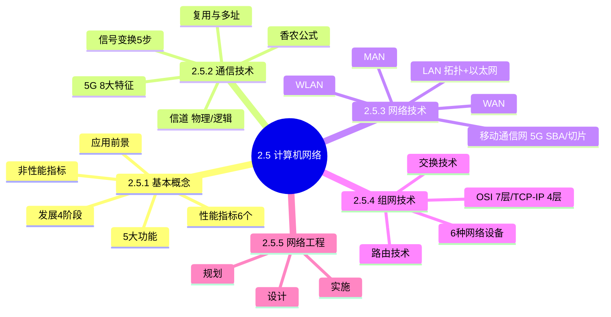

> [!tip] 🎯 考情：架构师考试里网络考多深？
> 计算机网络在综合知识（上午题）里通常只占少量分值，**几乎都是“概念辨析 + 记忆”型**，不会考到网络工程师那种深度的计算。从题库和真题看，出现过的考点集中在：
> - **分层模型**：某协议/设备在哪一层（IP 在网络层、Telnet 是应用层、ARP 把 IP 解析为 MAC……）
> - **网络设备**：哪种设备隔离广播帧、各设备工作层级
> - **TCP/UDP**：面向连接/可靠性、三次握手
> - **网络分类**：LAN/MAN/WAN 英文缩写、ATM 信元定长 53 字节、面向连接
> - **5G**：网络切片的目的、三大场景 eMBB/mMTC/uRLLC
> - **教材外高频**：DNS 递归/迭代、IPv6 特性、`arp -s`、HTTP/HTTPS/SET
>
> 另外，新版教材加入的 **香农公式、信号变换顺序、5G 架构与网元** 是“新增内容”，命题人很喜欢从新增内容出题，值得多看一眼。

---

## 1. 什么是计算机网络（2.5 总述）

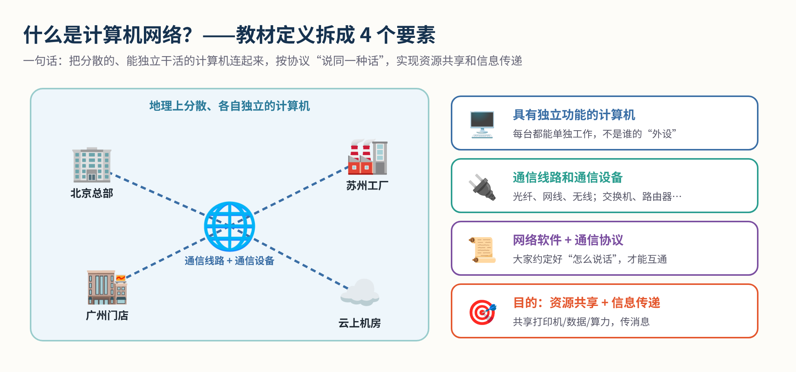
*图 1　教材定义拆成 4 个要素：独立计算机 + 通信线路/设备 + 网络软件/协议 + 资源共享/信息传递*

📘 **教材定义**：计算机网络是利用**通信线路**将**地理上分散的、具有独立功能的计算机系统和通信设备**按不同的形式连接起来，并依靠**网络软件及通信协议**实现**资源共享和信息传递**的系统。

先说直觉：你公司北京总部、苏州工厂、广州门店的电脑各自都能独立开机干活（“具有独立功能”），把它们用光纤/专线/互联网连起来，再让大家都遵守 TCP/IP 这套“说话规则”，于是广州门店能直接查总部数据库、苏州工厂的打印任务可以丢给总部打印机——这就是网络。

> [!warning] ⚠️ 定义里的两个“关键词陷阱”
> 1. **“具有独立功能”**：早期“一台主机 + 一群哑终端”的系统，终端离开主机什么也干不了，所以它只算网络的**雏形**（见 2.1 诞生阶段）。
> 2. **“依靠网络软件及通信协议”**：只连了线、没有协议，不叫网络。

---

## 2. 2.5.1 网络的基本概念

### 2.1 计算机网络的发展：4 个阶段

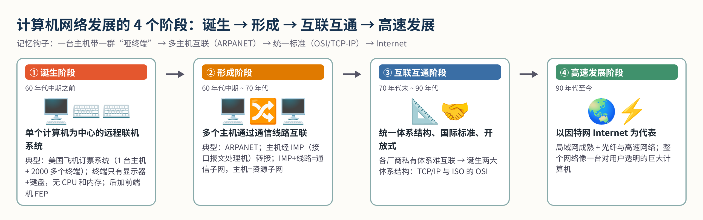
*图 2　诞生 → 形成 → 互联互通 → 高速发展*

| 阶段 | 时间 | 形态（教材关键词） | 典型代表 / 要点 |
|---|---|---|---|
| ① 诞生 | 20 世纪 60 年代中期之前 | **以单个计算机为中心的远程联机系统** | 美国飞机订票系统：1 台计算机 + 全美 2000 多个终端；终端只有显示器和键盘，**无 CPU 和内存**；终端多了以后在主机前加了**前端机（FEP）**。当时定义：“以传输信息为目的而连接起来，实现远程信息处理或资源共享的系统”——**已具备网络雏形** |
| ② 形成 | 60 年代中期 ~ 70 年代 | **多个主机通过通信线路互联**为用户提供服务 | **ARPANET**（美国国防部高级研究计划局协助开发）。主机不直接相连，而由**接口报文处理机（IMP）**转接；IMP + 线路 = **通信子网**，主机 = **资源子网**。定义：“以能够相互共享资源为目的互联起来的具有独立功能的计算机之集合体”——**形成了计算机网络的基本概念** |
| ③ 互联互通 | 70 年代末 ~ 90 年代 | **统一网络体系结构、遵守国际标准的开放式和标准化网络** | 各厂商私有体系结构互不兼容 → 产生两种最重要的体系结构：**TCP/IP** 和 ISO 的 **OSI** |
| ④ 高速发展 | 90 年代至今 | 局域网成熟、光纤与高速网络，网络像一个**对用户透明的庞大计算机系统** | 以 **Internet（因特网）**为代表的互联网 |

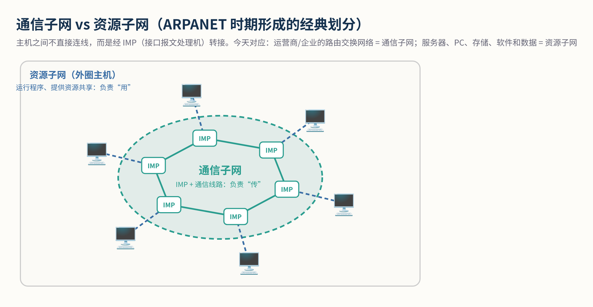
*图 3　通信子网负责“传”，资源子网负责“用”——这个划分在广域网（2.5.3）里还会再出现一次*

> [!tip] 🎯 考点提示
> - “**IMP**”“**通信子网/资源子网**”对应**第二阶段（形成阶段）**；“**FEP**”“**终端无 CPU 和内存**”对应**第一阶段**；“**OSI 与 TCP/IP 两大体系结构诞生**”对应**第三阶段**。
> - 选择题常把“具备网络雏形”和“形成网络基本概念”互换，记住：**雏形 = 第一阶段，基本概念 = 第二阶段**。

### 2.2 计算机网络的 5 大功能

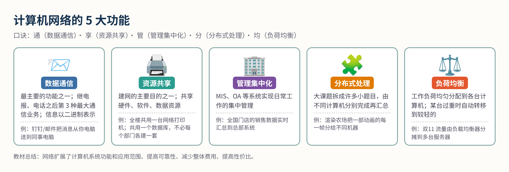
*图 4　通 · 享 · 管 · 分 · 均*

| 功能 | 教材要点 | 现实例子 |
|---|---|---|
| **数据通信** | **最主要的功能之一**；依照通信协议在两个结点间传递信息；计算机↔计算机、计算机↔终端、终端↔终端；是继电报、电话之后的**第 3 种最大的通信业务**；信息均以**二进制**表示；通常与远程信息处理相联系（科学计算、过程控制、信息检索等广义信息处理） | 邮件、IM 消息 |
| **资源共享** | **建立计算机网络的主要目的之一**；资源 = **硬件、软件、数据**。硬件共享提高利用率、避免重复投资（网络打印机、计算资源池）；软件与数据共享减少重复开发、避免大型数据库重复建设 | 全楼一台网络打印机；集团统一主数据库 |
| **管理集中化** | MIS、OA 等系统实现日常工作的集中管理，提高效率和效益 | 全国门店销售数据实时汇总到总部 |
| **实现分布式处理** | 大课题拆成许多小题目，由不同计算机分别完成，再集中解决 | 渲染农场、分布式计算 |
| **负荷均衡** | 工作负荷均匀分配给网络上各台计算机；**网络控制中心负责分配和检测**，某台过重时**自动转移**到较轻的计算机 | 负载均衡器把双 11 流量分到多台服务器 |

📘 教材小结：网络可以**扩展计算机系统的功能及应用范围、提高可靠性**，在为用户提供方便的同时**减少整体系统费用、提高性价比**。

> [!warning] ⚠️ 易混：“最主要的功能之一” vs “主要目的之一”
> 教材说 **数据通信是“最主要的功能之一”**，**资源共享是建网的“主要目的之一”**。出题时可能会偷换成“资源共享是最主要的功能”之类，注意措辞。

### 2.3 网络有关指标

#### 2.3.1 性能指标（6 个）

教材列出：**速率、带宽、吞吐量、时延、往返时间（RTT）、利用率**。

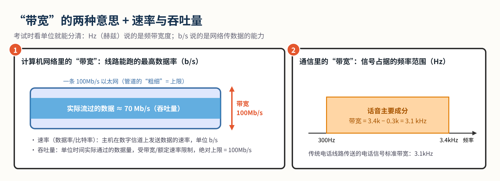
*图 5　“带宽”有两个意思：通信领域是频率范围（Hz），计算机网络里是最高数据率（b/s）*

| 指标 | 教材定义 | 单位 / 例子 |
|---|---|---|
| **速率** | 主机或通信设备在**数字信道**上传送数据的速率，也叫**数据率（Data Rate）或比特率（Bit Rate）**；**最重要的性能指标之一** | b/s |
| **带宽（意义一）** | 信号具有的**频带宽度**：信号所含各种频率成分占据的频率范围 | Hz；电话信号标准带宽 **3.1kHz（300Hz～3.4kHz）** |
| **带宽（意义二）** | 网络通信线路**传送数据的能力**：单位时间内从一个结点到另一个结点能通过的“**最高数据率**” | b/s |
| **吞吐量** | 单位时间内通过某个网络（信道、接口）的**实际数据量**；受带宽或额定速率**限制**；也可用每秒字节数或帧数表示 | 100Mb/s 以太网吞吐量绝对上限 100Mb/s，典型可能只有 70Mb/s |
| **时延** | 数据（报文、分组甚至比特）从网络一端传到另一端所需时间；也叫延迟、迟延；由**发送时延、传播时延、处理时延、排队时延**等组成 | ms |
| **往返时间 RTT** | 从发送方发送数据开始，到发送方收到接收方**确认**（接收方收到数据后立即发确认）总共经历的时间 | ping 显示的 time |
| **利用率** | **信道利用率**：信道被利用（有数据通过）的概率，百分数，完全空闲 = 0；**网络利用率**：全网信道利用率的**加权平均值** | % |

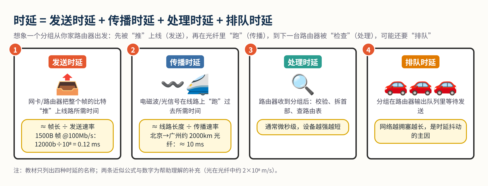
*图 6　四种时延像一辆车从出发到下一个路口：上路（发送）→ 路上跑（传播）→ 被检查（处理）→ 排队*

> [!example] 🧩 用一个真实数字感受时延（补充）
> 你在北京给广州的服务器发一个 1500 字节的以太网帧，链路 100Mb/s：
> - 发送时延 ≈ 1500×8 b ÷ 100×10⁶ b/s = **0.12 ms**
> - 传播时延 ≈ 2000 km ÷ (2×10⁸ m/s) = **10 ms**
>
> 结论：长距离链路上**传播时延往往才是大头**，把带宽从 100M 升到 1G 只能缩短发送时延，**缩短不了光在光纤里跑的时间**。这也是“带宽 ≠ 速度快”的直观解释，以及 CDN 要把内容放到离用户近的地方的原因。

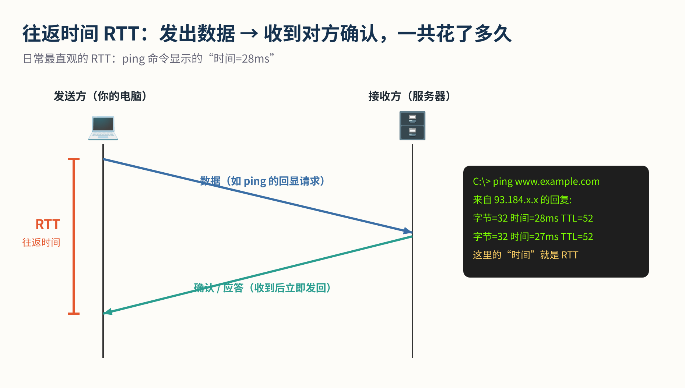
*图 7　RTT = 数据过去 + 确认回来*

> [!warning] ⚠️ 常考陷阱
> - **带宽有两种单位**：看到 **Hz** 是“频带宽度”，看到 **b/s** 是“最高数据率”。
> - **吞吐量 ≤ 带宽**：吞吐量是“实际跑了多少”，带宽是“最多能跑多少”。题目说“吞吐量可以超过带宽”一律错。
> - **RTT 包含对方的确认返回**，不是单程时延。

#### 2.3.2 非性能指标

📘 费用、质量、标准化、可靠性、可扩展性、可升级性、易管理性和可维护性等非性能指标与性能指标有很大相关性。

| 非性能指标 | 教材要点（一句话） |
|---|---|
| 费用 | 包括设计和实现的费用；**速率越高，价格一般越高** |
| 质量 | 取决于所有构件的质量和构建方式；体现在可靠性、管理简易性、性能等；高质量往往价格不菲 |
| 标准化 | 可按国际标准，也可按专用标准；**采用国际标准**互操作性更好、更易升级维护、更易获得技术支持 |
| 可靠性 | 与质量和性能都密切相关；**速率更高的网络，其可靠性不一定更差**，但要可靠运行往往更难、更贵 |
| 可扩展性和可升级性 | 构造时就应考虑日后扩展（规模扩大）和升级（性能和版本提高）；性能越好，扩展升级难度与费用往往越高 |
| 易管理和维护性 | 不进行良好的管理和维护，就很难达到和保持设计的性能 |

> [!warning] ⚠️ 陷阱：“速率越高的网络可靠性越差” —— **错**。教材原话是“**不一定**更差”。

### 2.4 网络应用前景（了解）

📘 信息时代的重要特征是**数字化、网络化和信息化**；网络已成为信息社会的命脉和发展知识经济的重要基础。90 年代以后，以因特网为代表的计算机网络飞速发展，从**教育科研网络**逐步发展成为**商业网络**，已成为**仅次于全球电话网的世界第二大网络**；因特网是人类**自印刷术发明以来在通信方面最大的变革**。

---

## 3. 2.5.2 通信技术

📘 通信技术是计算机网络的**基础**。这里所说的数据指**模拟信号和数字信号**，它们通过**信道**传输。

### 3.1 信道：物理信道 vs 逻辑信道

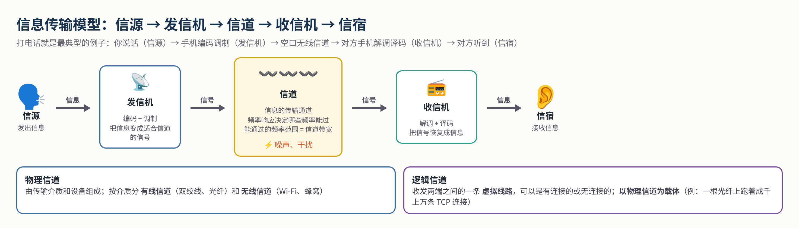
*图 8　信源 → 发信机 → 信道 → 收信机 → 信宿*

- **物理信道**：由**传输介质和设备**组成；按介质分**无线信道**和**有线信道**。
- **逻辑信道**：发送端和接收端之间的一条**虚拟线路**，可以**有连接或无连接**；**以物理信道为载体**。
- **信息传输**：信源和信宿通过信道收发信息。**发信机**接收信源信息，进行**编码和调制**，转换成适合信道传输的信号；**收信机**从信道接收信号，进行**解调和译码**，恢复出信息交给信宿。
- **频率响应**决定哪些频率的信号能通过信道，**可以通过的频率范围大小就是信道的带宽**。

### 3.2 香农公式：信道容量的天花板

$$C = B \times \log_2\left(1+\frac{S}{N}\right)$$

| 符号 | 含义 | 单位 |
|---|---|---|
| C | 信道容量 = 信道的**最大传输速率** | b/s |
| B | 信号带宽 | Hz |
| S | 信号平均功率 | W |
| N | 噪声平均功率 | W |
| S/N | 信噪比 | 教材写“dB（分贝）”，见下方陷阱 |

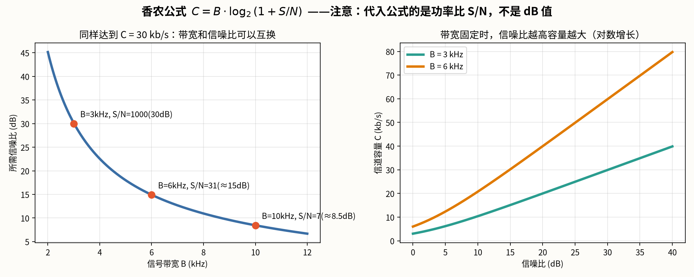
*图 9　左：同样 30kb/s 的容量，可以“大带宽 + 低信噪比”，也可以“小带宽 + 高信噪比”；右：带宽固定时，容量随信噪比对数增长*

📘 教材结论：提升信道容量**可以使用比较大的带宽，降低信噪比；也可以使用比较小的带宽，升高信噪比**。——理解成“**带宽和信噪比可以互相换**”：要达到同一个容量，带宽大了对信噪比的要求就低，反之亦然（图 9 左）。

> [!example] 🧩 计算演练（考试若出计算，基本就这个套路）
> 电话线带宽 B = 3000 Hz，信噪比 30 dB，求信道容量。
> 1. **先把 dB 换成功率比**：30 dB = 10·lg(S/N) → S/N = 10³ = **1000**
> 2. C = 3000 × log₂(1 + 1000) ≈ 3000 × 9.97 ≈ **29.9 kb/s ≈ 30 kb/s**
>
> 常用换算：10 dB → 10；20 dB → 100；30 dB → 1000；40 dB → 10000。

> [!warning] ⚠️ 陷阱：S/N 的单位
> 教材在符号表里写“S/N 代表信噪比，单位是 dB”，但**代入公式的必须是功率比（无量纲）**，dB 只是信噪比常用的表示方法：dB 值 = 10·lg(S/N)。题目给 dB 时**一定要先换算**再代入，这是计算题最常见的失分点。

### 3.3 信号变换：发信机 5 步、收信机 5 步

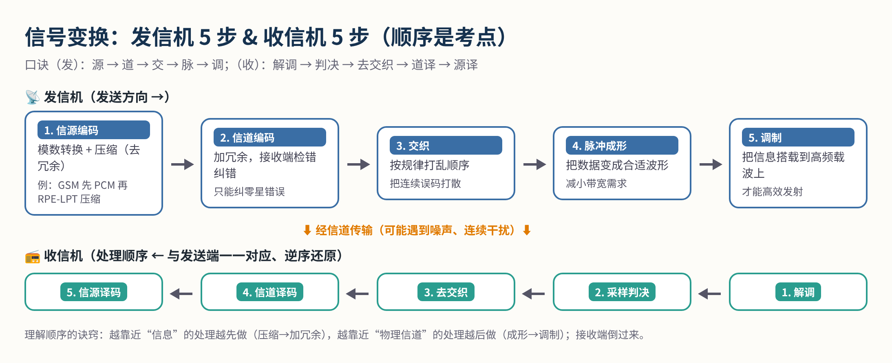
*图 10　顺序是考点：发 = 信源编码 → 信道编码 → 交织 → 脉冲成形 → 调制；收 = 解调 → 采样判决 → 去交织 → 信道译码 → 信源译码*

| 步骤 | 教材要点 | 一句话理解 |
|---|---|---|
| **信源编码** | 模拟信号**模数转换**，再**压缩编码（去除冗余信息）**，形成数字信号。例：GSM 先用 **PCM（脉冲编码调制）** 把语音转成二进制码流，再用 **RPE-LPT（规则脉冲激励-长期预测编码）** 压缩 | **去冗余**，让数据更小 |
| **信道编码** | **增加冗余信息**，以便接收端**检错和纠错**，解决信道噪声干扰导致的误码；**一般只能纠正零星错误，对连续误码无能为力** | **加冗余**，让数据更抗错 |
| **交织** | 把信道编码后的数据顺序按规律**打乱**，接收端在信道译码前**复原**——连续误码到接收端就变成零星误码 | 把“一串坏”变成“零星坏” |
| **脉冲成形** | 为了**减小带宽需求**，把发送数据转换成合适的波形；矩形脉冲竖边垂直需要很高频率，脉冲成形不要求垂直，所以频率要求降低 | 把方波“磨圆”，省带宽 |
| **调制** | 把信息承载到满足信号要求的**高频载波**信号上 | 装上“载波”这辆车 |

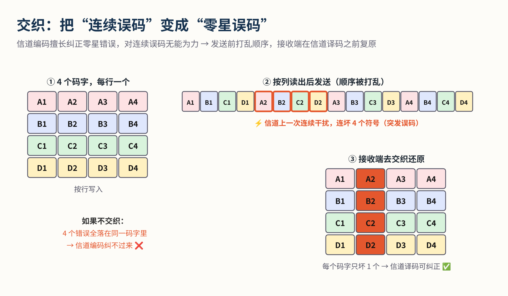
*图 11　交织：按行写、按列读；一次突发干扰连坏 4 个符号，去交织后每个码字只坏 1 个，信道译码就能纠正*

> [!warning] ⚠️ 易混：信源编码 vs 信道编码
> - **信源编码 = 压缩 = 去冗余**（为了效率）
> - **信道编码 = 纠错 = 加冗余**（为了可靠）
>
> 两者方向正好相反。题目问“增加冗余信息以便检错纠错的是哪一步”→ **信道编码**；问“为解决连续误码”→ **交织**；问“为减小带宽需求”→ **脉冲成形**。

### 3.4 复用技术和多址技术

📘 一条信道上只传一路数据时，经过信源编码、信道编码、交织、脉冲成形、调制就可以发送了；如果**同时传递多路数据**，就需要复用技术和多址技术。

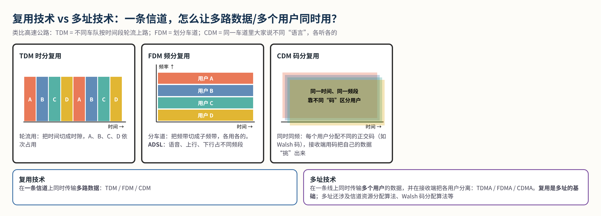
*图 12　TDM 轮流用时间、FDM 分频段、CDM 靠码区分*

| | 复用技术 | 多址技术 |
|---|---|---|
| 定义 | 在**一条信道**上同时传输**多路数据** | 在一条线上同时传输**多个用户**的数据，并在**接收端把多个用户的数据分离** |
| 种类 | **TDM** 时分复用、**FDM** 频分复用、**CDM** 码分复用 | **TDMA** 时分多址、**FDMA** 频分多址、**CDMA** 码分多址 |
| 关系 | **多路复用技术是多址技术的基础** | 多址还涉及**信道资源分配算法、Walsh 码分配算法**等 |
| 例子 | **ADSL 使用 FDM**：语音、上行、下行占用不同频段 | 2G/3G 手机网络的 TDMA/CDMA |

> [!tip] 🎯 一句话区分：复用讲“**多路数据**”，多址讲“**多个用户**”（且要在接收端分离）。

### 3.5 5G 通信网络（技术特征）

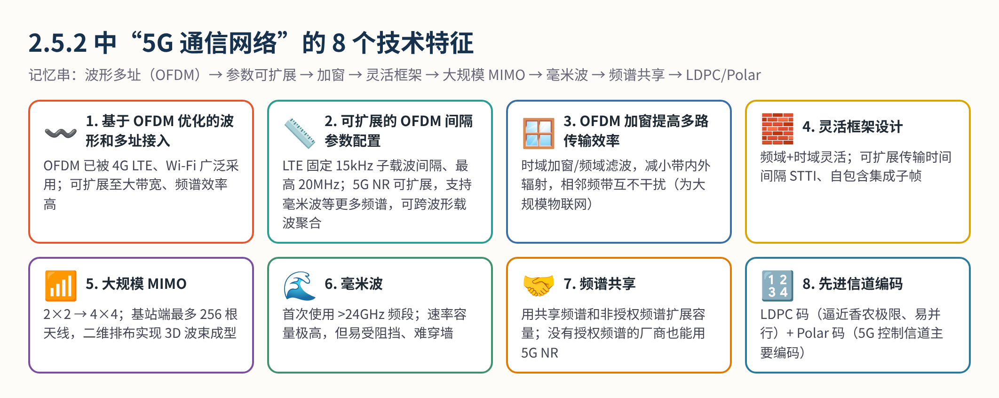
*图 13　教材 2.5.2 列出的 5G 8 个技术特征*

| # | 特征 | 教材要点 |
|---|---|---|
| 1 | **基于 OFDM 优化的波形和多址接入** | OFDM 已被 4G LTE 和 WiFi 广泛采用；可扩展至大带宽、频谱效率高、数据复杂性较低；可通过加窗或滤波增强频率本地化、创建单载波 OFDM 波形实现高能效上行 |
| 2 | **可扩展的 OFDM 间隔参数配置** | LTE 用固定 **15kHz** 子载波间隔，最高支持 **20MHz** 载波带宽；5G NR 引入可扩展参数配置，利用毫米波、非授权频段等所有可用频谱；FFT 扩展尺寸时不增加处理复杂性；可跨波形**载波聚合**（毫米波 + 6GHz 以下） |
| 3 | **OFDM 加窗提高多路传输效率** | 面向大规模物联网（数十亿设备）；频带内外辐射尽可能小，相邻频带不互相干扰；时域加窗或频域滤波 |
| 4 | **灵活框架设计** | 频域、更体现在时域上的灵活性；**可扩展传输时间间隔（STTI）**、**自包含集成子帧** |
| 5 | **大规模 MIMO** | 从 **2×2 提高到 4×4 MIMO**；终端空间有限，只能在**基站端**叠加更多天线，最多 **256 根**；二维排布实现 **3D 波束成型**，提高信道容量和覆盖 |
| 6 | **毫米波** | 首次把 **>24GHz** 频段用于移动宽带；速度和容量极致；但易路径受阻与损耗（衍射能力有限），通常**无法穿透墙体**，还面临波形和能耗问题 |
| 7 | **频谱共享** | 用共享频谱和非授权频谱扩展容量；让**没有授权频谱的厂商**（有线运营商、企业、物联网垂直行业）也能用 5G NR；前向兼容 |
| 8 | **先进信道编码设计** | LTE Turbo 码不足以应对；5G 采用 **LDPC 码** 和 **Polar 码** |

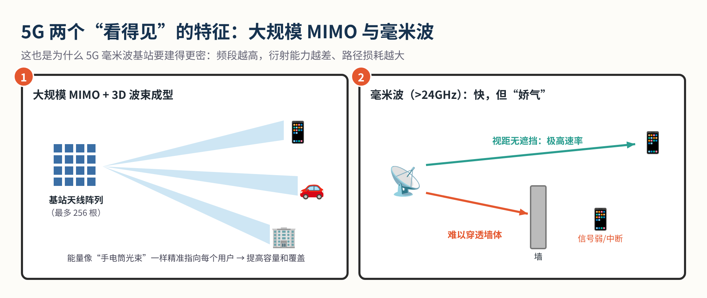
*图 14　大规模 MIMO 让信号像手电筒一样指向用户；毫米波很快但难穿墙*

| 编码 | 教材要点 | 记忆 |
|---|---|---|
| **LDPC 码**（低密度奇偶校验码） | 具有**稀疏校验矩阵**的分组纠错码；性能**逼近香农容量极限**；实现、译码简单，可**并行**，适合硬件实现；传输效率远超 LTE Turbo；低复杂度、低时延扩展 | “稀疏 + 并行 + 逼近香农” |
| **Polar 码**（极化码） | 前向错误更正编码；编码侧使子信道**极化**——一部分趋向容量≈1 的完美信道，一部分趋向容量≈0 的纯噪声信道，只在“好信道”上传信息；解码用逐次干扰抵消；可支持 **99.999% 可靠性**；**5G 控制信道的主要编码方式** | “极化 + 控制信道” |

> [!warning] ⚠️ 易混
> - **Polar 码 → 控制信道**（教材明确写了）；LDPC 常见于数据信道（教材未明说“数据信道”，只说传输效率高、适合高速率）。
> - 2.5.2 讲的是 5G 的**无线技术特征**（8 条），2.5.3 讲的是 5G 网络的**主要特征**（服务化架构 + 网络切片），别把两张清单混在一起。

---

## 4. 2.5.3 网络技术

📘 网络通常按照**覆盖区域和通信介质**等特征分类：**局域网（LAN）、无线局域网（WLAN）、城域网（MAN）、广域网（WAN）和移动通信网**等。

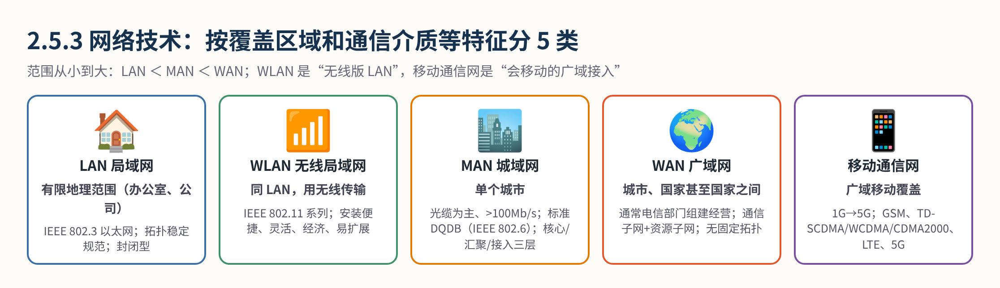
*图 15　5 类网络*

### 4.1 局域网（LAN）

📘 在**有限地理范围**内将若干计算机通过传输介质互联成计算机组，通过网络软件实现文件管理、应用软件共享、打印机共享、工作组内日程安排、电子邮件和传真通信服务等功能。**局域网是封闭型的**，可以由办公室内两台及以上计算机组成，也可以由一个公司内若干台计算机组成。

#### 4.1.1 网络拓扑

📘 局域网专用性非常强，具有比较稳定和规范的拓扑结构，常见的有**星状、树状、总线、环形**（教材随后还介绍了**网状**）。

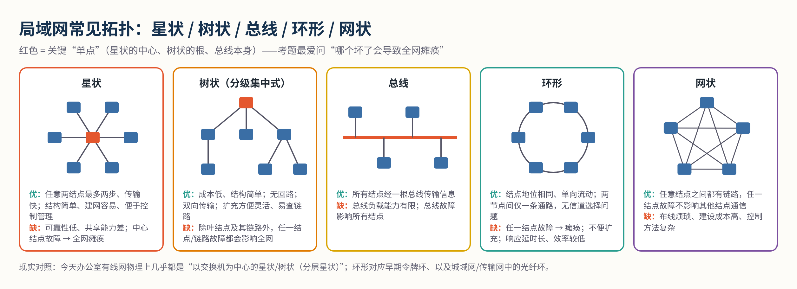
*图 16　五种拓扑及优缺点（据教材图 2-17、2-18、2-19 与正文整理）*

| 拓扑 | 特点 | 优点 | 缺点 |
|---|---|---|---|
| **星状** | 每个结点都连到**中心结点**，传输必须经过中心结点；中心结点是控制中心 | 任意两结点通信**最多两步**、传输速度快；结构简单、建网容易、便于控制和管理 | **可靠性低**、网络**共享能力差**；**中心结点故障 → 全网瘫痪** |
| **树状** | 也称**分级的集中式网络**；任意两结点间**不产生回路**；每个链路都支持**双向传输** | 成本低、结构简单；结点扩充方便灵活；方便寻查链路路径 | **除叶结点及其相连的链路外**，任何一个工作站或链路故障都会影响整个网络 |
| **总线** | 所有结点通过**一根总线**传输信息 | （结构简单，教材未单列优点） | 总线**负载能力有限**（由通信媒体物理性能决定）；**总线故障影响所有结点** |
| **环形** | 首尾相连的闭合环；各结点**地位相同**，信息按**固定方向单向流动**；两节点间**仅一条通路**，**无信道选择问题** | 控制简单（无信道选择） | **任一结点故障导致物理瘫痪**；**不便扩充**；系统响应**延时长**；传输**效率相对较低** |
| **网状** | 任何结点彼此之间均存在通信链路 | **任何结点故障不会影响其他结点之间的通信** | **布线烦琐、建设成本高、控制方法复杂** |

> [!tip] 🎯 秒杀思路
> - 问“**一个结点坏了全网瘫痪**”→ 星状（中心结点）/ 环形（任一结点）
> - 问“**可靠性最高 / 容错最好**”→ 网状
> - 问“**最多两步**”→ 星状；问“**无回路、分级集中式**”→ 树状；问“**单向流动、无信道选择**”→ 环形
>
> 🧩 现实对照：今天办公室的有线网，物理上几乎都是“**交换机为中心的星状/树状**”；家里所有设备连一台路由器，也是星状。

#### 4.1.2 以太网技术

📘 以太网（Ethernet）是一种局域网组网技术，**IEEE 802.3** 给出了技术标准，规定了物理层的连线、电信号和介质访问层协议；是**当前应用最普遍的局域网技术**。

**（1）以太网帧结构**

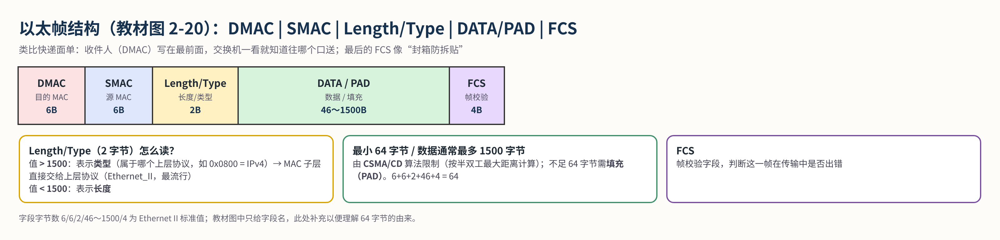
*图 17　以太帧：DMAC | SMAC | Length/Type | DATA/PAD | FCS（字节数为 Ethernet II 标准值补充）*

- **DMAC** 目的 MAC 地址；**SMAC** 源 MAC 地址。
- **Length/Type**：2 字节。**值 > 1500 表示类型**（属于哪个上层协议），此时 MAC 子层可直接把帧交给上层协议，这种结构就是当前较为流行的 **ETHERNET_II**，大部分计算机都支持；**值 < 1500 表示长度**。
- **DATA/PAD**：数据；以太网帧最小长度**不小于 64 字节**（根据半双工模式下最大距离计算获得），不足时在数据部分**填充**。
- **FCS**：帧校验字段，判断该帧是否出错。

**（2）最小帧长**：由于 **CSMA/CD** 算法限制，最小 **64 字节**，高层协议要保证此长度，不足则必须填充。数据域上限可灵活设置，但通常为 **1500 字节**。

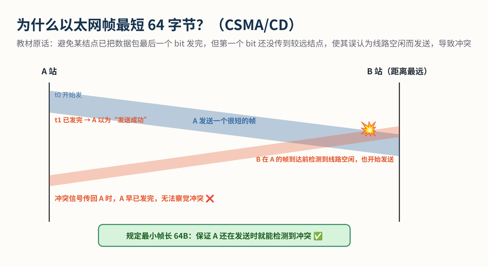
*图 18　规定最小帧长的原因：避免短帧“已经发完”才发生冲突，导致发送方察觉不到*

**（3）最大传输距离**：以太网的最大传输距离**没有严格限制**，由线路质量、信号衰减程度等因素决定。

**（4）流量控制**

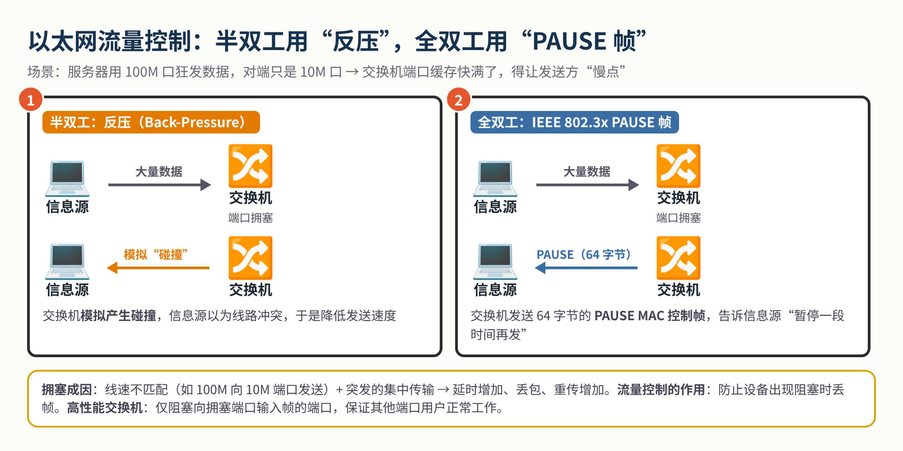
*图 19　半双工：反压；全双工：IEEE 802.3x PAUSE 帧*

- **端口阻塞**：通过交换机端口的流量超过其处理能力。网络拥塞一般由**线速不匹配**（如 100M 向 10M 端口发送）和**突发的集中传输**产生，可能导致**延时增加、丢包和重传增加**。
- **流量控制的作用**：**防止设备出现阻塞时丢帧**。
- **半双工**：**反压（Back-Pressure）** 技术，**模拟产生碰撞**，使信息源降低发送速度。
- **全双工**：遵循 **IEEE 802.3x**，规定了一种 **64 字节的 PAUSE MAC 控制帧**；端口阻塞时交换机向信息源发送 PAUSE 帧，让它暂停一段时间再发。
- 局域网产生拥塞的情况极少，所以**有的厂家交换机并不支持流量控制**；高性能交换机通常支持半双工反压和全双工 802.3x；有的交换机流控会阻塞整个 LAN 的输入，而高性能交换机**只阻塞向拥塞端口输入帧的端口**。

> [!warning] ⚠️ 易混
> - **64 字节**出现了两次：以太网**最小帧长 64 字节**；**PAUSE 帧也是 64 字节**。
> - **Length/Type 字段长度是 2 字节**，判断阈值是 **1500**（这是两个不同的数）。
> - **半双工 → 反压（模拟碰撞）**；**全双工 → PAUSE 帧（802.3x）**。别配反了。
> - 🧩 实际标准中“类型”取值从 0x0600（1536）起，教材以 1500 为界做了简化，考试按教材答即可。

### 4.2 无线局域网（WLAN）

📘 WLAN 利用无线技术在空中传输数据、话音和视频信号。

- **关键技术**：除了**红外传输技术、扩频技术、窄带微波技术**外，还有**调制技术、加解扰技术、无线分集接收技术、功率控制技术和节能技术**。
- **室外结构**（4 种）：**点对点型、点对多点型、多点对点型和混合型**。
- **优点**（相对有线）：**安装便捷、使用灵活、经济节约、易于扩展**。

**WLAN 标准**

| 标准 | 速率（教材） | 备注 |
|---|---|---|
| IEEE 802.11 | 1～2 Mb/s | **最早**的 WLAN 标准，采用**无连接**的协议 |
| IEEE 802.11b | 11 Mb/s | |
| IEEE 802.11a | 54 Mb/s | |
| IEEE 802.11g | 54 Mb/s（与 11a 一样） | **兼容 802.11b**，工作于免费的 **2.4GHz** 频段，比 11a 便宜 |
| IEEE 802.11n | 200 Mb/s 以上 | |

**WLAN 拓扑结构（通常使用的 3 种）**

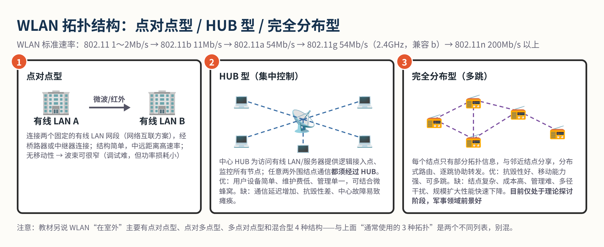
*图 20　点对点型、HUB 型、完全分布型*

| 拓扑 | 要点 | 优点 | 缺点 |
|---|---|---|---|
| **点对点型** | 用单频/扩频微波电台、红外发光二极管、红外激光等**连接两个固定的有线 LAN 网段**，实为网络互联方案；通过**桥路器或中继器**与有线 LAN 连接 | 结构简单；**中远距离高速率**；无移动性 → 波束可很窄，减小功率衰耗 | 窄波束增加设备调试难度 |
| **HUB 型** | 一个中心结点（HUB）+ 若干外围结点；HUB 为访问有线 LAN 或服务器提供**逻辑接入点**，监控所有结点、管理广播带宽竞争（软件实现）；任意两外围结点通信**都须经过 HUB**，**典型的集中控制式** | 用户设备简单、维护费用低、网络管理单一；可与**微蜂窝**结合实现空间和频率复用 | 用户间通信延迟增加；**抗毁性差**；中心结点故障易致全网瘫痪 |
| **完全分布型** | **目前还无具体应用，仅处于理论探讨阶段**；类似分组无线网；每个结点只有部分拓扑信息，与邻近结点分享，完成**分布路由算法**，传输路径上每个结点都协助转发 | **抗毁性好、移动能力强、可形成多跳网**；适合较低速率的中小型网络；**军事领域**前景好 | 结点复杂性和成本大幅提高；管理困难；多径干扰；规模扩大后性能快速下降 |

> [!warning] ⚠️ 两张清单别混：**室外 4 种结构**（点对点 / 点对多点 / 多点对点 / 混合）≠ **通常使用的 3 种拓扑**（点对点 / HUB / 完全分布）。

### 4.3 广域网（WAN）

📘 将分布于更广区域（一个城市、一个国家甚至国家之间）的计算机设备联接起来的网络，**通常由电信部门负责组建、经营和管理**，向社会公众提供通信服务。

- **组成**：**通信子网 + 资源子网**。
  - 通信子网：通信结点设备 + 链路；结点负责**转发**，链路分**传输主干链路**和**末端用户线路**；可利用**公用分组交换网、卫星通信网和无线分组交换网**构建。
  - 资源子网：实现资源共享功能的设备及其软件的集合（服务器、用户计算机、网络存储、软件资源、数据资源等）。

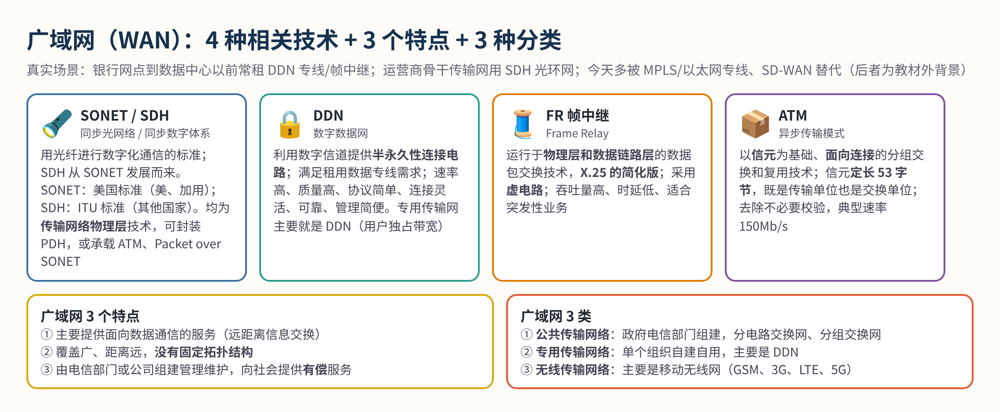
*图 21　广域网 4 种相关技术 + 3 个特点 + 3 种分类*

| 技术 | 教材要点 | 一眼识别关键词 |
|---|---|---|
| **SONET / SDH** | 光纤数字化通信标准；**SDH 从 SONET 发展而来**；SONET 是美国标准（美、加用），SDH 是**国际电信联盟**标准（其他国家用）；两者均为**传输网络物理层技术**；可封装 PDH，或支持 ATM、Packet over SONET | “光纤”“同步”“物理层” |
| **DDN 数字数据网** | 利用数字信道提供**半永久性连接电路**；满足租用数据专线需求；速率高、质量高、协议简单、连接灵活、电路可靠、管理简便 | “专线”“半永久” |
| **FR 帧中继** | 运行于 OSI 的**物理层和数据链路层**；数据包交换技术；**X.25 的简化版**，性能和效率更高；采用**虚电路**；吞吐量高、时延低、**适合突发性业务** | “X.25 简化”“虚电路”“突发” |
| **ATM 异步传输模式** | 以**信元**为基础的**面向连接**的分组交换和复用技术；信元**长度固定 53 字节**，既是传输单位也是交换单位；去除不必要的数据校验，交换速率高，典型速率 **150Mb/s**；支持语音、数据、传真、实时视频等多种业务 | “信元”“53 字节”“面向连接” |

**广域网特点**：① 主要提供**面向数据通信**的服务；② 覆盖范围广、距离远，**没有固定拓扑结构**；③ 由电信部门或公司负责组建管理维护，向全社会提供**有偿服务**。

**广域网分类**：
1. **公共传输网络**：政府电信部门组建管理控制，传输和交换装置可提供（租用）给任何部门；分为**电路交换网络**和**分组交换网络**两类。
2. **专用传输网络**：单个组织或团体自建、自用、自控、自维护的私有网络；至少有自己的通信和交换设备；**主要是 DDN**——在两个端点间建立永久的、专用的数字通道，租用期间**用户独占带宽**。
3. **无线传输网络**：主要是移动无线网，典型有 **GSM、TD-SCDMA/WCDMA/CDMA2000、LTE 和 5G**。

> [!warning] ⚠️ 常考陷阱
> - **ATM：面向连接 + 定长 53 字节信元**（🧩 补充：5 字节信头 + 48 字节载荷）。选项里出现“无连接”或“不定长”一律排除。
> - **DDN 是“半永久性连接”**（2.5.3 技术介绍处），而在“专用传输网络”处教材又说它建立“**永久的、专用的**数字通道”——两处措辞不同，都按原话记。
> - **帧中继 = X.25 简化版**，工作在**物理层 + 数据链路层**（不是网络层）。
> - **SONET/SDH 是物理层**技术。

### 4.4 城域网（MAN）

📘 在**单个城市**范围内建立的计算机通信网。采用**有源交换元件的局域网技术**，传输时延较小；传输媒介主要是**光缆**，速率在 **100Mb/s 以上**。MAN 基于一种大型的 LAN，通常使用与 LAN 相似的技术，但 MAN 的标准称为**分布式队列双总线 DQDB（IEEE 802.6）**，由**双总线**构成，把加入 MAN 的所有计算机连接起来。

📘 局域网或广域网通常为一个单位或系统服务，**城域网为整个城市**而非某个特定部门服务；**向上与骨干网相连，向下将本地所有联网用户与城市骨干网相连**。

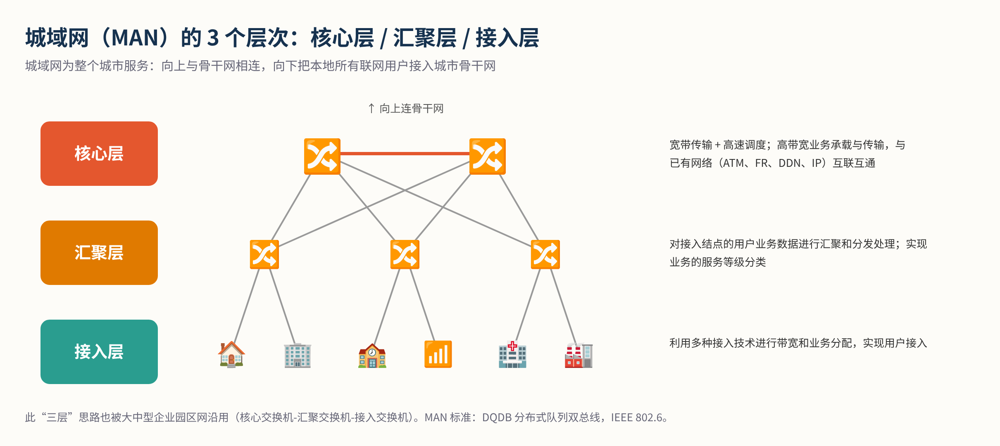
*图 22　城域网 3 个层次：核心层 / 汇聚层 / 接入层*

| 层次 | 教材要点 |
|---|---|
| **核心层** | 提供**高带宽的业务承载和传输**，完成和已有网络（ATM、FR、DDN、IP 网络）的**互联互通**；特征为**宽带传输和高速调度** |
| **汇聚层** | 给业务接入结点提供用户业务数据的**汇聚和分发处理**，同时实现**业务的服务等级分类** |
| **接入层** | 利用多种接入技术，进行**带宽和业务分配**，实现用户的接入 |

> [!tip] 🎯 记忆：**MAN = 802.6 = DQDB（双总线）**；局域网以太网是 **802.3**，WLAN 是 **802.11**。三个“802.x”放一起记。

### 4.5 移动通信网

#### 4.5.1 移动通信网的发展（1G → 5G）

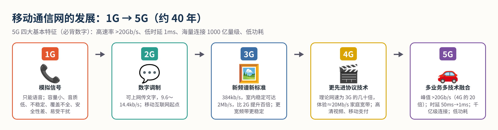
*图 23　约 40 年的演进*

| 代际 | 教材要点 |
|---|---|
| **1G** | **模拟信号**传输（频率调制）；容量有限，**一般只能传语音**；语音品质低、信号不稳定、覆盖不全、安全性差、易受干扰 |
| **2G** | **数字调制**；容量增加，手机**可以上网**，速率 **9.6～14.4kb/s**，可传文字；**移动互联网发展的起点** |
| **3G** | 延续数字传输，开辟新频谱、新标准；**384kb/s**，室内稳定环境可达 **2Mb/s**，比 2G 提升**百倍**；更宽频带、稳定性大大提高；大数据传送成为可能 |
| **4G** | 更先进协议和技术；理论网速为 3G 的**几十倍**，体验与 **20Mb/s 家庭宽带**相当；高清电影、大数据传输；像“水电”一样不可或缺 |
| **5G** | 不再由某项业务能力或技术特征定义；多业务、多技术融合，面向业务应用和用户体验的智能网络；**高速率**（峰值 **>20Gb/s**，4G 的 **20 倍**）、**低时延**（**50ms → 1ms**）、**海量设备连接**（**1000 亿量级**）、**低功耗**（基站更节能、终端更省电） |

#### 4.5.2 5G 网络的主要特征

**（1）服务化架构（SBA）**

📘 为满足行业应用差异化需求，网络需具备软件快速迭代升级能力（加快业务创新、低成本试错、实现商业敏捷），**3GPP 在 5G 核心网中引入 SBA（Service-based Architecture）**，实现网络功能的**灵活定制和按需组合**。

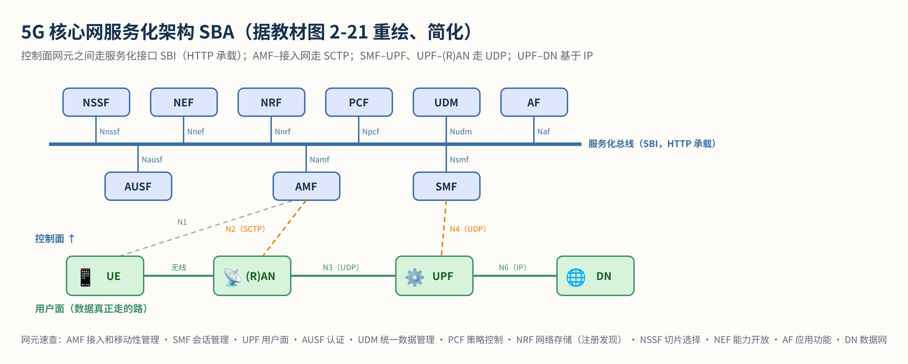
*图 24　5G 系统架构（据教材图 2-21 重绘简化）：上半部分控制面挂在服务化总线上，下半部分是用户面数据通道*

| 类别 | 网元 | 中文 | 一句话作用（🧩 简述） |
|---|---|---|---|
| 控制面 | **AMF** | 接入和移动性管理功能 | 手机接入、注册、移动性 |
| 控制面 | **SMF** | 会话管理功能 | 建立/管理上网会话，控制 UPF |
| 控制面 | **AUSF** | 认证服务功能 | 用户鉴权 |
| 控制面 | **UDM** | 统一数据管理功能 | 签约数据 |
| 控制面 | **PCF** | 策略控制功能 | 计费、QoS 策略 |
| 控制面 | **NRF** | 网络存储功能 | 网元注册与发现 |
| 控制面 | **NSSF** | 网络切片选择功能 | 选哪个切片 |
| 控制面 | **NEF** | 网络能力开放功能 | 向外部开放网络能力 |
| 控制面 | **AF** | 应用功能 | 应用侧与网络交互 |
| 用户面 | **UPF** | 用户面功能 | 真正转发用户数据 |
| 其他 | **UE** / **(R)AN** / **DN** | 用户设备 / （无线）接入网 / 数据网 | DN 泛指运营商服务网络、Internet 或第三方服务网络，是 5G 要接入的业务网络 |

| 接口对象 | 通信方式 | 承载协议（教材） |
|---|---|---|
| 控制面网元之间（AMF、SMF、NRF、NSSF…） | **服务化接口 SBI** | **HTTP** |
| AMF ↔ 接入网（AN） | 点到点 | **SCTP** |
| SMF ↔ UPF | 点到点 | **UDP** |
| UPF ↔ (R)AN | 点到点 | **UDP** |
| UPF ↔ DN | — | **IP**（教材此处印作“UDP 和 DN 之间基于 /IP 协议通信”，应为 UPF 与 DN） |

**（2）网络切片**

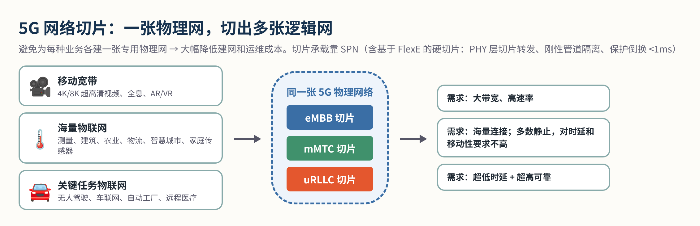
*图 25　同一张物理网络切出 eMBB / mMTC / uRLLC 三类逻辑网络*

📘 5G 服务对象不再只是手机（平板、固定传感器、车辆……），场景多样（移动宽带、大规模物联网、任务关键型互联网），要求多样（移动性、安全性、时延性、可靠性）→ 催生**网络切片**：在**单个独立的物理网络上切分出多个逻辑网络**，避免为每个服务建设专用物理网络，**极大降低建网和运维成本**。

| 切片 | 场景（教材） | 需求 |
|---|---|---|
| **eMBB** 移动宽带 | 4K/8K 超高清视频、全息技术、AR/VR | 对**带宽和速率**要求高 |
| **mMTC** 海量大规模物联网 | 测量、建筑、农业、物流、智慧城市、家庭等领域的海量传感器 | 设备**密集、规模庞大、大部分静止**，对时延和移动性要求不高 |
| **uRLLC** 关键任务物联网 | 无人驾驶、车联网、自动工厂、远程医疗 | **超低时延和超高可靠性** |

📘 为满足切片组网需要，引入 **SPN（Slicing Packet Network）**，其中包括基于**灵活以太网 FlexE** 的**硬切片**技术：FlexE 基于 **PHY 层**切片转发，提供**刚性管道隔离**、带宽灵活分配；基于 FlexE Cross-connection 的 FlexE Channel 把业务隔离从**端口级扩展到网络级**，实现端到端子信道隔离；保护倒换能做到 **1ms 以内**，把电信级保护提升到**工业控制级**。

> [!tip] 🎯 考点提示（真题：2023 年考过“网络切片的目的”）
> - **网络切片目的**：在同一物理网络上创建多个逻辑（虚拟）网络，为不同业务场景提供差异化服务、降低建网运维成本。
> - **三大场景对号入座**：要“快” → eMBB；要“多” → mMTC；要“稳、低时延” → uRLLC（无人驾驶、远程医疗）。
> - **SBA 引入者 = 3GPP**；控制面之间用 **HTTP**。

---

## 5. 2.5.4 组网技术

### 5.1 网络设备及其工作层级

📘 网络设备是连接到网络中的物理实体；基本的网络设备有**集线器、中继器、网桥、交换机、路由器和防火墙**等。

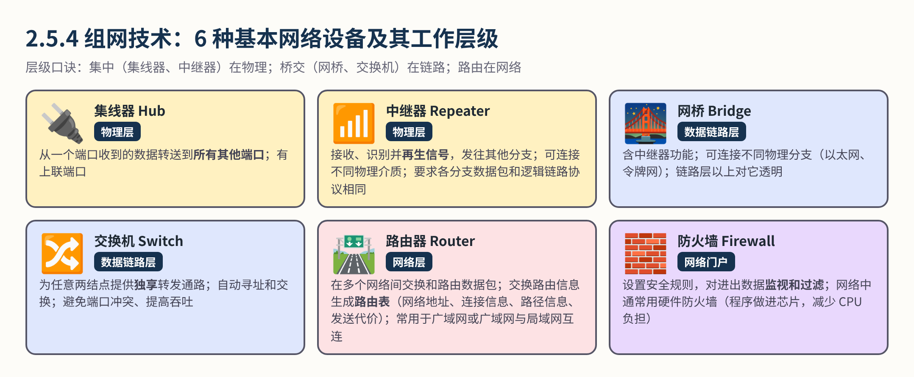
*图 26　6 种基本网络设备*

| 设备 | 工作层级 | 教材要点 |
|---|---|---|
| **集线器** | 物理层（🧩 教材未明写层级，通常归物理层） | **最简单的网络设备**；从一个端口收到的数据被转送到**所有其他端口**（不管对方是否准备好）；有一个**上联端口**连接其他集线器或路由设备 |
| **中继器** | **物理层** | 局域网互连设备；接收并识别网络信号，**再生信号**发送到其他分支；要求每个分支的**数据包和逻辑链路协议相同**；可连接**不同物理介质** |
| **网桥** | **数据链路层** | 数据链路层以上各层信息对网桥**透明**；**包含中继器的功能和特性**；能连接多种介质和**不同的物理分支**（如以太网、令牌网），在更大范围传送数据包 |
| **交换机** | **数据链路层** | 为接入的任意两个结点提供**独享的转发通路**；具备**自动寻址和交换**功能，**避免端口冲突、提高网络吞吐** |
| **路由器** | **网络层** | 在多个网络上交换和路由数据包；通过在相互独立的网络中交换路由信息生成**路由表**（含**网络地址、连接信息、路径信息和发送代价**）；通常用于**广域网或广域网与局域网的互连** |
| **防火墙** | 网络门户 | 通过安全规则对进出网络的数据**监视和过滤**；网络中通常用**硬件防火墙**（程序做到芯片里，减少 CPU 负担、使路由更稳定） |

#### 🧩 冲突域 vs 广播域（📝 练习题：题库 2.5 节题目 1）

| 设备 | 层 | 隔离冲突域？ | 隔离广播域？ |
|---|---|---|---|
| 集线器 / 中继器 | 1 | ❌ | ❌ |
| 网桥 / 二层交换机 | 2 | ✅ 每个端口一个 | ❌（广播帧目的 MAC 全 F，必须泛洪） |
| 路由器 | 3 | ✅ | ✅ 每个接口一个 |

> [!bug] 📝 例题：“下列设备可以隔离广播帧。A 路由器 B 网桥 C 以太网交换机 D 集线器” —— 正确答案 A
> **错因**：把交换机“按 MAC 表点对点转发**已知单播帧**”的能力，套用到了**广播帧**上。广播帧（如 ARP 请求）的目的 MAC 是 `FF-FF-FF-FF-FF-FF`，交换机 MAC 表里不可能有这个地址，只能向除入口外的所有端口泛洪——所以**交换机隔冲突不隔广播**。路由器在网络层，收到帧会剥掉二层头再按 IP 选路，二层广播帧到此终结。
> **广播域计数**：1 台路由器用 2 个接口连 2 台交换机 → **2 个广播域**（不是 1 个）。数广播域就数“路由器接口（或 VLAN）”。

### 5.2 网络协议

#### 5.2.1 开放系统互连参考模型 OSI/RM

📘 **开放系统**：遵从国际标准的、能够通过互连而相互作用的系统；系统之间相互作用**只涉及系统的外部行为，与内部结构和功能无关**。**ISO** 公布了 **OSI/RM**，为开放系统互连提供功能结构框架。它是**分层的体系结构，共 7 层**：**每一层都在下层提供的服务基础上提供更高级的增值服务，最高层提供能运行分布式应用程序的服务**；通过分层把复杂问题分解，并**保持层次之间的独立性**。

由低到高：**物理层 → 数据链路层 → 网络层 → 传输层 → 会话层 → 表示层 → 应用层**。

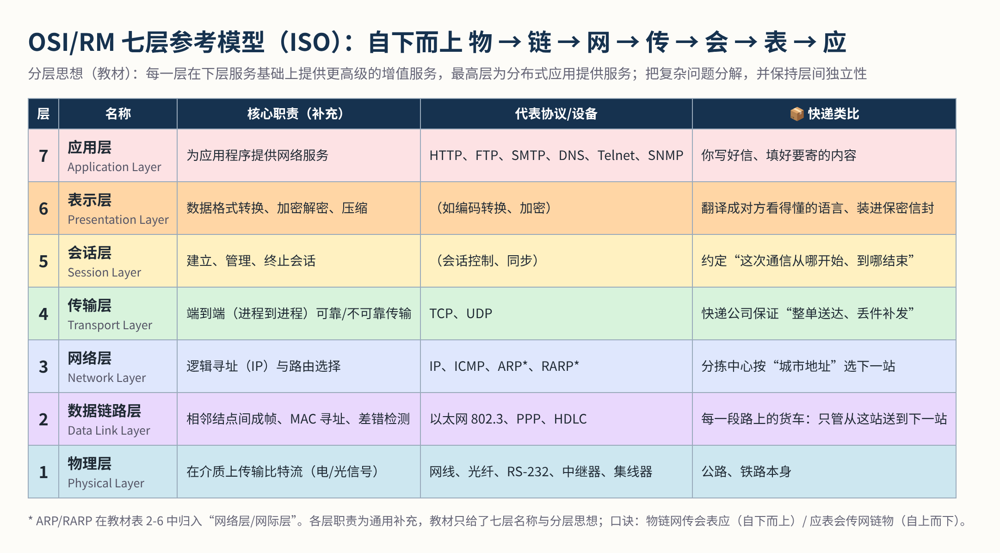
*图 28　七层模型 + 快递类比（各层职责为通用补充；教材给出七层名称、分层思想和图 2-23）*

> [!note] 📘 教材图 2-23 里藏着的一个细节
> 图中两端主机都是完整的 7 层，而中间的**通信子网（IMP）只有下三层**（网络层、数据链路层、物理层）。也就是说：**中间转发设备只需实现到网络层**；传输层及以上是**端到端**的，只在两台主机之间“对话”（对等协议）。这正是“路由器工作在网络层”的由来。

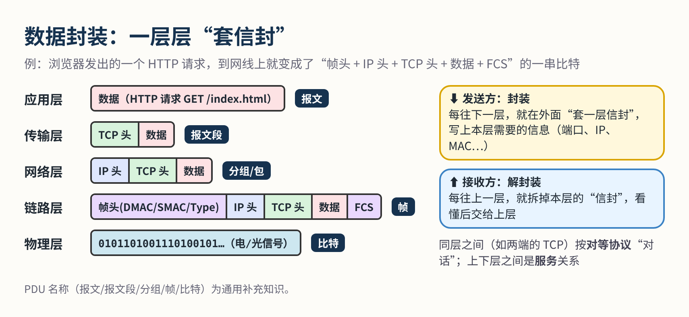
*图 29　发送时自上而下逐层封装，接收时自下而上逐层解封装*

#### 5.2.2 OSI 协议集（教材表 2-5）

| 层 | OSI 协议 |
|---|---|
| 应用层 | VT、DS、FTAM（教材印作 FTMA）、CMIP/CMIS（教材印作 CNIP/CMIS）、MHS、ASN.1（教材印作 ANS.1）；ACSE、RTSE、ROSE、CCR |
| 表示层 | OSI 表示层协议（ASN.1 纵跨应用/表示/会话） |
| 会话层 | OSI 会话层协议 |
| 传输层 | TP0、TP1、TP2、TP3、TP4 |
| 网络层 | ES-IS、IS-IS；X.25 PLP、CLNP |
| 数据链路层 | IEEE 802.2；HDLC、LAP-B（教材印作 PAP-B） |
| 物理层 | 802.3、802.4、802.5、FDDI；RS-232、RS-449、X.21、V.35、ISDN |

> 这张表考试很少直接考，扫一眼即可；值得注意的是 **IS-IS 在 OSI 体系里属于网络层**，而它也是后面路由技术里的**链路状态路由协议**。

#### 5.2.3 TCP/IP 协议集

📘 TCP/IP 是 **Internet 的核心协议**，广泛用于局域网和广域网。
- **主要特性**：**逻辑编址、路由选择、域名解析、错误检测和流量控制、对应用程序的支持**。
- **8 个主要协议**：**IP、TCP、UDP、TELNET（虚拟终端）、FTP（文件传输）、SMTP（电子邮件传输）、NNTP（网上新闻传输）、HTTP（超文本传送）**。
- **4 层**：**网络接口层、网际层、传输层、应用层**。
  - **网络接口层（网络访问层）**：TCP/IP 参考模型中**没有详细描述**，只指出主机必须使用某种协议与网络相连。
  - **网际层**：**整个 TCP/IP 体系结构的关键部分**，使主机可以把分组发往任何网络，并使分组**独立地**传向目标。除 IP 外还有 **ICMP、ARP、RARP**。
  - **传输层**：使源端和目的端机器上的对等实体可以进行会话；定义两个**端到端**协议：**TCP、UDP**。
  - **应用层**：NFS、Telnet、SMTP、SNMP、FTP 等。

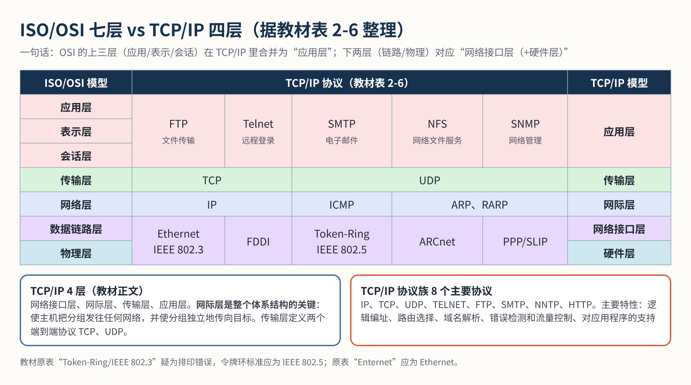
*图 30　OSI 七层 vs TCP/IP 四层（据教材表 2-6 整理）*

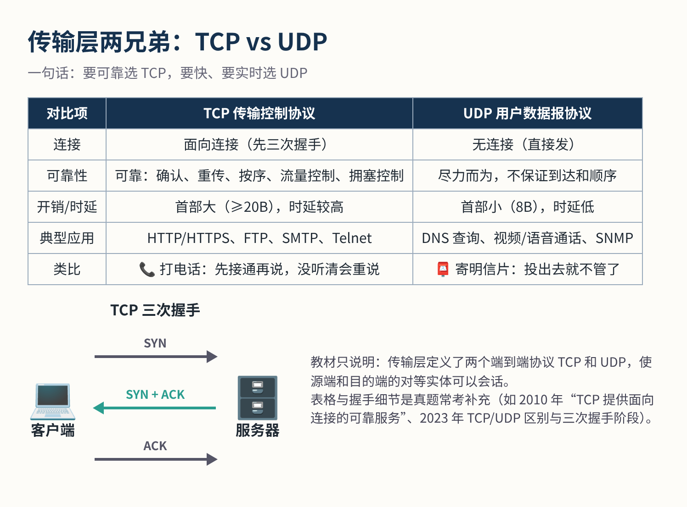
*图 31　🧩 TCP vs UDP（真题 2010、2023 都考过）*

> [!warning] ⚠️ 易混 / 常考
> - **ARP、RARP、ICMP 在网际层（网络层）**；ARP：IP → MAC，RARP：MAC → IP。
> - **Telnet、FTP、SMTP、SNMP、NFS、HTTP 都是应用层**；Telnet、FTP、SMTP、HTTP 基于 TCP（🧩 补充），SNMP 基于 UDP（🧩 补充）。
> - **IP 协议位于网络层（网际层）**，不是“网络接口层”。（真题材料里 2017 年 Q14 抄录的“官方答案 D”与解析矛盾，以解析“网络层”为准。）
> - TCP/IP 的“网络接口层”在 OSI 里对应**数据链路层 + 物理层**。
> - 教材表 2-6 有两处排印问题：“Enternet”应为 Ethernet，“Token-Ring/IEEE 802.3”中令牌环标准应为 **IEEE 802.5**。

#### 5.2.4 Internet 地址与常用服务

📘 Internet 地址有两种表示形式：**域名格式**和 **IP 地址格式**，**域名和 IP 地址一一对应**。IP 协议版本号为 4 称 **IPv4**，为 6 称 **IPv6**。

📘 **WWW（万维网）**：在因特网上以**超文本**为基础形成的信息网；采用**统一资源定位器 URL** 和图文声并茂的用户界面。互联网常用服务包括：**DNS 域名服务、WWW 服务、E-mail 电子邮件服务、FTP 文件传输服务、Telnet 远程登录服务、Gopher** 等。

> [!bug] 📝 例题：IPv6 —— “地址分为单播、广播和任意播”表述错误；“地址长度为 128 比特”正确
> IPv6 **没有广播**，三类地址是**单播、组播（多播）、任意播**；首部是**固定 40 字节**基本首部，比 IPv4 **更简单**；一个接口可以有**多个** IPv6 地址。
> 🧩 小提示：“域名和 IP 地址一一对应”是教材原话，但现实中一个域名可以解析出多个 IP（负载均衡），一个 IP 上也可以托管多个域名——考试按教材答“一一对应”。

### 5.3 交换技术

📘 数据在网络中转发通常离不开交换机；日常使用的计算机通常就是通过交换机接入网络的。**交换机功能**：

| 功能 | 教材要点 |
|---|---|
| ① 集线功能 | 提供大量可供线缆连接的端口，达到部署**星状拓扑**的目的 |
| ② 中继功能 | 转发帧时**重新产生不失真的电信号** |
| ③ 桥接功能 | 在内置端口上使用**相同的转发和过滤逻辑** |
| ④ 隔离冲突域功能 | 把局域网分为多个**冲突域**，每个冲突域有自己**独立的带宽**，提高整体带宽利用效率 |

> 记忆：交换机 = **集线器（集线）+ 中继器（中继）+ 网桥（桥接）+ 隔离冲突域**，正好把前面几种设备的能力都“集成”了。

#### 5.3.1 基本交换原理

📘 交换机是**基于 MAC 地址识别**、能完成封装转发数据包功能的网络设备；可以“**学习**”MAC 地址存入内部地址表，在数据帧的始发者和目标接收者之间**建立临时交换路径**。

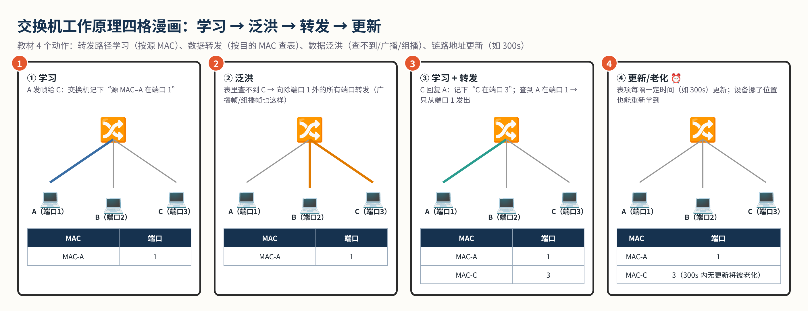
*图 33　学习 → 泛洪 → 转发 → 更新*

| 动作 | 教材要点 | 看的是哪个地址 |
|---|---|---|
| **转发路径学习** | 根据收到帧的**源 MAC** 建立该地址与端口的映射，写入 MAC 地址表 | **源 MAC** |
| **数据转发** | 按**目的 MAC** 在表中查到了 → 向对应端口转发 | **目的 MAC** |
| **数据泛洪** | 目的 MAC 不在表中 → 向所有端口转发；**广播帧和组播帧向所有端口（不包括源端口）转发** | 目的 MAC |
| **链路地址更新** | MAC 地址表每隔一定时间（如 **300s**）更新一次 | — |

> [!warning] ⚠️ 陷阱：交换机**学习看源 MAC，转发看目的 MAC**。选项说“根据目的 MAC 地址学习”是错的。

#### 5.3.2 交换机协议

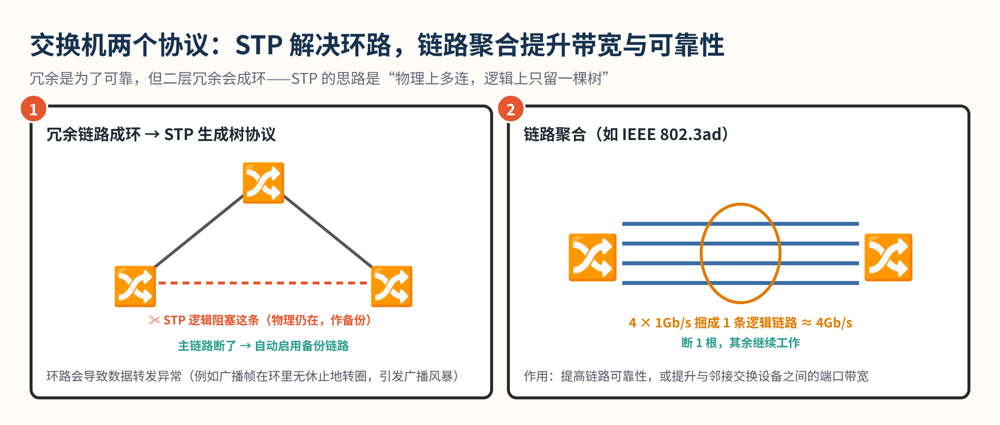
*图 34　STP 解决环路；链路聚合提高带宽和可靠性*

- **生成树协议 STP**：为保证可靠性常用一条以上物理链路连接设备，两台设备间多条链路就会**产生环路**，导致数据转发异常 → **STP 很好地解决链路环路问题**。
- **链路聚合协议（如 802.3ad）**：**提高链路可靠性，或提升与邻接交换设备之间的端口带宽**。

### 5.4 路由技术

📘 应用或业务数据在网络中的传输依照网络路由机制进行，路由功能由**路由器**提供，包括 **7 项**：

| # | 功能 | 说明 |
|---|---|---|
| 1 | 异种网络互连 | 具有异种子网协议的网络互连 |
| 2 | 子网协议转换 | 不同子网间（包括 LAN 和 WAN 之间）的协议转换 |
| 3 | 数据路由 | 将数据从一个网络依据路由规则转发到另一个网络 |
| 4 | 速率适配 | 利用缓存和流控协议进行适配 |
| 5 | 隔离网络 | **防止广播风暴**，实现防火墙 |
| 6 | 报文分片和重组 | 超过接口 **MTU** 的报文被分片，到达目的地后重组 |
| 7 | 备份、流量控制 | 主备线路切换和复杂流量控制等 |

#### 5.4.1 路由原理

📘 路由器工作在 OSI 第 **3** 层即**网络层**；接收来自一个网络接口的数据包，根据其**目的地址**决定待转发的**下一跳地址**；所有数据包的发送或转发都通过**查找路由表**实现；路由表可**静态配置**，也可通过**动态路由协议自动生成**。

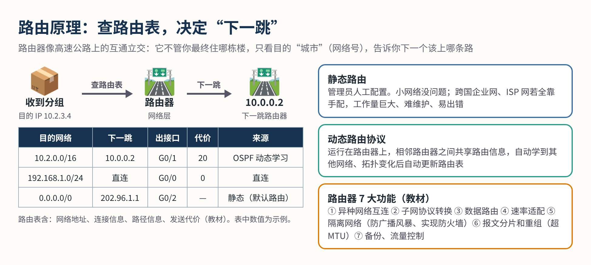
*图 35　查路由表决定下一跳（表中数值为示例）*

#### 5.4.2 路由协议：IGP vs EGP

📘 小规模网络人工指定转发策略没问题；但在较大规模网络（跨国企业网、ISP 网）中人工配置工作量巨大、难以维护 → **路由协议应运而生**。路由协议运行在路由器上，让路由器**自动学习**其他路由器的网络，并在**拓扑改变后自动更新**路由表；路由信息在**相邻路由器之间**传递。

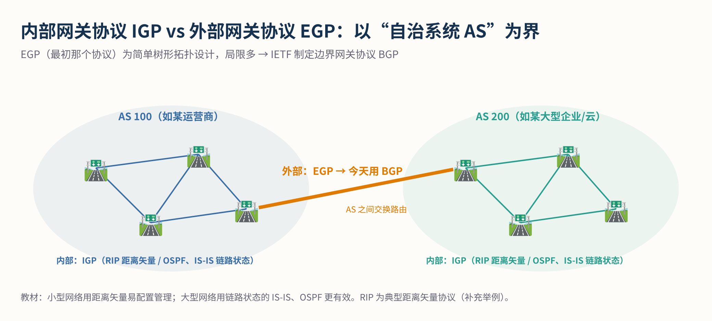
*图 36　以自治系统 AS 为界：AS 内用 IGP，AS 间用 EGP（今天是 BGP）*

| | 内部网关协议 IGP | 外部网关协议 EGP |
|---|---|---|
| 范围 | 在一个**自治系统 AS** 内 | 在 **AS 之间** |
| 分类 / 代表 | **距离矢量路由协议**（距离向量算法，🧩 如 RIP）；**链路状态路由协议**（**IS-IS、OSPF**） | 最初采用的协议就叫 **EGP**（为简单树形拓扑设计，局限多）→ IETF 制定 **BGP（边界网关协议）** |
| 适用 | 小型网络：距离矢量易配置管理、应用广；大型网络：距离矢量固有的**环路问题**更难解决、占用带宽迅速增长 → 用链路状态的 **IS-IS、OSPF 更有效** | Internet 骨干、运营商之间 |

> [!tip] 🎯 秒杀：**OSPF / IS-IS = 链路状态 = 适合大型网络 = IGP**；**BGP = EGP = AS 之间**。“EGP”既是一类协议的统称，也是最早那个具体协议的名字。

### 5.5 🧩 把 2.5.4 串起来：打开一个网页时发生了什么？

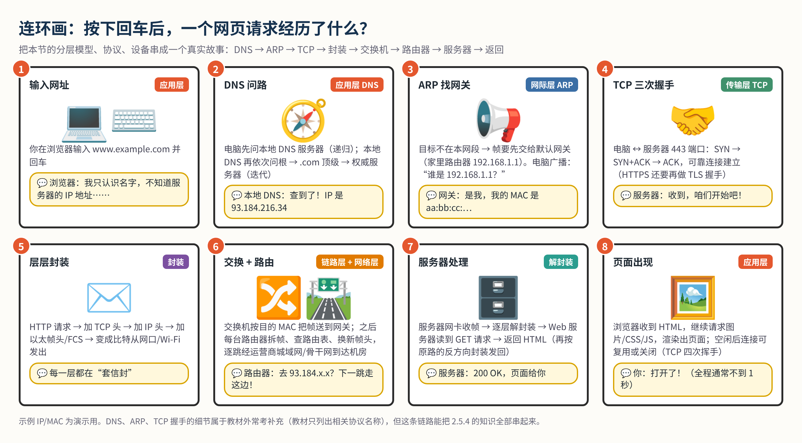
*图 37　8 格连环画：DNS → ARP → TCP → 封装 → 交换 + 路由 → 服务器 → 返回*

用这一个故事复习全部组网知识：
1. **应用层**：浏览器要访问 `www.example.com`，但网络只认 IP —— 需要 **DNS**（教材：互联网常用服务之一；域名与 IP 一一对应）。
2. **DNS 查询**：主机 → 本地 DNS 是**递归**；本地 DNS → 根 / 顶级 / 权威是**迭代**（见下图）。
3. **网际层 ARP**：目标 IP 不在本网段 → 要把帧交给**默认网关**，用 **ARP** 求网关的 MAC。
4. **传输层 TCP**：三次握手建立可靠连接（HTTPS 再加 TLS 握手）。
5. **逐层封装**：HTTP → TCP 头 → IP 头 → 以太帧头 + FCS → 比特（图 29）。
6. **交换机**按目的 MAC 转发（图 33）；**路由器**查路由表逐跳转发，每一跳都重新封装新的帧头（MAC 每跳变化，IP 端到端不变——🧩 重要直觉）。
7. **服务器**逐层解封装，处理请求并返回。
8. **浏览器**渲染页面。

> [!note] 📝 DNS 查询的三个例题
> 1. “顶级域名服务器是最高层次的域名服务器” —— **错**，最高层是**根**；本地缓存域名服务**不需要域名数据库**（只在内存里）是对的。
> 2. 时序图中根服务器“亲自往下问并等待” → 不合理之处是“**根域名服务器采用递归查询，影响了性能**”（不是中介服务器的锅）。
> 3. 时序图“根 2 进 3 原路回本地，中介 4 进后转头发 5”→ **根迭代，中介递归**。
>
> 口诀：**主机找本地用递归，本地问外面用迭代；根服务器只指路，绝不当跑腿。**

> [!bug] 📝 例题：“将网关 IP 与 MAC 绑定”的命令 → **`arp -s`**
> `-s` = **S**tatic 静态绑定；`-a` = **A**ll 查看；`-d` = **D**elete 删除；Windows 的 arp 没有 `-r`。绑定后 `arp -a` 看到类型为 `static`，不会被伪造的 ARP 应答覆盖。

> [!bug] 📝 相关练习：HTTPS vs SET（题库 2.3 节题目 91、116）
> - HTTPS = HTTP + SSL/TLS，默认端口 **443**（HTTP 是 80）；电子支付类网站**应使用 HTTPS**。
> - 能保证“**交易双方无法抵赖**”的是 **SET**（三方证书 + 双重数字签名），不是 HTTPS——HTTPS 只保护传输通道。

---

## 6. 2.5.5 网络工程

📘 网络建设是一个复杂的系统工程，是对**计算机网络、信息系统建设和项目管理**等领域知识进行综合利用的过程。系统架构设计师应充分分析和调研市场，确定网络建设方案。网络建设工程分为**网络规划、网络设计和网络实施**三个环节。

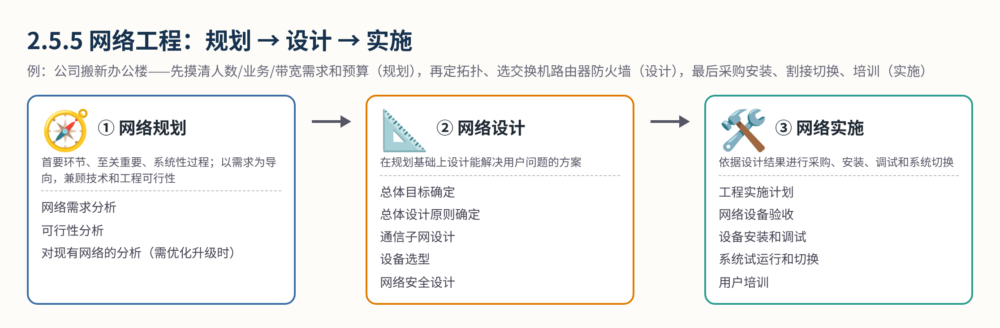
*图 40　规划 → 设计 → 实施*

| 环节 | 定位 | 包括（教材原话） |
|---|---|---|
| **网络规划** | 网络建设的**首要环节**，也是**至关重要**的步骤，**系统性过程**；以**需求为导向**，兼顾**技术和工程可行性** | **网络需求分析、可行性分析**以及**对现有网络的分析**（需对现有网络优化升级时） |
| **网络设计** | 在网络规划基础上设计一个**能解决用户问题的方案** | **网络总体目标确定、总体设计原则确定**以及**通信子网设计、设备选型、网络安全设计**等 |
| **网络实施** | 依据网络设计结果进行**设备采购、安装、调试和系统切换**（需对原有系统改造升级时）等 | **工程实施计划、网络设备验收、设备安装和调试、系统试运行和切换、用户培训**等 |

> [!warning] ⚠️ 常考的“归属判断”
> - **需求分析 / 可行性分析 / 现有网络分析** → **规划**
> - **设备选型 / 通信子网设计 / 网络安全设计 / 确定总体目标与原则** → **设计**
> - **设备采购 / 设备验收 / 安装调试 / 试运行和切换 / 用户培训** → **实施**
>
> 容易错的：“**设备选型**”属于设计，“**设备采购**”和“**设备验收**”属于实施。

---

## 7. 易混点总表

| 易混对 | 区别 |
|---|---|
| 带宽（Hz） vs 带宽（b/s） | 通信：频带宽度；计算机网络：最高数据率 |
| 带宽 vs 吞吐量 | 上限 vs 实际；吞吐量受带宽限制 |
| 时延 vs RTT | 单程（四种时延之和） vs 往返（含确认） |
| 信道利用率 vs 网络利用率 | 单个信道被利用的概率 vs 全网信道利用率的加权平均 |
| 物理信道 vs 逻辑信道 | 介质+设备 vs 虚拟线路（以物理信道为载体，可有/无连接） |
| 信源编码 vs 信道编码 | 去冗余（压缩） vs 加冗余（纠错） |
| 信道编码 vs 交织 | 纠零星错误 vs 把连续误码打散 |
| 复用 vs 多址 | 一条信道多路数据 vs 一条线多个用户（并在接收端分离）；复用是多址的基础 |
| LDPC vs Polar | 稀疏校验矩阵、并行、逼近香农极限 vs 信道极化、5G 控制信道主要编码 |
| 2.5.2 5G 8 特征 vs 2.5.3 5G 主要特征 | 无线技术（OFDM、MIMO、毫米波…） vs 网络架构（SBA、网络切片） |
| 星状 vs 树状 vs 环形 | 中心结点故障瘫痪 vs 非叶结点故障影响全网 vs 任一结点故障瘫痪 |
| 反压 vs PAUSE | 半双工模拟碰撞 vs 全双工 802.3x 64 字节控制帧 |
| WLAN 室外 4 结构 vs 3 种拓扑 | 点对点/点对多点/多点对点/混合 vs 点对点/HUB/完全分布 |
| 802.3 / 802.6 / 802.11 | 以太网 / 城域网 DQDB / 无线局域网 |
| DDN vs 帧中继 vs ATM | 半永久专线 vs X.25 简化、虚电路、突发业务 vs 53 字节定长信元、面向连接 |
| SONET vs SDH | 美国标准（美加） vs ITU 标准（其他国家）；都是物理层 |
| 中继器 vs 网桥 vs 交换机 vs 路由器 | 物理层再生信号 vs 链路层连不同分支 vs 链路层独享通路 vs 网络层路由 |
| 冲突域 vs 广播域 | 交换机按端口隔离 vs 路由器按接口隔离 |
| 交换机学习 vs 转发 | 看源 MAC vs 看目的 MAC |
| STP vs 链路聚合 | 消除环路 vs 提高带宽/可靠性（802.3ad） |
| IGP vs EGP | AS 内（距离矢量 / OSPF、IS-IS） vs AS 间（EGP → BGP） |
| DNS 递归 vs 迭代 | 替你跑腿到底 vs 只告诉你下一步去问谁 |
| 网络设计 vs 网络实施 | 设备**选型** vs 设备**采购、验收** |

---

## 8. 典型题精练（附解析）

> 说明：第 1～4 题来自练习题，其余为按教材原话改编的模拟题，覆盖本节最可能出题的点。

**1.**（题库 2.5 节题目 1）下列设备可以隔离广播帧。
A. 路由器　B. 网桥　C. 以太网交换机　D. 集线器
> **答案 A**。网桥、交换机是二层设备，只隔冲突域，广播帧照样泛洪；集线器什么都不隔；路由器在网络层终结二层广播。

**2.**（题库 2.5 节题目 3）某计算机遭到 ARP 病毒攻击，为彻底解决故障，可将网关 IP 地址与其 MAC 绑定，正确的命令是。
A. `arp -a 192.168.16.254 00-22-aa-00-22-aa`　B. `arp -d …`　C. `arp -r …`　D. `arp -s 192.168.16.254 00-22-aa-00-22-aa`
> **答案 D**。`-s` 静态绑定；`-a` 查看；`-d` 删除；没有 `-r`。

**3.**（题库）以下关于域名服务器的叙述，错误的是。
A. 本地缓存域名服务不需要域名数据库　B. 顶级域名服务器是最高层次的域名服务器　C. 本地域名服务器可以采用递归查询和迭代查询两种查询方式　D. 权限服务器负责将其管辖区内的主机域名转换为该主机的 IP 地址
> **答案 B**。最高层次是根域名服务器。

**4.**（题库 2.3 节题目 50）以下关于 IPv6 的论述中，正确的是。
A. IPv6 数据包的首部比 IPv4 复杂　B. IPv6 的地址分为单播、广播和任意播 3 种　C. IPv6 的地址长度为 128 比特　D. 每个主机拥有唯一的 IPv6 地址
> **答案 C**。IPv6 首部更简单（固定 40B），没有广播，一个接口可有多个地址。

**5.**（模拟）某信道带宽为 4kHz，信噪比为 30dB，则该信道的最大数据传输速率约为。
A. 4kb/s　B. 12kb/s　C. 40kb/s　D. 120kb/s
> **答案 C**。30dB → S/N = 1000；C = 4000 × log₂(1001) ≈ 4000 × 10 ≈ 40kb/s。若误把 30 直接代入：4000 × log₂31 ≈ 19.8kb/s，选项里没有——这就是“先换算 dB”的意义。

**6.**（模拟）发信机进行信号处理的正确顺序是。
A. 信源编码→交织→信道编码→脉冲成形→调制　B. 信源编码→信道编码→交织→脉冲成形→调制　C. 信道编码→信源编码→交织→调制→脉冲成形　D. 信源编码→信道编码→脉冲成形→交织→调制
> **答案 B**。先压缩、再加冗余、再打乱、再成形、最后调制。

**7.**（模拟）为解决连续误码导致信道译码出错的问题，通信系统中采用的技术是。
A. 信源编码　B. 脉冲成形　C. 交织　D. 调制
> **答案 C**。

**8.**（模拟，真题 2023 年同类）5G 网络切片技术的主要目的是。
A. 提高单基站覆盖范围　B. 在同一物理网络上切分出多个逻辑网络，满足不同业务场景的差异化需求　C. 降低终端功耗　D. 替代光纤传输
> **答案 B**。教材：在单个独立物理网络上切分出多个逻辑网络，避免为每个服务建专用物理网络，降低建网和运维成本。

**9.**（模拟）无人驾驶、远程医疗等应用对应的 5G 场景是。
A. eMBB　B. mMTC　C. uRLLC　D. NB-IoT
> **答案 C**。超低时延、超高可靠。

**10.**（模拟）关于 ATM，下列说法正确的是。
A. 无连接、信元定长 53 字节　B. 面向连接、信元定长 53 字节　C. 面向连接、信元不定长　D. 无连接、信元不定长
> **答案 B**。（真题材料 2017 年 Q21 抄录的“官方答案 B”与其选项顺序对不上，以教材为准：**面向连接 + 定长 53 字节**。）

**11.**（模拟）以太网帧的最小长度为 64 字节，其主要原因是。
A. 提高传输效率　B. 满足 CSMA/CD 冲突检测的需要　C. 便于 FCS 校验　D. 兼容 IEEE 802.11
> **答案 B**。

**12.**（模拟）在全双工以太网中，交换机端口发生阻塞时进行流量控制的方式是。
A. 反压技术，模拟产生碰撞　B. 发送 IEEE 802.3x 规定的 PAUSE 帧　C. 生成树协议　D. 链路聚合
> **答案 B**。半双工才用反压。

**13.**（模拟）交换机建立 MAC 地址表的依据是数据帧中的。
A. 目的 MAC 地址　B. 源 MAC 地址　C. 目的 IP 地址　D. 源 IP 地址
> **答案 B**。学习看源，转发看目的。

**14.**（模拟）在大型网络中，以下更适合作为内部网关协议的是。
A. 基于距离向量算法的路由协议　B. OSPF　C. BGP　D. EGP
> **答案 B**。大型网络用链路状态的 OSPF / IS-IS；BGP、EGP 是 AS 之间的外部网关协议。

**15.**（模拟）城域网的标准是。
A. IEEE 802.3　B. IEEE 802.6（DQDB）　C. IEEE 802.11　D. IEEE 802.3x
> **答案 B**。

**16.**（模拟）网络建设中，“设备选型”属于环节。
A. 网络规划　B. 网络设计　C. 网络实施　D. 网络运维
> **答案 B**。规划 = 需求/可行性/现有网络分析；设计 = 目标、原则、通信子网、设备选型、安全设计；实施 = 采购、验收、安装调试、试运行切换、培训。

**17.**（模拟）计算机网络发展过程中，以 ARPANET 为代表、出现通信子网和资源子网概念的是。
A. 诞生阶段　B. 形成阶段　C. 互联互通阶段　D. 高速发展阶段
> **答案 B**。

**18.**（模拟）星状拓扑的主要缺点是。
A. 布线烦琐、成本高　B. 中心结点故障会导致全网瘫痪　C. 信息单向流动、扩充困难　D. 总线负载能力有限
> **答案 B**。A 是网状，C 是环形，D 是总线。

---

## 9. 一页速记总结

> [!summary] 2.5 计算机网络 · 考前 5 分钟
> **定义**：分散独立计算机 + 通信线路/设备 + 网络软件/协议 → 资源共享 + 信息传递。四方面：通信技术、网络技术、组网技术、网络工程。
>
> **发展 4 阶段**：诞生（单主机远程联机，飞机订票，终端无 CPU/内存，FEP，雏形）→ 形成（ARPANET，IMP，通信子网/资源子网，基本概念）→ 互联互通（OSI、TCP/IP）→ 高速发展（Internet）。
>
> **5 功能**：数据通信（最主要功能之一，第 3 大通信业务）、资源共享（主要目的之一：硬件/软件/数据）、管理集中化、分布式处理、负荷均衡。
>
> **6 性能指标**：速率（b/s，最重要之一）、带宽（Hz 频带 / b/s 最高数据率；电话 3.1kHz）、吞吐量（≤带宽，100M 网典型 70M）、时延（发送+传播+处理+排队）、RTT（含确认）、利用率（信道 / 网络=加权平均）。**非性能**：费用、质量、标准化、可靠性（高速率不一定更不可靠）、可扩展/可升级、易管理维护。
>
> **香农**：C = B·log₂(1+S/N)，**dB 先换算**（30dB=1000）；带宽与信噪比可互换。
>
> **信号变换**：发 = 信源编码（去冗余，PCM+RPE-LPT）→ 信道编码（加冗余，纠零星）→ 交织（打散连续误码）→ 脉冲成形（减带宽）→ 调制（高频载波）；收 = 解调 → 采样判决 → 去交织 → 信道译码 → 信源译码。
>
> **复用 vs 多址**：TDM/FDM/CDM（一条信道多路数据，ADSL=FDM） vs TDMA/FDMA/CDMA（多用户，接收端分离）；复用是多址基础。
>
> **5G 8 技术特征**：OFDM 波形多址、可扩展间隔参数（LTE 15kHz/20MHz）、加窗、灵活框架（STTI、自包含子帧）、大规模 MIMO（4×4，基站 256 天线，3D 波束）、毫米波（>24GHz，难穿墙）、频谱共享、LDPC + Polar（控制信道）。
>
> **网络分类**：LAN / WLAN / MAN / WAN / 移动通信网。
>
> **拓扑**：星（最多两步，中心坏全瘫）、树（无回路，非叶故障影响全网）、总线（负载有限）、环（单向、无信道选择、任一坏全瘫、难扩充）、网状（最可靠、最贵）。
>
> **以太网 802.3**：帧 = DMAC|SMAC|Length/Type(2B，>1500 类型 / <1500 长度，Ethernet_II)|DATA/PAD|FCS；最小 64B（CSMA/CD），数据通常 ≤1500B；最大距离无严格限制；流控：半双工反压（模拟碰撞）、全双工 802.3x PAUSE（64B）。
>
> **WLAN 802.11**：11=1～2M（最早、无连接）、11b=11M、11a=54M、11g=54M（2.4GHz、兼容 b）、11n=200M+；拓扑：点对点 / HUB / 完全分布（理论、军事）；室外 4 结构另记。
>
> **WAN**：通信子网 + 资源子网；SONET（美）/SDH（ITU）物理层；DDN 半永久专线；帧中继（X.25 简化、物理+链路层、虚电路、突发）；ATM（面向连接、53B 信元、150Mb/s）；特点：数据通信、无固定拓扑、有偿；分类：公共（电路/分组交换）、专用（DDN，独占）、无线。
>
> **MAN**：光缆、>100Mb/s、DQDB = IEEE 802.6 双总线；核心层（宽带传输、高速调度）/ 汇聚层（汇聚分发、服务等级分类）/ 接入层（带宽业务分配、用户接入）。
>
> **移动通信**：1G 模拟语音 → 2G 数字 9.6～14.4kb/s → 3G 384kb/s（室内 2Mb/s）→ 4G ≈20Mb/s 宽带 → 5G（>20Gb/s、1ms、千亿连接、低功耗）。**5G 主要特征**：SBA 服务化架构（3GPP；控制面 SBI 用 HTTP；AMF–AN 用 SCTP；SMF–UPF、UPF–RAN 用 UDP）+ 网络切片（eMBB 大带宽 / mMTC 海量 / uRLLC 低时延高可靠；SPN、FlexE 硬切片，倒换 <1ms）。
>
> **设备**：集线器、中继器（物理层）；网桥、交换机（链路层）；路由器（网络层，路由表 = 网络地址+连接信息+路径信息+发送代价）；防火墙（门户，硬件防火墙）。**交换机隔冲突，路由器隔广播。**
>
> **OSI 7 层**（ISO）：物 → 链 → 网 → 传 → 会 → 表 → 应。**TCP/IP 4 层**：网络接口 → 网际（关键层：IP、ICMP、ARP、RARP）→ 传输（TCP、UDP）→ 应用（FTP、Telnet、SMTP、NFS、SNMP、HTTP…）；8 主要协议：IP、TCP、UDP、TELNET、FTP、SMTP、NNTP、HTTP。
>
> **交换**：4 功能（集线、中继、桥接、隔离冲突域）；原理：学习（源 MAC）→ 转发（目的 MAC）→ 泛洪（查不到/广播/组播）→ 更新（如 300s）；STP 防环、802.3ad 链路聚合。
>
> **路由**：7 功能（异种网络互连、子网协议转换、数据路由、速率适配、隔离网络、分片重组、备份流控）；第 3 层、查表定下一跳；静态/动态；IGP（AS 内：距离矢量小网 / OSPF、IS-IS 大网）vs EGP（AS 间：EGP → BGP）。
>
> **网络工程**：规划（需求、可行性、现有网络分析）→ 设计（目标、原则、通信子网、设备选型、安全设计）→ 实施（计划、验收、安装调试、试运行切换、培训）。
>
> **教材外高频**：DNS（根最高；主机→本地递归，本地→外部迭代；根不递归）；ARP（IP→MAC，`arp -s` 静态绑定）；IPv6（128 位、40B 固定首部、无广播）；TCP（面向连接可靠，三次握手）/ UDP（无连接）；HTTPS 443、SET 防抵赖。

---

## 附：教材覆盖对照与存疑说明

**覆盖对照**（教材 2.5 全部条目 → 本文位置）

| 教材条目 | 本文 |
|---|---|
| 2.5 定义、四个方面 | §0、§1 |
| 2.5.1 ① 发展（4 阶段）② 功能（5 项）③ 网络有关指标（性能 6 + 非性能 6）④ 网络应用前景 | §2.1～2.4 |
| 2.5.2 信道（含物理/逻辑信道、香农公式）、信号变换（5 步）、复用技术和多址技术、5G 通信网络（8 项） | §3.1～3.5 |
| 2.5.3 LAN（拓扑 5 种；以太网：帧结构、最小帧长、最大传输距离、流量控制）、WLAN（标准、拓扑）、WAN（相关技术 4 项、特点、分类）、MAN、移动通信网（发展、5G 主要特征：服务化架构、网络切片、SPN/FlexE） | §4.1～4.5 |
| 2.5.4 网络设备 6 种、网络协议（OSI/RM、OSI 协议集表 2-5、TCP/IP 协议集、OSI 与 TCP/IP 对比表 2-6、地址/IPv4/IPv6、WWW 与常用服务）、交换技术（4 功能、基本原理、STP/链路聚合）、路由技术（7 功能、原理、IGP/EGP） | §5.1～5.4 |
| 2.5.5 网络规划、网络设计、网络实施 | §6 |

**材料中的存疑点**
1. **S/N 单位**：教材写“单位是 dB”，但公式里应代入功率比；本文按“先把 dB 换算成比值”讲解。
2. **香农公式结论**的“可以使用比较大的带宽，降低信噪比；也可以使用比较小的带宽，升高信噪比”——本文理解为“带宽与信噪比可互换以达到同一容量”。
3. **表 2-6** 中“Enternet”“Token-Ring/IEEE 802.3”疑为排印错误（应为 Ethernet、IEEE 802.5）；**表 2-5** 中 FTMA、CNIP/CMIS、ANS.1、PAP-B 疑为 FTAM、CMIP/CMIS、ASN.1、LAP-B 的误印。本文表格里都标了原印法。
4. **5G 协议承载**一句“UDP 和 DN 之间基于 /IP 协议通信”应为“UPF 和 DN 之间基于 IP 协议通信”。
5. **Length/Type 阈值**：教材以 1500 为界，实际标准类型值从 0x0600（1536）起；考试按教材。
6. **集线器的工作层级**：教材没有明写，本文按通行说法归为物理层。
7. **OSI 各层职责、PDU 名称、以太帧各字段字节数、ATM 5+48、TCP 三次握手、DNS、ARP、IPv6 细节、arp 命令**等均为教材外补充，已在文中用 🧩 标出。
8. **真题材料**（`真题库/上午题`）里部分网络题的“官方答案”与选项/解析对不上（如 2017 Q14 IP 所在层、Q15 城域网缩写、Q21 ATM；2014 Q69 子网地址），疑为 PDF 转文本时错位；本文题目解析一律以教材为准，建议抽空核对原 PDF。
