# 第 2 章 计算机系统基础知识

> 目录骨架依据《系统架构设计师教程（第 2 版）》；按专题汇集概念、例题与辨析。

## 2.1 计算机系统概述

## 2.2 计算机硬件

### 2.2.1 计算机硬件组成

### 2.2.2 处理器

#### 一、AI 芯片的三大主流技术架构（GPU vs. FPGA vs. ASIC）与 SoC 集成形态辨析（题库 2.2 节题目 2）⭐⭐⭐

[考查：综合知识（支持训练和推理的 AI 芯片三大技术架构 `GPU`、`FPGA`、`ASIC` 辨析；定制化程度 vs 能效比权衡；芯片计算架构 `ASIC` 与系统级封装形态 `SoC` 概念维度区分）]

人工智能（AI）芯片的核心能力需要支持大规模神经网络的<strong>训练（Training）</strong>和**推理（Inference）**。按照硬件可编程性与定制化程度由低到高（通用 $\to$ 半定制 $\to$ 全定制），AI 芯片的主流技术架构严格分为 **`GPU`、`FPGA`、`ASIC`** 三种：

| 芯片类型与分类定位 | 英文全称 | 硬件定制程度与可编程性 ⭐⭐⭐ | 功耗、成本与能效比特征 | 典型应用场景与代表产品 | 考场设陷与排雷铁律 ⭐⭐⭐ |
|:---|:---|:---|:---|:---|:---|
| **1. GPU** ⭐⭐⭐<br>（属 AI 芯片三大架构） | **Graphics Processing Unit**<br>（图形处理器） | **通用型并行芯片**<br>（海量计算核心 ALU，软件编程生态如 CUDA 最成熟，通用性最强） | **价格和功耗过高**（相对于 FPGA 和 ASIC 而言） | 云端大规模 AI 模型**训练**与高吞吐通用推理（如 NVIDIA A100/H100） | ✅ 三大技术架构之一（通用架构代表）。 |
| **2. FPGA** ⭐⭐⭐<br>（属 AI 芯片三大架构） | **Field-Programmable Gate Array**<br>（现场可编程门阵列） | **半定制化芯片**<br>（可对芯片**硬件层门电路逻辑进行编程和配置**，无需重新流片） | 流水线并行延迟低，**相对于 GPU 有更低的功耗**，研发风险低于 ASIC | 算法仍在快速迭代期、中小批量的云端/边缘低延迟**推理** | ✅ 三大技术架构之一（半定制代表）；注意排除拼写错印项 `PPGA`（选项 B）。 |
| **3. ASIC** ⭐⭐⭐<br>（属 AI 芯片三大架构） | **Application-Specific Integrated Circuit**<br>（专用集成电路） | **全定制化芯片**<br>（专门为特定 AI 产品/服务如神经网络矩阵运算而设计，流片后硬件电路固定） | **在很低的功耗下实现非常高的能效比（TOPS/W）**，量产单价低，但前期流片（NRE）成本高 | 算法定型后的大规模云端/端侧专用 AI 加速（**目前 AI 芯片中最多的形式**，如 Google TPU、寒武纪 NPU、昇腾达芬奇核心） | ✅ **本题正解 A 核心拼图**：<br>与 GPU（通用）、FPGA（半定制）并列的第三大技术架构必为 **ASIC（全定制）**！ |
| **4. SoC** ❌<br> | **System on Chip**<br>（片上系统 / 系统级芯片） | **系统级单芯片集成封装形态**<br>（非单一计算加速架构分类） | 将 **CPU + GPU + DSP + NPU(ASIC) + 内存控制器** 等完整计算机子系统整合在一颗芯片上 | 智能手机处理器（麒麟、骁龙、Apple M 系列）、智能座舱芯片 | 🚫 **本题头号误选陷阱（D）**：<br>SoC 是“把多模块拼在一块芯片上”的**系统集成尺度**概念；SoC 内部负责算 AI 的加速核（NPU）其底层技术架构正是 **ASIC**！ |
| **5. CPU / DSP** ❌<br>（选项 B、C 干扰项） | **Central Processing Unit / Digital Signal Processor** | - **CPU**：以复杂控制逻辑（Control-Heavy）为核心的通用标量处理器，ALU 面积占比小，不归入专用 AI 芯片三大架构<br>- **DSP**：传统数字音频/图像信号处理器 | 通用控制能力强，但大规模矩阵并行算力密度远不及 GPU/ASIC | 操作系统调度、通用事务处理、传统数字滤波信号处理 | 🚫 凡选项中将 `CPU` 或 `DSP` 列入“AI 芯片的三种主流技术架构”（选项 B、C），直接排除！ |

> [!IMPORTANT]
> **AI 芯片三大技术架构秒杀口诀**：
> - **“AI 芯片三架构，通用、半定到全定：【GPU】（通用并行高功耗）、【FPGA】（现场编程半定制）、【ASIC】（专用电路高能效，选 A）！”**  
> - **“考场防坑双排雷：一排 CPU（通用控制非 AI 专用），二排 SoC（SoC 是片上系统大拼盘，里面装的 NPU 加速核才是 ASIC）！”**

  - 【软考达人-回忆版 / 题库 2.2 节题目 2】（AI 芯片是当前人工智能技术发展的核心技术，其能力要支持训练和推理。通常，AI 芯片的技术架构包括【**A. GPU、FPGA、ASIC**】等三种）。

#### 二、CPU 指令流水线（Instruction Pipeline）周期、执行时间、吞吐率与瓶颈消除策略（题库 2.2 节题目 4）⭐⭐⭐

[考查：综合知识（流水线周期 $\Delta t$、理论公式 vs 实践公式总执行时间 $T$、实际吞吐率 $TP$ vs 最大吞吐率 $TP_{\max}$、消除流水线瓶颈段的两种硬件改造方法）]

1. **指令流水线的四大核心指标与黄金公式体系**：
   设某指令流水线共有 $k$ 个流水段（如取指 `IF`、译码 `ID`、执行 `EX`、访存 `MEM`、写回 `WB`），各段的操作时间分别为 $t_1, t_2, \dots, t_k$，连续处理 $n$ 条指令：

   | 核心指标 | 数学公式与物理定义 | 考场判别铁律与易错陷阱 |
   | :--- | :--- | :--- |
   | **① 流水线周期（$\Delta t$）** | $$\Delta t = \max(t_1, t_2, \dots, t_k)$$ | **木桶效应（最慢段决定节拍）**：同步时钟必须迁就耗时最长的**瓶颈段（最长流水段操作时间）**，否则最长段尚未算完就会发生数据覆盖冲突。 |
   | **② $n$ 条指令总执行时间（$T$）** | **【理论公式（考场默认首选）】**：<br>$$T_{\text{理论}} = \sum_{i=1}^{k} t_i + (n - 1) \cdot \Delta t$$<br>**【实践公式（仅理论值无匹配选项时备选）】**：<br>$$T_{\text{实践}} = k \cdot \Delta t + (n - 1) \cdot \Delta t = (k + n - 1) \cdot \Delta t$$ | **首条指令建流耗时 + 其余 $(n-1)$ 条指令稳态输出耗时**：<br>注意 $k \cdot \Delta t$（流水段数 $\times$ 最长流水段操作时间）仅仅是**实践公式下第 1 条指令走完 $k$ 段的装填耗时**，绝不是流水线的产出间隔！ |
   | **③ 流水线实际吞吐率（$TP$）** | $$TP = \frac{n}{T} = \frac{n}{\sum_{i=1}^{k} t_i + (n - 1) \cdot \Delta t}$$ | 因首条指令存在装填耗时（$\sum_{i=1}^{k} t_i > \Delta t$），对于有限条指令 $n$，必有 $T > n \cdot \Delta t$，因此**实际吞吐率永远严格小于最大吞吐率（$TP < TP_{\max}$）**。 |
   | **④ 流水线最大/极限吞吐率（$TP_{\max}$）** | $$TP_{\max} = \lim_{n \to \infty} \frac{n}{T} = \frac{1}{\Delta t} = \frac{1}{\max(t_1, t_2, \dots, t_k)}$$ | 当流水线满载稳定后，**每隔 1 个流水线周期 $\Delta t$（即最长流水段操作时间）就刚好流出 1 条完成指令**！软考默认简称的“流水线的吞吐率是的倒数”即指 $TP_{\max} = \frac{1}{\text{最长流水段操作时间}}$。 |
   | **⑤ 流水线加速比（$S$）** | $$S = \frac{T_{\text{非流水}}}{T_{\text{流水}}} = \frac{n \cdot \sum_{i=1}^{k} t_i}{\sum_{i=1}^{k} t_i + (n - 1) \cdot \Delta t}$$ | 分子是完全串行执行 $n$ 条指令的总耗时，分母是采用流水线执行 $n$ 条指令的总耗时；$S$ 越大说明流水线并行加速效果越显著。 |

2. **消除非均匀流水线“瓶颈段（最长流水段）”的 2 种硬件架构改造策略**：
   当某一段（如执行段 $t_3 = 5\text{ ns}$，其余段均为 $2\text{ ns}$）成为制约整条流水线吞吐率的木桶短板时，硬件架构师有两种标准消除方案：
   - **策略一：瓶颈段再细分（Subdivision / 串联拆解）**：将耗时 $5\text{ ns}$ 的瓶颈流水段进一步拆分为多个耗时更短的子流水段（例如拆成 $2\text{ ns} + 2\text{ ns} + 1\text{ ns}$ 三个串联子段），使整条流水线的新周期降为 $\Delta t' = 2\text{ ns}$。
   - **策略二：瓶颈段重复设置 / 部件并联（Duplication / 并联分流）**：在瓶颈段处**并联多个相同的功能部件**（例如并联 3 个耗时 $5\text{ ns}$ 的执行部件 $EX_1, EX_2, EX_3$），由前级每隔 $2\text{ ns}$ 轮流向这 3 个部件分发任务，从而将瓶颈段的等效吞吐间隔压缩至 $2\text{ ns}$。

> [!IMPORTANT]
> **指令流水线吞吐率秒杀口诀**：
> - **“流水时钟看木桶，最长一段定周期（$\Delta t = \max t_i$）；满载每拍出一活，最大吞吐即倒数（$TP_{\max} = 1/\Delta t$，选最长流水段操作时间）！”**  
> - **“考场防坑双排雷：一排总和（$\sum t_i$ 是单条串行首条建流），二排段数乘最长（$k \cdot \Delta t$ 是实践公式首条装填耗时，绝非吞吐率倒数）！”**

  - 【软考真题 / 题库 2.2 节题目 4】（流水线的吞吐率是指单位时间流水线处理的任务数，如果各段流水的操作时间不同，则流水线的吞吐率是【**C. 最长流水段操作时间**】的倒数）。

#### 三、处理器体系结构二分法（哈佛体系结构 vs 冯·诺依曼/普林斯顿结构）与 DSP 数字信号处理器（题库 2.2 节题目 14）⭐⭐⭐

[考查：综合知识（冯·诺依曼/普林斯顿体系结构 vs 哈佛体系结构、指令与数据总线分离机理、DSP 数字信号处理器四大架构特征、嵌入式处理器四大家族对比）]

1. **计算机两大基础指令存储体系结构正交对比**：

| 对比维度 | **冯·诺依曼体系结构**<br>（又称**普林斯顿结构**，Princeton Architecture） | **哈佛体系结构** ⭐⭐⭐<br>（Harvard Architecture） |
| :--- | :--- | :--- |
| **存储器组织方式** | **程序指令和数据合并存储在同一个存储器中**（统一编址） | **程序指令存储器和数据存储器在物理上完全彼此独立分离**（独立编址） |
| **总线配置特征** | 指令与数据**共享同一套地址总线和数据总线**（单总线分时复用） | 配备**各自独立的程序地址/数据总线与数据地址/数据总线**（四总线/多总线结构） |
| **流水线并发与瓶颈** | ❌ **冯·诺依曼瓶颈**：同一时钟周期内**无法同时“读取下一条指令（IF）”和“读写当前数据（MEM）”**，存在访存结构冲突 | ✅ **打破总线瓶颈**：同一时钟周期内可**同时并发读取下一条指令和读写多个数据操作数**，支撑单周期乘加（MAC）满载流水 |
| **典型代表芯片** | 传统通用微处理器主存体系（如经典 x86 CPU、早期 ARM7 核） | **DSP（数字信号处理器）** ⭐⭐⭐（及超级哈佛结构 SHARC、部分 MCU 如 AVR/PIC） |

2. **DSP（Digital Signal Processor，数字信号处理器）四大标志性硬件特征（考场秒选题眼）**：
   - ① **采用哈佛体系结构（或改进型/超级哈佛结构）**：将程序空间与数据空间分离，支持单周期同时取 1 条指令 + 2 个数据操作数（$X, Y$）；
   - ② **内置专用硬件单周期乘累加器（MAC，Multiply-Accumulate）**：在 1 个时钟周期内硬件完成 $A \leftarrow A + X \times Y$，专为数字滤波（FIR/IIR）、卷积与矩阵运算加速；
   - ③ **专用硬件寻址模式**：原生支持 **位倒序寻址（Bit-Reversed Addressing，专为快速傅里叶变换 FFT 蝶形运算加速）** 与 **循环/模寻址（Circular/Modulo Addressing，专为滑动窗口滤波设计）**；
   - ④ **零开销循环硬件（Zero-Overhead Looping）**：由专用硬件寄存器控制紧密内循环跳转，无软件分支跳转周期惩罚，保障强实时信号处理确定性延迟。

3. **干扰项芯片定位排雷（DSP vs GPU vs FPGA vs ARM CPU）**：
   - **DSP（本题正解 B）**：专用于**实时数字信号处理**，标准采用**哈佛体系结构**。
   - **GPU（选项 A）**：核心标签是 **SIMT/SIMD 众核并行计算架构**（海量流处理器 ALU + 高带宽统一显存），用于图形渲染与大规模深度学习矩阵训练，非哈佛结构典型代表。
   - **FPGA（选项 C）**：核心标签是 **基于查找表（LUT）与可编程互连矩阵的半定制可重构硬件门阵列**，无固定指令集取指/译码 CPU 结构。
   - **ARM CPU（选项 D）**：通用微处理器（MPU）在片外主存层面遵循**冯·诺依曼（普林斯顿）统一编址体系**（仅在片内 L1 Cache 采用 I-Cache/D-Cache 分离的局部改进）。

> [!IMPORTANT]
> **哈佛体系结构与 DSP 秒杀口诀**：
> - **“普林斯顿（冯·诺依曼）同居一室共总线（取指访存打架）；哈佛结构分居两室双总线（取指访存并行）！”**
> - **“一见哈佛或实时信号处理（FFT/滤波/单周期 MAC），无脑秒选【B. DSP】！”**

#### 四、处理器指令集架构（ISA）分类（CISC vs RISC）与知识产权授权模式（x86 / ARM / RISC-V / PowerPC）（题库 2.2 节题目 49）⭐⭐⭐

[考查：综合知识（复杂指令集 `CISC` vs 精简指令集 `RISC`、主流指令集架构的开源/商业授权模式辨析、国产芯片自主可控指令集选型）]

1. **主流处理器指令集架构（ISA）技术分类与授权模式全景对比表**：

| 指令集架构 | 指令集类型（CISC / RISC） | 知识产权与商业授权模式 ⭐⭐⭐ | 生态特征与代表厂商 | 考场设陷与排雷铁律 ⭐⭐⭐ |
| :--- | :--- | :--- | :--- | :--- |
| **1. RISC-V** ⭐⭐⭐<br>（✅ **本题正解 C**） | **RISC**<br>（精简指令集，第 5 代 RISC） | **开源免费、无需商业授权**<br>（采用宽松的 **BSD 开源协议**，完全开放架构文档，免收 License 费与版税 Royalty） | 模块化设计（基础指令集 + 可选扩展指令集），任何企业/高校均可自由设计制造自有芯片；全球及我国芯片自主可控核心方向 | ✅ **本题唯一正解 C**：<br>凡题干出现<strong>“开源指令集 / 无需授权 / 免授权费”</strong>，100% 锁定 **RISC-V**！注意其名称自带 `RISC`，绝不可误判为 CISC。 |
| **2. x86** ❌<br> | **CISC**<br>（复杂指令集） | **高度闭源专有垄断**<br>（仅 Intel、AMD 及极少数历史交叉授权厂商如威盛/兆芯持有，不对外开放自由授权） | PC 与通用服务器市场霸主，指令长度可变、寻址方式复杂、向下兼容性强 | 🚫 **本题头号误选陷阱（A）**：<br>切勿将“PC 软硬件生态开放兼容”等同于“底层指令集开源”！x86 是闭源垄断程度最高的 CISC 架构。 |
| **3. ARM** ❌<br>（选项 B 干扰项） | **RISC**<br>（精简指令集） | **商业付费 IP 授权模式**<br>（闭源商业授权：分为架构层级授权、内核级授权、使用层级授权，需支付高昂授权费与版税） | 移动终端（智能手机）与低功耗嵌入式霸主；苹果、高通、华为海思、联发科均需付费购买其授权 | 🚫 虽属精简指令集（RISC）且使用厂商众多，但属于**商业收费授权架构**，并非开源免费。 |
| **4. PowerPC** ❌<br>（选项 D 干扰项） | **RISC**<br>（精简指令集） | **传统商业专有/联盟授权架构** | 由 Apple、IBM、Motorola（AIM 联盟）联合研发，用于早期苹果 Mac、IBM 小型机及车载/工控嵌入式处理器 | 🚫 属于传统商业授权 RISC 架构体系。 |

2. **CISC（复杂指令集）与 RISC（精简指令集）八维底层因果对比矩阵（题目 65 核心凝练）⭐⭐⭐**：

| 对比维度 | **CISC（复杂指令集计算机）**<br>*(Complex Instruction Set Computer)* | **RISC（精简指令集计算机）**<br>*(Reduced Instruction Set Computer)* | 底层硬件因果链与考场设陷排雷 ⭐⭐⭐ |
|:---|:---|:---|:---|
| **1. 控制器实现方式** | **微程序控制技术（Microprogrammed）**<br>（✅ **题目 65 正解 D**） | **硬布线控制逻辑（Hardwired / 组合逻辑）**<br>（不用或极少用微程序） | **核心因果起点**：CISC 指令复杂多变，必须靠微程序控存（ROM）查表实现；RISC 指令简单规整，直接用硬布线组合逻辑单周期高速译码。 |
| **2. 通用寄存器数量** | **较少**（一般 $8 \sim 16$ 个）<br>（芯片面积被庞大的微程序控存挤占） | **非常多 / 大量**（一般 $\ge 32$ 个，含重叠寄存器窗口） | 🚫 **题目 65 头号主语颠倒陷阱（A/B）**：<br>“少用通用寄存器、把芯片面积留给微程序”是 **CISC**！RISC 省去微程序控存，故设置了**大量通用寄存器**。 |
| **3. 主存访问指令限制** | **绝大多数指令均可直接访问主存**<br>（运算指令可直接操作内存单元） | **Load/Store 架构**：**仅 `Load`（取数）和 `Store`（存数）指令能访问主存**，其余运算一律在寄存器间完成 | RISC 通过限制只有 `Load/Store` 访存，消除了指令执行阶段的随机主存等待，保证了流水线节拍均一。 |
| **4. 指令数量与使用频度** | 指令系统庞大复杂（数百条），各指令使用频度差异极大（违背二八定律） | 只精选使用频度最高的 **20% 简单基本指令**，复杂功能由简单指令组合实现 | — |
| **5. 指令长度与格式** | **指令长度可变**、格式种类多、字段位置不固定 | **指令长度固定（定长指令，如 32 位）**、格式种类少且规整 | 定长指令使取指（IF）与译码（ID）硬件可固定切分比特位，极易流水线化。 |
| **6. 寻址方式** | **寻址方式繁多复杂**（十余种） | **寻址方式少而简单**（通常仅 $2 \sim 3$ 种，如寄存器、立即数、基址偏移） | — |
| **7. 流水线与执行周期** | 指令长短与耗时悬殊，**难以高效实现指令流水线**（单条指令往往需多个时钟周期） | **必须采用指令流水线技术**，绝大多数指令在<strong>单时钟周期（CPI $\approx 1$）</strong>内完成 | — |
| **8. 硬件复杂度与编译优化** | **微处理器硬件结构复杂、研制周期长**；难以通过编译程序生成高效率目标代码 | **微处理器结构简单规整、设计周期短**（排除 C）；**高度依赖编译器优化**来调度流水线与分配大量寄存器 | 🚫 **反直觉陷阱**：硬件越简单（RISC），越需要强大的**编译器优化**支持！ |

> [!IMPORTANT]
> **CISC vs RISC 与指令集授权秒杀口诀**：
> - **“CISC 复杂微程序（占面积、选 D），寄存器少任意访存慢；RISC 精简硬布线（省面积），寄存器多唯靠 Load/Store 跑单周期流水！”**
> - **“x86 复杂（CISC）闭源垄断 PC，ARM 精简（RISC）收费称霸移动，RISC-V 精简（RISC）开源免授权！”**

  - 【软考题库 / 2.2 节题目 49】（以下指令集中开源无需授权的是【**C. RISC-V**】）。
  - 【软考题库 / 2.2 节题目 65】（以下关于复杂指令集计算机 CISC 和精简指令系统计算机 RISC 的叙述中，正确的是【**D. CISC的实现方式一般是微程序控制技术**】）。

#### 五、嵌入式处理器 MMU（内存管理单元）vs MPU（内存保护单元）与 ARM Cortex-A/R/M 家族及嵌入式 OS 适配（题库 2.2 节题目 61 & 62）⭐⭐⭐

[考查：综合知识（不具备 MMU 的嵌入式处理器识别 `Cortex-M3` vs `ARM920T / PowerPC750 / MIPS32 24K`、`MMU` 虚实地址转换 vs `MPU` 物理地址权限保护硬件边界、无 MMU 微控制器适配的嵌入式实时操作系统 `UC/OS-II / FreeRTOS / uClinux` vs 强制依赖 MMU 的 `标准 Linux / VxWorks653 / Windows CE`）]

1. **主流嵌入式处理器家族 MMU 硬件配置与操作系统适配全景对比矩阵**：

| 处理器系列 / 典型型号 | 硬件定位与分类 | 是否内置【MMU】（内存管理单元）⭐⭐⭐ | 是否支持虚拟内存（虚实地址映射） | 适配运行的典型嵌入式操作系统 ⭐⭐⭐ | 考场设陷与排雷铁律 ⭐⭐⭐ |
| :--- | :--- | :--- | :--- | :--- | :--- |
| **1. ARM Cortex-M 系列**<br>（如 **Cortex-M3** / M0 / M4，及传统 **ARM7TDMI**） | **微控制器（MCU）**<br>*(M = Microcontroller)* | ❌ **不具备 MMU**<br>（仅可选配轻量级 **MPU** 内存保护单元） | ❌ **不支持**<br>（全程直接使用真实物理地址，无页表映射能力） | **UC/OS-II（$\mu\text{C/OS-II}$）、FreeRTOS、RT-Thread、eCos、uClinux**（专门移除 MMU 依赖的微控版 Linux） | ✅ **题目 61（第 1 空）正解 C（Cortex-M3） & 题目 62（第 2 空）正解 C（UC/OS-II）**：<br>无 MMU 微控制器必配 `UC/OS-II` 或带 `uC` 前缀的 `uClinux`！ |
| **2. ARM Cortex-A 系列**<br>（如 Cortex-A53 / A72） | **应用处理器（MPU）**<br>*(A = Application)* | ✅ **内置完整 MMU**<br>（含硬件页表遍历器与 TLB 快表） | ✅ **支持**<br>（支持多进程独立虚拟地址空间与分页保护） | **完整版标准 Linux、Android、Windows CE、VxWorks653** | 🚫 面向智能手机、车载座舱等复杂富应用，必须配备 MMU。 |
| **3. ARM Cortex-R 系列**<br>（如 Cortex-R5 / R8） | **硬实时处理器**<br>*(R = Real-time)* | 通常配备 **MPU**（面向确定性低延迟硬实时控制） | ❌ 通常不启用分页虚拟内存（避免缺页中断不可预测延迟） | **AutoSAR OS、FreeRTOS、VxWorks（实时模式）** | 面向汽车电子制动（ESP）、航空控制、5G 基带。 |
| **4. 经典 32 位高性能 RISC MPU**<br>（**PowerPC750、ARM920T、MIPS32 24K**） | **嵌入式微处理器（MPU）** | ✅ **均内置完整 MMU** | ✅ **支持** | **标准嵌入式 Linux、VxWorks、QNX、WinCE** | 🚫 **题目 61 误选陷阱（A/B/D）**：<br>切勿被 `MIPS32 24K` 中的“24K”误导！`PowerPC750`、`ARM920T`、`MIPS32 24K` 全部自带完整硬件 MMU！ |

2. **核心防坑一：MMU（内存管理单元）vs. MPU（内存保护单元）硬件能力边界**：
   - **MMU（Memory Management Unit，内存管理单元）**：兼具 **① 虚拟地址到物理地址的硬件动态映射转换（支撑虚拟内存机制）** 与 **② 内存分页访问权限保护** 两大功能。**标准 Linux / Windows CE / VxWorks653 等多进程或多分区操作系统强制依赖 MMU**。
   - **MPU（Memory Protection Unit，内存保护单元）**：`Cortex-M3` 可选配的硬件模块，**仅具备物理内存区段的访问权限保护功能**（防止某任务越界篡改其它任务或内核的物理 RAM），**绝对不具备虚拟地址到物理地址的映射转换能力**（即 `MPU ≠ MMU`，配了 MPU 的 Cortex-M3 依然不能运行标准 Linux）。

3. **核心防坑二：四大嵌入式操作系统对 MMU 的硬件依赖边界（题目 62 选项辨析）**：
   - **`UC/OS-II`（$\mu\text{C/OS-II}$，题目 62 正解 C）**：专为微控制器（MCU）设计的**基于静态优先级抢占式硬实时多任务内核**（最多支持 64 个任务，每个任务优先级必须唯一，不支持同优先级时间片轮转），采用**单一线性物理地址空间（实地址直接访问）**，**完全不需要硬件 MMU**，原生运行于 `Cortex-M3`。
   - **`Linux`（标准版，题目 62 误选陷阱 A）**：多进程虚拟内存操作系统（`fork` 写时复制、按需分页），**强制依赖硬件 MMU**，绝不能在无 MMU 的 Cortex-M3 上运行（注：只有明确带 `uC` 前缀、专门删改掉虚拟内存子系统的 **`uClinux`** 才能在无 MMU 芯片上运行）。
   - **`VxWorks653`（选项 B）**：遵循航空电子 **ARINC 653 规范**的分区实时操作系统，必须依赖 **硬件 MMU** 实现严格的分区空间隔离（Spatial Partitioning）。
   - **`Windows CE`（选项 D）**：微软 32 位多进程图形化嵌入式操作系统，**硬件强制要求内置 MMU** 以管理虚拟地址空间。

> [!IMPORTANT]
> **嵌入式处理器 MMU 与 OS 匹配秒杀口诀**：
> - **“Cortex 分三家：A 系应用带 MMU（跑标准 Linux/Android/WinCE），R 系硬实时，M 系微控无 MMU（Cortex-M3 跑 UC/OS-II / FreeRTOS / uClinux）！”**
> - **“老牌 ARM9（ARM920T）、PowerPC750、MIPS32 24K 全带 MMU；选项只写 Linux（无 uC 前缀）必配 MMU，无 MMU 只认带 UC/uC 的 UC/OS-II 和 uClinux！”**

  - 【软考题库 / 2.2 节题目 61（问题 1）】（以下嵌入式处理器类型中不具备内存管理单元［MMU］的是【**C. Cortex-M3**】）。
  - 【软考题库 / 2.2 节题目 62（问题 2）】（以下嵌入式处理器类型中不具备内存管理单元［MMU］的是［Cortex-M3］，嵌入式操作系统【**C. UC/OS-II**】可以运行在它上面）。

### 2.2.3 存储器

#### 存储器分类体系：按地址寻址方式划分三类（随机 RAM / 顺序 SAM / 直接 DAM）vs 按内容访问（相联存储器 CAM）⭐⭐⭐

[考查：综合知识（存储器按寻址方式分类 vs 按内容访问分类、物理硬件载体映射、直接存储器 DAM vs 直接主存存取 DMA 辨析）]

1. **顶层访问机制二分法（按地址寻址 vs 按内容访问）**：
   在《系统架构设计师教程（第2版）》中，存储器首先按检索依据划分为两大正交阵营：<strong>按地址访问（即“按寻址方式划分”）</strong>与**按内容访问（相联存储器）**。因此，**相联存储器（CAM）不属于按寻址方式划分的存储器**。

2. **四大存储器类型与物理硬件全景对比矩阵**：

| 存储器名称 | 英文缩写 | 所属分类维度 | 寻址 / 访问机理（核心题眼） | 典型物理硬件载体 | 考场设陷与排雷铁律 ⭐⭐⭐ |
| :--- | :--- | :--- | :--- | :--- | :--- |
| **1. 随机存储器** | **RAM**<br>(Random Access Memory) | **按寻址方式划分**<br>（按地址访问①） | 可对任意地址单元读写，**访问任何一个存储单元所需时间均相同**（与物理位置无关） | **主存（DRAM）**、高速缓存数据区（**SRAM**） | ✅ 属于按寻址方式划分的正统三类之一。 |
| **2. 顺序存储器** | **SAM**<br>(Sequential Access Memory) | **按寻址方式划分**<br>（按地址访问②） | 访问时间与数据所在的物理位置强相关，**必须按某种顺序从头依次查找** | **磁带**<br>（Magnetic Tape） | ✅ 属于按寻址方式划分的正统三类之一。 |
| **3. 直接存储器** ⭐⭐⭐<br> | **DAM**<br>(Direct Access Memory) | **按寻址方式划分**<br>（按地址访问③） | 介于随机与顺序之间的半随机寻址：**先直接跨道定位到一个小区域（磁道/柱面），再在该区域内顺序旋转查找（等待扇区）** | **磁盘（机械硬盘 HDD）**、**光盘（CD/DVD）** | 🚫 **本题头号误选陷阱（D）**：<br>DAM 是按寻址方式划分的第三类！切勿因日常少听说该译名或与 **DMA** 混淆而误判为伪概念！ |
| **4. 相联存储器** ⭐⭐⭐<br>（✅ **本题正解 C**） | **CAM**<br>(Content Addressable Memory) | **按内容访问**<br>（**不属于**按寻址方式划分！） | **不依赖地址编号**，将待查数据的一部分或全部<strong>内容（Content）</strong>作为检索关键字，与所有存储单元硬件**全并行比对**，一拍命中 | **虚拟存储器快表（TLB）**、**全相联/组相联 Cache 的 Tag 目录表** | ✅ **本题正解 C**：<br>凡题干问“**不属于按寻址方式划分**”或“**按内容访问**”，唯一秒选**相联存储器**！ |

3. **三大高频易混概念正交拆解（DAM vs DMA vs CAM）**：
   - **DAM（Direct Access Memory，直接存储器）**：属于**存储器按寻址方式的分类**，代表介质是**磁盘**（磁头直接寻道 + 扇区顺序旋转）。
   - **DMA（Direct Memory Access，直接主存存取）**：属于 **I/O 设备与主存之间的数据传送控制方式**（由专用 DMA 控制器接管系统总线，在外设与主存间直接成批传输数据，仅在开始和结束时中断 CPU，传送过程无需 CPU 干预）。
   - **CAM（Content Addressable Memory，相联存储器）**：属于**按内容并行检索的硬件存储器**，用于制造 CPU 内的**快表（TLB）**（拿“虚页号”作内容关键字并行比对，免去主存慢表按地址计算查找的开销）。

> [!IMPORTANT]
> **存储器分类与寻址秒杀口诀**：
> - **“按地址（寻址方式）分三家：内存随机（RAM）、磁带顺序（SAM）、磁盘直接（DAM，先直接找磁道再顺序转扇区）；”**
> - **“按内容访问独一家：相联存储（CAM）造快表（TLB），绝不属于按寻址！”**
> - **“DAM 是磁盘存储器，DMA 是外设传主存，一字之差莫搞混！”**

#### Cache 存储器设计的理论依据（程序的局部性原理：时间局部性 vs 空间局部性）与分级存储体系因果辨析（题库 2.2 节题目 7）⭐⭐⭐

[考查：综合知识（Cache 与虚拟存储器改善性能的理论依据、时间局部性 vs 空间局部性的硬件与代码级体现、局部性原理“因” vs 存储器分级结构“果”的因果防混）]

在《系统架构设计师教程（第 2 版）》第 2 章 **2.2.3 存储器**中，高速缓冲存储器（Cache）位于 CPU 与主存之间，容量极小但速度极快（采用 SRAM）。**Cache 改善系统性能的理论依据是【程序的局部性原理（Principle of Locality）】**。

##### 1. 局部性原理（因）vs 分级存储体系（果）全景对照与防坑表 ⭐⭐⭐

| 对比维度 | 法定标准概念 | 核心定义与底层机理 ⭐⭐⭐ | 典型硬件设计体现 | 典型程序代码体现 | 考场设陷与排雷铁律 ⭐⭐⭐ |
|:---|:---|:---|:---|:---|:---|
| **理论依据（因）**<br>（✅ **题目 7 正解 A**） | **程序的局部性原理**<br>*(Principle of Locality)* | 程序在执行时呈现出局部性规律，即在一段时间内，整个程序的执行仅限于程序中的某一部分，相应地，执行所访问的存储空间也局限于某个内存区域。 | 赋予了“极小容量 Cache 依然拥有 >90% 极高命中率”的客观统计保证 | 循环结构、顺序指令流、数组连续访问 | ✅ **本题唯一正解 A**：<br>凡问 Cache 或虚拟存储器的<strong>“设计理论依据 / 改善性能的依据”</strong>，100% 必选 **程序的局部性原理**！ |
| **子维度 1**<br>（时间维度） | **时间局部性**<br>*(Temporal Locality)* | 如果程序中的**某条指令一旦执行**，则不久以后该指令可能**再次执行**；如果**某数据被访问过**，则不久以后该数据可能**再次被访问**。 | 将刚访问过的指令和数据驻留在高速 Cache 中，供后续重复命中 | `for / while` **循环体指令**、循环计数器 `i`、累加器变量 `sum`、递归函数 | 判别核心：**“同一存储单元/同一指令在短期内被重复访问”**。 |
| **子维度 2**<br>（空间维度） | **空间局部性**<br>*(Spatial Locality)* | 一旦程序访问了**某个存储单元**，在不久之后，其**附近的（相邻地址）存储单元**也将被访问。 | **Cache 与主存按“块（Cache Line）”为单位成批预取**相邻地址单元；指令预取队列 | **顺序执行的指令流**（只是空间局部性的一种表现，排除 D）、一维/二维数组**按行优先（Row-major）连续遍历** | 判别核心：**“某单元被访问后，其地址相邻的单元很快也被访问”**。 |
| **工程结构（果）**<br> | **存储器的分级原理**<br>*(Storage Hierarchy)* | 为解决“速度、容量、价格”三角矛盾，构建 **“寄存器 $\leftrightarrow$ Cache $\leftrightarrow$ 主存 $\leftrightarrow$ 外存”** 的多级层次体系。 | 多级存储控制器与地址映射机制 | 对程序员透明的多级硬件存储层 | 🚫 **本题头号因果倒置陷阱（C）**：<br>分级结构是整个存储体系的**工程组织原则（果）**；而分级之所以有效，其背后的<strong>理论依据（因）</strong>是**程序的局部性原理（A）**！ |

> [!IMPORTANT]
> **Cache 局部性原理秒杀口诀**：
> - **“问 Cache 理论依据 / 改善性能依据，必选【程序的局部性原理】（选 A）；『分级存储』是工程架构（果），『局部性原理』才是理论根基（因）！”**
> - **“时间局部看循环（同一单元反复用），空间局部看数组与按块预取（相邻单元连着用），顺序执行只是空间局部性的子表现（排除 D）！”**

  - 【题库章节练习】 2.2 节题目 7（Cache存储器设计的理论依据是【**A. 程序的局部性原理**】）。

#### 独立冗余磁盘阵列（RAID 0 / 1 / 3 / 5 / 6 / 10 / 01）性能、空间利用率与容错冗余全景辨析（题库 2.2 节题目 27）⭐⭐⭐

[考查：综合知识（RAID 各级别条带分块/镜像/奇偶校验机制、磁盘空间利用率与实际可用容量计算、含热备盘 Hot Spare 容量扣减公式、RAID 10 vs RAID 01 容错退化差异）]

在《系统架构设计师教程（第 2 版）》第 2 章 <strong>2.2.3 存储器（外存与磁盘阵列 RAID）</strong>中，<strong>RAID（Redundant Arrays of Independent Disks，独立冗余磁盘阵列）</strong>通过将数据分散或复制到多块物理磁盘上，实现 **I/O 并行加速（分条 Striping）** 与 **故障容错恢复（镜像 Mirroring / 奇偶校验 Parity）**。

##### 1. RAID 全家族核心指标全景对比矩阵（设共有 $N$ 块同容量物理磁盘）⭐⭐⭐

| RAID 级别 | 核心数据组织机制 | 最少盘数 $N_{\min}$ | 磁盘空间利用率 | 有效可用容量（单盘容量 $C$） | 允许同时损坏盘数（容错能力） | I/O 读写性能特点与考场判别铁律 ⭐⭐⭐ |
| :--- | :--- | :---: | :---: | :---: | :---: | :--- |
| **RAID 0**<br>（✅ **题目 27 正解 A**） | **纯数据分条（Striping，条带化）**<br>无镜像、无奇偶校验 | $2$ | **$\mathbf{100\%}$**<br>（**最高**） | $$N \cdot C$$ | **$0$ 块**<br>（**无任何数据冗余保护 ❌**） | **I/O 读写性能最高**（$N$ 盘纯并行读写，无写校验惩罚）；<br>**“0”即零冗余**：坏任意 1 块盘，整组逻辑卷数据全部丢失！ |
| **RAID 1**<br> | **成对磁盘镜像（Mirroring）**<br>$1:1$ 完全同步复制 | $2$<br>（偶数） | **$\mathbf{50\%}$**<br>（**最低**） | $$\frac{N}{2} \cdot C$$ | 每对镜像允许坏 **$1$ 块**<br>（最多坏 $N/2$ 块非同对盘） | **冗余安全性极高**，读性能好（可双盘分担并发读），但**写性能较慢**（每次写需写两份），**成本最昂贵（利用率仅一半）**。 |
| **RAID 2** | 按位分条 + <strong>海明码（Hamming Code）</strong>校验盘 | $3+$ | $\frac{N - \lceil\log_2(N+1)\rceil}{N}$ | $(N-k)\cdot C$ | 允许坏 $1$ 块盘 | 需多块专用海明校验盘，开销过大，**工业界已淘汰**。 |
| **RAID 3** | 按位/字节细粒度分条 + **1 块专用奇偶校验盘** | $3$ | **$\frac{N-1}{N}$** | $$(N - 1) \cdot C$$ | 允许坏 **$1$ 块**盘 | 适合大文件连续顺序读写；但在**高频小文件随机写**时，所有写操作都要更新同一块**专用校验盘，极易形成 I/O 瓶颈**。 |
| **RAID 5** | 按数据块分条 + **分布式奇偶校验（Distributed Parity）** | $3$ | **$\frac{N-1}{N}$** | $$(N - 1) \cdot C$$ | 允许坏 **$1$ 块**盘<br>（若同时坏 2 块则数据丢失） | 奇偶校验信息**轮流均匀分布在所有 $N$ 块盘上**，彻底消除了 RAID 3 的专用校验盘写瓶颈，**综合性能、空间利用率与容错最均衡**。 |
| **RAID 6** | 按数据块分条 + **$P+Q$ 双重独立分布式校验** | $4$ | **$\frac{N-2}{N}$** | $$(N - 2) \cdot C$$ | 允许同时坏 **$2$ 块**盘 | 采用两套不同校验算法（如异或 + 伽罗华域 GF 编码），容错极强，但每次写需计算并写入两份校验，**随机写惩罚大**。 |
| **RAID 10**<br>（**RAID 1+0**） | **先两两做 RAID 1 镜像对，再对多组镜像对做 RAID 0 分条** | $4$<br>（偶数） | **$\mathbf{50\%}$** | $$\frac{N}{2} \cdot C$$ | 稳态必容忍 **$1$ 块**；只要每组镜像不同时全灭，最多可坏 **$N/2$ 块** | **兼顾极高 I/O 并发性能与极高容错安全性**，重建速度快（仅需从同对伙伴盘拷贝），是**金融/核心数据库首选方案**。 |
| **RAID 01**<br>（**RAID 0+1**） | **先分成两组做 RAID 0 分条，再将两组条带做 RAID 1 镜像** | $4$<br>（偶数） | **$\mathbf{50\%}$** | $$\frac{N}{2} \cdot C$$ | 稳态容忍 **$1$ 块**；一旦坏 1 块，该侧整条 RAID 0 半区即全部失效 | **容错安全性劣于 RAID 10**！坏 1 块盘后另一侧半区任意 1 块盘再坏即全盘崩溃，且重建需读取好侧全部磁盘。 |

##### 2. 两大进阶计算与架构陷阱
1. **带“全局热备盘（Hot Spare）”的实际可用容量计算公式**：
   - **热备盘（Hot Spare）本质**：平时处于通电待机状态、**不参与任何条带数据读写**；只有当阵列中某块活动盘故障时，控制器才自动拿热备盘顶替上去并触发数据重构（Rebuild）。
   - **扣减铁律（先扣热备盘 $H$，再套 RAID 公式）**：若用 $N$ 块容量为 $C$ 的磁盘组建包含 $H$ 块热备盘的阵列：
     - **RAID 5（含 $H$ 块热备盘）可用容量** $= (N - H - 1) \times C$（例如 6 块 2TB 盘组 `RAID 5 + 1 块热备盘`，可用容量 $= (6 - 1 - 1) \times 2\text{ TB} = 8\text{ TB}$）；
     - **RAID 6（含 $H$ 块热备盘）可用容量** $= (N - H - 2) \times C$；
     - **RAID 10（含 $H$ 块热备盘）可用容量** $= \frac{N - H}{2} \times C$。
2. **RAID 10（先 1 后 0）为何在容错安全性与重构效率上全面碾压 RAID 01（先 0 后 1）？**
   - 以 $N=6$ 块盘为例，当损坏第 1 块盘（如 $D_1$）后：
     - **RAID 10（3 组 2 盘镜像对）**：只有 $D_1$ 的同组镜像盘 $D_2$ 失去冗余保护，其余 4 块盘（$D_3, D_4, D_5, D_6$）仍处于双盘镜像保护下；此时再坏第 2 块盘导致崩溃的概率仅为 $\frac{1}{5} = 20\%$，且恢复 $D_1$ 只需读取 $D_2$ 这 **1 块盘**。
     - **RAID 01（2 组 3 盘分条组）**：$D_1$ 损坏会直接导致左半区整组 3 块盘的 RAID 0 条带彻底报废！此时右半区的 3 块盘（$D_4, D_5, D_6$）全部沦为单点无保护状态，再坏第 2 块盘导致崩溃的概率高达 $\frac{3}{5} = 60\%$，且恢复 $D_1$ 必须读取右半区全部 **3 块盘**。
3. **“$N$ 块 $X\text{ T}$ 硬盘”审题防坑与异构硬盘混插最低容量（$\min C_i$）木桶效应（题目 54 核心凝练）**：
   - **审题防坑（单盘容量 vs 总裸容量）**：软考题干中凡表述为 **“$N$ 块 $X\text{ T}$ 的硬盘”**（如“4 块 80T 的硬盘”），一律指 **单块硬盘容量 $C_{\text{单盘}} = 80\text{ T}$**（总原始容量为 $4 \times 80\text{ T} = 320\text{ T}$），**严禁将 $80\text{ T}$ 当作 4 块盘的总和再除以 4（误算成 $40\text{ T}$）**！
   - **异构硬盘混插通用通式**：当参与组建 RAID 的活动硬盘（已剔除 $H$ 块热备盘）容量不一致时，受条带化（Striping）各盘等长切分限制，每块活动盘最多只能贡献等于**最小活动盘容量 $\min(C_{\text{活动}})$** 的空间：
     $$\text{RAID 6 通用可用容量} = (N - H - 2) \times \min(C_{\text{活动}})$$
     *示例*：4 块 80T 硬盘组 RAID 6 $\implies (4 - 2) \times 80\text{ T} = \mathbf{160\text{ T}}$；若为 `60T、80T、80T、80T、100T(热备)` 共 5 块盘组 RAID 6 $\implies (5 - 1 - 2) \times \min(60, 80, 80, 80) = 2 \times 60\text{ T} = \mathbf{120\text{ T}}$。

> [!IMPORTANT]
> **RAID 磁盘阵列考场秒杀口诀**：
> - **“RAID 0 数字即零冗余：纯分条、空间利用率 100% 最高、I/O 性能最高、坏 1 盘全完蛋（选 A）！”**
> - **“RAID 1 成对做镜像：利用率 50% 最低；RAID 5 分布奇偶减 1 盘（$(N-1) \cdot \min C_i$），可坏 1 盘；RAID 6 双校验减 2 盘（$(N-2) \cdot \min C_i$），可坏 2 盘！”**
> - **“『$N$ 块 $X\text{ T}$』单盘就是 $X\text{ T}$（绝不除以 $N$）；见热备盘（Hot Spare）先从总盘数里扣除，异构盘向最小容量看齐！”**

  - 【题库章节练习】 2.2 节题目 27（在RAID技术中，哪种RAID级别提供了最高的I/O性能和磁盘空间利用率，但没有数据冗余保护【**A. RAID0**】）。
  - 【题库章节练习】 2.2 节题目 54（假如有 4 块 80T 的硬盘，采用 RAID6 组建磁盘阵列的容量是【**C. 160T**】）。

#### 存储器层次结构（片上缓存 L1 / 片外缓存 L2、L3 / 主存 / 外存）与 SRAM vs DRAM 物理特性对比（题库 2.2 节题目 26）⭐⭐⭐

[考查：综合知识（《系统架构设计师教程（第2版）》四级存储器层次结构定义、片上缓存 vs 片外缓存访问通道与 SRAM 介质、SRAM 双稳态触发器 vs DRAM 栅极电容底层特性、刷新机制与易失性辨析）]

在《系统架构设计师教程（第 2 版）》第 2 章 **2.2.3 存储器**中，计算机系统的存储器层次结构自顶向下划分为：**片上缓存（L1 Cache） $\to$ 片外缓存（L2/L3 Cache） $\to$ 主存（内存） $\to$ 外存（辅存）**。越靠近 CPU 核心，访问速度越快、单位比特成本越高、容量越小。

##### 1. 四级存储器层次结构与访问通道全景对比表（教材第 2 版原文基准）⭐⭐⭐

| 存储层次 | 物理位置与访问通道（教材原文题眼） | 核心存储介质 | 断电易失性 | 定时刷新需求 | 容量与速度梯度特征 | 考场设陷与排雷铁律 ⭐⭐⭐ |
| :--- | :--- | :---: | :---: | :---: | :--- | :--- |
| **1. 片上缓存**<br>*(On-chip Cache，L1)* | **直接集成在处理器核心（Core）中**，CPU 内核可直接访问（不经过外部开关） | **SRAM**<br>（静态随机存取存储器） | **易失性**<br>（掉电即丢） | **无需刷新**<br>（通电即保持） | 容量极小（数十 KB），**在缓存与存储层次中速度最快**（选项 A ✅） | ✅ 直接集成在处理器核心内部，延迟最低。 |
| **2. 片外缓存**<br>*(Off-chip Cache，L2/L3)* | **在处理器核心外的缓存，需要经过交换互联开关（Crossbar/Ring）访问** | **SRAM**<br>（静态随机存取存储器） | **易失性**<br>（掉电即丢） | **无需刷新**<br>（通电即保持） | 容量较大（数 MB $\sim$ 数十 MB），速度仅次于片上缓存 | ✅ **本题正解 D（找错项）**：<br>片外缓存（L2 Cache）**由 SRAM 构成，绝非采用 DRAM 结构**！ |
| **3. 主存（内存）**<br>*(Main Memory)* | 位于处理器外部主板内存插槽，通过**主存控制器与存储器总线**访问 | **DRAM**<br>（动态随机存取存储器，如 DDR4/DDR5） | **易失性**<br>（掉电即丢） | **必须定时充电刷新**<br>（每隔 $2\sim 64\text{ ms}$） | 容量大（数十 GB $\sim$ TB），速度比 Cache 慢 $1\sim 2$ 个数量级（选项 B ✅） | ✅ 主存采用 DRAM，利用极微小电容电荷存数据，因漏电**必须不断充电维持数据**。 |
| **4. 外存（辅存）**<br>*(External Storage)* | 位于主机 I/O 接口外侧（如 SATA/NVMe SSD、机械磁盘、光盘） | **闪存（Flash） / 磁表面 / 光介质** | **非易失性**<br>（掉电保持数据） | **无需刷新** | **容量最大**（TB $\sim$ PB 级），单位成本最低，访问速度最慢（选项 C ✅） | ✅ 掉电后能永久保存数据，处于存储金字塔最底层。 |

##### 2. SRAM（静态 RAM）vs DRAM（动态 RAM）底层物理与工程特性正交对比 ⭐⭐⭐

| 对比维度 | **SRAM（Static RAM，静态随机存取存储器）** | **DRAM（Dynamic RAM，动态随机存取存储器）** | 考场高频跨界混淆排雷 |
| :--- | :--- | :--- | :--- |
| **底层存储元电路** | **双稳态触发器（Flip-Flop，通常需 6 个晶体管 6T）** | **栅极电容 + 单个 MOS 晶体管（1T1C 极简结构）** | 触发器靠正反馈电路锁存高低电平；电容靠是否储存电荷代表 $0/1$。 |
| **是否需要定时刷新** | **不需要刷新**（只要不断电，触发器状态永久稳定保持） | **必须周期性定时刷新（充电）**（电容自然漏电，不刷新几毫秒内数据即丢失） | 🚫 **头号陷阱**：“SRAM 不需要刷新” $\neq$ “SRAM 断电不丢数据”！ |
| **断电易失性（Volatility）** | **易失性存储器（Volatile）——断电后数据全部丢失！** | **易失性存储器（Volatile）——断电后数据全部丢失！** | 无论 SRAM 还是 DRAM，凡属 **RAM** 家族，**掉电后数据必丢失**！ |
| **芯片集成度与单价** | **集成度低**（6T 占硅片面积大）、**功耗较大**、**造价昂贵** | **集成度极高**（1T1C 面积极小）、**功耗低**、**单位容量成本极低** | 因为 SRAM 贵且占地大，所以只能做小容量高速 **Cache（L1/L2/L3）**；DRAM 便宜且密度高，所以适合做大容量**主存**。 |
| **地址线复用方式** | 地址线不复用（行列地址同时送入，速度快） | 采用**地址线分时复用技术**（先送行地址 RAS，再送列地址 CAS，引脚数减半） | DRAM 引脚少、封装紧凑，但行列分两次选通进一步拉大了访问延迟。 |

> [!IMPORTANT]
> **存储器层次与双 R（SRAM/DRAM）秒杀口诀**：
> - **“凡是 Cache（无论 L1 核心内片上缓存，还是 L2/L3 核心外交换开关连接的片外缓存）100% 必用 SRAM（双稳态触发器、快、贵、不断电不刷新）！”**
> - **“凡是主存（内存条）100% 必用 DRAM（栅极电容漏电、慢、集成度高便宜、不断电也必须定时充电刷新）！”**
> - **“SRAM 和 DRAM 都是易失性存储器（断电全丢），只有外存/ROM/Flash 掉电保持数据！”**

#### 主存十六进制地址空间容量计算与存储器芯片扩展（字扩展×位扩展）公式体系（题库 2.2 节题目 40）⭐⭐⭐

[考查：综合知识（十六进制起止地址存储单元数计算“末址+1-首址”、十六进制零个数速算锚点 `1000H=4K / 10000H=64K / 100000H=1M`、按字节编址 vs 按字编址、存储器位扩展与字扩展总片数计算、逆向反推末地址）]

在《系统架构设计师教程（第 2 版）》第 2 章 **2.2.3 存储器**中，**主存十六进制地址区间容量计算**与**存储器芯片扩展片数计算**是软考系统架构设计师（高级）与软件设计师（中级）综合知识卷的重高频必考计算题。

##### 1. 主存编址与芯片扩展四大核心公式与速算锚点 ⭐⭐⭐

| 计算步骤与考查方向 | 标准数学公式与推导技巧 | 考场速算锚点与防坑铁律 ⭐⭐⭐ |
| :--- | :--- | :--- |
| **① 地址区间存储单元总数 $M$**<br>*(正向求单元数)* | $$M = \text{末地址} - \text{首地址} + 1 = (\text{末地址} + 1\text{H}) - \text{首地址}$$ | **“先加 `1H` 进位凑整，再减首地址”**：<br>如末地址 `DFFFFH` 先加 `1H` 变成 **`E0000H`**，再减 `B0000H` 直接口算出 `30000H`，彻底杜绝借位减法算错！ |
| **② 十六进制后缀 `0` 转 $\text{K}/\text{M}$**<br>*(权位幂次速算)* | 1 位十六进制 $= 4\text{ bit}$（$16^1 = 2^4$）：<br>- **`100H`**（2 个零）$= 16^2 = 2^8 = \mathbf{256}$<br>- **`1000H`**（3 个零）$= 16^3 = 2^{12} = 2^2 \times 2^{10} = \mathbf{4\text{K}}$<br>- **`10000H`**（4 个零）$= 16^4 = 2^{16} = 2^6 \times 2^{10} = \mathbf{64\text{K}}$ ⭐⭐⭐<br>- **`100000H`**（5 个零）$= 16^5 = 2^{20} = \mathbf{1\text{M}}$ | 🚫 **本题头号误选陷阱（B. `96k`）**：<br>切勿把 `10000H`（$2^{16}$）误记成 $32\text{K}$（$2^{15}$）！<br>`30000H` $= 3 \times 10000\text{H} = 3 \times \mathbf{64\text{K}} = \mathbf{192\text{K}}$（绝非 $3 \times 32\text{K} = 96\text{K}$）！ |
| **③ 总存储容量（看清编址粒度）** | - **按字节（Byte）编址**：总容量 $= M \times \mathbf{8\text{ bit}}$（即 $M$ 字节）<br>- **按 $W$ 位字（Word）编址**：总容量 $= M \times \mathbf{W\text{ bit}} = M \times \frac{W}{8}\text{ 字节}$ | 若 `A0000H~CFFFFH`（$M=192\text{K}$）改为**按 16 位字编址**，则每个地址存 $2\text{ Byte}$，总字节容量翻倍为 $192\text{K} \times 2 = \mathbf{384\text{ KB}}$！ |
| **④ 所需存储器芯片总片数 $N$**<br>*(字扩展 $\times$ 位扩展)* | 设单片芯片规格为 $d \times w\text{ bit}$：<br>$$N = \frac{\text{总容量}}{\text{单片容量}} = \underbrace{\left(\frac{M}{d}\right)}_{\text{字扩展（组数）}} \times \underbrace{\left(\frac{\text{编址位宽 } W}{w}\right)}_{\text{位扩展（每组并联片数）}}$$ | 本题第 2 空：用 `64K × 4bit` 芯片构成 `192KB`（$192\text{K} \times 8\text{bit}$）：<br>$$N = \frac{192\text{K}}{64\text{K}}\text{（3 组）} \times \frac{8\text{ bit}}{4\text{ bit}}\text{（每组 2 片）} = \mathbf{6\text{ 片}}$$ |
| **⑤ 已知首地址与容量反推末地址**<br>*(逆向求末地址)* | $$\text{末地址} = \text{首地址} + M\text{（化为十六进制）} - \mathbf{1\text{H}}$$ | 🚫 **逆向必考防漏减 `1H` 陷阱**：<br>如首地址 `80000H`，容量 $128\text{KB} = 2 \times 64\text{KB} = 20000\text{H}$，则末地址 $= 80000\text{H} + 20000\text{H} - 1\text{H} = \text{A0000H} - 1\text{H} = \mathbf{9\text{FFFFH}}$！ |

> [!IMPORTANT]
> **主存编址与芯片扩展考场秒杀口诀**：
> - **“末址先加 1（`DFFFFH + 1H = E0000H`），再减首地址（`E - B = 3`）；”**
> - **“3 个零是 `4K`，4 个零是 `64K`（千万别背成 `32K`！），`3 × 64K = 192K` 立选 D！”**
> - **“字节编址乘 `8bit`，字编址乘字长；总比特除以单片比特，位扩乘字扩秒出片数！”**

  - 【题库章节练习】 2.2 节题目 40（内存按字节编址，地址从 `B0000H` 到 `DFFFFH` 的内存，共有【**D. 192 k**】字节，若用存储容量为 `64k*4bit` 的存储器芯片构成该内存空间，至少需要【**6**】片）。

#### 三级存储体系双层对比（Cache—主存 vs 主存—辅存）与 Cache 硬件地址映像变换机制（题库 2.2 节题目 39）⭐⭐⭐

[考查：综合知识（Cache—主存层次“纯硬件”实现地址转换与块替换、主存—辅存虚拟存储层次“软件+少量辅助硬件”实现、系统程序员 vs 应用程序员透明性、纯硬件比较电路 vs CPU 微程序控制器职责区分、直接映像/全相联映像/组相联映像硬件复杂度对比）]

在《系统架构设计师教程（第 2 版）》第 2 章 **2.2.3 存储器**中，计算机三级存储体系由 **“Cache—主存”** 和 **“主存—辅存（虚拟存储器）”** 两个正交层次构成。其中，**在 Cache—主存层次结构中，主存单元到 Cache 单元的地址转换（映像与变换）为了追求纳秒级极高速度，100% 由【硬件】（A）自动完成**。

##### 1. “Cache—主存”层次 vs “主存—辅存”层次全景正交对比表 ⭐⭐⭐

| 对比维度 | **Cache—主存层次** ⭐⭐⭐<br>（✅ **题目 39 考查对象**） | **主存—辅存层次（虚拟存储系统）**<br>（选项 C 对应层次） | 考场设陷与排雷铁律 ⭐⭐⭐ |
| :--- | :--- | :--- | :--- |
| **核心设计目标** | **解决主存速度不足矛盾**（弥补高速 CPU 与慢速 DRAM 主存之间的速度鸿沟） | **解决主存容量不足矛盾**（在逻辑上为用户程序提供远大于物理内存的地址空间） | **Cache 管速度，虚存管容量**；目标不同直接决定了底层由谁来实现。 |
| **地址转换与管理实现主体** | **全部由纯【硬件】自动完成**（✅ **本题正解 A**）<br>*(Cache 控制器内的硬件比较器阵列 / 相联存储器 CAM)* | **由【软件（操作系统）和少量的辅助硬件（MMU/TLB）】共同完成**（选项 C） | 🚫 **头号张冠李戴陷阱**：<br>问 `Cache—主存` 必选 **硬件（A）**；问 `主存—辅存（虚存）` 才选 **软件和少量的辅助硬件（C）**！ |
| **对程序员的透明性** | **对【系统程序员】和【应用程序员】均完全透明**<br>*(任何程序员都无需也无法编写代码干预 Cache 地址转换)* | **仅对【应用程序员】透明，对【系统程序员】不透明**<br>*(系统程序员必须编写 OS 页表管理与缺页中断处理程序)* | 凡说“虚拟存储器对所有程序员都透明”必错；凡说“Cache 对系统程序员和应用程序员都透明”必对！ |
| **未命中（Miss）处理方式** | **硬件自动调块**：CPU 流水线硬件停顿（Stall）数拍，由 Cache 控制器硬件直接从主存读取数据块装入 Cache | **软硬件协同调页**：硬件 MMU 触发**缺页异常中断** $\to$ CPU 切换内核态执行 <strong>OS 缺页中断服务程序（软件）</strong>从磁盘调页并修改页表 | Cache 缺失不进操作系统中断；虚存缺页必须进操作系统中断。 |
| **典型速度数量级差距** | 约 **$10 \sim 100$ 倍**（纳秒 $\text{ns}$ 级，容不下任何软件或微程序解释开销） | 约 **$10^4 \sim 10^6$ 倍**（毫秒/微秒级磁盘 I/O，完全允许操作系统软件介入调度） | 正是因为 Cache 访问仅有 $1\sim 4$ 个时钟周期，连微程序（D）都来不及跑，只能用纯硬件电路！ |

##### 2. 为什么不能选“微程序（D）”或“寻址方式（B）”？（错因深度拔除）
- **排除 B（寻址方式）**：**寻址方式**（立即寻址、直接寻址、间接寻址、变址寻址等）解决的是<strong>“CPU 如何根据指令中的形式地址算出有效地址（EA）”</strong>，发生在向存储系统发出地址**之前**；一旦算出主存物理地址送达 Cache 控制器，后续“主存单元 $\to$ Cache 单元”的映射转换则完全由 Cache 硬件电路负责。

##### 3. Cache—主存的三种硬件地址映像与转换方式对比⭐⭐⭐

| 硬件地址映像方式 | 映射规则（主存块 $\to$ Cache 行） | 硬件地址转换与比较电路复杂度 | 块冲突概率与空间利用率 | 考场核心判别词与防坑铁律 |
| :--- | :--- | :--- | :--- | :--- |
| **1. 直接映像**<br>*(Direct Mapping)* | 每个主存块 $j$ **只能固定映射到 Cache 的唯一特定行** $i = j \bmod C$ | **最简单、成本最低**（直接按行号字段索引唯一行，仅需 **1 个**硬件比较器比对区号 Tag） | **块冲突概率最高**、Cache 空间利用率最低 | 适合大容量高速 L1/L2 Cache 早期设计；无需替换算法（位置唯一，直接覆盖）。 |
| **2. 全相联映像**<br>*(Fully Associative)* | 主存中任意一块**可以装入 Cache 中的任意一行** | **最复杂、成本最昂贵**（需将主存块号与 Cache **全部 $C$ 行的 Tag 用相联存储器 CAM 同时全并行比较**） | **块冲突概率最低**、Cache 空间利用率最高 | 硬件比较器数量等于总行数 $C$，仅适用于极小容量缓存（如快表 TLB）。 |
| **3. 组相联映像**<br>*(Set-Associative)* | **“组间采用直接映像，组内采用全相联映像”**（主存块固定映射到某一组，组内 $k$ 行可任选） | **适中**（按组号索引到特定组后，仅需 **$k$ 个**硬件比较器对组内 $k$ 路并行比对） | **冲突率低、利用率高**（兼顾直接映像的简单硬件与全相联的低冲突率） | 🚫 **高频语序反转陷阱**：必记<strong>“组间直接，组内全相联”</strong>！凡写成“组间全相联、组内直接”必错！ |

> [!IMPORTANT]
> **Cache—主存地址转换与映像秒杀口诀**：
> - **“Cache—主存为提速，地址转换纯【硬件】（选 A），系统应用全透明；主存—辅存为扩容，【软件（OS）+ 少量辅助硬件（MMU）】共完成，仅对应用透明！”**
> - **“微程序（D）在控存里译指令，寻址方式（B）在指令里算 EA，皆不管 Cache 地址转换！”**
> - **“硬件映像三兄弟：直接映像电路最简冲突最高，全相联电路最贵冲突最低，组相联『组间直接、组内全相联』最折中！”**

  - 【题库章节练习】 2.2 节题目 39（在Cache-主存层次结构中，主存单元到Cache单元的地址转换由【**A. 硬件**】完成）。

#### 磁盘移臂（寻道）调度算法（FCFS / SSTF / SCAN / C-SCAN / FSCAN）与操作系统“饥饿治理”体系（题库 2.2 节题目 46）⭐⭐⭐

[考查：综合知识（磁盘移臂调度算法 FCFS vs SSTF vs SCAN vs C-SCAN vs FSCAN、“饥饿 Starvation”现象产生根源、SSTF 与 SCAN 寻道总磁道数计算、进程调度 SJF/HRRN 与磁盘调度跨模块防饥饿映射）]

在《系统架构设计师教程（第 2 版）》第 2 章 **2.2.3 存储器（磁盘驱动器寻道）** 与 **2.3.5 设备管理**中，磁盘 I/O 访问时间由 **$T_{\text{访问}} = T_{\text{寻道时间（移臂）}} + T_{\text{旋转延迟时间}} + T_{\text{数据传输时间}}$** 三部分组成，其中**寻道时间（磁头移动到目标磁道/柱面的时间）占比最大**。因此，**磁盘移臂调度算法**的核心目标就是优化磁头移动轨迹、减少平均寻道时间并防止请求饥饿。

##### 1. 磁盘移臂调度五大算法全景对比矩阵 ⭐⭐⭐

| 调度算法 | 核心调度规则与移动轨迹特征 | 平均寻道时间 | 是否产生“饥饿”？ | 优缺点与考场判别铁律 ⭐⭐⭐ |
| :--- | :--- | :---: | :---: | :--- |
| **1. 先来先服务**<br>（**FCFS**）| **严格按请求到达的先后顺序**排队移动磁头（FIFO，绝不允许插队） | **最长（最差）**<br>磁头来回大幅震荡 | **绝不饥饿 ❌**<br>（绝对公平） | 🚫 **本题头号误选陷阱（A）**：<br>FCFS 的缺点是**平均寻道效率低**，但因排在前面的请求数量有限，后到请求**100% 必定被服务，绝不饥饿**！ |
| **2. 最短寻道时间优先**<br>（**SSTF**）<br>*(✅ 题目 46 正解 B)* | **局部贪心就近原则**：不论当前移动方向，每次总是优先挑选**离当前磁头所在磁道距离最近**的请求 | **较短（好）** | **会导致饥饿 ✅**<br>（**唯一基础饥饿项**） | ✅ **本题唯一正解 B**：<br>若当前磁头附近源源不断有新请求到达，新请求会**无限插队**，导致远离磁头的内/外圈边缘磁道请求**长期得不到服务（产生饥饿）**！ |
| **3. 扫描算法**<br>（**SCAN / 电梯算法**） | **双向电梯原则**：磁头必须先顺着**当前移动方向**依次服务完该方向所有请求，到头后再反向折返扫描 | **较短（好）** | **不会远端饥饿 ❌**<br>*(仅极端同磁道黏着)* | **专为克服 SSTF 远端磁道饥饿而设计**！兼顾了“距离”与“方向”，任何边缘磁道在一个往返内必获服务。 |
| **4. 循环扫描算法**<br>（**C-SCAN**） | **单向电梯回跳原则**：磁头只沿单一方向（如从内向外）扫描服务，到头后**不服务直接空跑折返起点**重新单向扫描 | **较好** | **不会饥饿 ❌** | 消除了 SCAN 折返时对“刚扫过的边缘磁道”等待最久、偏向中间磁道的不公，**各磁道响应时间最均匀**。 |
| **5. 分步/双队列扫描**<br>（**N-Step-SCAN / FSCAN**） | 将请求队列分为**当前扫描队列**与**新到达缓冲队列**：扫描期间新到的请求一律放入缓冲队列，留待下一轮扫描 | **较好** | **彻底根治一切饥饿 ❌** | 彻底解决了某进程高频重复读写当前磁道导致磁头停滞不前的 **“磁头臂黏着（Arm Stickiness）”** 极端饥饿。 |

##### 2. 操作系统跨模块“贪心饥饿 $\to$ 防饥饿演进”同构速查表

| 操作系统子模块 | 绝对公平但低效（绝不饥饿） | 贪心插队（**必定存在饥饿现象 ⚠️**） | 根治饥饿的经典折中改进算法 ⭐⭐⭐ |
| :--- | :--- | :--- | :--- |
| **CPU 进程 / 作业调度** | **先来先服务（FCFS）**<br>*(对短作业不利，周转时间长，但不饥饿)* | **短作业/短进程优先（SJF / SPF）**<br>**非老化静态优先级调度**<br>*(短作业/高优进程无限插队 $\to$ **长作业/低优进程饥饿**)* | **高响应比优先（HRRN）**（引入老化 Aging）：<br>$$R_p = \frac{\text{等待时间} + \text{要求服务时间}}{\text{要求服务时间}} = 1 + \frac{\text{等待时间}}{\text{要求服务时间}}$$<br>*(长作业等得越久 $R_p$ 越高，必获调度)* |
| **磁盘移臂（寻道）调度** | **先来先服务（FCFS）**<br>*(磁头跨区来回摆动，平均寻道最长，但不饥饿)* | **最短寻道时间优先（SSTF）**<br>*(近距离请求无限插队 $\to$ **远距离边缘磁道饥饿**)* | ① **SCAN（电梯算法）/ C-SCAN**：引入**方向约束**消除远磁道饥饿；<br>② **FSCAN / N-Step-SCAN**：引入**队列冻结隔离**消除同磁道磁头臂黏着。 |

> [!IMPORTANT]
> **磁盘调度与饥饿判别考场秒杀口诀**：
> - **“先来先服务（FCFS）死排队：寻道虽长最公平，全宇宙绝不饥饿（秒排 A）！”**
> - **“问『饥饿（Starvation）』必找贪心插队：CPU 调度选【SJF（短作业优先）】，磁盘调度选【SSTF（最短寻道时间优先，选 B）】！”**
> - **“算寻道距离看方向：SSTF 不管方向谁近去谁；SCAN 电梯必须顺着当前方向扫到底才能掉头！”**

  - 【题库章节练习】 2.2 节题目 46（在磁盘移臂调度算法中，以下哪种算法可能会导致'饥饿'现象【**B. 最短寻道时间优先（SSTF）**】）。

#### 闪存（Flash Memory：NOR Flash vs NAND Flash）物理擦写特性与 ROM / EEPROM / DRAM 角色辨析（题库 2.2 节题目 52）⭐⭐⭐

[考查：综合知识（闪存 Flash Memory 非易失性、以块 Block 为单位擦除 vs 普通 EEPROM 按字节擦写、Flash 代替嵌入式 ROM 与外存 vs 无法代替主存 DRAM、NOR Flash 芯片内执行 XIP vs NAND Flash 高密度按页/块访问）]

在《系统架构设计师教程（第 2 版）》第 2 章 **2.2.3 存储器**中，<strong>闪存（Flash Memory，快闪存储器）</strong>属于<strong>电可擦除可编程只读存储器（EEPROM）</strong>的改进变种，兼具 ROM 的<strong>非易失性（掉电信息不丢失）</strong>与在线快速擦写能力。在计算机与嵌入式体系中，Flash **常用来代替传统 ROM（如嵌入式存放引导固件）和代替机械硬盘外存（如 SSD）**，但因**必须按块擦除、无法像 RAM 一样按字节原位高速随机改写**，**绝不能用来代替主存（DRAM）**（选项 C 错误，为题目 52 正解）。

##### 1. 半导体存储器四大家族（ROM / 普通 EEPROM / Flash / DRAM）核心特性正交对比表 ⭐⭐⭐

| 存储器类型 | 断电易失性 | 最小读取粒度 | 最小擦除/改写粒度 ⭐⭐⭐ | 擦写速度与寿命（P/E Cycles） | 系统工程角色定位与考场排雷铁律 ⭐⭐⭐ |
| :--- | :---: | :---: | :--- | :--- | :--- |
| **1. 传统 ROM / EPROM**<br>*(Read-Only Memory)* | **非易失性**<br>（掉电不丢） | 按字节/字<br>随机读 | 掩膜固化不可改，或需紫外线整片擦除 | 极慢（需拆下芯片用专用编程器烧录） | 早期用于存放 BIOS 与嵌入式固件；现已被 **Flash（尤其是 NOR Flash）全面代替**（选项 D ✅）。 |
| **2. 普通 EEPROM**<br>*(电可擦除 ROM)* | **非易失性**<br>（掉电不丢） | 按字节<br>随机读 | **以【字节（Byte）】为单位进行电擦除和重写** | 擦写较慢，容量小（KB 级），成本高 | 适合保存少量需按字节微调的硬件配置参数；因按字节擦除慢，大批量更新远不及 Flash。 |
| **3. 闪存（Flash Memory）**<br>*(快闪存储器)* | **非易失性**<br>（掉电不丢，选项 A ✅） | 按字节（NOR）或按页（NAND） | **以【块（Block / 区块）】为单位进行电删除（擦除）操作**（选项 B ✅） | 整块一闪即擦，更新速度比普通 EEPROM 快；寿命约 $10^3\sim 10^5$ 次 | **“两替一不替”铁律**：<br>① **能代替嵌入式 ROM**（选项 D ✅）；<br>② **能代替外存**（SSD/U盘）；<br>③ **绝不能代替主存 RAM**（选项 C ❌，本题当选）！ |
| **4. 主存（DRAM）**<br>*(动态随机存储器)* | **易失性**<br>（掉电全丢，需定时充电刷新） | 按字节/字<br>随机读 | **以【字节/字】为单位直接原位随机覆盖写**（无需先擦除） | 纳秒级（$\text{ns}$）极速读写，擦写次数近乎无限（$>10^{15}$ 次） | 唯一能够直接充当计算机 **主存（内存条）** 的大容量工作存储器。 |

##### 2. 嵌入式系统两大闪存分支：`NOR Flash` vs `NAND Flash` 深度辨析⭐⭐⭐

| 对比维度 | **NOR Flash（或非型闪存）** ⭐⭐⭐<br>（**代替传统 ROM 的主力**） | **NAND Flash（与非型闪存）** ⭐⭐⭐<br>（**代替机械硬盘外存的主力**） | 考场设陷与排雷铁律 |
| :--- | :--- | :--- | :--- |
| **总线接口结构** | 拥有**独立的地址总线和数据总线**（类 SRAM/ROM 接口） | **地址线与数据线分时复用**（类磁盘 I/O 端口访问方式） | NOR 可直接挂在 CPU 地址总线上按字节寻址；NAND 需通过专用闪存控制器访问。 |
| **最小读写与擦除单位** | **按字节（Byte）随机读**；按块擦除 | **按页（Page，如 4KB）读写**；按块（Block，如 256KB~数 MB）擦除 | 两者**写前都必须先按块擦除（先擦后写）**，均不能像 RAM 那样按字节原位覆盖改写！ |
| **芯片内执行（XIP）**<br>*(eXecute In Place)* | **支持 XIP ✅**：CPU 可直接在 NOR Flash 内按字节取指运行程序，**无需先把代码拷贝到主存 RAM** | **不支持 XIP ❌**：存放在 NAND 中的程序必须先由引导程序**搬移（加载）到主存 DRAM** 中才能执行 | 🚫 **嵌入式必考题眼**：<br>问谁支持 **XIP（芯片内执行）**、谁直接代替 **ROM** 跑 Bootloader $\to$ 唯一必选 **NOR Flash**！ |
| **容量、成本与速度** | 集成度较低、容量较小（数 MB $\sim$ 数十 MB）、单位成本高；**读快、擦写慢** | 集成度极高、容量极大（数十 GB $\sim$ 数 TB）、单位成本极低；**读较慢、成批擦写极快** | NOR 存**代码（Bootloader / BIOS 固件）**；NAND 存**海量数据（SSD 固态硬盘 / eMMC / UFS / U盘）**。 |

> [!IMPORTANT]
> **Flash 闪存考场秒杀口诀**：
> - **“Flash 掉电不丢失（非易失 A 对），按【块】擦除速度快（B 对，EEPROM 才是按字节擦）！”**
> - **“两替一不替：能替嵌入式【ROM】（D 对，NOR Flash 支持 XIP 直接跑代码），能替【外存】（NAND Flash 做 SSD），因不能按字节原位改写，绝不能代替【主存 RAM】（C 错，选 C）！”**

  - 【题库章节练习】 2.2 节题目 52（以下关于闪存（Flash Memory）的叙述中，错误的是【**C. 采用随机访问方式，常用来代替主存**】）。

### 2.2.4 总线

#### 计算机总线二维分类体系：并行总线 vs 串行总线、内总线（系统总线）vs 外总线（通信总线）（题库 2.2 节题目 22）⭐⭐⭐

[考查：综合知识（并行总线 `PCI / PCI-X / IDE(PATA) / SCSI / ISA / AGP` 与串行总线 `USB / SATA / PCIe / RapidIO / SAS` 辨析、“由并转串”克服高频串扰与时钟偏移机理、内总线 vs 外总线位置归属）]

在《系统架构设计师教程（第 2 版）》第 2 章 **2.2.4 总线**中，计算机总线按**数据传输方式**分为**并行总线**与**串行总线**；按**在系统中的位置**分为**芯片内总线、内总线（系统总线/局部总线）和外总线（通信总线）**。

##### 1. 计算机总线二维正交分类全景对照表 ⭐⭐⭐

| 位置维度 \ 传输方式维度 | **并行总线（Parallel Bus）**<br>*(多根数据线同时并排传输一个字)* | **串行总线（Serial Bus）**<br>*(单通道或多通道点对点逐位差分传输)* | 代际演进一对一映射与考场高频陷阱 ⭐⭐⭐ |
|:---|:---|:---|:---|
| **内总线 / 系统总线 / 局部总线**<br>*(连接主板内 CPU、主存、I/O 扩展插槽板卡)* | - **`PCI`（✅ 题目 22 正解 C：不属于串行总线）**<br>- **`PCI-X`**（64 位服务器扩展并行总线）<br>- `ISA`、`EISA`、`VESA`、`AGP` | - **`PCIe`（PCI Express）**<br>- **`RapidIO`（Serial RapidIO / SRIO，选项 D）** | 🚫 **头号一字之差陷阱**：<br>**`PCI` 和 `PCI-X` 是并行总线**；只有加了 **`e`（Express）** 的 **`PCIe`** 才是高速串行总线！ |
| **外总线 / 通信总线 / 存储接口**<br>*(连接机箱外设、硬盘或计算机间通信)* | - **`IDE（PATA）`**（传统 40/80 芯并口硬盘排线）<br>- **`SCSI`**（小型计算机并行系统接口）<br>- `IEEE-488（GPIB）`、`LPT`（并行打印口） | - **`USB`**（Universal **Serial** Bus，选项 A）<br>- **`SATA`**（**Serial** ATA，选项 B）<br>- **`SAS`**（**Serial** Attached SCSI）<br>- `RS-232C`、`RS-485`、`IEEE-1394`、`SPI`、`I2C` | ✅ **首字母 `S` 秒判法**：<br>凡缩写含 **`S`（Serial）** 如 `USB`、`SATA`、`SAS`、`SPI`，100% 属于**串行总线**！ |

##### 2. 为什么现代高速总线（`PCIe / SATA / SAS`）全面淘汰并行总线而改用串行总线？
- **并行总线的物理极限瓶颈**：并行总线虽然在单周期内可传输 32 位或 64 位，但当工作频率提升至数百 MHz 以上时，密集并排的多根导线之间会产生剧烈的**电磁信号串扰（Crosstalk）**，且不同导线长度与电气特性的微小差异会导致各比特位到达接收端的时间不一致——即**时钟偏移（Clock Skew，偏斜）**，使得接收端无法同步锁存数据，频率难以突破。
- **串行总线的架构突围**：现代串行总线采用**点对点拓扑 + 低压差分信号（LVDS） + 嵌入式时钟（8b/10b 或 128b/130b 编码）**，彻底消除了多线间的时钟偏移（Skew），可将单通道（Lane）频率推升至数 GHz 乃至数十 GHz，并支持多通道（如 `PCIe x16`）聚合获得远超传统并行总线的带宽。

> [!IMPORTANT]
> **计算机总线分类秒杀口诀**：
> - **“见 `S` 必串行（`USB / SATA / SAS / SPI`），加 `e` 变串行（`PCI` 并行 $\to$ `PCIe` 串行，`PATA` 并行 $\to$ `SATA` 串行，`SCSI` 并行 $\to$ `SAS` 串行）；”**
> - **“传统并行认准 `PCI / PCI-X / ISA / EISA / AGP / IDE(PATA) / SCSI`；内总线认准 `ISA / EISA / VESA / PCI / PCIe`，外总线认准 `USB / RS-232C / IEEE-1394 / SCSI`！”**

#### 计算机总线按位置三层分类（内总线=片内=片上 / 系统总线 / 外部总线=通信总线）与系统总线三剑客（DB/AB/CB）计算（题库 2.2 节题目 33）⭐⭐⭐

[考查：综合知识（《系统架构设计师教程（第2版）》2.2.4 节按位置划分的三类总线原文定义、内总线=片内总线=片上总线同义性、系统总线必须经 I/O 接口连外设、外部总线=通信总线非仅连存储设备、AB/DB/CB 方向性与带宽寻址计算）]

在《系统架构设计师教程（第 2 版）》第 2 章 **2.2.4 总线**中，按总线在计算机系统中的**物理位置（互连层级）**，严格划分为**内总线、系统总线、外部总线**三个层级：

##### 1. 计算机总线按位置三分类全景对照表（教材第 2 版原文基准）⭐⭐⭐

| 总线分类（按位置） | 《系统架构设计师教程（第2版）》官方等价别名 | 互连物理对象与层级（教材原文题眼） | 典型协议 / 组成部分 | 考场判别铁律与绝对化排雷 ⭐⭐⭐ |
| :--- | :--- | :--- | :--- | :--- |
| **1. 内总线**<br>*(Internal Bus)* | **片内总线**<br>**片上总线**<br>*(On-Chip Bus)* | **芯片内部互连的总线**：<br>连接微处理器（CPU）内部各寄存器、算术逻辑部件（ALU）、控制部件，或 SoC 芯片内部各 IP 核 | `AMBA`（`AXI` / `AHB` / `APB`）、`Wishbone`、`CoreConnect` | ✅ **教材原文同义等式**：<br>**`内总线 = 片内总线 = 片上总线`**（题目 33 的 **A、D 均完全正确**，切勿把“片上 Chip”误当成“主板 Board”）！ |
| **2. 系统总线**<br>*(System Bus)* | **板级总线 / 局部总线**<br>*(Board-Level Bus)* | **插件板一级的互连总线**：<br>连接 **CPU、主存（内存）和 I/O 接口电路（控制器/适配器）** | 包含三大功能总线：<br>① **数据总线（DB）**<br>② **地址总线（AB）**<br>③ **控制总线（CB）**<br>典型标准：`ISA`、`EISA`、`PCI`、`PCIe` | ✅ **题目 33 的 B 完全正确**；<br>🚫 **高频设陷**：系统总线只能连 **【I/O 接口】**，绝不能跳过 I/O 接口直接连【外部设备】（因外设速度极慢、信号电平与数据格式不兼容）！ |
| **3. 外部总线**<br>*(External Bus)* | **通信总线**<br>*(Communication Bus)* | **计算机板和外部设备之间，或者计算机系统之间互连的总线** | `RS-232C`、`RS-485`、`IEEE-488（GPIB）`、`USB`、`IEEE-1394`、`SCSI` | ✅ **题目 33 正解 C（找错项）**：<br>外部总线可连接键鼠、打印机、显示器、传感器、外存以及**另一台计算机系统**，声称“**只用于**连接外部存储设备”完全错误！ |

##### 2. 系统总线内部“三剑客”（DB / AB / CB）传输方向与定量计算公式

| 系统总线子类 | 传输方向性（必考陷阱） | 宽度（根数）的物理意义与定量计算公式 | 考场经典实例演算 |
| :--- | :--- | :--- | :--- |
| **地址总线（AB）**<br>*(Address Bus)* | **单向传输**<br>（由 CPU 单向发出地址送往主存或 I/O 接口） | 若地址总线宽度为 $n$ 位（$n$ 根地址线），则**最大直接寻址空间**为：<br>$$\text{最大寻址单元数} = 2^n$$ | 若 $AB = 28$ 位（按字节编址），则最大直接寻址主存空间 $= 2^{28}\text{ B} = 2^8 \times 2^{20}\text{ B} = \mathbf{256\text{ MB}}$。 |
| **数据总线（DB）**<br>*(Data Bus)* | **双向传输**<br>（CPU 既可从主存/I/O 读数据，也可向其写数据） | 若数据总线宽度为 $W$ 位（一次并行传输 $W/8$ 字节），工作频率为 $f$，每周期传 $m$ 次，则<strong>总线带宽（最大数据传输率）</strong>为：<br>$$B = \frac{W}{8} \times f \times m$$ | 若 $DB = 64\text{ bit}$（$8\text{ B}$），$f = 100\text{ MHz}$，单周期传 1 次，则总线带宽 $B = 8\text{ B} \times 100\text{ MHz} = \mathbf{800\text{ MB/s}}$。 |
| **控制总线（CB）**<br>*(Control Bus)* | **总体双向，但每一根具体控制线是单向的！** | 传输 CPU 发出的读写命令（`RD/WR`、总线允许，向外单向）及外设/主存反馈的状态与请求信号（中断请求 `INTR`、DMA 请求、`Ready`，向内单向） | 🚫 **一票否决陷阱**：若选项称“控制总线中的**每一根线都是双向的**”，直接判错！ |

> [!IMPORTANT]
> **计算机总线按位置分类与三剑客秒杀口诀**：
> - **“芯片内叫【内总线 = 片内总线 = 片上总线】（A、D 正确）；主板连 CPU、主存、I/O 接口叫【系统总线】（B 正确）；板连外设、机连机叫【外部总线 = 通信总线】（C 说『只连外存』必错，选 C）！”**
> - **“地址总线 AB 单向定空间（$2^{|AB|}$），数据总线 DB 双向定带宽（$\frac{W}{8}\times f$），控制总线 CB 整体双向单根单向！”**

  - 【题库章节练习】 2.2 节题目 33（关于计算机总线的分类，下列说法错误的是【**C. 外部总线只用于连接外部存储设备**】）。

#### 共享总线的数据传输机理（分时发送 vs 同时接收）与集中式总线仲裁三方式（链式查询 / 计数器定时查询 / 独立请求）（题库 2.2 节题目 74）⭐⭐⭐

[考查：综合知识（共享总线“只能分时向总线发送数据、但可同时从总线接收数据”电气本质、三态门高阻态隔离机理、集中式总线仲裁三种方式的控制线数量与故障敏感度/响应速度极值对比）]

在《系统架构设计师教程（第 2 版）》第 2 章 **2.2.4 总线**中，总线（Bus）是一组连接多个部件并由各部件**公共共享的信息传输线**。这一物理公共铜线拓扑直接决定了挂接在总线上的多个部件在**发送**与**接收**两个方向上的正交行为特征：

##### 1. 挂接在总线上的多个部件：发送 vs 接收正交对比表（题目 74 核心题眼）⭐⭐⭐

| 操作方向 | 并发/分时属性（考场必背） | 底层物理电气机理 | 硬件接口与控制保障机制 | 考场设陷与排雷铁律 ⭐⭐⭐ |
|:---|:---|:---|:---|:---|
| **向总线发送数据**<br>*(Sending / Driving)* | **只能【分时】发送**<br>（绝对禁止同时发送 ❌） | 若两个部件同一时刻分别向同一根导线输出高电平（`1`）和低电平（`0`），会导致**高低电平直接短路叠加（总线信号冲突 Bus Contention）**，不仅数据损毁，还会烧毁接口驱动器。 | 1. **总线仲裁（判优控制）**：同一时刻只授权 **1 个主设备**占有总线发送权；<br>2. **三态门（Tri-state Buffer）**：未获授权部件的输出端全部置为**高阻态（Z 态，电气断开）**。 | 🚫 **题目 74 头号排除准则**：<br>凡选项前半句写“**可同时向总线发送数据**”（选项 C、D），违背基尔霍夫电路定律，**100% 瞬间排除**！ |
| **从总线接收数据**<br>*(Receiving / Sensing)* | **可以【同时】接收**<br>（支持广播/多播 ✅） | 当唯一主设备将电平信号驱动到总线上后，电信号沿整条公共铜线传播；所有挂接部件的输入缓冲器均处于高输入阻抗状态，**同时采样监听电压既不消耗总线能量、也不破坏信号波形**。 | 通过**地址总线译码器**识别目标从设备（单播接收），或由多个从设备**同时锁存同一广播数据**（并行接收）。 | ✅ **本题唯一正解 B**：<br>**“只能分时向总线发送数据，但可同时从总线接收数据”**（排除后半句写“只能分时接收”的 A、D 项）。 |

##### 2. 实现“分时向总线发送数据”的核心支撑：集中式总线仲裁三大方式对比⭐⭐⭐

| 仲裁方式 | 仲裁控制线数量（设挂接 $n$ 个设备） | 优先级分配机制 | 响应速度与硬件复杂度 | 核心优缺点与考场极值判别词 ⭐⭐⭐ |
|:---|:---:|:---|:---|:---|
| **1. 链式查询方式**<br>*(菊花链，Daisy Chain)* | **$3$ 根**<br>（**控制线数量最少**）<br>*(BS 总线忙、BR 总线请求、BG 总线同意串行传递)* | **离中央仲裁器越近的部件优先级越高**（物理位置固定优先级） | **响应速度最慢**；硬件连线与增删设备最简单 | - **优点**：只需极少数几根线即可按一定优先次序实现总线仲裁，极易扩充设备；<br>- **致命缺点**：**对硬件电路故障最敏感**（一旦链中某台设备的 `BG` 传递电路断路，其后方所有设备永远无法获得总线控制权）！ |
| **2. 计数器定时查询**<br>*(Counter Polling)* | **约 $\lceil \log_2 n \rceil + 2$ 根**<br>（居中）<br>*(用设备地址线代替 BG 串行线)* | - 每次从 `0` 开始计数 $\to$ **固定优先级**；<br>- 每次从**上次中止点**开始计数 $\to$ **循环公平优先级** | 速度与复杂度均居中 | 优先级设置比菊花链灵活，且不会因单点断路导致后续设备全军覆没。 |
| **3. 独立请求方式**<br>*(Independent Request)* | **$2n + 1$ 根**<br>（**控制线数量最多**）<br>*(每个设备独享一对 $BR_i$ 和 $BG_i$)* | 由仲裁器内部排队逻辑决定，可通过软件编程动态调整优先级 | **响应速度最快**；仲裁器硬件逻辑最复杂 | - **优点**：**响应速度最快**（无需逐个传递或计数扫描），优先级控制最灵活，可自动屏蔽故障设备请求；<br>- **缺点**：**控制线数量最多**（线数随设备数 $n$ 线性暴增），总线连线成本最高。 |

> [!IMPORTANT]
> **共享总线与总线仲裁考场秒杀口诀**：
> - **“总线好比对讲群：一人拿麦轮流讲（只能【分时发送】，靠总线仲裁+三态门高阻态防冲突），全群竖耳一起听（可以【同时接收】，选 B）！”**
> - **“总线仲裁三方式：菊花链（链式查询）【线最少、怕断路（对故障最敏感）】；独立请求【速度最快、线最多（$2n$ 根）】；计数器定时查询【起点可变最公平】！”**

  - 【软考经典真题 / 题库 2.2 节题目 74】（挂接在总线上的多个部件，【**B. 只能分时向总线发送数据，但可同时从总线接收数据**】）。

#### 串行总线 vs 并行总线传输机制（按位串行 vs 多通道并行）、差错控制依赖与双工/波特率/I/O控制方式辨析（2018年下半年 题目10）⭐⭐⭐

[考查：综合知识（串行总线按位 bit 传输机理、依赖校验码保障传输正确性、单工/半双工/全双工工作模式辨析、自适应波特率与动态协商、中断与 DMA 驱动方式）]

在《系统架构设计师教程（第 2 版）》第 2 章 **2.2.4 总线**中，总线按数据传输方式分为**并行总线（Parallel Bus）**和**串行总线（Serial Bus）**。随着时钟频率提升与传输距离延伸，总线体系结构经历了从并行向串行的全面演进。

##### 1. 串行总线 vs 并行总线核心特性与工作机制对比矩阵 ⭐⭐⭐

| 对比维度 | **串行总线（Serial Bus）** ⭐⭐⭐<br>*(题干考查核心)* | **并行总线（Parallel Bus）**<br>*(传统对比项)* | 考场设陷与排雷铁律 ⭐⭐⭐ |
| :--- | :--- | :--- | :--- |
| **1. 物理传输机制**<br>（✅ 正解 C 核心） | **按位（bit）逐位时序传输**：<br>在单条物理信号线或差分线对上依次传送数据比特位 | **多位（Byte/Word）同时并行传输**：<br>在多条并行数据线上同步传送多个比特位 | ✅ **正解 C 题眼**：串行总线本质即“按位（bit）传输数据”。 |
| **2. 差错控制机制**<br>（✅ 正解 C 核心） | **高度依赖校验码（Parity / CRC / 海明码）**：<br>因长距离传输或超高频信道易受噪声衰减与干扰导致单比特翻转，必须由校验码保障正确性 | 早期短距低频依赖奇偶校验；线多易受线间串扰（Crosstalk） | ✅ **正解 C 题眼**：串行总线数据的正确性依赖于校验码纠正/检错。 |
| **3. 通信双工模式**<br>（🚫 选项 A 陷阱项） | **兼具单工、半双工与全双工**：<br>- **半双工**：I2C（单 SDA 线）、CAN（差分仲裁）、RS-485（2 线）、USB 2.0；<br>- **全双工**：SPI（MOSI/MISO）、RS-422、PCIe | 通常为双向分时复用半双工，或具备独立读写总线 | 🚫 ：<br>串行总线适宜长距传输，但**绝非“一般都是全双工”**！许多工业与芯片级串行总线均为半双工。 |
| **4. 传输速率与波特率**<br>（🚫 选项 B 排除项） | **支持自适应波特率与动态协商**：<br>如 CAN FD 仲裁段与数据段动态换速、PCIe LTSSM 链路动态升降速 | 受限于时钟偏移（Clock Skew），高频下难以提速 | 🚫 **排除项 B**：<br>波特率并非“使用中不可改变”，现代协议支持自适应检测与动态速率切换。 |
| **5. 数据收发控制方式**<br>（🚫 选项 D 排除项） | **主要采用中断方式或 DMA 方式**：<br>为降低 CPU 占用并提升吞吐量，硬件控制器自主缓冲，数据满后发中断或走 DMA | 同步时钟控制下的总线周期读写 | 🚫 **排除项 D**：<br>软件查询（轮询）效率极低，现代串行总线极少仅以软件查询方式工作。 |

> [!IMPORTANT]
> **串行总线特性考场秒杀口诀**：
> - **“串行总线按位传，抗扰依赖校验码（秒选 C）！”**
> - **“长距防坑辨双工：I2C/CAN/485皆半双，『一般全双』太绝对（排 A）；动态波特率能协商（排 B）；中断 DMA 唱主角，查询轮询效率差（排 D）！”**

  - 【2018年下半年 综合知识上午题 第10题】（以下关于串行总线的说法中，正确的是【**C. 串行总线是按位（bit）传输数据的，其数据的正确性依赖于校验码纠正**】）。

### 2.2.5 接口

#### 计算机外部与内部常见接口分类体系：网络接口（RJ45/SFP）vs 存储接口（SATA/SAS/NVMe）vs 音视频接口（HDMI/DP）vs 串行控制口（RS-232）（题库 2.2 节题目 29）⭐⭐⭐

[考查：综合知识（常见计算机硬件接口按物理用途分类、以太网有线网络接口 `RJ45` 与电话口 `RJ11` 区分、内部存储接口 `SATA` 与传统串行通信口 `RS-232` 及音视频接口 `HDMI` 边界辨析）]

在《系统架构设计师教程（第 2 版）》第 2 章 **2.2.5 接口**中，计算机主板与外部设备、存储介质及通信网络相连的物理接口，按**功能域与信号标准**严格划分为四大类：

##### 1. 计算机四大常见硬件接口全景对比矩阵 ⭐⭐⭐

| 接口大类 | 代表接口标准与英文全称 | 物理形态与通道特征 | 核心功能定位与典型连接对象 | 考场设陷与排雷铁律 ⭐⭐⭐ |
|:---|:---|:---|:---|:---|
| **1. 网络接口**<br>（✅ **题目 29 正解 C**） | - **`RJ45`**（Registered Jack 45）<br>- **`SFP / SFP+`**（光纤模块口）<br>- *对比*：`RJ11`（电话线接口） | - **RJ45**：<strong>8P8C（8 位 8 触点）</strong>模块化水晶头，连接五类/超五类/六类双绞线<br>- **RJ11**：4P4C 或 6P4C（尺寸比 RJ45 窄） | - **RJ45**：计算机网卡（NIC）、以太网交换机、路由器接入**有线局域网（LAN）/广域网（WAN）**<br>- **RJ11**：连接传统模拟电话机、ADSL 猫语音分离器 | ✅ **本题唯一正解 C**：<br>凡题干问“**属于网络接口 / 局域网以太网电口**”，100% 秒选 **`RJ45`**！注意区分 8 芯网口 `RJ45` 与 4 芯电话口 `RJ11`。 |
| **2. 内部存储接口**<br> | - **`SATA`**（**Serial** Advanced Technology Attachment）<br>- **`SAS`**（Serial Attached SCSI）<br>- **`M.2（NVMe/PCIe）`**、`IDE(PATA)` | - **SATA**：7 针 L 型串行数据线 + 15 针扁平电源线，点对点差分串行传输 | 用于计算机**主板内部连接机械硬盘（HDD）、2.5 英寸固态硬盘（SSD）及光驱**，负责主机内主存与外存的数据读写 | 🚫 **本题头号误选陷阱（B）**：<br>`SATA` 是**连接硬盘的内部存储总线接口**，绝不能用于插网线通信！ |
| **3. 数字音视频接口**<br>（选项 A 干扰项） | - **`HDMI`**（High Definition Multimedia Interface）<br>- **`DP`**（DisplayPort）<br>- *对比*：`DVI`（纯视频）、`VGA`（模拟视频） | - **HDMI**：19 针梯形扁平接口，支持全数字化无压缩高清视频 + 多声道音频同步传输 | 连接显卡/机顶盒与**液晶显示器、电视机、投影仪**等显示及音响设备 | 🚫 **排除项 A**：<br>`HDMI` 与 `DP` 的亮点是**音画同步数字传输**（`VGA` 仅传模拟视频、`DVI` 仅传数字视频无音频），均不属于网络接口。 |
| **4. 传统串行外设与工控接口**<br>（选项 D 干扰项） | - **`RS-232（RS-232C）`**<br>- **`RS-485`**（差分平衡工业总线）<br>- **`USB`**（通用串行总线） | - **RS-232**：常见为 **9 针 D 型接口（DB-9，俗称 COM 口）**，全双工单端非平衡异步串行传输 | 用于近距离（$<15\text{ m}$）、低速率（通常 $\le 115.2\text{ kbps}$）的点对点设备通信、工业 PLC 控制及**交换机/路由器 Console 本地配置调试口** | 🚫 **排除项 D**：<br>`RS-232` 是**传统异步串行控制/调试接口（COM 口）**，而非以太网数据通信网络接口。 |

> [!IMPORTANT]
> **硬件接口分类秒杀口诀**：
> - **“插网线找 `RJ45`（8 芯水晶头以太网口，选 C），插电话线找 `RJ11`（4 芯），插光纤找 `SFP`；”**
> - **“接硬盘找 `SATA / SAS / M.2`（内部存储口，排除 B），连显示器找 `HDMI / DP`（数字音视频口，排除 A），接工业串口/Console 调试找 `RS-232`（DB-9 串口，排除 D）！”**

  - 【题库章节练习】 2.2 节题目 29（以下接口中属于网络接口的是【**C. RJ45**】）。

#### 主机与外设间四大输入输出（I/O）控制方式（程序查询 vs 程序中断 vs DMA vs 通道方式）与 CPU 时间占用排序（题库 2.6 节题目 22）⭐⭐⭐

[考查：综合知识（程序查询/轮询 Polling vs 程序中断 Interrupt vs 直接内存存取 DMA vs 通道控制方式 Channel、占用主机 CPU 时间从多到少排序、“外设准备期”与“数据传送期”两阶段 CPU 参与边界、DMA 周期窃取 vs 中断保护现场区别）]

在《系统架构设计师教程（第 2 版）》第 2 章 <strong>2.2.5 接口（输入输出控制方式）</strong>与 <strong>2.3.2 操作系统（设备管理）</strong>中，主机与外设间的输入输出控制方式经历了从低效串行到高效并行的四个演进阶段。其中，**占用主机 CPU 时间最多的是【程序查询（D）】方式**，而**占用主机 CPU 时间最少的是【通道方式（A）】**。

##### 1. 四大输入输出（I/O）控制方式全维度正交对比矩阵（题目 22 核心）⭐⭐⭐

$$\text{占用主机 CPU 时间最多} \longrightarrow \textbf{【程序查询（D）】} > \textbf{【程序中断（C）】} > \textbf{【DMA（B）】} > \textbf{【通道方式（A）】} \longleftarrow \text{占用主机 CPU 时间最少}$$

| I/O 控制方式 | 占用 CPU 时间排名 | 阶段 ①：外设准备数据期 CPU 状态 ⭐⭐⭐ | 阶段 ②：数据传送期控制主体与传送单位 | CPU 干预频度与考场排雷铁律 ⭐⭐⭐ |
| :--- | :---: | :--- | :--- | :--- |
| **1. 程序查询方式**<br>*(Programmed I/O / Polling)*<br>（✅ **题目 22 正解 D**） | **第 1 名**<br>（**占用最多**） | **❌ CPU 死循环轮询忙等（Busy-Waiting）**<br>CPU 与外设**100% 串行工作**，外设未就绪前 CPU 无法执行任何其他程序 | **主机 CPU**<br>（通过执行 I/O 指令，按**字/字节**经 CPU 寄存器中转读写） | ✅ **本题唯一正解 D**：<br>唯一在“外设慢速准备期”和“数据传送期”全程栓死 CPU 的方式，**CPU 利用率最低、占用 CPU 时间最多**！ |
| **2. 程序中断方式**<br>*(Interrupt-Driven I/O)*<br> | **第 2 名**<br>（较多） | **✅ CPU 与外设并行工作**<br>CPU 发出启动命令后即可转去执行其他程序，**彻底消除了准备期的空转忙等** | **主机 CPU**<br>（外设就绪后发中断，CPU 暂停现行程序、**保护现场与断点**，执行中断服务程序搬运 **1 个字/字节**） | 🚫 **本题头号误选陷阱 C**：<br>中断方式已将 CPU 从漫长的“外设准备期”中解放出来！虽然每传 1 个字/字节仍需中断 CPU，但占用 CPU 时间远少于程序查询！ |
| **3. DMA 方式**<br>*(Direct Memory Access)*<br>（选项 B 干扰项） | **第 3 名**<br>（较少） | **✅ CPU 与外设并行工作** | **DMA 控制器（DMAC）**<br>（由专用硬件接管总线，在外设与主存间按 **“数据块（Block）”** 直接成批传输） | CPU **仅在整块数据传送开始前（初始化 DMAC）和结束后（处理 DMA 结束中断）干预 2 次**；传送期间 CPU 不参与数据搬运。 |
| **4. 通道方式**<br>*(Channel Control)*<br>（选项 A 干扰项） | **第 4 名**<br>（**占用最少**） | **✅ CPU 与外设高度并行工作** | **通道（专用 I/O 处理机）**<br>（通道独立取出并执行存放在主存中的**通道程序/通道指令**，控制多台外设与主存交换数据） | ✅ **反向设问必考（占用 CPU 最少）**：<br>CPU 只需发一条启动通道指令，通道即可自主完成跨设备、多缓冲区的复杂 I/O 任务，**CPU 干预最少、并行度最高**！ |

##### 2. 高频进阶辨析：DMA（周期窃取/周期挪用）vs 程序中断⭐⭐⭐

| 对比维度 | **程序中断方式（Interrupt）** | **DMA 方式（周期窃取 / Cycle Stealing）** |
| :--- | :--- | :--- |
| **数据传送控制者** | **软件（CPU 执行中断服务子程序）** | **纯硬件（DMA 控制器 DMAC）** |
| **传送基本单位** | **字（Word）或字节（Byte）** | **数据块（Block，如磁盘一个扇区 512B/4KB）** |
| **对 CPU 指令流与现场的影响** | **打断 CPU 现行程序流**：必须在每条指令执行结束时响应中断，**压栈保存程序计数器（PC 断点）与通用寄存器现场**，开销较大 | **不打断 CPU 现行程序流**：DMAC 仅借用（窃取）**1 个内存总线存取周期**与主存交换一个字，CPU 仅暂停访存一拍，**无需保存 CPU 寄存器现场与 PC 断点**！ |
| **适用设备类型** | 键盘、鼠标、低速打印机等**低速字符设备** | 磁盘（HDD/SSD）、高速网卡、显卡等**高速块设备** |

> [!IMPORTANT]
> **四大 I/O 控制方式考场秒杀口诀**：
> - **“占 CPU 从多到少排座次：【程序查询（D，最多）】$>$【中断（C）】$>$【DMA（B）】$>$【通道（A，最少）】！”**
> - **“查询死等最费时（准备+传送全占 CPU）；中断省去准备期（但每传一字要保护现场）；DMA 按块直传主存（周期窃取不保现场，仅首尾中断）；通道自带处理机（跑通道程序最省心）！”**

### 2.2.6 外部设备

#### 外部设备信号流向与转换接口映射（A/D 模数转换接口 vs D/A 数模转换接口）及 PCM 数字化三步曲（题库 2.2 节题目 60）⭐⭐⭐

[考查：综合知识（外部设备按输入/输出与模拟量/数字量四象限分类、`A/D` 模数转换接口连接模拟输入设备［麦克风/传感器］、`D/A` 数模转换接口连接模拟输出设备［音箱/VGA 模拟显示器］、纯数字外设［键盘/打印机］、PCM 脉冲编码调制三步曲与奈奎斯特采样定理）]

在《系统架构设计师教程（第 2 版）》第 2 章 **2.2.5 接口**与 **2.2.6 外部设备**中，计算机主机（CPU 与主存）内部只能处理离散的**二进制数字信号（`D`，Digital）**，而自然界的物理量（如声波振动、温度、压力、光线强弱）均为连续变化的**模拟信号（`A`，Analog）**。因此，外部设备是否需要转换接口、以及需要 **`A/D`** 还是 **`D/A`** 接口，完全取决于<strong>信号传输方向（输入 vs 输出）</strong>与**外设侧信号形态（模拟 `A` vs 数字 `D`）**。

##### 1. 外部设备与接口转换类型（`A/D` vs `D/A` vs 纯数字）四象限全景对照表 ⭐⭐⭐

| 外设象限分类 | 信号流动方向与转换过程 | 所需接口转换器 | 典型代表外部设备（考场必背） | 考场设陷与排雷铁律 ⭐⭐⭐ |
| :--- | :--- | :---: | :--- | :--- |
| **1. 模拟输入设备**<br>（✅ **题目 60 正解 B**） | **外设模拟量（`A`）$\xrightarrow{\text{进入}}$ 计算机数字量（`D`）** | **`A/D 转换接口`**<br>（模数转换器 **ADC**） | - **麦克风（话筒，选项 B ✅）**<br>- **工业模拟传感器**（温度、湿度、压力、流量传感器）<br>- 模拟摄像头感光器件（CCD/CMOS 前端） | ✅ **本题唯一正解 B**：<br>看到 **`A/D`（模 $\to$ 数）**，起点是 `A`、终点是计算机 `D`，100% 锁定采集自然界连续物理量的**模拟输入设备（麦克风）**！ |
| **2. 模拟输出设备**<br> | **计算机数字量（`D`）$\xrightarrow{\text{走出}}$ 外设模拟量（`A`）** | **`D/A 转换接口`**<br>（数模转换器 **DAC**） | - **音箱 / 扬声器 / 耳机**（数字音频 $\to$ 模拟电流驱动振膜发声）<br>- **传统 VGA 模拟显示器**（显卡 RAMDAC 将数字像素转为模拟 RGB 电压） | 🚫 **本题头号方向反转陷阱（C）**：<br>显示器是**输出设备**（计算机 `D` $\to$ 外设），即便传统 VGA 模拟显示器需要转换，用的也是 **`D/A`（数 $\to$ 模）接口**，绝非 `A/D`！ |
| **3. 数字输入设备**<br>（选项 A 干扰项） | **外设数字量（`D`）$\xrightarrow{\text{进入}}$ 计算机数字量（`D`）** | **纯数字接口**<br>*(无需 A/D 或 D/A)* | - **键盘（选项 A ❌）**（按键开关通/断直接产生二进制扫描码）<br>- 数字光电鼠标、条形码/二维码扫描枪 | 🚫 **排除项 A**：<br>键盘按键天然是离散的 `0/1` 开关矩阵，直接输出数字键码（Scan Code），无需 A/D 转换。 |
| **4. 数字输出设备**<br>（选项 C/D 干扰项） | **计算机数字量（`D`）$\xrightarrow{\text{走出}}$ 外设数字量（`D`）** | **纯数字接口**<br>*(无需 A/D 或 D/A)* | - **打印机（选项 D ❌）**（接收数字点阵或页面描述指令）<br>- **现代 HDMI / DP 液晶显示器（选项 C ❌）** | 🚫 **排除项 D**：<br>打印机直接接收主机发来的二进制控制指令与点阵数据驱动打印头，全程纯数字传输。 |

##### 2. 麦克风 `A/D 转换`（PCM 脉冲编码调制数字化）内部三步曲与定量公式⭐⭐⭐

当麦克风采集的连续模拟声音信号送入声卡 **A/D 转换器（ADC）** 时，必须严格按顺序经历以下三个核心步骤：

| 步骤顺序 | 名称 | 物理转换本质（核心判别词） | 决定音质的核心技术参数与定理 |
| :---: | :--- | :--- | :--- |
| **第一步** | **采样**<br>*(Sampling)* | **时间轴离散化**：每隔固定时间间隔 $\Delta t = 1/f_s$ 抽取一次模拟信号的瞬时幅度值（将**时间连续**信号变为**时间离散**样本，但此时幅度仍连续） | **奈奎斯特（Nyquist）采样定理**：<br>采样频率 $f_s$ 必须**大于或等于模拟信号最高有效频率 $f_{\max}$ 的 2 倍（$f_s \ge 2 f_{\max}$）**，否则会产生频谱混叠失真（如人耳上限 $20\text{ kHz} \implies$ CD 采样率 $44.1\text{ kHz}$）。 |
| **第二步** | **量化**<br>*(Quantization)* | **幅度轴离散化**：将采样得到的连续电压幅值，按有限个离散台阶进行四舍五入归并（将**幅度连续**值变为**幅度离散**整数等级） | **量化位数（量化精度 / 位深 $b$）**：<br>若量化位数为 $b$ 位（如 $16\text{ bit}$），则可将声音幅度划分为 $2^b = 2^{16} = 65536$ 个离散等级；$b$ 越大，动态范围越大、量化噪声越小。 |
| **第三步** | **编码**<br>*(Encoding)* | **二进制化**：将量化后的每个离散电平等级转换为对应的二进制代码（`0/1` 比特流），并封装为数字音频格式（如 WAV/PCM）送入主存 | **未压缩 PCM 数字音频数据传输率（码率）公式**：<br>$$\text{码率（bps）} = f_s\text{（采样频率）} \times b\text{（量化位数）} \times c\text{（声道数）}$$ |

> [!IMPORTANT]
> **外设 A/D 与 D/A 接口考场秒杀口诀**：
> - **“计算机内部永远是 `D`（数字）：`A/D`（A 进 D）是模拟【输入】找麦克风与传感器（选 B）；`D/A`（D 出 A）是模拟【输出】找音箱与老式 VGA 显示器（排除 C）！”**
> - **“键盘按键天生成 `0/1` 扫描码（纯数字输入，排除 A），打印机直接收数字点阵（纯数字输出，排除 D）！”**
> - **“A/D 数字化三步走：先【采样】（时间离散，$f_s \ge 2 f_{\max}$）$\to$ 再【量化】（幅度离散，$2^b$ 个等级）$\to$ 后【编码】（转二进制）！”**

  - 【题库章节练习】 2.2 节题目 60（以下设备中需要通过A/D转换接口连接的是【**B. 麦克风**】）。

## 2.3 计算机软件

### 2.3.1 计算机软件概述

### 2.3.2 操作系统

[考查：综合知识]

#### 操作系统的分类与核心特点：多道批处理（多道/宏观并行/微观串行）vs 分时 vs 实时（题库 2.3 节题目 45）⭐⭐⭐

[考查：综合知识（多道批处理操作系统的三大特点［多道、宏观上并行运行、微观上串行运行］、主存空间同时装入多道 vs 单道批处理、分时操作系统四大特征［多路性/独立性/及时性/交互性］与实时操作系统 RTOS 对比）]

在《系统架构设计师教程（第 2 版）》第 2 章 **2.3.2 操作系统**中明确指出：**“多道批处理操作系统允许一次多个作业装入内存执行，主要有 3 个特点：多道、宏观上并行运行和微观上串行运行。”**

##### 1. 多道批处理操作系统三大特点与正误辨析矩阵（题目 45）⭐⭐⭐

| 核心特点 / 对比项 | 物理与架构本质（空间 vs 时间） | 对应选项真伪判定（题目 45） | 考场设陷与排雷铁律 ⭐⭐⭐ |
| :--- | :--- | :--- | :--- |
| **1. 多道**<br>*(Multiprogramming)* | **主存（内存）空间中同时驻留多道相互独立的作业** | **选项 A（允许多个作业同时装入内存）**：**说法正确 ✅**<br>**选项 D（同一时刻只能有一个作业装入内存）**：**说法错误 ❌（本题应选）** | ⚠️ **A 与 D 绝对互斥秒杀法**：<br>“允许多个装入内存（A）”与“只能有一个装入内存（D）”互为 100% 逆命题！D 项实为**单道批处理**的特征；切勿把“单核 CPU 同一时刻只能跑 1 个”误投射成“内存同一时刻只能装 1 个”！ |
| **2. 宏观上并行运行**<br>*(Macro-Parallelism)* | 进入内存的多道作业都处于“已开始、未结束”的运行过程中，从一段宏观时间段观察，多道程序在同时向前推进（且 **CPU 计算与外设 I/O 硬件重叠并行**） | **选项 B（宏观上并行运行）**：**说法正确 ✅** | 当作业 $J_1$ 因发起慢速磁盘 I/O 而阻塞时，CPU 立即切换执行内存中就绪的 $J_2$，消灭 CPU 空等 I/O 的浪费。 |
| **3. 微观上串行运行**<br>*(Micro-Serialism)* | 在单处理机（单核 CPU）环境下，内存中的多道作业**分时交替、轮流占用 CPU**，任意微观瞬间 CPU 上至多只有 1 道作业在执行指令 | **选项 C（微观上串行运行）**：**说法正确 ✅** | 空间（内存）是多道同时驻留；时间瞬间（单核 CPU）是单道交替串行。 |

##### 2. 四大经典操作系统类型全景对比速查表⭐⭐⭐

| 操作系统类型 | 内存中作业数 | 调度/运行机制与核心特征 | 核心优势指标 | 致命缺点 / 局限性 |
| :--- | :--- | :--- | :--- | :--- |
| **1. 单道批处理系统** | **同一时刻仅 1 个**（D 项） | 作业逐个串行装入内存，前一个完全跑完退出才装入下一个 | 实现简单，无并发调度开销 | **CPU 与 I/O 严格串行**，作业做 I/O 时 CPU 全程空转干等，资源利用率极低 |
| **2. 多道批处理系统** | **同时装入多个**（A 项） | **三大特点**：**多道、宏观上并行运行、微观上串行运行** | **资源利用率高、系统吞吐量大**（CPU 与 I/O 重叠并行） | **无交互性**（作业提交后用户无法在线干预调试），且**平均周转时间较长** |
| **3. 分时操作系统**<br>*(Time-Sharing OS)* | 多个终端交互作业 | 采用 **时间片轮转（Round-Robin）** 调度；具备 **多路性（同时性）、独立性、及时性、交互性** 四大特征 | **响应时间短**，支持多用户在线交互调试 | 时间片切换存在上下文开销，不保证硬实时截止期 |
| **4. 实时操作系统**<br>*(RTOS)* | 专用实时控制任务 | 以事件/优先级驱动抢占调度；核心特征是 **高及时性（确定性 Deadline）** 与 **高可靠性（容错安全）** | 严格在规定截止时间（Deadline）内响应外部事件 | 分为 **硬实时**（错过截止期即灾难，如飞控/导弹制导）与 **软实时**（偶发超时可容忍，如流媒体点播） |

> [!IMPORTANT]
> **多道批处理与操作系统分类考场秒杀口诀**：
> - **“多道批处理三特点：内存空间装【多道】（A 对 D 错），【宏观并行】齐推进（B 对），【微观串行】轮流跑（C 对）！”**
> - **“多道批处理优缺点：吞吐量大利用率高，唯独【无交互、周转长】；要交互找【分时（时间片轮转四特征）】，要死限找【实时（及时可靠硬与软）】！”**

  - 【题库章节练习】 2.3 节题目 45（关于多道批处理操作系统的特点，下列说法错误的是【**D. 同一时刻只能有一个作业装入内存**】）。

#### 操作系统三级调度体系：高级调度（作业调度）vs 中级调度（内存/对换调度）vs 低级调度（进程调度）与系统存在性（题库 2.3 节题目 85）⭐⭐⭐

[考查：综合知识（三级调度的别名等价［高级=作业/长程、中级=内存/对换/中程、低级=进程/处理机/短程］、分时与实时操作系统不存在【高级调度 A】、操作对象与七状态流转边界［作业无进程首次创建 vs 挂起进程多次换入换出］、运行频率排序［低级 > 中级 > 高级］）]

在《系统架构设计师教程（第 2 版）》第 2 章 <strong>2.3.2 操作系统（处理机管理）</strong>中，按调度的层次与运行频率由低到高，将操作系统的调度划分为**高级调度、中级调度和低级调度**三级。其中，**高级调度（作业调度）主要存在于多道批处理系统中，不存在于分时和实时操作系统中（A）**；而**低级调度与进程调度是 100% 同义词（C $\equiv$ D）**，在所有多道操作系统中均必不可少。

##### 1. 操作系统三级调度全景对比与系统存在性矩阵（题目 85 核心矩阵）⭐⭐⭐

| 调度层级与选项映射 | 标准别名（考场必背等价词） | 操作对象与物理位置流转 | 进程状态转换边界（五状态 / 七状态） | 调度频率 | 适用操作系统与正误排雷铁律 ⭐⭐⭐ |
| :--- | :--- | :--- | :--- | :---: | :--- |
| **1. 高级调度**<br>（✅ **题目 85 正解 A**） | **作业调度 / 长程调度 / 宏观调度**<br>*(Long-Term / Job Scheduling)* | **作业（Job）**：<br>外存**后备队列（输入井）** $\xrightarrow{\text{调入}}$ **内存** | **无进程 $\to$ 创建态 $\to$ 活动就绪态**<br>- 调入前**尚未创建进程**，调入时**首次创建进程（分配 PCB）**<br>- 每个作业一生**只调入 1 次、调出 1 次** | **最低**<br>（分钟 / 小时级） | ✅ **本题唯一正解 A**：<br>仅存在于**多道批处理系统**。**分时系统**（强调终端交互即时响应）与**实时系统**（强调 Deadline 截止期）的任务直接进入内存创建进程，**不存在高级调度（作业调度）**！ |
| **2. 中级调度**<br>（选项 B 干扰项） | **内存调度 / 对换（交换）调度 / 中程调度**<br>*(Medium-Term / Swapping)* | **已创建的挂起进程**：<br>外存**对换区（Swap）** $\xleftrightarrow{\text{换入/换出}}$ **内存** | **挂起态 $\leftrightarrow$ 就绪/阻塞态**<br>（`静止就绪` $\leftrightarrow$ `活动就绪`、`静止阻塞` $\leftrightarrow$ `活动阻塞`）<br>- **进程早已创建（PCB 仍常驻内存）**，生命周期内可**多次换入换出** | **中等**<br>（秒 / 分钟级） | 🚫 **排除项 B**：<br>实质是存储器管理中的<strong>对换（Swapping）</strong>功能，用于提高内存利用率和系统吞吐量，在分时、批处理等现代操作系统中普遍存在。 |
| **3. 低级调度**<br>（选项 C 干扰项）<br>$\equiv$<br>**4. 进程调度**<br> | **低级调度 $\equiv$ 进程调度 $\equiv$ 处理机调度 $\equiv$ 短程调度 / 微观调度**<br>*(Short-Term / Process Scheduling)* | **内存就绪进程/线程**：<br>内存**活动就绪队列** $\xrightarrow{\text{分派}}$ **CPU** | **活动就绪态 $\to$ 运行态**<br>（由分派程序 Dispatcher 执行上下文切换） | **最高**<br>（毫秒级，$10\sim 100\text{ ms}$） | 🚫 **C 与 D 同义双杀排雷**：<br>1. **C（低级调度）与 D（进程调度）100% 完全等价**，单选同义必同错！<br>2. 它是操作系统**最基本、不可或缺**的调度，在<strong>批处理、分时（时间片轮转）、实时（抢占式优先级/EDF/RMS）</strong>系统中 **100% 全部存在**！ |

> [!IMPORTANT]
> **三级调度考场秒杀口诀**：
> - **“高级管【作业】（外存后备 $\to$ 内存首次建进程，一生调入 1 次，频率最低，【分时与实时系统没有，选 A】）；”**
> - **“中级管【内存/对换】（外存 Swap $\leftrightarrow$ 内存挂起态激活，PCB 常驻内存可多次换入换出，频率居中）；”**
> - **“低级就是【进程调度】（C $\equiv$ D 单选同义双杀，活动就绪 $\to$ 运行态，频率最高毫秒级，一切操作系统必有）！”**

  - 【题库章节练习】 2.3 节题目 85（在操作系统中，哪种调度不存在于分时和实时操作系统中【**A. 高级调度**】）。

#### 两级多缓冲区生产者-消费者同步与互斥 PV 模型：空位数 $n/m$、满品数 $0$ 与互斥锁 $1$ 判定（题库 2.3 节题目 94）⭐⭐⭐

[考查：综合知识（两级流水线多缓冲区生产者-消费者模型［$P_1 \to B_1(n) \to P_2 \to B_2(m) \to P_3$］、6 个信号量 $S_1\sim S_6$ 的角色与初值判定［互斥信号量初值 1、空位数信号量初值 $n/m$、满品数信号量初值 $0$］、PV 顺序防死锁铁律［先 `P(同步)` 后 `P(互斥)`］）]

在《系统架构设计师教程（第 2 版）》第 2 章 <strong>2.3.2 操作系统（进程管理 / 同步与互斥 PV 操作）</strong>中，多缓冲区流水线（如“工人 $P_1 \to$ 半成品箱 $B_1(n) \to$ 工人 $P_2 \to$ 成品箱 $B_2(m) \to$ 检验员 $P_3$”）是最经典的进程同步互斥模型。每个容量为 $k$ 的有界缓冲区均需要配置 **3 个信号量**：**1 个互斥信号量**（初值 $1$）+ **1 个空位数信号量**（初值 $k$）+ **1 个满品数信号量**（初值 $0$）。

##### 1. 两级缓冲区 6 个信号量（$S_1 \sim S_6$）全景映射表（题目 94 核心矩阵）⭐⭐⭐

| 缓冲区 | 信号量 | P 操作执行位置 | V 操作执行位置 | 物理角色与功能定义 | 初始值 | 考场 3 秒判别铁律 ⭐⭐⭐ |
| :--- | :---: | :--- | :--- | :--- | :---: | :--- |
| **半成品箱 $B_1$**<br>（容量 $n$） | **$S_1$** | $P_1$ 放入前 `P(S1)`<br>$P_2$ 取出前 `P(S1)` | $P_1$ 放入后 `V(S1)`<br>$P_2$ 取出后 `V(S1)` | **互斥信号量**（控制对半成品箱 $B_1$ 的互斥访问） | **`1`**<br>（第1问正解 C） | **紧贴临界区首尾、在同一个进程内 `P/V` 成对出现** $\implies$ 必为互斥锁（初值 $1$）！ |
| **半成品箱 $B_1$**<br>（容量 $n$） | **$S_2$** | $P_1$ 放入前 `P(S2)` | $P_2$ 取出后 `V(S2)` | **同步信号量——空位数**（记录 $B_1$ 剩余可用空槽数） | **`n`**<br>（✅ **第2问正解 D**） | **放入前 `P`、取出后 `V`** $\implies$ 放入前需检查“有无空位”，初始箱子全空，故初值为容量 **$n$**！ |
| **半成品箱 $B_1$**<br>（容量 $n$） | **$S_3$** | $P_2$ 取出前 `P(S3)` | $P_1$ 放入后 `V(S3)` | **同步信号量——满半成品数**（记录 $B_1$ 现有半成品数） | **`0`**<br>（题干已明示） | **取出前 `P`、放入后 `V`** $\implies$ 取出前需检查“有无货品”，初始无货，故初值为 **$0$**！ |
| **成品箱 $B_2$**<br>（容量 $m$） | **$S_4$** | $P_2$ 放入前 `P(S4)` | $P_3$ 取出后 `V(S4)` | **同步信号量——空位数**（记录 $B_2$ 剩余可用空槽数） | **`m`**<br>（✅ **第2问正解 D**） | **放入前 `P`、取出后 `V`** $\implies$ $P_2$ 放成品前执行 `P(S4)` 申请 $B_2$ 空位，初值必为容量 **$m$**（🚫 切忌误选 A 项 `0`）！ |
| **成品箱 $B_2$**<br>（容量 $m$） | **$S_5$** | $P_2$ 放入前 `P(S5)`<br>$P_3$ 取出前 `P(S5)` | $P_2$ 放入后 `V(S5)`<br>$P_3$ 取出后 `V(S5)` | **互斥信号量**（控制对成品箱 $B_2$ 的互斥访问） | **`1`**<br>（第1问正解 C） | **紧贴“产品 $\to B_2$”与“从 $B_2$ 取产品”首尾成对加解锁** $\implies$ 必为互斥锁（初值 $1$）！ |
| **成品箱 $B_2$**<br>（容量 $m$） | **$S_6$** | $P_3$ 取出前 `P(S6)` | $P_2$ 放入后 `V(S6)` | **同步信号量——满成品数**（记录 $B_2$ 现有成品数） | **`0`**<br>（题干已明示） | **取出前 `P`、放入后 `V`** $\implies$ $P_3$ 取成品前执行 `P(S6)` 申请成品，初始无成品，初值为 **$0$**！ |

##### 2. 生产者-消费者 PV 顺序防死锁铁律⭐⭐⭐

> [!CAUTION]
> **为什么 `P(同步)`（如 `P(S2)` / `P(S4)` / `P(S3)` / `P(S6)`）必须严格排在 `P(互斥)`（如 `P(S1)` / `P(S5)`）之前？**
> - **死锁反例**：若工人 $P_2$ 在向 $B_2$ 放产品时先执行 `P(S5)`（锁死 $B_2$）再执行 `P(S4)`（等待空位），一旦成品箱 $B_2$ 已满（$S_4 = 0$），$P_2$ 就会**带着互斥锁 $S_5$ 阻塞**在 `P(S4)` 处；此时检验员 $P_3$ 想要从 $B_2$ 取走成品腾出空位（执行 `V(S4)`），却会在 `P(S5)` 处因拿不到互斥锁而永久阻塞，双方互相等待，系统**100% 死锁**！
> - **释放顺序无限制**：`V(互斥)` 与 `V(同步)` 均为唤醒/释放操作，不会导致进程阻塞，先后顺序可以任意调换。

  - 【题库章节练习】 2.3 节题目 94（某企业生产流水线 $P_1 \to B_1(n) \to P_2 \to B_2(m) \to P_3$ 共设 6 个信号量 $S_1\sim S_6$，$S_3=S_6=0$，问 $S_2$、$S_4$ 初值分别为【**D. `n、m`**】）。

#### 磁盘三维地址两级调度体系：最短移臂调度（SSTF 按柱面号聚类）+ 旋转调度（按同柱面扇区号排序）与电梯算法对比（题库 2.3 节题目 92）⭐⭐⭐

[考查：综合知识（磁盘三维物理地址［柱面号 Cylinder / 磁头号 Head / 扇区号 Sector］、两级调度优先级铁律［第 1 优先级按柱面号移臂调度 SSTF 且同柱面请求必捆绑清空，第 2 优先级按同柱面内扇区号由小到大旋转调度］、同柱面同扇区不可并发需多转一圈、SSTF vs 电梯算法 SCAN/LOOK 对比）]

在《系统架构设计师教程（第 2 版）》第 2 章 <strong>2.3.2 操作系统（设备管理 / 磁盘调度）</strong>中，磁盘访问时间由**寻道时间（移臂时间，最耗时）+ 旋转延迟时间 + 传输时间**三部分组成。当题干给出包含<strong>（柱面号、磁头号、扇区号）</strong>的请求列表时，系统严格执行<strong>“先移臂（按柱面号聚类）、后旋转（按扇区号排序）”</strong>的两级优化调度。

##### 1. 三维磁盘地址两级调度优先级与物理机理表（题目 92 核心矩阵）⭐⭐⭐

| 调度优先级 | 对应地址字段 | 物理动作与硬件约束 | 核心排序准则（以题目 92 初始在 `15` 号柱面为例） | 考场 5 秒排雷铁律 ⭐⭐⭐ |
| :---: | :--- | :--- | :--- | :--- |
| **第 1 优先级**<br>（宏观移臂调度） | **柱面号**<br>*(Cylinder)* | 驱动机械磁臂径向移动（**最耗时**）；一旦停在某柱面，**必定将该柱面上的所有请求一次性全部清空** | - 计算各柱面距当前柱面（`15`）的差值：$\vert 15-12\vert =\mathbf{3} < \vert 15-19\vert =\mathbf{4}$<br>- 柱面移动轨迹：`15` $\xrightarrow{3}$ **`12`{①,⑤}** $\xrightarrow{7}$ **`19`{②,④}** $\xrightarrow{4}$ **`23`{③}** $\xrightarrow{5}$ **`28`{⑥}**（总移臂距离 $=19$） | ✅ **第 1 步同柱面打包直接锁定 B**：<br>前两位必为 `12` 号柱面的 `{①, ⑤}`！<br>- A 项 `①②...` 丢下同柱面的 `⑤` 跑去 `19` 号柱面，**直接排除 A**！<br>- C/D 先去距离为 4 的 `19` 号柱面，**排除 C/D**！ |
| **第 2 优先级**<br>（微观旋转调度） | **扇区号**<br>*(Sector)* | 磁臂不动，盘片单向高速旋转，扇区按编号由小到大依次经过磁头下方 | - **`12` 号柱面内**：⑤（扇区 `4`）$<$ ①（扇区 `9`），`4` 号扇区先转到磁头下方，同一圈顺路再读 `9` 号扇区 $\implies$ **`⑤ → ①`**<br>- **`19` 号柱面内**：②（磁头 6, 扇区 `5`）与 ④（磁头 10, 扇区 `5`）扇区号相同，需多转一圈，按先来先服务 $\implies$ **`② → ④`** | ⚠️ **同柱面同扇区不可并发铁律**：<br>磁盘控制器同一时刻**只能激活一个磁头读写**！不同盘面的同一扇区垂直对齐，读完 ②（扇区 5）后盘片已转过 5 号扇区，必须**再转一整圈**才能切磁头读 ④！ |
| *无关干扰列* | **磁头号**<br>*(Head)* | 电子电路切换不同盘面的读写磁头（微秒级，**机械移臂距离为 $0$**） | 不影响机械臂移动，仅在同柱面同扇区冲突时导致无法同一圈并发读写 | 切勿按磁头号大小对不同柱面的请求做移臂排序！ |

##### 2. 四大经典移臂调度算法横向对比⭐⭐⭐

| 算法名称 | 核心规则 | 题目 92 数据（初始在 `15` 号柱面）下的响应序列 | 优缺点与饥饿特性 |
| :--- | :--- | :--- | :--- |
| **1. 先来先服务（`FCFS`）** | 严格按请求到达序号排队 | `①②③④⑤⑥` | 公平但寻道开销极大 |
| **2. 最短移臂调度（`SSTF`）** | 每次选距当前柱面**绝对距离最近**的柱面（不看方向） | **`⑤①②④③⑥`（本题正解 B**，`15 → 12 → 19 → 23 → 28`，总移臂距离 $19$） | 平均寻道时间短，但**会产生“饥饿（Starvation）”现象** |
| **3. 电梯调度算法（`SCAN / LOOK`）** | 先顺着**当前磁臂移动方向**一路清扫到底，再**掉头**反向清扫 | 若初始朝**柱面号增大**方向移动：`15 → 19{②,④} → 23{③} → 28{⑥} → 掉头 → 12{⑤,①}` $\implies$ **`②④③⑥⑤①`** | 兼顾寻道效率与公平性，**彻底消除饥饿现象** |
| **4. 单向扫描（`C-SCAN`）** | 只沿单向移动提供服务，到底后直接快速拉回起点重新单向扫描 | 若沿增大方向：`②④③⑥ → 拉回最小端 → ⑤①` | 消除了 SCAN 对两端磁道响应不均的缺陷 |

> [!IMPORTANT]
> **三维磁盘调度考场秒杀口诀**：
> - **“三维磁盘两步走：第一步【只看柱面号】，按距离远近同柱面打包全清空（`15 → 12{⑤①} → 19{②④} → 23{③} → 28{⑥}`，5 秒锁死 B）；”**
> - **“第二步【同柱面内看扇区】，扇区小的先转到（`⑤[扇4] → ①[扇9]`），扇区相同单磁头通道需多转一圈按先后（`② → ④`）！”**

  - 【题库章节练习】 2.3 节题目 92（假设磁盘臂位于 15 号柱面上……采用最短移臂调度算法 SSTF，系统的响应序列应为【**B. ⑤①②④③⑥**】）。

#### 进程与线程的资源归属 ⭐⭐

- **进程是资源分配的基本单位，线程是 CPU 调度的基本单位**；一个进程可创建多个线程。
- **线程共享（进程级资源）**：代码段、数据段（全局变量）、堆、**已打开的文件**、地址空间。
- **线程独有（私有执行上下文）**：**栈（栈指针）**、程序计数器（PC）、寄存器组、线程局部存储（TLS）。
- **判别口诀**：**进程的资源大家用，线程的栈自己用**——看到"栈指针 / PC / 寄存器 / TLS"→ 不能共享；看到"代码段 / 全局变量 / 打开的文件 / 堆"→ 可以共享。
- **干扰项配方**：分裂式半对选项（"不能被 T2 共享，但可被 T3 共享"）——独有资源对**任何**其他线程都不可共享。

#### 多核处理器、多线程与并发/并行（题目 225–227）⭐⭐⭐

[考查：综合知识（多核处理器与多线程、多核软件架构、并发与并行、单核/多核程序设计差异；2017 年上半年系统分析师下午试题三）]

题库第 225～227 题属于同一案例（试题三），按一组归档。场景是宇航电子设备升级到多核平台，问题依次考查多核/多线程与软件侧利用多核、并发与并行的区别，以及表 3-1 的七项判断。

##### 1. 多核与多线程：硬件提供执行资源，软件暴露并行工作 ⭐⭐⭐

- **多核处理器**：在一个处理器芯片中集成两个或更多相对完整的处理核心。多核提供多个可同时工作的硬件执行资源；操作系统可以把可运行的线程/进程调度到不同核心。
- **多线程**：一个进程内包含多个独立执行流；线程共享进程地址空间及代码、数据等资源，但各自拥有栈、程序计数器和寄存器等执行上下文。多线程可改善并发处理与资源利用；只有存在可并行的工作且被有效拆分、调度到不同核心时，才带来真正的多核并行收益。
- **题目 225 结论**：李工关于需要完善软件架构、由开发人员通过多进程/多线程设计提升多核利用率的意见正确；王工所称“多核对用户程序透明、只选支持多核的操作系统即可”不成立。操作系统负责线程调度，但不会自动把任意串行程序改造成并行程序。多核对可并行化软件的性能提升也不是无条件的，仍取决于任务拆分、负载均衡、同步与通信开销。

##### 2. 并发与并行 ⭐⭐

| 概念 | 含义 | 多核关系 |
|:---|:---|:---|
| **并发（Concurrency）** | 多个任务在一段时间内推进，执行过程可交替或重叠；不要求同一瞬间执行 | 单核可通过时间片切换实现并发，但某一时刻仍只有一个核心执行某条线程指令 |
| **并行（Parallelism）** | 多个任务在同一时刻分别由多个执行单元执行 | 需要多个硬件执行资源，例如多核处理器上的不同核心 |

**包含关系**：并行是并发任务的一种同时执行形式；并发不必然并行。考题问“同一时间段内交替推进”选并发，问“同一时刻由多个核心执行”选并行。

##### 3. 表 3-1 判断题答案与复习要点（题目 227）⭐⭐⭐

<strong>参考答案：</strong>`（1）√　（2）√　（3）×　（4）√　（5）×　（6）×　（7）√`。

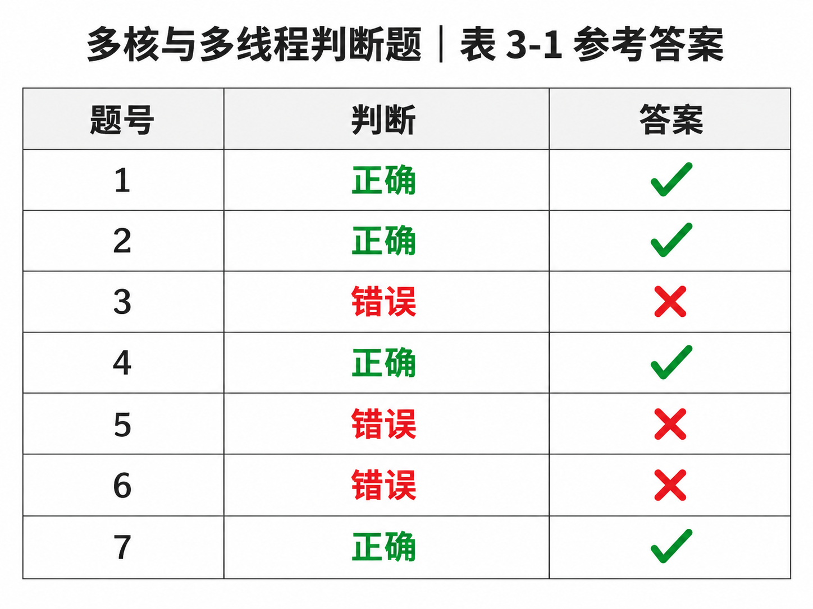

表格判断集中在多核负载划分、单核与多核程序设计假设，以及缓存一致性/伪共享等差异。单核环境下形成的时序与资源访问假设不能直接套用到多核；伪共享是不同核心访问同一缓存行中不同变量、引发缓存一致性流量的性能问题，不能说它在单核平台也以同样机制存在。七项答案按表格原序填写，避免把“并发”和“同时执行”混为一谈。

#### 操作系统内核（Kernel）的四大法定特征、底层原语与微内核 vs 宏内核架构边界（题库 2.3 节题目 100）⭐⭐⭐

[考查：综合知识（操作系统内核四大特征［必须常驻内存、以 CPU 最高优先级运行、可执行特权指令、可直接访问各种外设和全部主存空间］、管态全域寻址 vs 目态用户进程地址越界保护、内核底层支撑［时钟管理/中断处理/不可中断的原子原语 Primitive］、微内核 vs 宏内核架构）]

在《系统架构设计师教程（第 2 版）》第 2 章 **2.3.2 操作系统**中明确指出：**“内核驻留在内存中，它以 CPU 的最高优先级运行，能执行指令系统中的特权指令，具有直接访问各种外设和全部主存空间的特权。”** 因此，在判断内核特征的反向选非题中，**“内核不需要常驻内存（C）”为唯一错误说法**。

##### 1. 操作系统内核（Kernel）四大核心特权与用户态/外围程序对比表（题目 100 核心矩阵）⭐⭐⭐

| 特权特征维度 | **操作系统内核（Kernel，运行在管态 / Ring 0）** | **OS 外围模块（如 Shell / GUI）与普通用户进程（目态 / Ring 3）** | 题目 100 选项精准映射与排雷铁律 ⭐⭐⭐ |
| :--- | :--- | :--- | :--- |
| **1. 主存驻留属性**<br>*(Resident in RAM)* | **【必须常驻内存】（不可被换出到磁盘 Swap 区）**<br>若负责缺页中断与磁盘驱动的内核被换出内存，一旦发生中断系统将当场死机 | **不需要常驻内存**<br>（可按需装入内存，或由中级调度换出到外存 Swap 对换区） | ✅ **本题唯一正解 C（说法错误）**：<br>C 项称“内核不需要常驻内存”直接违背内核最根本的驻留契约！ |
| **2. 运行优先级**<br>*(Priority)* | **【以 CPU 的最高优先级运行】**<br>优先处理硬件中断、时钟滴答、系统异常与核心调度 | 运行优先级低于内核，受内核调度器抢占与时间片管控 | 🚫 **排除项 A（说法正确）**：<br>教材原文明确规定“它以 CPU 的最高优先级运行”。 |
| **3. 指令执行权限**<br>*(Privileged Inst.)* | **【能执行指令系统中的全部指令（含特权指令）】**<br>如直接 I/O、清内存、修改 PSW、置时钟、修改页表基址寄存器 | **严禁执行特权指令**；若需内核服务，必须执行非特权的“访管指令（SVC）”触发访管中断进入管态 | 🚫 **排除项 B（说法正确）**：<br>内核运行在管态（核心态），天然拥有特权指令执行权。 |
| **4. 主存与外设寻址**<br>*(Memory & I/O Access)* | **【具有直接访问各种外设和全部主存空间的特权】**<br>内核本身是物理内存分配者与页表维护者，拥有全域物理主存寻址权 | **受限寻址（地址越界保护）**：<br>每个用户态进程受基址/限长寄存器或页表限制，**只能访问自身合法地址空间** | 🚫 **本题头号误选陷阱 D（说法正确）**：<br>切勿把“用户态进程不能越界访问全部主存”误套在“管态内核”头上！**越界保护只拦用户态，不拦管态内核！** |

##### 2. 内核底层三大基石（含原语 Primitive）与微内核（Microkernel）架构边界⭐⭐⭐

| 核心概念 | 架构定义与特权态划分 | 核心特性与考场判别词 |
| :--- | :--- | :--- |
| **内核底层三基石**<br>（时钟 + 中断 + **原语**） | - **时钟管理**：提供时间片轮转基准与定时服务<br>- **中断处理**：响应系统调用（访管）、程序异常与硬件外设中断<br>- **原语（Primitive）**：由若干条指令构成的完成特定底层操作的过程（如进程创建/撤消、阻塞/唤醒、`P/V` 操作） | ⚠️ **原语的唯一铁律**：<br>原语具有**原子性（Atomicity）**，在执行过程中**绝对不允许被中断**（常通过关中断或硬件原子指令实现）！ |
| **宏内核（单内核）**<br>*(Monolithic Kernel)* | 将进程管理、内存管理、**文件系统、设备驱动程序、网络协议栈**全部集成在<strong>内核态（管态）</strong>一个大地址空间内运行（如传统 Linux / UNIX） | **优点**：模块间直接函数调用，**性能极高**；<br>**缺点**：耦合度高，任一驱动崩溃会导致整个内核死机。 |
| **微内核**<br>*(Microkernel)* | 仅将最基本的<strong>中断处理、基本进程/线程调度、进程间通信（IPC）</strong>保留在常驻内存的<strong>微内核（管态）</strong>中；而把**文件系统、设备驱动、网络协议栈**移至<strong>用户态（目态）</strong>作为独立服务器进程运行（如 QNX / Mach / 鸿蒙微内核） | **优点**：**高可靠性、高安全性**（驱动在用户态崩溃不影响内核）、易扩展移植；<br>**缺点**：频繁的**用户态 $\leftrightarrow$ 内核态上下文切换**与 IPC 消息传递导致**性能开销较大**。 |

> [!IMPORTANT]
> **操作系统内核特征考场秒杀口诀**：
> - **“内核驻留【常驻内存】（C 错必选），【最高优先】响应中断（A 对），身处管态执【特权指令】（B 对），【全部主存与各种外设】皆可直访（D 对）！”**
> - **“越界拦截只管【目态用户进程】，不管【管态内核】；底层【原语】不可中断，【微内核】把文件系统和驱动踢去用户态！”**

  - 【题库章节练习】 2.3 节题目 100（关于操作系统内核的特征，下列说法错误的是【**C. 内核不需要常驻内存**】）。

#### 多处理机系统耦合分类（紧耦合 vs 松耦合）与 SMP（UMA）/ NUMA / MPP 体系结构对比（题库 2.3 节题目 113）⭐⭐⭐

[考查：综合知识（紧耦合多机系统［直接耦合/共享主存，通过【共享内存】实现多机间通信，代表为【对称多处理器 SMP】］ vs 松耦合多机系统［间接耦合/分布独立主存，通过【消息传递/通信线路】实现多机通信，代表为【MPP / 集群 Cluster】］、SMP［UMA］vs NUMA vs MPP 三大架构横向对比与扩展性排序）]

在《系统架构设计师教程（第 2 版）》第 2 章中，多机系统（多处理机系统）按多机之间物理连接的紧密程度以及**是否共享物理主存**，严格划分为<strong>紧耦合多机系统（直接耦合系统）</strong>与<strong>松耦合多机系统（间接耦合系统）</strong>两类。其中，**紧耦合多机系统一般通过【共享内存（B）】实现多机间的通信；对称多处理器结构（SMP）属于【紧耦合】系统**。

##### 1. 紧耦合多机系统 vs 松耦合多机系统全景对比表（题目 113 双空核心矩阵）⭐⭐⭐

| 对比维度 | **紧耦合多机系统（直接耦合系统）**<br>（✅ **题目 113 问题 1 正解 B / 问题 2 正解**） | **松耦合多机系统（间接耦合系统）** | 考场设陷与排雷铁律 ⭐⭐⭐ |
| :--- | :--- | :--- | :--- |
| **物理互连方式** | 通过<strong>高速系统总线（Bus）或高速交叉开关（Crossbar）</strong>紧密互连，频带极高 | 通过<strong>I/O 通道（Channel）或高速通信线路（网络）</strong>互连 | 看到“总线 / 高速开关互连” $\to$ 紧耦合；<br>看到“通道 / 通信线路互连” $\to$ 松耦合。 |
| **主存组织与通信机制**<br>（**问题 1 唯一题眼**） | 所有处理机**共享同一个物理主存储器（Shared Memory）**，通过<strong>【共享内存（选项 B ✅）】</strong>直接读写实现多机间通信 | 每台处理机拥有**各自独立的私有主存（Local Memory）**，无共享内存，通过<strong>【消息传递（Message Passing）/ 通信线路】</strong>实现多机间通信 | 🚫 **排除 C（进程通信）与 D（共享寄存器）**：<br>- `进程通信（IPC）`是软件层概念（单机也有），非硬件耦合分类介质；<br>- `寄存器`封装在各 CPU 核心内部私有，多机间不可共享寄存器。 |
| **操作系统实例数** | 全系统仅运行 **1 个统一的操作系统**（集中控制、共享就绪队列与全系统资源） | 每个节点运行 **各自独立的操作系统副本**（自治管理本地资源） | 紧耦合 = 1 个 OS + 共享内存；<br>松耦合 = 多个独立 OS + 消息传递。 |
| **典型代表架构**<br>（**问题 2 唯一题眼**） | - **SMP（Symmetric Multi-Processor，对称多处理器）**<br>- **NUMA（非均匀存储访问）** | - **MPP（大规模并行处理机）**<br>- **集群系统（Cluster）** / 分布式系统 | ✅ **问题 2 铁律**：<br>问“**对称多处理器结构（SMP）属于系统**” $\to$ 秒选 **【紧耦合】**！ |

##### 2. 架构师高频铁三角：SMP（UMA） vs NUMA vs MPP 横向对比⭐⭐⭐

| 体系结构 | 英文全称与中文名 | 内存共享与地址空间模式 | 操作系统实例数 | 访存延迟特征与核心瓶颈 | 处理器/节点扩展能力 |
| :--- | :--- | :--- | :---: | :--- | :---: |
| **`SMP`**<br>*(UMA)* | Symmetric Multi-Processor<br>（**对称多处理器 / 均匀存储访问**） | **紧耦合 / 集中共享主存**<br>（全局单一物理地址空间） | **1 个 OS** | 所有 CPU 访问主存任意单元时间完全相同（**UMA**）；但**共享总线带宽与 Cache 一致性争用严重**，CPU 达数十颗时即遇瓶颈 | **最弱**<br>（通常 $2\sim 64$ 核） |
| **`NUMA`** | Non-Uniform Memory Access<br>（**非均匀存储访问**） | **紧耦合 / 分布式共享主存**<br>（物理内存分散在各节点，但**仍编入全局统一共享地址空间**） | **1 个 OS** | CPU 访问**本节点本地内存（Local）极快**，跨互连网访问**其他节点远端内存（Remote）较慢** | **中等**<br>（数十至数百核） |
| **`MPP`** | Massively Parallel Processing<br>（**大规模并行处理 / 无共享 Shared-Nothing**） | **松耦合 / 完全不共享内存**<br>（各节点私有独立地址空间） | **多个独立 OS**<br>（每节点 1 个） | 节点间**不能直接跨节点访存**，必须通过高速互联网络进行**消息传递（MPI）** | **最强**<br>（数千至数万节点） |

> [!IMPORTANT]
> **多机耦合度与 SMP/NUMA/MPP 考场秒杀口诀**：
> - **“紧耦合走总线、共主存，靠【共享内存（问题 1 选 B）】通信，典型代表是【SMP（问题 2 选紧耦合）】！”**
> - **“松耦合走通道/网络、各管各内存，靠【消息传递】通信，典型代表是【MPP / 集群】！”**
> - **“扩展能力排座次：`MPP`（无共享消息传递，上万节点）$>$ `NUMA`（统一地址空间，本地快远端慢）$>$ `SMP`（总线争用，扩展最差）！”**

#### CPU 运行模式（用户态/目态 vs 内核态/管态）、系统调用与访管中断 vs 外部中断及访管指令权限（题库 2.3 节题目 66）⭐⭐⭐

[考查：综合知识（用户态/目态 vs 内核态/管态、系统调用触发【访管中断 SVC】vs 硬件外设/时钟触发【外部中断】vs 算术【溢出中断】、双面考法防坑：访管指令本身【不是】特权指令［允许在用户态执行以陷入管态］vs 真正特权指令［I/O、清内存、修改 PSW 仅限管态执行］）]

在《系统架构设计师教程（第 2 版）》第 2 章 **2.3.2 操作系统**中，为了保护操作系统内核与硬件资源安全，现代 CPU 硬件划分了两种特权级别：<strong>用户态（User Mode，又称目态）</strong>与**内核态（Kernel/Supervisor Mode，又称管态/核心态）**。当用户态应用程序需要请求操作系统内核服务（即执行**系统调用 System Call**）时，必须通过触发<strong>【访管中断】（Supervisor Call Interrupt，选项 C）</strong>将 CPU 从用户态（目态）切换至内核态（管态）。

##### 1. 计算机中断分类全景对比表：访管中断 vs 程序性异常 vs 外部中断（题目 66 核心矩阵）⭐⭐⭐

| 中断类别 | 典型代表名称 | 物理触发源与同步/异步属性（核心分界线） | 触发目的与硬件行为 | 题目 66 选项精准映射与排雷铁律 ⭐⭐⭐ |
| :--- | :--- | :--- | :--- | :--- |
| **1. 访管中断**<br>*(内中断 / 陷入 Trap)*<br>（✅ **题目 66 正解 C**） | **`访管中断`**<br>*(Supervisor Call Interrupt, SVC)* | **CPU 内部当前指令流同步、主动触发**：<br>由应用程序在用户态（目态）执行**访管指令**（自愿进管指令，如 `syscall`、`int 0x80`、`SVC`）主动产生。 | **请求操作系统内核（管态）提供服务（即进行【系统调用】）**；硬件将 CPU 状态从**目态（用户态）切换为管态（内核态）**。 | ✅ **本题唯一正解 C（访管中断）**：<br>凡题干出现<strong>“进行系统调用 / 请求操作系统服务 / 从用户态进入管态”</strong>，100% 秒选**访管中断**！ |
| **2. 程序性异常中断**<br>*(内中断 / 故障 Fault)*<br>（选项 B 干扰项） | **`溢出中断`**、除数为零中断、缺页中断、地址越界中断、非法指令中断 | **CPU 内部当前指令执行出错被动、同步触发**：<br>由算术逻辑单元（ALU）或内存管理单元（MMU）在执行某条普通指令遇到异常条件时产生。 | 转入内核异常处理程序（如修复缺页，或终止算术溢出/越界的非法进程）。 | 🚫 **排除项 B（溢出中断）**：<br>发生于算术运算结果超出寄存器表示范围时，属于被动运算异常而非主动系统调用。 |
| **3. 外部中断**<br>*(外中断 / 硬件中断)*<br> | **`外部中断`**<br>（I/O 设备中断、时钟定时器中断） | **CPU 芯片外部的物理硬件异步触发**：<br>由外部设备控制器（**键盘、鼠标、网卡、磁盘 DMA**）或<strong>硬件定时器（时钟）</strong>通过中断请求线（`INTR`）发来电信号，**与当前正在执行的程序指令无关**。 | CPU 在当前指令周期结束时响应外设 I/O 完成事件或执行时间片轮转调度。 | 🚫 **本题头号误选陷阱（选项 D）**：<br>切勿把“用户程序向外部（OS 内核）请求服务”从字面上误解为“外部中断”！**外部中断特指 CPU 外部硬件（外设/时钟）触发**。 |

##### 2. 软考双面考法终极防坑：“访管指令”到底是不是“特权指令”？⭐⭐⭐

| 考场设问场景 | 命题表述特征 | 标准答案与核心判别铁律 |
| :--- | :--- | :--- |
| **考法一（如本题 66）：问触发什么中断？** | “应用程序在用户态使用特权指令（或访管指令）**进行系统调用**，是” | 必选 **【C. 访管中断】**（抓住题眼“**进行系统调用**”即可秒杀）。 |
| **考法二（单考指令权限）：问访管指令是不是特权指令？** | “下列指令中**可在用户态（目态）下执行**的是” / “关于**访管指令与特权指令**的说法正确的是” | ⚠️ **【访管指令本身不是特权指令！】**<br>- **真正的特权指令**（如**直接 I/O 指令、置时钟、清内存、修改程序状态字 PSW**）**只能在管态（内核态）下执行**；若在用户态强行执行特权指令，会触发“非法指令/特权违例异常”而非系统调用！<br>- <strong>访管指令（SVC / Trap）</strong>是**非特权指令**，它**专门允许在用户态（目态）下执行**，作为用户态程序请求进入管态的唯一合法跳板！ |

> [!IMPORTANT]
> **系统调用与访管中断考场秒杀口诀**：
> - **“系统调用求内核，目态进管叫【访管】（选 C）；算术越界叫【溢出/异常】（排 B），外设时钟电信号才叫【外部中断】（排 D）！”**
> - **“单考权限要清醒：【特权指令】（I/O、清内存、改 PSW）只准管态跑；【访管指令】非特权，专给用户态（目态）敲门进管态！”**

  - 【题库章节练习】 2.3 节题目 66（应用程序在用户态使用特权指令进行系统调用，是【**C. 访管中断**】）。

#### 进程/线程三态模型（执行态、就绪态、阻塞态）及四条状态转换方向与不可达禁区（2025年上半年 题目38）⭐⭐⭐

[考查：综合知识（执行态/就绪态/阻塞态的资源边界、`执行态 → 就绪态`［主动让出CPU / 时间片用完 / 高优先级抢占］vs `执行态 → 阻塞态`［请求键盘输入 I/O / 信号量 wait / 缺页异常］vs `阻塞态 → 就绪态`［I/O 完成中断唤醒 / signal 释放］、两大不存在转换禁区）]

在《系统架构设计师教程（第 2 版）》第 2 章 **2.3.2 操作系统**中，进程/线程在生命周期内的基本工作状态分为**执行态（Running）**、<strong>就绪态（Ready）</strong>和**阻塞/等待态（Blocked/Waiting）**。区分这三种状态与四条合法转换有向边的唯一核心标尺是：**“当前除了 CPU 之外，是否还缺少其他运行条件（如 I/O 数据、同步锁/信号量、主存页面）？”**

##### 1. 进程/线程三大基本状态核心边界对照表 ⭐⭐⭐

| 状态名称 | 资源具备情况（核心判别词） | 物理位置 | 灵魂一问：“此刻立刻把 CPU 分给它，能马上往下跑吗？” |
| :--- | :--- | :--- | :--- |
| **执行态（Running）** | 已获得 **CPU（处理机）** 及全部所需资源，正在 CPU 上执行指令 | CPU 核心寄存器与流水线 | 正在跑（单核同一时刻最多 1 个；多核最多等于核心数） |
| **就绪态（Ready）** | **“万事俱备，只欠 CPU”**：已分配到除 CPU 以外的所有必要资源 | 内存中的**就绪队列** | **✅ 能马上跑！**（只差调度器分派 CPU） |
| **阻塞态（Blocked）** | **“给 CPU 也跑不了”**：因等待某个外部事件或非 CPU 资源而暂停 | 内存中的**阻塞/等待队列** | **❌ 跑不了！**（缺键盘数据、缺磁盘页、缺信号量） |

##### 2. 四条合法状态转换有向边与两大绝对禁区（题目 38 考场秒杀矩阵）⭐⭐⭐

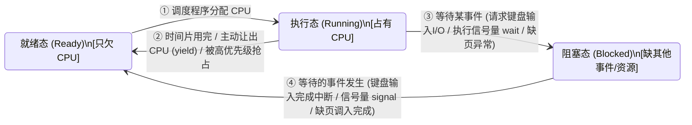

| 转换方向与合法性 | 典型触发事件（考场必背题眼） | 题目 38 选项精准映射与排雷铁律 ⭐⭐⭐ |
| :--- | :--- | :--- |
| **① 就绪态 $\to$ 执行态**<br>*(合法 ✅)* | - 处于就绪状态的任务被**调度程序（Scheduler）选中并分配了处理机（CPU）** | 唯一从就绪态进入执行态的通道。 |
| **② 执行态 $\to$ 就绪态**<br>*(合法 ✅ —— **本题正解 B**)* | - **分配的时间片已用完（Time Slice Expired）**<br>- **线程调用 `yield`【主动让出 CPU】**<br>- 可抢占式调度中，更高优先级线程就绪并<strong>抢占（Preempt）</strong>当前 CPU | ✅ **本题唯一正解 B（主动让出CPU）**：<br>线程自身并不等待任何外部事件或 I/O，仅交出 CPU 使用权，直接退回就绪队列！ |
| **③ 执行态 $\to$ 阻塞态**<br>*(合法 ✅ —— 选项 A/C/D)* | - **发起慢速 I/O 请求**：如请求**键盘输入（选项 A）**、读写磁盘文件<br>- **申请同步/互斥资源未满足**：如**执行信号量的 `wait` / P 操作（选项 C）**<br>- **内存访问缺失**：触发**缺页异常（选项 D）**，需等待从磁盘调入页面 | 🚫 **本题三大同质干扰项（A / C / D）**：<br>A（等按键数据）、C（等信号量）、D（等磁盘调页 I/O）均因缺少非 CPU 条件而无法继续，全部走 **`执行态 → 阻塞态`**！ |
| **④ 阻塞态 $\to$ 就绪态**| - **外部 I/O 事件完成中断**：如用户按下按键（**键盘输入完成**）、缺页已调入主存<br>- **其他线程释放资源**：其他线程执行信号量的 `signal` / V 操作唤醒等待者 | 🚫 **注意起点与终点**：<br>当键盘输入真正完成时，唤醒的是原先在阻塞队列等待的线程，走的是 **`阻塞态 → 就绪态`**，绝非 `执行态 → 就绪态`！ |
| **⑤ 阻塞态 $\not\to$ 执行态**<br>*(绝对禁区 ❌)* | **不存在！**（任何被唤醒的阻塞线程，必须先进入**就绪队列**排队，经调度器分配 CPU 后才能进入执行态） | 考场凡出现“I/O 完成后从阻塞态直接变成执行态”，100% 判错！ |
| **⑥ 就绪态 $\not\to$ 阻塞态**<br>*(绝对禁区 ❌)* | **不存在！**（就绪态线程还没上 CPU 执行指令，根本不可能发起 `wait`、I/O 请求或触发缺页异常） | 考场凡出现“就绪态直接变阻塞态”，100% 判错！ |

> [!IMPORTANT]
> **三态转换考场秒杀口诀**：
> - **“只丢 CPU 退【就绪】（时间片到、被抢占、【主动让出 CPU 选 B】）；缺数缺锁去【阻塞】（等键盘输入 A、调 `wait` 操作 C、缺页异常调盘 D）！”**
> - **“阻塞醒来先【就绪】，绝不跨栏直接跑（无 `阻塞 → 执行`）；没上 CPU 怎会卡（无 `就绪 → 阻塞`）！”**

  - 【2025年上半年 题目38】（下列选项中会导致线程从执行态变为就绪态的是【**B. 主动让出CPU**】）。

#### 进程状态模型演进体系：三态模型 vs 五态模型（+新建/终止）vs 七态模型（+就绪挂起/阻塞挂起）（题库 2.3 节题目 109）⭐⭐⭐

[考查：综合知识（进程三态模型［就绪+运行+阻塞］、五态模型［三态+新建态/创建态+终止态］、七态模型［五态+就绪挂起态/静止就绪+阻塞挂起态/静止阻塞］的递进扩展边界、五态与七态的跨阶混淆排雷、外存阻塞挂起进程在等待事件完成时的状态转换规律 `阻塞挂起态 → 就绪挂起态`）]

在《系统架构设计师教程（第 2 版）》第 2 章 <strong>2.3.2 操作系统（进程管理——进程的状态与转换）</strong>中，为了刻画进程在不同维度下的生命周期与内存驻留情况，操作系统依次定义了**三态模型**、**五态模型**与**七态模型**。其演进主线遵循严格的 **$3 \xrightarrow{+2\text{（生与死）}} 5 \xrightarrow{+2\text{（外存挂起）}} 7$** 阶梯扩展规律。

##### 1. 三态、五态与七态模型全景递进对照表（题目 109 核心秒杀矩阵）⭐⭐⭐

| 模型名称 | 状态总数 | 包含的完整状态集合 | 相比上一级模型**新增的状态** ⭐⭐⭐ | 引入该模型的工程目的与核心触发机制 | 题目 109 选项精准映射与排雷铁律 ⭐⭐⭐ |
| :--- | :---: | :--- | :--- | :--- | :--- |
| **1. 三态模型**<br>*(Three-State Model)*<br>（✅ **题目 109 正解 A**） | **3 种** | **`就绪态（Ready）` + `运行态（Running）` + `阻塞态/等待态（Blocked）`** | *（最核心的基础状态集）* | 刻画进程在**内存中存续期间**围绕 CPU 与 I/O 事件展开的核心流转闭环 | ✅ **本题唯一正解 A**：<br>“三态模型包括**就绪、运行和阻塞**三种状态”；任何后续扩展模型都**必须保留就绪态**（直接排除 D）！ |
| **2. 五态模型**<br>*(Five-State Model)*<br> | **5 种** | 三态（`就绪 + 运行 + 阻塞`）<br>**$+ \text{`新建态/创建态（New）`}$**<br>**$+ \text{`终止态（Exit/Terminated）`}$** | **【新建态（创建态）】+【终止态】**<br>（⚠️ **绝不含“挂起态”！**） | 补齐进程<strong>“从生到死”的完整生命周期两端</strong>：<br>- `新建态`：已创建 PCB，但尚未分配完内存/未装入就绪队列；<br>- `终止态`：进程正常结束或异常退出，已让出 CPU 但保留 PCB 供父进程回收统计信息 | 🚫 **本题头号跨阶嫁接陷阱（选项 B）**：<br>B 项把五态模型新增的<strong>“新建态”偷换成了七态模型的“挂起态”</strong>！五态模型比三态多的是**新建态和终止态**，绝非挂起和终止！<br>🚫 **排除项 C**：五态模型是通用生命周期模型，**绝不仅限于分时系统**！ |
| **3. 七态模型**<br>*(Seven-State Model)*<br> | **7 种** | 五态（`新建 + 活动就绪 + 运行 + 活动阻塞 + 终止`）<br>**$+ \text{`就绪挂起态（静止就绪）`}$**<br>**$+ \text{`阻塞挂起态（静止阻塞）`}$** | **【就绪挂起态（静止就绪）】+【阻塞挂起态（静止阻塞）】** | 引入**中级调度（内存/交换调度 Swapping）**：<br>当内存紧张时，将暂时不具备运行条件的内存进程映像换出到**磁盘对换区（外存）**，仅将 **PCB 常驻内存** | 只有引入<strong>中级调度（对换技术）</strong>扩展出的**七态模型**才包含**挂起态（Suspended）**！ |

##### 2. 七态模型二维正交状态转换与外存事件唤醒规律⭐⭐⭐

在带有挂起状态的七态模型中，进程的等待/就绪状态沿着两个正交维度划分：**维度一：是否等待某事件（阻塞 vs 就绪）**；**维度二：进程映像是否在内存中（活动 Active vs 静止/挂起 Suspended）**。

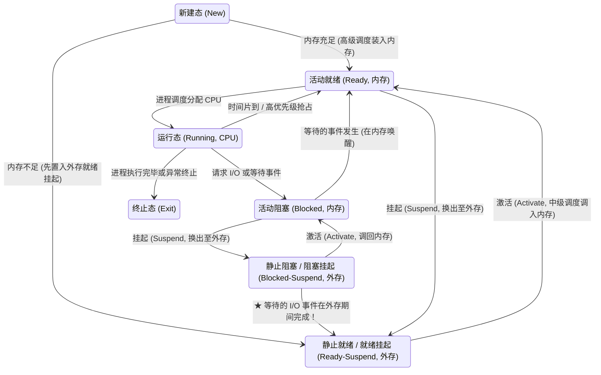

- **考场高频致命考点——“外存阻塞挂起进程的 I/O 事件完成”走哪条边？**
  - **场景**：某进程原本处于`活动阻塞态`（等待磁盘 I/O），因内存吃紧被中级调度换出至外存，进入**`阻塞挂起态（静止阻塞）`**。此时，若它所等待的 **I/O 事件顺利完成**，但内存依然紧张尚未将其调回内存，进程变为何种状态？
  - **结论**：**由 `阻塞挂起态（静止阻塞）` 直接转换为 `就绪挂起态（静止就绪）`（进程仍留在外存）！**
  - **原理排雷**：I/O 事件完成只消除“**阻塞**”属性（由阻塞变就绪），不改变“**外存挂起**”位置；只有经过中级调度执行<strong>“激活（Activate）”</strong>操作将其调回内存后，`静止就绪（就绪挂起）`才会进一步转为内存中的`活动就绪`。

> [!IMPORTANT]
> **三态 / 五态 / 七态模型考场秒杀口诀**：
> - **“三态内存核心转：【就绪、运行、阻塞】三兄弟（选 A）；五态补齐生与死：比三态多【新建（创建）+ 终止】（绝无挂起，秒杀 B）！”**
> - **“七态引入中级换（Swapping）：比五态多【就绪挂起（静止就绪）+ 阻塞挂起（静止阻塞）】（PCB 仍留内存）！”**
> - **“外存阻塞等来 I/O 完成：留在外存【阻塞挂起 $\to$ 就绪挂起】；中级调度调回内存才叫【激活（静止 $\to$ 活动）】！”**

  - 【题库章节练习】 2.3 节题目 109（在操作系统中，进程状态模型包括三态模型和五态模型。关于这两种模型，以下说法正确的是【**A. 三态模型包括就绪、运行和阻塞三种状态**】）。

#### 进程的本质定义、进程物理实体（静态描述 / 进程映像）三部分（程序 + 数据集合 + 控制块 PCB）及进程 vs 线程对仗（题库 2.3 节题目 151）⭐⭐⭐

[考查：综合知识（进程的标准定义、进程作为资源分配与调度基本单位、进程物理实体［进程映像/静态描述］三部分构成：程序 + 数据集合 + 进程控制块 PCB、PCB 作为进程存在的唯一标志、进程实体三部分 vs 计算机软件三要素 vs 线程基本单位对仗）]

在《系统架构设计师教程（第 2 版）》第 2 章 <strong>2.3.2 操作系统（进程管理）</strong>中，关于<strong>进程（Process）</strong>的定义及其在主存中的<strong>物理实体（又称“进程的静态描述”或“进程映像 Process Image”）</strong>有如下严格界定：

> **教材原文定语**：“<strong>【进程】</strong>是一个具有独立功能的程序关于数据集合的一次可以并发执行的运行活动，是**系统进行资源分配和调度的基本单位**。一个进程是通过其**物理实体**被操作系统所感知的，进程的物理实体又称为**进程的静态描述**，通常由三部分组成，分别是<strong>【程序】、【数据集合】和【进程控制块（Process Control Block，PCB）】</strong>。”

##### 1. 进程物理实体（静态描述 / 进程映像）三大组成部分全景解析（题目 151）⭐⭐⭐

| 组成部分 | 英文名称 | 核心作用与内存角色 | 考场题眼与唯一性地位 ⭐⭐⭐ |
| :--- | :--- | :--- | :--- |
| **1. 程序（程序段）** | `Program / Code Segment` | 描述进程本身要完成何种功能的指令序列（可被同一程序的多个并发进程共享） | 决定进程“**做什么**”（只读代码区）。 |
| **2. 数据集合（数据段）** | `Data Segment` | 程序在执行时所需的操作数据及私有工作区（含全局变量、堆、用户栈） | 决定进程“**加工什么**”（进程私有数据区）。 |
| **3. 进程控制块（控制块）** | **`PCB`** *(Process Control Block)* | 记录进程的标识（PID）、当前状态、优先级、CPU 寄存器上下文、主存与文件资源清单 | ⭐⭐⭐ **进程存在的唯一标志**！<br>操作系统**仅通过 PCB 感知和控制进程**（创建进程 = 创建 PCB；撤销进程 = 销毁 PCB）。 |

##### 2. 软考高频“三要素”与“基本单位”正交防混矩阵⭐⭐⭐

| 易混概念对 | 标准构成 / 核心定语 | 考场设陷与排雷铁律（题目 151 选项对比） |
| :--- | :--- | :--- |
| **进程物理实体（静态描述）三部分**<br>*(✅ 题目 151 正解 B)* | **`程序` + `数据集合` + `控制块（PCB）`** | ✅ **见“进程物理实体 / 静态描述 / 进程映像分为哪三部分” $\to$ 秒选【程序、数据集合和控制块（B）】**！ |
| **计算机软件（Software）三要素**<br>*(🚫 排除项 A)* | **`程序` + `数据` + `相关文档`** | 🚫 **排除项 A（代码、文档和配置）**：操作系统内核在内存中感知进程靠的是 **PCB（控制块）**，绝不需要读取开发文档！ |
| **并发运行时工具集**| `线程组、信号量和资源池`（D） / `进程栈、系统资源和时间片`（C） | 🚫 **排除项 C、D**：信号量、时间片、线程组属于并发同步工具或调度配额，绝非进程物理实体的法定三元组构成。 |
| **进程 vs 线程基本单位拆分**| - **传统 OS（未引入线程）**：**进程**既是**资源分配**基本单位，也是**调度**基本单位。<br>- **现代 OS（引入线程后）**：**进程**是系统进行<strong>【资源分配】</strong>的基本单位；**线程**是系统进行<strong>【CPU 独立调度和分派】</strong>的基本单位。 | 审题看清是否提及“引入线程后”：若问“引入线程后，资源分配的基本单位是（进程），独立调度的基本单位是（线程）”。 |

> [!IMPORTANT]
> **进程物理实体考场秒杀口诀**：
> **“软件三要素是【程序 + 数据 + 文档】；进程物理实体（静态描述）三部分是【程序 + 数据集合 + 控制块（PCB）】（选 B）；操作系统感知进程全靠【PCB（进程存在的唯一标志）】！”**

#### 处理机三级调度体系（高级/作业调度 vs 中级/内存调度 vs 低级/进程调度）及在分时/实时系统中的存在性（题库 2.3 节题目 85）⭐⭐⭐

[考查：综合知识（操作系统三级调度别名等价映射［高级调度 = 作业调度、中级调度 = 内存/交换调度、低级调度 = 进程调度］、物理迁移位置与状态转换边、为什么分时和实时操作系统中不存在高级调度、被挂起进程的 PCB 常驻内存铁律）]

在《系统架构设计师教程（第 2 版）》第 2 章 <strong>2.3.2 操作系统（处理机管理）</strong>中，按调度发生的位置、粒度和频率由粗到细，处理机调度分为**高级调度（作业调度）**、<strong>中级调度（内存/交换调度）</strong>和<strong>低级调度（进程调度）</strong>三级。

##### 1. 操作系统三级调度全景对比与 OS 类型存在性矩阵（题目 85）⭐⭐⭐

| 调度级别 | 标准别名（考场必背同义词） | 物理迁移方向与七态状态转换边 | 调度频率 | 各类 OS 中的存在性（本题题眼） | 对应选项真伪判定（题目 85） |
| :--- | :--- | :--- | :---: | :--- | :--- |
| **1. 高级调度**<br>*(High-level / Long-term)* | **作业调度**<br>（宏观调度 / 长程调度） | **外存后备队列 $\longrightarrow$ 内存**<br>（`无 → 创建态 → 就绪态`，为外存作业分配资源并创建进程，每个作业只调入 1 次） | **最低**<br>*(分钟/秒级)* | - **多道批处理系统：存在 ✅**<br>- **分时系统 & 实时系统：【不存在 ❌】**（交互命令和实时任务到达后**直接进入内存**创建进程，绝不能在外存后备队列排队干等） | **选项 A（高级调度）**：**本题唯一正解 ✅** |
| **2. 中级调度**<br>*(Intermediate / Medium-term)* | **内存调度 / 交换调度**<br>（中程调度 / Swapping） | **内存 $\longleftrightarrow$ 外存对换区（挂起队列）**<br>（`就绪/阻塞态 ↔ 就绪挂起/阻塞挂起态`，可多次换出 `Swap-out` 与换入 `Swap-in`；**注意被挂起进程的 `PCB` 仍常驻内存！**） | **居中**<br>*(秒/百毫秒级)* | - **分时系统 & 通用多任务系统：普遍存在 ✅**<br>（用于缓解内存紧张、提高内存利用率和系统吞吐量） | **选项 B（中级调度）**：**干扰项 ❌** |
| **3. 低级调度**<br>*(Low-level / Short-term)* | **进程调度 / 处理机调度**<br>（微观调度 / 短程调度） | **内存就绪队列 $\longrightarrow$ CPU（处理机）**<br>（`就绪态 → 执行态`，决定哪个就绪进程获得 CPU 执行权） | **最高**<br>*(毫秒/微秒级)* | - **所有多任务操作系统（批处理、分时、实时）：100% 必须存在 ✅**（操作系统最基本、不可或缺的核心调度） | **选项 C（低级调度） & 选项 D（进程调度）**：**同义项双双排除 ❌** |

##### 2. 考场两大秒杀铁律⭐⭐⭐

1. **同义双胞胎互斥秒杀法（C = D）**：
2. **高级调度 vs 中级调度的“外存 $\leftrightarrow$ 内存”边界**：
   - **高级调度（作业调度）**：操作对象是**尚未创建进程的原始作业**，从**外存后备队列**首次装入内存创建进程（`无 → 创建 → 就绪`），仅**批处理系统**有，**分时和实时系统没有**；
   - **中级调度（内存调度）**：操作对象是**已经创建了进程的活跃任务**，在内存与<strong>外存对换区（Swap）</strong>之间反复换出/换入（`就绪/阻塞 ↔ 挂起`），且进程换出到外存后其 **`PCB`（进程控制块）必须保留在内存中**。

> [!IMPORTANT]
> **操作系统三级调度考场秒杀口诀**：
> - **“高作外进内（高级=作业调度，仅批处理有，【分时和实时系统不存在】，秒选 A）！”**
> - **“中内换挂起（中级=内存交换调度，程序数据换出外存、PCB 仍留内存，排 B）！”**
> - **“低进分 CPU（低级=进程调度，C 与 D 同义双胞胎，所有操作系统全都有，排 C/D）！”**

  - 【软考题库章节练习】 2.3 节题目 85（在操作系统中，哪种调度不存在于分时和实时操作系统中【**A. 高级调度**】）。

#### 多道批处理系统双作业并行重叠甘特图推演与最短完成时间计算（题库 2.3 节题目 212）⭐⭐⭐

[考查：综合知识（多道批处理系统 CPU 与 I/O 设备并行重叠规则、单作业内部串行不可自重叠下界、CPU 空闲等待 I/O 缺口窗口定位［`160~180ms` 的 `20ms` 净空闲］、纯 CPU 累加陷阱 `200ms` 排雷与 CPU 利用率计算）]

在《系统架构设计师教程（第 2 版）》第 2 章 <strong>2.3.2 操作系统（多道批处理系统与处理机调度）</strong>中，多道程序通过交替使用 **CPU** 和 **I/O 设备**来减少空闲时间。核心物理约束只有两条：
1. **同设备互斥（单核 CPU 互斥 + 同作业串行）**：单核 CPU 同一时刻只能跑 1 个作业的计算段；**同一作业自身的 `计算1 → I/O → 计算2` 三步严格串行，绝对不可自我重叠**。
2. **异构设备并行（A 的 CPU $\parallel$ B 的 I/O）**：作业 $P_1$ 的 CPU 计算可与作业 $P_2$ 的 I/O 操作完全并行重叠。

##### 1. 题目 212 双通道时序甘特图与 20ms CPU 空窗定位表 ⭐⭐⭐

> **题干参数**：$P_1$（`计算 40ms，I/O 60ms，计算 20ms`，0ms 到达）；$P_2$（`计算 100ms，I/O 40ms，计算 40ms`，$20\text{ms}$ 到达）。

| 时间切片（ms） | 持续时长 | **CPU 通道（单核互斥）** | **I/O 通道（与 CPU 并行）** | 核心状态流转与误选 `B. 200ms` 排雷 ⭐⭐⭐ |
| :---: | :---: | :--- | :--- | :--- |
| **`0 ~ 40`** | $40\text{ ms}$ | **$P_1$ 计算①（$40\text{ ms}$）** | *空闲* | $P_2$ 在 **$20\text{ ms}$ 到达**，但 CPU 正被 $P_1$ 占用，$P_2$ 必须在就绪队列**等待 $20\text{ ms}$（`20~40ms`）**（切忌误算 $20\text{ms} + 180\text{ms} = 200\text{ms}$！）。 |
| **`40 ~ 100`** | $60\text{ ms}$ | **$P_2$ 计算①（前 $60\text{ ms}$）** | **$P_1$ I/O（$60\text{ ms}$）** | $40\text{ ms}$ 时 $P_1$ 转入 I/O；$P_2$ 接管 CPU。$100\text{ ms}$ 时 $P_1$ 完成 I/O 进入就绪队列等 CPU。 |
| **`100 ~ 140`** | $40\text{ ms}$ | **$P_2$ 计算①（后 $40\text{ ms}$）** | *空闲（$P_1$ 等 CPU）* | $P_2$ 跑完 $100\text{ ms}$ 计算①；若在 $100\text{ ms}$ 让 $P_1$ 抢占 $P_2$，反而会将 $P_2$ 的 I/O 推迟到 $160\text{ ms}$ 导致总时间恶化为 $240\text{ ms}$（排 A）。 |
| **`140 ~ 160`** | $20\text{ ms}$ | **$P_1$ 计算②（$20\text{ ms}$）** | **$P_2$ I/O（前 $20\text{ ms}$）** | $140\text{ ms}$ 时 $P_2$ 转入 $40\text{ ms}$ I/O（`140~180ms`）；CPU 并行执行 $P_1$ 最后 $20\text{ ms}$ 计算②，**$160\text{ ms}$ 时 $P_1$ 彻底完工退出**！ |
| **`160 ~ 180`** | **$20\text{ ms}$** | 🚨 **【CPU 被迫空转 $20\text{ ms}$】** | **$P_2$ I/O（后 $20\text{ ms}$）** | <strong>本题唯一决定生死的 $20\text{ ms}$ 缺口！</strong>$P_1$ 已完工，而 $P_2$ 的 $40\text{ ms}$ I/O 还剩后半段 $20\text{ ms}$ 未完，**CPU 无法达到 $100\%$ 利用率，被迫净空转 $20\text{ ms}$**（彻底击穿纯 CPU 求和 $200\text{ms}$ 的选项 B）！ |
| **`180 ~ 220`** | $40\text{ ms}$ | **$P_2$ 计算②（$40\text{ ms}$）** | *空闲* | $180\text{ ms}$ 时 $P_2$ 结束 I/O，回到 CPU 执行最后 $40\text{ ms}$ 计算②，于 **$220\text{ ms}$** 全部完工（**选 D**）！ |

##### 2. 考场两大 5 秒秒杀公式⭐⭐⭐

1. **公式一（I/O 缺口填补通式）**：
   $$T_{\min} = \sum T_{\text{纯 CPU}} + \max\left(0,\; T_{\text{长作业 I/O}} - T_{\text{另一作业剩余填坑 CPU}}\right) = (40+20+100+40) + \max(0,\; 40 - 20) = 200 + 20 = \mathbf{220\text{ ms}}$$
   - **变式 1（G1）**：若 $P_1$ 末段计算改为 `40ms`，则 $\max(0, 40 - 40) = 0$，总时间仍为 $220 + 0 = \mathbf{220\text{ ms}}$（CPU 零空闲）。
   - **变式 2（G2）**：若 $P_1$ 末段计算改为 `50ms`，则 $\max(0, 40 - 50) = 0$，总时间等于新的纯 CPU 总和 $230 + 0 = \mathbf{230\text{ ms}}$。
   - **CPU 利用率**：本题 $220\text{ ms}$ 内 CPU 实际忙 $200\text{ ms}$、闲 $20\text{ ms}$，故 $\eta_{\text{CPU}} = \frac{200}{220} \approx \mathbf{90.9\%}$。
2. **公式二（单作业内部串行关键路径下界）**：
   - $P_2$ 在 $t = 40\text{ ms}$ 才拿到 CPU，而 $P_2$ 自身三段串行总长为 $100 + 40 + 40 = \mathbf{180\text{ ms}}$（不可自我重叠），故最短完成时间绝不可能低于 $40 + 180 = \mathbf{220\text{ ms}}$！

#### 嵌入式实时操作系统（RTOS）的实时性评价指标：Rhealstone 六大内核延迟指标（含信号量混洗时间）vs 任务执行时间（题库 2.3 节题目 153）⭐⭐⭐

[考查：综合知识（嵌入式实时操作系统 RTOS 实时性评价指标界定准则［测 OS 内核开销，不测用户业务代码与 CPU 算力］、Rhealstone 基准测试核心实时指标：中断延迟时间 vs 中断响应时间定量公式、任务/线程切换时间、信号量混洗时间 Semaphore Shuffling Time、死锁解除时间、为何“任务执行时间”不属于 RTOS 实时性指标）]

在《系统架构设计师教程（第 2 版）》第 2 章 <strong>2.3.2 操作系统（实时操作系统 RTOS）</strong>及第 16 章嵌入式系统架构设计中，<strong>实时性（Real-Time Performance）</strong>是评价 RTOS 最核心的指标。界定某项指标是否属于 **RTOS 实时性评价指标** 的唯一黄金准绳是：**该指标度量的是“操作系统内核自身的管理、调度、同步与中断响应延迟”，还是“用户编写的应用代码计算量与硬件 CPU 主频算力”**。

##### 1. RTOS 实时性评价指标 vs 非 RTOS 指标全景辨析表（题目 153 核心）⭐⭐⭐

| 指标名称 | 英文术语与所属范畴 | 物理定义与定量构成公式 | 是否属于 RTOS 实时性评价指标及考场排雷 ⭐⭐⭐ |
| :--- | :--- | :--- | :--- |
| **1. 任务执行时间**<br>（✅ **题目 153 唯一正解 A**） | **Task Execution Time**<br>*(用户应用负载 + 硬件算力)* | 指某个具体用户应用任务（如图像滤波、PID 解算）在 CPU 上执行完自身业务指令所需的时长；**完全取决于用户算法复杂度、代码规模与 CPU 硬件主频/IPC 算力**。 | ❌ **【不是】RTOS 实时性评价指标（选非题唯一正解 A）**！<br>即使换用全球最顶级的硬实时 OS（如 VxWorks），OS 内核也无法替用户削减业务循环指令；它衡量的是应用负载与 CPU 速度，与 RTOS 内核实时性无关。 |
| **2. 信号量混洗时间**<br> | **Semaphore Shuffling Time**<br>*(Rhealstone 核心指标)* | **指从一个任务释放（V 操作 / `Give`）信号量，到另一个正在阻塞等待（P 操作 / `Take`）该信号量的任务被 RTOS 内核唤醒激活并恢复运行之间的时间延迟**。 | ✅ **【是】经典 RTOS 实时性指标（切勿因译名生僻误选 D）**！<br>直接衡量 RTOS 内核任务间同步原语（IPC）等待队列唤醒与抢占重调度路径的效率。 |
| **3. 中断延迟与响应时间**<br>（题目 153 选项 B） | **Interrupt Latency & Response Time**<br>*(RTOS 中断实时指标)* | - **中断延迟时间** $= \max(\text{关中断时间}) + \text{硬件开始执行 ISR 第一条指令的时间}$<br>- **中断响应时间** $= \text{中断延迟时间} + \text{保存 CPU 寄存器现场时间} + \text{进入 ISR 执行函数的时间}$ | ✅ **【是】核心 RTOS 实时性指标**！<br>直接决定 RTOS 对外部紧急异步硬件事件的捕获与响应速度。 |
| **4. 任务/线程切换时间**<br>（题目 153 选项 C） | **Task / Thread Switch Time**<br>*(RTOS 调度实时指标)* | RTOS 调度器将当前运行任务的 CPU 寄存器上下文保存到其 TCB 栈，并将新就绪任务的上下文从其 TCB 恢复到 CPU 寄存器所需的固定内核开销。 | ✅ **【是】核心 RTOS 实时性指标**！<br>直接体现 RTOS 上下文切换（Context Switch）的轻量化程度。 |
| **5. 死锁解除时间 & 系统调用平均运行时间** | **Deadlock Breaking Time & Syscall Overhead** | - **死锁解除时间**：高优先级任务等待低优先级任务持有的互斥资源发生优先级反转时，RTOS 内核通过**优先级继承 / 优先级天花板协议**解开阻塞所需的内核开销。<br>- **常用系统调用平均运行时间**：内核态原语执行的平均耗时。 | ✅ **【是】RTOS 实时性评价指标**（同属国际标准 Rhealstone 实时基准测试六大指标体系）。 |

> [!IMPORTANT]
> **RTOS 实时性指标考场秒杀口诀**：
> - **“RTOS 实时看内核：中断延迟与响应（B）、任务线程切换快（C）、【信号量混洗】（释放信号量到等待任务被激活的延迟，D 是真指标别误选）、死锁解除系统调！”**
> - **“唯有【任务执行时间（A）】看用户代码与 CPU 算力，绝不属于操作系统实时性评价指标（选‘不是’秒选 A）！”**

  - 【题库章节练习】 2.3 节题目 153（【**A. 任务执行时间**】不是反映嵌入式实时操作系统实时性的评价指标）。

#### 多核 CPU 环境下的进程调度算法：全局队列调度 vs 局部队列调度及工作窃取（Work-Stealing）机制（题库 2.3 节题目 15）⭐⭐⭐

[考查：综合知识（《系统架构设计师教程（第2版）》2.3.2 节多核 CPU 进程调度机制、全局队列调度［CPU 利用率高 / Cache 缓存利用率低］ vs 局部队列调度［Cache 缓存利用率高 / CPU 利用率低］四格反义对比、处理器亲和性 Processor Affinity、现代混合调度架构“每核局部队列 + 跨核负载均衡/工作窃取 Work-Stealing”）]

在《系统架构设计师教程（第 2 版）》第 2 章 <strong>2.3.2 操作系统（多核 CPU 环境下的进程调度）</strong>中，对称多处理（SMP）/ 多核处理器架构按就绪队列的组织方式，分为<strong>全局队列调度（Global Queue Scheduling）</strong>和<strong>局部队列调度（Local Queue Scheduling）</strong>两大基本流派。两者的优缺点在 **“CPU 核心利用率（忙闲均衡）”** 与 **“Cache 缓存利用率（处理器亲和性）”** 上呈现严格的正交对称反转：

##### 1. 多核 CPU 两大进程调度算法全景四格反义对比表 ⭐⭐⭐

| 对比维度 | **全局队列调度（Global Queue Scheduling）** | **局部队列调度（Local Queue Scheduling）** ⭐⭐⭐ | 考场设陷与排雷铁律 ⭐⭐⭐ |
| :--- | :--- | :--- | :--- |
| **就绪队列组织与选取规则**<br>*(教材第 2 版原文定义)* | 操作系统只维护**一个全局共享的任务等待队列**；当系统中有任意 CPU 核心空闲时，就**从全局任务等待队列中选取就绪任务**分配给该核心执行 | 操作系统为**每一个 CPU 核心维护一个独立的局部任务等待队列**；新任务创建时被分配给某核心的局部队列，之后一直只在该核心局部队列内调度执行 | 🚫 **本题头号主宾嫁接陷阱（选项 C）**：<br>C 项将“**局部队列调度**（主语）”与“**从全局任务等待队列中选取就绪任务**（全局队列调度的定义）”强行拼凑，直接判错！ |
| **CPU 核心利用率**<br>*(忙闲负载均衡度)* | **【高】（核心优点 ✅）**<br>*(只要全局队列有任务，任何空闲核都能立刻领活，不会出现“某核忙死、某核闲死”)* | **【低】（核心缺点 ✅ —— 题目 15 正解 D）**<br>*(若无跨核迁移，某核局部队列跑空时只能空转，即使其他核局部队列排长队也无法分担)* | ✅ **本题唯一正解 D**：<br>**局部队列调度的缺点是 CPU 利用率低**；全局队列调度的优点是 CPU 利用率高（排除 B）！ |
| **Cache 缓存利用率**<br>*(处理器亲和性 Affinity)* | **【低】（核心缺点 ❌）**<br>*(同一进程在不同时间片可能漂移到不同核心执行，导致原核心片上 L1/L2 Cache 与 TLB 热数据全部作废)* | **【高】（核心优点 ✅）**<br>*(进程固定绑定在同一个 CPU 核心上运行，无需跨核切换，充分复用该核已预热的 L1/L2 Cache)* | 🚫 **排除项 A**：<br>全局队列调度的缺点是**缓存利用率低**（A 说优点是缓存利用率高，完全说反）！ |
| **队列锁争用开销**<br>*(可扩展性)* | **锁竞争激烈**：所有 CPU 核心并发读写同一个全局队列，核心数越多自旋锁争用越严重 | **无锁/低争用**：各核心仅访问自己的私有局部队列，无跨核锁冲突 | 核心数较多（如 64 核/128 核服务器）时，纯全局队列会因锁争用退化为性能瓶颈。 |

##### 2. 现代多核操作系统混合调度架构与处理器亲和性⭐⭐⭐

为了同时克服“纯局部队列调度 CPU 利用率低”与“纯全局队列调度 Cache 缓存利用率低”的缺陷，现代主流操作系统（如 Linux `CFS` 调度器）及高并发协程运行时（如 Go `GMP`、Java `ForkJoinPool`）普遍采用**混合双层架构**：
1. **日常态：以“每核独立局部队列”为主（保住高 Cache 命中率）**
   - 遵循**软亲和性（Soft Affinity / 自然亲和性）**：默认将唤醒或时间片轮转的进程继续留在其上一次运行的 CPU 核心局部队列中，最大化利用片内 L1/L2 Cache 与 TLB 热数据。
   - 支持**硬亲和性（Hard Affinity / 显式绑核，如 `sched_setaffinity`）**：允许管理员或实时程序将特定关键线程强制锁死（Pin）在指定 CPU 核心集上，彻底禁止跨核迁移。
2. **失衡态：配合“周期性跨核负载均衡 / 空闲核工作窃取（Work-Stealing）”（拉满 CPU 利用率）**
   - 当某个 CPU 核心的局部队列跑空（进入 Idle）或核心间负载差距超过阈值时，空闲核心主动去繁忙核心的局部队列尾部<strong>窃取（Steal）/ 迁移（Migrate）</strong>部分等待任务过来执行，从而根治局部队列调度“旱涝不均、CPU 利用率低”的缺陷。

> [!IMPORTANT]
> **多核 CPU 进程调度考场秒杀口诀**：
> - **“全局队列共一池，局部队列各守家（C 说局部从全局队列取任务，主宾打架必错）！”**
> - **“全局保 CPU、伤 Cache（优点：CPU 利用率高；缺点：跨核乱跳 Cache 缓存利用率低，排 A、B）；”**
> - **“局部保 Cache、伤 CPU（优点：单核绑定 Cache 缓存利用率高；缺点：忙闲不均【CPU 利用率低】，秒选 D）！”**

  - 【题库章节练习】 2.3 节题目 15（关于多核CPU环境下进程的调度算法，以下说法正确的是【**D. 局部队列调度缺点是CPU利用率低**】）。

#### 分页存储管理：地址变换 + 页面淘汰 ⭐⭐

[考查：综合知识（页表计算题 + 淘汰页选择题）]

- **地址变换三步**：页大小 4K = $2^{12}$，页内偏移占低 12 位（十六进制低 3 位）。页号 = 逻辑地址 ÷ 页大小取整（十六进制右移 3 位）；查页表把**页号换成帧号，偏移不变**拼回。例：5148H → 页号 5、偏移 148H，页 5 帧号 3 → 物理地址 3148H。
- **二进制拼接形式**：地址以二进制给出时，物理地址 = 帧号 ∥ 偏移**直接拼接**（等价于"帧号 × 页大小 + 偏移"），再按选项位宽**高位补零**。两个专属陷阱：①页号位序读反（`0010`↔`0100`，拿错行帧号）；②拼接后漏补前导零。例：页 4KB、虚拟地址 `0010000000000100` → 页号 `0010` = 2 → 帧号 `110` → `110 ∥ 000000000100` 补零得 `0110000000000100`。
- **页表三标志位**：状态位（1=在内存 / 0=不在）、访问位（最近是否被访问）、修改位（是否被写过）。
- **页面淘汰优先级（改进型 Clock / NRU）**：**先看在不在（状态位），再看用没用（访问位 0 优先），最后看脏不脏（修改位 0 优先）**——访问位是第一优先级，修改位只在平局加赛（修改位=0 省去写回磁盘开销）。(0,0) 最佳牺牲品；(0,1) 仍优于 (1,0)；(1,1) "又热又脏"最不该淘汰。
- **易错点**：淘汰候选只看**在内存**的页（状态位=1）；地址变换常错在"页号直接当帧号"（忘查页表）或"拿错行的帧号"。

#### 虚拟存储器：内部地址变换 vs 外部地址变换 ⭐⭐

[考查：综合知识（变换方向 × 发生时机辨析）]

- **内部地址变换**：虚地址 → **主存**物理地址；时机 = 页面**命中**（页已在主存）；由快表（TLB）/页表完成。
- **外部地址变换**：虚地址 → **辅存**物理地址；时机 = 页面**失效（缺页）**；由操作系统（外页表）完成，用于定位并调入页面。
- 口诀：**命中变主存，缺页变辅存；起点永远是虚地址**。
- **判别词**：题干出现"页面失效 / 缺页"→ 此刻"虚→主存"映射不成立（页根本不在主存），必往辅存方向变。
- **易错点**：①忽略时机词"页面失效"，把缺页变换误当成命中时的虚→主存变换；②起点错选"主存地址"（程序给出的永远是虚地址）；③"主存→Cache"是 Cache 地址映像（直接/全相联/组相联），属另一存储层次，与缺页处理无关。

#### 请求页式存储管理：十六进制地址转换与改进型 Clock（NRU）四级页面淘汰优先级（题库 2.3 节题目 89）⭐⭐⭐

[考查：综合知识（十六进制逻辑地址拆页号与页内偏移 + 改进型 Clock/NRU 四级淘汰顺序 + “页面号 vs 物理块号”防串列陷阱）]

- **一、页式十六进制地址极速拆拼法（问题 1：`1385H → 2385H`）**：
  1. **由页面大小求页内偏移位数**：
     - 页面大小 $= 4\text{K} = 2^{12}\text{ B} \implies$ 页内地址占 **12 bit**，而 $1\text{ 位十六进制数} = 4\text{ bit}$，故**末尾 $12 \div 4 = 3$ 位十六进制数即为页内偏移**（若页面大小 $1\text{K} = 2^{10}$ 或 $2\text{K} = 2^{11}$ 非 $4$ 的整数倍，则将最高位十六进制展开为 4 位二进制再切分）。
  2. **查表替换页号为物理块号**：
     - 逻辑地址 `1385H` $\implies$ 高位 **逻辑页号 $= 1$**，低 3 位 **页内偏移 $= 385\text{H}$**；
     - 查页表得逻辑页号 `1` 对应的 **物理页号（物理块号）$= 2$** $\implies$ 拼接得物理地址 **`2385H`**。
- **二、改进型 Clock / NRU（最近未使用）页面淘汰三步铁律（问题 2：淘汰页号 `3`）**：
  1. **第一步（看状态位 $P = 1$：必须在内存中）**：
     - 只有当前驻留在内存中的页面（`状态位 = 1` 且占有物理存储块）才具备被淘汰资格；不在内存的页面（`状态位 = 0`，如正待调入的页面 `4`）直接排除。
  2. **第二步（按两位数二进制 `AM` = `[访问位 A, 修改位 M]` 从小到大四级淘汰）**：

| 淘汰优先级 | `(访问位 A, 修改位 M)` | 二进制权重 `AM` | 物理含义与 I/O 代价分析 | 题目 89 对应页面 |
| :---: | :---: | :---: | :--- | :--- |
| **第 1 顺位（最先淘汰）** | **`(A=0, M=0)`** | `00`（最小） | **最近未访问 + 未修改（干净页）**：局部性最差且淘汰时**无需写回磁盘（0 次写 I/O）** | ✅ **逻辑页号 `3`**（物理块号 `5`）$\implies$ **问题 2 唯一正解 A（`3`）** |
| **第 2 顺位（次选淘汰）** | **`(A=0, M=1)`** | `01` | **最近未访问 + 已修改（脏页）**：局部性差，但淘汰前**必须先写回外存磁盘（1 次写 I/O）** | 逻辑页号 `7`（物理块号 `8`）$\implies$ 仅当无 `(0,0)` 时才淘汰 |
| **第 3 顺位** | **`(A=1, M=0)`** | `10` | **最近已访问 + 未修改**：近期刚用过（时间局部性高），不能先于 `A=0` 淘汰 | 逻辑页号 `2`（物理块号 `3`）、题库错印行 `5` |
| **第 4 顺位（最后淘汰）** | **`(A=1, M=1)`** | `11`（最大） | **最近已访问 + 已修改**：既刚被访问又是脏页，保留价值最高 | 逻辑页号 `1`（物理块号 `2`） |

  3. **第三步（考场最高频防坑——严禁把第 2 列【物理块号 `5`】抄成第 1 列【逻辑页号 `3`】）**：
     - 题干问“**应该淘汰表中页面号为的页面**”，问的是第 1 列 **逻辑页号 `3`（选 A）**！
     - 切勿找到第 4 行 `(状态位=1, A=0, M=0)` 后看串列抄成第 2 列的 **物理页号（块号）`5`（误选 C）**；只有当后续追问“新调入的页面 `4` 将装入哪个物理块”时，才使用腾出的物理块号 **`5`**（如访问 `4A2CH` 变换为 **`5A2CH`**）。

#### 页式存储 vs 段式存储：段长【可动态变化】、段表结构与段地址越界验算（题库 2.3 节题目 34）⭐⭐⭐

[考查：综合知识（页式存储物理定长相等 vs 段式存储逻辑分段且段长可动态变化、页表 vs 段表记录项差异、段式地址变换“先比 `段内位移 d < 段长 L` 再加 `段基址 B`”越界防坑）]

1. **页式存储（Paging）与段式存储（Segmentation）全景对比矩阵**：

| 对比维度 | **页式存储管理（Paging）** | **段式存储管理（Segmentation）** ⭐⭐⭐ | 考场设陷与排雷铁律 ⭐⭐⭐ |
| :--- | :--- | :--- | :--- |
| **划分依据与单位属性** | 信息的**物理单位**（由硬件/系统机械等分，对用户完全透明） | 信息的**逻辑单位**（按程序逻辑模块如代码段、数据段、堆栈段划分，对用户可见） | 分段便于实现程序的模块化共享、保护与动态链接。 |
| **长度特性（本题题眼）** | **页长固定且相等**（如每页固定 $4\text{ KB}$，对应选项 A/B/D） | **段长互不相等，且是【可动态变化的】**（对应 **本题正解 C**：取决于存储的数据量，运行时可随堆栈压栈、堆内存伸缩动态调整） | ✅ **题目 34 唯一正解 C（可动态变化的）**：<br>切勿将页式存储的“固定/相等”张冠李戴给段式存储（排除 A/B/D）！ |
| **地址映射表记录项** | **页表（Page Table）**：仅记录 **`页号 → 块号（帧号）`**（因页长固定相等，无需存页长） | **段表（Segment Table）**：必须同时记录 **`段号 → 段长（Limit） + 段基址（Base）`** | 正因为每段段长不同且可动态变化，段表项才必须显式存 **段长**！ |
| **内存碎片类型** | 产生**内部碎片（页内碎片）**（最后一页未装满的部分），无外部碎片 | 产生**外部碎片（段间碎片）**（不同长度的段换入换出后留下的零散空闲区），无内部碎片 | 结合两者优点的**段页式存储**（先按逻辑分段、段内再定长分页）既便于共享保护又消除了外部碎片（无快表时需访问主存 **3 次**）。 |

2. **段式存储二维逻辑地址 `(段号 S, 段内位移 d)` 转换两步死律与双重越界中断保护（题目 34 & 55 凝练）**：
   - **转换方向铁律（题目 55 第 2 空题眼）**：CPU 执行指令时给出的是**逻辑地址 $(S, d)$**，由硬件 MMU 查段表转换为内存**物理地址**。因此不能转换的原因永远是 **“逻辑地址到物理地址转换时地址越界”（选 C）**，绝非方向颠倒的“物理地址到逻辑地址转换时地址越界”（排除 D）。
   - **第一关（查段号越界）**：检查 **`段号 S` 是否满足 $0 \le S < \text{段表长度 } M$**（例如段表含段号 $0 \sim 4$ 共 5 个段，若访问 `(5, 20)`，即便位移 $20$ 很小，因 $S=5 \ge 5$ 直接触发**段号越界中断**）。
   - **第二关（生死线——查段内位移越界，警惕 0 基临界值 $d = L$）**：比较 **`段内位移 d` 与该段的 `段长 L`**：
     - 合法范围：**$0 \le d < L$**（因偏移量从 `0` 起算，长度为 $L$ 的段最大合法偏移量仅为 **$L - 1$**）；
     - 越界红线：若 **$d \ge L$（注意 $d = L$ 也越界！）** $\implies$ **直接判定“逻辑地址到物理地址转换时地址越界”**！**一票否决，严禁拿段基址去加位移**（例如段 1 基址 `3310`/段长 `50`，访问 `(1, 50)` 因 $50 \ge 50$ 直接越界；段 4 基址 `2000`/段长 `100`，访问 `(4, 100)` 因 $100 \ge 100$ 直接越界！）。
   - **第三步（仅当 $0 \le S < M$ 且 $0 \le d < L$ 合法时求和）**：
     $$\text{物理地址} = \text{段基址 } B + \text{段内位移 } d$$

> [!IMPORTANT]
> **页式 vs 段式与地址越界秒杀口诀**：
> - **“页是物理定长相等（页表不存页长、有内部碎片）；段是逻辑长短不一且【可动态变化】（段表必存段长+段基址、有外部碎片）！”**
> - **“段式转换方向永远是【逻辑地址到物理地址转换时地址越界】（选 C 排 D）；先查段号（$S < M$）再查位移（$d < L$），临界 $d = L$ 也越界，合法才把基址加！”**

  - 【软考题库 / 2.3 节题目 34】（段式存储分段的段长是【**C. 可动态变化的**】）。

#### 页式存储系统十进制与十六进制地址变换、控制寄存器（页表长度）越界保护与块页差值速算法（题库 2.3 节题目 117）⭐⭐⭐

[考查：综合知识（页式存储十进制逻辑地址拆分公式 $P = \lfloor A / L \rfloor$ 与 $W = A \bmod L$、物理地址合成公式 $a = B \times L + W$、块页差值速算法、控制寄存器页表长度越界中断判定 $P \ge M$、十六进制地址变换互转）]

在《系统架构设计师教程（第 2 版）》第 2 章 <strong>2.3.2 操作系统（页式存储管理地址变换）</strong>中，页式存储系统的逻辑地址由 **页号 $P$** 和 **页内地址（页内偏移量）$W$** 两部分组成。硬件 MMU 进行地址变换时，**页内地址 $W$ 保持原封不动，仅通过查页表将“页号 $P$”替换为“物理块号（页框号）$B$”**。

##### 1. 页式存储地址变换三大计算方法对比矩阵（以页面大小 $L = 4\text{K} = 4096\text{ B}$、逻辑地址 $A = 8644$ 为例）⭐⭐⭐

| 计算方法 | 适用题型场景 | 核心数学公式与分步推演 | 本题（$A = 8644, L = 4096, 2 \to 8$）实战验算 | 考场设陷与防坑铁律 ⭐⭐⭐ |
| :--- | :--- | :--- | :--- | :--- |
| **1. 十进制标准除余法**<br>*(Standard Modulo)* | 题干给出**十进制逻辑地址**与十进制选项 | ① **求页号**：$$P = \lfloor A \div L \rfloor$$<br>② **求页内偏移**：$$W = A - P \times L$$<br>③ **查页表**：$$P \longrightarrow B$$<br>④ **求物理地址**：$$a = B \times L + W$$ | ① $P = \lfloor 8644 \div 4096 \rfloor = \mathbf{2}$（因 $2 \times 4096 = 8192$）<br>② $W = 8644 - 8192 = \mathbf{452}$<br>③ 查表得页号 `2` $\to$ 物理块号 **`B = 8`**<br>④ $a = 8 \times 4096 + 452 = 32768 + 452 = \mathbf{33220}$（**选 A**） | 🚫 **本题头号误选陷阱（选项 D：`2500`）**：<br>`2500` $= 2 \times 1024 + 452$！切记 **$4\text{K} = 4096$（绝不可只乘 $1\text{K}=1024$）**，且必须用查表后的**物理块号 `8`** 而非页号 `2`！ |
| **2. 块页差值速算法**<br>*(Block-Page Delta)*<br>⭐⭐⭐ **极力推荐** | 十进制选择题**一秒定大小范围**与免拆余数速算 | $$\text{物理地址 } a = A + (B - P) \times L$$<br>（直接用原逻辑地址加上“物理块号与页号之差 $\times$ 页面大小”，无需单独算余数 $W$！） | 因 $P = 2 \to B = 8$，块号比页号大了 $(8 - 2) = 6$ 个页面：<br>$$a = 8644 + 6 \times 4096 = 8644 + 24576 = \mathbf{33220}$$ | 💡 **考场 1 秒瞪眼秒杀技**：<br>既然物理块号 $B=8 >$ 页号 $P=2$，变换后的**物理地址必然严格大于原逻辑地址 `8644`**！四个选项中唯有 **A（`33220`）$> 8644$**，B/C/D 全 $\le 8644$，免算秒选 A！ |
| **3. 二进制 / 十六进制拼接法**<br>*(Hex Concatenation)*| 题干或选项采用<strong>十六进制（`H`）</strong>表示 | ① 页面大小 $L = 2^k \implies$ 页内偏移占低 $k$ 位二进制（每 4 位二进制 = 1 位十六进制，$4\text{K} = 2^{12}$ 对应**低 3 位十六进制**）；<br>② 高位十六进制即为页号 $P$，查表替换为块号 $B$ 后与低位直接拼接。 | $8644 = 2 \times 4096 + 452 = \text{21C4H}$：<br>- 低 3 位 `1C4H`（$=452$）为页内偏移，保持不变；<br>- 高位 `2`（页号）查表替换为 `8`（块号）$\implies$ **`81C4H`**（$= 33220$）。 | 牢记黄金映射：<br>- $1\text{K} = 2^{10}$（10 bit）<br>- $4\text{K} = 2^{12}$（**12 bit = 3 位十六进制**）<br>- $16\text{K} = 2^{14}$（14 bit） |

##### 2. 控制寄存器（页表寄存器 PTR：页表长度 $M$｜页表始址）越界中断保护机制⭐⭐⭐

- **页表寄存器（PTR）两大字段职责**：
  1. **页表长度 $M$**：记录当前进程一共拥有多少个合法页面（页号从 `0` 开始编号，合法页号范围为 **$0 \le P < M$**）。
  2. **页表始址（页表地址）**：记录该进程页表在主存中的起始物理地址。
- **硬件越界判定**：当 CPU 给出逻辑地址拆出页号 $P$ 后，首先将 $P$ 与控制寄存器中的 **页表长度 $M$** 比较：
  - 若 **$P \ge M$**（例如本题页表仅有页号 `0, 1, 2` 共 $M=3$ 项，若访问逻辑地址 `13000`，算得 $P = \lfloor 13000 / 4096 \rfloor = 3 \ge 3$），MMU 立即产生 **“地址越界中断”**，拒绝查表转换！

> [!IMPORTANT]
> **十进制页式地址变换考场秒杀口诀**：
> - **“4K 页面四零九六（`4096`），逻辑地址除以它：商是页号（`P=2`）余偏移（`W=452`），查表换块（`B=8`）乘 `4096` 加偏移（`33220`）！”**
> - **“块号 `8` 大于页号 `2`，物理地址必比逻辑地址 `8644` 大，一眼扫穿 B/C/D，秒选唯一大于 `8644` 的【A. 33220】！”**

  - 【软考经典真题 / 题库 2.3 节题目 117】（页式存储系统的逻辑地址是由页号和页内地址两部分组成。假定页面的大小为 4K，图中逻辑地址用十进制表示为 `8644`，页表 `0→2、1→3、2→8`，经过变换后十进制物理地址 a 应为【**A. 33220**】）。

#### 银行家算法（死锁避免）安全性检查 ⭐⭐

[考查：综合知识（"能否分配 / 是否安全"计算题）]

- **定位**：银行家算法是死锁**避免**手段（不是预防）；核心：分配资源前试算分配后系统是否仍处于**安全状态**（存在安全序列，即存在一种进程完成顺序使每个进程都能跑完）。
- **三步口诀**：**一算空闲，二试分配，三找序列**。
  1. **算空闲**：空闲 = 资源总量 − 各进程已分配合计。**任何判断之前先做这一步**——申请合计 > 空闲时物理上就分不出，直接排除（不用进入安全性检查）。
  2. **试分配**：从空闲中扣掉申请，更新该进程尚需数。
  3. **找序列**：每轮找"**尚需 ≤ 当前空闲**"的进程，让它跑完并**回收其全部已分配资源**（空闲变大），继续找；全部能跑完 → 安全；中途找不到 → 不安全，不能分配。
- **两个坑**：①漏算/错算空闲数（已分配合计加错）；②找到可推进进程后**忘记回收**其全部已分配资源，导致链条断裂误判不安全。空闲暂时为 0 ≠ 不安全，关键看能否借此让某进程跑完。

#### PV 操作与信号量取值范围 ⭐⭐

[考查：综合知识（取值范围 + 等待进程数计算题）]

- **资源型信号量**：初值 = **资源总数 m**（不是 0，不是 1——初值 1 是互斥锁、初值 0 是同步信号量，三者别混）。
- **取值范围通式**：n 个进程共享 m 台同类资源、每进程最多占 1 台 → **S ∈ [m − n, m]**，即 m, m−1, …, 0, −1, …, **−(n−m)**。
- **含义读法**：S > 0 → 还剩 S 台可用；S = 0 → 恰好分完；**S < 0 → |S| 个进程在排队等待**。
- **口诀**：**上限资源数，下限减进程；负值是排队**。
- **易错点**：把资源型信号量当初值 0 算 → 上限丢 m、下限错成 −(n−1)（命题人标准干扰项配方）。判别词"共享 m 台 / 初值"先定 m。

#### 二级串联生产者-消费者模型（$P_1 \xrightarrow{B_1(n)} P_2 \xrightarrow{B_2(m)} P_3$）：6 信号量定位、互斥初值必为 1 与双 P 顺序防死锁铁律（题库 2.3 节题目 93）⭐⭐⭐

[考查：综合知识（二级缓冲流水线 `S1~S6` 三类信号量识图［互斥锁 `mutex = 1`、空位同步 `empty = n/m`、满位同步 `full = 0`］、为何互斥信号量初值绝不可能为 0、连续两个 P 操作“先 P 同步后 P 互斥”防抱锁睡眠死锁法则）]

在《系统架构设计师教程（第 2 版）》第 2 章 <strong>2.3.2 操作系统（进程同步与互斥：生产者-消费者问题）</strong>中，对于有界缓冲区（如容量为 $n$ 的半成品箱 $B_1$ 和容量为 $m$ 的成品箱 $B_2$），**每一个缓冲箱固定配置 3 个信号量：1 个互斥信号量（初值恒为 `1`）+ 1 个空位同步信号量（初值恒为箱容量 `n` 或 `m`）+ 1 个满位同步信号量（初值恒为 `0`）**。

##### 1. 双缓冲箱流水线（$P_1 \to B_1(n) \to P_2 \to B_2(m) \to P_3$）6 信号量全景映射表（题目 93）⭐⭐⭐

| 信号量 | 归属缓冲箱 | 信号量性质与物理含义 | 流程图 P/V 视觉定位铁律（一秒识图） | 标准初值 | 考场设陷与排雷铁律 ⭐⭐⭐ |
| :---: | :---: | :--- | :--- | :---: | :--- |
| **`S1`** | 半成品箱 $B_1$<br>*(容量 $n$)* | **互斥信号量**<br>（保护 $B_1$ 互斥存取） | **同进程内紧贴临界区成对包裹**：<br>$P_1$ 内 `P(S1) → 半成品→B1 → V(S1)`<br>$P_2$ 内 `P(S1) → 从B1取半成品 → V(S1)` | **`1`** | ✅ **问题 1 正解 C（`S1, S5` 都是互斥信号量，初值分别为 `1` 和 `1`）**：<br>🚫 **排 D（初值为 `0` 和 `1`）**：**互斥信号量初值永远是 `1`，绝不可能是 `0`**（若 $S_1=0$，$P_1$ 执行 `P(S1)` 立即变 $-1$ 阻塞，开局即死锁）！ |
| **`S2`** | 半成品箱 $B_1$<br>*(容量 $n$)* | **空位同步信号量**<br>（$B_1$ 剩余空位数） | **跨进程交叉配对（放前 P、取后 V）**：<br>$P_1$ 放半成品前执行 `P(S2)`（耗 1 空位）<br>$P_2$ 取半成品后执行 `V(S2)`（还 1 空位） | **`n`** | ✅ **问题 2 前半空正解 `n`**：<br>初始时半成品箱 $B_1$ 全空，共有 $n$ 个空位可供 $P_1$ 放入。 |
| **`S3`** | 半成品箱 $B_1$<br>*(容量 $n$)* | **满位同步信号量**<br>（$B_1$ 现有半成品数） | **跨进程交叉配对（放后 V、取前 P）**：<br>$P_1$ 放半成品后执行 `V(S3)`（增 1 半成品）<br>$P_2$ 取半成品前执行 `P(S3)`（取 1 半成品） | **`0`**<br>*(题干已给)* | 初始时半成品箱 $B_1$ 内有 0 件半成品，$P_2$ 必须等 $P_1$ 执行 `V(S3)` 后才能取货。 |
| **`S4`** | 成品箱 $B_2$<br>*(容量 $m$)* | **空位同步信号量**<br>（$B_2$ 剩余空位数） | **跨进程交叉配对（放前 P、取后 V）**：<br>$P_2$ 放成品前执行 `P(S4)`（耗 1 空位）<br>$P_3$ 取成品后执行 `V(S4)`（还 1 空位） | **`m`** | ✅ **问题 2 后半空正解 `m`**：<br>初始时成品箱 $B_2$ 全空，共有 $m$ 个空位可供 $P_2$ 放入。 |
| **`S5`** | 成品箱 $B_2$<br>*(容量 $m$)* | **互斥信号量**<br>（保护 $B_2$ 互斥存取） | **同进程内紧贴临界区成对包裹**：<br>$P_2$ 内 `P(S5) → 产品→B2 → V(S5)`<br>$P_3$ 内 `P(S5) → 从B2取产品 → V(S5)` | **`1`** | 与 $S_1$ 完全对称，保护成品箱 $B_2$ 同一时刻仅允许 1 人存取，初值必为 **`1`**。 |
| **`S6`** | 成品箱 $B_2$<br>*(容量 $m$)* | **满位同步信号量**<br>（$B_2$ 现有成品数） | **跨进程交叉配对（放后 V、取前 P）**：<br>$P_2$ 放成品后执行 `V(S6)`（增 1 成品）<br>$P_3$ 取成品前执行 `P(S6)`（取 1 成品） | **`0`**<br>*(题干已给)* | 初始时成品箱 $B_2$ 内有 0 件成品，$P_3$ 必须等 $P_2$ 执行 `V(S6)` 后才能取货。 |

##### 2. 连续两次 P 操作 vs 连续两次 V 操作的先后顺序死律⭐⭐⭐

- **连续两次 P 操作：必须严格遵循【先 P 同步（空位 $S_2$/满位 $S_3$），后 P 互斥（箱锁 $S_1$）】，绝对不可颠倒！**
  - **反证推演**：若 $P_1$ 误写为“先 `P(S1)` 锁住箱子，再 `P(S2)` 申请空位”，一旦半成品箱 $B_1$ 已装满（$S_2 = 0$），$P_1$ 就会**怀揣着互斥锁 $S_1$ 在 `P(S2)` 处阻塞睡眠**；此时唯一能从 $B_1$ 取货腾出空位（执行 `V(S2)`）的消费者 $P_2$，在尝试访问 $B_1$ 时会被挡在门外的 `P(S1)` 处永久阻塞——双方互等对方释放资源，触发**抱锁睡眠死锁（Deadlock）**！
- **连续两次 V 操作（如 `V(S1)` 与 `V(S3)`）：顺序可以任意互换，不会引发死锁**（因为 V 操作只释放资源/唤醒等待者，永远不会阻塞当前进程）。

> [!IMPORTANT]
> **生产者-消费者流水线 PV 题考场秒杀口诀**：
> - **“同程紧贴一 P 一 V 必是【互斥信号量】，互斥初值永远是 `1`（见互斥初值写 `0` 如选项 D，直接按自相矛盾秒排）！”**
> - **“跨程交叉是一对同步：放前 P 空位（`S2=n, S4=m`），取前 P 满位（`S3=0, S6=0`）！”**
> - **“双 P 顺序铁律：必须【先 P 同步、后 P 互斥】（防箱满/箱空时抱锁睡眠死锁）；双 V 顺序可互换！”**

#### 前趋图 → PV 操作填空 ⭐⭐

[考查：综合知识（流程图填空题）]

- **三步法（✅ 题目 140 核心考点：信号量数量 = 有向边数量，初始值 = 0，前 P 后 V）**：
  1. **设信号量（看边不看点）**：**有几条有向边（前驱依赖箭头），就设置几个同步信号量（信号量数量 = 有向边数量，绝不等于进程/节点数！排 A）**；
  2. **赋初始值（同步归零）**：**所有前驱同步信号量的初始值一律设为 `0`**（因为前驱未完成前，后继无通行证；初值设为 `1` 是临界区互斥信号量 `mutex` 的做法，排 B）；
  3. **加 PV 操作（前 P 后 V）**：在每个进程**执行前对所有入边信号量执行 `P` 操作**（等待前驱完成），在进程**执行后对所有出边信号量执行 `V` 操作**（通知后继放行）（切勿写反为“执行前 V、执行后 P”，排 C）。
- **方向钩子**：P = 请先让行（申请/等待），V = 完毕放行（释放/通知）；口诀 **P 前 V 后，编号跟边走，个数等于有向边，初值一律设为 0**。
- **核心避坑——为什么信号量下标常与前驱进程号“错位 1 号”（如 `P4` 等 `P2`、`P3` 却填 `P(S3)P(S4)` 而非 `P(S2)P(S3)`）**：
  - **信号量 $S_k$ 1:1 绑定的是图中的“有向边（箭头）”而非“进程圆圈 $P_i$”**！
  - 只要上游存在<strong>一分二（Fork）</strong>节点（例如 $P_1$ 同时指向 $P_2$ 和 $P_3$），仅 $P_1$ 一个节点的出边就会吃掉 $S_1$（$P_1 \to P_2$）和 $S_2$（$P_1 \to P_3$）**两个**信号量编号；
  - 从而导致下一层 $P_2 \to P_4$ 和 $P_3 \to P_4$ 的两条入边编号顺延为 **$S_3$ 和 $S_4$**，因此 $P_4$ 执行前的 `f` 空必须填 **`P(S3)P(S4)`**（若按进程名惯性填 `P(S2)P(S3)` 就会把 $S_2$ 错抢给 $P_4$，导致 $P_2 \to P_4$ 无人等待）。
- **多入边 / 多出边**：入边几条就几个 P（全部等齐才执行）；出边几条就几个 V（执行完逐个通知）。例：P5 入边 S4、S5 → 执行前 `P(S4)P(S5)`；P1 出边 S1、S2 → 执行后 `V(S1)V(S2)`。
- **易错点**：①**P/V 方向颠倒**（把"等前驱"写成 V）——命题人标准干扰项配方是"方向反 + 编号对"；②**把信号量数量/下标当成进程数量/下标**（如题目 140 误选 `A. 设置的信号量数量等于进程数`，或忽略一分多出边消耗的信号量个数，误把等 `P2、P3` 写成 `P(S2)P(S3)`）；③同步信号量初值是 **0**（与初值 1 的互斥锁、初值 m 的资源型信号量区分）。
- **全图映射示例 1（菱形分叉汇聚 + 尾边，试题14 / 题目5）**：
  - 有向边编号：$P_1 \to P_2: S_1$、$P_1 \to P_3: S_2$、$P_2 \to P_4: S_3$、$P_3 \to P_4: S_4$、$P_4 \to P_5: S_5$。
  - 各空填法：`a`（$P_1$ 后）= `V(S1)V(S2)`；`b/c`（$P_2$ 前/后）= `P(S1)` / `V(S3)`；`d/e`（$P_3$ 前/后）= `P(S2)` / `V(S4)`；**`f`（$P_4$ 前）= `P(S3)P(S4)`**、`g`（$P_4$ 后）= `V(S5)`；`h`（$P_5$ 前）= `P(S5)`。
- **全图映射示例 2**（P1~P5，边 P1→P2:S1、P1→P3:S2、P2→P4:S3、P2→P5:S4、P3→P5:S5）：P1 后 `V(S1)V(S2)`；P2 前 `P(S1)`、后 `V(S3)V(S4)`；P3 前 `P(S2)`、后 `V(S5)`；P4 前 `P(S3)`；P5 前 `P(S4)P(S5)`。
- **全图映射示例 3（5 进程 6 信号量双源双汇跨层前趋图，题库 2.3 节题目 9）**：
  - **有向边按源进程出边编号（共 6 条边 $S_1 \sim S_6$）**：
    - $P_1$ 出 2 边：$P_1 \to P_3: S_1$、$P_1 \to P_4: S_2$ $\implies$ `a`（$P_1$ 后）填 **`V(S1)V(S2)`**；
    - $P_2$ 出 2 边：$P_2 \to P_3: S_3$、$P_2 \to P_5: S_4$ $\implies$ `b`（$P_2$ 后）填 **`V(S3)V(S4)`**；
    - $P_3$ 入 2 边（$P_1 \to P_3: S_1$、$P_2 \to P_3: S_3$）、出 2 边（$P_3 \to P_4: S_5$、$P_3 \to P_5: S_6$）$\implies$ **`c`（$P_3$ 前）填 `P(S1)P(S3)`**，**`d`（$P_3$ 后）填 `V(S5)V(S6)`**（问题 2 正解 **B**）；
    - $P_4, P_5$ 各入 2 边 $\implies$ `e`（$P_4$ 前）填 **`P(S2)P(S5)`**，`f`（$P_5$ 前）填 **`P(S4)P(S6)`**。
  - **考场 1 秒排错绝招——“末位最大号倒推法”**：题干声明共 $N$ 个信号量（如 $N=6$，即 $S_1 \sim S_6$），则**全场最后一个发出箭头的进程（$P_3$）执行后的 `V` 操作必定用光最后几个最大编号（`V(S5)V(S6)`）**！凡将 $P_3$ 出口写成 `V(S3)V(S4)`（选项 A）的，会导致 $S_5, S_6$ 永远无人释放，1 秒直接排除！

#### 指令流水线前驱图：直接制约（同行同步）vs 间接制约（同列互斥）与 PV 信号量计数通式（题库 2.3 节题目 58）⭐⭐⭐

[考查：综合知识（指令流水线三段前驱图的直接/间接制约辨析 + PV 信号量个数计数）]

- **核心判别准则（同行同指令直接同步，同列同部件间接互斥）**：
  1. **直接制约（进程同步，Same Instruction / Same Row $A_i \to B_i \to C_i$）**：
     - 源于<strong>同一条指令（或同一任务内部）</strong>各工序之间的逻辑合作与数据传递：第 $i$ 条指令必须先完成**取指 $A_i$**，把指令码交给**分析 $B_i$**，分析完才能交给**执行 $C_i$**。
     - **传递性（Transitivity）**：在同一条指令链 $A_1 \to B_1 \to C_1$ 中，不仅相邻的 $A_1$ 直接制约 $B_1$、$B_1$ 直接制约 $C_1$，**跨步的 $A_1$ 也直接制约 $C_1$**（没有 $A_1$ 的取指结果，$C_1$ 绝不可能执行）。
  2. **间接制约（进程互斥，Same Hardware Unit / Same Column $A_1 \to A_2 \to A_3$）**：
     - 源于**不同指令之间争夺同一个独占硬件功能部件**：例如 $A_1, A_2, A_3$ 分别是第 1、2、3 条独立指令的取指操作，它们本无直接数据依赖，仅仅因为要**先后争用同一个“取指部件（IF）”**（同理 $B_1, B_2, B_3$ 争用“分析部件 ID”，$C_1, C_2, C_3$ 争用“执行部件 EX”），才被迫按序排队。
     - **核心避坑**：前驱图里虽然画了 $A_2 \to A_3$ 的有向箭头，但这条边代表的是**硬件部件互斥（间接制约）**，绝不能见箭头就盲目判定为“直接制约”（误选 `B. A2直接制约A3`）！
  3. **对角线并发阶段（无制约关系）**：
     - 在同一时刻 $t$ 处于不同流水段的操作（如时刻 $t_3$ 的 **$C_1$（执行单元）、$B_2$（分析单元）、$A_3$（取指单元）**）使用各自独立的硬件部件并行工作，彼此之间**既无直接制约也无间接制约**（排除 `C. B2间接制约C1`、`D. A3间接制约B2`）。
- **前驱图 PV 信号量个数通用公式（1 条有向边 = 1 个同步信号量）**：
  - 设共有 $n$ 条指令、每条指令分解为 $k$ 个流水段（本题 $n=3, k=3$）：
    $$\text{信号量总数 } S_{\text{total}} = \underbrace{n \times (k - 1)}_{\text{同行指令内顺序边（直接制约）}} + \underbrace{k \times (n - 1)}_{\text{同列部件间复用边（间接制约）}}$$
  - **经典数值速查**：
    - **$3$ 条指令 $\times 3$ 段流水（本题问题 2）**：同行边 $3 \times (3-1) = 6$ 条 + 同列边 $3 \times (3-1) = 6$ 条 = **$12$ 个信号量**。
    - **$4$ 条指令 $\times 3$ 段流水（变式拓展）**：同行边 $4 \times (3-1) = 8$ 条 + 同列边 $3 \times (4-1) = 9$ 条 = **$17$ 个信号量**。

#### 机票销售系统流程图：互斥信号量初值（S=1）与双分支全路径解锁（一 P 对双分支 V）（题库 2.3 节题目 80）⭐⭐⭐

[考查：综合知识（共享余票单元互斥信号量初值设定 + 分支流程图全出口解锁 + 临界区最小化设计）]

- **核心模型与题眼判别**：
  1. **问题 1：信号量 $S$ 的性质与初值（正解：`B. 1`）**：
     - $n$ 个售票点进程 $P_1 \sim P_n$ 并发读写同一个共享存储单元 $T_j$（某日某航班剩余票数），`Temp = T_j` $\to$ `Temp >= x` $\to$ `Temp = Temp - x; T_j = Temp` 构成了不可分割的**读-改-写（Read-Modify-Write）临界区**。
     - 信号量 $S$ 用于保护临界资源 $T_j$ 的互斥访问（同一时刻最多允许 **1** 个售票点进程进入临界区），因此初始化时必须赋值为 **`1`**（区别于初值为 `0` 的前趋同步信号量）。
  2. **问题 2：双分支出口全路径解锁（正解：`(a) = P(S)`、`(b) = V(S)`、`(c) = V(S)`）**：
     - **入口 `(a)` 填 `P(S)`**：在读取共享变量 `Temp = T_j` 之前立即申请互斥锁。
     - **出口 `(c)` 填 `V(S)`**：当 `Temp >= x`（余票充足，走 `Y` 分支）完成 `T_j = Temp` 写回后，临界区操作已结束，立即释放互斥锁。
     - **出口 `(b)` 填 `V(S)`（高频防死锁陷阱）**：当 `Temp < x`（余票不足，走 `N` 分支）时，虽然未修改 $T_j$，但在 `(a)` 处已执行过 `P(S)` 持有了锁！**离开临界区的每一条分支路径都必须执行一次 `V(S)`**；若漏填 `(b)`，首个遇到余票不足的进程将“带锁退出”，导致 $S$ 永远停留在 $\le 0$，后续所有售票进程在 `(a)` 处永久阻塞（死锁）。
     - **为什么静态代码中有 2 个 `V(S)` 不会使 $S$ 累加到 2？** 因为 `Y` 分支与 `N` 分支是 `if-else` 互斥路径，单次执行流经过 1 次 `(a) P(S)` 后只会走其中一条分支（触发 `(b)` 或 `(c)` 之一的 1 次 `V(S)`），动态加解锁严格 $1:1$ 平衡。
  3. **架构衍生考点（临界区最小化 & 信号量取值范围）**：
     - **临界区最小化原则**：将 `按用户订票要求找到单元 T_j` 放在 `(a) P(S)` 之前、将慢速 I/O `输出 x 张票` 放在 `(c) V(S)` 之后，是为了缩短持锁时间，避免慢速打印设备阻塞其他售票点进程。
     - **$n$ 进程并发下 $S$ 的取值范围**：**`[-(n-1), 1]`**。当 $S = -k\ (k>0)$ 时，表示有 **1 个进程正在临界区内改票、$k$ 个进程阻塞在信号量 $S$ 的等待队列中**。

#### 文件管理：位示图（Bitmap）存储空间计算与块号映射 ⭐⭐⭐

[考查：综合知识（位示图大小计算 + 物理块号与字号位号双向换算）]

位示图是操作系统文件系统中利用二进制位（0/1）记录外存磁盘物理块空闲与占用状态的经典向量表技术：

1. **位示图大小计算模型**：
   - 设磁盘容量为 $C$，物理块大小为 $S$，字长为 $W$（常见 32 位或 64 位）：
     - 物理块总数 $N = C \div S$；
     - 位示图所需总位数 $= N$ 位；
     - **位示图所需字数** $= \lceil N \div W \rceil$ 个字（若不能整除需向上取整）。

2. **物理块号 $B$ 与（字号 $i$、位号 $j$）双向映射双模型**：

| 编号基准约定 | 题干显式特征 | 代数换算公式（字长 $W$） | 考场极简口诀 | 经典设陷点与排雷 |
|:---|:---|:---|:---|:---|
| **全从 0 起算**<br>（历年最高频） | 块号 $0, 1, 2\dots$<br>字号 $0, 1, 2\dots$<br>位号 $0, 1\dots W-1$ | - **字号** $i = B \div W$（整除取商）<br>- **位号** $j = B \bmod W$（取模余数）<br>- **块号** $B = i \times W + j$ | **“商即是字号，余即是位号；全 0 绝不加 1，分配占用置 1！”** | 误把“第几个字（序数）”当成“字号（编号）”而错加 1（如第 65 个字的字号是 64，切勿选 65）。 |
| **全从 1 起算**<br>（高难度陷阱） | 块号 $1, 2, 3\dots$<br>字号 $1, 2, 3\dots$<br>位号 $1, 2\dots W$ | - **化归法（先减 1 化 0，除完各自加 1）**：<br>  - 虚拟块号 $B' = B - 1$<br>  - **字号** $i = (B' \div W) + 1$<br>  - **位号** $j = (B' \bmod W) + 1$ | **“全 1 先减 1，除完商余各自加 1！”** | 边界块号（如 32、64）容易被误除导致字号多跨 1 个字；化归法可保 100% 绝对正确。 |

> [!IMPORTANT]
> **位示图审题三步走防呆心法**：
> 1. **看起点**：先圈出“块号、字号、位号”是从 **0** 开始还是从 **1** 开始；
> 2. **全 0 直接除**：商定字号，余定位号；
> 3. **全 1 减后除**：块号先减 1，除完商和余数各自加 1 还原。

  - 【题库章节练习】 题目 23（磁盘 200GB、块 1MB、字长 32 位，块号从 0 编起、字号从 0 编起；将 2053 号物理块分配给某文件 $\to$ $2053 \div 32 = 64 \dots 5$，选【A. 64号字，位号5的位置“1”】）。

#### 文件管理：文件的物理结构（连续/顺序结构 vs 链接结构［隐式/FAT显式］vs 索引结构）与哈希文件及内/外部碎片对比（题库 2.3 节题目 123 & 题目 134）⭐⭐⭐

[考查：综合知识（文件物理结构三大外存分配方式对比：连续结构/顺序结构［文件存放在连续编号的物理块上，支持快速随机访问，但易因文件删除产生外部磁盘碎片且难动态增长］vs 隐式链接结构［不连续物理块，每块末尾带指针，仅支持顺序访问］vs 显式链接 FAT［不连续物理块，指针集中抽出常驻内存 FAT 表，支持随机访问］vs 索引结构［不连续物理块，建立索引表，兼顾动态扩展与随机访问］vs 哈希结构/直接文件［按 H(key) 散列寻址，易发生同义词冲突 Collision 且不便顺序/范围扫描］、外部碎片 Compaction 整理 vs 内部碎片尾块损耗）]

在《系统架构设计师教程（第 2 版）》第 2 章 <strong>2.3.2 操作系统（文件管理——文件的结构与组织）</strong>中，文件在系统中的表示分为正交独立的两个层面：<strong>文件的逻辑结构（用户视角：无结构流式文件 vs 有结构记录式文件）</strong>与**文件的物理结构（外存视角：文件信息在磁盘物理块上的分配与组织方式）**。其中，**文件的物理结构**分为**连续结构（顺序结构）**、<strong>链接结构（串联结构）</strong>和**索引结构**三类。

##### 1. 文件三大物理结构（外存分配方式）与哈希结构全景辨析矩阵（题目 123 & 题目 134 核心）⭐⭐⭐

| 文件组织方式 | 磁盘物理块是否连续 ⭐⭐⭐ | 块间组织与地址计算机制 | 是否支持快速随机访问 | 固有缺陷与碎片类型（核心分水岭）⭐⭐⭐ | 题目 123 & 题目 134 精准映射与排雷铁律 ⭐⭐⭐ |
| :--- | :---: | :--- | :---: | :--- | :--- |
| **1. 连续结构**<br>*(顺序结构 / Contiguous)*<br>（✅ **题 123 正解 D**<br>✅ **题 134 正解 A**） | ✅ **连续！**<br>（存放在**连续编号的物理块**上） | 物理块首尾相邻（$B_i = B_{\text{start}} + i$），**无需指针或索引表**；FCB 仅记录`[起始物理块号 + 文件长度]` | ✅ **支持！**<br>（顺序与随机访问速度均最快，磁头移动最短） | ❌ **易产生【外部磁盘碎片】**（文件删除后留下无法利用的零散空闲块，需**紧凑 Compaction** 整理）；文件**极难动态增长** | ✅ **题 123 正解 D**：存放在**连续编号的物理块**上！<br>✅ **题 134 正解 A**：“**支持快速随机访问但易产生碎片**”唯一对应**连续结构**！ |
| **2. 链接结构（隐式）**<br>*(串联结构 / Implicit Linked)* | ❌ **不连续**<br>（离散分配） | **每个物理块末尾设置一个指针指向下一物理块**；FCB 记录`[首块号 + 末块号]` | ❌ **不支持！**<br>（查第 $i$ 块须依次读盘 $i$ 次，仅能顺序访问；断一指针则后链全丢） | ✅ **无外部碎片**（仅末块未满有少量**内部碎片**）；文件可随时申请任意空闲块追加，**极易动态增长** | 🚫 **题 123 排除 A/B & 题 134 排除 B**：<br>存放在不连续物理块上、靠块尾指针串联、不支持随机访问、不产生外部碎片。 |
| **3. 链接结构（显式 FAT）**<br>*(Explicit Linked / FAT)* | ❌ **不连续**<br>（离散分配） | 将整张磁盘所有物理块的“下一块指针”**集中抽取到一张文件分配表（FAT）并常驻内存** | ✅ **支持！**<br>（在内存 FAT 表中顺链查号，无需反复读盘） | ✅ **无外部碎片**，易于动态扩展；缺点是整张 FAT 表常驻内存占用较大 RAM 空间 | 解决了隐式链接“不能随机访问、单块指针损坏断链”的痛点（经典代表：`FAT16 / FAT32`）。 |
| **4. 索引结构**<br>*(Indexed Allocation)* | ❌ **不连续**<br>（离散分配） | 为每个文件**建立一张索引表（索引块）**，集中记录`逻辑块号 i → 物理块号`的映射；FCB 记录`[索引块号]` | ✅ **支持！**<br>（直接查索引表第 $i$ 项即可定位物理块） | ✅ **无外部碎片**（仅末块少量内部碎片），**既易动态增长又支持高速随机访问**；代价是**索引表本身占额外空间与 I/O** | 🚫 **题 123 排除 C & 题 134 排除 C**：<br>需要建立索引表；虽支持快速随机访问，但因为按单块离散分配，**绝不易产生外部磁盘碎片**！ |
| **5. 哈希结构（直接文件）**<br>*(Hash / Direct File)*<br> | *（属记录级键值散列存取组织）* | 通过哈希函数 $H(\text{key})$ 由记录键值直接计算存储桶（Bucket）地址 | ✅ **支持按键值 $O(1)$ 直接寻址** | ❌ **易发生【同义词哈希冲突（Collision）与桶溢出】**，且记录散列乱序存放，**不支持按关键字顺序/范围扫描** | 🚫 **题 134 头号局部匹配陷阱（选项 D）**：<br>哈希结构的痛点是<strong>“同义词冲突（Collision）与不便顺序扫描”</strong>，绝不是<strong>“因文件删除产生磁盘外部碎片”</strong>！ |

##### 2. 外部碎片（External Fragmentation）vs 内部碎片（Internal Fragmentation）及紧凑（Compaction）机理⭐⭐⭐

- **外部碎片（连续结构的标志性痛点）**：由于**连续结构**要求为文件分配一整片连续编号的物理块（不等长连续分配），当文件频繁创建与删除后，已占用文件之间会残留许多太小而无法满足新文件连续块数要求的零散空闲区。只能通过<strong>紧凑（Compaction / 磁盘碎片整理）</strong>搬移磁盘上的文件来合并消除。
- **内部碎片（离散分配链接/索引的尾块微损）**：**链接结构**与**索引结构**以固定大小的单个物理块为单位离散分配，任何 1 个空闲块都能立即分配，因此**彻底消除了外部碎片**；仅在文件末尾**最后一个盘块未装满**时产生小于 1 个块大小的**内部碎片**（无法通过紧凑消除）。

> [!IMPORTANT]
> **文件组织方式“优点 + 缺陷”配对考场秒杀口诀（题 123 + 题 134 双剑合璧）**：
> - **“连续（顺序）结构占【连续编号物理块】（题 123-D）：【支持快速随机访问 + 易产生外部碎片 / 难动态增长】（题 134 秒选 A）！”**
> - **“链接结构散放靠【指针】串：无外部碎片，但隐式【只能顺序访问】（排 B）；索引结构散放建【索引表】：支持随机访问且【无外部碎片】（排 C）！”**
> - **“哈希结构靠 $H(\text{key})$ 算地址：痛点是【同义词冲突（Collision）+ 难顺序/范围扫描】，见『易产生碎片』绝不选哈希（排 D）！”**

  - 【软考题库章节练习】 2.3 节题目 123（关于文件的连续结构［顺序结构］，下列说法正确的是【**D. 文件信息存放在连续编号的物理块上**】）。
  - 【软考题库章节练习】 2.3 节题目 134（【**A. 连续结构**】文件组织方式支持快速随机访问但易产生碎片）。

#### Linux 常用网络配置文件（/etc 四件套） ⭐

[考查：综合知识（识记 + 功能辨析）]

- **判别信号①（目录层）**：Linux 系统配置文件全在 `/etc/`；`/dev/` 是设备文件目录，`/var/` 是可变数据（日志/缓存）——选项以 `/dev`、`/var` 开头直接排除。
- **判别信号②（功能层）**：

| 文件 | 职能 | 关键内容 |
|---|---|---|
| `/etc/resolv.conf` | DNS **客户端**解析器配置 | `nameserver`（DNS 服务器地址）+ `search`（域名搜索顺序） |
| `/etc/hosts` | 本地静态域名映射 | IP + 主机名，不走 DNS，优先级高 |
| `/etc/hostname` | 本机主机名 | 仅主机名 |
| `/etc/named.conf` | DNS **服务器端**（BIND）主配置 | 本机作为 DNS 服务器如何应答、管理哪些区域 |
| `/etc/host.conf` | 解析顺序 | `order hosts,bind`：先查 hosts 还是先问 DNS |

- **口诀**：**解析靠 resolve，主机名是 hostname，静态映射在 hosts，服务器端是 named**；题干出现"域名搜索顺序 + DNS 服务器地址"→ `resolv.conf`。

#### 设备管理：I/O 缓冲区（单缓冲 vs 双缓冲）流水线总耗时与节约时间计算模型（题库 2.2 节题目 24）⭐⭐⭐

[考查：综合知识（单缓冲 vs 双缓冲并行重叠边界、通用流水线周期 $\Delta t$ 通式、节约时间秒杀算式、$M + C > T$ 瓶颈逆转防坑）]

设磁盘共有 $n$ 个数据块，每个盘块从磁盘读入操作系统缓冲区的时间为 $T$，从缓冲区传送到用户进程工作区的时间为 $M$，CPU 对用户工作区数据处理的时间为 $C$。

1. **三类缓冲工作方式的全景并发机理与计算矩阵**：

| 缓冲方式 | 物理互斥约束与并发重叠边界 | 单块流水线周期 $\Delta t_{\text{周期}}$ ⭐⭐⭐ | $n$ 块数据总耗时通式：$(n - 1) \cdot \Delta t + (T + M + C)$ | 当 $T > M + C$ 时的化简速算式 |
| :--- | :--- | :--- | :--- | :--- |
| **无缓冲** | $T \to M \to C$ 全程串行，无任何并行 | $T + M + C$ | $n \times (T + M + C)$ | $n(T + M + C)$ |
| **单缓冲** ⭐⭐⭐<br>（Single Buffering） | 仅 **1 个缓冲区**：在“读入 $T$ + 传送 $M$”全过程中唯一缓冲区被锁定；**只有当前块的 CPU 处理 $C$ 能与下一块的读入 $T$ 并行重叠**（**$M$ 在 $\max$ 外面**） | **$\Delta t_{\text{单}} = \max(T,\; C) + M$** | $$(n - 1)[\max(T,\; C) + M] + (T + M + C)$$ | $n(T + M) + C$<br>（本题：$10 \times 16 + 2 = 162\text{ }\mu\text{s}$） |
| **双缓冲** ⭐⭐⭐<br>（Double Buffering / 乒乓缓冲） | **2 个缓冲区乒乓交替**：第 1 块读完切向第 2 块缓冲区继续读 $T$；**上一块的“传送 $M$ + 处理 $C$”打包与下一块的“读入 $T$”完全并行重叠**（**$M$ 在 $\max$ 里面**） | **$\Delta t_{\text{双}} = \max(T,\; M + C)$** | $$(n - 1)\max(T,\; M + C) + (T + M + C)$$ | $n \cdot T + M + C$<br>（本题：$10 \times 10 + 8 =$ **`108 μs`**） |

2. **双缓冲比单缓冲节约时间 $\Delta T_{\text{节约}}$ 的秒杀规律**：
   - 在最常见的 $T > M + C$ 场景下（磁盘 I/O 最慢），双缓冲通过乒乓切换，把前 $n - 1$ 块原本在单缓冲中必须串行等待的“缓冲区送用户区时间 $M$”全部掩盖进了磁盘读入 $T$ 的阴影中：
     $$\Delta T_{\text{节约}} = T_{\text{单}} - T_{\text{双}} = (n - 1) \times M$$
   - *本题代入*（$n=10,\; T=10\text{ }\mu\text{s},\; M=6\text{ }\mu\text{s},\; C=2\text{ }\mu\text{s}$）：
     - 双缓冲耗时 $T_{\text{双}} = 9 \times \max(10,\; 6+2) + (10+6+2) = 90 + 18 = \mathbf{108\text{ }\mu\text{s}}$（选 **B**）；
     - 单缓冲耗时 $T_{\text{单}} = 9 \times [\max(10,\; 2) + 6] + 18 = 144 + 18 = \mathbf{162\text{ }\mu\text{s}}$（选项 C 强干扰项）；
     - 节约时间 $\Delta T_{\text{节约}} = 162 - 108 = (10 - 1) \times 6 = \mathbf{54\text{ }\mu\text{s}}$。

3. **三大考场致命设陷排雷**：
   - ❌ **陷阱一（漏加最后一块收尾 $M+C$，误选 A `100`）**：只算 $10 \times T = 100\text{ }\mu\text{s}$，忘了第 10 块读入缓冲区后还需 $M + C = 8\text{ }\mu\text{s}$ 才能送达用户区处理完毕。
   - ❌ **陷阱二（单双公式混淆，误选 C `162`）**：把单缓冲公式算出的 $162\text{ }\mu\text{s}$ 当成了双缓冲答案。
   - ❌ **陷阱三（瓶颈逆转陷阱：$M + C > T$ 时死套 $n \cdot T + M + C$）**：当 $M + C > T$（如 $T=10,\; M=5,\; C=8 \implies M+C=13 > 10$）时，双缓冲流水线瓶颈转移到 CPU 侧，周期 $\Delta t_{\text{双}} = \max(10,\; 13) = 13\text{ }\mu\text{s}$，总耗时必须用母公式算得 $9 \times 13 + 23 = \mathbf{140\text{ }\mu\text{s}}$（若死套 $10 \times 10 + 13 = 113\text{ }\mu\text{s}$ 必错！）。

> [!IMPORTANT]
> **单双缓冲流水线秒杀口诀**：
> - **“缓冲计算用流水：$(n - 1)$ 乘周期，最后一块加全套 $(T + M + C)$；”**
> - **“单缓冲 $M$ 在外：$\max(T, C) + M$；双缓冲 $M$ 在内：$\max(T, M + C)$；”**
> - **“若逢 $T$ 大压全场，双比单省 $(n - 1)M$；若逢 $M+C$ 反超 $T$，认准 $\max$ 不踩坑！”**

### 2.3.3 数据库

#### 分布式数据库四层模式结构与四大分布透明性：分片透明、位置透明、复制透明与逻辑透明（局部数据模型透明）（题库 2.3 节题目 167 & 题目 177）⭐⭐⭐

[考查：综合知识（分布式数据库新增全局四层模式级别定义：`全局外模式［全局视图/全局概念模式子集］ → 全局概念模式［定义分布式数据库整体逻辑结构，如同没有分布一样］ → 分片模式［水平/垂直/混合分片及完备性/可重构性/不相交性三原则］ → 分布/分配模式［分片在物理场地驻留位置与副本映射］`、四大分布透明性定义与层次高低排序）]

在《系统架构设计师教程（第 2 版）》第 2 章 **2.3.3/2.3.4 数据库系统**与第 5 章数据库设计中，**分布式数据库管理系统（DDBMS）** 在集中式数据库三级模式的基础上扩展出了**四层全局-局部模式结构**，并在不同模式映射层之间提供了由高到低四个维度的**分布透明性（Distribution Transparency）**：

##### 1. 分布式数据库四层模式与四大透明性全景层级矩阵（题目 167 核心）⭐⭐⭐

```text
          【全局外模式】（全局视图：全局概念模式的子集，面向特定分布式用户/应用）
                │
          【全局概念模式】（全局关系表：定义分布式数据库中数据的【整体逻辑结构】，如同没有分布一样 ✅ 题目 177 正解 D）
                │  ◄── ① 分片透明性（最高层次：无需知道数据如何切分［水平/垂直/混合分片］）
           【分片模式】（逻辑分片 Fragment：定义全局关系如何切分为数据分片）
                │  ◄── ② 位置透明性（中间层次：无需知道分片物理存放在哪个站点/场地）
                │  ◄── ③ 复制透明性（副本维度：无需关心各场地有多少副本，系统自动同步更新）
           【分配/分布模式】（定义各数据分片在网络物理场地上的驻留位置与多副本映像）
                │  ◄── ④ 逻辑透明性 / 局部数据模型透明性（最低层次：✅ 题目 167 正解 D）
          【局部概念模式】（各场地本地 DBMS 采用的关系/网状/层次数据模型）
                │
           【局部内模式】（各场地本地物理存储文件）
```

| 透明性名称 | 透明性层次与所在映射层 | 核心定义与唯一判别题眼（“用户无需知道什么？”） | 用户编写程序时仍需知道什么？ | 考场设陷与排雷铁律（题目 167）⭐⭐⭐ |
| :--- | :--- | :--- | :--- | :--- |
| **1. 分片透明**<br>*(Fragmentation Transparency)* | **最高层次**<br>（`全局概念模式 ↔ 分片模式`） | 用户直接对**全局关系**进行操作，**无需知道数据是如何分片的**（当分片改变时应用程序无需修改）。 | 仅需知道全局关系表名，什么分布细节都不用管 | 🚫 **排除项 A**：最高级透明性，题干问的是“局部数据模型透明”。 |
| **2. 位置透明**<br>*(Location Transparency)* | **中间层次**<br>（`分片模式 ↔ 分配模式`） | 用户**无需知道某数据分片物理存放在哪个局部场地（站点位置）**。 | 必须知道**数据如何分片**（需指定分片名） | 🚫 **排除项 C**：<br>切勿一见题干有“**局部场地**”四字就盲选位置透明！看清宾语：问“**存放在哪个局部场地**”才选位置透明；问“**局部场地使用的是哪种【数据模型】**”必选逻辑透明！ |
| **3. 复制透明**<br>*(Replication Transparency)* | **中间层次（副本维度）**<br>（`分片模式 ↔ 分配模式`） | 用户**无需关心数据在网络各节点上复制了多少份副本**，各副本的一致性同步更新由系统自动完成。 | 视是否兼具位置/分片透明而定 | 🚫 **排除项 B**：题干未涉及多副本冗余与同步。 |
| **4. 逻辑透明**<br>*(Logic / Local Mapping Transparency)* | **最低层次**<br>（`分配模式 ↔ 局部概念模式`） | **又称【局部数据模型透明性】**：**用户或应用程序无需知道局部场地使用的是哪种数据模型**（如关系型、网状型、层次型）。 | 既需知道**数据分片名**，又需知道**所在局部场地位置** | ✅ **本题唯一正解 D（逻辑透明）**：<br>与题干“**是指局部数据模型透明，即无需知道局部场地使用的是哪种数据模型**” 100% 精准对应！ |

##### 2. 分布式数据库新增四大全局模式级别定义与分片正确性三原则⭐⭐⭐

| 模式级别 | 核心职责与教材标准定义（唯一题眼钩子） | 题目 177 选项真伪与排雷铁律 ⭐⭐⭐ |
| :--- | :--- | :--- |
| **1. 全局概念模式**<br>*(Global Conceptual Schema)* | **定义分布式数据库中数据的【整体逻辑结构】**，将分布于各节点的数据抽象为统一的全局关系表，**使得数据使用方便，如同没有分布一样**。 | ✅ **题目 177 唯一正解 D**：<br>见<strong>“整体逻辑结构 / 如同没有分布一样”</strong> $\to$ 100% 秒选 **全局概念模式（D）**！ |
| **2. 全局外模式**<br>*(Global External Schema)* | 是**全局概念模式的子集**，定义面向特定分布式应用程序或特定用户群体的**全局用户视图（局部数据的逻辑结构）**。 | 🚫 **排除项 B**：<br>外模式永远只代表<strong>“特定用户视图 / 局部子集”</strong>，绝不能描述数据库的<strong>“整体逻辑结构”</strong>！ |
| **3. 分片模式**<br>*(Fragmentation Schema)* | 定义全局关系如何按**水平分片（按行）、垂直分片（按列）或混合分片**切分为若干逻辑数据分片。<br>⚠️ **分片三原则**：① **完备性**（不丢数据）；② **可重构性**（可通过并集或连接还原全局关系）；③ **不相交性**（**垂直分片必须重复包含全局关系【主键/元组标识码】以保证连接重构，是唯一例外**）。 | 🚫 **排除项 A**：描述的是全局关系到逻辑分片的切分规则。 |
| **4. 分布模式（分配模式）**<br>*(Allocation Schema)* | 定义各个逻辑数据分片在分布式网络各个**物理场地（站点节点）上的驻留位置**及是否存在冗余副本。 | 🚫 **排除项 C**：描述的是分片到物理节点的分配映像。 |

> [!IMPORTANT]
> **分布式数据库四模式与四透明性考场秒杀口诀**：
> - **“四模式看定语：见【整体逻辑结构 / 如同没有分布】选【全局概念模式（D）】；见【用户视图 / 概念模式子集】选【全局外模式（B）】；见【如何水平/垂直切分（垂直必带主键）】选【分片模式（A）】；见【分片驻留哪个站点】选【分布/分配模式（C）】！”**
> - **“四透明看高低：【分片透明（最高层，不问怎么切）】＞【位置透明（不问存哪站）& 复制透明（不问有几份）】＞【逻辑透明 / 局部数据模型透明（最低层，不问用啥数据模型，题 167 选 D）】！”**

  - 【软考真题 / 题库 2.3 节题目 167】（在分布式数据库中包括分片透明、复制透明、位置透明和逻辑透明等基本概念，其中：【**D. 逻辑透明**】是指局部数据模型透明，即用户或应用程序无需知道局部场地使用的是哪种数据模型）。
  - 【软考真题 / 题库 2.3 节题目 177】（分布式数据库系统除了包含集中式数据库系统的模式结构之外，还增加了几个模式级别，其中【**D. 全局概念模式**】定义分布式数据库中数据的整体逻辑结构，使得数据使用方便，如同没有分布一样）。

#### 分布式数据库的四大基本特性（自治性 vs 分布性 vs 共享性 vs 可用性）与两级事务（局部事务 LDBMS vs 全局事务 GDBMS/2PC）（题库 2.3 节题目 179）⭐⭐⭐

[考查：综合知识（分布式数据库基本特征：场地自治性 Local Autonomy［本地数据本地管理、本地业务在本地正常进行而不依赖其他场地］vs 物理分布性 Distribution［数据分散存储在不同场地节点］vs 逻辑整体性/共享性 Sharing［跨场地互访与全局事务］vs 可用性/可靠性 Availability［多副本容灾切换］、局部应用/本地事务［LDBMS 独立控制］vs 全局应用/全局事务［GDBMS + 2PC 两阶段提交］）]

在《系统架构设计师教程（第 2 版）》第 2 章 **2.3.3 数据库系统**与第 5 章数据库设计中，分布式数据库系统（DDBS）的核心本质是<strong>“物理上分散存储（分布性）、逻辑上同属一个整体（共享性）、各站点独立自主管理本地业务（自治性）”</strong>。

##### 1. 分布式数据库四大基本特性正交辨析表⭐⭐⭐

| 特性名称 | 英文术语 | 核心定义与考场唯一判别题眼 | 银行分布式数据库典型业务场景映射 | 考场设陷与排雷铁律（题目 179）⭐⭐⭐ |
| :--- | :--- | :--- | :--- | :--- |
| **1. 自治性**<br>*(场地自治性)* | **Local Autonomy** | 每个场地都有自己独立的**本地 DBMS（LDBMS）**，**本地数据由本地管理，本地业务（局部事务）能够在本地正常进行而不依赖于其他场地的数据库**（“自己管自己”）。 | 储户在本开户支行柜台办理存取款业务，直接由本支行节点数据库独立完成，无需总行或外省支行介入。 | ✅ **题目 179 唯一正解 D（自治性）**：<br>见<strong>“在本地正常进行而不依赖于其他场地的数据库”</strong> $\to$ 100% 秒选 **自治性（D）**！ |
| **2. 分布性**<br>*(物理分布性)* | **Distribution** | 数据库中的数据不是存放在同一场地，而是**物理上分散存储在计算机网络的不同场地（站点节点）上**。 | 全行 5 亿条账户记录按省份拆分存储在 34 个省级分行的物理服务器上。 | 🚫 **排除项 A**：<br>分布性只回答<strong>“数据放在哪里（多节点分散存放）”</strong>，不回答“本地事务能否不依赖外部节点独立执行”！ |
| **3. 共享性**<br>*(逻辑整体性)* | **Sharing** | 分散在不同场地的数据逻辑上同属一个整体，**任一场地的用户均可通过网络协同访问其他场地的数据**。 | 北京开户的储户到广州支行异地取款/跨省转账，广州节点跨网访问并扣减北京节点余额。 | 🚫 **排除项 B**：<br>强调<strong>“跨场地协同互访”</strong>，与题干“不依赖于其他场地”正好相反。 |
| **4. 可用性**<br>*(可靠性)* | **Availability** | 通过**多场地数据冗余副本与故障自动切换**，当单个场地或链路故障时，系统整体仍可通过其他场地的副本继续提供服务。 | 某支行机房光缆中断掉线，系统自动切换至异地灾备场地的冗余副本继续服务。 | 🚫 **排除项 C**：<br>强调<strong>“故障容灾与多副本备份”</strong>，而非日常本地事务的独立自治。 |

##### 2. 支撑“场地自治性”与“全局共享性”的两级应用与事务控制机制⭐⭐⭐

| 应用/事务类型 | 支撑的 DDBS 特性 | 访问数据范围 | 执行与控制主体 | 核心一致性协议 |
| :--- | :--- | :--- | :--- | :--- |
| **1. 局部应用**<br>*(本地事务 Local Transaction)* | **场地自治性**<br>*(Local Autonomy)* | **仅访问本场地**数据库中的数据 | 由本场地的 **局部 DBMS（LDBMS）** 独立执行、锁定与提交，无需全局协调器介入 | 本地事务 ACID 日志恢复（Undo/Redo） |
| **2. 全局应用**<br>*(全局事务 Global Transaction)* | **共享性 / 逻辑整体性**<br>*(Global Sharing)* | **涉及两个或两个以上不同场地**的数据读写 | 由 **全局 DBMS（GDBMS / 全局事务协调者）** 协同多个场地的 LDBMS 共同完成 | **两阶段提交协议（2PC，Two-Phase Commit）** 保证跨节点全局原子性 |

> [!IMPORTANT]
> **分布式数据库四大特性考场秒杀口诀**：
> **“数据分放多节点叫【分布性（A）】；跨站互访办业务叫【共享性（B，GDBMS+2PC）】；多份副本防宕机叫【可用性（C）】；本地业务本地办、不靠外站自己管叫【自治性（秒选 D，LDBMS 独立控制）】！”**

  - 【软考真题 / 题库 2.3 节题目 179】（某银行信息管理系统采用分布式数据库系统，以便对本地储户的存储业务能够在本地正常进行而不依赖于其他场地的数据库，这种情况称为分布式数据库的【**D. 自治性**】）。

#### 数据仓库（Data Warehouse）四大基本特性（面向主题性 / 集成性 / 相对稳定性 / 反映历史变化性）与 OLTP vs OLAP 对比（题库 2.3 节题目 49）⭐⭐⭐

[考查：综合知识（Bill Inmon 数据仓库四大基本特征正交判别词、ETL 消除多源数据不一致性［集成性］vs 跨时间周期快照趋势预测［反映历史变化性］、OLTP 联机事务处理 vs OLAP 联机分析处理对比）]

在《系统架构设计师教程（第 2 版）》第 2 章 **2.3.3/2.3.4 数据库系统**与第 6 章 **数据库设计基础知识**中，“数据仓库之父” Bill Inmon 将<strong>数据仓库（Data Warehouse，DW）</strong>权威定义为：**“数据仓库是一个面向主题的（Subject-Oriented）、集成的（Integrated）、相对稳定的/非易失的（Non-Volatile）、反映历史变化的/随时间变化的（Time-Variant）数据集合，用于支持管理决策。”**

##### 1. 数据仓库四大基本特征（Inmon 四要素）考场一词秒杀矩阵 ⭐⭐⭐

| 特性名称（中英文） | 核心内涵与工程实现机制 | 考场唯一判别词（题眼秒杀钩子） | 题目 49 选项精准映射与排雷铁律 ⭐⭐⭐ |
| :--- | :--- | :--- | :--- |
| **1. 面向主题性**<br>*(Subject-Oriented)* | 摆脱传统操作型数据库（OLTP）按具体业务事务/应用流程（如开户、存款、借贷）建表的模式，改为按**企业高层决策所关心的核心主题域**（如**客户、产品、供应商、风险**）高层次抽象并组织数据。 | **“按主题域组织 / 面向分析决策主题 / 跨部门抽象归类”** | 🚫 **排除项 A**：<br>回答的是“数据按什么维度分类组织”，而非如何消除多源数据冲突。 |
| **2. 集成性**<br>*(Integrated)*<br>（✅ **题目 49 正解 B**） | 源数据分散在多个异构 OLTP 系统中，存在大量同名异义、异名同义、编码不同（如性别 `1/0` vs `M/F`）、度量单位不一（如 `元` vs `万元`）。入库前必须经过 **ETL（抽取 Extract、清洗转换 Transform、加载 Load）** 加工，**消除源数据中的不一致性，提供整个企业的一致性全局信息**。 | **“消除了源数据中的不一致性 / 统一命名编码与度量单位 / 提供企业一致性全局信息 / ETL 清洗转换”** | ✅ **本题唯一正解 B（集成性）**：<br>题干原话“**消除了源数据中的不一致性，提供整个企业的一致性全局信息**”100% 对应**集成性**！ |
| **3. 相对稳定性**<br>*(Non-Volatile，非易失性)* | 数据一旦进入数据仓库便长期保存，**主要供联机分析查询（OLAP）操作，只有极少量的修改和删除操作（通常不直接删改）**，仅按计划周期批量追加（Load）和刷新（Refresh）。 | **“主要进行查询操作 / 极少修改和删除 / 非易失 / 批量加载刷新”** | 🚫 **排除项 C**：<br>回答的是“数据入库后的读写操作特性（只读少改）”。 |
| **4. 反映历史变化性**<br>*(Time-Variant，随时间变化)*<br> | 传统 OLTP 只保存当前最新状态快照；而数据仓库的数据总是与**特定时间段**相关联（主码中隐含或显式包含**时间戳/日期属性**），记录企业**从过去某一时刻到当前各个阶段的历史信息**（通常保存 5~10 年），用于**对发展历程和未来趋势做定量分析和预测**。 | **“随时间变化 / 包含时间戳或历史快照 / 从过去某一时刻到当前各阶段 / 发展历程与未来趋势定量分析预测”** | 🚫 **本题头号误选陷阱（选项 D）**：<br>D 项解决的是<strong>时间轴（过去 $\to$ 现在 $\to$ 未来趋势）</strong>问题；而题干强调的是**空间多源轴（消除多源异构不一致）**，切勿张冠李戴！ |

##### 2. 操作型数据库（OLTP）与分析型数据仓库（OLAP / DW）对比速查表 ⭐⭐

| 对比维度 | **操作型数据库（OLTP，联机事务处理）** | **数据仓库（DW / OLAP，联机分析处理）** |
| :--- | :--- | :--- |
| **面向用户与核心用途** | 面向一线业务操作人员；支撑日常高频**事务处理**（转账、下单） | 面向管理层、决策者与数据分析师；支撑**管理决策与趋势预测** |
| **数据组织与范围** | **面向应用/事务流程**；数据分散在各业务烟囱系统，格式不一 | **面向主题、全局集成**（经 ETL 消除不一致性） |
| **数据时间跨度** | 仅存**当前最新数据**（一般 3~6 个月内活跃数据） | 存**长周期历史数据**（5~10 年历史快照，**反映历史变化**） |
| **读写操作特征** | 高并发、短事务的**增删改查（Insert/Update/Delete）**，强 ACID | **相对稳定（非易失）**：批量加载，以大规模多维只读**查询分析**为主 |

> [!IMPORTANT]
> **数据仓库四大特征考场秒杀口诀**：
> - **“按决策主题归类选【面向主题（A）】；经 ETL 消多源不一致、供全企统一视图选【集成性（B）】；”**
> - **“只查不改批量刷选【相对稳定/非易失（C）】；带时间戳记过去、测未来趋势选【反映历史变化（D）】！”**

  - 【题库章节练习】 2.3 节题目 49（数据仓库中的【**B. 集成性**】消除了源数据中的不一致性，提供整个企业的一致性全局信息）。

### 2.3.4 文件系统

#### 文件控制块（FCB）四大基本文件属性（R 只读 / A 存档 / S 系统 / H 隐藏）与 Linux 文件类型标识辨析（题库 2.3 节题目 60）⭐⭐⭐

[考查：综合知识（Windows/DOS/FAT 文件管理系统四大基本属性字母 `R`［Read-only 只读］、`A`［Archive 存档备份标记］、`S`［System 系统文件］、`H`［Hidden 隐藏］英文词源与控制语义、增量备份 vs 差异备份对 `A` 标志的清除差异、UNIX/Linux `ls -l` 首字符文件类型 `- / d / l / b / c / s / p` 防混）]

在《系统架构设计师教程（第 2 版）》第 2 章 **2.3.4 文件系统**中，文件控制块（FCB / 目录项）用于集中记录文件的管理元数据。在经典文件管理系统（如 DOS / Windows FAT / NTFS）中，定义了 **只读（`R`）、存档（`A`）、系统（`S`）、隐藏（`H`）** 四种基本文件属性（巧记单词 **`RASH`**）。

##### 1. 文件管理系统四大基本属性（`R / A / S / H`）全景对照矩阵 ⭐⭐⭐

| 属性代码 | 英文词源与中文名称 | 核心控制语义与工程机制（考场唯一题眼） | 题目 60 选项精准映射与排雷铁律 ⭐⭐⭐ |
| :---: | :--- | :--- | :--- |
| **`R`** | **R**ead-only<br>（**只读属性**） | 标识该文件**只能被读取，不能被直接修改、覆盖或常规删除**，防止用户或程序误篡改重要数据。 | 🚫 **排除项 A**：<br>`R` 表示**只读文件属性**，而非系统文件标识。 |
| **`A`** | **A**rchive<br>（**存档/归档属性**） | **备份变动脏标记（Dirty Flag）**：当文件被**新建或编辑修改**后，操作系统自动将其 `A` 属性置位，通知备份工具“该文件自上次备份以来发生过变动，需纳入本次备份”。<br>👉 **全量备份 / 增量备份**完成后会**清除 `A` 标记**；**差异备份**完成后**不清除 `A` 标记**。 | 🚫 **排除项 B（最高频设陷项）**：<br>切勿望文生义把 `A` 误当成“历史冷归档锁定不可改”或“管理员文件（Admin）”！它专门服务于增量/差异备份筛选。 |
| **`S`**<br>（✅ **正解 C**） | **S**ystem<br>（**系统文件属性**） | **专门用于标识操作系统核心运行所必需的重要【系统文件】**（如引导程序、内核核心模块、页交换文件等），受系统级保护，禁止普通用户随意移动或删除。 | ✅ **本题唯一正解 C（`S`）**：<br>问“**表示该文件是一个系统文件**”，认准 **S**ystem 首字母 **`S`**！ |
| **`H`** | **H**idden<br>（**隐藏文件属性**） | 标识该文件在常规目录列表查询（如默认 `dir` 命令或未勾选“显示隐藏的项目”的资源管理器）中**隐藏不显示**。 | 🚫 **排除项 D**：<br>`H` 表示**隐藏属性**；虽然很多系统文件同时打有 `S` 和 `H` 标志，但标识“系统文件”身份的唯一属性是 **`S`**。 |

##### 2. 跨体系同名防混：Windows 文件属性（`R/A/S/H`）vs UNIX/Linux `ls -l` 首字符文件类型⭐⭐

| UNIX/Linux `ls -l` 第 1 位字符 | 代表的文件类型（英文） | 与 Windows `R/A/S/H` 的跨系统防混边界 |
| :---: | :--- | :--- |
| **`-`** | **普通文件**（Regular File） | 包含文本文件、二进制可执行程序、压缩包等。 |
| **`d`** | **目录文件**（**D**irectory） | 存储“文件名 $\to$ inode 号”映射表。 |
| **`l`** | **符号链接 / 软链接**（Symbolic **L**ink） | 类似快捷方式，存目标文件的路径字符串。 |
| **`b` / `c`** | **块设备 / 字符设备文件**（**B**lock / **C**haracter Device） | `b` 如磁盘分区（按块随机读写）；`c` 如键盘、串口终端（按字节流顺序读写）。 |
| **`s`** ⚠️ | **套接字文件**（**S**ocket） | ⚠️ **同名防混红线**：Linux `ls -l` 首字符的小写 **`s` 表示进程间网络/本地通信套接字（Socket）**；而 Windows 文件属性的大写 **`S` 才表示系统文件（System）**！ |
| **`p`** | **命名管道文件**（Named **P**ipe / FIFO） | 用于进程间先进先出管道通信。 |

> [!IMPORTANT]
> **文件四大属性与跨系统文件类型秒杀口诀**：
> - **“四大文件属性背单词 `RASH`：`R`（Read-only）只读防篡改，`A`（Archive）存档备增量，`S`（System）系统护核心（选 C），`H`（Hidden）隐藏不显形！”**
> - **“跨系统莫串台：Windows 属性 `S` 是【系统文件（System）】，Linux `ls -l` 首字符 `s` 是【套接字（Socket）】、`d` 是【目录】！”**

#### 文件共享：硬链接（两个文件目录项指向同一个索引节点 inode）vs 软链接/符号链接（建立文件路径映射）（题库 2.3 节题目 57）⭐⭐⭐

[考查：综合知识（硬链接教材原话定义［两个文件目录项指向同一个索引节点 B］vs 软链接/符号链接［建立文件路径的映射关系 C］、索引节点链接计数 `count` 变化、删除原文件后存活状态、删原文件后再新建同名文件时的读写归属）]

在《系统架构设计师教程（第 2 版）》第 2 章 **2.3.4 文件系统**中明确指出：**“文件的硬链接是指两个文件目录表目（目录项）指向同一个索引结点（inode）的链接。”**

| 对比维度 | **硬链接（Hard Link，`ln`）**<br>*(✅ 题目 57 正解 B)* | **软链接 / 符号链接（Symbolic Link，`ln -s`）**<br>*(🚫 题目 57 误选项 C)* | 考场设陷与排雷铁律 ⭐⭐⭐ |
| :--- | :--- | :--- | :--- |
| **教材本质定义** | **两个文件目录项（目录表目）指向【同一个索引节点（inode）】**（选项 B ✅） | 系统创建一个新的 `LINK` 类型文件，在新文件内容中记录被链接文件的<strong>【路径名（建立文件路径的映射关系）】</strong>（选项 C ❌，类似 Windows 快捷方式） | ✅ **看绑定目标 1 秒锁定**：<br>问**硬链接** $\to$ 选<strong>【同一个索引节点（B）】</strong>；<br>问**软链接/符号链接** $\to$ 选<strong>【建立文件路径映射（C）】</strong>！ |
| **`inode` 编号与链接计数 `count`** | 与原文件共用**完全相同的 `inode` 号**，该 `inode` 的链接计数 **`count + 1`**，**不创建新文件实体**（排除 A） | 分配**全新的独立 `inode` 号**，原文件 `inode` 的链接计数 **`count` 保持不变** | 硬链接地位完全平等，不存在“主从”之分。 |
| **删除原文件 `f1` 后的存活状态**| 仅将共用 `inode` 的 `count` 减 1；只要 `count > 0` 就不释放物理数据块，**通过硬链接 `f2` 仍能正常读取文件内容** | 原路径 `"f1"` 对应的目标文件消失，**软链接 `f3` 立即失效变成悬空死链（Dangling Link）** | **硬链删原名仍存活（`count > 0`），软链删原名变死链！** |
| **删 `f1` 后再新建同名文件 `f1`**| 新建的同名 `f1` 会分配**新 `inode`**；硬链接 `f2` 仍死死绑定**旧 `inode`**，因此读 `f2` 得到的是<strong>【原来的旧文件内容】</strong> | 软链接 `f3` 保存的是路径名 `"f1"`，按路径重新解析到新 `inode`，因此读 `f3` 得到的是<strong>【新建的同名文件内容】</strong> | 软考真题终极试金石：**硬链认 `inode`（读旧内容），软链认路径名（读新内容）**！ |
| **跨文件系统 / 目录限制** | **不能跨文件系统**（各分区 `inode` 独立编号），且通常不允许对目录创建硬链接（防止目录环路） | **可以跨文件系统**（甚至跨网络 NFS），可以对目录创建软链接 | 选项 D（必须位于同一个文件系统）虽符合工程限制，但在单选题考“硬链接定义”时，唯一选教材原话 **B（指向同一个索引节点）**。 |

  - 【题库章节练习】 2.3 节题目 57（关于文件的硬链接，下列描述正确的是【**B. 两个文件目录项指向同一个索引节点**】）。

#### 索引节点混合索引分配（i-node）

[考查：综合知识]

- **结构**：索引节点含若干地址项；前 d 项为直接索引（直接存数据块的物理块号），其后依次为一级间接、二级间接索引项（存**索引块**的物理块号）。
- **核心公式**：每个索引块可存地址项数 $n = \dfrac{\text{块大小}}{\text{地址项大小}}$（如 1KB / 4B = 256 项）。
- **级数容量公式**：$k$ 级索引最多覆盖 $n^k$ 个数据块（一级 $n$、二级 $n^2$、三级 $n^3$）；若问文件最大**字节数**，再乘块大小。例：4KB 块、4B 块号，$n = 1024$，二级索引最大占 $1024 \times 1024$ 个物理块（约 4TB）。
- **逻辑块号 → 物理块号三步法**：
  1. 算 $n$，按"直接 → 一级间接 → 二级间接"划分逻辑块号区间（逻辑块号一律从 **0** 开始编号）；
  2. 目标块号减去所在区间起点，得偏移量；
  3. 沿索引树逐级查表，最后一级命中的表项即物理块号。
- **典型区间**（5 直接 + 2 一级 + 1 二级，$n=256$）：

| 索引项 | 类型 | 覆盖逻辑块号 |
|---|---|---|
| iaddr[0]~iaddr[4] | 直接 | 0 ~ 4 |
| iaddr[5] | 一级间接 | 5 ~ 260 |
| iaddr[6] | 一级间接 | 261 ~ 516 |
| iaddr[7] | 二级间接 | 517 ~ 66052 |

- **易错点**：
  - 逻辑块号是 **0 基**；按 1 基计数会把边界块恰好错一位，命题人常据此设计干扰项。
- 间接索引项指向的索引块存的是地址而非文件数据，属管理开销；问"某物理块存放什么"时，先判断该块在索引树的第几层。
- 二级间接索引中，一级索引块存二级索引块的块号，二级索引块才存数据块号。
- **容量题别把中间量当答案**：算出 $n$ 只是一级索引的容量，判别词"**二级**索引"必须平方（$n^2$）；命题人常把 $n$ 本身（如 1024）列为 A 项干扰。题库章节练习  二级索引题即此陷阱。

#### 目录与元数据的掉电影响（文件系统一致性）

[考查：综合知识（损坏影响面比较）]

- **目录 = 文件系统的结构元数据**：记录"文件名 → 物理位置"映射；目录写回磁盘时掉电 → 映射不一致 → 整棵目录子树的文件无法定位，影响是**结构性、连锁性**的。
- **影响面排序**：**目录 > 空闲块管理信息（位示图，可全盘扫描重建）> 单个用户程序 / 用户数据（局部损失）**。
- **判别词**："对**系统**的影响相对较大"——系统视角 ≠ 用户视角；"用户数据最重要"是经典直觉陷阱。
- **锚点**：目录是地图，数据是房子——烧地图比烧房子严重。

#### 位示图（bitmap）大小计算 ⭐⭐

[考查：综合知识（公式计算＋单位换算）]

- **位示图**：每 **1 个物理块占 1 位**记录空闲/占用；位示图按机器字长组织成"字"。
- **计算口诀**：**容量除以块，得到多少块；一块占一位，再除字长得字数**。
- **标准算式**（2020 下半年题）：300GB ÷ 4MB = (300×1024)÷4 = 76800 块 → 76800 位 → ÷ 32 = **2400 字**。
- **三个坑**：①题目问"字"还是"位"（问字必须除字长）；②1GB = **1024**MB（二进制口径，不是 1000）；③块大小**只在"容量→块数"一步用一次**，不能在"块数→字数"再除。
- **量级自检**：块大小缩小 k 倍 → 块数、位示图同步放大 k 倍（块 4MB→1MB，2400 字→9600 字）。

#### 记录的成组与分解技术（块因子 $f$）及 0 基逻辑字节到物理磁盘块映射计算（题库 2.3 节题目 90）⭐⭐⭐

[考查：综合知识（记录的成组与分解［Blocking & Deblocking］、块因子 $f = \lfloor B \div L \rfloor$、每块有效逻辑字节数 $B_{\text{eff}} = f \times L$、0 基逻辑字节号 $X$ 到物理磁盘块列表的精确映射与整除临界点防坑）]

在《系统架构设计师教程（第 2 版）》第 2 章 **2.3.4 文件系统**中，操作系统为了减少磁盘 I/O 次数并提高外存空间利用率，将若干个逻辑记录合并存入一个物理磁盘块，称为**记录的成组（Blocking）**；从磁盘块中分离出单个逻辑记录交由用户缓冲区处理，称为**记录的分解（Deblocking）**。

##### 1. 四步通用计算模型（通杀“整除无碎片”与“非整除含块内碎片”两大考法）⭐⭐⭐

设物理磁盘块大小为 $B$ 字节，每个逻辑记录大小为 $L$ 字节（规定逻辑记录不跨磁盘块存储），文件的目标逻辑字节号（相对字节偏移量，**一律从 `0` 起算**）为 $X$：

1. **第 1 步：算块因子（Blocking Factor）$f$**：
   $$f = \lfloor B \div L \rfloor \quad (\text{即每个物理磁盘块最多能完整装入的逻辑记录条数})$$
2. **第 2 步：算每块实际有效逻辑字节数 $B_{\text{eff}}$**：
   $$B_{\text{eff}} = f \times L \quad (\text{若 } B \text{ 不能被 } L \text{ 整除，余下的 } B - B_{\text{eff}} \text{ 字节为块内碎片，不可存逻辑数据！})$$
3. **第 3 步：算 0 基逻辑块下标 $k$**：
   $$k = \lfloor X \div B_{\text{eff}} \rfloor \quad (\text{等价于：先算 0 基逻辑记录号 } r = \lfloor X \div L \rfloor\text{，再算 } k = \lfloor r \div f \rfloor)$$
4. **第 4 步：映射到物理磁盘块序列**：
   - 由于下标 $k$ 从 $0$ 开始计数（$k = 0, 1, 2, \dots$），对应题干给定的物理磁盘块列表中的**第 $(k + 1)$ 个磁盘块**！

##### 2. 题目 90（$B = 4096\text{ B},\ L = 2048\text{ B},\ 7$ 条记录存于 `58, 89, 96, 101` 号块）0 基字节边界对照表 ⭐⭐⭐

| 块序（1基） | 逻辑块下标 $k$（0基） | 物理磁盘块号 | 存放的逻辑记录（0基） | 覆盖的 0 基逻辑字节范围 $[k \times 4096,\ (k+1) \times 4096 - 1]$ | 临界点设陷与排雷铁律 ⭐⭐⭐ |
| :---: | :---: | :---: | :---: | :--- | :--- |
| 第 1 块 | $k = 0$ | **`58` 号**（A） | $R_0, R_1$ | **`0 ~ 4095`** | 共 4096 个字节，末尾是 `4095` 而非 `4096`！ |
| 第 2 块 | $k = 1$ | **`89` 号**（B） | $R_2, R_3$ | **`4096 ~ 8191`** | 🚫 ：若问第 `8191` 字节选 **89 号**；问第 `8192` 字节已跨入 96 号。 |
| 第 3 块 | $k = 2$ | **`96` 号**（C） | $R_4, R_5$ | **`8192 ~ 12287`** | 🚫 **整除越界头号陷阱**：前 3 块共 $12288$ 字节，编号止于 **`12287`**！ |
| **第 4 块** | **$k = 3$** | **`101` 号（D）✅** | **$R_6$**（第 7 条） | **`12288 ~ 14335`** | ✅ **本题正解 D（101）**：<br>$12288 \div 4096 = 3 \implies$ 下标 $k=3$（第 $3+1=4$ 块），第 `12288` 字节正是 **`101` 号块的第 1 个字节（偏移 0）**！ |

> [!IMPORTANT]
> **逻辑字节转磁盘块考场秒杀口诀**：
> - **“逻辑字节从 0 数，整除商 $k$ 加 1 块（$k \times B_{\text{eff}}$ 永远是第 $k+1$ 块的块首字节）！”**
> - **“成组先算块因子 $f = \lfloor B \div L \rfloor$，分母必用有效字节 $f \times L$！”**

  - 【软考历年真题 / 题库 2.3 节题目 90】（磁盘块大小 4096B，7 个逻辑记录×2048B 依次存放在 58、89、96 和 101 号磁盘块上，存取第 12288 逻辑字节处的信息应访问【**D. 101**】号磁盘块）。

### 2.3.5 网络协议

#### IPv6 协议核心改进特性（128 位地址、固定 40B 简化首部、单播/组播/任意播三分类、单接口多地址）与 IPv4 正交对比（题库 2.3 节题目 50）⭐⭐⭐

[考查：综合知识（IPv6 vs IPv4 地址长度、固定 40 字节基本首部简化机理、IPv6 三大地址类型［单播/组播/任意播］与废除广播 Broadcast、单主机/单网络接口多 IPv6 地址机制）]

在《系统架构设计师教程（第 2 版）》第 2 章 **2.3.5 网络协议** 与 **2.5.3 网络技术**中，**IPv6（Internet Protocol Version 6）** 是为彻底解决 IPv4 地址枯竭并提升路由器转发性能而设计的下一代网际协议。

##### 1. IPv4 与 IPv6 核心技术特征全景正交对比矩阵 ⭐⭐⭐

| 对比维度 | **IPv4 协议** | **IPv6 协议** ⭐⭐⭐ | 底层架构因果与考场设陷排雷 ⭐⭐⭐ |
| :--- | :--- | :--- | :--- |
| **1. 地址长度与表示法**<br>*(✅ 题目 50 正解 C)* | **32 比特（4 字节）**<br>点分十进制（如 `192.168.1.1`），地址总数 $2^{32} \approx 43$ 亿 | **128 比特（16 字节）**<br>冒号十六进制记法（8 组 $\times$ 16 bit，支持零压缩 `::`），地址总数 $2^{128}$ | ✅ **本题唯一正解 C**：<br>IPv6 地址长度为 **128 比特**（是 IPv4 的 **4 倍**，地址空间扩大 $2^{96}$ 倍）。 |
| **2. 数据包首部复杂度**<br>*(🚫 排除项 A)* | **首部复杂、变长（$20 \sim 60$ 字节）**<br>含 12 个以上固定字段 + 可变选项，每跳路由器均需重新计算首部检验和并支持中间分片 | **首部简单、基本首部定长 40 字节**<br>仅保留 **8 个字段**；取消首部校验和、取消中间路由器分片（仅源节点分片），可选功能移至**扩展首部** | 🚫 **排除项 A（颠倒演进方向）**：<br>**IPv4 的首部比 IPv6 复杂**！IPv6 通过定长 40B 简化基本首部以大幅提升核心路由器硬件转发吞吐率。 |
| **3. 地址三大分类**| **1. 单播（Unicast）**<br>**2. 组播/多播（Multicast）**<br>**3. 广播（Broadcast）** | **1. 单播（Unicast，一对一）**<br>**2. 组播/多播（Multicast，一对多全体）**<br>**3. 任意播/泛播（Anycast，一对最近）** | 🚫 **本题头号误选陷阱（选项 B）**：<br>**IPv6 彻底废除了“广播（Broadcast）”**！原本依赖广播的场景（如 ARP）全部改用**组播（如邻居发现协议 NDP 请求节点组播）**，以彻底消除广播风暴。 |
| **4. 主机/接口地址数量**<br>*(🚫 排除项 D)* | 通常单接口配置唯一主 IPv4 地址 | **一个主机/单个网络接口可同时拥有多个 IPv6 地址**（地址分配给“接口”而非“主机”） | 🚫 **排除项 D**：<br>同一接口可同时绑定**链路本地地址（`FE80::/10`）**、**全球单播地址（`2000::/3`）**、唯一本地地址及多个任意播/组播地址，绝非唯一地址。 |

##### 2. IPv6 三大地址类型（单播 vs 组播 vs 任意播）概念边界拆解

1. **单播地址（Unicast）——“一对一”**：标识单个网络接口，发往单播地址的数据包精确交付给该唯一接口。
2. **组播/多播地址（Multicast，`FF00::/8`）——“一对全体组员”**：标识一组接口，发往组播地址的数据包会被复制并交付给**该组内的所有成员接口**（完全接管并取代了 IPv4 中的广播功能）。
3. **任意播/泛播地址（Anycast）——“一对最近”**：同样标识一组接口（如全球多地部署的同域名镜像 DNS 根服务器集群），但发往任意播地址的数据包**仅被路由交付给该组中距离源节点路由度量最近（拓扑距离最近）的那 1 个接口**。

> [!IMPORTANT]
> **IPv6 协议特征考场秒杀口诀**：
> - **“128 位定长（选 C）、40 字节简首部（排 A）、单组任三播无广播（排 B）、一接口多地址（排 D）！”**
> - **“见『广播』必为假（IPv6 用组播替广播）；组播发给全组成员（一对多），任意播发给最近一个（一对最近）！”**

  - 【软考题库 / 2.3 节题目 50】（以下关于 IPv6 的论述中，正确的是【**C. IPv6的地址长度为128比特**】）。

#### 构件组装阶段的体系结构失配（Architectural Mismatch）三大分类：构件失配 vs 连接子失配（题库 2.3 节题目 190）⭐⭐⭐

[考查：综合知识（构件组装 CBSD 与软件体系结构失配问题［David Garlan 1995］、三大失配分类：由【构件 A】引起的失配［构件基础设施、控制模型、数据模型假设冲突］vs 由【连接子 D】引起的失配［构件交互协议、构件连接时数据格式假设冲突］vs 全局体系结构假设冲突、局部词复现诱饵［模型 B / 协议 C］排雷）]

在《系统架构设计师教程（第 2 版）》第 2 章 **2.3.5 构件**与第 7 章 <strong>软件架构设计（构件组装与体系结构失配）</strong>中，<strong>体系结构失配（Architectural Mismatch，由 David Garlan 等人于 1995 年提出）</strong>是指在软件复用与构件组装过程中，由于待复用构件对最终系统的体系结构和环境的<strong>假设（Assumption）</strong>与实际状况不同而导致的冲突。

##### 1. 构件组装阶段三大体系结构失配正交对比与双连空排雷矩阵（题目 190）⭐⭐⭐

| 架构失配大类（顶层主语） | 包含的具体假设冲突子项（题干后半句定语） | 真实工程案例 | 题目 190 双连空题眼与诱饵排雷铁律 ⭐⭐⭐ |
| :--- | :--- | :--- | :--- |
| **1. 由【构件】引起的失配**<br>*(Component Mismatch)*<br>（✅ **问题 1 正解 A：构件**） | 包括由于系统对：<br>① **构件基础设施**的假设冲突<br>② **构件控制模型**的假设冲突<br>③ **构件数据模型**的假设冲突 | 两个复用构件均假设自己独占操作系统主线程的事件循环主控权（Active Object 控制模型冲突） | ✅ **见“构件基础设施、控制模型和数据模型” $\to$ 必选【A. 构件】失配**！<br>🚫 **严禁误选诱饵 B（模型）**：控制模型与数据模型只是构件内部假设的子集，绝不可“以子代父”选模型！ |
| **2. 由【连接子】引起的失配**<br>*(Connector Mismatch)*<br>（✅ **问题 2 正解 D：连接子**） | 包括由于系统对：<br>① **构件交互协议**的假设冲突<br>② <strong>构件连接时数据格式（连接子数据模型）</strong>的假设冲突 | 构件 M 采用异步发布-订阅输出 XML 报文，而构件 N 要求同步 RPC 输入 JSON 数据（交互协议 + 连接数据格式冲突） | ✅ **见“构件交互协议、构件连接时数据格式” $\to$ 必选【D. 连接子】失配**！<br>🚫 **严禁误选诱饵 C**：“协议”仅能涵盖第①项，无法统摄第②项“连接时数据格式”；唯有顶层架构要素**连接子**同时统管交互协议与连接数据格式！ |
| **3. 全局体系结构失配**<br>*(Global Architecture Mismatch)* | 由于系统成分对**全局体系结构**（整体拓扑结构与环境）的假设存在冲突引起的失配 | 构件假设运行在集中式共享内存架构，而目标系统为无共享分布式集群架构 | 与构件失配、连接子失配共同构成构件组装阶段的三大失配类型。 |

> [!IMPORTANT]
> **架构失配双连空考场秒杀口诀**：
> **“软件架构两核心：一头是【构件（A）】，一头是【连接子（D）】（B 模型、C 协议全是题干局部词诱饵，一律排除）！基础设施、控制与数据模型归【构件失配（A）】；交互协议、连接时数据格式归【连接子失配（D）】！”**

#### 跨操作系统 API 封装架构模式：包装器外观（Wrapper Facade）调用链路与质量属性权衡（题库 2.3 节题目 172 / 2013 下半年真题 Q46~Q47）⭐⭐⭐

[考查：综合知识（并发与联网架构模式 POSA2：包装器外观模式 Wrapper Facade 解决异构操作系统 Linux/Solaris/Windows NT 底层 API 差异、调用链路［服务端程序 → 包装器外观实例 → 底层操作系统 API 函数］、架构质量属性得失权衡［提高底层代码访问一致性/可移植性，但降低服务端程序调用性能］）]

在跨操作系统平台（如同时运行于 `Linux`、`Solaris` 和 `Windows NT`）的分布式/高并发服务端程序开发中，不同操作系统的原生系统调用与底层 API 函数（通常为非面向对象的 C 函数及关联数据结构，如 POSIX Socket/Pthreads vs Win32 API）存在显著差异。为此，架构师常采用 **“包装器外观（Wrapper Facade）”** 架构模式：

$$\text{服务端应用程序（登录服务）} \xrightarrow{①\text{ 调用面向对象统一方法}} \textbf{包装器外观实例（Wrapper Facade）} \xrightarrow{②\text{ 发送请求与参数}} \textbf{【操作系统 API 函数】（问题 1 正解 B）}$$

##### 1. 包装器外观（Wrapper Facade）双连空全链路与选项排雷矩阵（题目 172 & 题目 173）⭐⭐⭐

| 考查维度 | 教材/真题标准结论 | 架构底层机理与因果解析 | 干扰项设陷与排雷铁律 ⭐⭐⭐ |
| :--- | :--- | :--- | :--- |
| **问题 1（题目 172）：包装器外观将请求和参数发送给谁？**<br>*(✅ 正解 B)* | **【B. 操作系统 API 函数】**<br>*(OS API Functions)* | `Wrapper Facade` 向上对服务端应用程序暴露简洁、一致的面向对象类方法；向下则在方法内部将请求和参数**直接转发给当前宿主平台的底层操作系统 API 函数**，调用成功后将结果原路返回。 | - 🚫 **排 D**：“登录连接/服务端程序”是**发起调用的上层业务方（Caller）**，若转发回给自己会导致原地死循环；<br>- 🚫 **排 C（TCP 协议 API 函数）**：以偏概全，并发登录还涉及 OS 线程、同步锁、I/O 复用等全部底层 OS API，且题干原词即“**操作系统的相关 API 函数**”；<br>- 🚫 **排 A（客户端程序）**：客户端是远端网络请求发起者，方向相反。 |
| **问题 2（题目 173）：使用该模式的架构质量属性权衡？**<br>*(✅ 正解 A)* | **【A. 提高了底层代码访问的一致性，但降低了服务端程序的调用性能】** | - **正面收益（全部提高 $\uparrow$）**：将 Linux / Solaris / Windows NT 异构 API 收拢为统一面向对象接口，**底层代码访问的一致性 $\uparrow$、跨平台可移植性 $\uparrow$、可维护性 $\uparrow$、可复用性 $\uparrow$、可配置性 $\uparrow$**；<br>- **唯一代价（调用性能降低 $\downarrow$）**：在调用链中**多引入了一层面向对象封装与函数间接转发（Indirection Layer）**，带来额外函数压栈与参数转换开销。 | - 🚫 **排 D**：前半句正确，但后半句“降低了可配置性”失真（集中封装为可插拔外观类反而提升了跨平台可配置性）；<br>- 🚫 **排 B（……但提高了服务端程序的调用性能）**：多加一层间接包装只会降低（绝不会提高）调用性能；<br>- 🚫 **排 C（降低了服务端程序的可移植性……）**：解决多 OS 差异的核心收益正是**提高可移植性**！ |

> [!IMPORTANT]
> **Wrapper Facade 双连空考场秒杀口诀**：
> **“题干痛点是【不同操作系统的相关 API 函数不同】$\to$ 问题 1 包装器外观必转发给【B. 操作系统 API 函数】（绝不选上层调用方 D 登录连接程序）；问题 2 加中间层必是【A. 提高了底层代码访问的一致性，但降低了服务端程序的调用性能】（绝不降低可配置性 D 或可移植性 C）！”**

### 2.3.6 中间件

#### 中间件的层次定位（平台与应用之间）、6 大基本功能与三连空（连接和通信 / 事务处理 / 负载均衡和高可用性）及五大类中间件产品映射（题库 2.3 节题目 140）⭐⭐⭐

[考查：综合知识（中间件在软件栈中的三明治层次定位［位于操作系统、网络和数据库之上，应用软件之下］、中间件的 6 大基本功能、经典三连空母题［(1) 连接和通信 + (2) 事务处理机制保证交易一致性 + (3) 应用的负载均衡和高可用性］、底层平台要素［硬件/OS/网络数据库］层级倒挂排雷、五大常见中间件产品分类映射）]

在《系统架构设计师教程（第 2 版）》第 2 章 **2.3.6 中间件**中，<strong>中间件（Middleware）</strong>被权威定义为：**“一种独立的系统软件或服务程序，位于操作系统（及网络、数据库）之上、应用软件之下，管理计算资源和网络通信，是提供【平台】和【应用】之间的通用服务（这些服务具有标准的程序接口和协议），实现分布式应用之间的互操作。”**

##### 1. 中间件“三明治夹心”层次定位与三连空核心功能映射矩阵（题目 140 核心）⭐⭐⭐

$$\underbrace{\text{底层平台（基础硬件 A + 操作系统 B + 网络与数据库 C）}}_{\text{Platform（中间件脚下被屏蔽的底座 ❌ 绝非向上提供的应用功能）}} \xleftrightarrow{\textbf{【中间件 Middleware】提供通用服务}} \underbrace{\text{上层业务应用（Application）}}_{\text{享受：(1)连接和通信 + (2)事务处理 + (3)【负载均衡和高可用性 D ✅】}}$$

| 考查维度 / 题干空位 | 标准答案 / 核心定义 | 对应的中间件类别与典型代表产品 | 题目 140（问题 3）选项真伪判定与排雷铁律 ⭐⭐⭐ |
| :--- | :--- | :--- | :--- |
| **空 (1)**：为客户端和服务器之间提供 **（1）** | **【连接和通信】**<br>*(Connection & Communication)* | - **面向消息中间件（MOM）**：IBM MQ、RabbitMQ、Kafka（异步松耦合通信）<br>- **远程过程调用（RPC） / 对象请求代理（ORB）**：CORBA、gRPC | 对应教材第 1 项基本功能：“负责客户机与服务器之间的**连接和通信**，客户机与应用层之间的高效率通信机制”。 |
| **空 (2)**：提供 **（2）** 保证交易的一致性 | **【事务处理机制 / 交易管理机制】**<br>*(Transaction Processing)* | - **事务处理监控器 / 交易中间件（TPM）**：**BEA Tuxedo、IBM CICS**、J2EE `JTA`（基于 XA 两阶段提交协议保障分布式事务 ACID 一致性） | 对应教材第 4 项基本功能：“提供**交易管理（事务处理）机制，保证交易的一致性**”。 |
| **空 (3)**：提供应用的 **（3）**<br>（✅ **问题 3 正解 D**） | **【负载均衡和高可用性】**<br>*(Load Balancing & High Availability)* | - **企业级应用服务器与集群中间件**：WebLogic、WebSphere、JBoss、Nginx 反向代理集群（将请求均匀分发并在单点故障时自动故障转移 Failover） | ✅ **问题 3 唯一正解 D（负载均衡和高可用性）**：<br>对应教材第 5 项基本功能：“**提供应用的负载均衡和高可用性**”！ |
| **底层平台干扰项**<br>（🚫 **选项 A / B / C**） | - `A. 基础硬件平台`<br>- `B. 操作系统服务`<br>- `C. 网络和数据库` | 构成异构底层 **“平台（Platform）”** 的三大基础设施（中间件位于它们**之上**，负责封装和屏蔽它们的异构性，其中异构数据库由 **ODBC / JDBC** 数据库访问中间件连接） | 🚫 **层级倒挂一刀三斩（排除 A、B、C）**：<br>题干明言中间件提供“**【平台】和【应用】之间**”的服务，硬件（A）、操作系统（B）、网络和数据库（C）全是脚下的“**平台**”，绝不是向上给应用提供的功能！ |

##### 2. 教材原文：中间件的 6 大基本功能完整清单（必背）⭐⭐⭐

1. **负责客户机与服务器之间的【连接和通信】**（空 1），以及客户机与应用层之间的高效率通信机制；
2. **提供应用层不同服务之间的互操作机制**，以及应用层与底层数据库之间的连接和控制机制（如 ODBC/JDBC）；
3. **提供多层架构下应用开发和运行的平台**（如 J2EE / .NET 容器运行环境）；
4. **提供应用开发框架**，支持模块化和构件化开发；
5. **提供【事务处理（交易管理）机制】，保证交易的一致性**（空 2）；
6. **提供应用的【负载均衡和高可用性】**（空 3，**本题正解 D**）以及应用的安全机制。

> [!IMPORTANT]
> **中间件层次与三连空考场秒杀口诀**：
> - **“中间件夹在三明治中央：脚踩【硬件（排 A）+ 操作系统（排 B）+ 网络数据库（排 C）】，头顶【业务应用】！”**
> - **“三连空铁三角：一供 C/S【连接和通信】（MOM/RPC），二供【事务处理】保交易一致性（Tuxedo/CICS），三供应用的【负载均衡和高可用性（秒选 D）】！”**

#### 嵌入式与分布式中间件核心分类：消息中间件（MOM：容器/异步松耦合/PTP与Pub-Sub）vs 分布式对象中间件（CORBA/ORB）（题库 2.2 节题目 48）⭐⭐⭐

[考查：综合知识（嵌入式中间件两大主流类型、消息中间件 MOM 的容器定位与两大基本特点、点对点 PTP vs 发布-订阅 Pub/Sub 传递模型、分布式对象中间件 CORBA/ORB/IDL 跨平台对象通信张冠李戴排雷）]

在《系统架构设计师教程（第 2 版）》第 2 章 **2.3.6 中间件**与第 16 章 **16.3.4 嵌入式中间件**中明确指出：“通常，嵌入式中间件没有统一的架构风格，根据应用对象的不同可存在多种类型，比较常见的是**消息中间件**和**分布式对象中间件**。”

##### 1. 消息中间件（MOM）vs 分布式对象中间件正交对比矩阵 ⭐⭐⭐

| 对比维度 | **消息中间件（MOM，Message-Oriented Middleware）**<br>*(题干设问核心)* | **分布式对象中间件（Distributed Object Middleware）**<br>*(✅ 题目 48 选项 C 张冠李戴设陷源)* | 考场设陷与排雷铁律 ⭐⭐⭐ |
|:---|:---|:---|:---|
| **教材核心定义** | **是消息传输过程中保存消息的一种容器**（利用高效可靠的消息传递机制进行平台无关的数据交流，并基于数据通信来集成分布式系统） | **主要由一组对象来提供系统服务，对象间能够跨平台通信**（以对象为核心抽象，屏蔽异构网络、OS 与编程语言差异） | ✅ **本题正解 C（选不正确项）**：<br>C 项“主要由一组对象来提供系统服务，对象间能够跨平台通信”是**分布式对象中间件**的原话，被命题人偷换给了消息中间件！ |
| **两大基本特点** | ① **采用异步处理模式**（发送方把消息投递进容器即可返回，无需阻塞等待接收方响应）<br>② **应用程序和应用程序调用关系为松耦合关系**（空间与时间解耦） | 默认以<strong>面向对象的远程方法调用（RMI/RPC 风格）</strong>为主，客户端通过桩（Stub）调用远程骨架（Skeleton），调用语义相对紧耦合 | ✅ 选项 A、B 均为消息中间件的教材原文定义与两大基本特点，表述 100% 正确。 |
| **核心通信模型 / 架构组件** | **两种消息传递服务模型（选项 D 正确）**：<br>1. **点对点模型（PTP，Point-to-Point）**<br>2. **发布-订阅模型（Pub/Sub，Publish/Subscribe）** | **三大核心组件（以 CORBA 为代表）**：<br>1. **对象请求代理（ORB）**：软总线，负责定位与转发对象请求<br>2. **接口定义语言（IDL）**：语言无关接口契约<br>3. **客户端存根（Stub）与服务端框架（Skeleton）** | 看到 `Queue / Topic / 异步解耦 / 削峰填谷` $\to$ 选**消息中间件**；<br>看到 `一组对象 / 跨平台对象通信 / ORB / IDL / IIOP` $\to$ 选**分布式对象中间件**！ |
| **典型代表产品/技术** | RabbitMQ、RocketMQ、Kafka、ActiveMQ、IBM MQ、JMS | **CORBA**（OMG 标准）、**Java RMI / EJB**、**DCOM / COM+**、DDS | — |

##### 2. 消息中间件内部两大传递服务模型（点对点 PTP vs 发布-订阅 Pub/Sub）边界拆解

| 服务模型 | 核心载体抽象 | 消费基数与竞争规则（核心题眼） | 典型工程应用场景 |
|:---|:---|:---|:---|
| **1. 点对点模型**<br>*(Point-to-Point, PTP)* | **消息队列（Queue）** | **单播竞争单次消费（一对一）**：<br>即使有多个消费者监听同一个 Queue，**每一条消息有且仅能被其中 1 个消费者取走并消费一次**（消费后即从队列移除，严防重复处理）。 | 支付扣款工单池、异步订单结算 Worker 集群负载均衡、打印作业队列。 |
| **2. 发布-订阅模型**<br>*(Publish/Subscribe, Pub/Sub)* | **主题（Topic）** | **广播/多播克隆分发（一对多）**：<br>发布者将一条消息发布到 Topic，**所有订阅了该 Topic 的独立订阅者模块都会各自收到一份完整消息副本**并并发处理。 | 车载雷达障碍物预警同时推送给“制动控制 + 语音告警 + 黑匣子日志”、配置中心全局广播、股票行情推送。 |

> [!IMPORTANT]
> **消息中间件与分布式对象中间件秒杀口诀**：
> - **“消息中间件三要素：存消息的【容器】（A 对）、【异步 + 松耦合】两特点（B 对）、【点对点（Queue 单人抢）+ 发布订阅（Topic 大家享）】两模型（D 对）！”**
> - **“一见『由一组对象提供系统服务、对象间跨平台通信』（C 项），必是【分布式对象中间件（CORBA/ORB）】张冠李戴，选不正确直接秒 C！”**

#### J2EE（Java EE）核心容器与 EJB 三大组件（会话 Bean / 实体 Bean / 消息驱动 Bean）及四大底层服务（题库 2.3 节题目 30）⭐⭐⭐

[考查：综合知识（J2EE 四层架构组件分工、EJB 三大核心组件：会话 Bean［有状态/无状态业务逻辑］vs 实体 Bean［数据库持久化映射］vs 消息驱动 Bean MDB［对接 JMS 处理异步消息］、J2EE 四大底层技术规范 `JTA / JMS / JNDI / JDBC` 映射）]

在《系统架构设计师教程（第 2 版）》第 2 章 **2.3.6 中间件**与企业级分布式应用架构中，**J2EE（Java EE）** 将服务端应用划分为 **Web 容器（Servlet / JSP）** 与 **EJB 业务容器（Enterprise JavaBeans）**。其中，EJB 容器包含三类核心 Bean 组件，**“消息驱动 Bean（Message-Driven Bean，简称 MDB）”专门结合 JMS 用于处理【异步消息】（C）**。

##### 1. J2EE 服务端核心组件（Web 层 + EJB 三大 Bean）全景职责矩阵 ⭐⭐⭐

| 所属容器与组件名称 | 英文全称与分类 | 核心职责定位（考场唯一题眼） | 调用模式与状态特征 | 考场设陷与排雷铁律 ⭐⭐⭐ |
| :--- | :--- | :--- | :--- | :--- |
| **1. 消息驱动 Bean**<br>（✅ **题目 30 正解 C / 题目 71 第 3 空 D**） | **Message-Driven Bean**<br>（简称 **MDB**，消息驱动构件） | **专门监听消息队列（如 JMS Queue / Topic），接收并处理【异步消息】；主要用来处理【并发和异步访问操作】** | - **纯异步触发**（**无客户端远程接口**，客户端无法直接调用 MDB）<br>- **无状态（Stateless）**，由 EJB 容器实例池并发消费 | ✅ **第 3 空题眼锁死**：<br>见<strong>“处理异步消息 / 并发和异步访问操作”</strong> $\to$ 选 **消息驱动构件（MDB）**！ |
| **2. 会话 Bean**<br>*(Session Bean)*<br>（✅ **题目 71 第 1 空正解 A**） | **Stateful / Stateless Session Bean**<br>（会话型构件） | **【负责完成服务端与客户端的交互】**，封装核心业务逻辑、业务过程与会话工作流控制 | - **暴露 Remote/Local 接口供客户端直接交互**<br>- **有状态（Stateful）**：绑定单客户多步会话（如**购物车**）<br>- **无状态（Stateless）**：池化复用处理独立请求（如**计息**） | ✅ **第 1 空题眼锁死**：<br>见<strong>“负责完成服务端与客户端的交互 / 实现业务逻辑”</strong> $\to$ 100% 选 **会话型构件（Session Bean，A）**！ |
| **3. 实体 Bean**<br>*(Entity Bean / JPA)*<br>（✅ **题目 71 第 2 空 B**） | **Entity Bean**<br>（实体型构件） | **【用于数据持久化来简化数据库开发工作】**，实现 O/R 映射（将数据库表记录映射为内存实体对象） | 跨会话持久化存储于数据库中，新建/修改/删除实体 Bean 即同步增删改数据库表记录 | ✅ **第 2 空题眼锁死**：<br>见<strong>“用于数据持久化来简化数据库开发工作 / O-R 映射”</strong> $\to$ 选 **实体型构件（Entity Bean，B）**！ |
| **4. Servlet / JSP**<br>（题目 30 选项 B） | **Java Servlet / JavaServer Pages**<br>（Web 容器） | **专门接收、解析前端浏览器的【HTTP 请求】（`doGet/doPost`）并生成动态 Web 响应** | 基于 HTTP 请求-响应模型，运行于 Web 容器（如 Tomcat / Jetty） | 🚫 **排除项**：<br>处理 **HTTP 请求**是 Web 容器 **Servlet / JSP** 的职责，绝非 EJB 消息驱动 Bean！ |
| **5. Applet / Swing / COM**<br>（干扰项排雷） | - **Applet / Swing**（客户端 GUI）<br>- **COM 构件**（微软二进制标准） | - **Applet/Swing**：捕捉客户端【用户界面事件】<br>- **COM 构件（题目 71 选项 C）**：微软平台组件对象模型（`IUnknown`），**不属于 Java EJB 体系** | — | 🚫 **排除项 C（COM 构件）**：<br>微软阵营标准，混入 Java EJB 题干时 1 秒排除！ |

##### 2. J2EE 四大底层核心服务规范（`JTA / JMS / JNDI / JDBC`）首字母秒杀表⭐⭐⭐

| J2EE 服务规范 | 英文全称（加粗为核心判别字母） | 核心架构职责（一对一精准锁死） | 与原题干扰项（选项 A 数据库事务）的排雷关系 |
| :--- | :--- | :--- | :--- |
| **`JTA` / `JTS`** | Java **T**ransaction API / Service | **`T` = Transaction（事务）**：提供跨多数据库、多消息队列的**分布式数据库事务控制（ACID / 两阶段提交 2PC）** | 🚫 **彻底拔除原题误选 A**：<br>若题干问“J2EE 中专门用于管理/处理<strong>数据库事务（分布式事务）</strong>的 API”，正解必为 **`JTA`**！ |
| **`JMS`** | Java **M**essage Service | **`M` = Message（消息）**：提供点对点（Queue）和发布/订阅（Topic）的**企业级异步消息传递服务** | 是 **消息驱动 Bean（MDB）** 赖以生存的底层消息通道规范。 |
| **`JNDI`** | Java **N**aming and **D**irectory Interface | **`ND` = Naming & Directory（命名与目录）**：提供统一的**名字与目录查找服务**（通过逻辑名字定位数据源 DataSource、EJB 远程引用） | 凡见“按名称查找/定位分布式对象或数据源”，秒选 **`JNDI`**。 |
| **`JDBC`** | Java **D**ata**B**ase Connectivity | **`DB` = DataBase（数据库）**：提供统一的**关系数据库连接与标准 SQL 执行接口** | 负责底层 SQL 执行与连接池交互。 |

> [!IMPORTANT]
> **J2EE 组件与 EJB 三连空考场秒杀口诀**：
> - **“EJB 三连空对号入座：客户端交互找【会话型构件（Session Bean，第 1 空选 A）】；数据持久化找【实体型构件（Entity Bean，第 2 空选 B）】；并发与异步找【消息驱动构件（MDB，第 3 空选 D）】；微软 `COM` 踢出局（排 C）！”**
> - **“Web 容器 `Servlet/JSP` 管【HTTP 请求】；底层服务看中间字母：`JTA` 管【事务】，`JMS` 管【异步消息】，`JNDI` 管【命名目录查找】，`JDBC` 管【数据库连接】！”**

  - 【题库章节练习】 2.3 节题目 30（J2EE中的“消息驱动Bean”用于处理【**C. 异步消息**】）。

#### J2EE 四层体系结构：四大容器（Containers）、五种构件模型（Applet / Application Client / JSP / Servlet / EJB）与底层服务 API（JDBC / JCA / JNDI）辨析（题库 2.3 节题目 137）⭐⭐⭐

[考查：综合知识（J2EE 四层架构与四大容器承载的五种标准构件模型 `Applet / Application Client / JSP / Servlet / EJB` vs 底层企业级连接/通信服务 API `JDBC / JCA / JNDI / RMI-IIOP` vs 桌面 GUI 类库 `JFC/Swing` 边界排雷）]

在《系统架构设计师教程（第 2 版）》第 2 章 **2.3.5 构件 / 2.3.6 中间件**及企业级分布式架构规范中，**J2EE（Java 2 Platform, Enterprise Edition）** 严格区分了<strong>“运行于四大容器中的五种应用构件模型（Component Models）”</strong>与<strong>“容器向构件提供的底层标准服务与通信 API（Services & APIs）”</strong>。

##### 1. J2EE 四层架构、四大容器（Containers）与五种构件模型（Component Models）一一映射表 ⭐⭐⭐

> **核心架构定律**：**“是 J2EE 构件，必有对应的 J2EE 宿主容器（Container）管理其生命周期！”** 四大容器共承载 **5 种**不同类型的构件模型（其中 Web 容器承载 `JSP` + `Servlet` 2 种）：

| J2EE 逻辑分层 | 对应的 J2EE 宿主容器（4 大容器） | 承载的 J2EE 构件模型（共 5 种，✅ 题目 137 正解 D） | 构件运行位置与核心职责 |
| :--- | :--- | :--- | :--- |
| **1. 客户层**<br>*(Client Tier)* | **① Applet 容器**<br>*(Applet Container，内嵌于 Web 浏览器)* | **1. `Applet`**<br>*(小应用程序构件)* | 下载并在客户端 Web 浏览器沙箱中运行的图形化客户端构件。 |
| **1. 客户层**<br>*(Client Tier)* | **② 应用客户端容器**<br>*(Application Client Container, ACC)* | **2. `Application Client`**<br>*(应用客户端构件)* | 运行在客户端独立 JVM 桌面环境中的富客户端程序，可直接通过 RMI-IIOP 访问后端的 EJB 业务构件。 |
| **2. Web 表示层**<br>*(Web Tier)* | **③ Web 容器**<br>*(Web Container，如 Tomcat)* | **3. `JSP`** *(JavaServer Pages)*<br>**4. `Servlet`** *(Java Servlet)* | 运行在 Web 服务器端，负责接收 HTTP 请求、管理 Web 会话并生成动态 HTML/JSON 响应（1 个 Web 容器承载 **2 种**构件）。 |
| **3. 业务逻辑层**<br>*(Business Tier)* | **④ EJB 容器**<br>*(EJB Container，如 WebLogic/JBoss)* | **5. `EJB`** *(Enterprise JavaBeans)*<br>*(内含 Session Bean / Entity Bean / MDB)* | 运行在应用服务器端，封装核心业务逻辑、分布式事务（JTA）、安全与数据持久化。 |
| **4. 企业信息系统层**<br>*(EIS Tier)* | *(外部数据库 RDBMS、大型机、ERP、传统遗留系统，无 J2EE 构件容器)* | *(不承载 J2EE 构件；由业务层/Web 层通过 **JDBC** 或 **JCA** 连接访问)* | 提供企业底层数据存储与外部遗留系统业务能力。 |

##### 2. 考场三大高频混入陷阱：构件模型（Components）vs 底层服务 API（Services）vs 桌面 GUI 类库 ⭐⭐⭐

| 干扰项技术缩写 | 英文全称与技术定位 | 为什么【不是】J2EE 构件模型？ | 出现即排除的选项 |
| :--- | :--- | :--- | :--- |
| **`JDBC`** | Java DataBase Connectivity<br>*(Java 数据库连接 API)* | 属于 **J2EE 标准数据访问服务接口（Service API）**，供 EJB/Servlet 调用以访问关系数据库（RDBMS），本身无容器托管生命周期。 | 🚫 **排除选项 C** |
| **`JCA`** | J2EE Connector Architecture<br>*(J2EE 连接器体系结构)* | 属于 **J2EE 底层系统集成连接服务规范**，供应用服务器对接非关系型的**企业信息系统（EIS，如 ERP、大型机 CICS、遗留系统）**，不是应用构件模型。 | 🚫 **排除选项 C** |
| **`JNDI` / `RMI` / `IIOP`** | 命名与目录接口 / 远程方法调用 / 互联网 ORB 间协议 | 属于 **J2EE 底层命名查找服务与分布式跨进程通信协议（Protocols & Infrastructure）**，负责帮构件定位对象和传输报文，绝非应用构件本身。 | 🚫 **排除选项 B** |
| **`JFC`** | Java Foundation Classes<br>*(Java 基础类库，含 AWT/Swing/Java 2D)* | 属于 **Java SE 桌面图形用户界面（GUI）工具包/类库**（用来画按钮、窗口、文本框），只是编写 `Applet` 或 `Application Client` 时调用的 UI 类库，不是容器托管的构件模型。 | 🚫 **排除选项 A** |

> [!IMPORTANT]
> **J2EE 五种构件模型考场秒杀口诀**：
> - **“四大容器托五件：客户两件 `Applet`（浏览器）与 `Application Client`（独立桌面），Web 两件 `JSP` 与 `Servlet`，业务一件 `EJB`！（锁定唯一正解 D）”**
> - **“见 `JDBC`（连库 API）、`JCA`（连 ERP/EIS 接口）、`JNDI/RMI/IIOP`（通信与命名服务）、`JFC`（GUI 画图类库），统统是底座工具/服务而非构件，1 秒全踢出局！”**

  - 【题库章节练习】 2.3 节题目 137（J2EE 应用系统支持五种不同类型的构件模型，包括【**D. Applet、Servlet、JSP、EJB、Application Client**】）。

#### 服务端构件模型的典型解决方案：应用服务器（EJB + COM+）vs Web 服务器（Servlet + ASP）与 .NET CLI（题库 2.3 节题目 132）⭐⭐⭐

[考查：综合知识（服务端构件模型按承载服务器层级划分：适用于应用服务器的 EJB 模型［J2EE］+ COM+ 模型［微软］vs 适用于 Web 服务器的 Servlet 模型［基于 JSP］+ ASP/VB 模型［微软］vs 同时适用于客户端和服务端的 .NET CLI 构件模型）]

在《系统架构设计师教程（第 2 版）》第 2 章 **2.3.5 构件**中，针对<strong>服务端构件模型（Server-Side Component Model）</strong>的典型解决方案，按照<strong>承载服务器层级（应用服务器 vs Web 服务器）</strong>与<strong>技术厂商阵营（Sun J2EE vs 微软）</strong>构成了严密的 $2 \times 2$ 对偶架构矩阵：

| 适用范围与容器层级 | 核心架构职责与支撑机制 | **Sun（J2EE / Java EE）阵营** | **微软（Microsoft）阵营** | 考场题眼与排雷铁律（题目 132）⭐⭐⭐ |
| :--- | :--- | :--- | :--- | :--- |
| **1. 适用于【应用服务器】**<br>*(Application Server)*<br>（✅ **题目 132 正解 A**） | 承载企业级核心业务逻辑、分布式事务协调（JTA / MTS 两阶段提交 2PC）、对象池/连接池、安全认证与持久化管理 | **EJB 模型**<br>*(Enterprise JavaBeans，J2EE 的一部分)* | **COM+ 模型**<br>*(Component Object Model Plus，由 COM/DCOM + MTS 演进)* | ✅ **见“适用于应用服务器” $\to$ 必选【EJB 和 COM+ 模型（A）】**！<br>🚫 严禁混入属于 Web 服务器层的 `Servlet`（排 B、D）或 `ASP`（排 C）！ |
| **2. 适用于【Web 服务器】**<br>*(Web Server)*<br> | 负责前端 HTTP 请求接收与解析、会话状态（Session）管理及动态 Web 页面渲染输出 | **Servlet 模型**<br>*(基于 Sun 公司 JSP 技术)* | **Visual Basic 及其他微软技术**<br>*(基于微软公司 ASP 技术)* | ✅ **见“适用于 Web 服务器” $\to$ 必选【Servlet 和 ASP（VB）模型】**！<br>⚠️ 辨析提示 `D（COM+ 和 servlet 模型）` 的根因：错把 Web 服务器层的 `Servlet` 当作与微软 `COM+` 对偶的应用服务器构件。 |
| **3. 同时适用于【客户端和服务端】**<br>*(Client + Server 双端通用)*<br> | 引入跨语言、跨层级的统一组件运行底座与元数据自描述机制 | — | **.NET 框架基于 CLI 的构件模型**<br>*(Common Language Infrastructure，教材亦注为 Command Line Interface)* | ✅ **见“同时适用于客户端和服务端的新构件模型” $\to$ 必选【.NET 框架基于 CLI 的构件模型】**！ |

> [!IMPORTANT]
> **服务端构件模型考场秒杀口诀**：
> **“服务端构件分两层：应用服务器选【EJB + COM+】（管业务、控事务），Web 服务器选【Servlet/JSP + ASP】（接 HTTP、染网页）；客户端+服务端双端通用找【.NET CLI】！”**

#### Web 容器中间件（Tomcat）核心功能及主流中间件家族产品矩阵（题库 2.3 节题目 99）⭐⭐⭐

[考查：综合知识（Tomcat Web 容器［Servlet/JSP 运行时环境］vs 完整 J2EE 应用服务器［WebLogic/WebSphere/JBoss］vs 消息中间件［RabbitMQ/Kafka］vs 数据库中间件［MyCAT/ShardingSphere/JDBC］正交映射）]

在《系统架构设计师教程（第 2 版）》第 2 章 **2.3.6 中间件**中，不同类别的中间件承担着截然不同的基础软件平台职责：

| 中间件/服务类别 | 核心功能定位（考场题眼） | 典型工业代表产品 | 题目 99 选项映射与边界辨析 ⭐⭐⭐ |
| :--- | :--- | :--- | :--- |
| **1. 轻量级 Web 容器中间件**<br>*(Web Container)* | **提供 Web 应用（Servlet / JSP）的运行时环境**（由 `Connector` 连接器解析 HTTP 请求 + `Container` 容器管理 Servlet 生命周期与 Session 会话） | **Apache Tomcat**、**Jetty**、Undertow | ✅ **本题唯一正解 B（提供 Web 应用的运行时环境）**：<br>⚠️ 注意：**Tomcat 仅包含 Web 容器（Servlet/JSP），不包含 EJB 容器**！ |
| **2. 重量级 J2EE 应用服务器**<br>*(Application Server)* | 完整实现 Java EE 规范，**同时包含 Web 容器（Servlet/JSP）+ EJB 容器（Session/Entity/MDB）** 及 JTA 分布式事务、JMS 服务 | **Oracle WebLogic**、**IBM WebSphere**、**JBoss / WildFly** | 当系统需要使用 EJB 构件或 JTA 跨库分布式事务时，需选完整 J2EE 应用服务器（或 Tomcat + Spring 生态组合）。 |
| **3. 数据库访问 / 分片中间件**<br>*(Data Access / Sharding)* | 屏蔽异构数据库底层接口差异，或**管理分布式数据库（分库分表路由、读写分离）** | **ODBC / JDBC**（底层访问）、**MyCAT**、**ShardingSphere** | 🚫 **排除项 A（管理分布式数据库）**：属数据库分片中间件职责，非 Tomcat 功能。 |
| **4. 消息中间件**<br>*(MOM)* | **实现异步消息队列（Queue）與发布/订阅（Topic）**，完成跨应用异步通信、解耦与削峰填谷 | **RabbitMQ**、**RocketMQ**、**Kafka**、**ActiveMQ**、**IBM MQ** | 🚫 **排除项 C（实现消息队列）**：属消息中间件职责，非 Tomcat 功能。 |
| **5. 交易 / 事务处理中间件**<br>*(TPM)* | **监视并协调大规模并发联机交易事务**（并发事务调度、两阶段提交 2PC、负载均衡、故障恢复，保证 ACID 一致性） | **BEA Tuxedo**、**IBM CICS** | 金融/电信核心联机交易常见考点（题目 128 选项 B「事务中间件用于实现并发事务处理」表述正确 ✅）。 |
| **6. 通信 / 消息传输中间件**<br>*(Communication / MOM)* | **屏蔽底层异构操作系统与网络协议差异，实现跨平台数据传输与消息交换** | **IBM MQ**、**RabbitMQ**、**Kafka**、**RocketMQ**、RPC / Socket 通信框架 | 题目 128 选项 A「通信中间件用于实现跨平台数据传输」正是通信中间件最核心的跨异构平台职责（表述正确 ✅，切勿误判为底层网卡物理职责）。 |
| **7. Web 服务器中间件**<br>*(Web Server Middleware)* | **提供 Web 应用运行环境、HTTP 请求解析与分发、负载均衡、静态缓存、连接池及访问控制** | **Apache HTTP Server**、**Nginx**、**IIS**、**Tomcat** | 🚨 **题目 128 唯一错误项 C（Web 服务器中间件主要用于数据加密）**——“主要用于数据加密”属于**安全中间件**职责，偷换了 Web 服务器中间件的核心定位！ |
| **8. 安全中间件**<br>*(Security Middleware)* | **以 PKI / CA 公钥基础设施为核心，提供数据加密、数字签名、身份认证与单点登录（SSO）访问控制** | **SSL/TLS 安全网关**、**CAS / Keycloak（SSO）**、PKI/CA 认证中间件 | 题目 128 选项 D「安全中间件提供加密和认证功能」表述正确 ✅。 |

- **关联记录**：

#### 分布式系统中中间件提供的两种支持类型（交互支持与提供公共服务）及中间件容器机制（题库 2.3 节题目 102）⭐⭐⭐

[考查：综合知识（分布式系统中间件的两大顶层支持类型［交互支持 + 提供公共服务］、子集与全集不并列排雷［数据支持/安全支持/事务支持均属公共服务子集］、中间件容器 Container 承载机制与跨组件交互机制映射）]

在《系统架构设计师教程（第 2 版）》第 2 章 **2.3.6 中间件**中明确定义：**在一个分布式系统中，中间件通常提供两种不同类型的支持：① 交互支持（Interaction Support）；② 提供公共服务（Provision of Common Services）**。

##### 1. 分布式中间件两大顶层支持类型正交对比与设陷排雷矩阵（题目 102）⭐⭐⭐

| 支持类型维度 | 核心职责与教材标准定义 | 架构落地载体与代表技术 | 与干扰项（数据支持 / 安全支持）的逻辑关系⭐⭐⭐ |
| :--- | :--- | :--- | :--- |
| **1. 交互支持**<br>*(Interaction Support)*<br>（✅ **正解 B 前半句**） | **中间件协调系统中的不同组件之间的交互**<br>（解决跨网络、跨节点异构组件之间的位置透明通信、参数编组解组与同步/异步协同） | **跨组件通信协调总线/协议**：<br>- 远程过程/方法调用（`RPC`、`RMI`）<br>- 消息中间件（`MOM`，Queue/Topic）<br>- 对象请求代理（`CORBA ORB / IIOP`） | 🚫 **选项辨析 D 的缺失项**：<br>分布式系统各组件分散在不同节点上，若无“交互支持”，组件将沦为信息孤岛；凡选项漏掉“交互支持”（如 C、D），直接排除！ |
| **2. 提供公共服务**<br>*(Common Services)*<br>（✅ **正解 B 后半句**） | **中间件提供对通用服务的可复用实现**<br>（公共服务是指被不同业务组件共同需求的服务，不管这些组件的具体业务功能是什么） | **中间件容器（Middleware Container，如 EJB 容器 / CCM 容器）**：<br>组件被部署在容器内，由容器统一提供：**数据访问与持久化（连接池/ORM）、分布式事务（JTA）、安全认证、命名目录（JNDI）、并发与生命周期管理** | 🚫 **“子集与全集并列”头号陷阱（选项 A / C / D）**：<br><strong>“数据支持（A/D）”</strong>与<strong>“安全支持（C）”</strong>本身就是“公共服务”内部的某一项具体子服务！将子集与“提供公共服务”并列属于严重逻辑错误！ |

> [!IMPORTANT]
> **分布式中间件两大支持类型秒杀口诀**：
> - **“分布中间件两支柱：横向【交互支持】连组件（RPC/MOM/ORB），纵向【提供公共服务】驻容器（事务/安全/数据全包揽，秒选 B）！”**
> - **“排雷铁律：数据支持、安全支持皆是『公共服务』囊中物，子集绝不与全集肩并肩（秒排 A、C、D）！”**

  - 【软考题库章节练习】 2.3 节题目 102（在分布式系统中，中间件通常提供两种不同类型的支持，即【**B. 交互支持和提供公共服务**】）。

### 2.3.7 软件构件

#### 软件构件（Component）的核心特性、唯接口访问契约与三大工业标准（题库 2.3 节题目 35）⭐⭐⭐

[考查：综合知识（构件的定义与两大最重要特性［自包容 + 可重用］、唯接口访问与黑盒封装铁律［外部只能通过接口访问，绝不能直接操作构件内部］、接口失配 Adapter 适配机制、三大构件标准 COM/DCOM vs CORBA vs EJB）]

在《系统架构设计师教程（第 2 版）》第 2 章 **2.3.5 构件**（知识库大纲 `2.3.7 软件构件`）中明确指出：**“构件（Component，也称组件）是一个自包容、可重用的程序集。构件外部只能通过接口来访问构件，而不能直接操作构件的内部。构件的两个最重要的特性是自包容与可重用。”**

##### 1. 软件构件（Component）核心特性与正误辨析矩阵 ⭐⭐⭐

| 核心维度 | 教材标准契约与架构机理 | 对应选项真伪判定（题目 35） | 考场设陷与排雷铁律 ⭐⭐⭐ |
| :--- | :--- | :--- | :--- |
| **1. 自包容性**<br>*(Self-contained)* | 构件把实现特定业务功能所需的数据、操作代码及运行时依赖自成一体打包，是**最重要的两大特性之一** | **选项 A（构件是自包容的程序集）**：**说法正确 ✅** | 构件不是零散的源码片段，而是高内聚、可独立部署的二进制或字节码单元。 |
| **2. 可重用性**<br>*(Reusable)* | 构件设计的根本目标是支持跨项目、跨系统的“插拔式组装复用（CBSE）”，是**最重要的两大特性之二** | **选项 D（构件具有可重用性）**：**说法正确 ✅** | 自包容是手段，可重用与可替换是目的。 |
| **3. 唯接口访问与黑盒封装**<br>*(Interface-only Access)* | **构件外部只能通过显式暴露的接口（Interface）来访问构件，绝不能直接操作构件的内部** | **选项 B（构件必须通过接口访问）**：**说法正确 ✅**<br>**选项 C（可以直接操作构件内部）**：**说法错误 ❌（本题应选）** | ⚠️ **互斥选项秒杀法**：<br>选项 B（必须通过接口访问）与选项 C（可以直接操作构件内部）构成**完全互斥逆命题**——真假必居其一！切勿因 B 含“必须”二字就误判为绝对化错误；**接口与实现严格分离**正是构件之所以能无缝升级替换的命脉！ |
| **4. 接口失配应对机制**| 当复用第三方商用现货构件（COTS）遇到<strong>接口不兼容（接口失配）</strong>时，由于严禁拆改构件内部实现，必须在外层加装<strong>适配器（Adapter / 包装器 Wrapper）</strong>进行接口转换 | — | 凡见“反编译修改第三方构件内部代码”或“直接绕过接口修改内部结构体”100% 判错，必选 **适配器（Adapter）包装**。 |

##### 2. 三大主流工业级软件构件标准对比速查表 ⭐⭐⭐

| 构件标准体系 | 制定组织 / 厂商 | 核心通信总线 / 容器机制 | 核心标志词与根接口（题眼） | 适用环境与特点 |
| :--- | :--- | :--- | :--- | :--- |
| **1. COM / DCOM / COM+** | **Microsoft（微软）** | 二进制级接口标准（进程内 COM、跨主机 DCOM、企业事务服务 COM+） | **`IUnknown` 根接口**（所有 COM 构件必须实现的三大基础方法：`QueryInterface`、`AddRef`、`Release`） | Windows 平台主导，语言无关的二进制重用标准 |
| **2. CORBA**<br>*(公共对象请求代理体系结构)* | **OMG**<br>*(对象管理组织)* | <strong>ORB（对象请求代理，Object Request Broker）</strong>软总线 + **IIOP** 跨网协议 | **`ORB` 软总线** + **`IDL`（接口定义语言）** + 客户端 `Stub` / 服务端 `Skeleton` | 跨异构操作系统、跨硬件平台、跨编程语言的工业分布式构件标准 |
| **3. J2EE / EJB**<br>*(Enterprise JavaBeans)* | **Sun / Oracle（Java）** | **EJB 容器** + **RMI-IIOP** + **JMS/JTA/JNDI/JDBC** 四大服务 | **三大 Bean 组件**：会话 Bean（Session）、实体 Bean（Entity）、消息驱动 Bean（MDB） | 基于 JVM 的“一次编写、到处运行”企业级服务端构件标准 |

> [!IMPORTANT]
> **软件构件（Component）考场秒杀口诀**：
> - **“两大特性自包容、可重用；外部访问唯接口、禁入内！”**
> - **“B（必须走接口）与 C（直接改内部）同屏互斥必选 C；接口失配加 Adapter，绝不拆盒改源码！”**
> - **“三大标准记标志：微软 `COM` 认 `IUnknown`，OMG `CORBA` 认 `ORB + IDL`，Java `EJB` 认三大 Bean！”**

  - 【题库章节练习】 2.3 节题目 35（关于软件构件的特性，下列说法错误的是【**C. 可以直接操作构件内部**】）。

#### 软件构件（Component）三大核心特点（独立部署单元 / 第三方组装单元 / 无外部可见状态）与构件 vs 对象辨析（题库 2.3 节题目 122）⭐⭐⭐

[考查：综合知识（软件构件三大核心特点：① 独立部署单元［与环境及其他构件完全分离 A 对，作为部署单元不可拆分 B 对］、② 作为第三方的组装单元、③ 没有外部的可见状态［进程内可存在多个拷贝 C 对，任何内部属性均不可对外部可见 D 错］、构件 Component vs 运行期对象 Object 的状态边界）]

在《系统架构设计师教程》中，软件构件（Component）具备 **3 个核心特点（Szyperski 三大公理）**：**① 独立部署单元**；**② 作为第三方的组装单元**；**③ 没有（外部的）可见状态**。因此，选项 D 称“对于不影响构件功能的某些属性可以对外部可见”**直接违背了第 3 个核心特点，为唯一错误说法（本题应选 D）**。

##### 1. 软件构件三大核心特点与教材原文逐项对位表（题目 122 核心矩阵）⭐⭐⭐

| 构件三大核心特点 | 教材标准原文与底层工程机理 | 题目 122 选项精准映射与正误判定 | 考场设陷与排雷铁律 ⭐⭐⭐ |
| :--- | :--- | :--- | :--- |
| **1. 独立的部署单元**<br>*(Unit of Independent Deployment)* | - **“构件必须能跟它所在的环境及其他构件完全分离”**（物理打包自包容，不与环境或其他构件实现代码粘连）<br>- **“构件作为一个部署单元是不可拆分的，不会只部署构件的一部分”** | - **选项 A（部署必须与环境及其他构件完全分离）**：**说法正确 ✅**<br>- **选项 B（作为部署单元不可拆分）**：**说法正确 ✅** | 🚫 **本题头号误选陷阱 A**：<br>切勿被 A 项的“**完全分离**”字眼吓退！这里的“完全分离”是教材原话，指**物理部署包独立自包容**（而它与环境的适配靠的是显式接口与外部配置文件）。 |
| **2. 作为第三方的组装单元**<br>*(Unit of Third-Party Composition)* | 构件是自包容的二进制黑盒，第三方组装者无需知晓其内部源码实现，**所有外部访问必须且只能通过公开规格说明的【接口（Interface）】进行** | — | 外部访问构件的唯一合法通道是 **接口（Interface）**。 |
| **3. 没有（外部的）可见状态**<br>*(No Externally Observable State)* | - **构件本身没有外部可见状态**（同一个构件的两个二进制拷贝完全不可区分）<br>- **“在一个特定进程中可能会存在多个特定构件的拷贝”**（如不同动态加载上下文） | - **选项 C（特定进程中可能存在多个特定构件的拷贝）**：**说法正确 ✅**<br>- **选项 D（不影响功能的某些属性可对外部可见）**：**✅ 说法错误（本题正解）** | ✅ **识破 D 项“退步妥协话术”**：<br>无论是否影响构件功能，**构件的任何内部属性或状态都绝对不能对外部可见**！一旦属性对外部可见，即破坏了“无外部可见状态”与黑盒封装铁律！ |

##### 2. 架构师深度辨析：软件构件（Component） vs 对象（Object）/ 类（Class）⭐⭐⭐

| 对比维度 | **软件构件（Component）** | **对象（Object，运行期实例）** |
| :--- | :--- | :--- |
| **存在形态与粒度** | **静态二进制部署与组装单元**（不可拆分的独立部署包） | **运行期动态内存实例（Instance）** |
| **状态与可区分性** | **没有（外部的）可见状态**；同一个构件的多个拷贝完全不可区分 | **具有内部状态（State）与唯一标识（Identity）**；不同对象实例状态各异 |
| **与类（Class）及语言关系** | 一个构件内部可包含**多个类**，甚至可采用**非面向对象语言**实现（只要遵守二进制接口标准） | 必须由类（Class）实例化生成，强依赖于特定面向对象语言运行时 |

> [!IMPORTANT]
> **构件三大核心特点考场秒杀口诀**：
> - **“构件核心三特点：①【独立部署】（与环境及其他构件【完全分离 A 对】、部署单元【不可拆分 B 对】）；②【第三方组装】（唯接口黑盒）；③【无外部可见状态】（进程可存【多份拷贝 C 对】，任何属性【绝不对外部可见 D 错】）！”**

  - 【题库章节练习】 2.3 节题目 122（以下关于软件构件的叙述中，错误的是【**D. 对于不影响构件功能的某些属性可以对外部可见**】）。

#### 面向构件的编程（COP）四大基本支持（多态性、模块封装性、后期绑定和装载、安全性）vs 构件三大特征（题库 2.3 节题目 37）⭐⭐⭐

[考查：综合知识（面向构件的编程 COP 四大基本支持“多模后安”、Szyperski 构件三大定义特征、COP 与 OOP 面向对象编程的核心分野、为何 COP 禁用跨构件实现继承、构件容器企业级服务区分）]

在《系统架构设计师教程（第 2 版）》第 2 章 **2.3.5 构件** 与第 8 章 **基于构件的软件工程（CBSE）** 中，**面向构件的编程（COP，Component Oriented Programming）** 关注于如何从编程语言与运行支撑环境层面支持建立面向构件的解决方案。**COP 所需要的 4 项基本支持包括：【多态性、模块封装性、后期绑定和装载、安全性】（选项 C）**。

##### 1. “面向构件的编程（COP）四大基本支持” vs “构件（Component）三大定义特征”正交对比表 ⭐⭐⭐

| 对比维度 | 法定构成要素（考场必背） | 每一要素的底层架构因果支撑机理 | 考场高频设陷与一票否决排雷 ⭐⭐⭐ |
| :--- | :--- | :--- | :--- |
| **面向构件的编程（COP）<br>所需要的四大基本支持**<br>*(✅ 题目 37 正解 C)* | **1. 多态性（Polymorphism）**<br>**2. 模块封装性（Modular Encapsulation）**<br>**3. 后期绑定和装载（Late Binding & Loading）**<br>**4. 安全性（Safety）**<br>*(速记口诀：**“多模后安”**)* | ① **多态性**：保障实现同一接口的不同第三方构件可热插拔互相替代；<br>② **模块封装性**：提供高于单类（Class）的**模块/包级整体黑盒隐藏**；<br>③ **后期绑定和装载**：构件以独立二进制包交付，必须在**部署/运行期动态加载并绑定**；<br>④ **安全性**：保障动态装载外来二进制构件时的**类型安全与内存边界安全**。 | ✅ **灵魂题眼词：`后期绑定和装载` + `模块封装性`**！<br>🚫 **排 A（继承性）**：COP **严禁跨构件实现继承**（防脆弱基类问题）；<br>🚫 **排 D（事务管理）**：事务管理、安全访问控制属于 **EJB/COM+ 容器服务**，非 COP 语言基本支持！ |
| **构件（Component）自身<br>的三大定义核心特征**| **1. 独立的部署单元**<br>*(Unit of Independent Deployment)*<br>**2. 作为第三方的组装单元**<br>*(Unit of Third-party Composition)*<br>**3. 没有（外部可见的）持久状态**<br>*(No Externally Visible State)* | 构件与面向对象中的“对象（Object）”不同：构件是编译打包好的二进制部署包（如 `.dll` / `.jar`），本身就像“加强版的类模块”，不保存特定客户端实例的外部可见状态，且必须能被第三方直接黑盒组装。 | 🚫 **排 B（`封装性、信息隐藏、独立部署、模块安全性`）**：<br>B 项把“构件自身的外部特征（**独立部署**）”与“COP 编程机制的基本支持”搞混，且将“封装性/信息隐藏”同义重复，漏掉了最核心的 **【多态性】** 与 **【后期绑定和装载】**！ |

> [!IMPORTANT]
> **面向构件编程（COP）考场秒杀口诀**：
> - **“问 COP 基本支持背『多模后安』：多态性、模块封装性、后期绑定和装载、安全性（秒选 C）！”**
> - **“问构件自身三特征背『独三无』：独立部署单元、第三方组装单元、无外部可见状态！”**
> - **“排雷三斩：一斩继承性（COP 禁跨构件继承，排 A），二斩独立部署（缺后期绑定与多态，排 B），三斩事务管理（属容器服务，排 D）！”**

  - 【系统架构设计师真题 / 题库 2.3 节题目 37】（面向构件的编程［Component Oriented Programming，COP］关注于如何支持建立面向构件的解决方案。面向构件的编程所需要的基本支持包括【**C. 多态性、模块封装性、后期绑定和装载、安全性**】）。

#### 构件的二进制交付形态、元数据（Metadata）自描述机制与部署期配置适配原则（题库 2.3 节题目 61）⭐⭐⭐

[考查：综合知识（构件四大本质属性辨析：二进制形式无需部署前编译、构件元数据自描述、独立软件单元、通用实体在部署时必须通过配置来适应应用系统）]

在《系统架构设计师教程（第 2 版）》第 2 章 **2.3.5 构件**（知识库大纲 `2.3.7 软件构件`）与第 7 章 **基于构件的软件开发（CBSD）** 中，构件作为可独立部署的黑盒复用实体，其<strong>“交付形态（二进制免编译）”</strong>、<strong>“能力暴露（构件元数据）”</strong>与<strong>“场景定制（部署期外部配置）”</strong>构成了严密的因果闭环：

##### 1. 构件（Component）四大特征正误辨析与因果矩阵（题目 61）⭐⭐⭐

| 核心特征维度 | 教材标准定义与底层工程机理 | 对应选项真伪判定（题目 61） | 考场设陷与排雷铁律 ⭐⭐⭐ |
| :--- | :--- | :--- | :--- |
| **1. 交付形态：二进制免编译**<br>*(Binary Form)* | 构件已由提供者完成编译与打包（如 `.dll`、`.so`、`.jar`、COM/EJB 二进制或字节码包），组装方拿来即插即用，**无需在部署前重新编译源代码** | **选项 A（构件是二进制形式，无需在部署前编译）**：**说法正确 ✅** | 🚫 **本题头号误选陷阱（选项 A）**：<br>切勿将“构件（黑盒二进制组装单元）”与“传统白盒源码函数库/模块（需拷入项目重新编译）”混淆！二进制交付免编译正是构件复用的核心优势。 |
| **2. 自描述机制：构件元数据**<br>*(Component Metadata)* | 既然构件是看不见源码的二进制黑盒，外部容器与组装工具必须读取封装在构件内的<strong>构件元数据（如接口描述符、属性清单、环境依赖说明）</strong>来获知其能力 | **选项 B（构件元数据是构件本身相关的数据）**：**说法正确 ✅** | 构件元数据 = 二进制黑盒构件的“自带说明书/自省清单”，记录构件本身的接口、属性与上下文依赖。 |
| **3. 场景适配：通用实体必配置**<br>*(Deployment Configuration)* | 构件面向多系统复用而设计（是**通用实体**）；正因为不能改源码、不在部署前重编译，**在部署时必须对构件进行配置（Configuration）来适应具体应用系统** | **选项 C（构件是通用实体，不能对构件进行配置来适应应用系统）**：**说法错误 ❌（本题应选）** | ✅ **本题唯一正解 C**：<br>前半句“构件是通用实体”正确，后半句“不能对构件进行配置”完全说反！若通用二进制构件不能配置参数（数据源、事务、超时等），根本无法适配具体应用系统。 |
| **4. 部署边界：独立软件单元**<br>*(Independent Unit)* | 构件与具体应用环境相分离，具有显式的接口契约和上下文依赖，是一个**自包含、可独立部署和替换的软件单元** | **选项 D（构件是一个独立的软件单元）**：**说法正确 ✅** | 对应 Szyperski 构件三大定义特征之首——**独立的部署单元（Unit of Independent Deployment）**。 |

##### 2. 二进制构件黑盒复用的两级适配机制⭐⭐⭐

- **第一级：参数/属性级适配 $\longrightarrow$ 部署期外部配置（Configuration）**
  - 读取**构件元数据**所声明的可配置属性，在部署阶段通过修改外部部署描述符（如 XML/YAML 配置文件、环境变量、容器属性表）注入目标系统的特定参数，**全程不触碰源码、不重新编译**。
- **第二级：接口签名/协议失配 $\longrightarrow$ 外围包裹器（Wrapper / 适配器 Adapter）与胶水代码（Glue Code）**
  - 当外部配置仍无法消除构件接口与目标系统的签名差异时，通过在外围编写<strong>包裹器（Wrapper）</strong>或**胶水代码**进行接口转换，仍然严守“二进制黑盒不反编译修改”铁律。

> [!IMPORTANT]
> **构件四大特征因果链秒杀口诀**：
> - **“构件四定：独立单元（D 对）二进制（A 对），自带元数（B 对）靠配置（C 错）！”**
> - **“因为是二进制黑盒免编译（A 对）$\to$ 所以靠构件元数据自报家门（B 对）；因为是通用实体不改源码 $\to$ 所以部署时必须靠配置适应应用系统（C 说不能配置必错）！”**

  - 【软考达人-回忆版 / 题库 2.3 节题目 61】（以下关于构件的描述中，【**C. 构件是通用实体，不能对构件进行配置来适应应用系统**】是不正确的）。

#### CORBA 服务端构件模型（POA 体系）：可移植对象适配器（POA）vs 伺服对象（Servant）vs 对象请求代理（ORB）与局部激活/定位插件（题库 2.3 节题目 72 & 2016下半年题目 118）⭐⭐⭐

[考查：综合知识（CORBA 服务端构件模型核心角色辨析：可移植对象适配器 POA［在底层传输平台 ORB 与接收调用并返回结果的对象实现之间进行协调、屏蔽 ORB 内核实现细节］vs 伺服对象 Servant［CORBA 对象的真正实现，最终完成客户端请求的服务对象实现］vs 对象请求代理 ORB［解释调用、查找对象、传递参数并返回结果的通信软总线］、POA 下属三大局部插件［伺服对象激活器 RETAIN / 伺服对象定位器 NON_RETAIN / 适配器激活器］、IOR vs Object ID vs AOM）]

在《系统架构设计师教程（第 2 版）》第 2 章 **2.3.5 构件 / 2.3.6 中间件**（知识库大纲 `2.3.7 软件构件`）的 **CORBA（公共对象请求代理体系结构）** 中，“CORBA 对象”是一个具有全局唯一<strong>可互操作对象引用（IOR）</strong>和 IDL 接口定义的**抽象逻辑概念**，而它在服务端落地运行则依赖 **ORB + 可移植对象适配器（POA）+ 服务端框架（Skeleton）+ 伺服对象（Servant）** 的四层协同模型：

##### 1. CORBA 服务端构件模型四大角色职责与题干金句映射矩阵（题目 72 & 题目 118）⭐⭐⭐

| 组件角色名称 | 架构层级与角色比喻 | 核心职责（教材与真题原文唯一定位判别词） | 对应真题真伪判定（题 72 & 题 118） | 考场设陷与排雷铁律 ⭐⭐⭐ |
| :--- | :--- | :--- | :--- | :--- |
| **1. 伺服对象**<br>**（`Servant`）** | 服务端业务代码层<br>*（真正干活的“工匠/仆人”）* | **是 CORBA 对象的真正实现（具体编程语言如 C++/Java 编写的代码实例），是最终完成客户请求的服务对象实现** | ✅ **题 72 唯一正解 A** &<br>✅ **题 118（问题 2）唯一正解** | 凡题干问 **“是 CORBA 对象的真正实现 / 最终完成客户请求的服务对象实现”**，100% 秒选 **`伺服对象（Servant）`**！ |
| **2. 可移植对象适配器**<br>**（`Object Adapter` / `POA`）** | ORB 底层传输平台与对象实现之间的协调中枢<br>*（服务端“总协调官/大管家”）* | ① **在底层传输平台（ORB）与接收调用并返回结果的对象实现（Servant）之间进行协调**；<br>② **屏蔽 ORB 内核的实现细节**，将请求传送到伺服对象，按需创建子 POA，提供管理伺服对象的策略（生成 IOR、维护活动对象映射表 AOM） | ✅ **题 118（问题 1）唯一正解 D（可移植对象适配器 POA）** | 凡题干问 **“在底层传输平台与对象实现之间进行协调 / 屏蔽 ORB 内核实现细节 / 对象实现与 ORB 之间的中介”**，100% 秒选 **`可移植对象适配器 POA`**！ |
| **3. 对象请求代理**<br>**（`ORB`）** | 跨网通信软总线<br>*（找人传话的“中介总线”）* | **解释调用并负责查找实现该请求的对象，将参数传给找到的对象，并调用方法返回结果**（使客户方无需了解服务对象的位置、通信方式、实现、激活或存储机制） | 🚫 **题 72 辨析提示 C** | `ORB` 只是负责**跨网寻址路由与参数转发的“底层通信传输平台/软总线”**，绝不是业务对象的真正实现代码！ |
| **4. 局部按需回调插件**<br>（`伺服对象激活器` / `伺服对象定位器` / `适配器激活器`） | 挂载在 POA 内部的懒加载插件<br>*（缺人时才触发的“临时猎头”）* | - **`伺服对象激活器（ServantActivator）`**：POA 采用 `RETAIN` 策略且目标对象不在 AOM 表中时，按需实例化 Servant 并存入 AOM；<br>- **`伺服对象定位器（ServantLocator）`**：POA 采用 `NON_RETAIN` 策略时，每次请求单次临时查找并释放 Servant；<br>- **`适配器激活器（AdapterActivator）`**：目标子 POA 尚未创建时，按需动态创建子 POA | 🚫 **题 118（问题 1）辨析提示 A（伺服对象激活器）** 及干扰项 B、C | 🚫 **题 118 头号局部顶替全局陷阱（A/B/C）**：<br>凡带 **“激活器 / 定位器”** 字样的全部是 **POA 肚子里的按需懒加载小插件**，绝不能越级充当连接底层传输平台与对象实现的顶层协调中枢！ |

##### 2. CORBA 客户端到服务端一次完整远程调用（RPC）五步时序链⭐⭐⭐

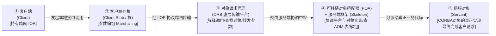

##### 3. CORBA 对象的抽象标识体系（IOR vs Object ID vs AOM）（题目 118 解析核心凝练）⭐⭐⭐

- **可互操作对象引用（`IOR`，Interoperable Object Reference）**：独立于程序设计语言和特定 ORB 产品的**跨网全局对象引用**。从客户程序角度看，`IOR` 中封装了服务端的 IP/端口、POA 层次路径、<strong>对象标识（`Object ID`）</strong>及接口类型，供 ORB 查找对象实现。
- **对象标识（`Object ID`）**：用于在**某个特定 POA 内部**唯一标识一个 CORBA 对象的字符串（既可由程序员手工指派 `USER_ID`，也可由对象适配器自动分配 `SYSTEM_ID`，在创建它的 POA 内必须唯一）。
- **活动对象映射表（`AOM`，Active Object Map）**：POA 内部维护的一张 `Object ID ↔ Servant 内存指针` 映射表。在一个 CORBA 对象的生命期中，它可能先后与多个不同的伺服对象（Servant）相关联。

> [!IMPORTANT]
> **CORBA 核心组件角色考场秒杀口诀（题 72 + 题 118 双剑合璧）**：
> - **“底层传输平台是【ORB】（解释调用找对象、传参返果软总线）；真正干活实现是【伺服对象 Servant】（CORBA 对象的真正实现、最终完成客户请求，秒选题 72-A & 题 118-空2）！”**
> - **“夹在底层平台（ORB）与对象实现（Servant）之间做【协调 / 屏蔽内核细节】的总管家，100% 秒选【可移植对象适配器 POA（题 118-D）】！”**
> - **“凡带『激活器 / 定位器』（伺服对象激活器 A、适配器激活器 B、伺服对象定位器 C）全是 POA 肚子里的按需懒加载小插件，见之即排！”**

  - 【软考题库章节练习】 2.3 节题目 72（CORBA服务端构件模型中，【**A. 伺服对象（Servant）**】是CORBA对象的真正实现，负责完成客户端请求）。

#### 架构描述语言（ADL）四大组成部分（组件、组件接口、连接件、架构配置）与一等公民特征（题库 2.3 节题目 111）⭐⭐⭐

[考查：综合知识（架构描述语言 ADL 四大组成部分［组件 + 组件接口 + 连接件 + 架构配置］、连接件作为一等公民 First-Class Citizen 区分 ADL 与其他建模语言的本质特征、组件接口 Port vs 连接件角色 Role vs 架构配置 Configuration 的组装关系、典型 ADL 语言 Wright / UniCon / C2 专长对比）]

在《系统架构设计师教程（第 2 版）》第 2 章 <strong>2.3 计算机软件（软件构件与架构描述）</strong>及第 8 章 <strong>8.1.4 架构描述语言（ADL）</strong>中，<strong>架构描述语言（Architecture Description Language, ADL）</strong>是一种在高于源代码实现的抽象层次上，为**明确说明软件系统的概念架构（Conceptual Architecture）并对这些概念架构建模**提供形式化功能的语言。

##### 1. ADL 四大语法组成部分（构造块）与干扰项全景辨析矩阵（题目 111 核心）⭐⭐⭐

$$\text{ADL 四大组成部分} = \underbrace{\text{组件（Component）}}_{\text{计算/数据单元（点）}} + \underbrace{\text{组件接口（Interface / Port）}}_{\text{组件对外交互点（插孔）}} + \underbrace{\mathbf{\text{连接件（Connector）}}}_{\text{组件间交互协议实体（线） ✅}} + \underbrace{\text{架构配置（Configuration）}}_{\text{Port 与 Role 绑定拓扑图（图）}}$$

| 要素 / 选项名称 | 是否属于 ADL 四大组成部分 | 对应的内部子概念与架构职责 | 题目 111 选项精准映射与排雷铁律 ⭐⭐⭐ |
| :--- | :---: | :--- | :--- |
| **1. 组件 / 构件**<br>*(Component)* | ✅ **是（第 1 要素）** | 承担计算或数据存储的独立单元（架构图中的“**节点**”）。 | 题干已给出第 1 项。 |
| **2. 组件接口**<br>*(Component Interface / Port)* | ✅ **是（第 2 要素）** | 组件与外部环境交互的一组访问点，在 ADL 中称为 **端口（Port）**（节点上的“**插孔**”）。 | 题干已给出第 2 项。 |
| **3. 连接件**<br>*(Connector)*<br>（✅ **题目 111 正解 C**） | ✅ **是（第 3 要素）** | 建立组件间交互关系、控制交互规则（如 RPC、管道、事件广播、共享数据访问）的**独立一等建模实体**（架构图中的“**连线/协议中介**”）；其交互端点称为 **角色（Role）**，协调逻辑称为 **粘合协议（Glue）**。 | ✅ **本题唯一正解 C（连接件）**：<br>① 补齐“组件 + 组件接口 + **连接件** + 架构配置”四元组；<br>② **ADL 对【连接件】的重视（将其提升为与组件平起平坐的一等公民），是区分 ADL 和其他建模语言（UML/编程语言）的最重要特征！** |
| **4. 架构配置**<br>*(Architecture Configuration)* | ✅ **是（第 4 要素）** | 将组件的 **端口（Port）** 与连接件的 **角色（Role）** 进行绑定关联（`Attachment`）所构成的整体拓扑连接图与约束规约。 | 题干已给出第 4 项。 |
| **5. 架构风格**<br>*(Architectural Style)*<br> | ❌ **否**<br>（属宏观分类范畴） | 对一族具有共同结构与语义约束的架构系统的**宏观经验模式分类**（如管道-过滤器风格、分层风格、C/S 风格、微内核风格）。 | 🚫 **本题头号误选陷阱（选项 A）**：<br>`架构风格`是跨系统的宏观分类词汇表，而非单个 ADL 模型内部用来连接组件接口的微观语法构造块！若把连接件换成架构风格，组件之间将彻底断连！ |
| **6. 架构实现 / 组件实现**<br>*(Implementation)*<br>（🚫 **选项 B / D**） | ❌ **否**<br>（属编码实现期） | 用 C++ / Java / Python 等传统程序设计语言编写的具体业务逻辑代码与数据结构实现。 | 🚫 **概念架构 vs 代码实现越界陷阱（排除 B、D）**：<br>题干明言 ADL 描述的是“**概念架构**”，故意屏蔽底层`架构实现（B）`与`组件实现（D）`细节！ |

##### 2. 三大经典 ADL 语言（Wright / UniCon / C2）核心特征速查表⭐⭐⭐

| 典型 ADL 语言 | 研发机构 | 核心技术特征与考场唯一判别题眼 ⭐⭐⭐ |
| :--- | :--- | :--- |
| **`Wright`** | 卡内基梅隆大学（CMU） | 基于 **CSP（通信顺序进程，进程代数）** 形式化定义连接件的交互协议（Glue 与 Role），擅长**自动形式化验证组件连接是否存在死锁（Deadlock）与协议兼容性**。 |
| **`UniCon`** | 卡内基梅隆大学（CMU） | 强调**异构构件组装与预定义连接件类型库**（内置 `Pipe`、`FileIO`、`ProcedureCall`、`RemoteProcCall`、`RTScheduler` 等连接件类型），支持从架构描述生成可执行系统。 |
| **`C2`** | 加州大学欧文分校（UCI） | 专门面向**基于异步消息/事件隐式调用的图形用户界面（GUI）系统**，组件间严禁直接过程调用，全部通过上下异步消息连接件（Message Bus）通信，支持运行时动态演化。 |

> [!IMPORTANT]
> **ADL 架构描述语言考场秒杀口诀**：
> - **“ADL 四件套：点是【组件】，孔是【组件接口（Port）】，线是【连接件（Connector，选 C）】，组装图是【架构配置（Configuration）】！”**
> - **“区分 ADL 与 UML/编程语言的灵魂铁律：唯有 ADL 把【连接件（Connector）】捧成一等公民！”**
> - **“见『概念架构』必排『架构实现/组件实现』（排 B/D）；『架构风格』是宏观流派分类，绝非模型内部连线（排 A）！”**

  - 【软考题库章节练习】 2.3 节题目 111（架构描述语言［Architecture Description Language, ADL］是一种为明确说明软件系统的概念架构和对这些概念架构建模提供功能的语言。ADL主要包括以下组成部分：组件、组件接口、【**C. 连接件**】和架构配置）。

#### 构件（Component）、原子构件（Atomic Component）、模块（Module）与资源（Resource）四级构成公式与部署边界辨析（题库 2.3 节题目 121）⭐⭐⭐

[考查：综合知识（Szyperski 构件规范定义：构件 = 一组需要同时部署的原子构件、原子构件 = 一个模块 + 一组资源［部署/版本控制/替换的基本单位，可被单独部署但通常随构件家族成组部署］、模块 = 不带单独资源的原子构件、Java 包为何在严格定义下不是模块）]

在《系统架构设计师教程（第 2 版）》第 2 章 **2.3.5 构件**（知识库大纲 `2.3.7 软件构件`）与第 7 章 **基于构件的软件开发（CBSD）** 中，教材引用 Clemens Szyperski《构件软件：超越面向对象编程》的严格定义，从**物理部署、版本控制与资源封装粒度**将构件体系划分为<strong>“构件（构件家族）— 原子构件 — 模块 — 资源”</strong>四级概念：

##### 1. 四级构成代数等式与部署边界全景对照表（题目 121 核心）⭐⭐⭐

$$\begin{aligned}
\text{构件（Component）} &= \text{一组通常需要同时部署的原子构件（同一构件家族）} \\
\text{原子构件（Atomic Component）} &= \mathbf{\text{1 个模块（Module）} + \text{1 组资源（A Set of Resources）}} \\
\text{模块（Module）} &= \mathbf{\text{不带单独资源的原子构件（仅含编译后的类/过程/函数）}}
\end{aligned}$$

| 概念层级 | 教材标准定义与代数构成关系 | 部署、版本控制与家族归属特性 | 题目 121 选项真伪映射与排雷铁律 ⭐⭐⭐ |
| :--- | :--- | :--- | :--- |
| **1. 构件**<br>**（`Component`）** | **是一组通常需要同时部署的原子构件** | 一次部署往往涉及整个<strong>构件家族（Component Family）</strong>中的所有原子构件。 | ✅ **本题唯一正解 A**：<br>`构件包含了一组需要同时部署的原子构件`（100% 命中教材定义原话）。 |
| **2. 原子构件**<br>**（`Atomic Component`）** | **是一个模块（Module）和一组资源（Resources）** | ① **是部署、版本控制和替换的基本单位**；<br>② 大多数原子构件永远不会被单独部署（通常成组地部署），**尽管它们可以被单独部署**；<br>③ 大多数原子构件只属于**一个构件家族**。 | 🚫 **排 B（原子构件不能被单独部署）**：<br>把“通常成组部署、大多数永不单独部署”绝对化为“不能被单独部署”！技术上它**能够被单独部署**。<br>🚫 **排 C（可在多个构件家族中共享）**：<br>大多数原子构件隶属于单一构件家族，随该家族整体部署。 |
| **3. 模块**<br>**（`Module`）** | **是不带单独资源的原子构件**（一组类和可能的非面向对象结构体，如过程或函数） | 纯代码编译产物；**在严格定义下，Java 包（`package`）不是模块**——因为 Java 中部署的单元是 `.class` 类文件，一个单独的包被编译成多个单独的类文件（每个公共类都有一个）。 | 🚫 **选项辨析 D（一个模块可以看作带有单独资源的原子构件）**：<br>犯了<strong>“有无颠倒 / 包含关系倒置”</strong>错误！带资源的是**原子构件**（$\text{模块}+\text{资源}$），而**模块是不带单独资源的原子构件**！ |
| **4. 资源**<br>**（`Resource`）** | 除可执行代码外的**类型化固定项**（如图标、位图、配置文件、国际化字符串表等） | 与模块一起打包封装在原子构件内，不可脱离宿主原子构件独立成为版本控制基本单位。 | 辅助判别“原子构件 vs 模块”的唯一差集（$\text{原子构件} - \text{模块} = \text{一组资源}$）。 |

> [!IMPORTANT]
> **构件—原子构件—模块四级关系考场秒杀口诀**：
> - **“构件是同部署的原子构件群（秒选 A）；原子构件 = 1 模块 + 1 组资源（版本替换基本单位，可独部署但常成组，排 B/C）；模块 = 无单独资源的裸原子构件（D 说带有资源必错）！”**
> - **“Java 包（package）不是严格模块：一包编译出多个 `.class` 文件，并非单一部署单元！”**

  - 【2016 年下半年系统架构设计师上午真题 Q41 / 题库 2.3 节题目 121】（关于构件的描述，正确的是【**A. 构件包含了一组需要同时部署的原子构件**】）。

#### CORBA 体系结构三层模型（最底层软总线 ORB vs 中间层公共对象服务 COS vs 最上层公共设施）与服务端组件定位（题库 2.3 节题目 149）⭐⭐⭐

[考查：综合知识（OMG 对象管理体系结构 OMA / CORBA 自底向上三层结构：最底层对象请求代理 ORB［分布对象系统中的“软总线”］、中间层公共对象服务 COS［提供命名/生命周期/事务/安全等系统级基础服务］、最上层公共设施 Common Facilities［提供高层业务对象服务与应用框架］，以及与对象适配器 POA / 伺服对象 Servant 的横向区分）]

在《系统架构设计师教程（第 2 版）》第 2 章 **2.3.5 构件 / 2.3.6 中间件**（知识库大纲 `2.3.7 软件构件`）与第 7 章 **基于构件的软件开发（CBSD）** 中，OMG 制定的 **CORBA（Common Object Request Broker Architecture，公共对象请求代理体系结构）** 采用了经典的**自底向上三层体系结构**，并以最底层的 **ORB（对象请求代理）** 作为贯穿全局的<strong>“软总线（Software Bus）”</strong>：

##### 1. CORBA 体系结构自底向上三层模型与服务端组件对照表（题目 149 核心）⭐⭐⭐

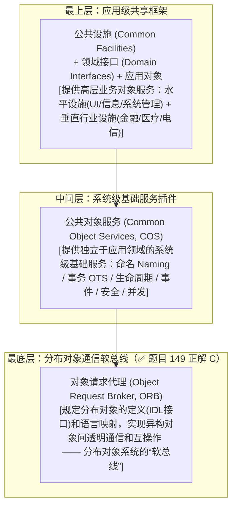

| 层次 / 组件名称 | 英文全称与缩写 | 所在架构层级 | 教材标准职责与考场唯一题眼词 | 题目 149 选项真伪映射与排雷铁律 ⭐⭐⭐ |
| :--- | :--- | :--- | :--- | :--- |
| **1. 对象请求代理** | `Object Request Broker`（**`ORB`**） | **最底层（通信底座）** | **规定了分布对象的定义（接口）和语言映射，实现对象间的通信和互操作，是分布对象系统中的“软总线”** | ✅ **本题唯一正解 C（对象请求代理）**：<br>`CORBA` 缩写核心即为 `ORB`；见题眼 **“软总线（Software Bus）”** 100% 秒选 **`对象请求代理（ORB）`**！ |
| **2. 公共对象服务** | `Common Object Services`（**`COS`**） | **中间层（系统级基础服务）** | 在 ORB 之上提供独立于应用领域的**基础对象服务**（命名服务 Naming、生命周期服务、事件服务、事务服务 OTS、并发控制、持久性、安全服务） | 🚫 **选项辨析 B（公共对象服务）**：<br>受 `CORBA` 首字母 `C-O` 字面诱导误选！`COS` 是**插在 ORB 软总线上的基础服务模块**，而非软总线本身。 |
| **3. 公共设施** | `Common Facilities`（**`CF`**） | **最上层（应用级通用框架）** | 面向终端应用提供**高层业务对象服务**（分水平设施如用户界面/信息管理/系统管理，和垂直领域设施如电信/医疗/金融） | 🚫 **排 A（公共设施）**：<br>位于最上层，提供高层应用业务对象服务，不承担底层通信总线职责。 |
| **4. 对象适配器** | `Object Adapter` / `POA` | **服务端转接桥梁** | **用于屏蔽 ORB 内核的实现细节**，在底层传输平台（ORB）与对象实现（Servant）之间进行协调，管理对象引用（IOR）与激活 | 🚫 **排 D（对象适配器）**：<br>服务端内部转接管家，题眼是“**屏蔽 ORB 内核实现细节 / 在底层传输与对象实现间协调**”。 |

> [!IMPORTANT]
> **CORBA 专项真题题眼横向秒杀口诀**：
> - **“最底层 `ORB（对象请求代理）` 是【软总线】（秒选 C）；中间层 `公共对象服务（COS）` 管【命名/事务/生命周期基础服务】（排 B）；最上层 `公共设施` 管【高层业务对象框架】（排 A）！”**
> - **“服务端三剑客：问【软总线/解释调用找对象】选 `ORB`；问【屏蔽 ORB 内核细节/底层与实现协调】选 `对象适配器（POA）`；问【CORBA 对象的真正实现】选 `伺服对象（Servant）`！”**

  - 【软考题库章节练习】 2.3 节题目 149（CORBA架构中，作为"软总线"的是【**C. 对象请求代理**】）。

### 2.3.8 应用软件

#### Redis 主从复制与 RDB/AOF 持久化（题目 228）⭐⭐⭐

[考查：应用软件与分布式数据存储（Redis 主从全量复制、增量复制、RDB 快照与 AOF 日志持久化）]

题库第 228 题为 Redis 缓存与主从复制独立案例，包含全量同步流程填空、增量同步流程填空，以及比较两种持久化方式。

##### 1. 主从全量同步与增量命令传播 ⭐⭐⭐

**全量复制流程：**

1. 从库向主库发起同步请求（初次同步可用 `SYNC`；现代协议通常由 `PSYNC` 发起）。
2. 主库通过 `BGSAVE` 生成 RDB 快照。
3. 生成快照期间，主库把新收到的写命令暂存到复制缓冲区。
4. 主库把 RDB 文件发送给从库；从库清理旧数据并载入快照。
5. 主库再把缓冲区中的增量写命令发送给从库执行，追上主库当前状态。

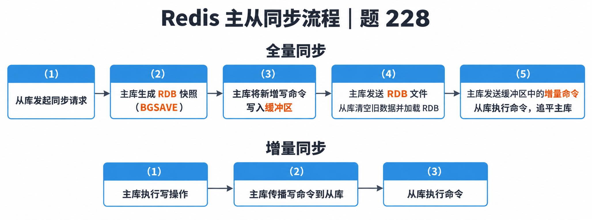

<strong>题目所称的增量同步流程：</strong>`主库执行写操作 → 主库传播写命令到从库 → 从库执行命令`。这描述复制建立后的持续命令传播。若题目讨论的是断线重连后的**部分重同步**，则现代 `PSYNC` 会用复制 ID 与偏移量定位缺失命令；主库复制积压缓冲区仍保有该命令区间时可部分重同步，否则退化为全量复制。两种“增量”语境不要混为一谈。

##### 2. RDB 与 AOF 持久化比较 ⭐⭐⭐

| 方式 | 记录内容与恢复 | 优点 | 代价与风险 |
|:---|:---|:---|:---|
| **RDB** | 在指定时点生成数据集快照；恢复时直接载入快照 | 文件紧凑、恢复较快，适合备份与灾难恢复 | 两次快照之间的最新写入可能丢失；`BGSAVE` 的 `fork` 及写时复制会带来短暂停顿和额外内存压力 |
| **AOF** | 追加记录改变数据集的写命令；恢复时重放命令日志 | 按配置可获得更高的数据持久性；日志可读、便于排查；可通过重写压缩冗余命令 | 通常比 RDB 大，重放恢复较慢；重写会消耗资源。`appendfsync everysec` 是常见折中，故障时通常最多丢失约一秒写入（取决于配置与故障情形） |

**考场作答口诀**：RDB“快照、小、恢复快、可能丢最后一段”；AOF“写命令日志、持久性更细、文件/恢复开销较大”。不要把 AOF 的刷盘策略说成无条件实时落盘。

- **题源与参考答案**：[2025 年上半年系统架构设计师案例分析整理](https://github.com/YoungHong1992/ruankao-senior-architecture-designer/blob/main/02.%E5%8E%86%E5%B9%B4%E7%9C%9F%E9%A2%98%28%E8%A1%A5%E5%85%85%29/2025%E5%B9%B4%E4%B8%8A%E5%8D%8A%E5%B9%B4-%E7%B3%BB%E7%BB%9F%E6%9E%B6%E6%9E%84%E8%AE%BE%E8%AE%A1%E5%B8%88-%E6%A1%88%E4%BE%8B%E5%88%86%E6%9E%90.md)
- **官方机制说明**：[Redis replication](https://redis.io/docs/latest/manual/replication/)；[Redis persistence](https://redis.io/docs/latest/operate/oss_and_stack/management/persistence/)

## 2.4 嵌入式系统及软件

### 2.4.1 嵌入式系统的组成及特点

#### 嵌入式系统层次架构与硬件抽象层（HAL / BSP）核心职责、层间边界与软硬件并行设计机理（题库 2.4 节题目 14）⭐⭐⭐

[考查：综合知识（嵌入式系统四层架构、硬件抽象层 HAL 核心作用［隐藏硬件多样性、隔离操作系统与硬件平台、使软硬件设计与调试并行］、HAL 与 OS 内核职责边界［任务调度属于 OS 内核而非 HAL］）]

在《系统架构设计师教程（第 2 版）》第 2 章 **2.4 嵌入式系统及软件**（及第 16 章嵌入式系统架构设计）中，**硬件抽象层（HAL，Hardware Abstraction Layer，常以板级支持包 BSP 形式实现）** 位于**嵌入式硬件平台**与**嵌入式操作系统内核**之间，为操作系统和上层应用提供了一组标准化的硬件访问接口。

##### 1. 嵌入式系统四层标准架构与各层职责边界全景矩阵 ⭐⭐⭐

| 架构层次（由上至下） | 核心组成模块 | 核心职责（考场唯一定位题眼） | 是否包含在 HAL 内 |
| :--- | :--- | :--- | :---: |
| **4. 应用软件层**<br>*(Application Layer)* | 领域控制算法、GUI 交互、业务逻辑 | 实现面向特定行业场景的业务应用功能，调用 OS 系统调用 API。 | ❌ 否 |
| **3. 嵌入式操作系统层**<br>*(OS Kernel Layer)* | **任务调度器（Task Scheduler）**、进程/线程同步与通信（IPC）、内存管理、文件系统、通用设备驱动框架 | **负责任务调度、多任务并发同步、虚拟/物理内存分配、中断高层分发与设备统一管理**。 | ❌ **否（题目 14 正解 D 设陷点）** |
| **2. 硬件抽象层**<br>*(HAL / BSP Layer)* | 硬件初始化（Bootloader/上电自检）、寄存器映射、底层 I/O 操作、硬件相关中断处理入口、板级底层驱动 | ① **向操作系统隐藏底层硬件的多样性**（A 对）；<br>② **将操作系统与硬件平台隔开**（B 对）；<br>③ **提供标准化软硬件接口契约，使软硬件的设计与调试可以并行**（C 对）。 | ✅ **是（HAL 本层职责）** |
| **1. 嵌入式硬件平台**<br>*(Hardware Platform)* | 嵌入式微处理器（MPU/MCU/DSP/SoC）、存储器（Flash/RAM）、外围接口电路与传感器 | 提供底层物理运算、存储与外设电信号交互通路。 | ❌ 否 |

##### 2. 题目 14 选项真伪映射与考场高频设陷排雷表 ⭐⭐⭐

| 选项内容 | 正误判定 | 底层架构因果机理与考场排雷铁律 ⭐⭐⭐ |
| :--- | :---: | :--- |
| **A. 硬件抽象层与硬件密切相关，可对操作系统隐藏硬件的多样性** | ✅ **正确** | HAL 向下直接操作目标板寄存器与特定 CPU 架构（与硬件密切相关），向上把异构硬件包装成统一接口，使 OS 无需感知硬件差异。 |
| **B. 硬件抽象层将操作系统与硬件平台隔开** | ✅ **正确** | HAL 是夹在 OS 内核与物理硬件之间的“隔离桥接层”，OS 通过调用 HAL 标准接口间接控制硬件，大幅提升 OS 的跨平台可移植性。 |
| **C. 硬件抽象层使软硬件的设计与调试可以并行**| ✅ **正确** | **【反直觉高频真命题】**：只要在设计初期先行锁定 **HAL 标准接口规范（API 契约）**，上层软件团队即可面向 HAL 接口（利用仿真器或桩函数 Stub）独立设计调试 OS 与应用，而硬件团队同步进行 PCB 制板与 HAL 底层实现，变“硬件先、软件后”的串行开发为**软硬件并行设计与调试**！ |
| **D. 硬件抽象层应包括设备驱动程序和任务调度**<br>*(✅ 本题应选错误项)* | ❌ **错误（本题正解）** | **【跨层张冠李戴】**：<strong>任务调度（Task Scheduling）</strong>是<strong>嵌入式操作系统内核（OS Kernel）</strong>最核心的职责，绝不属于硬件抽象层（HAL）；且通用设备驱动程序通常位于 OS 内核层，仅底层板级硬件接口驻留 HAL。 |

> [!IMPORTANT]
> **嵌入式硬件抽象层（HAL）考场秒杀口诀**：
> - **“HAL 夹在硬与核，向下贴硬向上统；一藏硬件多样性（A 对），二把系统硬件隔（B 对），三定接口促并行（软硬件设计调试可并行，C 对勿误选）！”**
> - **“一见【任务调度 / 内存管理 / 文件系统】塞进 HAL，必是越界抢了【OS 内核】的饭碗，100% 判错秒选 D！”**

### 2.4.2 嵌入式系统的分类

#### 实时系统：时间约束、分类与错误到失效链（题库题目 20）

[考查：案例分析（实时系统定义与特征；强/弱实时；时间类别、时间需求与工作方式结构；Error、Defect、Fault、Failure 的阶段和边界）]

实时系统需要在规定时限内响应外部事件并完成计算或控制任务。系统正确性同时取决于输出逻辑和响应时间；超过截止时间可能使结果失去用途。主要特征包括时间约束、可预测性、高可靠性、与外部环境交互、多任务并发，以及任务时限和负载约束复杂。

| 分类维度 | 判定项 | 分类或表现 |
|:---|:---|:---|
| 时间类别 | 时限违约的危害程度 | 强实时、弱实时 |
| 时间类别 | 时间角色 | 时间明确、时间响应 |
| 时间需求 | 需求内容 | 时限/反应时间、输入/输出激励、周期/零星/非周期 |
| 工作方式结构 | 触发方式 | 时间触发、事件触发 |

**错误、缺陷、故障与失效**按阶段和可见性区分：错误通常由开发人员在生命周期中引入；缺陷存在于需求、设计、代码、数据等工作产品中；缺陷在运行条件下被触发时可形成软件内部故障；故障导致对外行为偏离要求时，用户经历到失效。标准术语的细分口径会随上下文变化；本题按图示的生命周期链条作答。ISO/IEC/IEEE 24765 将 defect 描述为工作产品不符合要求的瑕疵或不足，将 fault 描述为软件中错误的表现或可能导致错误的系统缺陷，并说明遇到 fault 可能产生 failure；failure 是系统不能履行所需功能或对规格产生外部可见偏离。

- **术语来源**：[ISO/IEC/IEEE 24765:2017](https://swehb.nasa.gov/download/attachments/16450104/c071952_ISO_IEC_IEEE_24765_2017.pdf?api=v2)

### 2.4.3 嵌入式软件的组成及特点

#### 嵌入式系统初始化三环节（片级初始化 → 板级初始化 → 系统级初始化）自底向上流程与边界辨析（题库 2.4 节题目 13）⭐⭐⭐

[考查：综合知识（嵌入式系统启动/Bootloader 自底向上三环节次序：片级初始化 $\to$ 板级初始化 $\to$ 系统级初始化、各阶段物理与逻辑控制范围、纯硬件过程 vs 软硬件交界过程 vs 软件为主过程边界辨析）]

在《系统架构设计师教程（第 2 版）》第 2 章 <strong>2.4.3 嵌入式软件的组成及特点（引导加载程序 Bootloader 与 BSP 初始化）</strong>及第 16 章 **嵌入式系统软件架构**中，嵌入式系统上电复位后的初始化过程按照**自底向上（物理空间尺度从微处理器芯片内部 $\to$ 印制电路板外围硬件 $\to$ 整个操作系统与软件环境）、从硬件到软件**的次序，严格依次划分为 **`片级初始化` $\rightarrow$ `板级初始化` $\rightarrow$ `系统级初始化`** 三个环节：

##### 1. 嵌入式系统初始化三环节全维度正交对比矩阵（题目 13 核心）⭐⭐⭐

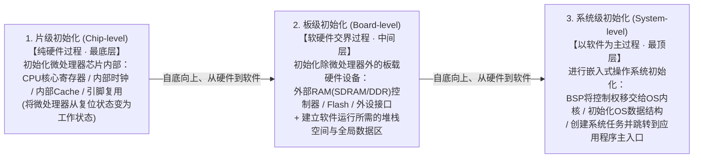

| 初始化阶段次序 | 环节名称 | 性质属性定位 | 控制物理/逻辑范围 | 核心执行的初始化任务（考场归属判别词） | 题目 13 选项真伪与排雷铁律 ⭐⭐⭐ |
| :---: | :--- | :--- | :--- | :--- | :--- |
| **第 1 步**<br>（最底层） | **片级初始化**<br>*(Chip-level Initialization)* | **纯硬件过程** | **微处理器芯片内部**<br>（CPU Core & On-Chip） | 设置微处理器核心寄存器、关闭中断、配置芯片内部时钟（PLL）、初始化内部指令/数据 Cache 与内部总线，**将微处理器从上电复位状态变为工作状态**。 | ✅ **自底向上第 1 站**：<br>CPU 自身若未完成内部寄存器与时钟初始化，根本无法通过外部总线去访问电路板上的其他芯片！ |
| **第 2 步**<br>（中间层） | **板级初始化**<br>*(Board-level Initialization)* | **软硬件交界过程** | **印制电路板（PCB）外围硬件设备** | 初始化**除微处理器以外的其他板载硬件设备**（如外部 SDRAM/DDR 内存控制器、Flash、GPIO、UART/网卡控制器、中断控制器），并在 RAM 中**初始化软件运行所需的堆栈（Stack）指针与全局变量数据区**。 | ✅ **自底向上第 2 站（承上启下）**：<br>为接下来的操作系统内核加载准备好可用的主存空间（RAM）和 C 语言运行堆栈环境。 |
| **第 3 步**<br>（最顶层） | **系统级初始化**<br>*(System-level Initialization)* | **以软件为主的过程** | **嵌入式操作系统（OS）与应用软件层** | **BSP 将控制权移交给嵌入式操作系统**，完成操作系统内核数据结构初始化、内存管理/文件系统挂载、多任务调度器启动、创建系统级与应用级任务。 | ✅ **本题唯一正解 B（`片级初始化→板级初始化→系统级初始化`）**；<br>🚫 ：误将最高抽象层的“系统级（OS 软件）”当成了最底层的硬件前提！ |

> [!IMPORTANT]
> **嵌入式系统初始化三环节考场秒杀口诀**：
> - **“自底向上硬到软，先芯（片级）后板（板级）再系统（系统级，秒选 B）！”**
> - **“片级纯硬管芯片（CPU 寄存器与内钟），板级交界管外设（外部 RAM 与建堆栈），系统纯软管 OS（移交内核建任务）！”**

  - 【软考题库章节练习 / 历年真题】 2.4 节题目 13（嵌入式系统初始化过程主要有 3 个环节，按照自底向上、从硬件到软件的次序依次为【**B. 片级初始化→板级初始化→系统级初始化**】）。

#### 实时操作系统（RTOS）任务调度器核心机制：抢占方式（可剥夺）vs 时间片轮转及静态/动态优先级算法（RMS / EDF / LLF）（题库 2.3 节题目 112）⭐⭐⭐

[考查：综合知识（RTOS 调度首要目标［及时性/可预测性 vs 分时公平性］、大多数 RTOS 调度算法采用抢占方式［可剥夺方式］、为何 RTOS 不都采用时间片轮转［μC/OS-II 优先级唯一无时间片 vs VxWorks 同优先级辅助轮转］、静态优先级 RMS vs 动态优先级 EDF/LLF 辨析）]

在《系统架构设计师教程（第 2 版）》第 2 章 **2.3.2 操作系统 / 2.4.3 嵌入式软件**及第 16 章 **嵌入式实时操作系统（RTOS）任务调度**中，实时操作系统是指当外界事件或数据产生时，能够接受并以足够快的速度予以处理，其处理的结果又能在规定的时间（Deadline）之内来控制生产过程或对处理系统作出快速响应的操作系统。

##### 1. RTOS 任务调度器 vs 通用分时系统调度器四维正交辨析矩阵（题目 112）⭐⭐⭐

| 对比维度 | **实时操作系统（RTOS）任务调度器**<br>*(题干设问核心)* | **通用分时操作系统（TSOS）调度器**<br>*(选项 A / C 混淆源)* | 对应选项真伪判定与考场排雷铁律 ⭐⭐⭐ |
| :--- | :--- | :--- | :--- |
| **1. 首要调度目标** | **及时响应（满足截止时间 Deadline）与可预测性（确定性 Determinism）** | **任务之间的公平性（Fairness）**、平均周转时间与系统吞吐量 | 🚫 **排 A（任务之间的公平性是最重要的调度目标）**：<br>RTOS 中高优先级紧急任务具有绝对特权，绝不与低优先级任务讲“平均公平”！ |
| **2. 核心剥夺方式** | **大多数 RTOS 调度算法都是抢占方式（可剥夺方式，Preemptive）** | 分时时间片轮转与动态优先级结合 | ✅ **本题唯一正解 B**：<br>一旦高优先级实时任务就绪，内核必须立即剥夺当前低优先级任务的 CPU 使用权，确保紧急事件不超期。 |
| **3. 时间片轮转（RR）支持边界**| **并非所有 RTOS 都采用时间片轮转！**<br>- **纯抢占无轮转**：如 **`μC/OS-II`** 要求最多 64 个任务的**优先级必须互不相同**，完全不支持时间片轮转；<br>- **同优先级辅助轮转**：如 `VxWorks` / `FreeRTOS` 仅在**多个任务处于相同优先级**时，才可选启用时间片轮转作为次级辅助策略。 | 以<strong>基于时间片轮转（Round-Robin）</strong>作为交互式任务分时共享 CPU 的核心机制 | 🚫 **本题头号误选陷阱（选项 C：RTOS 调度器都采用了基于时间片轮转的调度算法）**：<br>“都采用了”犯了全称绝对化与阵营张冠李戴错误！时间片轮转是为了“雨露均沾”，而 RTOS 主干是“高优独占抢占”。 |
| **4. 优先级算法体系**| **同时包含静态优先级算法与动态优先级算法**，且现代商用 RTOS 支持多策略混合调度 | 多级反馈队列动态调整 | 🚫 **排 D（大多数 RTOS 调度算法只采用一种静态优先级调度算法）**：<br>除静态优先级（`RMS`）外，RTOS 广泛支持动态优先级（`EDF`、`LLF`）及混合调度。 |

##### 2. RTOS 三大经典实时优先级调度算法（`RMS` vs `EDF` vs `LLF`）对比速查表⭐⭐⭐

| 算法名称 | 英文全称 | 优先级类型 | 优先级分配核心判据（考场唯一题眼） | 单核可调度 CPU 利用率理论上界 |
| :--- | :--- | :---: | :--- | :---: |
| **1. `RMS`** | **Rate Monotonic Scheduling**<br>（单调速率调度） | **静态优先级**<br>（Static） | **按任务的周期 $T_i$ 固定分配**：<br>**周期 $T_i$ 越短（执行频度/速率越高），静态优先级越高**；运行期恒定不变 | $$U \le n(2^{1/n} - 1) \xrightarrow{n \to \infty} \ln 2 \approx 69.3\%$$ |
| **2. `EDF`** | **Earliest Deadline First**<br>（最早截止期优先） | **动态优先级**<br>（Dynamic） | **按任务的绝对截止时间 $d_i$ 动态分配**：<br>**当前距离截止期 $d_i$ 越近（截止时间越早）的任务，动态优先级越高** | $$U = \sum_{i=1}^{n} \frac{C_i}{T_i} \le 100\%$$ |
| **3. `LLF`** | **Least Laxity First**<br>（最低松弛度优先） | **动态优先级**<br>（Dynamic） | **按任务的剩余松弛时间 $L_i = (d_i - t) - c_i'$ 动态分配**：<br>**松弛度 $L_i$（可再拖延时间）越小，紧急程度越高，动态优先级越高**（当 $L_i = 0$ 时必须立即抢占执行） | $$U \le 100\%$$ |

> [!IMPORTANT]
> **RTOS 任务调度器考场秒杀口诀**：
> - **“分时图公平（排 A）用时间片轮转（排 C）；实时保死线（Deadline），大多数 RTOS 必用【抢占方式 / 可剥夺方式】（秒选 B）！”**
> - **“μC/OS-II 六十四任务优先级唯一（无时间片轮转）；实时优先级分两派：静态看周期（`RMS` 周期短优先），动态看死线与松弛度（`EDF` 截止早优先、`LLF` 松弛小优先，排 D）！”**

  - 【软考题库章节练习】 2.3 节题目 112（以下关于实时操作系统［RTOS］任务调度器的叙述中，正确的是【**B. 大多数RTOS调度算法都是抢占方式（可剥夺方式）**】）。

#### 多周期实时任务调度、时间性能评估与 I/O 驱动选择（题库题目 21/22）

[考查：案例分析（RTOS 选型；多周期任务的时间性能评估与时序安排；短周期优先；串口中断、双口存储器/离散量查询、A/D 与 D/A 驱动选择）]

RTOS 适合由多个周期任务构成的嵌入式控制系统。任务调度器管理任务的优先级与执行次序；事件、信号量和任务间通信支持同步，并处理共享资源互斥。成熟的商用 RTOS 可以减少底层调度与同步机制的重复开发，缩短开发周期。选型时重点比较上下文切换时间、中断响应时间、内核占用空间、服务接口丰富度与开放性、可靠性支持、开发工具和目标板支撑、配置与裁剪能力。

| 任务 | 周期 | 单次处理时间 | 输入/输出需求 | 参考处理方式 |
|:---|---:|---:|:---|:---|
| 5 ms 任务 | 5 ms | 约 1 ms | 从 1024 KB 双口存储器采集输入数据 | 查询访问 |
| 20 ms 任务 | 20 ms | 约 4 ms | 两路 115200 Hz 的 422 接口采集 64 B 数据；分别输出 16 B 控制命令 | 422 接口中断驱动 |
| 60 ms 任务 | 60 ms | 约 2 ms | 两路 38400 Hz 的 422 接口采集 6 B；两路 A/D 采集 28 位；输出 2 B 命令、一路 28 位 D/A 数据和 8 路离散量 | 422 中断驱动；双口存储器/离散量查询；A/D、D/A 定时查询并让出 CPU |
| 1 s 监控任务 | 1 s | 约 5 ms | 检测软硬件状态并记录运行状态 | 按周期调度 |

**时间性能评估**包括操作系统时间开销、任务能否在各自期限内完成（可调度性）、上下文切换时间和中断响应时间。题库参考答案把操作系统开销控制在控制系统运行时间总开销的 20% 以内作为评估要求。

**时序与优先级**：以 5 ms 为基本节拍，短周期任务优先，优先级从高到低为 **5 ms > 20 ms > 60 ms > 1 s**（从低到高则相反）。每个 5 ms 边界先执行 5 ms 任务，之后继续被中断的任务；到达 20 ms、60 ms、1 s 周期边界时，再调度相应的到期任务。题库把 1 s 称为最长工作周期/主时间框架；若“重复周期”指四类任务的完整释放模式，精确超周期为 $\operatorname{lcm}(5,20,60,1000)=3000$ ms（3 s）。

**I/O 选择依据**：422 串口的传输速度远低于处理器，采用中断驱动可以免去等待数据时的忙轮询；双口存储器和离散量接口可直接访问，按查询方式处理即可；A/D、D/A 转换存在等待时间，采用定时查询，并在等待期间让出处理器。

#### 嵌入式系统软件低功耗设计：三大设计技术（软硬件协同设计、编译优化技术、算法优化）与仿真实验边界辨析（2018年下半年 题目11）⭐⭐⭐

[考查：综合知识（嵌入式低功耗设计三大支柱：软硬件协同设计、编译优化技术、算法优化；低功耗设计技术 vs 测试验证/仿真实验手段边界辨析；DPM/DVFS/Race-to-sleep 机制）]

在《系统架构设计师教程（第 2 版）》第 2 章 **2.4.3 嵌入式软件的组成及特点**与第 16 章 **嵌入式系统架构设计**中，低功耗是移动互联、物联网与电池供电设备的核心设计指标。系统功耗主要分为静态功耗（漏电流功耗）和动态功耗（$P_{\text{dynamic}} = \alpha \cdot C \cdot V^2 \cdot f$）。虽然电能直接消耗在硬件电路上，但**软件行为决定了硬件模块的运行状态、执行时长和活跃占空比**。因此，软件低功耗设计是嵌入式系统低功耗体系的重要支柱。

##### 1. 嵌入式软件低功耗设计三大核心技术途径对比矩阵 ⭐⭐⭐

| 技术途径 | 英文名称 | 核心机制与作用机理 | 典型实现策略与软硬件工程体现 ⭐⭐⭐ | 考场设陷与标准判别词 ⭐⭐⭐ |
| :--- | :--- | :--- | :--- | :--- |
| **1. 软硬件协同设计**<br>*(Hardware/Software Co-design)*<br>（✅ 正解支柱 1） | 充分利用硬件提供的低功耗特性，软件与硬件紧密匹配，按负载动态管理硬件电源域与时钟 | - **动态电源管理（DPM）**：在系统空闲或轻载时，软件控制关闭非活动外设电源或让处理器进入休眠（Sleep / Deep Sleep）；<br>- **动态电压与频率调节（DVFS）**：软件根据当前计算负荷预测，动态降低工作时钟频率与供电电压（因功耗 $P \propto V^2 f$，降压降频可显著节能）；<br>- **用“中断”代替“轮询”**：无外部事件时 CPU 休眠，事件到来通过中断唤醒处理，消除空转功耗。 | ✅ 凡涉及**电源状态管理、DVFS/DPM、中断唤醒**，均属软硬件协同设计范畴。 |
| **2. 编译优化技术**<br>*(Compile-time Optimization)*<br>（✅ 正解支柱 2） | 利用针对低功耗专门优化的编译器，在代码生成与指令调度阶段减少能耗 | - **指令重排**：降低总线信号线翻转频率（Bus Switching Activity / Hamming 距离最小化），减少充放电功耗；<br>- **寄存器分配优化**：尽量将变量分配在寄存器中，减少片外高功耗内存/Flash 访存；<br>- **优化循环与分支**：循环展开（Loop Unrolling）减少跳转开销，降低指令流水线刷新能耗。 | ✅ 凡涉及**编译器指令调度、减少总线翻转、寄存器优化**，均属编译优化技术范畴。 |
| **3. 算法优化**<br>*(Algorithm Optimization)*<br>（✅ 正解支柱 3） | 降低算法时间复杂度与访存开销，减少 CPU 持续高功耗运行时间 | - **Race-to-sleep 策略**：优化算法复杂度，让计算尽快完成并以最快速度重新进入低功耗休眠模式；<br>- **降低访存频度**：提升数据局部性，充分发挥 Cache 作用，避免频繁访问高功耗外部存储介质；<br>- **定点化计算**：对无 FPU 的嵌入式微处理器，用定点数运算替代浮点数软模拟，大幅缩减执行指令周期。 | ✅ 凡涉及**算法复杂度优化、缩短活跃运行时间、提高计算能效**，均属算法优化范畴。 |
| **4. 仿真实验** ❌<br>*(Simulation Experiment)*| 在宿主机上利用软件模型或硬件仿真器对系统功能、性能与功耗进行模拟评估 | - **属于测试、验证与评估阶段的方法与工具**，不改变目标软件在真实嵌入式硬件运行时的物理功耗特性；<br>- 仿真本身只能“测量/评估功耗”，绝非“软件低功耗设计技术”！ | 🚫 **头号范畴混淆陷阱（选项 C）**：<br>切勿将**测试验证手段（仿真实验）**与**系统设计技术（Design Technique）**混为一谈！ |
| **5. 过程/环境优化** ❌<br>*(选项 B 干扰项)* | 开发过程优化（敏捷/瀑布管理）与开发环境优化（IDE/工位环境） | - 属于项目管理流程与办公/辅助环境范畴，与目标嵌入式软件的能耗控制无直接关系。 | 🚫 凡将开发流程、工具环境作为软件低功耗技术的，直接排除。 |

> [!IMPORTANT]
> **嵌入式软件低功耗设计考场秒杀口诀**：
> - **“软件低功耗三支柱：软硬协同（DPM/DVFS/中断换轮询）、编译优化（指令重排少翻转）、算法优化（算得快好休眠，秒选 D）！”**
> - **“防坑排雷双铁律：一排过程/环境管理（选项 B），二排仿真实验（仿真仅是测试验证手段，非设计技术，排 C）！”**

  - 【2018年下半年 综合知识上午题 第11题】（嵌入式系统设计一般要考虑低功耗，软件设计也要考虑低功耗设计，软件低功耗设计一般采用【**D. 编译优化技术、软硬件协同设计和算法优化**】）。

### 2.4.4 安全攸关软件的安全性设计

#### 嵌入式软件分层架构（Layered Architecture）的单向依赖特性、两大固有脆弱性与层桥接（Layer Bridging）权衡（题库 2.3 节题目 40）⭐⭐⭐

[考查：综合知识 / 案例分析（软件脆弱性 Vulnerability vs 外部威胁 Threat 定义、嵌入式分层架构的两大固有脆弱性：底层发生错误会导致整个系统无法正常运行 + 层与层之间引入通信机制势必造成性能下降、严格分层 vs 开放分层/层桥接跨层调用权衡）]

1. **分层架构（Layered Pattern）单向依赖机理与两大固有脆弱性 2×2 辨析矩阵**：

| 维度拆解 | 架构机理与客观固有特征 | 对应正误选项判定（题目 40） | 考场设陷与排雷铁律 ⭐⭐⭐ |
| :--- | :--- | :--- | :--- |
| **前半句：错误传播方向**<br>（底层错误 vs 上层错误） | 分层架构遵循严格的**单向向下依赖（上层依赖下层，无循环依赖）**。硬件驱动/OS 内核位于底层，应用位于顶层。<br>👉 **底层发生错误会导致整个系统无法正常运行**；而上层错误通常局限于该单一应用模块内。 | ✅ **前半句必选“底层发生错误会导致整个系统无法正常运行”**（保留 A、B；直接排除 C、D） | **地基塌则整栋楼倒，顶楼漏水不塌地基**：凡写“上层发生错误导致整个系统无法运行”（C、D），1 秒排除！ |
| **后半句：固有架构脆弱性**<br>（通信性能下降 vs 功能引用失效） | <strong>脆弱性（Vulnerability）</strong>是系统架构内部**客观、必然存在的固有薄弱点**：<br>多层隔离迫使请求与数据必须逐层封包、解包、转发与上下文切换，**层与层之间引入通信机制势必造成性能下降**（直接导致实时性与可用性降低）。 | ✅ **后半句必选“层与层之间引入通信机制势必造成性能下降”**（锁定 **正解 B**；排除 A） | 🚫 **本题头号误选陷阱（选项 A）**：<br>“层与层之间的功能引用”是分层架构得以协同工作的正常机制而非架构脆弱性；**跨层引入通信机制势必造成性能下降**才是所有分层架构无法回避的客观固有硬伤！ |

2. **架构师针对分层架构两大脆弱性的工程治理与权衡**：
   - **针对脆弱性 ①（底层单点故障级联崩溃）**：在底层核心层（如安全关键 RTOS 内核、BSP 驱动层）引入硬件/软件冗余容错、看门狗定时器（Watchdog）自恢复以及硬件 MMU/MPU 分区隔离（如 ARINC 653）。
   - **针对脆弱性 ②（层与层之间引入通信机制势必造成性能下降）**：采用 **“开放分层架构 / 层桥接（Layer Bridging）”**——允许高频、强实时关键路径**绕过中间层直接跨层调用底层接口**，从而消除中间层通信转发开销、提升性能；其权衡代价是**增加了层间耦合度，降低了系统的可移植性与可维护性**。

> [!IMPORTANT]
> **嵌入式分层架构脆弱性秒杀口诀**：
> - **“上层靠下层，底层错则全盘崩（排 C/D）；逐层传数据，引入通信必降性能（选 B 排 A）！”**
> - **“严格分层保移植但损性能；开放分层（层桥接）跨层直调提性能但增耦合！”**

  - 【软考题库 / 2.3 节题目 40】（常见的分层架构的脆弱性包括【**B. 底层发生错误会导致整个系统无法正常运行、层与层之间引入通信机制势必造成性能下降**】等两个方面）。

## 2.5 计算机网络

### 2.5.1 网络的基本概念

#### 常见网络拓扑结构（星型 vs 总线型 vs 环型 vs 网状型）特征、单点故障与优缺点辨析（题库 2.5 节题目 7）⭐⭐⭐

[考查：综合知识（计算机网络物理与逻辑拓扑结构分类：星型拓扑［中心集中控制、建网扩展维护容易、传输速度快，但中心节点单点故障 SPOF、网络可靠性低、共享能力差］vs 总线型拓扑［节约线缆成本低、无单点依赖，但总线断开全网瘫痪、排错极难、共享信道易碰撞冲突］vs 环型拓扑［令牌传递无冲突，但节点单点断环，自愈需双环］vs 网状拓扑［多路径冗余无单点故障、网络可靠性最高，但布线成本最高、结构最复杂］）]

在《系统架构设计师教程（第 2 版）》第 2 章 **2.5.1 网络的基本概念**中，网络拓扑结构是指用传输介质互连各种设备的物理或逻辑布局方式。常见的局域网与广域网拓扑结构包括星型、总线型、环型、树型和网状拓扑：

##### 1. 四大经典网络拓扑结构核心指标与优缺点对比矩阵 ⭐⭐⭐

| 拓扑结构类型 | 物理与逻辑结构特征 | 核心优点（为何选它） | 致命缺点与瓶颈（为何慎选）⭐⭐⭐ | 典型物理介质与工业场景 | 考场设陷与排雷铁律 ⭐⭐⭐ |
| :--- | :--- | :--- | :--- | :--- | :--- |
| **1. 星型拓扑**<br>*(Star Topology)*<br>（✅ **题目 7 正解 C**） | 每个外围节点均通过专用点对点链路直连到**中央交换节点（交换机 Switch / 集线器 Hub）** | ① **便于控制和管理**（集中在中心节点监控流量与配置策略）；<br>② **建网容易、维护扩容方便**（RJ-45 模块化双绞线直插，增删单个节点不影响他人）；<br>③ **传输速度快、时延稳定**（点对点专用链路，无总线争用） | ❌ **网络可靠性低（核心缺陷！）**：**中心节点是全网单点故障源（SPOF）**，一旦中心设备损坏，全网立即瘫痪；且线缆用量大、信道共享能力差 | 现代以太网局域网（双绞线连接二/三层交换机）、办公网络、数据中心机架内接入 | 🚨 **题目 7 设陷点（选说法错误项）**：<br>- 选项 A（传输速度快）：说法正确 ✅；<br>- 选项 B（便于控制和管理）：说法正确 ✅；<br>- **选项 C（网络可靠性高）：说法错误 ❌（本题正解）**；<br>- 选项 D（建网容易）：说法正确 ✅。 |
| **2. 总线型拓扑**<br>*(Bus Topology)* | 所有节点均挂接在<strong>同一根单一直线传输介质（公共总线）</strong>上，首尾两端各配一个**终端匹配电阻（Terminator）** | ① **线缆用量极少、建网成本极低**；<br>② **无中心节点依赖**，单个外围主机故障不影响总线通信 | ❌ **故障诊断与排错极其困难**；总线物理介质一旦断开，全网通信中断；所有节点共享信道，重负载下 CSMA/CD 碰撞率剧增 | 早期同轴电缆以太网（10Base2 / 10Base5）、工业现场总线（CAN 总线、RS-485 总线） | 🚫 凡题干问“节约线缆但排错最难 / 介质断开全网瘫痪”，对应总线型拓扑。 |
| **3. 环型拓扑**<br>*(Ring Topology)* | 所有节点首尾相连形成一个**封闭的物理或逻辑环路**，数据沿环路单向或双向按顺序传输 | ① **信道利用率高、无信道冲突**（采用令牌 Token 传递机制，确定性延迟）；<br>② 适用于光纤高带宽远距离传输 | ❌ **节点可靠性脆弱**：普通单环中任意节点或链路损坏会导致环路开路瘫痪；节点增删改动需中断环路 | 令牌环网（Token Ring）、FDDI 光纤分布式数据接口（采用反向双环自愈机制） | 🚫 凡题干问“令牌传递、无冲突、但节点损坏断环”，对应环型拓扑。 |
| **4. 网状拓扑**<br>*(Mesh Topology)*| 节点之间存在多条冗余连接链路，分为<strong>全互联网状（Full Mesh）</strong>与**部分互联网状（Partial Mesh）** | ① **网络可靠性最高、容错抗毁性极强**（杜绝单点故障，多路径冗余动态路由）；<br>② 节点或链路局部失效不影响全局连通 | ❌ **布线结构复杂、线缆与端口开销极其昂贵**，动态路由控制协议复杂度高 | 广域网主干核心路由网（WAN）、金融级高可用核心骨干网、分布式存储互联 Fabric | ✅ **进阶练习迁移题眼**：凡问“要求最高容错抗毁能力、无单点故障、多路径冗余”，100% 锁定 **网状拓扑（Mesh）**！ |

##### 2. 星型拓扑“建网容易”vs“可靠性低”底层因果剖析（专治误选 D）⭐⭐⭐

- **为什么星型拓扑“建网容易”（选项 D 正确，不可选）？**
  - 星型拓扑的布线完全模块化、结构清晰，各节点通过标准 RJ-45 水晶头和双绞线分别插入交换机端口即可，即插即用；
  - 增加新主机只需接入空闲交换机端口，移除或移动主机只需拔下网线，**全程对现有网络零中断、零影响**，施工与日常管理极其简单。
- **为什么星型拓扑“网络可靠性低”（选项 C 错误，符合题意）？**
  - 虽然单个外围节点故障不影响其他节点，但**网络整体生存能力完全绑死在中心交换机/集线器上**；
  - 中心设备处于绝对的单点故障（SPOF）位置，一旦电源损坏、背板宕机或固件崩溃，整个星型网络全部节点瞬间失联，因此在网络拓扑理论分类中，星型拓扑属于<strong>“可靠性低”</strong>。

> [!IMPORTANT]
> **四大网络拓扑考场秒杀口诀**：
> - **“星型中心一把抓：集中管控速度快，即插即用建网易（A/B/D 皆正确）；中心单点故障瘫，网络可靠性偏低（选错误项 C）！”**
> - **“总线省线缆但排错难、单断全瘫；环型令牌无冲突、自愈看双环；网状（Mesh）多路径高可靠，成本昂贵拓扑繁！”**

  - 【题库章节练习 / 题库 2.5 节题目 7】（关于星型网络拓扑结构的特点，下列说法错误的是【**C. 网络可靠性高**】）。
  - 【题库章节练习 / 题库 2.5 节题目 23】（以下局域网拓扑结构中，所有节点共享同一传输介质，且极易发生数据冲突的是【**C. 总线型**】）。

#### OSI 七层参考模型高三层（会话层 vs 表示层 vs 应用层）核心职能、数据表示与同步机制辨析（题库 2.5 节题目 93 等）⭐⭐⭐

[考查：综合知识（OSI/RM 开放系统互连参考模型层次划分、资源子网高三层职责边界：会话层 Session Layer［对话管理、全双工/半双工、同步校验点 Checkpoint 与断点续传］vs 表示层 Presentation Layer［数据语法格式转换、ASCII/EBCDIC、大小端字节序、数据加密解密、数据压缩解压］vs 应用层 Application Layer［面向最终用户应用进程提供特定业务网络服务接口］、OSI 七层 vs TCP/IP 四层架构映射）]

在《系统架构设计师教程（第 2 版）》第 2 章 <strong>2.5.1 网络的基本概念（网络体系结构与 OSI 参考模型）</strong>中，国际标准化组织（ISO）提出的 **开放系统互连参考模型（OSI/RM）** 将计算机网络通信体系划分为七层。其中，底四层（物理层、数据链路层、网络层、传输层）构成**通信子网**，负责端到端的数据传输；高三层（会话层、表示层、应用层）构成**资源子网**，负责数据的表示、会话控制与业务应用交互：

##### 1. OSI 高三层核心职责与关键技术判别词对照表 ⭐⭐⭐

| 层次划分 | 层次定位与核心设计哲学 | 核心负责功能与底层机理（考场唯一判别词）⭐⭐⭐ | 典型技术与协议实体 | 考场设陷与排雷铁律 ⭐⭐⭐ |
| :--- | :--- | :--- | :--- | :--- |
| **第 7 层：应用层**<br>*(Application Layer)*<br>*(选项 A)* | **面向应用与用户**<br>（直接服务最终用户） | 直接向用户的应用进程提供特定的网络服务接口，定义应用进程间通信的规则与报文格式 | HTTP、FTP、SMTP、POP3、DNS、Telnet、SNMP | 🚫 ：<br>现代 TCP/IP 协议栈虽将表示层与会话层功能并入应用层，但在 **OSI 七层标准模型**中，加解密与格式转换**不属于**应用层！ |
| **第 6 层：表示层**<br>*(Presentation Layer)*<br>*(✅ **本题正解 B**)* | **面向数据语法与表示**<br>（屏蔽异构系统机器差异） | ① **数据格式转换**：统一抽象语法（ASN.1）、字符集编码转换（ASCII $\leftrightarrow$ EBCDIC）、大小端字节序转换；<br>② **数据加密与解密**：确保数据在网络传输过程中的机密性与安全性；<br>③ **数据压缩与解压缩**：减少传输数据量，提升信道传输效率 | XDR、ASN.1、SSL/TLS（传统 OSI 映射定位）、JPEG、MPEG | ✅ **本题唯一正解 B**：<br>凡题干见<strong>“数据格式转换 / 编码转换 / 加密解密 / 压缩解压”</strong>，100% 秒选 **表示层**！ |
| **第 5 层：会话层**<br>*(Session Layer)*<br>*(选项 C)* | **面向通信会话与进程对话**<br>（管理组织双向通信） | ① **建立、维持和终止不同主机进程之间的通信会话**；<br>② **对话控制**：协调通信双方是双工（Duplex）还是半双工（Half-duplex）；<br>③ **会话同步与断点续传**：在数据流中**插入同步校验点（Checkpoint / Synchronization Point）**，当链路中断后只需回退到最近的检查点重传，无需全盘重发 | RPC、NetBIOS、SQL 会话控制 | ⚠️ **进阶练习迁移题眼**：<br>凡题干见<strong>“对话管理 / 设置同步校验点 / 断点续传”</strong>，100% 秒选 **会话层**！ |

##### 2. OSI 七层参考模型 vs TCP/IP 四层架构层级映射全景⭐⭐⭐

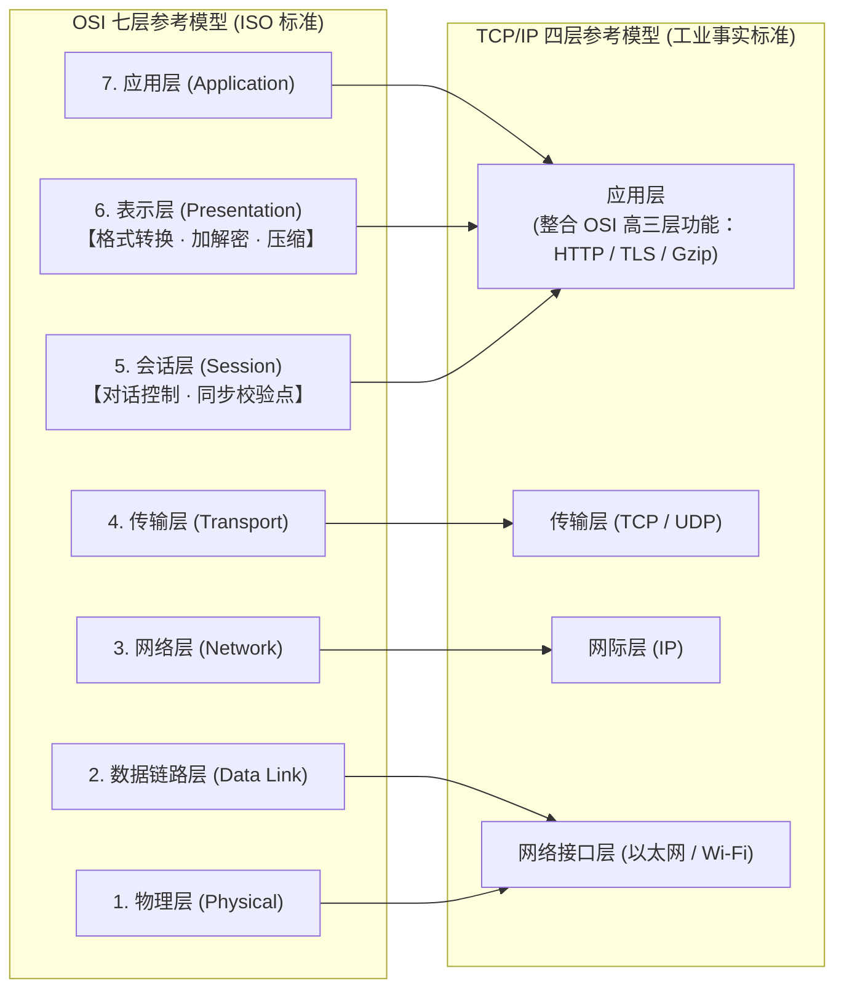

> [!IMPORTANT]
> **OSI 高三层职能考场秒杀口诀**：
> - **“应用面向终端人（HTTP/FTP 查域名），会话对话设节点（同步打桩断点传）；”**
> - **“数据表示找六层：格式转换消差异，加密解密提安全，压缩解压省带宽，三大动作全属【表示层（选 B/C）】！”**

#### 计算机网络五大法定基本功能（数据通信、资源共享、管理集中化、实现分布式处理、负载均衡）与网络安全扩展机制辨析（题库 2.5 节题目 73）⭐⭐⭐

[考查：综合知识（计算机网络法定基本功能封闭枚举［数据通信、资源共享、管理集中化、实现分布式处理、负载均衡］、负载均衡与分布式处理作为网络基础特性的内涵［算力协同与负荷分摊］、网络安全保障机制［数据加密、数字签名、访问控制］vs 网络基本功能边界辨析）]

在《系统架构设计师教程（第 2 版）》第 2 章 **2.5.1 网络的基本概念（计算机网络的定义与功能）** 中，计算机网络是将地理位置不同、功能独立的多个计算机系统通过通信线路互联，由网络操作系统与网络协议协调管理，以实现**资源共享和信息传递**的系统。软考官方教材对计算机网络的基本功能做出了权威的法定归纳：

> **【教材依据】**：**“计算机网络的功能主要体现在五个方面：① 数据通信；② 资源共享；③ 管理集中化；④ 实现分布式处理；⑤ 负载均衡。”**

##### 1. 计算机网络五大法定基本功能 vs 外延安全/业务机制正交对照矩阵 ⭐⭐⭐

| 功能分类 | 核心代表功能 | 功能机制与技术内涵 | 典型应用与工程体现 ⭐⭐⭐ | 考场设陷与标准判别词 ⭐⭐⭐ |
| :--- | :--- | :--- | :--- | :--- |
| **1. 数据通信**<br>*(Data Communication)* | **最基本、最核心的基石功能** | 实现网络中各独立节点间的数据交换、位流传输与报文交互 | 电子邮件、文件传输、即时通信、Web 浏览 | ✅ 属于网络五大基本功能之一（选项 A）。 |
| **2. 资源共享**<br>*(Resource Sharing)* | **网络建立的首要初衷与最高价值** | 允许多个用户共同使用网络中的硬件、软件和数据资源：<br>- **硬件共享**：网络打印机、云端 GPU 算力、NAS 存储；<br>- **软件共享**：网络编译器、数据库管理系统；<br>- **数据共享**：共享文档、业务数据库 | 消除物理孤岛，降低系统拥有成本（TCO） | ✅ 属于网络五大基本功能之一（选项 B）。 |
| **3. 管理集中化**<br>*(Centralized Management)* | **统一管控与资源调配** | 对网络中的软硬件资源进行集中配置、安全监控、性能审计与目录服务管理 | 活动目录（Active Directory）、LDAP 统一认证、SNMP 网络管理 | ✅ 属于网络五大基本功能之一。 |
| **4. 实现分布式处理**<br>*(Distributed Processing)* | **大任务拆解与多节点协同计算** | 将一个庞大复杂的计算任务拆分成多个相互协作的子任务，调度给网络中多台计算机并行计算 | 大规模气象模拟、基因测序、分布式批处理 MapReduce、网格计算 | ✅ 属于网络五大基本功能之一。 |
| **5. 负载均衡**<br>*(Load Balancing)*| **动态负荷分摊，消除单点过载** | 依据各主机的实时空闲状态与性能权重，将网络请求和计算负荷均衡分配给多台服务器处理 | 服务器集群负载分摊、多路径路由流量负载均衡 | 🚫 **头号经验主义陷阱 D**：<br>切勿误以为负载均衡只是现代应用层中间件技术！在计算机网络理论中，它是并列于数据通信的法定基础功能！ |
| **6. 网络安全保障机制**<br>*(Security Mechanisms)*<br>*(✅ 题目 73 正解 C)* | **数据加密、数字签名、访问控制、认证审计** | 属于对通信内容保密性、完整性、真实性与抗抵赖的**外延安全防护策略**，不属于网络賴以成立的基本功能 | AES 加密、RSA 签名、防火墙安全策略、TLS 安全握手 | ✅ **题目 73 唯一正解 C**：<br>凡题干问<strong>“不属于计算机网络基本功能”</strong>，直接秒选 **数据加密（C）**！ |

##### 2. 计算机网络系统层次与功能解耦拓扑模型 ⭐⭐⭐

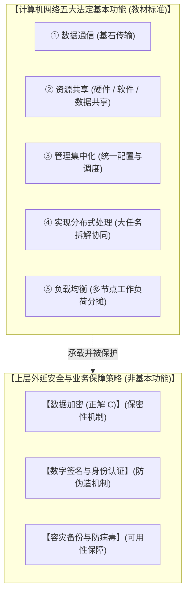

> [!IMPORTANT]
> **计算机网络基本功能考场终极秒杀口诀**：
> - **“网络五事法典定：【通（通信 A）、享（共享 B）、管（管理）、分（分布式）、平（负载均衡 D）】；”**
> - **“加密（C）、签名、防病毒，全属安全保护伞，外延策略非基础，见『不属于网络功能』秒选【数据加密（C）】！”**

#### 计算机网络核心性能指标体系：总时延四大物理组成（发送、传播、处理、排队）vs 宏观独立指标往返时延（RTT）（题库 2.5 节题目 74）⭐⭐⭐

[考查：综合知识（计算机网络性能指标体系封闭枚举［速率、带宽、吞吐量、时延、时延带宽积、往返时延 RTT、利用率］、网络单向总时延四大不可分割的微观物理组成［发送时延（传输时延）、传播时延、处理时延、排队时延］及其物理发生位置与计算模型、排队时延与网络拥塞指数级激增机理、宏观端到端双向综合指标 RTT 的独立属性辨析）]

在《系统架构设计师教程（第 2 版）》第 2 章 **2.5.1 网络的基本概念（计算机网络性能指标）** 中，时延（Delay 或 Latency）是指数据（一个报文或分组，甚至 1 比特）从网络（或链路）的一端传送到另一端所耗费的全部时间。网络总时延在物理微观层面由且仅由以下**四大法定分量**相加构成：

$$\text{网络单向总时延} = \text{发送时延} + \text{传播时延} + \text{处理时延} + \text{排队时延}$$

##### 1. 网络总时延四大物理组成 vs 宏观独立指标 RTT 正交对比矩阵 ⭐⭐⭐

| 时延分量 / 性能指标 | 物理机理与定义 | 精确计算公式 / 发生位置 | 主导影响因素 ⭐⭐⭐ | 考场设陷与标准判别词 ⭐⭐⭐ |
| :--- | :--- | :--- | :--- | :--- |
| **1. 发送时延**<br>*(传输时延，Transmission Delay)* | 主机或路由器将数据块推送到物理信道所需时间（从第 1 位到最后 1 位推完） | $$\text{发送时延} = \frac{\text{分组长度 (bit)}}{\text{发送速率 / 带宽 (b/s)}}$$<br>📍 **网卡端口发送队列** | 数据帧大小、网卡接口物理带宽速率 | ✅ 属于网络总时延四大法定组成（选项 A）。 |
| **2. 传播时延**<br>*(Propagation Delay)* | 电磁波信号在物理传输介质（光纤、铜缆）中传播一段距离所需时间 | $$\text{传播时延} = \frac{\text{物理链路长度 (m)}}{\text{介质电磁波传播速率 (m/s)}}$$<br>📍 **物理信道（光纤/双绞线）** | 物理链路距离、光电信号在介质中的光速（光纤中约 $2 \times 10^8\text{ m/s}$） | ✅ 属于网络总时延四大法定组成（选项 B）。注意区分：**“推上信道耗时”是发送时延，“在信道奔跑耗时”是传播时延**！ |
| **3. 处理时延**<br>*(Processing Delay)* | 主机或节点交换设备收到分组时，解析报头、差错检验、查转发表寻径所耗时间 | 📍 **路由器 CPU / 专用交换架构 ASIC** | 节点硬件计算能力、路由表检索效率 | ✅ 属于网络总时延四大法定组成。现代硬件流水线交换技术通常将其降至微秒级。 |
| **4. 排队时延**<br>*(Queuing Delay)*| 分组在网络节点输入队列等待 CPU 调度处理、在输出队列等待信道空闲转发的时间 | 📍 **路由器输入/输出内存缓冲队列** | **全网实时通信量与链路利用率 $U$**：<br>当 $U \to 1$ 时，排队时延趋于无穷大 | 🚫 ：<br>切勿望文生义以为“排队”只是意外故障延误！在分组交换网络中，它是四大不可或缺的物理构成之一，更是衡量网络拥塞程度的核心指标。 |
| **5. 往返时延（RTT）**<br>*(Round-Trip Time)*<br>*(✅ 题目 74 唯一正解 C)* | 从发送方发送第一位数据开始，到发送方收到来自接收方的确认信息（ACK）的**双向全链路端到端总时间** | 包含往返双向的多次发送、传播、处理与排队时延，以及接收端产生 ACK 的开销 | 端到端往返距离、沿途各跳网络综合拥塞度 | ✅ **题目 74 唯一正解 C（不属于时延组成）**：<br>RTT 是与“时延、带宽、吞吐量、时延带宽积”**平级并列的独立宏观综合性能度量指标**，绝非单向时延的微观子组成！ |

##### 2. 网络总时延微观物理全景与宏观 RTT 拓扑模型 ⭐⭐⭐

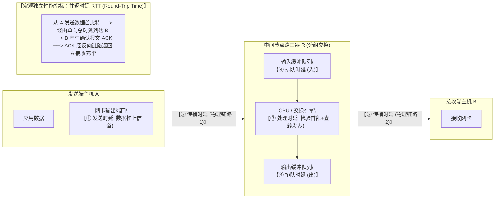

> [!IMPORTANT]
> **计算机网络性能指标考场终极秒杀口诀**：
> - **“单向时延四大项：【推（发送 A）、跑（传播 B）、检（处理）、等（排队 D）】；”**
> - **“往返 RTT 是双向，宏观指标自独立，见『不属于时延组成』秒选【往返时延（C）】！”**

#### 网络延迟核心影响因素与全链路剖析：服务器端延迟（队列排队与磁盘 IO）vs 网络互连设备转发延迟（交换机 ASIC 直通 vs 路由器存储转发）vs 对等网拓扑规模效应（题库 2.5 节题目 88）⭐⭐⭐

[考查：综合知识（网络延迟/时延 Network Latency 全链路构成、端系统服务器处理延迟主要瓶颈［操作系统内核/线程池队列延迟 + 磁盘 I/O 读写延迟］、二层以太网交换机硬件 ASIC 线速/直通转发微秒级延迟 vs 三层路由器完整存储转发/查路由表毫秒级延迟、对等网络 P2P 终端规模与共享介质争用/覆盖网路由跳数相关性、公共 Internet 尽力而为服务与跨域多跳时延机理）]

在《系统架构设计师教程（第 2 版）》第 2 章 **2.5.1 网络的基本概念（网络性能与时延分析）** 中，网络延迟（Latency / Delay）不仅取决于传输介质本身的物理特性（光速传播时延与带宽发送时延），更深受**端系统服务器处理架构、中间网络互连设备转发处理机制以及网络拓扑连接模型**的综合支配：

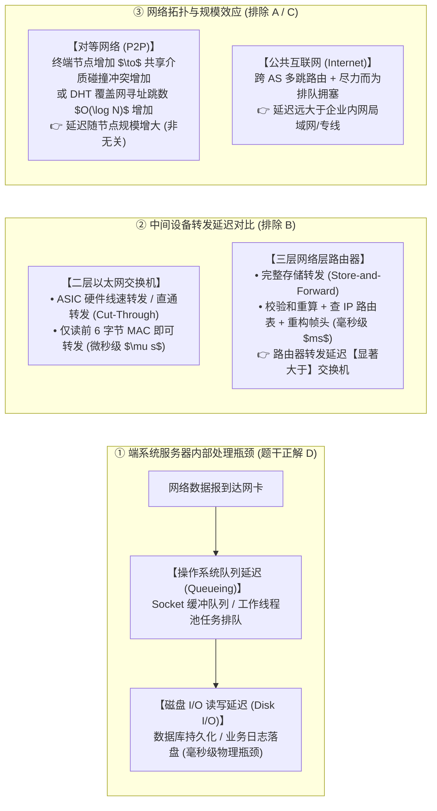

##### 1. 网络延迟四大核心影响场景与正误辨析矩阵 ⭐⭐⭐

| 考察对象 / 场景 | 核心工作机制与底层物理/软件原因 | 常见误区与考场排雷铁律 ⭐⭐⭐ | 结论定性 |
| :--- | :--- | :--- | :---: |
| **1. 服务器端延迟的主要影响因素**<br>*(✅ 题目 88 正解 D)* | 当请求到达服务器后，微秒级的 CPU 内存计算并非瓶颈，真正耗时的是：<br>① **队列延迟（Queueing Delay）**：请求在操作系统 Socket 缓冲区与业务线程池队列中的排队等待；<br>② **磁盘 I/O 延迟（Disk I/O Delay）**：涉及文件读写、数据库检索等磁盘物理访问（机械寻道或 SSD 块擦除耗时数毫秒）。 | 记住：**端系统应用层最耗时的就是“排队等 CPU”和“等磁盘 I/O 读写”**，二者是服务器延迟的决定性因素。 | ✅ **说法正确**<br>（本题正解） |
| **2. 对等网络（P2P）终端数量与延迟**| ① **物理/MAC 层**：在总线型或对等共享信道中，节点越多，CSMA/CD 碰撞冲突或轮询时隙等待越长；<br>② **应用层 P2P**：在分布式哈希表（如 Chord、Kademlia）拓扑中，网络规模 $N$ 越大，分布式路由逻辑跳数（通常为 $O(\log N)$）越多，端到端寻址延迟越大。 | 🚫 **选项辨析陷阱 A**：<br>切勿将“P2P 节点越多总下载带宽越大（吞吐量汇聚）”与“单次通信延迟”混为一谈！**对等网络延迟必然与终端数量强相关**。 | ❌ **说法错误**<br>（排 A） |
| **3. 交换机 vs 路由器转发延迟**<br>*(选项 B 干扰项)* | - **以太网交换机（L2）**：依赖专用硬件 ASIC 芯片实现线速硬件转发，或采用**直通转发（Cut-Through）**，读完目的 MAC 即发射，时延仅微秒级（$\mu s$）；<br>- **路由器（L3）**：必须采取**存储转发（Store-and-Forward）**，完整接收分组、解封装二层头、校验 IP 首部、检索庞大路由表进行最长前缀匹配、更新 TTL 并重算校验和、重新封装二层链路头，时延为毫秒级（$ms$）。 | 🚫 **反硬件常识陷阱 B**：<br>路由器由于功能更复杂、解包层次更深，**其转发延迟显著大于二层交换机**！“路由器延迟小于交换机”必定错误。 | ❌ **说法错误**<br>（排 B） |
| **4. 公共 Internet 服务的延迟表现**<br>*(选项 C 干扰项)* | Internet 是跨越全球的多级自治系统（AS）级联网络，采用<strong>尽力而为（Best-Effort）</strong>的无连接 IP 路由，数据包需经历长途光纤传播延迟（约 $5\,\mu s/\text{km}$）及多跳路由器的排队排障时延，且容易发生网络拥塞。 | 🚫 **绝对化常识陷阱 C**：<br>企业专用局域网（LAN）或专用物理专线（如 MPLS VPN）延迟远低于公网 Internet。“使用 Internet 能够最大限度减小延迟”完全失实。 | ❌ **说法错误**<br>（排 C） |

> [!IMPORTANT]
> **网络延迟与设备拓扑考场秒杀口诀**：
> - **“服务器内看内耗，排队队列加 IO（毫秒级大头在此，秒选 D 正解）；”**
> - **“二层交换走直通微秒级，三层路由拆装查表慢吞吞（交换延迟小于路由，B 项必错）；”**
> - **“对等网络人多必拥挤，终端越多延迟大（A 项无关必错）；”**
> - **“Internet 多跳尽力跑，减小延迟找专线局域网（C 项必错）！”**

#### 计算机网络分类体系：广域网（WAN）四大核心特征、动态不规则网状拓扑 vs 局域网（LAN）规则拓扑与运营权属辨析（题库 2.5 节题目 78）⭐⭐⭐

[考查：综合知识（计算机网络按地理覆盖范围分类体系［局域网 LAN、城域网 MAN、广域网 WAN、个人局域网 PAN］、广域网四大法定核心特征［远距离数据通信、覆盖范围广、无固定拓扑结构（动态分布式 Mesh）、电信部门统一运营管理］、局域网 vs 广域网在拓扑确定性、运营管理权属、链路租用机制及传输协议控制上的正交对比）]

在《系统架构设计师教程（第 2 版）》第 2 章 **2.5.1 网络的基本概念（计算机网络的分类）** 中，按照网络覆盖的地理范围大小，计算机网络通常划分为局域网（LAN）、城域网（MAN）和广域网（WAN）。广域网（Wide Area Network）用于将分布在不同城市、国家乃至全球范围的计算机、局域网或城域网互联，其架构设计与局域网存在本质的物理与管理分界：

##### 1. 广域网（WAN）核心特征全景与局域网（LAN）正交对比矩阵 ⭐⭐⭐

| 对比维度 | 局域网（LAN, Local Area Network） | 广域网（WAN, Wide Area Network） ⭐⭐⭐ | 考场设陷与标准判别词 ⭐⭐⭐ |
| :--- | :--- | :--- | :--- |
| **1. 拓扑结构形态**<br>*(✅ 题目 78 正解 B)* | 采用**规整且确定固定的拓扑**：<br>经典如星型（辐射双绞线）、总线型（同轴电缆）、环型（令牌环） | 采用**分布式、不规则网状拓扑（Mesh）**，节点间存在多条备用路由路径，随路由收敛与链路状态动态变化，**【没有固定的拓扑结构】** | 🚫 **全题头号反向命题陷阱（B）**：<br>B 项声称“具有固定的拓扑结构”严重违背广域网动态网状本质！**凡题干问“不属于广域网特点”，秒选【具有固定拓扑结构（B）】**！ |
| **2. 建设与运营管理主体**| **企事业单位自主投资组建**，由单位内部 IT 网管人员专网维护，内部专用 | <strong>由国家电信部门 / 公用网络运营商（ISP / Telecom）</strong>统一投资建设长途骨干设施、维护管理并公用营运，企业通过**租用信道**接入 | 🚫 ：<br>切勿凭日常互联网自由接入直觉误以为广域网没有管理机构！长途光缆与骨干路由涉及市政公用路权与巨额资产，**“由电信部门负责管理”是广域网区别于私网 LAN 的法定特征**！ |
| **3. 地理覆盖范围** | 局限于有限地理空间：<br>单栋楼宇、园区、校园或机房，通常在数米至数公里范围内 | 跨越广袤地理空间：<br>跨越城市、省份、国家乃至大洲，距离通常在数十公里至数千、上万公里 | ✅ 属于广域网法定基本特征（选项 C 正确）。 |
| **4. 通信服务功能** | 为同一机构内部的终端提供高速资源共享与内网报文交互 | **提供跨地域的远距离数据通信服务**，实现异地分支机构与异构网络互联 | ✅ 属于广域网法定基本特征（选项 A 正确）。 |
| **5. 传输性能与物理约束** | 物理链路距离短，**传输速率高（千兆/万兆）、延迟极小、误码率极低** | 长途物理介质受光速限制导致传播延迟大，跨公用中继节点多，**偶发误码率高于 LAN** | 广域网必须在数据链路层和网络层设计高强度的**差错控制、流量控制与动态路由寻径机制**（如 HDLC/PPP、OSPF/BGP）。 |

##### 2. 局域网确定性拓扑 vs 广域网动态不规则网状拓扑模型 ⭐⭐⭐

```mermaid
flowchart TB
    subgraph LAN_Example ["【局域网 (LAN): 规则且固定的确定性拓扑 (如星型)】"]
        direction TB
        SW["中心交换机 (Switch)\\n【单位自主投资自管】"]
        PC1["工作站 1"] --- SW
        PC2["工作站 2"] --- SW
        PC3["服务器 A"] --- SW
    end

    subgraph WAN_Architecture ["【广域网 (WAN): 动态不规则网状拓扑 Mesh (无固定结构)】"]
        direction LR
        subgraph TelecomOperator ["【公用电信部门 / ISP 统一投资建设与运营骨干网】"]
            R1["骨干路由器 R1"] <===> R2["骨干路由器 R2"]
            R2 <===> R3["骨干路由器 R3"]
            R1 <===> R4["骨干路由器 R4"]
            R4 <===> R3
            R1 -.->|"多路径冗余/动态寻径"| R3
        end
    end

    LAN_Example ==="【租用电信专线 / 接入信道】"===> R1
```

> [!IMPORTANT]
> **广域网核心特征考场终极秒杀口诀**：
> - **“广域覆盖千山水（C），远距通信破壁垒（A）；”**
> - **“网状拓扑动态变，并无固定结构在，见『固定拓扑』必属假，排雷秒选【选 B】！”**

#### 网络互联设备分层体系：路由器在 OSI 网络层（L3）工作机理与四大层次设备（中继器/交换机/路由器/网关）冲突域/广播域隔离全景（题库 2.5 节题目 82）⭐⭐⭐

[考查：综合知识（OSI 七层参考模型与网络互联设备映射［L1 物理层中继器/集线器、L2 数据链路层网桥/二层交换机、L3 网络层路由器/三层交换机、L4~L7 高层网关/多层交换机］、各层处理 PDU 与核心寻址决策依据［比特/MAC/IP/端口］、路由器核心职能［基于 IP 逻辑地址路由寻径与数据分组转发］、网络互联设备对冲突域（Collision Domain）与广播域（Broadcast Domain）隔离能力的架构选型规则）]

在《系统架构设计师教程（第 2 版）》第 2 章 **2.5.1 网络的基本概念（网络互联设备与协议模型）** 中，网络互联设备按照其在 OSI 七层参考模型中实现的功能最高层次进行分类。不同层次的互联设备具有不同的寻址依据、协议解析能力与广播/冲突隔离边界：

##### 1. 网络互联四大层次设备正交对照与域隔离矩阵 ⭐⭐⭐

| OSI 层次与编号 | 代表性网络互联设备 ⭐⭐⭐ | 处理的协议数据单元 (PDU) | 转发寻址依据 ⭐⭐⭐ | 冲突域隔离能力 | 广播域隔离能力 ⭐⭐⭐ | 典型工程场景与考场设陷排雷 ⭐⭐⭐ |
| :--- | :--- | :--- | :--- | :---: | :---: | :--- |
| **第 1 层 物理层（L1）** | **中继器（Repeater）**、**集线器（Hub）** | 比特流（Bit） | 无地址（仅物理电平信号放大、整形再生与广播分发） | ❌ **不隔离**（所有端口共享同一冲突域） | ❌ **不隔离** | 扩大网络物理覆盖距离，但多节点同时发信必定发生碰撞冲突。 |
| **第 2 层 数据链路层（L2）** | **网桥（Bridge）**、**以太网交换机（Switch，二层）** | 帧（Frame） | **物理硬件地址（MAC 地址）**（维护 MAC 地址表） | ✅ **隔离冲突域**（每个交换端口为一个独立冲突域） | ❌ **不隔离**（广播帧全网泛洪） | 消除以太网共享介质碰撞冲突，但遇到广播报文（如 ARP 请求）会向所有非源端口广播，无法阻断广播风暴。 |
| **第 3 层 网络层（L3）**<br>*(✅ 题目 82 正解 A)* | **路由器（Router）**、**三层交换机（Layer 3 Switch）** | **数据分组 / IP 数据报（Packet）** | **逻辑网络地址（IP 地址）**（维护路由表 / 转发表 FIB） | ✅ **隔离冲突域** | ✅ **隔离广播域**（阻断广播帧跨子网传播） | ✅ **题目 82 唯一正解 A**：<br>路由器的核心功能是**路径选择与分组转发**，工作在 **网络层（L3）**！<br>🚫 **排雷 C**：切勿将“传输数据”字面联想为“传输层（L4）”！传输层由端系统主机管理，路由器默认不处理传输层。 |
| **第 4~7 层 高层（L4~L7）** | **协议网关（Gateway）**、四层/七层应用交换机、反向代理 | 报文段（Segment）/ 应用数据 | **端口号（Port）**、应用层 URI/协议头 | ✅ **隔离冲突域** | ✅ **隔离广播域** | 负责高层异构协议转换（如不同系统间协议转换）、基于四层端口与七层内容的智能流量调度。 |

##### 2. 路由器微观处理引擎与网络互联层级模型 ⭐⭐⭐

```mermaid
flowchart TD
    subgraph HostA ["源端主机 A (OSI 完整 7 层)"]
        direction TB
        AppA["应用层 / 表示层 / 会话层"]
        L4_A["传输层 (L4)\\n【TCP/UDP 端口号: 进程到进程】"]
        L3_A["网络层 (L3)\\n【封装源 IP / 目的 IP】"]
        L2_A["数据链路层 (L2)\\n【封装源 MAC / 下一跳 MAC】"]
        L1_A["物理层 (L1)"]
        AppA --> L4_A --> L3_A --> L2_A --> L1_A
    end

    subgraph RouterR ["【网络互联核心：路由器 (工作在 L3 网络层)】"]
        direction TB
        L1_R["物理接口接收"] --> L2_R["数据链路层: 校验 MAC 并剥离帧头"]
        L2_R --> L3_R["【网络层 L3 核心处理引擎】\\n① 解析 IP 数据报头 (TTL-1 / 校验和)\\n② 查找路由表 (LPM 最长前缀匹配)\\n③ 确定最佳下一跳 (Next Hop) 出口 IP 与出接口"]
        L3_R --> L2_Out["重新封装下一跳 L2 帧头 (新目的 MAC)"]
        L2_Out --> L1_Out["物理接口转发"]
    end

    subgraph HostB ["目的端主机 B (OSI 完整 7 层)"]
        direction TB
        L1_B["物理层"] --> L2_B["数据链路层"] --> L3_B["网络层"] --> L4_B["传输层 (端口接收)"] --> AppB["应用层"]
    end

    HostA ==="物理信号"===> RouterR
    RouterR ==="物理信号"===> HostB
```

> [!IMPORTANT]
> **网络互联设备考场终极秒杀口诀**：
> - **“一层集线（Hub）比特定，二层交换（Switch）MAC 寻；”**
> - **“四层以上找网关，异构转换端口连；”**
> - **“集线冲突广播同（都不隔），交换隔冲放广播，路由双隔断风暴！”**

#### 网络工程方法学：网络系统生命周期五大阶段时序演进（需求规范 $\to$ 通信规范 $\to$ 逻辑设计 $\to$ 物理设计 $\to$ 实施阶段）与任务边界全景（题库 2.5 节题目 89）⭐⭐⭐

[考查：综合知识（网络系统工程生命周期划分与严格因果递进逻辑［需求规范 $\to$ 通信规范 $\to$ 逻辑网络设计 $\to$ 物理网络设计 $\to$ 实施阶段］、首要阶段判定［业务需求驱动一切］、通信规范分析核心任务［通信流量与 QoS 量化］、逻辑网络设计 vs 物理网络设计任务与交付成果边界辨析［逻辑拓扑/IP/VLAN/路由 vs 综合布线/机房环境/设备选型与采购］）]

在《系统架构设计师教程（第 2 版）》第 2 章 **2.5.1 网络的基本概念（网络工程规划与生命周期）** 中，网络系统的建设是一项高度结构化的系统工程。为了确保网络系统能够精准满足企事业单位的战略目标与业务需求，网络工程生命周期标准划分为以下**五个按序递进的核心阶段**：

$$\text{需求规范} \longrightarrow \text{通信规范} \longrightarrow \text{逻辑网络设计} \longrightarrow \text{物理网络设计} \longrightarrow \text{实施阶段}$$

##### 1. 网络系统生命周期五大阶段任务、交付物与因果递进矩阵 ⭐⭐⭐

| 阶段序号与名称 | 阶段核心目标与使命 | 核心工程活动与工作内容 | 标志性输出交付物 ⭐⭐⭐ | 考场设陷与时序排雷铁律 ⭐⭐⭐ |
| :--- | :--- | :--- | :--- | :--- |
| **第 1 阶段：需求规范**<br>*(Requirements Specification)* | **确立业务目标与用户需求**（生命周期第一步，工程起点） | 收集并分析用户业务组织架构、应用系统类型、地理分布、投资预算、工期进度、安全合规要求与约束 | 《网络系统需求规格说明书》 | 🚫 **全题首要排雷点（排除 C、D）**：<br>任何工程**必须“需求先行”**！没有业务需求输入，通信流量与网络架构无从谈起，**首个阶段 100% 为“需求规范”**！ |
| **第 2 阶段：通信规范**<br>*(Communication Specification)* | **将业务需求转化为量化的通信流量与性能指标** | 调研现有网络通信瓶颈、估算各子网数据流量分布、峰值带宽需求、端到端时延、丢包率与 QoS 服务质量约束 | 《通信规范说明书》、流量分布与特征分析表 | 🚫 ：<br>切勿将通信规范误解为外部通用电信协议标准！它是针对本项目的流量量化规范，必须由需求规范推导得出，居第二位。 |
| **第 3 阶段：逻辑网络设计**<br>*(Logical Network Design)* | **脱离具体硬件的抽象逻辑网络架构设计** | 核心/汇聚/接入三层层次化网络拓扑结构抽象、IP 地址规划与子网划分（CIDR/VLSM）、VLAN 划分、动态路由协议选型（OSPF/BGP）、安全逻辑策略（ACL/NAT） | 《逻辑网络设计方案说明书》、逻辑拓扑图 | ✅ **技术架构抽象**：回答“结构怎么搭、IP 怎么分、路由怎么走”，**与具体硬件设备厂商和型号无关**！先逻辑后物理（排除 B）。 |
| **第 4 阶段：物理网络设计**<br>*(Physical Network Design)* | **将逻辑设计落地为具体的物理实施与设备方案** | 综合布线系统走向与线缆选型（单模/多模光纤、双绞线）、机房环境供电与防雷接地、设备性能计算（背板带宽/包转发率）、具体设备品牌型号选型与配置清单 | 《物理网络设计方案》、设备清单与采购工程预算表 | ✅ **工程实体落地**：回答“机房怎么建、线怎么拉、买什么牌子型号的交换机”。 |
| **第 5 阶段：实施阶段**<br>*(Implementation Phase)* | **工程施工、配置联调、测试验收与交付运营** | 综合布线物理施工、设备上架加电安装、配置脚本编写与加载、全网联调与压力测试、用户培训与割接入网试运行 | 《网络工程验收测试报告》、网络运行维护手册 | ✅ 闭环交付上线。 |

##### 2. 网络系统生命周期递进演进模型 ⭐⭐⭐

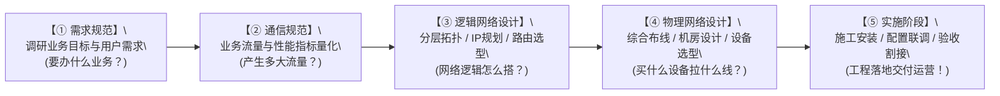

> [!IMPORTANT]
> **网络系统生命周期考场终极秒杀口诀**：
> - **“需求先行明业务（首阶段排 C、D），通信量化算流量（第二步紧跟上）；”**
> - **“先做逻辑抽象图（分层拓扑 IP 划，排 B 项次序倒），再落物理选机型；”**
> - **“五步时序定乾坤：【需 $\to$ 通 $\to$ 逻 $\to$ 物 $\to$ 实】，考场秒选【标准 A】！”**

#### 局域网物理与逻辑拓扑结构（星状 vs 总线 vs 环状 vs 树状 vs 网状）：传输机制、单点故障隐患与故障排查难易度全景（题库 2.5 节题目 106）⭐⭐⭐

[考查：综合知识（局域网主流拓扑结构：星状 Star［中心节点最多两步、易控易管、中心单点故障］vs 总线 Bus［共享同轴电缆广播、无路由寻径、单点断裂全网瘫痪、故障排查诊断极难］vs 环状 Ring［首尾封闭闭合环、单向循环传输、令牌控制、两节点间仅一条单向通路］vs 树状 Tree［分层星型、根节点瓶颈］vs 网状 Mesh［冗余全互联 N(N-1)/2 条链路、可靠性极高、成本最高］；数据传输方向、单点故障波及范围与工程优缺点辨析）]

在《系统架构设计师教程（第 2 版）》第 2 章 **2.5.1 网络的基本概念（网络拓扑结构）** 中，局域网（LAN）通常具有稳定、规范的拓扑结构。网络拓扑结构不仅决定了传输介质的布线方式，还直接制约了**介质访问控制协议、数据流动时序、单点故障影响范围与故障诊断难易度**：

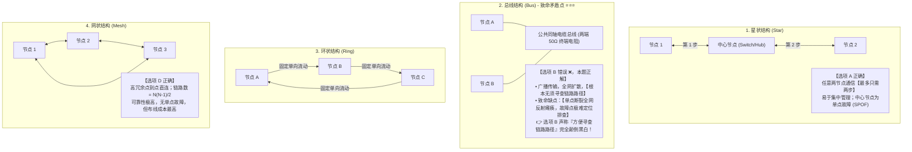

##### 1. 五大经典局域网拓扑结构特性全景对照矩阵 ⭐⭐⭐

| 拓扑结构 | 核心物理形态与布线 | 数据流向与介质访问机制 | 节点间路径步数 | 核心架构优势 | 致命缺陷与考场排雷铁律（题目 106 深度剖析）⭐⭐⭐ |
| :--- | :--- | :--- | :---: | :--- | :--- |
| **1. 星状结构**<br>*(Star)*<br>*(选项 A)* | 每个节点直接与单一**中心节点**（交换机/集线器）点到点相连 | 节点间通信必须经由中心转发 | **最多只需 2 步**<br>（源 $\to$ 中心 $\to$ 目的） | 传输速度快、建网容易、**便于集中控制与计费、单线损坏不影响其他节点** | 选项 A 完全正确：**中心节点是单点故障隐患（SPOF）**；电缆总用量大。 |
| **2. 总线结构**<br>*(Bus)*<br>*(❌ 题目 106 正解 B)* | 所有节点并联挂接在一条**单一公共干线电缆**（如同轴电缆）上，两端加终端匹配电阻 | **广播式扩散**（CSMA/CD 载波监听多路访问/冲突检测） | 直连共享总线 | 网络成本极低、电缆用量极少、结构简单、节点增删灵活 | ❌ **题目 106 唯一正解 B（说法错误）**：<br>① **无寻径概念**：广播传输直接向整条总线发送，**根本不存在也无须“寻查路径”**！<br>② **故障诊断排查极难**：**总线缺乏集中控制，电缆任何一处断开或终端电阻松动会导致全网反射阻抗失配瘫痪，且极难查出故障断点位置**！声称“方便寻查链路路径”纯属颠倒事实！ |
| **3. 环状结构**<br>*(Ring)*| 节点首尾通过点对点链路串接，形成**封闭闭合环形网络** | **固定单向循环流动**（如顺时针）；通过<strong>令牌（Token）</strong>控制信道访问权，无碰撞 | 顺环单向逐站传递 | 节点地位平等；电缆长度较短；重负载下信道利用率高、确定性时延 | ⭕ **选项 C 完全正确**：<br>环网信号严格按单一方向流动，每个节点相当于单向中继器，因此**任意两个节点之间沿着流动方向严格仅有唯一一条通信通路**！<br>⚠️ 缺点：单节点断电或单链路断裂会导致整环瘫痪（需双环冗余如 FDDI）。 |
| **4. 树状结构**<br>*(Tree)* | **分层星型结构**；顶层为根节点，向下逐级呈树状分支扩展 | 沿树形层次分级交换/路由转发 | 视层次深度而定 | 易于扩充大型网络；分支隔离故障较好 | 越靠近根部（Root）的节点或主干链路故障，波及的下属子树范围越大。 |
| **5. 网状结构**<br>*(Mesh)*<br>*(选项 D)* | 节点间存在**多条冗余通信链路**（全网状为任意两点均有专线直连） | 依靠动态路由协议自主寻优转发 | **两节点直达只需 1 步**（全互联） | **高冗余、高容错、可靠性极高**，任何单节点或链路故障绝不影响其余通信 | 选项 D 完全正确：布线极其复杂、硬件端口消耗大、建设和维护成本极为昂贵。<br>📏 **全连通链路公式**：$L = \frac{N(N-1)}{2}$。 |

##### 2. 环网单向通路 vs 总线广播排错本质辨析⭐⭐⭐

1. **为什么环网“两个节点之间仅有一条通路”说法完全正确？**
   - 在计算机网络拓扑理论中，“通路（Path）”是有方向的有向路径。
   - 环形拓扑是**单向传输介质**（Unidirectional Loop）。数据帧从节点 1 发往节点 3，只能按照固定流向经过节点 2 转发到达，绝不可能反向逆行。因此沿此流向，通路具有**唯一性**（仅有一条通路）。
2. **为什么总线结构“极不方便排查链路路径”？**
   - 星型网络中某台电脑断网，网管看交换机对应端口指示灯是否熄灭即可秒级定位故障点；
   - 总线网络是“一根铜轴通全网”，一旦总线出现隐蔽裂纹或虚接，整条总线高频特性遭到破坏，所有电脑全部同时断网。没有任何设备指示灯能够指出是哪个房间的哪一段总线坏了，必须依赖人工携带 TDR 仪器逐点排查，**故障排查极其困难**。

> [!IMPORTANT]
> **网络拓扑结构考场秒杀口诀**：
> - **“星型中控两步达（中心是单点瓶颈）；”**
> - **“总线广播全网发，单点破裂全瘫痪，故障最难查（排 B 方便寻径）；”**
> - **“环形闭合单向转，两点仅通一条道（C 说法完全对）；”**
> - **“网状冗余抗毁强，链路半数乘节点（$N(N-1)/2$），成本高昂布线繁！”**

  - 【题库章节练习 / 题库 2.5 节题目 106】（局域网拓扑结构中以下说法不正确的是【**B. 总线结构……方便寻查链路路径**】）。

### 2.5.2 通信技术

#### 物理层数字基带传输编码：曼彻斯特编码 vs 差分曼彻斯特编码 vs 不归零码（NRZ）机理与以太网传输规范（2024年上半年 / 题库 2.5 节题目 15）⭐⭐⭐

[考查：综合知识（物理层基带传输数字信号编码：直接二进制不归零码 NRZ［无自同步、有直流分量］vs 曼彻斯特编码 Manchester［IEEE 802.3 以太网标准、每个码元中心跳变定 0/1 兼时钟自同步、编码效率 50% / 波特率 = 2 × 比特率］vs 差分曼彻斯特编码 Differential Manchester［IEEE 802.5 令牌环网标准、中心跳变仅提时钟、起始边界有变是 0 没变是 1、抗干扰极性反接能力强］vs 百兆以太网 4B/5B 与千兆以太网 8B/10B 效率跃迁）]

在《系统架构设计师教程（第 2 版）》第 2 章 <strong>2.5.2 通信技术（传输技术与数字编码）</strong>中，局域网在物理层进行基带传输时，不能直接传输原始二进制电平（如连续全 0 或全 1 的 NRZ 码会导致接收端丢失位同步时钟，且存在直流偏置）。为了从接收信号中可靠提取同步时钟并消除直流分量，必须采用具备自同步能力的数字编码：

##### 1. 三大经典数字基带编码技术与局域网协议全景对照表 ⭐⭐⭐

| 编码类型 | 电平跳变机理与 0/1 判别规则 ⭐⭐⭐ | 自同步时钟提取机制 | 编码效率与波特率关系 ⭐⭐⭐ | 典型网络协议标准与应用场景 | 考场设陷与排雷铁律 ⭐⭐⭐ |
| :--- | :--- | :--- | :---: | :--- | :--- |
| **1. 曼彻斯特编码**<br>*(Manchester)*<br>（✅ **题目 15 正解 C**） | 每个比特周期的**正中心必定翻转**：<br>- **中心跳变方向直接决定数值**（IEEE 802.3 规定：高 $\to$ 低为 `1`，低 $\to$ 高为 `0`；亦有相反定义，核心是**方向定 0/1**） | ✅ **具备自同步**<br>（每个码元中心跳变兼作时钟信号） | **$\mathbf{50\%}$**<br>（1 比特需 2 个脉冲，**波特率 $B = 2 \times$ 比特率 $R$**） | **传统以太网（IEEE 802.3，10Mbps 经典以太网 10Base-T 等）** | ✅ **题目 15 唯一正解 C**：<br>见题干<strong>“以太网中数据的传输使用”</strong> $\to$ 100% 锁定 **曼彻斯特编码**！ |
| **2. 差分曼彻斯特编码**<br>*(Differential Manchester)*<br>*(🚫 题目 15 干扰项 D)* | 每个比特周期的**正中心也必定翻转**，但：<br>- **中心跳变仅用于提取时钟**；<br>- **由码元起始边界是否有跳变决定数值**：<br>  👉 **边界有跳变表示 `0`**；<br>  👉 **边界无跳变表示 `1`** | ✅ **具备自同步**<br>（抗干扰与抗极性接反能力强于普通曼彻斯特） | **$\mathbf{50\%}$**<br>（波特率 $B = 2 \times$ 比特率 $R$） | **令牌环网（Token Ring，IEEE 802.5）** | 🚫 **全卷头号协议张冠李戴陷阱（D）**：<br>差分曼彻斯特主要用于**令牌环网（802.5）**，切勿与以太网（802.3）混淆！ |
| **3. 不归零码（NRZ）**<br>*(Non-Return-to-Zero)*<br>*(🚫 题目 15 干扰项 A)* | 用高电平代表 `1`，低电平代表 `0`（或反之）；在整个码元周期内电平恒定，**脉冲之间不回到零电平** | ❌ **无自同步能力**<br>（连续遇到长串 `0` 或长串 `1` 时电平恒定，接收端无法提取时钟） | **$\mathbf{100\%}$**<br>（波特率 $B = R$） | 计算机内部总线、低速直连串口（RS-232），**局域网物理信道不直接使用** | 🚫 **排除 A 项（直接的二进制码）**：因缺乏时钟自同步且含直流分量，局域网以太网不能直接传输 NRZ 码。 |

##### 2. 编码效率突破与高速以太网演进⭐⭐⭐

1. **曼彻斯特编码的带宽瓶颈**：由于曼彻斯特编码每发 1 个 bit 数据需在中心翻转一次（占用 2 个电平脉冲，即 $1\text{ bit} = 2\text{ baud}$），编码效率仅为 **$50\%$**。若在 100 Mbps 网络中继续沿用，物理信道需要承受高达 $200\text{ Mbaud}$ 的高频调制，超出当时双绞线的物理承载极限。
2. **高速局域网的编码迭代**：
   - **快速以太网（100 Mbps，100Base-TX）**：弃用曼彻斯特，改用 **4B/5B 编码**（每 4 位数据映射为 5 位编码，编码效率提升至 **$80\%$**）+ NRZI 调制；
   - **千兆以太网（1000 Mbps，1000Base-X）**：采用 **8B/10B 编码**（每 8 位数据映射为 10 位编码，编码效率同样为 **$80\%$**）；
   - **万兆以太网（10 Gbps）**：采用 **64B/66B 编码**（编码效率高达 **$97\%$**）。

> [!IMPORTANT]
> **基带传输编码考场秒杀口诀**：
> - **“以太（802.3）曼彻斯特（选 C），中心跳变定数字；令牌（802.5）差分曼彻斯特（排 D），边界有变才是零（有 0 没 1）！”**
> - **“曼彻斯特效率半（50%），波特率是比特率的两倍整（10 Mbps 需 20 Mbaud）；百兆 4B/5B 提八成（80%）！”**

  - 【2024年上半年真题 第34题 / 题库 2.5 节题目 15】 & （以太网中，数据的传输使用【**C. 曼彻斯特编码**】）。

#### 差错控制技术：奇偶校验码（Parity Check）编码规则、检错边界与三大校验码能力对比（题库 2.5 节题目 6）⭐⭐⭐

[考查：综合知识（数据通信差错控制、奇偶校验编码规则与校验位计算、海明距离 d=2 检错能力边界限制、三大校验码［奇偶校验 vs 海明码 vs CRC］检错与纠错能力横向辨析）]

在《系统架构设计师教程（第 2 版）》第 2 章 <strong>2.5.2 通信技术（差错控制与数据编码）</strong>中，数据在信道传输过程中因噪声干扰可能出现比特翻转（差错）。为了保证通信可靠性，系统通常引入校验码实现检错或纠错：

##### 1. 奇偶校验码（Parity Check）编码规则与校验位生成矩阵 ⭐⭐⭐

奇偶校验通过在 $n$ 位有效数据后附加 $1$ 位校验位 $P$，构成 $n+1$ 位的校验码字：

| 校验类型 | 核心编码目标（教材标准契约） | 有效数据中 `'1'` 为**奇数个**时 | 有效数据中 `'1'` 为**偶数个**时 | 考场设陷与排雷铁律 ⭐⭐⭐ |
| :--- | :--- | :---: | :---: | :--- |
| **奇校验（Odd Parity）** | 包含校验位在内，整个码字中 **`'1'` 的总个数必须为奇数** | 校验位填 **`'0'`**<br>（原数据已是奇数，不需再加 1） | 校验位填 **`'1'`**<br>（偶数 + 1 = 奇数） | 🚫 **排题目 6 选项 B**：B 项称“奇校验有效数据为偶数时填 0”，填 0 无法凑成奇数，故错误！ |
| **偶校验（Even Parity）** | 包含校验位在内，整个码字中 **`'1'` 的总个数必须为偶数** | 校验位填 **`'1'`**<br>（奇数 + 1 = 偶数） | 校验位填 **`'0'`**<br>（原数据已是偶数，填 0 保持偶数） | 🚫 **排题目 6 选项 C**：C 项称“偶校验有效数据为奇数时填 0”，填 0 仍为奇数，故错误！ |

##### 2. 奇偶校验的检错能力边界与物理局限性（海明距离 $d=2$）⭐⭐⭐

1. **最小码距与检错能力公式**：
   - 奇偶校验码的最小海明距离（任意两个合法码字之间最少不同的二进制位数）为 **$d = 2$**。
   - 根据编码理论定理：
     - 若要**检测 $e$ 位错误**，要求码距满足：**$d \ge e + 1$**；
     - 若要**纠正 $t$ 位错误**，要求码距满足：**$d \ge 2t + 1$**。
   - 奇偶校验码距 $d=2 \implies$ 仅能检测 $e = 1$ 位错误，**纠错能力 $t = 0$（完全无法纠错）**。
2. **为何只能检测奇数位错误（题目 6 正解 D 核心）**：
   - **奇数位比特翻转（1位、3位、5位……）**：任何奇数次跳变必然打破整个码字的奇偶平衡（奇数变偶数、偶数变奇数），接收端校验器能够**百分之百捕获并报错**。
   - **偶数位比特翻转（2位、4位、6位……）**：发生偶数次跳变时，比特变化相互抵消，整个码字的奇偶性保持不变，接收端校验器**完全无法察觉（漏检）**。
   - **结论**：奇偶校验码**只能检测奇数位出错的编码**，且**完全不具备纠错能力**（解析中称“前向纠错机制”为软件题库笔误，应为检错机制）。

##### 3. 软考三大高频校验码核心指标与能力对比速查表⭐⭐⭐

| 校验码名称 | 核心数学/逻辑原理 | 最小码距 $d$ | 检错能力 | 纠错能力 ⭐⭐⭐ | 典型工程应用场景 |
| :--- | :--- | :---: | :--- | :--- | :--- |
| **1. 奇偶校验码**<br>*(Parity Check)* | 模 2 加法（异或运算），附加 1 位校验位 | $2$ | **只能检测奇数位错**（偶数位错漏检） | ❌ **无纠错能力** | 低速串口通信（RS-232/RS-485）、微机内存简单校验 |
| **2. 海明校验码**<br>*(Hamming Code)*| 利用多位校验码将数据分组，交叉奇偶校验；满足：<br>$$2^k \ge n + k + 1$$ | $\ge 3$ | **可检测双位错**（$d=4$ 时可检 2 纠 1） | ✅ **能定位并纠正 1 位错误** | ECC 内存、高可靠计算机主存与高速总线缓存 |
| **3. 循环冗余校验码**<br>*(CRC)* | 多项式模 2 除法，余数作为帧校验序列（FCS） | 依赖多项式 | **检突发错误能力极强**（所有单/双位错与突发错） | 工程上通常**不用于纠错**（检错后配合 ARQ 丢弃重传） | 局域网以太网帧（MAC FCS）、无线通信、硬盘接口（SATA） |

> [!IMPORTANT]
> **校验码考场终极秒杀口诀**：
> - **“奇校验凑奇，偶校验凑偶；差 1 补 1，不差补 0（排 B、C）！”**
> - **“码距为二只检奇，双位翻转两眼瞎（选 D 局限性）；只检不纠无定位！”**
> - **“检纠边界记分明：奇偶只能检奇数，海明定位纠单错（$2^k \ge n+k+1$），CRC 模二除法算余数、网卡 FCS 检错重传不用纠！”**

#### 循环冗余校验码（CRC）：生成多项式二进制转换、补零阶数确定、模 2 异或除法计算与余数位宽边界（2018年下半年真题 / 题库 2.5 节题目 108）⭐⭐⭐

[考查：综合知识（数据通信与数据链路层差错控制、循环冗余校验 CRC 工作原理、生成多项式 G(x) 到二进制除数的系数提取规则、补零位数 r 与校验码余数位宽判定［r 等于多项式最高阶次，除数 r+1 位，余数严格 r 位］、模 2 除法按位异或运算逻辑、余数高位补零保定长规则、接收端全 0 无错校验判决）]

在《系统架构设计师教程（第 2 版）》第 2 章 <strong>2.5.2 通信技术（差错控制与信道编码）</strong>中，循环冗余校验（Cyclic Redundancy Check, CRC）是数据通信与计算机网络数据链路层（如以太网 MAC 帧校验序列 FCS）应用最广泛的检错编码技术。CRC 具有极强的检突发错误能力，其核心算法基于代数编码理论的**模 2 多项式除法（异或运算）**：

##### 1. CRC 编解码四步标准化计算流水线 ⭐⭐⭐

1. **第 1 步：将生成多项式 $G(x)$ 转换为二进制除数**：
   从最高次幂 $x^r$ 到常数项 $x^0$ 逐阶补齐列出系数。存在该项则系数填 `1`，缺失该项则系数填 `0`。
   - 例如 $G(x) = x^5 + x^3 + x + 1 = \mathbf{1}x^5 + \mathbf{0}x^4 + \mathbf{1}x^3 + \mathbf{0}x^2 + \mathbf{1}x^1 + \mathbf{1}x^0$ $\implies$ **除数二进制串为 `101011`（共 $r+1 = 6$ 位）**。
2. **第 2 步：根据最高阶次 $r$ 确定补零位数与校验码位宽（核心秒杀排雷点）**：
   - 生成多项式的最高幂次为 **$r$**；
   - 在原始信息码后面追加 **$r$ 个 `0`** 构成被除数；
   - **位宽铁律**：计算出的 CRC 校验码（余数）位数**严格为 $r$ 位**（除数有 $r+1$ 位，模 2 除法余数最多只有 $r$ 位，**绝不能保留 $r+1$ 位**！）。
3. **第 3 步：执行模 2 除法（按位异或 XOR 运算）**：
   - 模 2 运算规则：**不借位、不进位，同为 0、异为 1（即纯异或）**；
   - 部分余数最高位为 `1` 时，商 `1`，与除数逐位异或；
   - 部分余数最高位为 `0` 时，商 `0`，与全 0 逐位异或（相当于直接移位落下下一位）；
   - 直到所有补零位全部落下并异或完毕，得到最终余数。
4. **第 4 步：余数对齐与高位补零**：
   - 若最终计算出的余数有效位数小于 $r$ 位，**必须在最高位补 `0` 凑足 $r$ 位**；
   - 发送码字（CRC 码字）$=$ 原始信息码字 $+$ $r$ 位 CRC 校验码。
5. **接收端检错验证**：
   - 接收端收到完整码字后，使用**同一个生成多项式 $G(x)$** 执行相同的模 2 除法；
   - 若**余数为全 0**，则判定数据在传输过程中**无差错**（接收）；
   - 若**余数不为 0**，则判定数据**传输发生差错**（直接丢弃并触发 ARQ 重传机制）。

##### 2. CRC 计算常见陷阱与考场秒杀排雷矩阵 ⭐⭐⭐

| 运算环节 | 标准数学规范 | 考场高频设陷与致命误区 ⭐⭐⭐ | 快速排雷技巧与秒杀口诀 |
| :--- | :--- | :--- | :--- |
| **多项式展开** | 缺项必须填 `0` | 误漏掉中间项（如将 $x^5+x^3+x+1$ 错写成 `1111`） | **“幂次递减列到底，缺项补零做除数！”** |
| **余数位数判定**<br>*(✅ 题目 108 核心)* | **校验码位数严格等于最高幂次 $r$** | 🚫 ：看到除数有 6 位，误以为余数也是 6 位（错选 6 位的 `001101` 或 `011001`） | **“除数 $r+1$ 位，余数严格 $r$ 位；最高幂次是 5，见 6 位选项直接秒排！”** |
| **前导 0 处理** | 模 2 除法末位异或首位对齐抵消为 0，只取剩余 $r$ 位 | 把已被异或抵消的前导 `0` 错误保留为余数第 1 位（选错成 6 位的 D 项 `011001`） | **“首位异或已抵消，只留后方 $r$ 位数！”** |
| **余数高位补零** | 余数不足 $r$ 位时，高位必须补 `0` | 将不足 $r$ 位的余数（如 $r=3$ 时算出 `11`）直接当作校验码 | **“余数不足 $r$ 位宽，高位补零莫省去！”** |

##### 3. CRC 校验码生成与接收端校验闭环流程图 ⭐⭐⭐

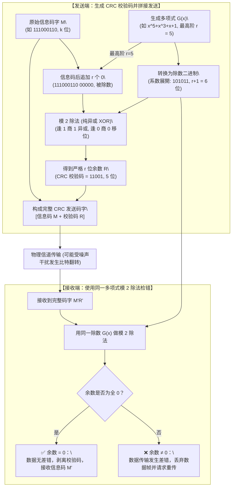

> [!IMPORTANT]
> **CRC 校验码考场终极秒杀口诀**：
> - **“多项式展开看幂次，缺项填零定除数；”**
> - **“最高幂次定 $r$ 位，补零 $r$ 个余 $r$ 位（题目 108 幂次为 5，校验码严格 5 位，秒选 B，排除 6 位的 C/D）；”**
> - **“模二除法纯异或，首位逢 1 异或除，首位逢 0 移位落；”**
> - **“余数不足高位补，接收全零保无差！”**

#### 数字通信发信机信号处理流水线：交织技术（抗突发连续误码）vs 调制 vs 脉冲成形 vs 模数转换（题库 2.5 节）⭐⭐⭐

[考查：综合知识（现代数字通信系统发信机基带与射频信号处理流水线、信源编码［A/D 转换与压缩］vs 信道编码［前向纠错码 FEC］vs 交织技术 Interleaving［数据打乱重排、突发连续误码离散化］vs 脉冲成形 Pulse Shaping［升余弦滚降滤波、消除码间串扰 ISI、减小带宽需求］vs 调制 Modulation［基带搬移到高频载波］）]

在《系统架构设计师教程（第 2 版）》第 2 章 <strong>2.5.2 通信技术（传输技术、调制与信道处理）</strong>中，数字通信系统的发信机（Transmitter）负责将原始模拟或数字信息高效、可靠地转换为适合在无线信道中传播的射频信号。各处理模块在发信机流水线中承担着严格不同的物理职能：

##### 1. 发信机五大核心信号处理模块全景对比矩阵 ⭐⭐⭐

| 信号处理环节 | 对应技术与模块 | 核心工作机理与物理输入输出 | 核心工程目的（考场唯一判别词）⭐⭐⭐ | 题目选项对应与排雷铁律 ⭐⭐⭐ |
| :--- | :--- | :--- | :--- | :--- |
| **第 1 步：模数转换与压缩** | **信源编码**<br>*(Source Coding)* | 模拟信号 $\xrightarrow{\text{采样量化编码}}$ 数字比特流；去除原始信号冗余 | **【进行模数转换（A/D）】**、降低信源数率 | 🚫 **选项 D（进行模数转换）**：属于信源编码前置处理，非交织功能。 |
| **第 2 步：增加检纠错监督位** | **信道编码**<br>*(Channel Coding)* | 增加冗余监督位（如汉明码、卷积码、Turbo 码、LDPC、Polar 码） | 赋予接收端<strong>前向纠错（FEC）</strong>能力，抵抗信道随机噪声 | 信道纠错码擅长纠正独立的随机误码，对集中爆发的长串连续误码无能为力。 |
| **第 3 步：打乱数据排列顺序**<br>*(✅ **本题考点**)* | **【交织技术】**<br>*(Interleaving)* | **按特定二维矩阵写入/读取（如按行写入、按列读出），打乱比特时间顺序**（⚠️ **自身不增加冗余**！） | **【解决连续误码问题（选 C ✅）】**：<br>将信道突发衰落造成的<strong>长串连续误码（Burst Errors）</strong>在解交织时**分散为单个孤立的离散误码**，供信道译码器轻松纠正 | ✅ **本题唯一正解 C**：<br>见题干<strong>“交织的主要作用”</strong> $\to$ 100% 秒选 **解决连续误码问题**！ |
| **第 4 步：基带滤波限带** | **脉冲成形**<br>*(Pulse Shaping)* | 采用升余弦滚降滤波器对矩形数字基带脉冲进行频域平滑整形 | **【减小带宽需求（排 A ❌）】**、抑制带外频谱旁瓣泄漏、消除码间串扰（ISI） | 🚫 **选项 A（减小带宽需求）**：由脉冲成形滤波器实现，非交织功能。 |
| **第 5 步：频谱搬移至射频** | **调制**<br>*(Modulation)* | 用基带信号控制高频正弦载波的幅度、频率或相位（ASK/FSK/PSK/QAM/OFDM） | **【将信息承载到高频载波（排 B ❌）】**，以便通过天线向自由空间辐射发射 | 🚫 ：<br>切勿将基带数据重排的交织误当成频带搬移的调制！承载到高频载波 100% 对应调制。 |

##### 2. 交织技术“变连续突发为离散”底层原理时序图⭐⭐⭐

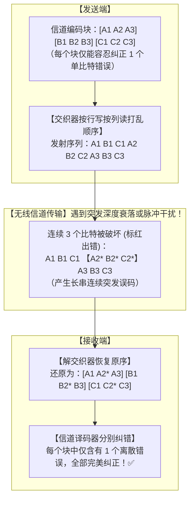

> [!IMPORTANT]
> **发信机流水线与交织秒杀口诀**：
> - **“信源模数转数字（D），信道加码保纠错；”**
> - **“交织打乱顺序破突发，连续误码化零星（秒选 C）；”**
> - **“成形滤波省带宽（A），载波搬移上高频必选调制（B）！”**

#### 5G 网络切片（Network Slicing）核心特性：端到端独立网络与差异化 SLA 安全/性能定制机制（题库 2.5 节）⭐⭐⭐

[考查：综合知识（5G 核心技术之网络切片 Network Slicing、基于 NFV/SDN 的物理与逻辑网络切分、“一物多虚”与“端到端全链路独立贯通”［无线接入网 RAN + 承载网 + 核心网 CN］、切片间逻辑隔离与生命周期自治、差异化安全策略与 QoS 特性定制［eMBB vs uRLLC vs mMTC］）]

在《系统架构设计师教程（第 2 版）》第 2 章 <strong>2.5.2 通信技术（移动通信与 5G 架构）</strong>中，5G 移动通信网络引入了<strong>网络切片（Network Slicing）</strong>技术。网络切片是指在**同一套物理网络基础设施**上，基于 SDN（软件定义网络）和 NFV（网络功能虚拟化）技术，逻辑划分出多个相互隔离、功能各异、具备独立 SLA 服务等级协议保障的**虚拟端到端逻辑网络**。

##### 1. 5G 网络切片四大核心特征与考场设陷矩阵 ⭐⭐⭐

| 特征维度 | 技术实现原理与底层内涵 | 考场设陷与排雷铁律 ⭐⭐⭐ |
| :--- | :--- | :--- |
| **1. 物理共享，逻辑切分**<br>*(选项 A 正确 ✅)* | 依托同一套物理基础设施（铁塔、物理基站、光纤链路、通用服务器计算资源池），通过虚拟化技术动态切分出多张逻辑上相互隔离的网络。 | 提高物理设备利用率与能源效率，降低全网 CAPEX/OPEX。 |
| **2. 独立的端到端网络**<br>*(选项 B 正确 ✅)* | **【贯穿全链路的 End-to-End 独立逻辑网络】**：<br>切片不仅限于核心网的划分，而是贯穿<strong>终端（UE）、无线接入网（RAN）、传输/承载网（TN）到核心网（CN）</strong>全链路，每个切片都拥有独立的网络资源配额与生命周期管理机制。 | 🚫 ：<br>切勿误以为“切片只是局部的虚划分，无法做到端到端独立”！端到端保障正是 5G 切片区别于传统局部 QoS 划分的核心突破。 |
| **3. 独特的安全与性能特性**<br>*(选项 C 错误 ❌ —— **本题正解**)* | **【差异化与隔离性定制】**：<br>每个网络切片都是一个相互隔离的逻辑实体，**包含自己独特的延迟、吞吐量、带宽以及安全特性**（如根据承载业务的机密等级独立配置访问控制、隔离级别、加密机制）。 | ✅ **本题唯一正解 C（说法错误）**：<br>C 项声称“不同切片间共享相同的安全特性”严重违背切片的隔离与定制原则！各切片具有独特而非相同的安全与性能参数。 |
| **4. 灵活应对多样化需求**<br>*(选项 D 正确 ✅)* | 面向垂直行业不同业务场景实现弹性编排与按需定制，支持按需动态创建、修改、扩容和释放切片。 | 选项 D 属于 5G 赋能千行百业的根本价值。 |

##### 2. 5G 三大核心应用场景与切片特性定制对照⭐⭐⭐

| 5G 场景分类 | 典型业务代表 | 核心网络性能要求 | 切片定制特征（时延/吞吐量/安全） |
| :--- | :--- | :--- | :--- |
| **1. eMBB**<br>*(增强移动宽带)* | 4K/8K 超高清视频、VR/AR 沉浸式应用、移动互联网流量 | **超高速率、超大带宽**<br>（峰值速率达 10~20 Gbps） | 配置超大吞吐量和高带宽通道，通用商用加密等级。 |
| **2. uRLLC**<br>*(超高可靠低时延通信)* | **自动驾驶（车联网 V2X）、远程手术医疗、工业精密制造控制** | **极致超低时延、极高可靠性**<br>（时延 $\le 1\text{ ms}$，可靠性达 99.999%） | **最高优先级调度、独占计算资源、最严苛的安全隔离策略与防篡改机制**。 |
| **3. mMTC**<br>*(海量机器类通信)* | **智能抄表（水电气表）、智慧农业传感器、智慧城市环境监测** | **海量连接密度、超低功耗**<br>（百万连接/$\text{km}^2$、电池寿命 10 年） | 简化协议栈开销、低吞吐量通道、轻量级物联网安全认证。 |

> [!IMPORTANT]
> **5G 网络切片考场秒杀口诀**：
> - **“一物多虚共基座（A 对），全链贯通端到端（RAN 到核心网全独立，B 对）；”**
> - **“千行百业按需编（D 对），特性独特各不同；安全策略独立配，共享相同必判定为错（选 C）！”**

#### 信源编码 vs 信道编码：核心目标（有效性 vs 可靠性）与冗余处理机制辨析（题库 2.5 节）⭐⭐⭐

[考查：综合知识（通信系统信源编码 Source Coding 与信道编码 Channel Coding 核心职责边界、信源模数转换 A/D 与压缩消除冗余以追求“有效性” vs 信道差错控制人为增加冗余监督位以追求“可靠性”、典型技术映射［哈夫曼/算术/JPEG/MPEG vs 海明码/CRC/卷积码/LDPC/Polar］）]

在《系统架构设计师教程（第 2 版）》第 2 章 **2.5.2 通信技术（数据通信系统模型与信号处理）** 中，数字通信系统的发射端通过信源编码与信道编码两大核心阶段，分别解决信息传输的<strong>效率（有效性）</strong>与<strong>质量（可靠性）</strong>问题：

##### 1. 信源编码 vs 信道编码全维度正交对比矩阵 ⭐⭐⭐

| 对比维度 | **信源编码（Source Coding）** ⭐⭐⭐<br>（面向信息源） | **信道编码（Channel Coding）** ⭐⭐⭐<br>（面向传输信道） | 考场核心设陷与排雷铁律 ⭐⭐⭐ |
| :--- | :--- | :--- | :--- |
| **1. 核心根本目标** | **提高通信传输的【有效性】**<br>（用最少的码元/频带传输尽可能多的信息） | **提高通信传输的【可靠性】**<br>（降低误码率，抵抗信道噪声与物理干扰） | ⭕ 牢记：**“信源求有效（快、省），信道求可靠（准、稳）”**！ |
| **2. 对“冗余”的处理策略**<br>*(核心考点)* | **【消除冗余 / 去除冗余】（压缩）**<br>原始信号中通常存在大量时间、空间或统计相关性冗余，必须通过压缩编码去除无用冗余数据 | **【人为增加冗余】（加校验码）**<br>按照特定数学规律人为在信息序列中添加结构化监督码元（校验位），使码字间具备检纠错能力 | 🚫 **全卷头号反直觉易混陷阱**：<br>- **信源千方百计“减冗余”**；<br>- **信道故意主动“增冗余”**！<br>- 见“增加冗余信息用于纠错” $\to$ 100% 判定为信道编码功能，非信源编码！ |
| **3. 核心物理功能与工序** | ① **模数转换（A/D 转换）**：对模拟信号进行抽样、量化与编码，将其转换为数字基带信号；<br>② **数据压缩**：消除统计与感知冗余 | **差错控制（检错与纠错）**：<br>为数据序列附加监督码，接收端据此执行差错检验（检错）与前向纠错（FEC） | 选项 A（模数转换）、B（压缩去冗余）、D（形成数字信号）全属信源编码标准动作。 |
| **4. 典型代表技术与算法** | - **无损压缩**：哈夫曼编码（Huffman）、香农-范诺编码、算术编码、游程编码（RLE）、LZW 算法；<br>- **有损压缩**：预测编码、变换编码（DCT）、JPEG（图像）、MP3/AAC（音频）、H.264/H.265/AV1（视频） | - **检错码**：奇偶校验码、循环冗余校验码（CRC）；<br>- **纠错码**：海明码（Hamming）、BCH 码、RS 码、卷积码、Turbo 码、LDPC 码、极化码（Polar Code，5G 控制信道） | 迁移判别：哈夫曼、JPEG $\to$ 信源编码；海明码、CRC $\to$ 信道编码。 |

##### 2. 通信全链路信号流转与冗余变化图谱


> [!IMPORTANT]
> **信源与信道编码考场终极秒杀口诀**：
> - **“信源求有效，数模转换（A）成数字（D），压缩去冗余（B 对）；”**
> - **“信道求可靠，差错控制加冗余（C 错在把信道当信源）；”**
> - **“哈夫曼压缩归信源，海明 CRC 检纠归信道！”**

#### 信道极限容量理论：奈奎斯特准则（理想无噪）vs 香农定理（有噪信道）公式参数与实战解题辨析（题库 2.5 节题目 103）⭐⭐⭐

[考查：综合知识（数据通信信道极限容量两大定理：奈奎斯特准则 Nyquist vs 香农定理 Shannon、物理量符号对应［信道容量 C vs 信号带宽 B vs 码元离散状态数 M vs 信号功率 S vs 噪声功率 N］、量纲单位辨析［容量 bps vs 带宽 Hz］、信噪比分贝换算 SNR dB 转化线性比值 S/N 陷阱、波特率与带宽换算关系 R_B = 2B 及避免重复乘 2 陷阱、同时给出两个公式参数时取交集下限决策）]

在《系统架构设计师教程（第 2 版）》第 2 章 **2.5.2 通信技术（传输技术与信道容量）** 中，数据通信系统中传输速率受物理信道带宽与信噪比的客观限制。香农（Shannon）与奈奎斯特（Nyquist）分别给出了真实有噪信道与理想无噪信道的极限信息传输速率定理：

##### 1. 奈奎斯特准则 vs 香农公式正交对比矩阵 ⭐⭐⭐

| 对比维度 | **奈奎斯特准则（Nyquist Formula）** ⭐⭐⭐<br>（理想无噪声信道） | **香农公式（Shannon Theorem）** ⭐⭐⭐<br>（真实有噪声信道） | 考场核心设陷与排雷铁律 ⭐⭐⭐ |
| :--- | :--- | :--- | :--- |
| **1. 适用信道环境** | **理想信道**（假定信道**无任何环境噪声与物理干扰**） | **实际信道**（存在随机高斯白噪声干扰的连续信道） | 题目出现“无噪声”、“理想信道” $\to$ 奈氏；出现“有噪声”、“信噪比”、“dB” $\to$ 香农！ |
| **2. 核心数学公式** | $$C = 2B \times \log_2(M)$$<br>*(或记为 $C = R_B \times \log_2 M$)* | $$C = B \times \log_2\left(1 + \frac{S}{N}\right)$$ | ⭕ **倍数差异牢记**：奈氏公式**带系数 2**（$2B$）；香农公式**不带系数 2**（$B$）！ |
| **3. 各物理量与符号定义** | - **$C$（Capacity）**：信道极限传输速率（$\text{bps}$）；<br>- **$B$（Bandwidth）**：信道信号带宽（$\text{Hz}$）；<br>- **$M$**：每个码元所能选取的**离散电平/调制物理状态数**（$n = \log_2 M$ 为每个码元携带的比特数） | - **$C$（Capacity）**：信道极限传输容量（$\text{bps}$）；<br>- **$B$（Bandwidth）**：信道信号带宽（$\text{Hz}$）；<br>- **$S$（Signal）**：信号平均功率（$\text{W}$）；<br>- **$N$（Noise）**：高斯白噪声平均功率（$\text{W}$） | 🚫 ：<br>- **$C$ 是 Capacity（容量，bps）**；<br>- **$B$ 是 Bandwidth（带宽，Hz）**！<br>- 绝不可将自变量 $B$ 误判为信道容量。 |
| **4. 信噪比参数转换陷阱** | 不涉及噪声与信噪比 | **$\frac{S}{N}$ 必须是无量纲线性功率比值**！<br>若题干给出分贝值 $\text{SNR (dB)}$，必须先换算：<br>$$\text{SNR (dB)} = 10 \times \log_{10}\left(\frac{S}{N}\right)$$<br>例如 $30\text{ dB} \implies \frac{S}{N} = 10^3 = 1000$ | 🚫 **全卷头号计算死穴**：<br>绝不可将分贝数值（如 $30$）直接代入 $S/N$ 计算！代入后 $1 + 1000 = 1001 \approx 1024 = 2^{10} \implies \log_2 \approx 10$。 |
| **5. 两公式同时适用时的裁决** | 综合考题若同时给出了 $B$、$M$ 和信噪比 $\text{dB}$ | 分别计算出 $C_{\text{奈氏}}$ 与 $C_{\text{香农}}$ 后，<strong>必须取两者中的较小值（下限）</strong>作为最终极限信道容量！ | 系统的实际传输速率既受调制技术限制（不能超奈氏），又受物理噪声制约（不能超香农）。 |

##### 2. 香农公式经典计算实例（分贝换算与代入）

- **题目场景**：信道带宽 $B = 3000\text{ Hz}$，信噪比为 $30\text{ dB}$，求信道极限容量 $C$：
  1. **第一步（分贝转比值）**：$30\text{ dB} = 10 \log_{10}(S/N) \implies S/N = 10^3 = 1000$；
  2. **第二步（代入香农公式）**：
     $$C = B \times \log_2(1 + S/N) = 3000 \times \log_2(1 + 1000) \approx 3000 \times \log_2(1024) = 3000 \times 10 = \mathbf{30\text{ kbps}}$$
  3. **结论**：极限传输速率为 $30\text{ kbps}$（$30000\text{ bps}$）。

##### 3. 奈奎斯特准则实战推演与三大防坑铁律（题目 103 深度剖析）⭐⭐⭐

1. **题目 103 完整推演四步法**：
   - **条件提取**：无噪声环境、信道带宽 $B = 3000\text{ Hz}$、物理编码状态数 $M = 32$；
   - **求单码元信息量**：$n = \log_2(M) = \log_2(32) = 5\text{ bit/码元}$；
   - **求极限速率**：$C = 2B \times \log_2(M) = 2 \times 3000 \times 5 = 30000\text{ bps}$；
   - **单位换算（逢千除）**：$C = \frac{30000}{1000} = \mathbf{30\text{ kbps}}$（✅ **题目 103 正解 B**）。
2. **考场头号致命陷阱：波特率（Baud）与带宽（Hz）的“系数 2 重复乘”**：
   - 奈氏准则中极限波特率（码元速率）$R_B = 2B$（Baud）；
   - **若题干给带宽 $B$（Hz）** $\implies$ **必须乘 2**：$C = 2 \times B \times \log_2(M)$；
   - **若题干直接给波特率 $R_B$（Baud）** $\implies$ **绝不可再乘 2**：$C = R_B \times \log_2(M)$（因为 $R_B$ 已经等于 $2B$，再乘 2 就成了 $4B$，必错！）。
3. **状态数取对数规则**：
   - 物理状态数 / 离散电平数 $M$ 必须取以 2 为底的对数 $\log_2(M)$（如 $M=4 \to 2$ 位，$M=8 \to 3$ 位，$M=16 \to 4$ 位，$M=32 \to 5$ 位，$M=64 \to 6$ 位）；切勿直接用 $B \times M$ 粗暴相乘！

> [!IMPORTANT]
> **信道容量公式考场终极秒杀口诀**：
> - **“C 是容量（Capacity）单位 bps，B 是带宽（Bandwidth）单位赫兹（Hz）；”**
> - **“理想无噪奈奎斯特，两倍带宽乘对数（$C = 2B \log_2 M$）；见波特率直接乘（$C = R_B \log_2 M$），切莫重算系数二；”**
> - **“实际有噪看香农，一倍带宽加信噪（$C = B \log_2(1 + S/N)$，无系数 2）；”**
> - **“信噪分贝除以十，十的幂次方成比值（30dB 是 1000，20dB 是 100，直接代入必错题）；两法并存取其小！”**

  - 【题库章节练习 / 题库 2.5 节题目 103】（某信道的带宽为 3000Hz，编码采用 32 种不同的物理状态来表示数据，在无噪声环境下，该信道的最大数据传输速率是【**B. 30**】kbps）。

#### 数据通信工作模式全景：单工（Simplex） vs 半双工（Half-Duplex） vs 全双工（Full-Duplex）传输机理、时序特征与经典工程设备辨析（题库 2.5 节题目 69）⭐⭐⭐

[考查：综合知识（数据通信线路传输方式分类、单工通信［单向固定传输］vs 半双工通信［双向分时轮流交替传输］vs 全双工通信［双向瞬时并发同时传输］的核心定义、时序机制、信道物理线路构成及典型工程与生活设备映射辨析）]

在《系统架构设计师教程（第 2 版）》第 2 章 **2.5.2 通信技术（传输技术与数据通信基础）** 中，按照数据在传输介质中的信号流动方向与时序控制关系，数据通信线路的工作模式划分为**单工（Simplex）**、**半双工（Half-Duplex）** 与 **全双工（Full-Duplex）** 三种基本形态：

##### 1. 数据通信三大传输模式全景特性正交对照矩阵 ⭐⭐⭐

| 传输模式 | 英文术语 | 信号传输方向 | 传输时序限制 | 信道物理要求 | 核心形象比喻 | 典型生活与工程设备实例 ⭐⭐⭐ | 考场设陷与标准判别词 ⭐⭐⭐ |
| :--- | :--- | :--- | :--- | :--- | :--- | :--- | :--- |
| **1. 单工通信** | **Simplex** | **单一固定方向**<br>（只能由 A 到 B，绝不支持反向传输） | 无反向传输时序概念，信号随时单向发送 | 1 条单向传输信道 | **单行道**<br>（只去不回） | - **无线电广播（FM/AM）**<br>- **电视广播发射系统**<br>- **单向红外遥控器**<br>- 传统寻呼机（BP机） | 🚫 **题目 69 混淆陷阱**：<br>见<strong>“只在一个方向上传输信息”</strong> $\to$ **100% 锁定单工！** 切勿误安到半双工头上！ |
| **2. 半双工通信**<br>*(✅ 题目 69 核心)* | **Half-Duplex** | **双向通信**<br>（既可 A 到 B，也可 B 到 A） | **不能同时传输**！<br>双方必须**分时轮流/交替**占用信道发送与接收 | 可共享 1 条物理双向通路（时分复用） | **独木桥**<br>（两边都能过，但必须一方过完另一方才能过） | - **传统无线对讲机**（按住 PTT 讲话，说完讲“Over”松开收听）<br>- **基于 Hub 的共享以太网（CSMA/CD）**<br>- 工业 RS-485 两线制半双工总线 | ✅ **本题唯一正解前半句 C**：<br>见<strong>“可在两个方向上轮流传输信息 / 分时交替”</strong> $\to$ **100% 锁定半双工！** |
| **3. 全双工通信**<br>*(✅ 题目 69 核心)* | **Full-Duplex** | **双向通信**<br>（既可 A 到 B，也可 B 到 A） | **允许同时瞬时传输**！<br>双方可以同时发送和接收数据 | 通常需要两条独立的物理信道（独立的发送与接收线路，如双绞线收发线对） | **双向四车道立交桥**<br>（对向车流并行奔驰，互不干扰） | - **固定电话 / 移动蜂窝电话通话**<br>- **现代交换式以太网（全双工交换机 Switch）**<br>- 计算机全双工串行总线（如 PCIe、全双工 RS-422） | ✅ **本题唯一正解后半句 C**：<br>见<strong>“可在两个方向上同时传输信息 / 瞬时双向”</strong> $\to$ **100% 锁定全双工！** |

##### 2. 三大传输模式数据流向与时序对比图 ⭐⭐⭐

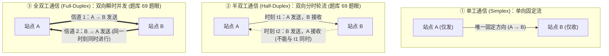

> [!IMPORTANT]
> **通信传输工作模式考场终极秒杀口诀**：
> - **“单工（Simplex）只往一个方向走（单行道，广播电视只发不收，排 B）；”**
> - **“半双工（Half-Duplex）能发能收轮流过（独木桥，对讲机讲完说 Over，选 C 前半句）；”**
> - **“全双工（Full-Duplex）双向同时任性跑（双车道立交桥，电话交换机同收发，选 C 后半句）！”**

#### 数据通信定时与传输方式：同步传输（Synchronous） vs 异步传输（Asynchronous）底层机理、总线边界与外设缓冲全景辨析（题库 2.5 节题目 112）⭐⭐⭐

[考查：综合知识（计算机系统总线定时控制、通信物理层传输方式分类、同步传输［公共时钟线驱动、时钟上升沿/下降沿锁存、无起始/停止位开销、高带宽与速度匹配］ vs 异步传输［无公共时钟、基于起始/停止位字符界定、基于应答握手信号 Ready/Ack 或驱动层缓冲池解耦、适应悬殊速率机电外设］、I/O 接口两侧总线物理边界划分与考场设陷排雷）]

在《系统架构设计师教程（第 2 版）》第 2 章 **2.5.2 通信技术（数据传输与定时控制）** 与 **2.2.3 存储与总线系统** 中，计算机系统内部各部件之间以及系统与外部设备之间的数据传输，依据**收发两端是否依赖统一的公共时钟基准节拍**，严格划分为 **同步传输（Synchronous Transmission）** 与 **异步传输（Asynchronous Transmission）**：

##### 1. 同步传输 vs 异步传输底层物理机制与系统场景正交对比矩阵 ⭐⭐⭐

| 对比维度 | **同步传输（Synchronous Transmission）** ⭐⭐⭐ | **异步传输（Asynchronous Transmission）** ⭐⭐⭐<br>*(✅ 题目 112 正解)* | 考场核心设陷与排雷铁律（题目 112 深度剖析）⭐⭐⭐ |
| :--- | :--- | :--- | :--- |
| **1. 时钟依赖基准** | **必须有统一的公共物理时钟信号（Clock）**<br>（由专有时钟线传输，或从数据流曼彻斯特编码中提取同步时钟） | **通信双方没有统一的公共时钟线**<br>（各自拥有独立的本地时钟发生器 / 波特率发生器，相位互不锁定） | ⭕ **判别分水岭**：是否有公共时钟脉冲同步驱动收发步调！ |
| **2. 数据传输单位与格式** | **以“数据块 / 帧（Block / Frame）”为传输单位**<br>（在数据块首尾加同步字符 `SYN` 或标志字节，中间连续传输海量数据） | **以“单个字符（Character）”为独立传输单位**<br>（每个字符独立前置 1 位**起始位**、后置 1~2 位**停止位**及可选校验位） | 异步字符之间的时间间隔完全是随机、不可预知的（空闲时呈高电平 Mark 状态）。 |
| **3. 传输效率与总线开销** | **传输效率极高、总线带宽利用率高**<br>（传输成千上万字节仅需几个字节的帧头开销，无额外字符冗余位） | **传输开销较大、有效利用率相对较低**<br>（传输 1 个 8 位字符需附加 2~3 位起始/停止位，额外冗余开销达 $20\% \sim 30\%$） | 异步传输以牺牲部分开销为代价，换取了系统拓扑的灵活性与异构容错性。 |
| **4. 两端物理特性要求** | **要求通信双方速度匹配、距离近、时延严格确定** | **允许通信双方速度差异悬殊、时延不可预期** | 若双方速度相差成千上万倍，强行使用同步传输将导致高速部件长时间处于硬等待停滞状态。 |
| **5. 硬件协调与解耦机制** | 严格按时钟节拍计数（在 Clock 脉冲节拍内自动读写锁存） | ① **握手联络信号（Handshaking）**：如 Ready/Strobe/Ack 双向握手；<br>② <strong>基于内存缓冲池（Buffer Pool / Spooling）</strong>队列解耦 | 打印机由于机械走纸、喷墨、激光加热耗时极长，操作系统必须开辟打印缓冲池做异步解耦。 |
| **6. 典型应用场景与代表实体** | ① **CPU 访问主存（RAM）**（选项 A）；<br>② **CPU 与 PCI / PCIe 总线交换数据**（选项 C）；<br>③ **CPU 与 I/O 接口控制器寄存器通信**；<br>④ 芯片间 SPI / I2C 高速总线、数字通信中的 SDH/SONET | ① **I/O 接口与慢速外部设备（打印机、机械键盘、鼠标）交换信息**（✅ 选项 D）；<br>② **RS-232 / UART 异步串行接口通信**；<br>③ 远程调制解调器（Modem）异步拨号 | 🚫 ：<br>误以为“凡涉及 I/O 全是异步”！I/O 接口控制器芯片就焊在主板上，CPU 读写其内部端口寄存器走的是**系统内部高速时钟同步总线**！真正异步的是接口连向打印机的那条线（D）！ |

##### 2. 计算机主板内部总线（同步域） vs 板外外设链路（异步域）物理边界全景图 ⭐⭐⭐

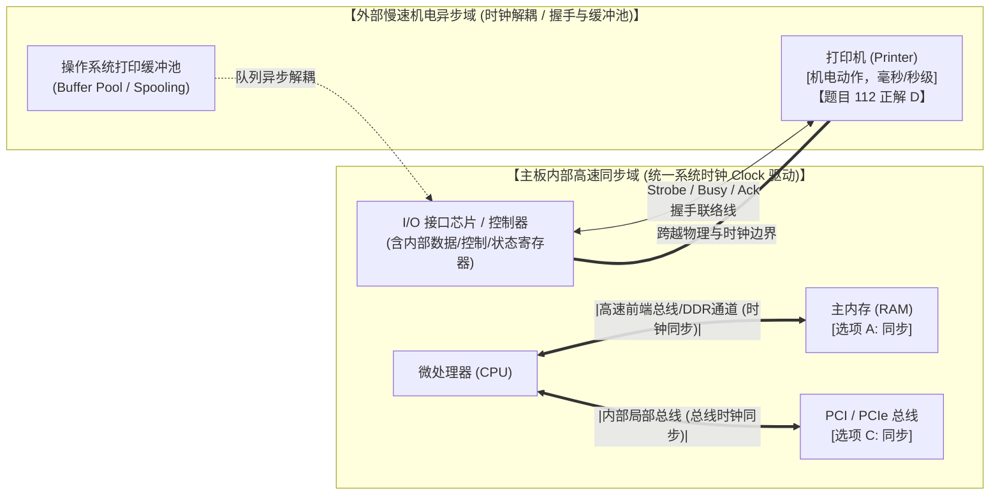

##### 3. 考场设陷与四大典型场景判别铁律 ⭐⭐⭐

1. **“板内高速看同步，板外机械选异步”**：
   - 只要通信的两端部件全部位于计算机**主板内部**，且处于**系统总线时钟**控制下（CPU、Cache、主存、PCI 总线、I/O 接口控制器），速度处于纳秒（ns）量级，必采用**同步传输方式**；
   - 只要通信涉及**慢速机电外部设备**（如打印机走纸打字、终端键盘敲击、串口通信），速度跨越到毫秒（ms）甚至秒级，必须采用**基于应答联络信号或缓冲池的异步传输方式**。
   - **内侧（CPU $\leftrightarrow$ I/O 接口）**：CPU 访问的是 I/O 接口内部的“端口寄存器”（如数据缓冲寄存器、状态寄存器、控制寄存器），这是纯主板芯片间的总线读写，**属于严格的同步传输**；
   - **外侧（I/O 接口 $\leftrightarrow$ 外部设备）**：I/O 接口向外通过电缆连接打印机，受机械动作制约，两端没有统一时钟，**必须采用异步传输**。

> [!IMPORTANT]
> **计算机数据传输方式考场终极秒杀口诀**：
> - **“板内芯片一家亲，公共时钟步调齐（CPU、内存、PCI、I/O 接口全走同步，排除 A、B、C）；”**
> - **“板外机电慢吞吞，握手应答缓冲池（I/O 接口接打印机，题目 112 秒选 D 异步）；”**
> - **“I/O 接口分内外：向内接 CPU 是总线同步，向外接外设才是缓冲异步！”**

  - 【题库章节练习 / 题库 2.5 节题目 112】（计算机系统中，在【**D. I/O接口与打印机交换信息**】的情况下一般应采用异步传输方式）。

### 2.5.3 网络技术：DNS 域名系统与解析工作流（递归查询 vs 迭代查询机理与根服务器架构规范）⭐⭐⭐

域名系统（Domain Name System, DNS）是互联网核心应用层基础设施，负责将便于人类记忆的主机域名映射为底层网络路由所需的 IP 地址。

1. **DNS 查询的两大核心工作模式正交对比表**：

| 查询模式 | 核心工作机理 | 发起端角色与行为 | 接收端（服务器）职责与行为 | 典型应用交互场景 | 优缺点与系统开销 |
|:---|:---|:---|:---|:---|:---|
| **递归查询**⭐⭐⭐<br>（Recursive Query） | **“包办到底 / 一查到底”** | 客户端只发一次解析请求，随后挂起等待最终确切的“域名 $\to$ IP”映射（或权威报错）。 | 收到请求后若本地无缓存，**必须代替客户端向其他域名服务器发起后续查询**，直到获取最终结果再逐级回传。 | **PC（主机） $\to$ 本地域名服务器（Local DNS）** | 客户端轻量极简；但服务器端需持久化维持会话连接与并发上下文，**极度消耗服务器内存与连接资源**。 |
| **迭代查询**⭐⭐⭐<br>（Iterative Query） | **“指引下一跳 / 指路跑腿”** | 发起方（通常为 Local DNS）拿到服务器返回的“下一跳地址”后，**由发起方自己亲自向下一级服务器发起新的查询**。 | 收到请求后若本地无答案，**不替发起方跑腿**，仅返回“下一级可能知晓答案的域名服务器（如中介/顶级/权威）IP 地址”（Referral）。 | **本地域名服务器 $\to$ 根域名服务器 / 顶级域名服务器 / 授权域名服务器** | 服务器无长期等待负担，随查随结，**高并发吞吐能力极强**；解析的往返控制逻辑由本地域名服务器承担。 |

2. **根域名服务器架构设计与性能红线**：
   - **全球稀缺中枢**：全球 IPv4 根域名服务器仅有 13 个逻辑 IP 地址（A 到 M），是整个互联网名字解析的根基。
   - **禁止递归原则**：**根域名服务器（以及顶级域名服务器 TLD）绝不能配置或承担递归查询**！如果根服务器为全球海量 Local DNS 提供递归查询，根服务器将陷入海量并发挂起等待状态，瞬间导致性能枯竭、全球网络瘫痪。
   - **架构规范**：根服务器**必须且只能采用迭代查询**，只负责返回顶级/中介域名服务器的地址。

3. **标准两段式 DNS 解析全景时序**：
   - 第一段：**PC $\to$ 本地域名服务器**（标准**递归查询**，用户主机轻量化）；
   - 第二段：**本地域名服务器 $\to$ 根 / 顶级 / 权威服务器**（标准**迭代查询**，Local DNS 分别向根、顶级、授权发包询问）。

4. **DNS 时序拓扑图识图金标准（全迭代星型拓扑 vs 混合递归级联拓扑）**：
   - **全迭代星型拓扑**：本地域名服务器作为唯一的中心节点，分别向“根 $\to$ 本地”、“中介/顶级 $\to$ 本地”、“权威 $\to$ 本地”往返发包。各级上级服务器**均直接原路回包给本地域名服务器**，不向下级转发，各级服务器均执行**迭代查询**。
   - **混合递归级联拓扑**：本地域名服务器向上级服务器发包后，上级服务器**亲自转头向下级发出新请求代为跑腿**（如本题中介 $\to$ 授权），此时该上级服务器**执行的是递归查询**。
   - **一秒识图原则**：“**原路回包即迭代（谁问回谁），转头发包必递归（替你跑腿）！**”

5. **DNS 树状层次结构与五类域名服务角色分工矩阵**：

| 域名服务角色 | 树状层次地位 | 核心管辖范围与职责 | 是否需要维护权威域名数据库（Zone DB） | 典型设陷点与排雷 |
|:---|:---|:---|:---|:---|
| **根域名服务器**<br>（Root Name Server） | **最高层次（第 0 层，`.`）**⭐⭐⭐ | 掌握全部<strong>顶级域名服务器（TLD）</strong>的域名与 IP 地址；是全球解析寻址的总起点 | 维护根区（Root Zone）数据 | ❌ **高频陷阱**：把“顶级域名服务器”错称为最高层次；记住**树顶永远是“根”**！ |
| **顶级域名服务器**<br>（TLD Name Server） | **第二层**（如 `.com`、`.cn`、`.org`） | 管理在该顶级域名下注册的所有**二级域名**（及对应权限域名服务器地址） | 维护对应的顶级域区域数据库 | ❌ 望文生义误以为“顶级（Top-Level）”就是最高层（它上面还有根服务器）。 |
| **权限域名服务器**<br>（Authoritative Name Server） | **第三层及以下**（管辖区 Zone） | 负责将其**管辖区内**的主机域名权威转换为该主机的 IP 地址 | **必须维护**所管辖区域（Zone）的权威域名数据库文件 | 管辖区内的最终权威答案提供者。 |
| **本地域名服务器**<br>（Local DNS / 默认 DNS） | 不属于树状层次结构，但极重要 | 主机发出 DNS 查询报文后**首先送往**的服务器；可采用递归或迭代两种查询方式 | 可配置缓存或代理，非特定公网域权威 | 客户端主机的第一跳委托代理。 |
| **本地缓存域名服务**<br>（Local DNS Cache） | 客户端/解析程序内存区域 | 在**内存**中临时保存最近被解析过的主机名及 IP 地址映像，加速重复解析 | **不需要域名数据库**⭐⭐⭐（仅内存暂存，无管辖区文件） | ❌ **高频陷阱**：误以为只要提供域名服务就必须有域名数据库文件。 |

> [!IMPORTANT]
> **DNS 查询模式与层次秒杀口诀**：
> - **“树顶永远是根（Root），顶级（TLD）排第二；管辖区内找权限（有库），内存加速靠缓存（无库）！”**
> - **“主机找本地用递归（包办到底等结果），本地查外网用迭代（指路跑腿自己忙）；”**
> - **“根服务器金贵少，绝不递归当苦力；见根向下发请求，必是递归错上头！”**
> - **“时序识图看端点：原路回包是迭代，转头发包是递归！”**

  - 【题库章节练习】 题目 28（以下关于域名服务器的叙述，错误的是 $\to$ 选【B. 顶级域名服务器是最高层次的域名服务器】）。
  - 【软考达人题库】 题目 21（主机PC对某个域名进行查询，最终由该域名的授权域名服务器解析并返回结果，查询过程时序图中根域名服务器亲自向中介服务器发起请求并等待返回，这种查询方式中不合理的是 $\to$ 选【A. 根域名服务器采用递归查询，影响了性能】）。
  - 【软考达人题库】 题目 25（主机host1对host2进行域名查询，时序图中根服务器 2 进 3 原路回本地，中介服务器 4 进后转头发 5、6 给授权服务器再回 7，下列说法正确的是 $\to$ 选【A. 根域名服务器采用迭代查询，中介域名服务器采用递归查询】）。

#### HTTP 与 HTTPS 协议架构对比（默认端口 80 vs 443、SSL/TLS 混合加密握手与电子支付安全场景）（题库 2.3 节题目 91）⭐⭐⭐

[考查：综合知识（HTTP 与 HTTPS 协议差异、默认周知服务端口 `TCP 80` vs `TCP 443`、SSL/TLS 在协议栈中的安全子层位置、CA 数字证书 + 非对称密钥协商 + 对称加密传输的混合加密机制、电子支付网站安全协议选型）]

1. **HTTP 与 HTTPS 协议全维度正交对比矩阵**：

| 对比维度 | **HTTP（超文本传输协议）**<br>*(HyperText Transfer Protocol)* | **HTTPS（安全超文本传输协议）** ⭐⭐⭐<br>*(HTTP Over SSL/TLS)* | 考场设陷与排雷铁律 ⭐⭐⭐ |
| :--- | :--- | :--- | :--- |
| **1. 协议栈架构组成** | `HTTP（应用层）` $\to$ `TCP（传输层）` | `HTTP（应用层）` $\to$ **`SSL/TLS（安全子层）`** $\to$ `TCP（传输层）` | $\text{HTTPS} = \text{HTTP} + \text{SSL/TLS}$（绝非在网络层直接用 IPSec，也非仅改 HTTP 请求头）。 |
| **2. 默认服务端口号** | **`TCP 80`**（选项 C 正确 ✅） | **`TCP 443`**（选项 B 正确 ✅） | 🚫 **选项辨析陷阱（选项 B）**：切勿将 HTTPS 默认端口 `443` 误记为错误，或审题漏看“不正确的是”！ |
| **3. 传输安全性** | **明文传输**（不加密、不验证通信方身份、报文极易被嗅探窃听与中间人篡改） | **密文传输**（支持**加密传输**［选项 A 正确 ✅］、**CA 证书身份认证**、**MAC 完整性防篡改**） | — |
| **4. 证书与部署成本** | 无需申请数字证书 | 需要向 **CA（证书授权中心）** 申请数字证书（绑定域名与服务器公钥） | — |
| **5. 典型业务适用场景** | 仅适用于对安全无敏感要求的公开静态资讯浏览 | **电子支付类网站、网上银行、电商交易、用户登录认证**等敏感隐私业务强制使用 | ✅ **本题唯一正解 D（选错误描述）**：<br>D 项声称“电子支付类网站应使用 HTTP 协议”严重违背安全规范，电子支付必须使用 **HTTPS**！ |

2. **HTTPS（SSL/TLS）混合加密握手与通信三要素分工**：
   - **① CA 数字证书（防钓鱼/身份认证）**：客户端验证服务器发来的 CA 数字证书签名，确认服务器真实身份并提取其**公钥**。
   - **② 非对称加密（握手阶段安全协商会话密钥）**：利用非对称加密算法（如 RSA / ECDHE）在握手阶段安全协商或加密传输随机生成的**对称会话密钥（Session Key / Pre-master Secret）**，解决密钥分发难题。
   - **③ 对称加密（业务数据传输阶段高效加密）**：握手完成后，双方使用协商好的**对称会话密钥**（如 AES）对后续所有 HTTP 业务报文进行高速对称加密传输（兼顾安全性与低计算延迟）。

> [!IMPORTANT]
> **HTTP vs HTTPS 考场秒杀口诀**：
> - **“明文八零（HTTP=80）密四四三（HTTPS=443），HTTP 加 SSL 变安全；”**
> - **“握手非对称传密钥、证书验身防中间人、业务数据走对称加密；电子支付必用 HTTPS（说用 HTTP 必错，秒选 D）！”**

  - 【软考题库章节练习】 2.3 节题目 91（以下关于 HTTPS 和 HTTP 协议的描述中，不正确的是【**D. 电子支付类网站应使用 HTTP 协议**】）。

#### IPv4 地址分类、子网掩码借位与特殊地址（网络地址 vs 直接广播 vs 受限广播）计算全景（题库 2.5 节题目 36）⭐⭐⭐

[考查：综合知识（分类 IPv4 地址结构［A/B/C 类默认掩码与网络号/主机号划分］、子网掩码 Subnet Mask 借位与子网号提取、子网网络地址计算［主机位全 0］、直接广播地址 Directed Broadcast Address 计算［主机位全 1］、受限广播地址 Limited Broadcast Address［255.255.255.255］、主机单播地址辨析、变长子网 CIDR 计算）]

在《系统架构设计师教程（第 2 版）》第 2 章 **2.5.3 网络技术（网络协议与 IP 寻址）** 中，IPv4 地址由 32 位二进制数（4 字节）组成，采用点分十进制表示。为了在无连接的分组交换网中实现层次化路由寻址与管理，IP 地址空间严格遵循网络分类、子网划分与特殊地址定义规则：

##### 1. IPv4 传统三大分类结构与默认网络掩码速查表 ⭐⭐⭐

| 网络类别 | 首字节十进制范围 | 二进制前导特征位 | 默认网络号位数 | 默认主机号位数 | 默认子网掩码 | 默认私有 IP 地址范围（RFC 1918） |
| :--- | :--- | :--- | :---: | :---: | :--- | :--- |
| **A 类** | `1 ～ 126`<br>（`127` 保留作环回） | `0...` | 8 位（1 字节） | 24 位（3 字节） | `255.0.0.0`（`/8`） | `10.0.0.0 ～ 10.255.255.255` |
| **B 类** ⭐⭐⭐<br>（本题 `140.252`） | **`128 ～ 191`**<br>（✅ **140 属于 B 类**） | `10...` | 16 位（2 字节） | 16 位（2 字节） | `255.255.0.0`（`/16`） | `172.16.0.0 ～ 172.31.255.255` |
| **C 类** | `192 ～ 223` | `110...` | 24 位（3 字节） | 8 位（1 字节） | `255.255.255.0`（`/24`） | `192.168.0.0 ～ 192.168.255.255` |
| **D 类** | `224 ～ 239` | `1110...` | 组播地址（Multicast），不划分网络/主机号 | — | — | 组播专用（如 `224.0.0.1` 所有主机） |
| **E 类** | `240 ～ 255` | `1111...` | 保留用于科学实验与研究 | — | — | — |

##### 2. 子网划分三层层次结构与地址切分机制（题目 36 核心）⭐⭐⭐

```text
原始 B 类地址： [------- 16 位网络号 -------] [---------------- 16 位主机号 ----------------]
划分 /24 子网： [------- 16 位网络号 -------] [--- 8 位子网号 ---] [------ 8 位主机号 ------]
本题实例数值：  140            .252          .12                 .120
子网掩码掩盖：  255            .255          .255                .0
```

- **子网掩码的作用**：子网掩码中二进制为 `1` 的位对应 IP 地址中的**网络位与子网位**；二进制为 `0` 的位对应**主机位**。
- **主机号提取**：将 IP 地址与子网掩码的**反码**按位与运算（或直接观察掩码全 0 部分对应的 IP 字节），本题中主机号即为 `0.0.0.120`（或标为 `120`）。

##### 3. 四大特殊 IP 地址类型与功能辨析矩阵（考场设陷排雷）⭐⭐⭐

| 特殊地址类型 | 二进制结构特征 | 本题实例表现 | 核心网络用途与路由器行为 | 考场排雷与设陷防坑 ⭐⭐⭐ |
| :--- | :--- | :--- | :--- | :--- |
| **① 子网网络地址**<br>*(Network Address)* | **主机位全部置 0** | `140.252.12.0` | 代表整个子网网络本身；**绝对不能分配给任何物理主机或网卡** | 路由表中路由条目的目标网段。 |
| **② 子网直接广播地址**<br>*(Directed Broadcast)*<br>（✅ **题目 36 正解 B**） | **网络/子网位不变，主机位全部置 1** | **`140.252.12.255`** | **向指定子网内的所有主机广播**；路由器允许跨网段单播路由传输，到达目标网关路由器后泛洪为广播 | ✅ **本题正解**：见题干“**该子网直接的广播地址**”，直接锁定**主机位全 1**！ |
| **③ 受限广播地址**<br>*(Limited Broadcast)*<br>*(选项 A 干扰项)* | **32 位全为 1**<br>（`255.255.255.255`） | `255.255.255.255` | 仅在**本物理局域网段内广播**（用于 DHCP Discover 寻找地址）；**路由器严禁跨网段转发** | 🚫 **排雷 A**：受限广播与特定子网无关，绝非某个指定子网的直接广播。 |
| **④ 单播主机地址**<br>*(Unicast Host IP)*| **主机位既非全 0 也非全 1** | `140.252.12.120` | 分配给单台网络设备（主机、服务器、路由器接口）进行一对一通信 | 🚫 ：这是题干原本的主机 IP，单播地址绝不能充当广播地址！ |
| **⑤ 环回测试地址**<br>*(Loopback)* | `127.0.0.0/8`<br>（如 `127.0.0.1`） | `127.0.0.1` | 用于本机操作系统内部 TCP/IP 协议栈环回自测，**报文不出物理网卡芯片** | 凡 `127` 开头的地址均不得接入公网。 |

##### 4. 变长子网（CIDR）非整字节直接广播地址三步速算铁律⭐⭐⭐

若掩码不是整字节（如 `/26` 即 `255.255.255.192`）：
1. **求步长（Block Size）**：子网块增量 $\Delta = 256 - \text{掩码最后一个有效字节} = 256 - 192 = 64$；
2. **定区间（Find Subnet Block）**：写出 64 的倍数基数：`0, 64, 128, 192`。IP 末字节 `120` 介于 $64 \le 120 < 128$，锁定所在子网网络地址为 **`.64`**；
3. **出广播（Broadcast = Next Network - 1）**：下一子网起始地址减 1（即主机位全 1）：$128 - 1 = \mathbf{127}$，得出直接广播地址为 **`140.252.12.127`**！

> [!IMPORTANT]
> **IP 地址分类与广播计算考场终极秒杀口诀**：
> - **“A类一二六、B类一二八到一九一（140 是 B 类）、C类一九二到二二三；”**
> - **“网络地址主机位全零（代表网络不能配），直接广播主机位全一（本网广播选 B 255）；”**
> - **“CIDR 广播看步长，256 减掩码定块宽，下个子网减去一是广播！”**

#### TCP/IP 网络层核心辅助协议（ARP / RARP / ICMP / IGMP）与 IP 组播管理架构（IGMP vs PIM）（题库 2.5 节题目 33）⭐⭐⭐

[考查：综合知识（TCP/IP 网络层四大辅助协议功能矩阵、ARP 地址解析 vs RARP 逆地址解析、ICMP 差错与状态控制、IGMP 组播组成员加入与退出机制、组播体系分工［主机到直连路由器 IGMP vs 路由器间分发树 PIM］、IPv6 MLD 组播侦听机制）]

在《系统架构设计师教程（第 2 版）》第 2 章 **2.5.3 网络技术（网络协议体系）** 中，TCP/IP 协议栈网络层以 IP 协议为核心，协同四大辅助控制协议完成寻址、映射、差错报告与组播管理：

##### 1. TCP/IP 网络层四大核心辅助协议全景对照矩阵 ⭐⭐⭐

| 协议名称 | 英文全称 | 封装层级与 IP 协议号 | 核心业务职责与数据流向 | 典型应用场景与考场标志词 ⭐⭐⭐ | 考场排雷铁律 |
| :--- | :--- | :--- | :--- | :--- | :--- |
| **1. IGMP**<br>*(✅ 题目 33 正解 C)* | **Internet Group Management Protocol**<br>（网际组管理协议） | 直接封装在 IP 报文中<br>*(IP 协议号: **2**)* | **定义组播中组（Group）的成员加入和退出机制**；在本地主机与直连组播路由器之间维护组成员关系 | ⭕ **“定义组播成员加入和退出机制”**<br>⭕ **“主机与直连组播路由器之间”** $\to$ **100% 锁定 IGMP（C）**！ | 🚫 严禁跨路由器在广域网泛洪；只作用于本地子网链路。IPv6 中由 **MLD（基于 ICMPv6）** 替代。 |
| **2. ICMP**<br>*(选项 D)* | **Internet Control Message Protocol**<br>（网际控制报文协议） | 直接封装在 IP 报文中<br>*(IP 协议号: **1**)* | **报告 IP 数据包传输过程中的差错与网络异常**（如目的不可达、TTL 超时、参数问题），提供网络探测查询 | ⭕ **“报告差错情况和异常情况”**<br>⭕ **“网络连通性探测”**（`Ping` 的 Echo Request/Reply、`Tracert` 底座） | 🚫 ICMP 本身不保证可靠传输，也不用于单播或组播的业务数据分发。 |
| **3. ARP**<br>*(选项 B)* | **Address Resolution Protocol**<br>（地址解析协议） | 介于数据链路层与网络层之间（以太网帧类型 `0x0806`） | **已知目标主机的 IP 地址，查询并解析其物理 MAC 地址**（广播请求，单播响应，维护本地 ARP 缓存表） | ⭕ **“已知 IP 地址确定物理地址”**<br>⭕ **“广播发送请求，单播返回应答”** | 🚫 仅在同物理网段广播有效，不能跨路由器解析异地 MAC。 |
| **4. RARP**<br>*(选项 A)* | **Reverse ARP**<br>（逆地址解析协议） | 介于数据链路层与网络层之间（以太网帧类型 `0x8035`） | **已知本机物理 MAC 地址，从网关/服务器查询获取自身 IP 地址** | ⭕ **“已知物理地址请求 IP 地址”**<br>⭕ **“无盘工作站引导启动”** | 🚫 现已被功能更强、支持跨网段中继与子网掩码下发的 **DHCP** 彻底替代。 |

##### 2. IP 组播网络双层架构拓扑与协议分工⭐⭐⭐

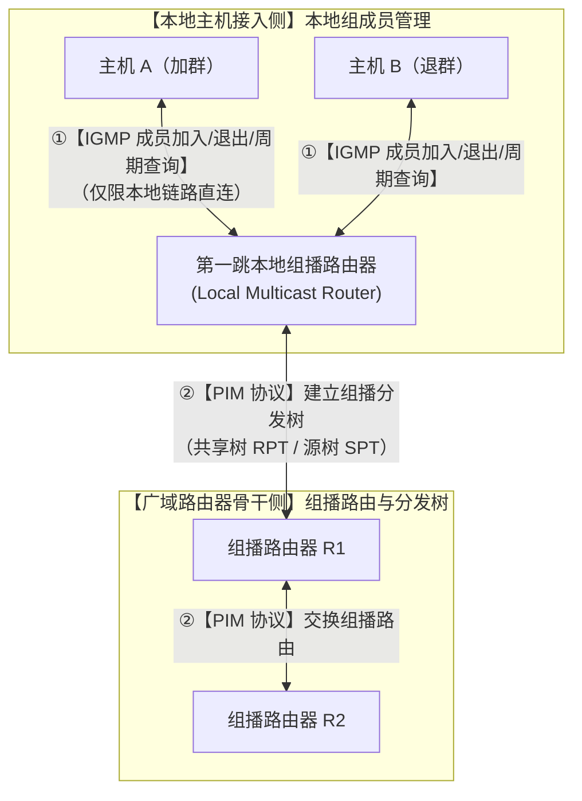

> [!IMPORTANT]
> **TCP/IP 辅助协议与组播架构考场秒杀口诀**：
> - **“IP 查 MAC 靠【ARP】，MAC 查 IP 靠【RARP】；”**
> - **“查错网络异常选【ICMP】，组播成员加入退出锁定【IGMP（C）】；”**
> - **“本地主机管成员认【IGMP】，跨路由器建分发树选【PIM】！”**

#### 常见应用层网络协议功能与电子邮件系统工作流（SMTP 发送推模式与 TCP 25 端口 vs POP3/IMAP 接收拉模式 vs MIME 扩展 vs 常用传输/网络协议）（题库 2.5 节题目 19 / 题目 39）⭐⭐⭐

[考查：综合知识（应用层常见网络协议功能：SMTP 简单邮件传输协议［发送/中继邮件、推模式 Push、TCP 25］vs POP3/IMAP 邮件接收读取［收件人从服务器拉取/下载、拉模式 Pull、TCP 110/143］vs MIME 多用途互联网邮件扩展［支持多媒体与非 ASCII 码附件］vs FTP/TFTP 文件传输 vs Telnet/SSH 远程登录）]

在《系统架构设计师教程（第 2 版）》第 2 章 <strong>2.5.3 网络技术（网络协议与应用层协议）</strong>中，电子邮件系统与常见网络服务运行在 TCP/IP 协议栈的应用层，不同协议根据数据流动方向与交互特性承担各自特定的功能角色。

##### 1. 电子邮件系统三大核心协议全景工作流与正交对比表 ⭐⭐⭐


| 协议名称 | 英文全称 | 传输层协议与默认端口 | 数据流向模式与核心职责 ⭐⭐⭐ | 考场设陷与排雷铁律 ⭐⭐⭐ |
| :--- | :--- | :--- | :--- | :--- |
| **1. SMTP**<br>*(✅ 题目 19/39 正解 B)* | **Simple Mail Transfer Protocol**<br>（简单邮件传输协议） | **TCP 25**<br>*(SSL/TLS: 465 / STARTTLS: 587)* | **【推模式（Push）】负责发送与中继邮件**：<br>① 发件客户端 $\to$ 发件服务器（题目 39 考点）；<br>② 发件服务器 $\to$ 收件服务器 | ✅ **本题唯一正解 B（题目 19 / 题目 39）**：<br>见题干<strong>“来进行邮件发送”</strong> $\to$ 第一空秒选 **SMTP（B）**，第二空端口秒填 **TCP 25**！<br>🚫 **排雷**：辨析提示接收协议 POP3（A），必须牢记发信全走 SMTP。 |
| **2. POP3**<br>*(选项 A 对应)* | **Post Office Protocol version 3**<br>（邮局协议第 3 版） | **TCP 110**<br>*(SSL/TLS: 995)* | **【拉模式（Pull）】负责从服务器拉取/下载邮件**：<br>收件客户端从收信服务器下载邮件到本地（默认离线阅读，单向同步） | 🚫 仅用于客户端**收信/取信**，绝不能用于跨服务器中继或客户端发信。<br>⚠️ **缺点**：单向离线拉取，客户端已读/删除标记不回传服务器，**不支持多终端状态双向同步**。 |
| **3. IMAP4**<br>*(现代主流拉模式)* | **Internet Message Access Protocol**<br>（互联网邮件访问协议） | **TCP 143**<br>*(SSL/TLS: 993)* | **【双向交互式拉模式（Pull）】**：<br>客户端在线管理服务器端邮箱目录、已读/未读状态双向同步，支持按需预览部分内容（如仅下载正文摘要） | 优于 POP3：邮件集中存储在服务器端，收件端在手机/电脑/Webmail 多设备切换时保持状态高度一致。 |
| **4. MIME**<br>*(内容格式扩展)* | **Multipurpose Internet Mail Extensions**<br>（多用途互联网邮件扩展） | 依附于 SMTP 报文格式 | **【邮件内容格式扩展】**：<br>解决原始 SMTP 仅能传输 7 位 ASCII 文本的缺陷，支持**中文等多语言编码、图片/音频等多媒体以及二进制附件** | 🚫 MIME 是**格式定义标准**而非独立传输协议，与 SMTP 紧密协同工作。 |

##### 2. 软考高频常见应用层网络通信协议速查矩阵（排除法排雷利器）⭐⭐⭐

| 协议简称 | 核心业务功能 | 传输层基础与常用周知端口 | 题目 19 / 39 选项映射与考场排雷 ⭐⭐⭐ |
| :--- | :--- | :--- | :--- |
| **SMTP** | **发送与中继电子邮件** | **TCP 25** | ✅ **选项 B 正确**（题目 19 / 题目 39 正解）。 |
| **POP3 / IMAP** | **接收/拉取电子邮件** | **POP3: TCP 110 / IMAP: TCP 143** | 选项 A（接收电子邮件）由 POP3/IMAP 负责，非发信协议。 |
| **FTP / TFTP** | **文件传输服务** | **FTP: TCP 20(数据) / 21(控制)**<br>**TFTP: UDP 69** | 🚫 **题目 19 误选陷阱（文件传输）**：<br>专用于在客户端与服务器间双向传输任意格式文件的是 **FTP** 或 **TFTP**，绝非 SMTP！ |
| **Telnet / SSH** | **远程终端登录与管理** | **Telnet: TCP 23（明文）**<br>**SSH: TCP 22（加密）** | 选项 D（远程登录）对应 Telnet/SSH，非 SMTP。 |
| **HTTP / HTTPS** | **超文本万维网浏览** | **HTTP: TCP 80 / HTTPS: TCP 443** | 基础 Web 浏览访问协议（题目 39 选项 C）。 |
| **DNS** | **域名系统解析（域名 $\leftrightarrow$ IP）** | **UDP 53（日常查询） / TCP 53（区域传送）** | 互联网核心基础寻址服务。 |
| **DHCP** | **动态主机配置（自动分配 IP/掩码/网关）** | **UDP 67(服务端) / 68(客户端)** | 局域网即插即用自动地址分配。 |
| **SNMP** | **简单网络管理协议（设备监控与配置）** | **UDP 161(轮询Agent) / 162(Trap告警)** | 网络设备运行状态监控。 |

##### 3. 错因深度剖析与防坑秒杀口诀 ⭐⭐⭐

- **错因深度根治（专治误选 A“POP3”与误选 C“文件传输”）**：
  - **混淆收发职责**：考生常将邮件收发笼统归为“电子邮件协议”，看到 POP3 熟悉即选。必须建立清晰的**推拉单向门机制**：发信/中继永远是发方主动“推”（SMTP 25），收信永远是收方主动“拉”（POP3 110 / IMAP 143）；
  - **端口号成对绑定记忆**：发信 `SMTP` $\leftrightarrow$ `25`，收信单向 `POP3` $\leftrightarrow$ `110`，收信双向 `IMAP` $\leftrightarrow$ `143`；
  - 邮件中的多媒体与附件由 **MIME** 编码后打包嵌入到 SMTP 邮件正文中传输，其协议核心定义严格属于<strong>“发送电子邮件”</strong>。

> [!IMPORTANT]
> **邮件与常见应用层协议考场秒杀口诀**：
> - **“发信中继推模式，认准【SMTP（25 端口选发信 B）】；”**
> - **“收信下载拉模式，客户端里找【POP3（110 单向）与 IMAP（143 双向）】；”**
> - **“中文附件多媒体，【MIME】扩展打辅助；”**
> - **“文件传输找【FTP（20/21）/ TFTP（69）】，远程登录找【Telnet（23）/ SSH（22）】；考场分工各司职，绝不张冠李戴！”**

  - 【软考达人-回忆版 / 题库 2.5 节题目 39】（电子邮件客户端通过发起对服务器的端口的 TCP 连接来进行邮件发送 $\to$ 第一空选【**B. SMTP**】，第二空对应【**TCP 25**】）。
  - 【题库章节练习 / 题库 2.5 节题目 19】（在网络通信中，SMTP协议主要用于以下哪项功能【**B. 发送电子邮件**】）。
  - 【题库章节练习 / 题库 2.5 节题目 16】（POP3服务默认的TCP 端口号是【**D. 110**】）。

#### TCP/IP 协议族核心标准化功能（数据封装、定址、传输、路由、接收）与 OSI 表示层职能边界（数据压缩/格式转换/加解密）（题库 2.5 节题目 67）⭐⭐⭐

[考查：综合知识（TCP/IP 协议族法定定义与核心标准化功能［封装、定址、传输、路由、接收］、数据封装机制［逐层加控制首部包裹载荷］vs 数据压缩机制［消除内容冗余，归属表示层/应用业务］、OSI 七层参考模型与 TCP/IP 四层架构职能映射与排雷）]

在《系统架构设计师教程（第 2 版）》第 2 章 **2.5.3 网络技术（网络协议与体系结构）** 中，TCP/IP 协议族是 Internet 的技术基石。官方教材对 TCP/IP 协议族给出了明确的标准化功能定义：

> **【教材依据】**：**“TCP/IP 提供点对点的链接机制，将数据应该如何封装、定址、传输、路由以及在目的地如何接收，都加以标准化。”**

##### 1. TCP/IP 协议族五大核心功能 vs OSI 表示层三大职能正交对照矩阵 ⭐⭐⭐

| 功能领域 | 典型核心机制 / 动作 | 协议栈所处层次 | 是否属于 TCP/IP 协议族原生标准化功能？ | 考场高频设陷与底层逻辑排雷 ⭐⭐⭐ |
| :--- | :--- | :--- | :---: | :--- |
| **1. 数据封装**<br>*(Encapsulation)* | 报文下发时自顶向下逐层添加协议头（段头、包头、帧头帧尾），将上层 PDU 作为本层净荷封装 | 贯穿传输层、网络层、链路层 | ✅ **100% 属于主要功能**| 🚫 ：数据流转依赖加头打包，“逐层封装”是协议栈运转的根本机制！ |
| **2. 逻辑定址**<br>*(Addressing)* | 标识通信端点与物理接口（网络层 IP 地址、传输层端口号 Port、链路层 MAC 地址） | 贯穿全协议栈 | ✅ **100% 属于主要功能** | 提供全局唯一的寻址空间。 |
| **3. 数据传输**<br>*(Transmission)* | 通过底层介质和逻辑信道实现可靠（TCP）或不可靠（UDP）的端到端位流与数据报输送 | 传输层 / 链路层 | ✅ **100% 属于主要功能**<br>*(选项 B)* | 网络协议存在的最本质目的。 |
| **4. 路由选择**<br>*(Routing)* | 依据路由协议（OSPF、BGP、RIP）动态构建路由表，网络层 IP 分组按跳转发决策 | 网络层（IP 层） | ✅ **100% 属于主要功能**<br>*(选项 C)* | 实现跨异构网络的分组接力转发。 |
| **5. 目的接收与解封装**<br>*(Receiving & De-capsulation)* | 接收端逐层校验并剥离协议头，将纯净荷向上交付给目的进程 | 链路层向上至应用层 | ✅ **100% 属于主要功能** | 与发送端封装动作严格对称。 |
| **6. 数据压缩与解压缩**<br>*(Data Compression)* | 采用霍夫曼、Run-Length、LZ77、Gzip 等算法消除多媒体或文本冗余信息 | **OSI 表示层 / 纯应用层** | ❌ **不属于 TCP/IP 功能**<br>*(✅ 题目 67 正解 D)* | ✅ **题目 67 唯一正解 D**：TCP/IP 对数据内容透明，不负责对净荷做数据压缩！ |
| **7. 数据格式转换**<br>*(Format Conversion)* | ASCII 与 EBCDIC 互转、大端（Big-Endian）与小端（Little-Endian）数据转换 | **OSI 表示层** | ❌ **不属于 TCP/IP 功能** | 解决不同异构计算系统数据表示的差异。 |
| **8. 数据端到端加解密**<br>*(Encryption)* | 对业务数据内容进行加解密（保护保密性） | **OSI 表示层 / 应用层** | ❌ **非 TCP/IP 基础栈原生** | 除网络层 IPSec 等专用安全协议外，通用 TCP/IP 协议栈本身不负责业务内容加解密。 |

##### 2. 数据在 TCP/IP 协议栈中的封装与流动时序模型 ⭐⭐⭐

```mermaid
flowchart TD
    subgraph App ["【应用层】产生原始业务数据（自主按需执行数据压缩与格式编码）"]
        Data["用户净荷数据 (Data)\n[可由应用自身 gzip 压缩，非底层协议栈内嵌功能]"]
    end

    subgraph Trans ["【传输层】数据封装第一步：分段与加头"]
        TCP_H["TCP / UDP 首部\n[端口号、序列号、控制位]"]
        Segment["【数据段 (Segment)】= TCP 首部 + 净荷数据"]
        Data --> Segment
    end

    subgraph Net ["【网络层】数据封装第二步：打包与定址/路由"]
        IP_H["IP 首部\n[源/目 IP、TTL、协议号]"]
        Packet["【数据包 (Packet)】= IP 首部 + TCP 数据段"]
        Segment --> Packet
    end

    subgraph Link ["【网络接口层】数据封装第三步：成帧与物理传输"]
        MAC_H["以太网帧首部\n[源/目 MAC、类型]"]
        MAC_T["帧尾部\n[FCS 校验]"]
        Frame["【数据帧 (Frame)】= MAC 首部 + IP 包 + FCS 尾部"]
        Packet --> Frame
    end
```

> [!IMPORTANT]
> **TCP/IP 核心功能与分层边界考场秒杀口诀**：
> - **“TCP/IP 官宣管五事：【封（封装 A）、定（定址）、传（传输 B）、路（路由 C）、接（接收）】；”**
> - **“表示层里管三样：【格式转换、加解密、数据压缩（D）】；”**
> - **“见『TCP/IP 不包括的功能』直接秒杀【数据压缩（D）】！”**

#### TCP/IP 体系传输层核心双雄（TCP vs UDP）协议机制与典型应用层协议（Telnet/NFS/FTP/DNS 等）从属映射全景（题库 2.5 节题目 42）⭐⭐⭐

[考查：综合知识（TCP/IP 四层架构各层协议精准归属、传输层双雄 TCP vs UDP 机制特性［连接性/可靠性/流控制/报文流/16位端口］、常见应用层协议［Telnet 远程终端/NFS 网络文件系统/FTP 文件传输/DNS/SMTP 等］与传输层底层承载依赖关系辨析）]

在《系统架构设计师教程（第 2 版）》第 2 章 **2.5.3 网络技术（网络协议体系）** 中，TCP/IP 体系结构自顶向下严格分为**应用层**、**传输层**、**网际层（网络层）** 和 **网络接口层**。传输层（Transport Layer）为运行在不同主机上的应用进程之间提供**逻辑通信（端到端通信）**，其核心协议只有 **TCP** 与 **UDP**。

##### 1. 传输层双子星：TCP vs. UDP 底层技术特性全景正交对比表 ⭐⭐⭐

| 对比维度 | **TCP（传输控制协议）**<br>*(Transmission Control Protocol)* | **UDP（用户数据报协议）**<br>*(User Datagram Protocol)* | 考场设陷与底层逻辑排雷 ⭐⭐⭐ |
| :--- | :--- | :--- | :--- |
| **1. 连接性与状态** | **面向连接（Connection-Oriented）**<br>传输数据前必须经历“三次握手”建连，结束后“四次挥手”拆链 | **无连接（Connectionless）**<br>发送数据前无需建立连接，随发随走，无状态开销 | 区分业务模式：有连接重可靠，无连接重轻巧。 |
| **2. 可靠性保证机制** | **完全可靠交付**<br>（具备确认应答 ACK、超时重传、序列号去重与重排、校验和） | **不可靠交付（尽最大努力交付）**<br>（不保证数据包可达、不保证顺序、不重传） | 🚫 只要题干问“提供可靠传输”，100% 锁定 **TCP**！ |
| **3. 传输模式与边界** | **面向字节流（Byte Stream）**<br>将应用层数据视为无边界字节流，根据网络状况自行切片打包 | **面向报文（Datagram-Oriented）**<br>保留应用层交下来的报文边界，既不合并也不拆分，整发整收 | TCP 无固定边界（需应用层解决粘包），UDP 有明确报文边界。 |
| **4. 流量与拥塞控制** | **具备完备的流量控制（滑动窗口）与拥塞控制**<br>（慢启动、拥塞避免、快重传、快恢复） | **完全没有流量控制和拥塞控制**<br>主机以恒定速率或任意速率将数据灌入网络 | 🚫 **高频设陷**：切勿认为 UDP 也有滑动窗口或拥塞控制！ |
| **5. 头部开销大小** | **首部开销大**（固定 20 字节，含可选字段最高达 60 字节） | **首部开销极小（固定仅 8 字节）**<br>（源端口、目的端口、长度、校验和） | 8 字节极简头部是 UDP 超低时延的关键。 |
| **6. 端口号规格** | **16 位二进制**（`0 ～ 65535`） | **16 位二进制**（`0 ～ 65535`） | 🚫 无论 TCP 还是 UDP，**端口号都是 16 位**（排除 32 位伪概念）。 |
| **7. 典型适用业务场景** | 对数据准确性与完整性要求极高、容忍少量重传延迟的场景 | 追求极低延迟、单报文快速问答、容忍少量丢包或由应用层自行纠错的场景 | — |

##### 2. 软考高频常见应用层协议与底层传输层（TCP / UDP）映射矩阵 ⭐⭐⭐

```mermaid
flowchart TD
    subgraph AppLayer ["【应用层 (Application Layer)】面向具体用户业务与功能"]
        A1["HTTP / HTTPS (Web 浏览)"]
        A2["FTP (文件传输: 20/21)"]
        A3["SMTP / POP3 / IMAP (邮件系统)"]
        A4["Telnet (远程终端: 23) / SSH (22)"]
        A5["NFS (网络文件系统，挂载共享)"]
        A6["DNS (域名查询: 53)"]
        A7["DHCP (动态地址分配: 67/68)"]
        A8["TFTP (简单文件传输: 69)"]
        A9["SNMP (网络管理: 161/162)"]
    end

    subgraph TransLayer ["【传输层 (Transport Layer)】端到端 (进程到进程) 通信"]
        TCP["【TCP 协议】面向连接、可靠字节流"]
        UDP["【UDP 协议】无连接、轻量数据报"]
    end

    A1 --> TCP
    A2 --> TCP
    A3 --> TCP
    A4 --> TCP
    A5 -.->|"基于 RPC 承载"| TCP
    A5 -.->|"基于 RPC 承载"| UDP
    A6 -->|"日常查询"| UDP
    A6 -->|"主从区域传送"| TCP
    A7 --> UDP
    A8 --> UDP
    A9 --> UDP
```

| 应用层协议 | 英文全称与业务职责 | 底层依托的传输层协议 | 常用周知端口 | 考场设陷与归属排雷 ⭐⭐⭐ |
| :--- | :--- | :---: | :---: | :--- |
| **`Telnet`**| **远程终端协议**（字符终端会话） | **TCP** | **`23`** | 🚫 **选项辨析陷阱**：Telnet 是远程登录应用，自身绝非传输层！在传输层依托 TCP 提供可靠会话。 |
| **`NFS`**| **网络文件系统**（分布式目录透明挂载） | **RPC**（下层依附 **TCP/UDP**） | `2049` | 🚫 **混淆陷阱**：虽字带“传输文件”，但属于**分布式应用层文件系统**，绝非传输层基础协议！ |
| **`FTP`** | **文件传输协议**（双连接可靠文件交互） | **TCP** | 控制 `21` / 数据 `20` | 应用层协议，依托 TCP 保证大文件传输绝不丢包。 |
| **`SMTP`** | **简单邮件传输协议**（推模式发信/中继） | **TCP** | `25` | 应用层协议，依托 TCP 可靠通道递送邮件。 |
| **`DNS`** | **域名系统解析** | **UDP（默认日常）**<br>TCP（区传送/大包） | `53` | 应用层核心寻址，日常使用轻量 UDP 一问一答。 |
| **`DHCP`** | **动态主机配置协议** | **UDP** | 客户端 `68` / 服务端 `67` | 应用层即插即用协议，基于 UDP 广播发现。 |
| **`TFTP`** | **简单文件传输协议** | **UDP** | `69` | 应用层轻量文件传输，自身通过停等协议保证可靠。 |

> [!IMPORTANT]
> **TCP/IP 协议栈分层考场终极秒杀口诀**：
> - **“传输层里双子星，除了【TCP 和 UDP】（题目 42 秒选 A）谁也别想混进来；”**
> - **“IP 与 ICMP/IGMP/ARP 扎堆【网络层（B）】；”**
> - **“文件传输 FTP、收发邮件 SMTP/POP3、终端登录 Telnet/SSH、网络挂载 NFS 全是【应用层（C/D）】；莫被日常『传输』字面词忽悠进传输层！”**

#### CIDR 无分类域间路由与网络划分：网络前缀借位计算、子网地址边界、有效主机容量与超网路由汇聚全景（题库 2.5 节题目 62）⭐⭐⭐

[考查：综合知识（无分类编址 CIDR 与斜线记法、标准 A/B/C 类网络掩码映射、网络前缀借位与子网数量计算［$N = 2^{\Delta m}$］、子网地址范围与大网广播地址边界计算、逆向 CIDR 路由汇聚［超网合并消除黑洞］算法）]

在《系统架构设计师教程（第 2 版）》第 2 章 **2.5.3 网络技术（IP 地址与网络互连）** 中，为了解决早期按 A/B/C 分类编址造成的 IPv4 地址资源巨大浪费以及骨干路由器路由表过度膨胀的危机，IETF 推行了 **CIDR（无分类域间路由选择，Classless Inter-Domain Routing）**。CIDR 消除了传统的 A、B、C 类网络地址以及划分子网的概念，采用<strong>网络前缀（Network-Prefix）</strong>代替网络号加子网号，形成了“网络前缀 + 主机号”的两层编址结构。

##### 1. CIDR 编址体系与标准分类网络基准正交对照矩阵 ⭐⭐⭐

| 网络分类 / 编址形态 | 标准网络前缀长度 | 默认子网掩码（点分十进制） | 主机号位数 | 包含 IP 总数 ($2^h$) | 最大可用主机数 ($2^h - 2$) | 考场高频映射与记忆常数 ⭐⭐⭐ |
| :--- | :--- | :--- | :---: | :---: | :---: | :--- |
| **A 类网络** | **/8** | `255.0.0.0` | 24 位 | $2^{24} = 16,777,216$ | $16,777,214$ | 默认前缀基准：**8 位** |
| **B 类网络** | **/16** | `255.255.0.0` | 16 位 | $2^{16} = 65,536$ | $65,534$ | 默认前缀基准：**16 位** |
| **C 类网络**<br>*(✅ 题目 62 目标)* | **/24** | `255.255.255.0` | 8 位 | $2^8 = 256$ | $254$ | 默认前缀基准：**24 位**（核心考点锚） |
| **CIDR 任意前缀**<br>*(题目 62 给定)* | **/20** | `255.255.240.0` | 12 位 | $2^{12} = 4,096$ | $4,094$ | 介于 B 类与 C 类之间（超网/大地址块） |

##### 2. CIDR 正向子网切分与逆向超网汇聚双向推导模型 ⭐⭐⭐

```mermaid
flowchart TD
    subgraph ForwardSplit ["【正向切分：从超网到细分子网 (题目 62)】"]
        Net20["大地址块：210.115.192.0/20\n(前缀 20 位，主机位 12 位)"]
        Net20 -->|"借 4 位主机位扩展为网络前缀 (24 - 20 = 4 位)"| Subnets["切分出 2^4 = 16 个标准 C 类子网 (/24)\n(每个子网 256 个 IP，254 台可用主机)"]
        Subnets --> Range["子网范围：210.115.192.0/24 ～ 210.115.207.0/24\n"]
    end

    subgraph ReverseMerge ["【逆向汇聚：从离散子网到 CIDR 路由汇聚 】"]
        Sub4["4 个连续 C 类子网：\n192.0/24, 193.0/24, 194.0/24, 195.0/24"]
        Sub4 --> Bin["展开第三字节二进制：\n192 = 1100 0000\n193 = 1100 0001\n194 = 1100 0010\n195 = 1100 0011"]
        Bin --> Prefix["提取公共前缀：1100 00 (共 6 位)\n总前缀长度 = 16 + 6 = 22 位"]
        Prefix --> Supernet["最精准汇聚路由：210.115.192.0/22\n(掩码 255.255.252.0，无路由黑洞)"]
    end
```

##### 3. 软考 CIDR 子网与汇聚四大计算铁律 ⭐⭐⭐

1. **子网切分个数定理**：
   从网络前缀 $m_1$ 划分为目标网络前缀 $m_2$（$m_2 > m_1$），可划分的子网个数为：
   $$N = 2^{m_2 - m_1}$$
   *本题秒算*：原掩码 $m_1 = 20$，目标 C 类掩码 $m_2 = 24$，$N = 2^{24 - 20} = 2^4 = 16$ 个（**题目 62 选 C**）。
2. **主机容量计算法则**：
   若子网前缀长度为 $m$，则每个子网总 IP 数为 $2^{32-m}$，**有效可用主机数**为：
   $$H_{\text{valid}} = 2^{32-m} - 2$$
   *扣除项*：主机号全 0 的**网络地址**与主机号全 1 的**本网广播地址**。
3. **第三字节跨度与边界避坑**：
   地址块 `210.115.192.0/20` 中，第 3 字节有效网络前缀占 4 位（`1100`），子网可变位占 4 位（$0 \sim 15$）。
   - 第 1 个子网：`210.115.192.0/24`
   - 第 16 个（最后 1 个）子网：`210.115.207.0/24`（$192 + 15 = 207$）
   - 大地址块广播地址：`210.115.207.255`
   - 🚫 **避坑**：切勿将 $192 + 16 = 208$ 当作最后一个子网，`208.0` 已属于下一个相邻 `/20` 块！
4. **超网聚合（Route Aggregation）无黑洞法则**：
   将 $K$ 个连续且对齐的子网向上汇聚为大网路由时，前缀缩短位数 $\Delta k = \log_2(K)$。
   - 4 个连续 C 类子网：$24 - \log_2(4) = 24 - 2 = 22$ 位，聚合为 `/22`。
   - 8 个连续 C 类子网：$24 - \log_2(8) = 24 - 3 = 21$ 位，聚合为 `/21`。
   - 若实际只有 4 个子网却发布了 `/21` 路由，则多囊括了另外 4 个未分配子网，会导致上级路由误转发流量形成**路由黑洞（Routing Blackhole）**。

> [!IMPORTANT]
> **CIDR 子网划分与超网汇聚考场秒杀口诀**：
> - **“标准掩码记在心：A 是 8、B 是 16、C 是 24；”**
> - **“超网切子网，掩码相减算次方（$24 - 20 = 4 \implies 2^4 = 16$ 个子网，秒选 C）；”**
> - **“找末尾子网加差值减一（$192 + 16 - 1 = 207$），全 1 广播点 255；”**
> - **“4 个子网退两位（/22），8 个子网退三位（/21），公共前缀对齐合，不留黑洞最精准！”**

#### 自治系统路由体系与动态路由协议分类：内部网关协议 IGP（OSPF vs RIP vs IS-IS）vs 外部网关协议 EGP（BGP-4）全景图谱（题库 2.5 节题目 75）⭐⭐⭐

[考查：综合知识（自治系统 AS、内部网关协议 IGP、外部网关协议 EGP/BGP、链路状态算法 OSPF、距离矢量算法 RIP、协议层级与传输层承载）]

在《系统架构设计师教程（第 2 版）》第 2 章 **2.5.3 网络技术**中，互联网采用<strong>分层的自治系统（Autonomous System, AS）</strong>体系进行路由选择。路由选择协议依据工作边界与算法模型分为两大类：内部网关协议（IGP）与外部网关协议（EGP）。

```mermaid
graph TD
    Internet["全球互联网互联架构 (Internet)"]
    Internet --> AS1["自治系统 AS 100 (内部网络)"]
    Internet --> AS2["自治系统 AS 200 (内部网络)"]
    
    subgraph AS100 ["自治系统 AS 100 (IGP 运行范围)"]
        R1["核心路由器 R1"] <-->|OSPF / IS-IS (链路状态)| R2["汇聚路由器 R2"]
        R2 <-->|RIP (距离矢量)| R3["接入路由器 R3"]
    end
    
    subgraph AS200 ["自治系统 AS 200 (IGP 运行范围)"]
        R4["核心路由器 R4"] <-->|OSPF| R5["边缘路由器 R5"]
    end
    
    R1 <==>|BGP-4 (外部路由 EGP / TCP 179)| R4
```

##### 1. 内部网关协议（IGP）与外部网关协议（EGP/BGP）核心差异矩阵 ⭐⭐⭐

| 维度 / 协议类别 | 内部网关协议 IGP (Interior Gateway Protocol) | 外部网关协议 EGP / BGP (Exterior Gateway Protocol) |
| :--- | :--- | :--- |
| **定义与作用域** | 运行在**同一个自治系统（AS）内部**的路由协议 | 运行在**不同自治系统（AS）之间**的跨域路由协议 |
| **典型协议** | **OSPF**（开放最短路径优先）、**RIP**（路由信息协议）、**IS-IS**（中间系统到中间系统） | **BGP-4**（边界网关协议第 4 版）、早期 EGP |
| **核心设计目标** | **高效性与最短路径**：追求内部网络极致的收敛速度、带宽利用率或最小跳数 | **策略性与可达性**：追求跨 AS 策略路由（政治、商业、安全互联），防环第一 |
| **路径度量 Metric** | 带宽/代价（Cost）、跳数（Hop Count）、延迟等物理参数 | 路径属性（Path Attributes，如 `AS_PATH`、`Local_Pref`、`MED`） |
| **承载协议/端口** | **OSPF**：直接封装于 IP 协议（协议号 **89**）<br>**RIP**：封装于 UDP（端口 **520**）<br>**IS-IS**：直接运行于数据链路层（CLNP） | **BGP-4**：封装于 **TCP**（端口 **179**，借助 TCP 保障可靠传输） |

##### 2. 内部网关协议两大主力：OSPF vs RIP 深度技术对比 ⭐⭐⭐

| 考点维度 | 开放最短路径优先（OSPF） | 路由信息协议（RIP） |
| :--- | :--- | :--- |
| **算法原理** | <strong>链路状态（Link-State）</strong>算法，基于 Dijkstra SPF（最短路径优先）计算拓扑树 | <strong>距离矢量（Distance-Vector）</strong>算法，基于 Bellman-Ford 算法 |
| **路由度量 (Metric)** | **Cost（代价）**，由链路带宽反比算出，支持不均等负载分担 | **跳数（Hop Count）**，纯看途径路由器个数（每经过一跳 +1） |
| **最大跳数限制** | **无限制**（采用 Area 分层拓扑，支持超大规模网络，分为骨干 Area 0 与非骨干区） | **最大 15 跳**（**16 跳即视为不可达**，仅适用于小型局域网） |
| **更新机制** | **触发式更新**（仅当拓扑变化时泛洪 LSA 链路状态通告），收敛极快（秒级） | **周期性广播更新**（默认每 30 秒全网广播整张路由表），慢收敛且易环路 |
| **防环机制** | SPF 算法根据全网一致的链路状态数据库（LSDB）无环计算，天然无环 | 水平分割（Split Horizon）、毒性逆转（Poison Reverse）、触发更新、定义最大跳数 |
| **报文封装** | 直接封装在 IP 报文内（协议号 **89**），组播地址 `224.0.0.5` / `224.0.0.6` | 封装在 UDP 报文内（端口号 **520**） |

> [!IMPORTANT]
> **网络层路由协议分类与承载关系考场秒杀口诀**：
> - **“自家人看 IGP（OSPF、RIP、IS-IS），跨国跨域找 BGP；”**
> - **“OSPF 算法 Dijkstra 链路状态算 Cost，无跳数上限分区域，IP 89 组播发；”**
> - **“RIP 距离矢量 15 跳，16 不达周期报，UDP 520 慢收敛；”**
> - **“BGP 稳坐跨域王，路径矢量防成环，TCP 179 保可靠，TCP 本身是传输层莫混淆！”**

#### 路由器多路由协议选路仲裁体系：管理距离（AD / 路由可信度）vs 度量值（Metric / 路径开销）双重裁决机制与协议优先级全景（题库 2.5 节题目 102）⭐⭐⭐

[考查：综合知识（多路由协议共存环境下的选路冲突仲裁机制、管理距离 Administrative Distance［AD，衡量不同路由来源可信度/优先级的无量纲指标，范围 0~255，值越小优先级越高/越可靠］vs 度量值 Metric［单一协议内部度量物理链路代价/开销的参数］双重裁决体系、常见路由来源默认管理距离速查表［直连 0、静态 1、内部 EIGRP 90、OSPF 110、IS-IS 115、RIP 120、外部 BGP 20 / 内部 BGP 200、不可信 255］、浮动静态路由 Floating Static Route 容灾备份工程原理）]

在《系统架构设计师教程（第 2 版）》第 2 章 **2.5.3 网络技术（路由选择与控制）** 中，大型网络环境中的核心路由器通常同时运行多种路由协议（如同时运行 OSPF 与 BGP，并配置静态路由），甚至从不同协议同时学到了通往同一目的网段的路由信息。此时路由器必须遵循严格的**两层正交裁决体系（Two-Tier Decision Mechanism）**：

##### 1. 管理距离（AD）vs 度量值（Metric）双重裁决正交矩阵 ⭐⭐⭐

| 对比维度 | 第一层裁决：管理距离（AD, Administrative Distance）⭐⭐⭐ | 第二层裁决：度量值（Metric / Cost / 代价） |
| :--- | :--- | :--- |
| **概念本质** | **路由信息来源的“信誉分 / 可信度 / 优先级”**（无量纲整数） | **同一协议内部计算的“路径物理传输开销 / 距离代价”** |
| **作用范围** | **不同路由协议之间**进行跨协议竞争仲裁（如 OSPF vs RIP） | **同一路由协议内部**比较多条候选路径（如 OSPF 内部路径 A vs 路径 B） |
| **数值规律** | 取值范围 **$0 \sim 255$**：<br>👉 **数值越小，优先级越高，路由来源越可靠！** | 取值由具体协议算法决定（如跳数、时延、带宽反比）：<br>👉 **数值越小，传输开销越低，路径性能越优！** |
| **决定的事项** | **决定“路由器到底相信哪种协议”**，选出最优协议后将该协议的路由放入全局路由表（FIB） | **决定“在被采纳的协议中，到底走哪条具体链路”** |
| **跨协议横向比较** | ✅ **跨协议强行裁决的唯一法定依据** | ❌ **绝对不可跨协议比较**（RIP 的 2 跳与 OSPF 的 Cost 500 分属不同度量体系，直接比较毫无意义） |
| **典型数值代表** | 直连 = 0，静态 = 1，OSPF = 110，RIP = 120 | RIP 看 Hop（最大 15），OSPF 看带宽 Cost（$\frac{10^8}{\text{Bandwidth}}$） |
| **考场设陷排雷 ⭐⭐⭐** | 🚫 ：<br>考生见“管理距离为 15”望文生义误以为是“物理距离很短、代价较小”；**管理距离衡量的是【可靠性/可信度】，绝非路径代价（选 C，排 D）**！ | 凡涉及跳数、延迟、带宽、传输时间等物理性能指标的，全属 **Metric（代价）** 范畴！ |

##### 2. 常见路由来源默认管理距离（AD）速查对照表 ⭐⭐⭐

| 路由协议 / 路由来源 | 默认管理距离（AD） | 可信度与优先级评估 | 工程应用与架构说明 |
| :--- | :---: | :--- | :--- |
| **直连接口（Connected Interface）** | **`0`** | **绝对可信（最高）** | 路由器本接口配置的直连网段，只要物理链路 UP，可信度最高 |
| **静态路由（Static Route）** | **`1`** | **极高可信** | 网络管理员人工静态配置的路由，优先于所有动态协议 |
| **浮动静态路由（Floating Static）** | **`> 1`（如 130）** | **次级可信（容灾备份）** | 管理员故意将静态路由 AD 调大（如调至 130），平时由 OSPF(110) 选路，OSPF 断开后静态路由自动浮出接管 |
| **外部 BGP（EBGP）** | **`20`** | **极高优先级** | 跨自治系统（AS）学到的外部路由，公网出口高优先级 |
| **内部 EIGRP** | **`90`** | **高可靠** | Cisco 私有/高级距离矢量协议 |
| **OSPF（开放最短路径优先）** | **`110`** | **较高可靠** | 内部网关链路状态协议主流，优于 IS-IS 和 RIP |
| **IS-IS（中间系统到中间系统）** | **`115`** | **较高可靠** | 大型运营商骨干网链路状态协议 |
| **RIP（路由信息协议）** | **`120`** | **中等可靠** | 传统距离矢量协议，易受计数到无穷与慢收敛影响，优先级低于 OSPF |
| **内部 BGP（IBGP）** | **`200`** | **较低可靠** | 同一 AS 内部传递的 BGP 路由 |
| **未知 / 不可达（Unknown）** | **`255`** | **绝对不可信（最低）** | 路由器严禁安装此路由，数据包被丢弃 |

##### 3. 路由器双重选路仲裁流水线模型 ⭐⭐⭐

```mermaid
flowchart TD
    subgraph MultiRouting ["【步骤 1：不同协议到达同一目的网段 (异构协议冲突)】"]
        direction LR
        P_RIP["RIP 协议通告\\n(AD = 120, Metric = 2 跳)"]
        P_OSPF["OSPF 协议通告\\n(AD = 110, Metric = Cost 500)"]
        P_Static["静态路由配置\\n(AD = 1, Metric = 0)"]
    end

    MultiRouting --> JudgeAD{"【第一层裁决：比较管理距离 AD】\\n谁的 AD 最小？(来源最可靠)"}

    JudgeAD --"AD 最小者胜出 (如 OSPF AD 110 < RIP 120)"--> SelectProto["确定信赖该协议！\\n(完全忽略各协议内部度量值差异)"]
    JudgeAD --"AD = 255"--> Discard["不可信路由，直接丢弃"]

    SelectProto --> JudgeMetric{"【第二层裁决：同协议内部比较 Metric】\\n在该胜出协议内部，哪条路径 Metric 最小？"}

    JudgeMetric --"Metric 最小路径"--> InstallRIB["写入全局路由表 (RIB / FIB)\\n负责底层线速转发！"]
    JudgeMetric --"Metric 相同"--> ECMP["开启等价多路径负载均衡 (ECMP)"]
```

> [!IMPORTANT]
> **管理距离与路由仲裁考场秒杀口诀**：
> - **“协议打架看管理（AD），数值越小越可靠（题目 102 秒选 C）；”**
> - **“协议内部比代价（Metric），跳数带宽算开销；”**
> - **“管理距离 15 信任高，绝非物理代价小（切莫顾名思义选错 D）；”**
> - **“直连为 0 静态 1，OSPF 110 胜 RIP（120），跨域 BGP 外部 20 内部 200，双层裁决不混淆！”**

#### 层次化网络设计与编址：连续地址空间分配、CIDR 路由汇聚（Supernetting）与层次化路由选择（Hierarchical Routing）机理（2017年下半年 / 题库 2.5 节题目 111）⭐⭐⭐

[考查：综合知识（层次化网络拓扑设计、层次化编址 Hierarchical Addressing 与层次化路由选择 Hierarchical Routing 的因果绑定关系、CIDR 路由汇聚 / 超网 Supernetting 机制与数学计算方法、压缩上层路由表规模与隔离网络拓扑震荡 Route Flapping 工程价值、泛化管理套话陷阱排雷）]

在《系统架构设计师教程（第 2 版）》第 2 章 **2.5.3 网络技术（网络设计与路由协议）** 中，随着企业网络规模的成倍扩大，若采用平坦式网络拓扑与离散 IP 编址，路由器的路由表将急剧膨胀，且局部链路震荡会引发全网路由频繁重算。为了提高网络的可扩展性（Scalability）与健壮性，现代企业网广泛采用**层次化网络设计（核心层、汇聚层、接入层）**，并在此基础上推行**层次化编址与层次化路由选择**：

##### 1. 层次化地址编码（Hierarchical Addressing）与层次化路由选择（Hierarchical Routing）的因果共生机制 ⭐⭐⭐

- **教材核心定义**：<strong>层次化路由（Hierarchical Routing）</strong>是指路由器对网络拓扑结构和配置的了解是**局部的**，一台路由器不需要知道全网所有的明细路由信息，只需要了解其所管辖区域的路由信息。
- **必要物理前提**：**层次化路由选择必须配合层次化的地址编码（连续地址空间）！**
  - **连续编址（Continuous Address Space）**：为下级机构或区域分配连续的 IP 地址块；
  - **超网汇聚（Supernetting / Route Summarization）**：上联/汇聚路由器提取下属子网的公共网络前缀，将多个明细子网（Subnet）打包聚合为一个<strong>超网（Supernet）</strong>或汇总网段向骨干层通告；
  - **因果铁律**：如果给分支随机分配离散、碎片化的 IP 地址，上联路由器就无法提取公共前缀，路由汇总彻底失效，层次化路由就会退化为平坦路由。因此，**分配连续地址空间采用超网表示，其最直接、唯一的架构核心技术作用就是实现“层次化路由选择（选 A）”**！

##### 2. 路由聚合（超网汇总）在层次化拓扑中的工程价值时序模型 ⭐⭐⭐

```mermaid
flowchart TD
    subgraph HQ ["总部核心层 (Headquarters / Backbone)"]
        HQ_R["总部核心路由器\n【仅需维护 1 条汇总超网路由】\n条目：172.16.8.0/22 via 汇聚路由器\n⚡ 内存占用减少 75%，隔离分支拓扑抖动 (Route Flapping)"]
    end

    subgraph Agg ["企业级汇聚中枢 (Aggregation Layer)"]
        GW["企业上联路由器\n【执行 CIDR 路由汇聚，生成层次化汇总路由】"]
    end

    subgraph Branches ["下属 4 个分支机构（分配连续连续地址块）"]
        B1["分支机构 1: 172.16.8.0/24"]
        B2["分支机构 2: 172.16.9.0/24"]
        B3["分支机构 3: 172.16.10.0/24"]
        B4["分支机构 4: 172.16.11.0/24"]
    end

    B1 & B2 & B3 & B4 -->|"上报明细子网路由"| GW
    GW -->|"【层次化路由通告】：聚合为单个超网 172.16.8.0/22"| HQ_R
```

##### 3. 超网汇聚（CIDR 路由汇总）实战三步计算法⭐⭐⭐

以题库高频实战题“将连续 4 个子网 `172.16.8.0/24`、`172.16.9.0/24`、`172.16.10.0/24`、`172.16.11.0/24` 汇聚为超网”为例：

1. **第一步（锁定异变字节）**：第 1 字节（172）、第 2 字节（16）、第 4 字节（0）均完全相同，差异仅集中在**第 3 字节（8、9、10、11）**。
2. **第二步（展开二进制找最长公共前缀）**：
   - $8 = \mathbf{000010}\,00_{(2)}$
   - $9 = \mathbf{000010}\,01_{(2)}$
   - $10 = \mathbf{000010}\,10_{(2)}$
   - $11 = \mathbf{000010}\,11_{(2)}$
   - 最长公共前缀为前 **6 位**（$\mathbf{000010}$），后 2 位为覆盖 4 个分支的主机/子网变化位。
3. **第三步（确定超网网络号与掩码）**：
   - 汇聚后的前缀总长度：$8\text{ (第1字节)} + 8\text{ (第2字节)} + 6\text{ (第3字节)} = \mathbf{22\text{ 位}}$（即 `/22`）；
   - 超网网络号（保留公共前缀，后续位全置 0）：$\mathbf{172.16.8.0/22}$；
   - 汇聚子网掩码（前 22 位全为 1）：$\mathbf{255.255.252.0}$（第三字节为 $255 - 2 - 1 = 252$）。

##### 4. 考场设陷排雷矩阵⭐⭐⭐

| 选项名称 | 技术机制与属性 | 考场设陷机理与排雷铁律 ⭐⭐⭐ |
| :--- | :--- | :--- |
| **A. 层次化路由选择**<br>（✅ **本题正解**） | **核心网络技术机制与体系架构术语** | 题干问的是地址连续分配与超网表示在协议层面的**核心功能机制**。子网与超网属于层次化地址编码，其直接目的就是服务于**层次化路由选择**！ |
| **B. 易于管理和性能优化**<br> | **通用衍生效益（Benefit / 套话）** | 典型的“放之四海皆准”的宽泛管理口号。网络中划分 VLAN、部署 QoS、升级带宽都可以说是为了“易于管理和性能优化”。在技术题中用泛化管理口号替代底层专业技术术语，是软考一贯的强干扰陷阱！ |
| **C. 基于故障排查**<br>（🚫 排除项） | 伪相关选项 | 路由汇总掩盖了分支明细网段，分支局部断网时上层路由器无法在路由表层直接定位具体哪个分支故障，反而在一定程度上增加了端到端单点排障的隐蔽性。 |
| **D. 使用较少的资源**<br>（🚫 排除项） | 表述片面模糊 | 地址空间本身并没有减少（甚至因连续块分配而常留有未使用的 IP 碎片）。所节省的主要是上层路由器的内存表项与 SPF 计算开销，不能本末倒置作为地址规划的直接技术定义。 |

> [!IMPORTANT]
> **层次化编址与路由聚合考场秒杀口诀**：
> - **“连续编址超网聚，分级通告省内存；”**
> - **“局部震荡不扩散，机制直指【层次化（A）】；”**
> - **“管理优化是套话（排 B 假大空），故障排查莫沾边（排 C/D）！”**

  - 【2017年下半年真题 / 题库 2.5 节题目 111】（某企业通过一台路由器上联总部，下联4个分支机构，设计人员分配给下级机构一个连续的地址空间，采用一个子网或者超网段表示。这样做的主要作用是【**A. 层次化路由选择**】）。

#### 层次化网络设计三层模型（核心层 vs 汇聚层 vs 接入层）：职责边界、设备选型与策略下沉铁律（题库 2.5 节题目 113）⭐⭐⭐

[考查：综合知识（层次化网络三层设计模型［核心层 Core Layer、汇聚层 Distribution Layer、接入层 Access Layer］、核心层唯一宗旨［区域间高速数据转发、最低时延、全冗余无单点故障］、核心层架构禁忌［严禁配置复杂 ACL 包过滤、策略路由、NAT，严禁使用二层交换机］、汇聚层策略中枢［ACL 过滤、路由聚合、VLAN 间路由、提供多路径缓解瓶颈］、接入层用户接入［二层交换机、端口安全、MAC 绑定、PoE 供电］）]

在《系统架构设计师教程（第 2 版）》第 2 章 **2.5.3 网络技术（网络设计与体系结构）** 中，为了解决扁平化网络带来的广播风暴、拓扑复杂度和故障难以隔离等问题，企业网络广泛遵循经典的三层层次化网络模型。各层承担着严格独立、不可逾越的架构职责：

##### 1. 层次化网络设计三层模型全维度正交对照矩阵 ⭐⭐⭐

| 层次划分 | 核心架构定位与比喻 | 核心设备类型 | 法定核心职责（考场唯一判别题眼）⭐⭐⭐ | 架构禁忌与避免行为（考场高频设陷点）⭐⭐⭐ |
| :---: | :--- | :--- | :--- | :--- |
| **核心层**<br>*(Core Layer)*<br>*(✅ 题目 113 正解 B)* | **全网高速主干高铁**<br>*(追求极致吞吐与超低时延)* | **高性能全冗余三层交换机**<br>（骨干路由器） | ① **在不同区域间高速地转发数据分组（选项 B ✅）**；<br>② 提供最优传送路径与超高背板带宽；<br>③ 采用全冗余组件（双电源、双引擎、双机热备、多链路）实现无单点故障（SPOF）。 | 🚫 **两大架构死穴**：<br>① **严禁二层交换机混入核心层**（排除 C 项，二层无法跨网段路由骨干）；<br>② **严禁配置复杂的访问控制列表（ACL）、深度包检测（DPI）、NAT、复杂策略路由**（排除 A 项！复杂处理会强制中断硬件线速交换，将骨干拖垮！）。 |
| **汇聚层**<br>*(Distribution Layer)*<br>*(🚫 干扰项 D)* | **交通枢纽与安检安检口**<br>*(策略控制中枢，负责脏活累活)* | **三层交换机** | ① **实施安全策略（ACL 过滤、数据包检测）**；<br>② **路由聚合（Route Aggregation / CIDR 超网）**，隔离分支抖动；<br>③ **VLAN 间路由与广播域隔离**；<br>④ <strong>提供多条上行路径来缓解接入层的通信瓶颈（D 项特征）</strong>与流量负载均衡。 | 策略处理的主战场，安全与路由汇聚全部在此层“拦截消化”，防止冲击核心层。 |
| **接入层**<br>*(Access Layer)* | **家门口车站与检票机**<br>*(最终用户终端接入端点)* | **高密度以太网二层交换机** | ① **终端用户接入（PC、IP 电话、无线 AP、打印机）**；<br>② **端口安全（Port Security）与 MAC 地址绑定**；<br>③ **802.1X 身份认证与 PoE 远程以太网供电**；<br>④ **基于端口划分 VLAN**，实现微隔离。 | 不承担跨子网路由，不承担跨区域骨干转发，追求低成本与高端口密度。 |

##### 2. 核心层“极速线速” vs 汇聚层“策略下沉”架构交互全景 ⭐⭐⭐

```mermaid
flowchart TD
    subgraph Core ["【核心层 (Core Layer)】— 骨干转发枢纽 (极致线速 / 绝无二层 / 绝不包过滤)"]
        direction LR
        C1["核心三层交换机 A\n【ASIC 硬件线速转发】"] <===> C2["核心三层交换机 B\n【双机热备 / 全冗余】"]
        style Core fill:#f9f0ff,stroke:#722ed1,stroke-width:2px
    end

    subgraph Dist ["【汇聚层 (Distribution Layer)】— 策略控制中枢 (安全过滤 / 路由聚合 / 缓解瓶颈)"]
        D1["汇聚交换机 1\n【ACL 包过滤 / QoS 策略】\n【路由汇总 / 提供多路径缓解瓶颈】"]
        D2["汇聚交换机 2\n【VLAN 间路由 / 负载分担】\n【阻断广播风暴向上蔓延】"]
        style Dist fill:#e6f7ff,stroke:#1890ff,stroke-width:2px
    end

    subgraph Access ["【接入层 (Access Layer)】— 终端接入中枢 (二层交换 / 端口安全)"]
        A1["接入二层交换机 1\n【终端用户网线直连】\n【802.1X 认证 / MAC 绑定】"]
        A2["接入二层交换机 2\n【PoE 供电 / 端口划分 VLAN】\n【高端口密度 / 低成本】"]
        style Access fill:#f6ffed,stroke:#52c41a,stroke-width:2px
    end

    C1 <===>|"骨干高速链路"| D1 & D2
    C2 <===>|"骨干高速链路"| D1 & D2
    D1 <--->|"多上行链路分流"| A1 & A2
    D2 <--->|"多上行链路分流"| A1 & A2
```

##### 3. 考场设陷排雷深度剖析（专治误选 C 与误选 A）⭐⭐⭐

1. **为什么 C 选项“由多台二、三层交换机组成”彻底错误？**
   - 核心层的作用是连接异构区域与不同子网的骨干，其物理和逻辑流量全部是跨网段的 Layer 3 路由流量；
   - 二层交换机（Layer 2 Switch）仅仅依据 MAC 地址在单个广播域内转发，**既不能隔离广播域，也无法进行跨网段路由寻径**。在核心层部署二层交换机会导致全网广播泛洪失控，因此**核心层绝对清一色由高性能三层交换机（或骨干路由器）构成，绝不可能包含二层交换机**！
2. **为什么 A 选项“为了保障安全性，应该对分组进行尽可能多的处理”是致命毒药？**
   - 传统软件安全往往认为“检查越多越安全”，但在网络底层架构中，**对数据包的深度检测（如 ACL、包过滤、加解密、NAT）是极其消耗 CPU 与内存算力的昂贵操作**；
   - 核心层数据吞吐量往往高达数百 Gbps 乃至 Tbps，任何逐包检查策略都会引发报文排队丢包与微秒级延迟激增，瞬间瘫痪骨干通道。网络设计的黄金法则之一就是**安全策略全部“下沉”到汇聚层和接入层消化，核心层只做纯粹的“盲转发”（线速交换）**。
3. **为什么 D 选项“提供多条路径来缓解通信瓶颈”属于汇聚层？**
   - 汇聚层汇聚了下层海量终端接入交换机的零散流量，容易在上行时发生微突发拥塞，因此汇聚层通过多条上行路径做等价多路径（ECMP）分流；核心层虽然拓扑也具有全冗余，但它的核心叙述是<strong>“区域间高速转发”</strong>，而非以“缓解接入通信瓶颈”为其定义性特征。

> [!IMPORTANT]
> **层次化三层网络模型考场秒杀口诀**：
> - **“核心唯快不破（B），纯三层硬件跑（排二层 C）；包过滤是累赘（排 A 错），安全策略全挪开；”**
> - **“汇聚干尽苦活，聚合 ACL 多路径（D 属汇聚非核心）；”**
> - **“接入低成本，二层认证绑 MAC！”**

  - 【题库章节练习 / 题库 2.5 节题目 113】（以下关于网络核心层的叙述中，正确的是【**B. 在区域间高速地转发数据分组**】）。

### 2.5.4 组网技术

#### 网络互连设备（集线器、网桥、以太网交换机、路由器）的 OSI 层次、冲突域与广播域隔离边界及拓扑计算（题库 2.5 节题目 1）⭐⭐⭐

[考查：综合知识（物理层/数据链路层/网络层互连设备、冲突域与广播域隔离边界、ARP 广播帧泛洪与终结机制、拓扑图冲突域与广播域数量计算）]

在《系统架构设计师教程（第 2 版）》第 2 章 **2.5.4 组网技术**中，不同 OSI 层次的网络互连设备对<strong>冲突域（Collision Domain）</strong>和<strong>广播域（Broadcast Domain，即广播帧传播范围）</strong>具有严格不同的隔离边界。

##### 1. 四类核心网络互连设备 OSI 层次与域隔离全景矩阵 ⭐⭐⭐

| 设备名称 | 所在 OSI 层次 | 转发依据与帧处理机制 | 能否隔离冲突域 | 能否隔离广播域（隔离广播帧） | 考场设陷与排雷铁律 ⭐⭐⭐ |
| :--- | :--- | :--- | :---: | :---: | :--- |
| **1. 集线器（Hub） / 中继器** | **物理层（第 1 层）** | 仅对物理比特流进行放大、整形和全端口再生广播，不识别 MAC 地址与帧结构 | ❌ **不能**<br>（整机共享 1 个冲突域） | ❌ **不能**<br>（整机共享 1 个广播域） | 物理层设备既不隔冲突，也不隔广播。 |
| **2. 网桥（Bridge）** | **数据链路层（第 2 层）** | 早期双端口/少端口软件转发二层设备，依靠自学习 MAC 地址表过滤已知单播帧 | ✅ **能**<br>（每个端口为 1 个独立冲突域） | ❌ **不能**<br>（收到广播帧仍向所有端口泛洪） | 二层设备只隔冲突域，不能隔离广播帧（排除 B）。 |
| **3. 以太网交换机（Switch）**| **数据链路层（第 2 层）**<br>*(默认指二层交换机)* | 多端口硬件 ASIC 线速网桥；已知单播帧按 MAC 表点对点转发，但**遇到目标 MAC 为 `FF:FF:FF:FF:FF:FF` 的广播帧（如 ARP 请求）必须向除接收口外的所有端口泛洪（Flooding）** | ✅ **能**<br>（每个有效连接端口为 1 个独立冲突域） | ❌ **不能**<br>（未划分 VLAN 时所有端口同属 1 个广播域） | 🚫 **本题头号误选陷阱（C）**：<br>切勿把“按 MAC 表点对点隔离单播冲突域”误当成“隔离广播帧”！没有任何主机网卡 MAC 是全 1，交换机查表无法单播匹配广播帧，必全端口泛洪！ |
| **4. 路由器（Router）**<br>*(✅ 题目 1 正解 A)* | **网络层（第 3 层）** | 依据 IP 路由表在异构或不同网段间转发 IP 分组；**数据帧到达路由器接口时被剥离二层帧头，二层广播帧（如 ARP 广播）在此终结，绝不跨接口转发** | ✅ **能**<br>（每个接口本身也是独立二层链路端点） | ✅ **能**<br>（**每个路由器接口划分为 1 个独立广播域**） | ✅ **题目 1 唯一正解 A**：<br>凡题干问<strong>“可以隔离广播帧 / 隔离广播域 / 隔离 ARP 广播”</strong>，唯一秒选 **路由器（A）**！ |
| **5. 网关（Gateway）** | **传输层及高层（L4~L7）** | 负责在不同网络体系结构或异构高层协议之间进行协议转换与语义翻译（如邮件网关、应用层 API 网关） | ✅ **能** | ✅ **能** | 题目 12 选项 D 干扰项。 |

##### 2. 拓扑图“广播域数量”与“冲突域数量”秒算公式⭐⭐⭐

1. **广播域数量计算铁律（看路由器接口数 / VLAN 数）**：
   - **普通二层交换机、网桥、集线器不切分广播域**——不论多少台交换机级联，只要中间没有经过路由器（且未划分 VLAN），它们全部合并为 **1 个广播域**。
   - **路由器每个连接局域网的接口 = 1 个独立广播域**！例如：**1 台路由器通过 2 个接口分别连接 2 台普通二层交换机**，左侧交换机网段与右侧交换机网段被路由器隔开，共有 **$2$ 个广播域**（切勿误算为 1 个广播域）。
2. **冲突域数量计算铁律（看交换机/路由器有效连接端口数）**：
   - 交换机和路由器的<strong>每一条独立直连点对点链路（或下接的每 1 台独立主机/每 1 台集线器整体）</strong>各算 **1 个冲突域**。
   - 例如：`1 台路由器连接 2 台二层交换机，每台交换机下接 2 台主机`，则每台交换机有 `上联路由器 1 条链路 + 下接主机 2 条链路 = 3 个冲突域`，两台交换机共计 **$3 \times 2 = 6$ 个冲突域**，全网共 **$2$ 个广播域、$6$ 个冲突域**。

> [!IMPORTANT]
> **冲突域与广播域隔离考场秒杀口诀**：
> - **“物理集线器（Hub）双不隔（1 冲突 1 广播）；二层网桥交换机，只隔冲突不隔广（广播帧全 1 必泛洪，排 B/C）；三层路由器，拆掉二层头，既隔冲突又隔广播帧（秒选 A）！”**
> - **“拓扑数域两句话：广播域数【路由器接口 / VLAN】，冲突域数【交换机有效端口连线】！”**

  - 【题库章节练习 / 题库 2.5 节题目 12】（在OSI参考模型中，工作在数据链路层的设备是【**B. 网桥**】）。

#### 以太网 MAC 帧结构规范与 Length/Type 字段机理：Ethernet II vs IEEE 802.3 标准演进、1500 兼容分水岭与尺寸边界（题库 2.5 节题目 70）⭐⭐⭐

[考查：综合知识（以太网 MAC 帧结构［目的 MAC、源 MAC、Length/Type、Data/PAD、FCS］、Ethernet II 协议类型 Type vs IEEE 802.3 帧长度 Length 双重语义、以太网最大传输单元 MTU 1500 与 1500 分水岭判定法则、高频 EtherType 标识［IPv4 0x0800、ARP 0x0806、IPv6 0x86DD、802.1Q 0x8100］、以太网帧尺寸边界［最小 64 字节与 CSMA/CD 争用期、最大 1518 字节、VLAN 扩展 1522 字节］）]

在《系统架构设计师教程（第 2 版）》第 2 章 **2.5.4 组网技术（以太网数据链路层体系）** 中，以太网（IEEE 802.3 / DIX Ethernet II）作为局域网底层事实上的统一标准，其核心封装协议为 MAC 帧。网卡硬件与操作系统协议栈通过精妙的数值空间隔离，实现了对历史两大以太网帧格式的无缝兼容。

##### 1. Ethernet II vs IEEE 802.3 帧结构全景正交对比表 ⭐⭐⭐

| 帧结构对比维度 | **Ethernet II（DIX V2 格式）** ⭐⭐⭐<br>*(TCP/IP 事实工业标准)* | **IEEE 802.3 格式**<br>*(国际标准化组织推行)* | 考场设陷与底层机制排雷 ⭐⭐⭐ |
| :--- | :--- | :--- | :--- |
| **1. 物理层前导码** | 前导码（Preamble，7 字节 `0xAA`）$+$ 帧首定界符（SFD，1 字节 `0xAB`） | 前导码（7 字节）$+$ 帧首定界符（1 字节） | 物理层位同步开销（8 字节），**通常不计入二层帧长**。 |
| **2. MAC 寻址字段** | 目的 MAC（DMAC，**6 字节**）$+$ 源 MAC（SMAC，**6 字节**） | 目的 MAC（6 字节）$+$ 源 MAC（6 字节） | 48 位硬件 MAC 地址点对点识别。 |
| **3. 核心分水岭字段**<br>（✅ **题目 70 核心**） | **类型字段（Type / EtherType）**<br>👉 **固定占 2 字节**<br>数值范围：**$\ge 1536$（即 $\ge \text{0x0600}$，题目表述“大于 1500”）** | **长度字段（Length）**<br>👉 **固定占 2 字节**<br>数值范围：**$0 \sim 1500$（即 $\le \text{0x05DC}$）** | ✅ **题目 70 唯一正解 B**：<br>- **值 $> 1500$** $\to$ **表示数据帧的类型（Type）**！<br>- **值 $\le 1500$** $\to$ **表示数据帧的长度（Length）**！<br>🚫 **排雷**：标准以太网数据载荷（MTU）上限即为 1500 字节，**长度绝对不可能超过 1500**！辨析提示 A 违背物理常识。 |
| **4. 字段指示目标** | 直接指明数据载荷交由哪个**上层协议处理**（如 IPv4、ARP、IPv6） | 指示后续 LLC/MAC 客户数据的**实际字节长度**（具体协议由上层 LLC 头识别） | Ethernet II 绕过繁琐的 LLC 层直接分发，处理开销极小，成为互联网绝对主流。 |
| **5. 数据载荷范围** | **46 ～ 1500 字节**（不足 46 字节填充 `PAD` 补足） | **46 ～ 1500 字节**（含 LLC 头，不足 46 填充 `PAD`） | 46 字节为满足 64 字节最小帧长的下限。 |
| **6. 帧校验序列（FCS）** | **4 字节**（采用 32 位循环冗余校验 CRC-32） | **4 字节**（CRC-32 校验） | 检错范围覆盖从目的 MAC 到数据末尾全部字段。 |
| **7. 整帧尺寸边界**<br> | **最小 64 字节，最大 1518 字节**<br>（带 802.1Q VLAN Tag 时最大为 **1522 字节**） | **最小 64 字节，最大 1518 字节**<br>（带 802.1Q VLAN Tag 时最大为 **1522 字节**） | 最小 64 字节是为了满足 CSMA/CD 争用期（Slot Time）；最大 1518 字节是为了防止单帧占用介质过久并限制设备缓冲区。 |

##### 2. 高频 EtherType 协议类型数值速查矩阵⭐⭐⭐

```mermaid
flowchart TD
    subgraph FrameHeader ["以太网 MAC 帧头 (14 字节)"]
        DMAC["目的 MAC\n(6 字节)"]
        SMAC["源 MAC\n(6 字节)"]
        Type["【Length / Type 字段】\n(2 字节)"]
    end

    subgraph DecisionNode ["网卡驱动判断逻辑"]
        Branch{"读取数值是否大于 1500？"}
    end

    subgraph EtherTypeGroup ["Type 协议分发 (Ethernet II 格式)"]
        T1["0x0800 (十进制 2048) ➔ 【IPv4 报文】"]
        T2["0x0806 (十进制 2054) ➔ 【ARP 地址解析】"]
        T3["0x86DD (十进制 34525) ➔ 【IPv6 报文】"]
        T4["0x8100 (十进制 33024) ➔ 【IEEE 802.1Q VLAN 标记】"]
        T5["0x8847 / 0x8848 ➔ 【MPLS 标签数据】"]
    end

    subgraph LengthGroup ["Length 长度解析 (IEEE 802.3 格式)"]
        L1["数值 ≤ 1500 ➔ 提取长度，转交 LLC 逻辑链路控制子层"]
    end

    Type --> DecisionNode
    Branch -->|"是 ( > 1500 )"| EtherTypeGroup
    Branch -->|"否 ( ≤ 1500 )"| LengthGroup
```

> [!IMPORTANT]
> **以太网帧 Length/Type 与尺寸考场秒杀口诀**：
> - **“以太帧头十四字节（6 目的 + 6 源 + 2 类型），帧尾四字节 CRC（固定 FCS）；”**
> - **“两字节字段两张脸，一千五百是边界；”**
> - **“小于等于一千五算【长度（Length）】，大于一千五必是【类型（Type，题目 70 秒选 B）】；”**
> - **“常见 Type 全超标：零八零零是 IPv4（2048），零八零六是 ARP（2054），八一零零打 VLAN，八六双 D 是 IPv6；”**
> - **“载荷四六到千五（46~1500），整帧六四到一五一八（64~1518 字节，短了补 PAD，长了不超千五百一十八）！”**

#### 以太网交换机帧转发与过滤机制（未知单播泛洪 vs 已知单播转发 vs 同端口过滤丢弃）与 MAC 地址自学习（题库 2.5 节题目 5）⭐⭐⭐

[考查：综合知识（以太网交换机二层工作原理、MAC 地址表构建与“自学习”机制、未知单播帧泛洪 Flooding、已知单播精确转发、同端口帧过滤丢弃、广播与组播处理机制）]

在《系统架构设计师教程（第 2 版）》第 2 章 **2.5.4 组网技术**中，以太网交换机（二层交换机）是基于硬件 ASIC 芯片实现数据帧线速转发的核心网络互连设备。其核心工作逻辑围绕 **MAC 地址表的建立（自学习）** 与 **数据帧的转发/过滤处理** 展开：

##### 1. 以太网交换机四大转发/过滤场景正交对照表 ⭐⭐⭐

| 场景分类 | 目的 MAC 地址状态 | 接收端口与目的端口关系 | 交换机采取的动作机制 ⭐⭐⭐ | 底层网络工程原理与目的 | 考场设陷与排雷铁律 ⭐⭐⭐ |
| :--- | :--- | :--- | :--- | :--- | :--- |
| **1. 未知单播帧**<br>*(Unknown Unicast)*<br>（✅ **题目 5 正解 B**） | **单播 MAC 地址，但不在当前 MAC 地址表中** | 未知（尚无出端口条目） | **泛洪转发（Flooding）**<br>（向除接收端口外的**所有其他有效端口**转发） | 保证数据帧能够尝试送达目标主机；促使目标主机回包，以便交换机反向学习其所在端口 | 🚫 ：<br>二层交换机面对未知单播**绝不丢弃**！若直接丢弃，网络中新加入或未活跃的节点将永远无法动态建立连通。 |
| **2. 已知单播帧**<br>*(Known Unicast)* | **单播 MAC 地址，且命中 MAC 地址表** | 目的端口 $\ne$ 接收端口（跨端口通信） | **单播精确转发（Forwarding）**<br>（仅从 MAC 地址表指定的单个出端口发送） | 点对点精准定向传输，隔离不同端口间的单播冲突域，避免全网广播占用带宽 | 交换机最主要的日常稳态工作模式。 |
| **3. 同端口数据帧**<br>*(Same-Port Filtering)*<br> | **单播 MAC 地址，且命中 MAC 地址表** | **目的端口 $=$ 接收端口**（位于同一网段） | **过滤丢弃（Filtering / Discarding）**<br>（不向任何其他端口转发，直接丢弃该帧） | 源主机与目的主机经集线器（Hub）接入同一端口时，物理介质已直通，目的主机已能直接收到，无需交换机跨端口转发 | ✅ **交换机唯一正当丢弃单播帧的场景**！判别词：“出端口恰好是入端口”。 |
| **4. 广播与组播帧**<br>*(Broadcast / Multicast)* | <strong>广播 MAC（`FF:FF:FF:FF:FF:FF`）</strong>或组播 MAC | 所有同属该 VLAN 的端口 | **全网泛洪 / 广播转发**<br>（向本 VLAN 内除接收端口外的所有端口转发） | 满足 ARP 解析、DHCP 发现等全网或多播广播发现需求 | 交换机不能隔离广播帧，收到全 1 广播必须全端口泛洪。 |

##### 2. 以太网交换机“自学习（Self-Learning）”闭环时序链⭐⭐⭐

```mermaid
flowchart TD
    A["① 收到数据帧进入端口 P"] --> B["② 学习阶段（看源 MAC）\n记录/刷新映射：【源 MAC 地址 ↔ 端口 P】"]
    B --> C{"③ 转发阶段（看目的 MAC）\n检索 MAC 地址表"}
    C -->|"命中且出端口 = P"| D["【过滤丢弃】\n（源目在同端口，无需跨口转发）"]
    C -->|"命中且出端口 ≠ P"| E["【单播转发】\n（精确从该出端口发出）"]
    C -->|"未命中（未知单播）或为广播帧"| F["【泛洪转发 (Flooding)】\n（向除 P 外的所有端口广播发送）"]
    F --> G["④ 目标主机接收并返回响应帧"]
    G -->|"响应帧进入交换机新端口"| H["⑤ 交换机读取响应帧的【源 MAC】，\n成功学习到目标主机的端口映射！"]
```

> [!IMPORTANT]
> **以太网交换机自学习与帧转发考场秒杀口诀**：
> - **“学习看源，转发看目；已知单播精确转，未知单播全泛洪（选 B，绝不丢弃 A）！”**
> - **“源目同口才过滤丢弃，目标回包看源 MAC 补全表项！”**

#### 交换网络链路环路危害（以太网帧无 TTL / 广播风暴）与生成树协议（STP / RSTP / MSTP）破环机制全景（题库 2.5 节题目 44）⭐⭐⭐

[考查：综合知识（交换网络物理冗余链路环路成因、以太网数据帧缺乏 TTL 机制带来的致命危害［广播风暴/MAC 震荡/多副本帧］、生成树协议 STP（IEEE 802.1D）破环工作原理［BPDU 交互/根桥与端口选举/阻塞端口 Blocking 逻辑切断］、故障收敛切换机制、二层链路防环（STP）vs 三层路由防环（TTL/水平分割/BGP AS-Path）边界辨析）]

在《系统架构设计师教程（第 2 版）》第 2 章 **2.5.4 组网技术（局域网交换与高可用）** 中，为了提高园区网络的可靠性、消除交换机单点故障（SPOF），网络拓扑中普遍采用**冗余备份链路（双链路上联、环形组网）**。然而，冗余物理连接不可避免地引入了**二层网络环路**。

##### 1. 二层交换环路 vs 三层路由环路底层机制全景正交对比表 ⭐⭐⭐

| 对比维度 | **二层交换网络环路（Switching Loop）** ⭐⭐⭐ | **三层路由网络环路（Routing Loop）** | 考场设陷与排雷铁律 ⭐⭐⭐ |
| :--- | :--- | :--- | :--- |
| **1. 发生层级与设备** | **数据链路层（L2）**<br>发生在**以太网二层交换机**之间（题目 44 场景） | **网络层（L3）**<br>发生在**三层路由器 / 三层交换机**之间 | ✅ **审题核心**：见题干限定词<strong>“在交换网络中”</strong> $\to$ 100% 锁定二层协议 **STP**！ |
| **2. 协议头部防环字段** | ❌ **完全没有 TTL 字段！**<br>以太网标准帧头部仅包含目的 MAC、源 MAC、类型与数据，**无跳数与生存时间限制** | ✅ **内置 TTL（生存时间）**<br>IP 头部包含 TTL（IPv4）或 Hop Limit（IPv6），每过一跳路由器减 1，为 0 强制丢弃 | 🚨 **二层环路致命根源**：广播帧一旦进入物理闭环，永远不会自然消亡！ |
| **3. 环路引发的灾难后果** | ① **广播风暴（Broadcast Storm）**：广播帧无限倍增泛洪，瞬间占满链路带宽；<br>② **MAC 地址表频繁震荡（MAC Flapping）**：交换机从不同端口反复学到同一源 MAC，转发表崩溃；<br>③ **整机瘫痪**：交换机 CPU 飙至 100%，正常单播无法通信 | 数据包在环路路由器间来回跳跃，直到 TTL 耗尽被丢弃（仅消耗部分链路带宽，不导致交换机崩溃） | 二层环路可在几秒钟内彻底瘫痪整个企业内网。 |
| **4. 专用破环/防环协议** | **STP（生成树协议，IEEE 802.1D）** ⭐⭐⭐<br>及演进版 **RSTP（802.1w，快速生成树）**、**MSTP（802.1s，多生成树）** | ① **报文级自毁**：IP TTL 机制；<br>② **距离矢量协议防环**：水平分割、毒性逆转、定义最大跳数（RIP 16 跳）；<br>③ **外部网关协议防环**：**BGP 的 `AS_PATH` 属性**（包含自身 AS 号则拒收） | 🚫 **辨析提示 C（BGP 协议）**：<br>切勿将三层跨广域网 AS 的路由防环协议 BGP 误填入二层交换网络！ |

##### 2. 生成树协议（STP）破环成树与故障自愈四步工作流 ⭐⭐⭐

```mermaid
flowchart TD
    subgraph PhysicalLoop ["【物理拓扑：存在闭环】"]
        SW1["根网桥 (Root Bridge)\n(BID 最小)"]
        SW2["汇聚交换机 A"]
        SW3["汇聚交换机 B"]
        SW1 <-->|"活动主链路 (DP ↔ RP)"| SW2
        SW1 <-->|"活动主链路 (DP ↔ RP)"| SW3
        SW2 <-->|"冗余备用链路 (DP ↔ 【阻塞端口 Blocking】)"| SW3
    end

    subgraph LogicTree ["【逻辑拓扑：修剪为无环树】"]
        T1["根网桥 (Root)"] --> T2["交换机 A"]
        T1 --> T3["交换机 B"]
        T2 -.->|"逻辑阻塞 (阻断数据帧，保留 BPDU 心跳)"| T3
    end
```

1. **选举根网桥（Root Bridge）**：全网交换机互发 BPDU，选择网桥 ID（BID = 优先级 + MAC 地址）最小的交换机为逻辑树根；
2. **选举根端口（RP）与指定端口（DP）**：每个非根交换机选出 1 个开销最小通往根桥的**根端口（RP）**，每个网段选出 1 个**指定端口（DP）**；
3. **逻辑阻塞冗余端口（Blocking / Alternate Port）**：其余端口被置为**阻塞状态**，**不转发用户数据帧、不自学习 MAC 地址**，将网状环路修剪为逻辑无环树；
4. **动态自愈收敛**：阻塞端口像哨兵一样**持续监听 BPDU 报文**；一旦主链路故障收不到心跳，阻塞端口在超时后经历状态转换（Listening $\to$ Learning $\to$ Forwarding）自动转为**转发状态**，实现毫秒/秒级无缝倒换。

> [!IMPORTANT]
> **交换网络防环与 STP 考场终极秒杀口诀**：
> - **“交换网络（二层）怕成环，以太网帧无 TTL；广播风暴 MAC 震荡，破环除灾唯有【STP（选 B）】！”**
> - **“三层路由各有招：IP 报文靠【TTL】，内部路由选【OSPF（A）】，跨域自治认【BGP（C）】；”**
> - **“STP 阻塞不硬拔，不转数据不学 MAC，留着耳朵听 BPDU，主路一断秒顶上！”**

#### 虚拟局域网（VLAN）技术机理：逻辑网段划分、冲突域 vs 广播域辨析、802.1Q 封装与跨 VLAN 路由通信（题库 2.5 节题目 63）⭐⭐⭐

[考查：综合知识（虚拟局域网 VLAN 概念与优势［逻辑划分网段、抑制广播风暴、增强网络安全、简化管理］、交换机端口切分冲突域 vs VLAN 切分广播域［域数量增加 vs 域大小范围缩小］、Access 接入端口 Untagged vs Trunk 中继链路 IEEE 802.1Q Tagged 封装机制、跨 VLAN 间三层路由转发 SVI / 单臂路由）]

在《系统架构设计师教程（第 2 版）》第 2 章 **2.5.4 组网技术（局域网与交换技术）** 中，虚拟局域网（VLAN, Virtual Local Area Network）是通过交换机在数据链路层（OSI Layer 2）将一个物理局域网在逻辑上划分成多个独立的广播域的通信技术。VLAN 打破了传统局域网受限于物理布线和地理位置的束缚。

##### 1. VLAN 核心价值与四大技术优势矩阵 ⭐⭐⭐

| 技术维度 | 传统单物理局域网缺陷 | VLAN 架构技术优势 ⭐⭐⭐ | 考场高频设陷与排雷铁律 ⭐⭐⭐ |
| :--- | :--- | :--- | :--- |
| **1. 拓扑与网段划分**<br>（✅ **题目 63 正解 A**） | 物理位置强绑定，跨楼层或跨建筑物的同部门主机无法同属同一广播网段 | **允许逻辑地划分网段**：<br>根据部门、项目组或安全策略将用户逻辑归组，用户物理搬迁无需重构布线 | ✅ **本题唯一正解 A**：<br>见<strong>“VLAN 的优点”</strong> $\to$ 100% 秒选 **允许逻辑地划分网段**！ |
| **2. 广播域数量与范围**<br>（🚫 **高频干扰项 D**） | 全网同属 1 个大广播域，ARP、DHCP 等广播报文全网泛洪，极易爆发**广播风暴**瘫痪网络 | **隔离广播域，抑制广播风暴**：<br>每个 VLAN 是一个独立广播域，广播流量被限制在本地 VLAN 内；<br>👉 **广播域数量增加（1 个变 $K$ 个），广播域范围/大小缩小** | 🚫 **核心混淆 D 项（减少了广播域的数量）**：<br>切块划分使得广播域**数量增加**，域内主机**范围缩小**；声称“减少广播域数量”完全相反！ |
| **3. 冲突域数量与大小**<br> | 早期 Hub 共享介质多机碰撞冲突 | **冲突域由交换机物理端口隔离**：<br>交换机每个端口本身就是一个独立冲突域（独享带宽），**与是否划分 VLAN 无关** | 🚫 ：<br>① 冲突域是交换机硬件端口隔离的，不是 VLAN 功能；<br>② 交换机切分冲突域同样是**增加冲突域数量**，非减少！ |
| **4. 网络安全性与访问控制** | 同一二层网络内主机互通无阻，极易发生 ARP 欺骗、网络嗅探监听 | **二层严格隔离，必须经三层路由**：<br>不同 VLAN 之间二层报文完全阻断，跨 VLAN 通信强制经过三层路由器或防火墙做 ACL 策略检查 | 极大地提升了内部安全审计与权限隔离能力。 |
| **5. 灵活性与维护成本** | 业务调整需要网络工程师现场重新拉线、跳线 | 软件化集中配置，通过网管系统动态修改端口 VLAN 即可完成网段重构 | 大幅降低综合布线与日常运维 TCO 成本。 |

##### 2. 冲突域 vs 广播域四象限设备演进与拓扑计算法则⭐⭐⭐

```mermaid
flowchart TD
    subgraph Hub_Box ["【物理层：集线器 Hub】"]
        H["物理信号放大\n既不隔冲突，也不隔广播\n【整机 = 1 个冲突域，1 个广播域】"]
    end
    subgraph Switch_Box ["【链路层：标准二层交换机 (无 VLAN)】"]
        SW["硬件 MAC 表线速转发\n端口隔冲突，整机不隔广播\n【N 个端口 = N 个冲突域，全机 = 1 个广播域】"]
    end
    subgraph VLAN_Box ["【链路层：交换机划分 K 个 VLAN】"]
        VLAN["逻辑切分广播域\n【N 个端口 = N 个冲突域，K 个 VLAN = K 个广播域】\n（冲突域数量看有效端口，广播域数量看 VLAN 个数）"]
    end
    subgraph Router_Box ["【网络层：三层路由器 / 三层交换机】"]
        RT["IP 路由转发与终结二层广播\n【每个三层路由接口 = 1 个独立广播域】"]
    end

    Hub_Box -->|"ASIC 端口独享带宽"| Switch_Box
    Switch_Box -->|"802.1Q 逻辑分段"| VLAN_Box
    VLAN_Box -->|"跨网段三层互通"| Router_Box
```

##### 3. 交换机端口工作模式与跨交换机 Trunk / 802.1Q 封装机理⭐⭐⭐

1. **Access 端口（接入链路）**：
   - 面向终端用户 PC、服务器或打印机；
   - 只能属于 **1 个 VLAN**；
   - 进入交换机时打上该端口默认 PVID 标签，**从该端口发送给终端时强制剥离 VLAN Tag**（终端网卡接收纯净的 Untagged 标准以太网帧）。
2. **Trunk 端口（中继链路）**：
   - 面向交换机与交换机之间、或交换机与路由器之间的级联骨干链路；
   - **允许多个不同 VLAN 的流量并发通过**；
   - 采用标准 **IEEE 802.1Q 封装格式**：在以太网源 MAC 与类型字段之间插入 **4 字节的 VLAN 标记（Tag）**，其中包含 **12 比特的 VLAN ID（VID）**，理论取值范围为 $0 \sim 4095$（实际可用 $1 \sim 4094$），最多支持 4094 个独立 VLAN。
3. **跨 VLAN 通信三层必要性**：
   - 同一 VLAN 内主机通过二层 MAC 地址表直接线速交换；
   - **不同 VLAN 之间在二层完全隔离**（即使插在同一台物理交换机上），跨 VLAN 互访必须经过**三层路由转发**（主流采用三层交换机的 SVI / VLANIF 逻辑接口线速路由，或单臂路由 Sub-interface）。

> [!IMPORTANT]
> **VLAN 与域切分考场秒杀口诀**：
> - **“交换机端口切冲突（端口几个冲突几个），VLAN 出来切广播（VLAN 几个广播几个）；”**
> - **“凡是切块，【数量增加、大小范围缩小】（说减少数量直接判错，排除 B、D）；”**
> - **“VLAN 核心选【逻辑划分网段（A 正解）】，业务调动不改线；”**
> - **“PC 接口用 Access（脱标 Untagged），交换级联用 Trunk（打标 802.1Q 占 4 字节，12 位 ID 记心间）；”**
> - **“同段二层直通，跨段必须走三层路由！”**

#### 网络互联设备分层体系：物理层（集线器/中继器）vs 数据链路层（二层交换机/网桥）vs 网络层（路由器/三层交换机）工作原理与转发寻址全景（题库 2.5 节题目 97）⭐⭐⭐

[考查：综合知识（OSI 七层模型与网络互联设备映射、物理层集线器 Hub / 中继器 Repeater［纯电信号放大整形、共享总线广播、无地址概念、1 个冲突域 / 1 个广播域］、数据链路层二层交换机 Switch / 网桥 Bridge［数据帧 Frame、识别 48 位 MAC 地址、维护 CAM 表定向转发、独享端口带宽微段化、隔离冲突域但不隔离广播域］、网络层路由器 Router / 三层交换机［数据包 Packet、识别 IP 逻辑地址、维护路由表寻径、隔离冲突域且隔离广播域］；各层设备 PDU 单元、寻址依据与考场设陷排雷）]

在《系统架构设计师教程（第 2 版）》第 2 章 **2.5.4 组网技术（网络互连设备）** 中，网络互连设备依据其所工作的 **OSI 七层参考模型层次**，具备完全不同的**协议数据单元（PDU）处理能力、地址感知能力与广播/冲突域隔离特性**。软考教程对典型交换机给出了明确的法定定义：

> **【教材依据】**：**“典型交换机工作在 OSI 七层协议中的数据链路层，为接入交换机的两个网络节点提供独享的转发通路，将从一个端口接收的数据通过内部处理转发到指定端口。”**

```mermaid
flowchart TD
    subgraph L3 ["第 3 层：网络层 (PDU: 数据包 Packet)"]
        direction TB
        R["【路由器 Router / 三层交换机】\n• 核心寻址：IP 逻辑地址 (IPv4/IPv6)\n• 转发依据：路由表 (Routing Table) 寻径\n• 域隔离特性：【既隔离冲突域，又隔离广播域】\n• 典型场景：跨子网互连、WAN 路由、阻断广播风暴"]
    end

    subgraph L2 ["第 2 层：数据链路层 (PDU: 数据帧 Frame) ⭐⭐⭐"]
        direction TB
        SW["【典型二层以太网交换机 Switch / 网桥 Bridge】(✅ 题目 97 正解 A)\n• 核心寻址：【MAC 物理硬件地址】(48 位，如 CAM 表)\n• 转发依据：MAC 地址转发表 (源 MAC 学习，目的 MAC 查表定向转发)\n• 工作机制：【硬件交换矩阵为节点提供独享转发通路，消除碰撞】\n• 域隔离特性：【隔离冲突域 (每个端口一个冲突域)，默认不隔离广播域】"]
    end

    subgraph L1 ["第 1 层：物理层 (PDU: 比特流 Bit)"]
        direction TB
    end

    L1 -.->|微段化硬件革新：消除共享争用| L2
    L2 -.->|引入网络层逻辑寻址：跨网段寻径| L3
```

##### 1. 网络互联设备分层工作原理、PDU 与隔离能力全景对比矩阵 ⭐⭐⭐

| OSI 层次 | 协议数据单元（PDU） | 典型网络互联设备 | 核心寻址依据与转发表项 | 转发与通道机制 | 冲突域（碰撞域）隔离？ | 广播域隔离？ | 考场设陷与排雷铁律（题目 97 核心剖析）⭐⭐⭐ |
| :--- | :--- | :--- | :--- | :--- | :---: | :---: | :--- |
| **1. 物理层<br>(Layer 1)** | **比特流（Bit）** | **集线器（Hub）**<br>**中继器（Repeater）** | **完全无地址感知**<br>（纯电信号与物理介质级别） | **共享总线、信号再生放大、全端口盲目广播** | ❌ **不隔离**<br>（所有端口同属 1 个冲突域） | ❌ **不隔离**<br>（所有端口同属 1 个广播域） | 🚫 **原题辨析提示 B 陷阱**：<br>① 集线器是纯物理电信号放大器，**根本读不懂 MAC 物理地址**！<br>② 所有节点共享总带宽并产生碰撞，**绝不具备“独享转发通路”和“内部处理定向转发到指定端口”的能力**！ |
| **2. 数据链路层<br>(Layer 2)** | **数据帧（Frame）** | **二层以太网交换机（Switch）** ⭐⭐⭐<br>**网桥（Bridge）** | **48 位 MAC 物理地址**<br>👉 **MAC 地址表（CAM 硬件表）** | **基于 MAC 学习与查表精准定向单播转发；提供独享无阻塞转发通路** | ✅ **隔离冲突域**<br>（**每个端口独立为一个冲突域**，独享标称带宽） | ❌ **默认不隔离**<br>（未划分 VLAN 时，整机同属 1 个广播域） | ✅ **题目 97 唯一正解 A**：<br>① 典型交换机是**多端口网桥**，100% 工作在**数据链路层**；<br>② 利用内部 ASIC 交换矩阵，实现“入端口到出端口”独享通路，告别 CSMA/CD 碰撞。 |
| **3. 网络层<br>(Layer 3)** | **数据包（Packet / 分组）** | **三层路由器（Router）**<br>**三层交换机（Layer 3 Switch）** | **IP 逻辑地址**（IPv4 / IPv6）<br>👉 **路由表（Routing Table）** | **跨网段最长前缀匹配寻径与转发；TTL 逐跳递减** | ✅ **隔离冲突域**<br>（每个接口独立为一个冲突域） | ✅ **隔离广播域**<br>（**每个三层路由接口终结一个广播域**） | 🚫 **排干扰项 C**：<br>题干明确为“典型交换机”（默认二层），未提“路由、IP、VLAN 间路由”，断不可越级选网络层。 |
| **4. 传输层及以上<br>(Layer 4 - 7)** | **报文段（Segment）/ 应用报文** | **网关（Gateway）**<br>应用防火墙、七层负载均衡、WAF | **端口号、会话状态、URL、应用报文** | **不同高层协议间的转换与深度报文语义解析过滤** | ✅ **隔离** | ✅ **隔离** | 网关主要用于异构协议转换（如 SNA 互通、TCP 转专有协议）。 |

##### 2. 典型以太网二层交换机内部“三大核心转发机制”深度解析 ⭐⭐⭐

1. **MAC 地址自学习（Address Learning）**：
   - 交换机开机时 MAC 地址表为空；
   - 交换机接收到数据帧时，**查看“源 MAC 地址”**，将该 MAC 地址与接收端口号绑定并记录到 CAM 表中（带有老化老化时间 Timer）。
2. **定向转发与精准单播（Direct Forwarding）**：
   - 交换机<strong>查看数据帧的“目的 MAC 地址”</strong>并在 CAM 表中检索：
     - 若表中有该目的 MAC 对应的端口，且非原接收端口，则**精准定向转发到该指定端口**（其他端口完全静默，节点独享通道）；
     - 若目的端口就是接收端口，则直接丢弃（过滤）。
3. **未知单播泛洪（Unknown Unicast Flooding）**：
   - 若目的 MAC 在 CAM 表中未命中（未知单播帧）或收到广播帧（全 F），交换机将数据帧向<strong>除接收端口以外的所有其他端口泛洪（Flooding）</strong>广播出去。

> [!IMPORTANT]
> **网络互联设备分层与转发考场秒杀口诀**：
> - **“一物集线中继器，电平放大无感知，共享信道全碰撞（物理层排 B）；”**
> - **“二链网桥交换机，读懂 MAC 查 CAM，独享端口隔冲突（数据链路层秒选 A）；”**
> - **“三网路由三层换，解包看 IP 查路由，广播隔断跨网联；”**
> - **“高层网关转协议，代号 PDU 比帧包！”**

  - 【题库章节练习 / 题库 2.5 节题目 97】（典型交换机工作在 OSI 七层协议中的【**A. 数据链路层**】，为接入交换机的两个网络节点提供独享的转发通路，将从一个端口接收的数据通过内部处理转发到指定端口）。

#### 层次化网络设计模型：三层架构（核心层 vs 汇聚层 vs 接入层）核心职责、策略边界与高频设陷辨析（题库 2.5 节题目 10）⭐⭐⭐

[考查：综合知识（层次化网络设计原则、三层架构模型［核心层、汇聚层、接入层］职责边界、核心层高速转发与禁止复杂策略、汇聚层策略控制与路由汇聚、接入层终端接入与端口级准入控制）]

在《系统架构设计师教程（第 2 版）》第 2 章 **2.5.4 组网技术**中，为了降低网络设计的复杂性、提高可扩展性与可维护性，大型企业园区网与数据中心通常采用**层次化网络设计模型（Hierarchical Network Design Model）**。经典体系将网络严格划分为 **核心层（Core Layer）**、**汇聚层（Distribution Layer）** 与 **接入层（Access Layer）** 三大逻辑层：

##### 1. 经典网络三层架构核心定位与职责分工全景矩阵 ⭐⭐⭐

| 网络层次 | 架构设计哲学与核心定位 | 核心负责功能（考场标准题眼）⭐⭐⭐ | 绝对禁止 / 严格避免的操作 ⭐⭐⭐ | 题目 10 选项映射与考场排雷 ⭐⭐⭐ |
| :--- | :--- | :--- | :--- | :--- |
| **1. 核心层**<br>*(Core Layer)* | **唯快不破**<br>（骨干高速通道） | **高速数据交换（线速转发）**、冗余链路负载分担、双机热备（VRRP/HSRP/堆叠） | 🚫 **严禁配置复杂的 ACL 包过滤、策略路由、数据包检查与流量计费**（避免消耗 CPU 形成骨干拥塞瓶颈） | 选项 A「高速数据交换」100% 属于核心层！ |
| **2. 汇聚层**<br>*(Distribution Layer)*<br>（✅ **题目 10 正解 C**） | **策略控制中枢**<br>（二/三层分水岭，承上启下） | ① **策略路由（PBR）与数据包过滤（ACL 访问控制）**<br>② **路由聚合（路由汇总，减少核心层路由表大小）**<br>③ **终结二层广播域、跨 VLAN 路由与默认网关**<br>④ **安全控制（防火墙/VPN 接入）、QoS 优先级分类**<br>⑤ **给业务接入结点提供用户业务数据的汇聚和分发处理**（城域网标准定义） | 避免直接挂接大量终端用户 PC（应通过接入层上联） | ✅ **本题唯一正解 C**：<br>凡见<strong>“策略路由 / 数据包过滤 / 访问控制 ACL / 路由聚合 / 终结广播域 / 汇聚和分发处理”</strong> $\to$ 100% 锁定 **汇聚层**！ |
| **3. 接入层**<br>*(Access Layer)*<br> | **终端接入与准入守门**<br>（面向最终用户） | ① **用户接入与流量识别**（连接 PC、AP、打印机）<br>② **准入认证与安全拦截（802.1X、MAC 地址认证、端口安全 Port Security）**<br>③ **接入计费管理信息采集（RADIUS/TACACS+）**<br>④ **PoE 供电、广播风暴抑制、划分用户 VLAN** | 避免执行复杂的跨网段动态路由计算 | 🚫 ：<br>“用户接入”与“MAC 认证”直接面向物理终端，100% 属于**接入层**！ |

##### 2. 汇聚层“承上启下”四大核心机制时序与数据流向⭐⭐⭐

```mermaid
flowchart TD
    subgraph Core ["【核心层 (Core)】唯快不破"]
        C1["骨干高速线速转发\n（纯净流量，无 ACL / 无策略路由）"]
    end
    subgraph Dist ["【汇聚层 (Distribution)】策略中枢"]
        D1["① 跨 VLAN 路由网关\n（终结接入层广播域）"]
        D2["② 实施安全 ACL 过滤\n与策略路由 (PBR)"]
        D3["③ 路由条目汇聚 (汇总)\n压缩路由表"]
    end
    subgraph Access ["【接入层 (Access)】终端准入"]
        A1["终端用户接入与 PoE 供电"]
        A2["MAC 认证 / 802.1X 准入控制"]
        A3["用户接入计费信息采集"]
    end
    Access -->|"原始终端流量"| Dist
    D1 --> D2 --> D3
    Dist -->|"安检后的纯净流量"| Core
```

> [!IMPORTANT]
> **网络三层分层设计考场终极秒杀口诀**：
> - **“核心跑高速不设防（高速数据交换 A，禁止 ACL 拖慢网速）；”**
> - **“汇聚掌策略做汇聚（策略路由 + 包过滤 C，终结广播做汇总，汇聚分发找汇聚）；”**
> - **“接入面向终端管（用户接入与计费 B，端口安全 MAC 认证 D，见『接入』秒选接入层）！”**

#### 无线局域网（WLAN / 802.11）安全认证体系：WEP vs WPA vs WPA2 vs WPA3 加密算法（RC4 vs AES）与握手认证机制（题库 2.5 节题目 13 / 第 65 题）⭐⭐⭐

[考查：综合知识（IEEE 802.11 无线局域网 WLAN 安全机制代际演进、开放式认证 vs WEP vs WPA vs WPA2 vs WPA3、底层数据加密算法［RC4 流密码 vs AES 分组密码］、消息完整性校验算法［CRC-32 vs Michael vs CBC-MAC vs SAE］、初始向量 IV 长度与安全漏洞防范）]

在《系统架构设计师教程（第 2 版）》第 2 章 **2.5.4 组网技术（无线网络）** 与第 4 章 **信息安全技术基础知识**中，无线局域网（WLAN / IEEE 802.11 系列标准）的数据在自由空间无线信道中广播传输，极易遭到空中监听、截获与篡改。为此，Wi-Fi 安全认证与加密标准经历了四代演进：

##### 1. Wi-Fi 安全认证四大协议代际演进全景矩阵 ⭐⭐⭐

| 认证协议标准 | 对应 IEEE 标准与发布年份 | 核心加密协议与底层加密算法 ⭐⭐⭐ | 初始向量（IV）长度与完整性算法 | 核心优缺点与考场排雷铁律 ⭐⭐⭐ |
| :--- | :--- | :--- | :--- | :--- |
| **1. 开放式认证**<br>*(Open System)*<br>*(选项 A)* | 802.11 原始规范 | **无加密（明文裸奔）**<br>*(Plaintext)* | 无 | 客户端无需任何密码即可连入，数据全部明文传输，**安全性最低**。 |
| **2. WEP**<br>*(有线等效保密)*<br>*(选项 D)* | IEEE 802.11（1997/1999） | **RC4 对称流加密算法**<br>*(Stream Cipher)* | **24 比特 IV**（明文发送）<br>完整性：**CRC-32**（无抗篡改性） | 🚫 **核心缺陷（已淘汰）**：IV 空间极小（$2^{24}$），极易发生密钥流重用与碰撞；几分钟内即可通过抓包软件（如 Aircrack）暴力破解，**严禁在生产环境使用**！ |
| **3. WPA**<br>*(Wi-Fi 保护访问)*<br>*(选项 B，初版过渡)* | Wi-Fi 联盟（2003，草案） | **TKIP 协议**（临时密钥完整性协议）<br>👉 **底层仍为 RC4 流加密**！ | **48 比特 IV**<br>完整性：**Michael 算法（MIC）** | ⚠️ **高频考场设陷**：为了兼容市场上老旧网卡硬件，仅通过软件固件升级推出，**底层依然复用 RC4**，并未引入 AES！ |
| **4. WPA2**<br>*(802.11i 正式版)*<br>*(✅ 题目正解 C)* | **IEEE 802.11i**（2004） | **CCMP 协议**<br>👉 **强制采用 AES 分组加密算法**（128位）！ | **48 比特包编号（PN）**<br>完整性：**CBC-MAC（AES 消息认证码）** | ✅ **本题唯一正解 C**：<br>见<strong>“AES 加密算法 / 安全性更高 / 802.11i”</strong> $\to$ 100% 秒选 **WPA2**！采用 AES-CTR 计数器模式加密 + CBC-MAC 认证，安全性显著飞跃。 |
| **5. WPA3**<br>*(新一代安全标准)*<br>*(最新演进)* | Wi-Fi 联盟（2018） | **GCMP-256 / AES-GCM**<br>（支持 CNSA 192 位商业国家安全套件） | 握手认证：**SAE（对等实体同时认证）**<br>具备**前向保密（PFS）** | ⚠️ **高频进阶**：彻底取代了 WPA2 易受离线字典暴力破解与重放攻击的 **PSK 四次握手**；即使攻击者窃取了 Wi-Fi 密码，也无法解密此前已录制的空中历史流量。 |

##### 2. Wi-Fi 安全体系“加密算法 vs 认证协议 vs 握手协议”考场纵横对比⭐⭐⭐

```mermaid
flowchart LR
    subgraph WEP_Era ["第一代：WEP (1999)"]
        W1["底层：RC4 流加密\nIV：24 bit (极易碰撞)"]
    end
    subgraph WPA_Era ["过渡代：WPA (2003)"]
        W2["协议：TKIP\n底层：仍为 RC4 (硬件兼容)\nIV：48 bit + Michael MIC"]
    end
    subgraph WPA2_Era ["成熟代：WPA2 (2004)"]
        W3["协议：CCMP\n底层：【AES 对称分组加密】\n机制：AES-CTR + CBC-MAC"]
    end
    subgraph WPA3_Era ["现代：WPA3 (2018)"]
        W4["握手：【SAE (对等实体同时认证)】\n加密：AES-GCM (前向保密 PFS)\n抗离线字典爆破"]
    end
    WEP_Era -->|"软升级过渡"| WPA_Era
    WPA_Era -->|"硬件级重构 (802.11i)"| WPA2_Era
    WPA2_Era -->|"抗字典暴力破解"| WPA3_Era
```

> [!IMPORTANT]
> **无线局域网 Wi-Fi 安全考场终极秒杀口诀**：
> - **“WEP 与 WPA 都是【RC4 流加密】（WEP 24 位 IV 弱爆了，WPA 靠 TKIP 升级 48 位 IV 兼容老硬件）；”**
> - **“见【AES 加密 / CCMP 协议 / 802.11i】必选【WPA2（C）】；”**
> - **“见【SAE 握手 / 防离线字典攻击 / 前向保密 PFS】必选【WPA3】！”**

#### 硬件防火墙技术特性与架构实现：芯片级程序固化（ASIC/NP 加速与 CPU 卸载）vs 综合安全功能边界 vs 纯软件防火墙辨析（题库 2.5 节）⭐⭐⭐

[考查：综合知识（硬件防火墙法定概念与底层技术架构、将防火墙程序做到芯片里［ASIC / NP 专用硬件逻辑流水线］、减少通用 CPU 负担与提升路由稳定性因果链、安全能力边界［支持状态检测与深度检测，绝非“只能实现基本功能”］、软硬件防火墙架构权衡）]

在《系统架构设计师教程（第 2 版）》第 2 章 **2.5.4 组网技术（网络安全与互连设备）** 中，防火墙作为隔离内部受信任网络与外部非信任网络（如互联网）的核心边界防御设施。依据其底层物理实现形态，划分为**软件防火墙**与**硬件防火墙**。软考教材对硬件防火墙给出了明确的法定定义：

> **【教材依据】**：**“硬件防火墙是指把防火墙程序做到芯片里面，由硬件执行这些功能，能减少 CPU 的负担，使路由更稳定。”**

##### 1. 硬件防火墙 vs 纯软件防火墙底层技术架构全景对比矩阵 ⭐⭐⭐

| 对比维度 | 硬件防火墙（Hardware Firewall）⭐⭐⭐ | 纯软件防火墙（Software Firewall） | 考场设陷与底层逻辑排雷 ⭐⭐⭐ |
| :--- | :--- | :--- | :--- |
| **1. 程序载体与实现机制** | **将防火墙程序直接做在芯片里面**<br>（采用 **ASIC 专用集成电路** 或 **网络处理器 NP** 硬件固化过滤与状态检测逻辑） | 纯软件程序安装并运行于**通用商用 PC / 工控机操作系统**（如 Windows / Linux 内核模块）之上 | ✅ **A 项正解原理**：<br>“做在芯片里”指微代码/算法固化在硬件门电路或微引擎中，非普通主机 ROM 存储。 |
| **2. 数据报文处理主体** | 由 **专用安全芯片硬件流水线** 直接线速匹配处理，**通用 CPU 零介入或极少介入** | 由 **通用主机 CPU** 频繁触发中断并在通用内层空间进行协议栈逐包解析 | ✅ **B 项正解原理**：<br>硬件流水线卸载了通用 CPU 的计算开销，**大幅减少 CPU 负担**。 |
| **3. 吞吐性能与时延** | **高吞吐、微秒级超低时延、线速转发**，适合骨干网与大型园区网边界 | 受限于通用操作系统总线与 CPU 算力瓶颈，高并发流量下吞吐低、延迟高 | 硬件防火墙是高性能网络边界的事实标准。 |
| **4. 安全能力完备性**<br>（🚫 **原题设陷点 C**） | **具备完整且高级的综合安全功能**：<br>包过滤、**状态检测（Stateful Inspection）**、应用代理、**入侵防御（IPS）**、防病毒（AV）、VPN、深度报文检测（DPI）等 | 逻辑上同样支持全套安全策略与应用层检测，但受 CPU 瓶颈限制无法跑高吞吐 | 🚫 **原题头号绝对化陷阱 C**：<br>硬件防火墙**绝非“只能实现基本安全功能”**！专用芯片正是为了支撑繁重的深度检测策略而设计的。 |
| **5. 对网络路由稳定性的影响** | **使路由更稳定**：<br>安全过滤与路由引擎相互独立，大流量或受攻击时通用 CPU 不崩溃，保障路由协议平稳 | 突发流量或 SYN Flood 攻击极易耗尽系统 CPU 和内存，导致网络接口掉线、路由协议震荡瘫痪 | ✅ **D 项正解原理**：<br>解耦安全负载，保障网络设备路由计算持续稳定。 |
| **6. 规则更新与配置灵活性** | **控制平面与数据平面分离**：硬件负责高速执行，安全规则表与病毒特征库可通过控制软件**在线动态更新** | 配置灵活，软件补丁与升级成本低 | 🚫 芯片固化的是通用过滤逻辑与算法流水线，策略表项仍完全支持动态配置。 |

##### 2. 硬件防火墙三大底层因果闭环链路（解题核心推导）⭐⭐⭐

```mermaid
flowchart TD
    A["① 底层芯片化实现\n【把防火墙程序做到芯片里（A 对）】\n（ASIC / NP 专用硬件逻辑）"] --> B["② 卸载通用计算\n专用硬件流水线高速过滤报文\n【减少通用 CPU 负担（B 对）】"]
    B --> C["③ 维持系统韧性\n安全计算不争抢路由控制平面资源\n【使网络路由更稳定（D 对）】"]
    A -.-> D["④ 安全功能能力边界\n硬件加速支撑【状态检测 / IPS / DPI 深度安全】\n【绝非“只能实现基本功能”（C 错，选 C）】"]
```

> [!IMPORTANT]
> **硬件防火墙考场终极秒杀口诀**：
> - **“硬件防火墙四部曲：程序做到芯片里（A 对），减少 CPU 负担轻（B 对），卸载负载路由稳（D 对）；”**
> - **“全套防护样样通，状态检测加 DPI，见『只能做基本安全』直接当错误项斩断（秒选 C）！”**

#### 网络分层安全协议体系全景图谱：物理层 / 链路层（PPTP/L2TP/PAP/CHAP）/ 网络层（IPSec）/ 传输层（SSL/TLS/SET）/ 会话层（SOCKS）/ 应用层（安全RPC/HTTPS/PGP/S-MIME/SSH/Kerberos）（题库 2.5 节题目 38 / 题目 47）⭐⭐⭐

[考查：综合知识（OSI/RM 与 TCP/IP 体系结构中安全协议分层归属、链路层加密与隧道［PPTP / L2TP / PAP / CHAP］、网络层安全［IPSec：AH 认证与 ESP 加密封装、端到端与透明传输］、传输层安全［SSL / TLS / SET］、会话层代理安全［SOCKS 协议］、应用层安全技术［安全 RPC / HTTPS / PGP / S-MIME / SSH / Kerberos / SNMPv3］的适用场景、跨层对比与高频混淆排雷）]

在《系统架构设计师教程（第 2 版）》第 2 章 **2.5.4 组网技术（网络安全与协议）** 与第 4 章 **信息安全技术基础知识** 中，现代计算机网络构建了纵深防御体系。为了在不同层次实现保密性、完整性、可用性与不可否认性，安全协议被部署在 OSI 七层参考模型的不同层级。**安全协议所在层次决定了其保护的数据范围、对上层应用的透明度以及性能与灵活性开销**。

##### 1. 网络分层安全协议体系全景矩阵 ⭐⭐⭐

| OSI 分层 | 典型安全协议 / 技术 | 保护范围与核心机制 | 核心特点与架构权衡 ⭐⭐⭐ | 考场高频设陷与考点对应 ⭐⭐⭐ |
| :--- | :--- | :--- | :--- | :--- |
| **应用层<br>(Layer 7)** | **安全 RPC**（Secure RPC）<br>**HTTPS**（HTTP over SSL/TLS，端口 443）<br>**PGP / S-MIME**（电子邮件加密与签名）<br>**SSH**（安全外壳协议，默认端口 22）<br>**Kerberos**（对称密钥网络鉴别服务）<br>**SNMPv3**（安全网络管理协议） | **特定应用层载荷、远程过程与服务会话**：<br>直接针对具体应用业务数据提供细粒度加密、身份认证与抗抵赖 | **针对性强、灵活性最高**：<br>与特定应用紧密绑定，不同应用需分别实现安全机制；对终端用户透明度较低，但能实现端到端精细访问控制。<br>👉 **安全 RPC**：为分布式进程间的远程函数调用提供请求参数鉴别与结果加密，**绝非低层网络传输协议**！ | ✅ **题目 38 正解 D（HTTPS）**：<br>见“应用层安全协议” $\to$ 必选 **HTTPS**（或 PGP、S/MIME、SSH）！<br>🚫 **题目 47 辨析提示 D（安全 RPC）**：<br>切勿因“RPC 底层通信”的表象误以为是传输层，安全 RPC 严格运行在**应用层/中间件层**！ |
| **会话层<br>(Layer 5)** | **SOCKS 协议**（SOCKS v4 / SOCKS v5 代理协议） | **TCP/UDP 会话连接建立与代理转发**：<br>运行在会话层，在客户端与真实服务器建立会话时进行访问控制与回路级代理（Circuit-Level Gateway） | **回路级代理、不支持深度解析**：<br>充当通用代理网关，仅转发会话连接并验证用户身份，**无法对应用层特定协议进行深度报文语义解析与针对性加密**。 | ⚠️ **高频混淆（题目 47 选项 B）**：<br>SOCKS 属于 **会话层安全技术**，绝非传输层加解密协议！ |
| **传输层<br>(Layer 4)** | **SSL**（Secure Sockets Layer）<br>**TLS**（Transport Layer Security）<br>**SET**（安全电子交易协议，电子商务）<br>**WTLS**（无线传输层安全） | **传输层连接及套接字（Socket）载荷**：<br>介于 TCP 与应用层之间，为基于 TCP 的上层协议（HTTP/FTP/SMTP）提供透明安全通道 | **通用性强、开发成本低**：<br>应用层只需调用 SSL/TLS API（套接字封装）即可升级为加密传输；但无法加密 TCP/IP 头部（源/目的端口暴露）。 | ✅ **题目 47 正解 A（SSL）**：<br>见<strong>“传输层安全技术”</strong> $\to$ 100% 秒选 **SSL / TLS**！<br>⚠️ **高频混淆**：SSL/TLS 法定归类为传输层，SET 归类为传输层/会话层，**绝非三层网络层**！ |
| **网络层<br>(Layer 3)** | **IPSec**（IP Security 协议簇）：<br>- **AH**（Authentication Header，IP 协议号 51）<br>- **ESP**（Encapsulating Security Payload，IP 协议号 50）<br>- **IKE**（Internet Key Exchange） | **整个 IP 数据报（IP 包体及原始 IP 头）**：<br>在网络层对 IP 分组进行鉴别与加密，支持传输模式（保护载荷）与隧道模式（封装全包） | **对上层完全透明（极低侵入性）**：<br>所有上层协议（TCP/UDP/ICMP/HTTP/DNS 等）**均无需做任何代码修改**即可自动享受 IP 层安全保护；适合构建跨地域企业分支 Site-to-Site VPN。但对高层业务语义盲目（无法识别具体业务接口）。 | 🚫 **题目 38/47 常见干扰项（IPSec）**：<br>IPSec 属于 **网络层（IP 层）** 安全协议！题目考查传输层或应用层时坚决排除！ |
| **数据链路层<br>(Layer 2)** | **PPTP**（点对点隧道协议）<br>**L2TP**（第二层隧道协议）<br>**L2F**（第二层转发协议）<br>**PAP**（密码认证协议，明文握手）<br>**CHAP**（挑战握手认证协议，哈希质询）<br>**WEP / WPA / WPA2 / WPA3**（802.11 链路加密） | **链路层数据帧（Point-to-Point Frame）**：<br>保护单跳点对点链路或二层隧道中的报文传输与用户接入身份认证 | **点对点/接入级安全**：<br>局限在单跳物理链路或 ISP 接入网隧道内；跨越路由器后二层报头会被解封装重写，无法提供端到端跨网安全。 | 🚫 **题目 38 选项 B（L2TP）与 选项 C（PAP）**：<br>- **L2TP** 属于 **数据链路层** 隧道协议；<br>- **PAP** 属于 **数据链路层** PPP 拨号认证协议。 |
| **物理层<br>(Layer 1)** | 物理隔离、光纤防窃听、屏蔽机房与电磁屏蔽网 | 物理信号与传输介质本身 | 物理级防窃听与信号泄漏阻断。 | 属于物理基础设施防范。 |

##### 2. 协议分层安全架构推导链路与权衡对比 ⭐⭐⭐

```mermaid
flowchart TD
    subgraph L7 ["应用层 (Layer 7) - 业务精细级"]
        direction LR
        P_L7["安全 RPC (远程调用保护) / HTTPS (Web安全) / PGP & S-MIME (邮件安全) / SSH (运维) / Kerberos"]
        F_L7["特点：保护特定应用载荷与函数参数，粒度最细，与业务强耦合"]
    end
    subgraph L5 ["会话层 (Layer 5) - 连接代理级"]
        direction LR
        P_L5["SOCKS (SOCKS v5 代理协议)"]
        F_L5["特点：回路级代理防火墙，建立与管理会话连接，不做应用层深度语义解析"]
    end
    subgraph L4 ["传输层 (Layer 4) - 通用通道级"]
        direction LR
        P_L4["SSL / TLS / SET / WTLS"]
        F_L4["特点：基于 Socket 封装，为 TCP 连接透明加密，应用改动小，暴露端口信息"]
    end
    subgraph L3 ["网络层 (Layer 3) - 全局透明级"]
        direction LR
        P_L3["IPSec (AH 认证 + ESP 加密 + IKE 密钥交换)"]
        F_L3["特点：保护全部 IP 数据报，对上层协议【完全透明】，适合构建 Site-to-Site VPN"]
    end
    subgraph L2 ["数据链路层 (Layer 2) - 节点接入级"]
        direction LR
        P_L2["PPTP / L2TP / PAP / CHAP / 802.11i (WPA2/WPA3)"]
        F_L2["特点：保护单跳链路或拨号隧道，二层报头跨网解封装，不具备跨互联网端到端性"]
    end

    L7 -->|"向下调用"| L5
    L5 -->|"向下封装"| L4
    L4 -->|"向下封装"| L3
    L3 -->|"向下封装"| L2
```

> [!IMPORTANT]
> **网络分层安全协议考场秒杀口诀**：
> - **“会话层找 SOCKS：SOCKS 代理五层跑，回路代理防墙绕（排除 B）；”**
> - **“传输层认 SSL/TLS：传输层安全选 SSL（题目 47 秒选 A），加密套接字保通道，SET 购物也算四；”**
> - **“网络层看 IPSec：AH/ESP/IKE 三剑客，对上层全透明，三层 VPN 骨干跑（切勿误选 C）；”**
> - **“链路层看隧道与接入：PPTP / L2TP 是二层隧道，PAP / CHAP 是 PPP 拨号认证！”**

#### IPv4 向 IPv6 过渡演进技术：双协议栈（Dual Stack） vs 隧道技术（Tunneling） vs 协议转换（NAT-PT）工作机理与应用场景辨析（题库 2.5 节题目 50）⭐⭐⭐

[考查：综合知识（IPv4 向 IPv6 平滑过渡演进策略、三大主流过渡技术：双协议栈［Dual Stack 节点端多协议共存］、隧道技术［Tunneling 报文封装与跨网承载，如 6over4 / 6to4 / ISATAP / GRE］、协议与地址转换［NAT-PT / 翻译网关跨协议互通］的核心工作机制、报文处理行为、部署拓扑与适用场景正交辨析）]

在《系统架构设计师教程（第 2 版）》第 2 章 **2.5.4 组网技术（网络协议与演进）** 中，由于 IPv4 地址资源枯竭，全球互联网正全面向 IPv6 演进。但 IPv4 与 IPv6 的数据报格式、地址长度（32 位 vs 128 位）与报头结构不兼容，整个互联网无法在同一瞬间全部切换完毕，必须经历相当长期的渐进过渡阶段。软考教材与真题体系将过渡技术严格抽象为三大技术路线：

##### 1. IPv4 向 IPv6 三大过渡演进技术核心特征正交对照矩阵 ⭐⭐⭐

| 对比维度 | **双协议栈技术 (Dual Stack)** ⭐⭐⭐| **隧道技术 (Tunneling)** ⭐⭐⭐<br>*(✅ 题目 50 正解 B)* | **网络地址与协议转换 (NAT-PT)** ⭐⭐⭐|
| :--- | :--- | :--- | :--- |
| **1. 部署位置与主体** | **端节点（终端 PC、服务器、网络设备）** | **网络边界路由器 / 防火墙（隧道端点）** | **专用网关设备（NAT-PT 网关）** |
| **2. 底层报文处理机制** | 节点网卡同时配置 IPv4 和 IPv6 地址，操作系统协议栈同时运行两套协议。**与谁通信就用谁的协议，各自独立收发纯 v4 或纯 v6 报文** | **“大包装小包”（封装 Encapsulation）**：将 IPv6 报文整体作为净荷，塞入 IPv4 报头中（IPv6-over-IPv4）；到达对端隧道端点后再解封装剥离 IPv4 报头恢复 IPv6 报文 | **“报头翻译重写”（Translation）**：网关在网络层和传输层拆解 IP 报头，将 IPv6 报头各字段动态映射重写为 IPv4 报头（及端口映射与地址池转换），反之亦然 |
| **3. 拓扑与核心应用场景** | 终端或服务器升级阶段，同时接入 IPv4 与 IPv6 双栈网络 | **“IPv4 海洋承载 IPv6 孤岛互联”**：两端为 IPv6 局域网，中间经由现有的纯 IPv4 骨干网络互通 | **“跨界异构通信”**：一端为纯 IPv6 终端，另一端为纯 IPv4 服务器/资源，两者之间直接跨协议访问 |
| **4. 两端通信节点能力要求** | 通信双方至少拥有一种相同协议栈 | **隧道两端（端点）必须同时支持 IPv6 与隧道协议**（或节点本身支持隧道） | **两端终端完全无需支持对端协议**（纯 v6 节点不知对方是 v4，纯 v4 节点不知对方是 v6，全靠网关翻译） |
| **5. 典型协议与代表技术** | 双栈主机（Dual IP layer）、双栈路由器 | **6over4、6to4、ISATAP、GRE 隧道、6PE/6VPE、4in6（反向隧道）** | **NAT-PT（静态/动态/NAPT-PT）、NAT64 / DNS64、IVI 翻译** |
| **6. 考场设陷与判别词** | 🚫 ：双协议栈只解决“节点自身懂两套语言”，**不涉及隧道部署，也不能解决穿越异构纯网络的问题**！ | ✅ **题目 50 唯一正解 B**：凡见<strong>“在 IPv4 网络中部署隧道 / 承载 IPv6 业务 / 报文封装穿越”</strong> $\to$ 100% 秒选 **隧道技术**！ | 凡见<strong>“纯 IPv6 与纯 IPv4 直接通信 / 报头动态翻译映射 / 网关协议转换”</strong> $\to$ 秒选 **NAT-PT**！ |

##### 2. 三大过渡技术数据流向与报文形态时序演进图 ⭐⭐⭐

```mermaid
flowchart TD
    subgraph S1 ["① 双协议栈 (Dual Stack)：各自独立收发"]
        Host1["双栈终端\n[IPv4 + IPv6]"] -->|"发送纯 IPv4 报文"| Net4["IPv4 网络"] --> Server4["纯 IPv4 服务器"]
        Host1 -->|"发送纯 IPv6 报文"| Net6["IPv6 网络"] --> Server6["纯 IPv6 服务器"]
    end

    subgraph S2 ["② 隧道技术 (Tunneling)：封装穿越 (题库 50 题题眼)"]
        SiteA["IPv6 网络 A\n[纯 IPv6 报文]"] --> TR1["边界路由器 (隧道起点)"]
        TR1 -->|"【封装】[IPv4 头 [IPv6 报文]]"| IPv4_Net["中间纯 IPv4 骨干网络 (Tunnel)"]
        IPv4_Net --> TR2["边界路由器 (隧道终点)"]
        TR2 -->|"【解封装】剥离 IPv4 头恢复 [IPv6 报文]"| SiteB["IPv6 网络 B\n[纯 IPv6 报文]"]
    end

    subgraph S3 ["③ NAT-PT 协议转换：报头翻译 "]
        Client6["纯 IPv6 终端\n[源: IPv6, 目: 转换IPv6]"] --> GW["NAT-PT 网关\n[网络层/传输层报头字段重写映射]"]
        GW -->|"[源: 转换IPv4, 目: IPv4]\n翻译重写后报文"| Server4_Only["纯 IPv4 服务器"]
    end
```

> [!IMPORTANT]
> **IPv4 向 IPv6 过渡演进考场终极秒杀口诀**：
> - **“双栈（A）终端自己懂，双修地址独立通，各自发包不打洞；”**
> - **“隧道（B）大包装小包，v4 海里运 v6，穿山跨海搭隧道（题目 50 见『部署隧道承载业务』秒选 B）；”**
> - **“NAT-PT（C）做翻译，纯 4 纯 6 跨界通，网关改头换面转！”**

#### 域名系统（DNS）体系结构与解析机制：递归查询（Recursive Query）vs 迭代查询（Iterative Query）全景图谱（题库 2.5 节题目 83）⭐⭐⭐

[考查：综合知识（应用层协议 DNS、分布式层次化域名树状拓扑、递归查询［彻底解析包办到底］vs 迭代查询［指路引荐线索］、客户端与本地 DNS 交互模式、各级域名服务器［根/顶级/权威］架构分工与防雪崩机制、传输层 UDP/TCP 53 端口特性）]

在《系统架构设计师教程（第 2 版）》第 2 章 **2.5.4 组网技术（应用层网络服务）** 中，域名系统（Domain Name System, DNS）作为互联网核心基础设施，负责将易于人类记忆的主机域名映射解析为计算机互联所需的 IP 地址。DNS 采用**分布式、分层的树状命名空间与服务器架构**，其核心解析机制依据**请求发起方与处理方的代理职责**划分为**递归查询**与**迭代查询**两大模式。

```mermaid
sequenceDiagram
    autonumber
    participant Client as 客户端主机 (Host/Stub Resolver)
    participant LocalDNS as 本地域名服务器 (Local DNS)
    participant RootDNS as 根域名服务器 (Root DNS)
    participant TLD as 顶级域名服务器 (.com TLD)
    participant AuthDNS as 权威域名服务器 (abc.com)

    Note over Client, LocalDNS: 【递归查询】客户端当甩手掌柜，Local DNS 彻底解析并返回最终结果
    Client->>LocalDNS: 1. 查询 www.abc.com IP 地址 (RD=1, 期望递归)
    
    Note over LocalDNS, AuthDNS: 【迭代查询】Local DNS 自行跑腿，上级服务器只给下家线索 (指路)
    LocalDNS->>RootDNS: 2. 问根域：www.abc.com 的 IP？
    RootDNS-->>LocalDNS: 3. 我不知道，但请去问 .com 顶级域 (返回 TLD IP 引荐)
    
    LocalDNS->>TLD: 4. 问 .com 顶级域：www.abc.com 的 IP？
    TLD-->>LocalDNS: 5. 我不知道，但请去问 abc.com 权威域 (返回 Auth IP 引荐)
    
    LocalDNS->>AuthDNS: 6. 问权威域：www.abc.com 的 IP？
    AuthDNS-->>LocalDNS: 7. 最终解析结果：IP = 192.0.2.123 (权威应答)
    
    Note over Client, LocalDNS: Local DNS 将最终结果交付客户端，并写入本地 Cache
    LocalDNS-->>Client: 8. 返回最终 IP 结果 (完成彻底解析)
```

##### 1. 递归查询 vs 迭代查询核心架构特征对照矩阵 ⭐⭐⭐

| 维度 / 比较项 | 递归查询（Recursive Query）⭐⭐⭐<br>*(✅ 题目 83 正解 D)* | 迭代查询（Iterative Query）⭐⭐⭐| 考场设陷与底层架构原因 ⭐⭐⭐ |
| :--- | :--- | :--- | :--- |
| **法定标准定义** | **DNS 服务器接收请求后，全权代办解析过程，直至获取最终 IP 地址或报错，并向客户端返回最终结果** | **DNS 服务器收到请求后，若无法直接解析，不代为追问，而是返回可能知道答案的下一级 DNS 服务器地址引用（Referral/线索）** | ✅ **题目 83 题眼**：<br>见<strong>“彻底解析并返回最终结果”</strong> $\to$ 100% 锁定 **递归查询（D）**！ |
| **服务器承担的角色** | **“全权代理人（跑腿代办到底）”**：为请求方维护递归调用上下文，层层转发并聚合结果 | **“交通警察（只指路，不代办）”**：只看域名后缀，指示下一级权威服务器地址 | 根服务器和顶级服务器面临全球海量并发，**坚决不跑腿（拒绝对外递归）**。 |
| **典型应用链路** | **主机（客户端） $\to$ 本地域名服务器（Local DNS）** | **本地域名服务器 $\to$ 根域名服务器 / 顶级域名服务器 / 权威域名服务器** | 客户端通常配置 Local DNS（如运营商 DNS 或 `8.8.8.8` / `114.114.114.114`）做递归解析。 |
| **发起方的状态与开销** | **只需发送一次请求，静坐等待最终结果**；客户端逻辑极简（Stub Resolver） | **发起方需保存中间状态并亲自发起多次连续查询**；开销转移到 Local DNS | 终端设备计算资源轻量化，复杂逻辑由服务器承担。 |
| **服务器负载与防雪崩** | **极耗内存与连接资源**：需为每个并发请求维护挂起状态与会话计时器 | **资源开销极小且恒定**：查表无果立即返回线索，单次往返即关闭会话 | 若根服务器开放递归查询，瞬间会被全球并发淹没崩溃。 |

##### 2. 域名解析全流程四级服务器分工与报文协议特征 ⭐⭐⭐

1. **四级域名服务器架构体系**：
   - **根域名服务器（Root DNS Server）**：全球共 13 组逻辑根域名（A 至 M，由数百台任播镜像服务器承载），负责管理所有的顶级域名（TLD）服务器地址。
   - **顶级域名服务器（TLD Server）**：负责管理特定顶级域（如通用顶级域 `.com`、`.org`，国家顶级域 `.cn`、`.jp`），返回二级域的权威 DNS 地址。
   - **权威域名服务器（Authoritative DNS Server）**：负责管理具体域名的**权威区域文件（Zone File）**，拥有该域名的真正权威映射记录，是迭代查询链的**最终终点**。
   - **本地域名服务器（Local DNS Server）**：不属于树状域名空间，通常由 ISP 或企业网络部署，作为客户端的默认代理网关，具备强大的 DNS 缓存功能。
2. **传输层协议与端口考点（UDP 53 vs TCP 53）**：
   - **常规查询与应答**：优先使用 **UDP 端口 53**（开销小、无连接、响应快）。
   - **转用 TCP 端口 53 场景**：
     - 当 DNS 响应报文大小**超过 512 字节**时（DNS 报头截断位 `TC=1`），客户端自动转用 **TCP 端口 53** 发起重查；
     - 主 DNS 服务器与辅 DNS 服务器之间的<strong>区域传送（Zone Transfer）</strong>必须使用 **TCP 端口 53**（确保数据高可靠性）。

> [!IMPORTANT]
> **DNS 查询方式与服务器分工考场秒杀口诀**：
> - **“递归递归包办到底，代查到头返结果（题目 83 秒选 D，排 A）；”**
> - **“迭代迭代只给线索，交警指路自己跑（根域顶级防瘫痪，坚决迭代不做代）；”**
> - **“客户查本地常递归，本地查根域常迭代；”**
> - **“常规查问走 UDP 53，超 512 字节或区域传送转 TCP 53！”**

#### Web 页面访问全流程底层协议协同与时序状态机：域名解析（DNS） $\to$ 二层网关寻址（ARP） $\to$ 传输层三次握手（TCP） $\to$ 应用层资源请求（HTTP）（题库 2.5 节题目 90）⭐⭐⭐

[考查：综合知识（Web 页面访问全流程协议栈时序调用、应用层 DNS 查询［浏览器/系统缓存/网络请求］、网络层向数据链路层映射［ARP 广播请求默认网关 MAC 而非远端服务器 MAC］、传输层 TCP 三次握手建立连接与 ESTABLISHED 状态触发、应用层 HTTP 请求报文发出时间节点边界与因果倒置排雷）]

在《系统架构设计师教程（第 2 版）》第 2 章 **2.5.4 组网技术（应用层网络服务与全栈协议协同）** 中，用户在客户端浏览器地址栏输入 URL（如 `http://www.example.com/index.html`）并按下回车到网页最终渲染呈现，底层操作系统协议栈与网络设备经历严格的**分阶段时序调用链**：

##### 1. Web 页面访问全流程协议交互全景时序链 ⭐⭐⭐

```mermaid
sequenceDiagram
    autonumber
    participant Browser as 浏览器 / 用户主机
    participant LocalHost as 本机系统 / 协议栈
    participant DNS as 本地 DNS 域名服务器
    participant Gateway as 本地默认网关 (路由器)
    participant WebServer as 目标 Web 服务器

    rect rgb(240, 248, 255)
    Note over Browser, LocalHost: 【阶段一：域名解析 (获取目标 Web 服务器 IP)】
    Browser->>LocalHost: ① 检查浏览器与本机 hosts / DNS 缓存 (选项 A)
    LocalHost-->>Browser: 若命中直接得到 IP；若未命中执行 ②
    LocalHost->>DNS: ② 发起 DNS 查询请求数据包 (UDP 端口 53，选项 B)
    DNS-->>LocalHost: ③ 返回目标 Web 服务器 IP 地址 (如 93.184.216.34)
    end

    rect rgb(255, 250, 240)
    Note over LocalHost, Gateway: 【阶段二：二层寻址 (跨网段数据封装与网关 ARP)】
    LocalHost->>LocalHost: ④ 掩码计算确认目标 IP 处于异地外网，必须交由默认网关转发
    LocalHost->>Gateway: ⑤ 检索本地 ARP 表；若无网关 MAC，广播发送 ARP 请求包 (选项 D)
    Gateway-->>LocalHost: ⑥ 单播返回网关接口物理 MAC 地址
    end

    rect rgb(245, 255, 250)
    Note over LocalHost, WebServer: 【阶段三：传输层建连 (TCP 三次握手)】
    LocalHost->>WebServer: ⑦ 发送 TCP SYN 报文 (目标端口 80/443)
    WebServer-->>LocalHost: ⑧ 响应 TCP SYN + ACK 报文
    LocalHost->>WebServer: ⑨ 发送 TCP ACK 报文 (客户端与服务端进入 ESTABLISHED 状态)
    end

    rect rgb(255, 240, 245)
    Note over Browser, WebServer: 【阶段四：应用层通信 (发出 HTTP 请求报文)】
    Browser->>WebServer: ⑩ 客户端正式发出 HTTP 请求报文 (GET，获取 Web 应用资源，选项 C)
    WebServer-->>Browser: ⑪ 服务端返回 HTTP 响应报文 (200 OK + HTML 资源体)
    end
```

##### 2. Web 页面访问全流程四大阶段与选项因果时序对照矩阵 ⭐⭐⭐

| 交互阶段 | 涉及协议与网络层次 | 阶段核心操作与网络行为 | 在发出 HTTP 请求报文【之前】的时序定性 | 考场排雷与设陷剖析 ⭐⭐⭐ |
| :--- | :--- | :--- | :---: | :--- |
| **阶段 1：域名解析** | **DNS**<br>*(应用层，承载于 UDP 53)* | ① **查询本机 DNS 缓存**（选项 A）：检查浏览器缓存、系统 `hosts` 文件及 DNS 客户端缓存；<br>② **发起网络 DNS 请求**（选项 B）：若未命中，向配置的 Local DNS 发送 UDP 请求获取服务器 IP。 | ✅ **必须在之前执行**<br>（前置必要条件） | 没有目标服务器 IP 地址，传输层连 TCP SYN 数据包的目的 IP 字段都无法填充，根本无法开展后续任何通信！ |
| **阶段 2：网关寻址** | **ARP**<br>*(网络层/链路层之间)* | **发送 ARP 广播请求网关 MAC**（选项 D）：由于 Web 服务器在公网，主机判断跨网段后，若本机 ARP 表无网关 MAC，必须广播寻找默认网关 MAC。 | ✅ **必须在之前执行**<br>（前置必要条件） | 🚨 **高频混淆**：路由器隔断广播域，主机**绝对不可直接 ARP 远端 Web 服务器 MAC**，只能向局域网 ARP **本地网关 MAC**。 |
| **阶段 3：传输层建连** | **TCP**<br>*(传输层)* | 客户端向服务器 80/443 端口发起**三次握手**（SYN $\to$ SYN+ACK $\to$ ACK），连接进入 `ESTABLISHED` 状态。 | ✅ **必须在之前执行**<br>（前置必要条件） | HTTP 是基于可靠 TCP 连接的无状态协议，必须握手成功后才能传输数据。 |
| **阶段 4：Web 应用请求** | **HTTP / HTTPS**<br>*(应用层)* | **发送请求信息，获取将要访问的 Web 应用**（选项 C）：浏览器构建并发送 `GET / HTTP/1.1` 请求报文。 | 🚫 **不可能在【之前】执行**<br>（⚠️ **本动作即是发出 HTTP 请求本身**） | ✅ **题目 90 唯一正解 C**：<br>“发送请求信息获取 Web 应用”就是**发出 HTTP 请求报文本尊**！焉能在自身发出【之前】已经执行？典型因果时序倒置！ |

> [!IMPORTANT]
> **Web 访问全链路协议协同考场秒杀口诀**：
> - **“访问网页有五步：一查 DNS 定 IP（A、B 在前），二发 ARP 寻网关（D 在前），三握 TCP 建好路，四发 HTTP 取资源（C 本尊），五收页面始渲染！”**
> - **“前三步是底层基建，第四步才轮到 HTTP（C 项自身就是第四步，断不可能在之前，秒选 C 排除因果倒置）！”**
> - **“外网访问找网关，ARP 广播绝不跨路由（只问网关 MAC，不问远端服务器 MAC）！”**

#### 应用层网络协议：DHCP 八大报文类型、DORA 交互时序与收发方向全景辨析（题库 2.5 节题目 98）⭐⭐⭐

[考查：综合知识（动态主机配置协议 DHCP 架构原理、工作端口［客户端 UDP 68，服务器 UDP 67］、八大核心报文类型定义、报文交互方向［客户端 $\to$ 服务器 vs 服务器 $\to$ 客户端］、DORA 四步基础建约时序、租约生命周期与续约时序［T1 50% 单播续约 vs T2 87.5% 广播重申］、异常检测与冲突防护［免费 ARP、DECLINE、NAK、RELEASE］）]

在《系统架构设计师教程（第 2 版）》第 2 章 **2.5.4 组网技术（应用层网络协议与服务）** 中，**动态主机配置协议（Dynamic Host Configuration Protocol, DHCP）** 采用 Client-Server 架构为局域网主机动态集中分配 IP 地址、子网掩码、默认网关与 DNS 服务器等网络配置参数。DHCP 基于 UDP 传输，**客户端监听 UDP 68 端口，服务器监听 UDP 67 端口**。整个协议交互围绕 **8 种核心报文类型** 展开，具备严格的收发主体方向约束与生命周期状态机：

##### 1. DHCP 八大报文类型、发送方向与核心功能全景矩阵 ⭐⭐⭐

| 报文类型 | 英文全称 | 发送主体 $\to$ 接收主体 | 核心触发场景与功能定义 | 考场设陷与排雷铁律（题目 98 深度剖析）⭐⭐⭐ |
| :--- | :--- | :---: | :--- | :--- |
| **1. DHCP DISCOVER** | DHCP Discover | **客户端 $\to$ 服务器**<br>（广播发往 255.255.255.255:67） | **寻找可用服务器**：客户端初次接入局域网无 IP 时，全网广播寻找可用的 DHCP 服务器。 | 属于客户端发出报文（选项 D 排除）。 |
| **2. DHCP OFFER** | DHCP Offer | **服务器 $\to$ 客户端**<br>（单播或广播） | **提供拟分配方案**：DHCP 服务器收到 DISCOVER 后，从地址池中挑选一个可用 IP 并附带掩码、网关和租约时限预分配给客户端。 | 属于服务器发出报文。 |
| **3. DHCP REQUEST** | DHCP Request | **客户端 $\to$ 服务器**<br>（初次获取时广播确认；<br>租约续约时单播申请） | **请求确认或租约续约**：<br>① 初次获取时：广播向选中的服务器正式申请 IP，并委婉通知其他服务器回收 OFFER；<br>② **租约续约时（T1 $50\%$ 时点）**：向租用服务器**单播**发起续订申请。 | 属于客户端发出报文（选项 B 排除）。无论初次广播确认还是后续单播续约，**发送者必定是客户端**！ |
| **4. DHCP ACK** | DHCP Acknowledgment | **服务器 $\to$ 客户端**<br>（单播或广播） | **肯定确认与配置最终下发**：服务器最终确认租约绑定，正式将 IP、掩码、网关、DNS 等完整网络参数交给客户端，租约计时器启动。 | 属于服务器发出报文。 |
| **5. DHCP NAK** ⭐⭐⭐<br>（✅ **题目 98 正解 A**） | DHCP Negative Acknowledgment | **服务器 $\to$ 客户端**<br>（广播或单播） | **否定拒绝**：当服务器收到 REQUEST 后，发现该 IP 已被抢占、不再有效或租约配置发生变化时，**明确拒绝客户端的租用申请**。客户端收到后必须立即停止使用该 IP 并重新发起 DISCOVER。 | ✅ **题目 98 唯一正解 A**：<br>**NAK 是服务器向客户端发出的否定报文**，不是客户端发往服务器的！ |
| **6. DHCP RELEASE** ❌<br> | DHCP Release | **客户端 $\to$ 服务器**<br>（单播发往服务器） | **客户端主动解绑释放**：当客户端正常关机、拔出网线或管理员执行 `ipconfig /release` 时，**客户端主动告知服务器**“该 IP 我已不再使用，请立即收回地址池以供他人使用”。 | 🚫 **题目 98 头号误选陷阱 C**：<br>许多考生望文生义以为 RELEASE 是“服务器主动回收踢客户端下线”，**大错特错**！服务器回收是等租约自然到期或发 NAK 拒绝；**RELEASE 必定由客户端主动发出**！ |
| **7. DHCP DECLINE** | DHCP Decline | **客户端 $\to$ 服务器**<br>（广播或单播） | **客户端冲突拒绝**：客户端在收到 ACK 后，会向局域网广播发送<strong>免费 ARP（Gratuitous ARP）</strong>检测该 IP 是否已被局域网内其他设备物理占用；若检测到 IP 冲突，**客户端主动向服务器发送 DECLINE 报文拒绝该 IP**，并重新申请新地址。 | 属于客户端发出报文。切勿与 NAK 混淆：DECLINE 是**客户端拒收**服务器给的冲突 IP，NAK 是**服务器拒借**客户端请求的 IP。 |
| **8. DHCP INFORM** | DHCP Inform | **客户端 $\to$ 服务器**<br>（单播发往服务器） | **已有 IP 仅查网络参数**：客户端已经通过静态配置等方式拥有了合法 IP，仅向 DHCP 服务器查询补充网关、DNS 服务器、WINS 等外部配置参数。 | 属于客户端发出报文。 |

##### 2. DHCP 完整生命周期交互时序与状态机模型 ⭐⭐⭐

```mermaid
sequenceDiagram
    autonumber
    participant Client as 客户端 (UDP 68)
    participant Server as DHCP 服务器 (UDP 67)
    participant Other as 局域网其他主机

    rect rgb(240, 248, 255)
    Note over Client, Server: 【阶段一：DORA 四步建约时序 (初次获取 IP)】
    Client->>Server: ① DHCP DISCOVER (广播 255.255.255.255，寻找服务器)
    Server-->>Client: ② DHCP OFFER (单播/广播，携带拟分配 IP 与配置参数)
    Client->>Server: ③ DHCP REQUEST (广播确认选择，并通告其他服务器回收)
    Server-->>Client: ④ DHCP ACK (单播/广播，正式确认租约生效)
    end

    rect rgb(255, 250, 240)
    Note over Client, Other: 【阶段二：免费 ARP 防重检测 (DECLINE 机制)】
    Client->>Other: ⑤ 广播发送免费 ARP (请求自身刚获得的 IP 地址)
    opt 检测到 IP 冲突 (收到局域网其他主机的 ARP 应答)
        Client->>Server: ⑥ DHCP DECLINE (客户端拒收冲突 IP，退回初始状态)
    end
    end

    rect rgb(255, 250, 250)
    Note over Client, Server: 【阶段三：租约生命周期与续约时序 (50% 与 87.5% 双阈值)】
    Note over Client: 租约消耗至 50% (T1 时间点)
    Client->>Server: ⑦ DHCP REQUEST (单播直发原服务器申请续约)
    alt 服务器同意续约
        Server-->>Client: ⑧ DHCP ACK (租约时限刷新重置)
    else 服务器拒绝或租约无效
        Server-->>Client: ⑧ DHCP NAK (服务器否定拒绝，客户端强制退回阶段一)
    else 服务器无响应且租约消耗至 87.5% (T2 时间点)
        Client->>Server: ⑨ DHCP REQUEST (全网广播申请向任意可用服务器续约)
    end
    end

    rect rgb(255, 240, 245)
    Note over Client, Server: 【阶段四：租约主动解绑释放 (RELEASE 机制)】
    Client->>Server: ⑩ DHCP RELEASE (客户端主动单播通知服务器释放 IP 地址)
    Server->>Server: ⑪ 服务器将该 IP 重新标记为空闲并纳入可用地址池
    end
```

##### 3. DHCP 核心考点与高频设陷三定律 ⭐⭐⭐

1. **收发方向唯一判别铁律**：
   - 八大报文中，**由服务器发往客户端的仅有 3 种**：**`OFFER`、`ACK`、`NAK`**；
   - 其余 **5 种全部由客户端发往服务器**：**`DISCOVER`、`REQUEST`、`RELEASE`、`DECLINE`、`INFORM`**。
   - 凡考查“**不是从客户端发往服务器**”或“**从服务器发往客户端**”的报文，直接锁定 **`OFFER` / `ACK` / `NAK`**！
   - `DHCP RELEASE` 是**客户端的主动行为**（Client-initiated），客户端离线或网卡重置时礼貌告知服务器释放资源；服务器在租约期满前若想强行收回不会使用 RELEASE，而是发 `DHCP NAK`。
   - `DHCP NAK` 是**服务器的拒绝行为**（Server-initiated），当客户端续约无效或请求了非法 IP 时，服务器下发 NAK 予以驳回。
3. **DECLINE 与 NAK 的拒绝主体对称性**：
   - `DECLINE` 是**客户端向服务器发起拒绝**（“你给我的 IP 和别人撞车了，我不要了”）；
   - `NAK` 是**服务器向客户端发起拒绝**（“你请求续约或绑定的 IP 我不能给你，重新去申请吧”）。

> [!IMPORTANT]
> **DHCP 八大报文与方向秒杀口诀**：
> - **“DHCP 报文共八种，收发方向一清二白：”**  
> - **“服务器发客户端只有仨：【OFFER 提议】、【ACK 确认】和【NAK 否绝】（不是客户端发，秒选 A）！”**  
> - **“客户端发服务器占了五：【DISCOVER 寻路】、【REQUEST 申请】、【RELEASE 归还】、【DECLINE 拒撞车】和【INFORM 查参数】！”**  
> - **“考场防坑双排雷：RELEASE 是客户端退房退租，绝非服务器赶人；服务器赶人驳回用 NAK，客户端拒收撞车用 DECLINE！”**

  - 【题库章节练习 / 题库 2.5 节题目 98】（在DHCP运行过程中会交互多种报文类型，那么下列哪个报文不是从客户端发往服务器的【**A. DHCP NAK**】）。

#### 传输层协议核心机制：TCP/UDP 端口号本质（对应用层进程寻址）、分层寻址体系与 TCP 首部字段功能映射全景（2019年下半年真题 110 / 题库 2.5 节）⭐⭐⭐

[考查：综合知识（计算机网络体系结构分层寻址边界［MAC 网卡 vs IP 主机 vs 端口号 进程］、套接字 Socket 定义与复用/解复用机制、TCP 报文段首部结构核心字段与机制映射［端口号 vs 滑动窗口 vs SYN/ACK 控制标志位 vs 序号/确认号 vs 校验和］、常见典型服务熟知端口号分类与考场设陷排雷）]

在《系统架构设计师教程（第 2 版）》第 2 章 **2.5.4 组网技术（传输层网络协议与端到端服务）** 中，**传输层（Transport Layer）** 为运行在不同主机上的应用进程之间提供逻辑通信（即“端到端 End-to-End”通信）。传输层协议（TCP 与 UDP）的核心调度中枢是 **16 位端口号（Port Number）**，其根本作用是**在端系统中唯一标识应用程序进程，实现应用层进程的寻址以及多路复用（Multiplexing）与多路解复用（Demultiplexing）**：

##### 1. 计算机网络各层寻址粒度与通信实体全景矩阵 ⭐⭐⭐

| 网络层次 | 核心协议与寻址标识 | 寻址标识物理长度 | 寻址的最终实体对象 | 通信模式本质与物理范围 | 考场设陷与排雷铁律 ⭐⭐⭐ |
| :--- | :--- | :---: | :--- | :--- | :--- |
| **数据链路层**<br>*(Layer 2)* | **MAC 地址**<br>*(物理硬件地址)* | 48 位（6 字节）<br>如 `00-1A-2B-3C-4D-5E` | **物理网络接口卡（网卡 NIC）** | **跳到跳（Hop-to-Hop）**：仅在同一广播域/局域网物理信道内标识相邻节点 | 🚫 仅负责局域网二层数据帧投递，隔断网段即失效，无法寻址广域网主机。 |
| **网络层**<br>*(Layer 3)* | **IP 地址**<br>*(逻辑网络地址)* | 32 位（IPv4）/<br>128 位（IPv6） | **网络中的目标主机或路由器接口** | **主机到主机（Host-to-Host）**：在广域网互连网络中寻找目标端系统 | 🚫 只管将数据报从源主机送到目的主机，**不关心也不知晓主机内部是哪个应用程序要用该数据**！ |
| **传输层** ⭐⭐⭐<br>*(Layer 4)* | **端口号（Port Number）**<br>*(✅ 题目 110 正解 D)* | 16 位（2 字节）<br>范围 $0 \sim 65535$ | **应用层具体的应用程序进程（Process）** | **端到端（End-to-End） /<br>进程到进程（Process-to-Process）** | ✅ **题目 110 唯一正解 D**：<br>传输层端口号的法定职责必是<strong>“对应用层进程的寻址”</strong>！ |
| **应用交互**<br>*(L3 + L4 联合)* | **套接字（Socket）** | `(IP 地址, 端口号)`<br>如 `192.168.1.1:80` | **网络中特定主机上的特定应用进程** | 操作系统进行网络通信编程的最小抽象接口与端点 | 唯一的端到端通信标识符：五元组 `(源IP, 源端口, 协议, 目的IP, 目的端口)` 唯一确定一条网络连接。 |

##### 2. TCP 报文段首部核心字段与协议控制机制映射全景矩阵 ⭐⭐⭐

| TCP 首部关键字段 | 字段比特长度 | 字段直接支撑的核心网络机制 | 考场排雷与设陷深度剖析（针对题目 110 选项 A、B、C）⭐⭐⭐ |
| :--- | :---: | :--- | :--- |
| **1. 源端口号 / 目的端口号**<br>*(Source / Destination Port)* | 各 16 位<br>（共 32 位） | **对应用层进程寻址**<br>（多路复用与解复用） | ✅ **题目 110 唯一正解 D**：接收端内核依据目的端口号将 TCP 数据载荷分发交付给绑定的特定应用程序进程（如 80 $\to$ Web 服务器，22 $\to$ SSH 服务）。 |
| **2. 控制标志位中的 `SYN` / `ACK`**<br>*(6 位标志位字段)* | `SYN`（1 位）<br>`ACK`（1 位） | **建立端到端虚拟连接**<br>（TCP 三次握手状态机） | 🚫 ：**“建立连接”是 TCP 协议的核心功能阶段，依靠控制位 `SYN=1`（同步序号）与 `ACK=1`（确认应答）及序号协商实现**，绝非端口号本身的作用！ |
| **3. 窗口大小字段（Window Size）**<br>*(16 位通告窗口 rwnd)* | 16 位 | **接收端流量控制（Flow Control）**<br>（滑动窗口机制） | 🚫 **选项 A 排除**：**“流量控制”由 16 位滑动窗口字段主导**，接收方根据自身接收缓冲区空闲量动态通告发送方允许发送的字节数，与端口号无关。 |
| **4. 序列号 / 确认号**<br>*(Sequence / Ack Number)* | 各 32 位 | **数据可靠有序传输、超时重传与丢包恢复** | 序号标识发送字节流起始偏移量；确认号表示期望收到对端的下一个字节偏移量。 |
| **5. 校验和字段（Checksum）** | 16 位 | **端到端端系统数据差错检测** | 覆盖 TCP 首部和应用层数据（并附加 12 字节伪首部检验 IP 与协议号），发现误码即丢弃。 |
| **6. 紧急指针（Urgent Pointer）** | 16 位 | **优先传输紧急数据（带外数据 OOB）** | 需配合控制位 `URG=1` 使用，指示紧急数据在数据报文中的结束位置。 |
| **7. 外部机制：ACL 过滤**<br>*(Access Control List)* | 非首部字段 | **网络边界设备（路由器/防火墙）的安全过滤策略** | 🚫 **选项 B 排除**：高级 ACL 虽然可以在规则中提取 TCP 目的端口号进行包过滤（如禁止访问 80 端口），但这属于**网络边界设备借用端口号实施的外部安全策略**，绝非 TCP 端口号的协议设计本体功能！ |

##### 3. 常见端口号三大区间与典型熟知端口分类 ⭐⭐⭐

| 端口区间类型 | 端口号范围 | 分配管理与服务特征 | 典型熟知协议与端口号一对一映射 |
| :--- | :---: | :--- | :--- |
| **1. 熟知端口号**<br>*(Well-Known Ports)* | **$0 \sim 1023$** | 由 IANA 严格分配，供**系统级核心网络协议**固定使用，普通用户进程无权随意监听 | - **FTP**：`21`（控制建连）、`20`（数据传输）<br>- **SSH**：`22`；**Telnet**：`23`；**SMTP**：`25`<br>- **DNS**：`53`（UDP/TCP）；**DHCP**：`67`（服务器）、`68`（客户端）<br>- **HTTP**：`80`；**HTTPS**：`443`；**POP3**：`110`；**SNMP**：`161` |
| **2. 注册端口号**<br>*(Registered Ports)* | **$1024 \sim 49151$** | 供第三方企业软件与数据库进程登记注册使用，防止端口冲突 | - **MySQL**：`3306`；**Oracle**：`1521`；**SQL Server**：`1433`<br>- **Redis**：`6379`；**Tomcat**：`8080`；**RDP**：`3389` |
| **3. 动态/私有端口号**<br>*(Dynamic/Private Ports)* | **$49152 \sim 65535$** | 客户端操作系统在发起网络请求时**临时随机分配的本地源端口**（Ephemeral Ports） | 客户端浏览器打开新标签页时，系统临时随机分配一个 50000+ 端口与远端服务器 80/443 通信，通信结束即自动回收。 |

> [!IMPORTANT]
> **各层寻址边界与 TCP 首部字段秒杀口诀**：
> - **“MAC 寻网卡，IP 寻主机，端口寻进程（端到端解复用，题目 110 秒选 D）！”**  
> - **“TCP 字段各司其职，切勿张冠李戴：”**  
> - **“端口管进程寻址（排 C），窗口管流量控制（排 A），SYN/ACK 管三次握手建连，Seq/Ack 管有序重传，校验和管差错检测，ACL 是设备外挂过滤（排 B）！”**

  - 【软考真题 / 题库 2.5 节题目 110】2019年下半年（TCP端口号的作用是【**D. 对应用层进程的寻址**】）。

### 2.5.5 网络工程

#### Windows 网络诊断与排错命令（arp 静态绑定防欺骗 / ipconfig / netstat / tracert）（题库 2.5 节题目 3）⭐⭐⭐

[考查：综合知识（ARP 欺骗/病毒攻击机理、Windows `arp` 命令三大核心参数 `-s` 静态绑定 vs `-a` 查看缓存 vs `-d` 删除表项、动态 `dynamic` 与静态 `static` 表项边界、Windows 高频网络排错命令矩阵）]

在《系统架构设计师教程（第 2 版）》第 2 章 <strong>2.5.5 网络工程（网络管理与排错命令）</strong>中，局域网遭受 **ARP 病毒 / ARP 欺骗攻击**时，攻击者通过广播伪造的 ARP 报文篡改主机的 **动态（`dynamic`）ARP 缓存表**。为彻底解决故障，管理员需在命令行执行 **`arp -s <网关IP> <网关MAC>`**，将网关 IP 地址与其真实 MAC 地址固化为 **静态（`static`）绑定**。

##### 1. Windows `arp` 命令核心参数与正误辨析矩阵（题目 3 核心）⭐⭐⭐

| 命令语法与参数 | 参数英文助记 | 表项动作与类型变化 | 考场题眼与排雷铁律 ⭐⭐⭐ |
| :--- | :--- | :--- | :--- |
| **`arp -s <IP> <MAC>`**<br>（✅ **题目 3 正解 D**） | **`-s` = Static**<br>（静态绑定） | 手动在本地 ARP 缓存表中添加一条 **静态（`static`）** 映射记录，**不会被后续收到的伪造动态 ARP 广播报文覆盖**，也不会随计时器超时老化 | ✅ **本题唯一正解 D**：<br>见题眼<strong>“遭到 ARP 病毒攻击 / 将网关 IP 地址与其 MAC 绑定 / 固化 ARP 表”</strong> $\to$ 100% 秒选 **`arp -s`**！ |
| **`arp -a [IP]`** 或 **`arp -g`**<br> | **`-a` = All**<br>（显示全部） | **查询/显示**当前本机所有的 IP 与 MAC 映射表项及其类型（区分 `dynamic` 动态与 `static` 静态），**只读不写** | 🚫 **本题头号误选陷阱 A**：<br>`arp -a` 后面不能接 MAC 地址来做写入绑定！切勿因日常排错最常敲 `arp -a` 就将其误当作绑定命令！ |
| **`arp -d <IP>`** 或 **`arp -d *`**<br>（选项 B 干扰项） | **`-d` = Delete**<br>（删除表项） | **删除**指定的 ARP 缓存表项（`*` 表示清空所有动态表项），使主机在下次通信时重新发送 ARP 广播请求学习 | 🚫 仅用于临时清除错误缓存刷新，不能阻止 ARP 病毒紧接着再次发伪造包投毒，且语法后不带 MAC 地址。 |
| **`arp -r ...`**<br>（选项 C 干扰项） | 伪造参数 | Windows `arp` 命令中**不存在 `-r` 参数** | 🚫 命题人捏造的混淆项（常用来诱导联想到 Replace 或 `route` 命令），直接排除！ |

##### 2. Windows 六大网络诊断命令参数速查矩阵（联动迁移）⭐⭐⭐

| 命令名称 | 高频参数组合 | 核心排错用途与唯一判别词 |
| :--- | :--- | :--- |
| **`arp`** | `-a`（查表）、`-d`（删表）、**`-s`（静态绑定防欺骗）** | 二/三层边界 **IP $\leftrightarrow$ MAC 地址解析**缓存排查与静态防欺骗固化 |
| **`ipconfig`** | `/all`（看 MAC/DHCP/DNS 详情）、`/release` + `/renew`（释放重申 DHCP）、**`/flushdns`（清空本地 DNS 缓存）** | 本机 TCP/IP 配置查看、DHCP 租约重获与 **DNS 本地缓存污染清理** |
| **`ping`** | `-t`（持续发包直至 Ctrl+C）、`-l`（指定包大小）、`-n`（指定发包个数） | 基于网络层 **ICMP 回显请求/应答**测试端到端连通性与时延丢包率 |
| **`tracert`** | `tracert <目标IP/域名>`（Linux 下为 `traceroute`） | 利用 ICMP 超时报文（TTL 从 1 递增）**追踪数据包到达目标所经过的每一跳路由器路径**，定位断网发生在哪一跳 |
| **`netstat`** | `-a`（所有连接和监听端口）、`-n`（数字形式显示 IP 和端口）、`-o`（显示进程 PID）、`-r`（显示路由表） | 查看本机当前 **TCP/UDP 连接状态（如 `LISTENING`、`ESTABLISHED`）、端口占用与路由表** |
| **`nslookup`** | `nslookup <域名> [指定DNS服务器]` | 正反向测试 **DNS 域名解析服务器**是否工作正常、排查域名劫持 |

> [!IMPORTANT]
> **ARP 防欺骗与命令参数考场秒杀口诀**：
> - **“ARP 三参数首字母锁死：`-a`（All）只查表，`-d`（Delete）删缓存，`-s`（Static）绑静态防欺骗（秒选 D）！”**
> - **“防 ARP 欺骗用 `arp -s IP MAC`（变 `static` 拒广播篡改）；清 DNS 污染用 `ipconfig /flushdns`！”**

#### 网络规划与设计生命周期：五大阶段合理实施顺序（需-通-逻-物-实）与逻辑网络设计核心任务/交付物全景（题库 2.5 节题目 21 / 题目 89 / 题目 91）⭐⭐⭐

[考查：综合知识（网络工程生命周期五个阶段：网络需求分析［导出需求规范］ $\to$ 现有网络环境分析［导出通信规范］ $\to$ 逻辑网络设计［根据需求与通信规范实施资源分配与安全规划］ $\to$ 物理网络设计［确定设备物理分布与机房环境］ $\to$ 网络实施调试；生命周期合理实施顺序［需-通-逻-物-实］；逻辑设计交付物［逻辑拓扑图、IP 地址与子网规划、路由协议选择、安全策略］vs 物理设计交付物［物理拓扑图、综合布线方案、具体设备选型清单 BOM、安装后的测试计划与工程预算］边界辨析）]

在《系统架构设计师教程（第 2 版）》第 2 章 <strong>2.5.5 网络工程（网络规划与设计）</strong>中，网络系统建设通常划分为需求分析、现有网络分析、逻辑网络设计、物理网络设计和网络实施调试五个阶段。五大阶段具有严格的**因果递进逻辑**与**输入输出交付物界面**：

```mermaid
flowchart TD
    subgraph S1 ["第 1 阶段：网络需求分析 (需求规范)"]
        direction TB
        T1["【题目 91 选项 D】\n• 收集业务、用户与应用功能和性能指标要求\n• 明确网络应具备的功能与性能指标\n👉 输出产物：【需求规格说明书 (需求规范)】"]
    end

    subgraph S2 ["第 2 阶段：现有网络分析 (通信规范)"]
        direction TB
        T2["【题目 91 选项 B】\n• 分析现有网络和新网络的资源分布\n• 掌握网络当前运行状态与设备瓶颈\n• 量化网络通信流量、并发数与吞吐量需求\n👉 输出产物：【现网分析报告】+【通信规范】"]
    end

    subgraph S3 ["第 3 阶段：逻辑网络设计 (本题考点 ⭐⭐⭐)"]
        direction TB
        T3["【题目 91 选项 C 正解 ✅】\n• 输入依据：【根据需求规范和通信规范】\n• 核心任务：【实施资源分配 (IP/子网/路由) 和安全规划】\n• 抽象架构：确定分层逻辑拓扑，独立于厂商具体硬件\n👉 输出产物：逻辑拓扑图、IP 分配方案、路由规划、安全策略"]
    end

    subgraph S4 ["第 4 阶段：物理网络设计 (实物落地)"]
        direction TB
        T4["【题目 91 选项 A】\n• 依据逻辑网络设计的要求\n• 确定网络设备的【物理分布】和【机房运行环境】\n• 综合布线走向设计、硬件设备选型 (BOM 清单)\n👉 输出产物：物理拓扑图、布线施工图、设备 BOM 清单、测试计划"]
    end

    subgraph S5 ["第 5 阶段：网络系统实施"]
        direction TB
        T5["• 设备采购、施工布线、设备上架安装、配置加载与联调验收测试"]
    end

    S1 -->|"导出需求规范"| S2
    S2 -->|"导出通信规范"| S3
    S3 -->|"输入逻辑设计方案"| S4
    S4 -->|"输入 BOM 清单与布线图"| S5
```

##### 1. 网络工程生命周期五大阶段标准任务与输入输出全景矩阵（题目 89 / 题目 91 核心）⭐⭐⭐

| 生命周期阶段 | 核心任务定位（教材原话）⭐⭐⭐ | 阶段输入依据 | 核心交付成果（产出物清单） | 考场设陷与标准判别词 ⭐⭐⭐ |
| :--- | :--- | :--- | :--- | :--- |
| **1. 需求分析阶段**<br>*(需求规范)*<br>*(🚫 选项 D)* | **收集并理解网络应该具有的功能和性能，设计出符合用户需求的网络愿景** | 用户业务调研、现场访谈、业务战略规划 | **《网络需求规格说明书》（需求规范）** | 🚫 ：<br>D 项“理解功能和性能，设计出符合用户需求的网络”描述的是需求分析的总体目标，绝非第三阶段逻辑设计的专属任务！ |
| **2. 现有网络分析阶段**<br>*(通信规范)*<br>*(选项 B)* | **分析现有网络和新网络的资源分布，掌握网络的运行状态与性能瓶颈** | 现网配置、资产台账、流量抓包与监控数据 | **《现有网络现状分析报告》+《通信规范》（流量与通信量说明书）** | 🚫 **排选项 B**：属于摸底调查现网资产与运行状态，非逻辑网络设计。 |
| **3. 逻辑网络设计阶段**<br>*(✅ 题目 91 正解 C)* | **根据需求规范和通信规范，实施资源分配（IP/子网/路由）和安全规划** | **需求规范 + 通信规范** | ① 逻辑网络结构拓扑图；<br>② **IP 地址分配与子网/超网规划方案**；<br>③ 内部与外部路由选择协议规划（如 OSPF/BGP）；<br>④ VLAN 划分与广播域控制策略；<br>⑤ 网络安全管理策略（ACL/安全域划分） | ✅ **题目 91 唯一正解 C**：<br>见<strong>“根据需求规范和通信规范，实施资源分配和安全规划”</strong> $\to$ 100% 锁定 **逻辑网络设计阶段**！ |
| **4. 物理网络设计阶段**<br>*(选项 A)* | **依据逻辑网络设计的要求，确定设备的物理分布和运行环境** | 逻辑网络设计方案 | ① 物理网络拓扑图与结构化综合布线施工图；<br>② **网络设备和部件的详细列表清单（BOM 清单，含品牌、型号、配件规格）**；<br>③ 机房环境、电气、防雷与机柜平面布局设计；<br>④ **设备安装后的测试计划与验收标准**；<br>⑤ 网络工程施工与设备采购预算估算 | 🚫 **排选项 A**：明确出现“确定设备的物理分布和运行环境”必属物理网络设计！<br>🚨 **题目 21 考点**：物理设计输出不包括 IP 地址分配方案（属于逻辑设计）。 |
| **5. 系统实施阶段** | 设备采购、综合布线施工、上架配置、割接与验收测试 | 物理设计方案与 BOM 清单 | **工程验收测试报告、竣工图纸、试运行排错日志** | 物理工程落地的执行阶段。 |

##### 2. 逻辑网络设计 vs 物理网络设计阶段核心任务与交付成果对照矩阵 ⭐⭐⭐

| 对比维度 | **逻辑网络设计（Logical Network Design）** | **物理网络设计（Physical Network Design）** ⭐⭐⭐ | 考场设陷与排雷铁律 ⭐⭐⭐ |
| :--- | :--- | :--- | :--- |
| **1. 阶段核心目标** | 依据需求规范，确定网络的**逻辑拓扑架构、协议体系与寻址规范**，独立于具体设备品牌与物理介质 | 将逻辑设计转换为具体的**工程物理实现**，确定具体硬件选型、线缆空间布线与施工验收方案 | **逻辑重抽象架构，物理重实体落地**。 |
| **2. 核心交付物（输出内容）** | ① 逻辑网络结构拓扑图；<br>② **IP 地址分配与子网/超网规划方案**（✅ 题目 21 正解 C）；<br>③ 内部与外部路由选择协议规划（如 OSPF/BGP）；<br>④ VLAN 划分与广播域控制策略；<br>⑤ 网络安全管理策略（ACL/安全域划分） | ① 物理网络拓扑图与结构化综合布线施工图（选项 A）；<br>② **网络设备和部件的详细列表清单（BOM 清单，含品牌、型号、配件规格，选项 B）**；<br>③ 机房环境、电气、防雷与机柜平面布局设计；<br>④ **设备安装后的测试计划与验收标准（选项 D）**；<br>⑤ 网络工程施工与设备采购预算估算 | 🚨 **题目 21 设陷点（选不包括项）**：<br>- 选项 A（物理图与布线方案）：物理设计输出；<br>- 选项 B（设备部件清单）：物理设计输出；<br>- **选项 C（IP 地址分配方案）：属于逻辑设计输出（本题正解）**；<br>- 选项 D（安装后的测试计划）：物理设计输出。 |
| **3. 常见易混误区剖析** | 误以为 IP 地址是配置在具体物理网卡上的，所以属于物理设计（错误：IP 属于网络层逻辑寻址，不依赖硬件选型） | 误以为“测试计划”是后期网络施工或运维的事，不属于设计阶段（错误：物理网络设计必须配套交付安装验收与测试计划） | 记住：**“IP 路由逻辑定，设备布线看物理；测试计划随物走，验收归入物理出！”** |

> [!IMPORTANT]
> **网络设计五阶段顺序与任务考场秒杀口诀**：
> - **“五阶段顺序顺口溜：需-通-逻-物-实（需求规范 $\to$ 通信规范 $\to$ 逻辑设计 $\to$ 物理设计 $\to$ 实施阶段，题目 89 秒选 A）；”**
> - **“需求分析定功能（排 D），现状分析摸家底（排 B）；”**
> - **“逻辑设计承双规，资源分配保安全（IP 路由与安全，题目 91 秒选 C，题目 21 选 IP 归逻辑）；”**
> - **“物理设计落地走，买啥设备铺啥线，机房环境测试单（设备分布与环境，排除 A）！”**

  - 【题库章节练习 / 题库 2.5 节题目 91】（网络系统设计过程中，逻辑网络设计阶段的任务是【**C. 根据需求规范和通信规范，实施资源分配和安全规划**】）。
  - 【题库章节练习 / 题库 2.5 节题目 89】（网络系统生命周期可以划分为5个阶段，实施这5个阶段的合理顺序是【**A. 需求规范、通信规范、逻辑网络设计、物理网络设计、实施阶段**】）。
  - 【题库章节练习 / 题库 2.5 节题目 21】（在网络设计中，物理结构设计阶段的输出内容不包括以下哪项【**C. IP地址分配方案**】）。

#### 结构化综合布线系统（SCS）：六大子系统空间拓扑定位、两端接口界面与关键工程规范全景（题库 2.5 节题目 92 / 题目 115）⭐⭐⭐

[考查：综合知识（结构化综合布线系统 SCS 六大子系统：工作区子系统［终端到信息插座］、水平子系统［楼层配线架到信息插座，连接干线与工作区，永久链路 90m / 信道 100m，星型拓扑］、垂直干线子系统［各楼层弱电竖井垂直贯通，连接各楼层配线间与主设备间］、管理子系统［楼层配线架 IDF、交叉连接跳线管理］、设备间子系统［大楼主机房，核心交换机/服务器/MDF］、建筑群子系统［园区多栋建筑间互连］；各子系统物理空间界限、端点界面与考场设陷排雷）]

在《系统架构设计师教程（第 2 版）》第 2 章 **2.5.5 网络工程（网络物理设计与综合布线）** 中，依据国家标准《综合布线系统工程设计规范》（GB 50311）及国际 ANSI/TIA-568 标准，结构化综合布线系统（Structured Cabling System, SCS）划分为 **6 个子系统**。布线系统是承载一切网络设备的**被动物理基础设施**，具有严格的**物理空间划分**与**端点连接界面**：

```mermaid
flowchart TD
    subgraph S1 ["1. 工作区子系统 (Work Area)"]
        direction TB
        WA["【题目 92 选项 C】\n• 终端设备 (PC/网络电话) ── 用户跳线 ── 信息插座 (86底盒/RJ-45)\n• 覆盖终端至墙壁/地面插座的整个工位区域"]
    end

    subgraph S2 ["2. 水平子系统 (Horizontal Subsystem) ⭐⭐⭐"]
        direction TB
        HZ["【题目 92 选项 B 正解 ✅】\n• 敷设于同一楼层平面，采用星型拓扑\n• 起点：楼层管理间配线架 (IDF) ── 终点：工位信息插座 (IO)\n👉 核心职能：【连接了干线子系统和工作区子系统】\n📏 物理限制：永久链路 ≤ 90m，总信道 ≤ 100m"]
    end

    subgraph S3 ["3. 管理子系统 (Administration)"]
        direction TB
        AD["【题目 92 选项 A 混淆点】\n• 楼层弱电间内的配线架 (IDF)、色标标记与跳线场\n• 负责水平缆线与垂直主干缆线之间的跳线交叉连接与重新跳接\n⚠️ 注意：交换机/集线器属于有源网络设备，不属于布线系统本体"]
    end

    subgraph S4 ["4. 垂直干线子系统 (Backbone Subsystem)"]
        direction TB
    end

    subgraph S5 ["5. 设备间子系统 (Equipment Room)"]
        direction TB
        ER["• 建筑物主网络中心机房：安装核心交换机、服务器、PBX、主配线架 (MDF)\n• 配套 UPS 供电、机房精密空调、防雷接地等环境基础设施"]
    end

    subgraph S6 ["6. 建筑群子系统 (Campus Subsystem)"]
        direction TB
        CP["• 园区室外地下管沟、直埋或架空主干光缆\n• 实现园区内多栋建筑物网络机房之间的通信互联"]
    end

    WA <-->|信息插座 (IO)| HZ
    HZ <-->|楼层配线架 (IDF)| AD
    AD <-->|弱电竖井垂直干线| BB
    BB <-->|主配线架 (MDF)| ER
    ER <-->|室外园区管沟光缆| CP
```

##### 1. 综合布线六大子系统功能、空间边界与考场排雷对照全景矩阵 ⭐⭐⭐

| 子系统名称 | 英文名称 | 空间位置与物理起止界限 | 核心构件与典型介质 | 核心拓扑与连接关系 | 考场设陷与排雷铁律（题目 92 深度剖析）⭐⭐⭐ |
| :--- | :--- | :--- | :--- | :--- | :--- |
| **1. 工作区子系统**<br>*(Work Area)*<br>*(选项 C)* | Work Area Subsystem | **终端设备到信息插座的整个工位区域** | 办公终端（PC/网络电话）、86 型面板、RJ-45 信息模块、**用户端设备跳线（通常 $\le 5\text{m}$）** | 终端延伸至插座 | 🚫 **排雷选项 C**：“由终端设备到信息插座的整个区域组成”是工作区子系统的标准定义，绝非水平子系统！ |
| **2. 水平子系统**<br>*(配线子系统)*<br>*(✅ 题目 92 正解 B)* | Horizontal Subsystem | **同一楼层平面内，从楼层管理配线架（IDF）水平敷设至工位信息插座** | 4 对非屏蔽/屏蔽双绞线（UTP/STP，如 Cat6/Cat6A）或光纤到桌面（FTTD）、水平线槽/线管 | **星型拓扑（Star）**；<br>**连接了干线子系统（管理间端）与工作区子系统（插座端）** | ✅ **题目 92 唯一正解 B**：<br>① **空间界面**：水平子系统一头接干线子系统（楼层配线架），一头接工作区子系统（信息插座），教程原话明确表述为<strong>“连接了干线子系统和工作区子系统”</strong>！<br>② **高频参数**：**永久链路（Permanent Link）最大长度 $\le 90\text{m}$**；加上两端跳线后**总信道（Channel）最大长度 $\le 100\text{m}$**！ |
| **3. 管理子系统**<br>*(选项 A)* | Administration Subsystem | **楼层弱电配线间（电信间 / IDF 间）内部** | 楼层配线架（Patch Panel）、交叉连接跳线场、标签色标管理体系 | 介于水平缆线与垂直干缆之间 | 🚫 **排雷选项 A**：<br>① 交叉连接跳线架属于管理子系统；<br>② **集线器、交换机属于有源网络设备（Active Equipment）**，综合布线系统是无源被动介质，布线系统本身绝不包含交换机/集线器！ |
| **4. 垂直干线子系统**<br>*(干线子系统)*| Backbone Subsystem | **大楼弱电竖井（上下贯通的垂直电缆井）** | 大对数双绞线（语音干线）、多模/单模室外/室内主干光缆、垂直走线金属线槽 | **星型或树型**；<br>连接主设备间（MDF）与各楼层配线间（IDF） | 🚫 ：<br>选项 D“**实现各楼层设备间子系统之间的互连**”强调的是**跨楼层垂直纵向贯通**，这是**垂直干线子系统**的核心天职！切勿见“互连”就抢选，必须严防平面水平横向与跨楼层垂直纵向的空间混淆！ |
| **5. 设备间子系统** | Equipment Room Subsystem | **大楼中心网络机房（MDF 所在机房）** | 主配线架（MDF）、核心交换机、服务器群、PBX 程控交换机、UPS 供电、机房空调与防雷接地 | 大楼信息网络枢纽 | 放置全楼公共核心网络设备与主配线架，是整个大楼布线与通信的中心神经节点。 |
| **6. 建筑群子系统**<br>*(园区子系统)* | Campus Subsystem | **园区内各建筑物之间的室外区域（室外地下管沟、管道、直埋、架空）** | 室外单模/多模铠装光缆、大对数室外铜缆、过压过流浪涌保护器 | 园区主干网 | 实现多栋建筑物机房之间的通信互联，将各建筑物的设备间子系统连接成统一的园区网络。 |

##### 2. 水平子系统关键工程技术规范与参数铁律 ⭐⭐⭐

1. **水平链路 90m 极限距离（考场必记数字）**：
   - **永久链路（Permanent Link）**：从楼层配线架（接线端口）到工作区信息插座（RJ-45 插孔）的固定布线部分，物理长度**不得超过 90 米**；
   - **信道（Channel）**：包含永久链路（90m）+ 工作区跳线（$\le 5\text{m}$）+ 管理间设备跳线（$\le 5\text{m}$），总物理长度**严格限制在 100 米以内**（超过 100m 信号衰减和往返时延将导致 CSMA/CD 碰撞检测失效或误码率急剧上升）。
2. **拓扑结构严格采用星型（Star）**：
   - 每个工作区信息插座必须通过独立的水平线缆直连到楼层配线架，禁止在水平段采用总线型“T”接或环型串接，确保单点故障不扩散。
3. **介质选用标准**：
   - 数据点优先采用 4 对 100 欧姆非屏蔽双绞线（UTP）或屏蔽双绞线（STP，如超五类 Cat5e、六类 Cat6、超六类 Cat6A）；对带宽要求极高或抗干扰环境采用室内光纤（光纤到桌面 FTTD）。

> [!IMPORTANT]
> **综合布线六大子系统考场秒杀口诀**：
> - **“工位插座工作区（终点插座，排 C），楼层平面水平去（连干线与工作区，题目 92 秒选 B）；”**
> - **“水平双绞九十米，百米信道星型聚（90m 永久链路 + 10m 跳线，秒选 A）；”**
> - **“竖井上下叫垂直（跨楼层贯通，排除 D），配线跳线管管理（跳线色标，排除 A）；”**
> - **“机房总控设备间，园区互通建筑群！”**

  - 【题库章节练习 / 题库 2.5 节题目 115】（建筑物综合布线系统中的垂直子系统是指【**C. 各楼层设备之间的互连系统**】）。
  - 【题库章节练习 / 题库 2.5 节题目 92】（结构化布线系统分为六个子系统，其中水平子系统【**B. 连接了干线子系统和工作区子系统**】）。

## 2.6 计算机语言

### 2.6.1 计算机语言的组成

### 2.6.2 计算机语言的分类

#### UML 五大系统视图（4+1 视图模型）建模元素与架构设计职责边界辨析（题库 2.6 节题目 1）⭐⭐⭐

[考查：综合知识（UML 五大系统视图 / Kruchten `4+1` 视图模型、各视图面向的关心人员［Stakeholders：进程视图主要面向开发者和系统集成者 vs 实现视图面向设计者/开发者/配置管理与测试者］、核心建模元素一对一映射、用例视图［最基本需求分析模型］vs 逻辑视图［类/子系统/包和用例实现的子集］vs 实现视图［物理代码文件与组件］vs 进程视图［可执行线程与进程］vs 部署视图［物理节点与软硬件映射］）]

在《系统架构设计师教程（第 2 版）》第 2 章 <strong>2.6.2 计算机语言的分类（建模语言 UML）</strong>及第 7 章 <strong>系统架构设计基础知识（`4+1` 视图模型）</strong>中，UML 利用 **5 个系统视图**（用例视图、逻辑视图、进程视图、实现视图、部署视图）从不同利益相关者视角描述系统的组织结构。

##### 1. UML 五大系统视图（`4+1` 视图模型）面向人员（题目 43 核心）与建模元素（题目 1 核心）全景矩阵 ⭐⭐⭐

| UML 系统视图 | 对应 `4+1` 视图 | 面向角色 / 关心人员（教材原话，题目 43 题眼）⭐⭐⭐ | 核心建模元素与考场唯一判别题眼（教程原话）⭐⭐⭐ | 包含的主要 UML 图 | 考场设陷与排雷铁律 ⭐⭐⭐ |
| :--- | :--- | :--- | :--- | :--- | :--- |
| **1. 用例视图**<br>*(Use Case View)*<br> | **场景视图**<br>（`+1` 核心驱动视图） | **所有相关人员**<br>（最终用户、客户、分析人员、开发者、测试人员） | **“最基本的需求分析模型”**；仅从外部用户视角定义<strong>参与者（Actor）与用例（Use Case）</strong>之间的功能交互（回答系统“做什么 What”）。 | 用例图 | 🚫 **题目 1 头号误选陷阱（A）**：<br>用例视图是纯外部黑盒**需求分析模型**，**绝不包含系统内部的“类、子系统、包”**！切勿因题干末尾出现“和用例”三字就条件反射误选用例视图！ |
| **2. 逻辑视图**<br>*(Logical View)*<br>（✅ **题目 1 正解 B**） | **逻辑视图**<br>（又称**设计视图**） | **系统分析人员和设计人员**<br>（及关注功能实现的最终用户/客户） | **“表示了设计模型中在架构方面具有重要意义的部分，即【类、子系统、包和用例实现的子集】”**，采用**类、子系统、包和用例**对系统架构进行设计建模（回答内部“如何实现功能 How”）。 | 类图、对象图、包图、状态图、顺序图、通信图 | ✅ **题目 1 唯一正解 B**：<br>凡题干出现<strong>“采用类、子系统、包和用例（实现）对系统架构进行设计建模”</strong>，100% 锁定 **逻辑视图（B）**！ |
| **3. 进程视图**<br>*(Process View)*<br>（✅ **题目 43 正解 C**） | **进程视图** | **开发者和【系统集成者】** ⭐⭐⭐<br>*(Developers and System Integrators)* | **“是【可执行线程和进程】作为活动类（Active Class）的建模”**，关注运行时并发控制、同步机制、进程通信（IPC）、吞吐量与容错性。 | 活动图、顺序图、通信图（聚焦并发线程/进程） | ✅ **题目 43 唯一正解 C**：<br>见角色<strong>“开发者和【系统集成者】”</strong>或元素<strong>“可执行线程和进程 / 活动类 / 并发同步”</strong> $\to$ 100% 秒选 **进程视图（C）**！ |
| **4. 实现视图**<br>*(Implementation View)*<br> | **开发视图**<br>*(Development View)* | **设计者、开发者（程序员）、软件配置管理（SCM）人员和测试者** | **“对组成基于系统的【物理代码的文件和组件（Component）】进行建模”**，描述源代码文件、静态/动态库（`.jar`/`.dll`）及模块编译依赖关系。 | 构件图（组件图） | 🚫 **题目 43 头号误选陷阱（D）**：<br>切勿因看到前半词“开发者”就抢选实现视图！实现视图管静态物理代码文件与组件，**不含“系统集成者”**；管运行时跨进程并发集成的必是**进程视图（C）**！ |
| **5. 部署视图**<br>*(Deployment View)* | **物理视图**<br>*(Physical View)* | **系统工程人员、网络与交付安装运维人员** | **“把组件部署到一组【物理节点（Node）】上，表示【软件到硬件的映射和分布结构】”**。 | 部署图 | 见角色<strong>“系统工程人员 / 网络硬件运维”</strong>或元素<strong>“物理节点 / 软件到硬件的映射和分布结构”</strong> $\to$ 秒选 **部署视图**！ |

##### 2. 核心疑点剖析：为什么“逻辑视图”的定义里会出现“用例”二字？（Use Case vs Use Case Realization）⭐⭐⭐

- 在 **用例视图** 中，**用例（Use Case）** 只是一个外部需求黑盒椭圆（例如“客户下单”），里面没有代码设计；
- 进入 **逻辑视图（设计建模）** 后，架构师必须说明“客户下单”这个用例在系统内部是由哪些<strong>类（如 `OrderController`、`Order`）、包（如 `order.service`）和子系统（如 `交易子系统`）</strong>相互协作来实现的——这在 UML 规范中称为<strong>“用例实现（Use Case Realization）”</strong>。因此教程原话明确表述为：“逻辑视图表示了设计模型中在架构方面具有重要意义的部分，即**类、子系统、包和用例实现的子集**”。

##### 3. Kruchten “4+1” 视图模型面向对象建模三连空黄金定式（题目 58 核心：逻辑视图 + 类图 + 状态图）⭐⭐⭐

在 Philippe Kruchten（1995）提出的“4+1”视图模型经典三连空真题（题库 2.6 节题目 58）中，逻辑视图采用面向对象的设计方法描述对象模型时，严格区分**静态类关系**与**单个对象的内部动态行为**：

| 连环空位 | 题干精确判别词原话 | 唯一标准答案 | 考场设陷与排雷铁律（针对问题 3 误选对象图 B）⭐⭐⭐ |
| :--- | :--- | :--- | :--- |
| **问题 1（第 1 空）** | “其中视图用于**描述对象模型**，并说明**系统应该为用户提供哪些服务**。” | **逻辑视图**<br>*(Logical View)* | 见“描述对象模型 + 提供哪些服务（功能）” $\to$ 秒选**逻辑视图**。 |
| **问题 2（第 2 空）** | “通常使用表达**类的内部属性和行为**，以及**类集合之间的交互关系**；” | **类图**<br>*(Class Diagram)* | 见“**类的**内部属性和行为 + **类集合**之间的关系” $\to$ 秒选**类图**（排除 D 进入第 3 空）。 |
| **问题 3（第 3 空）** | “采用定义**对象的内部行为**。” | **状态图（A）**<br>*(State Diagram)* | ✅ **问题 3 唯一正解 A（状态图）**：<br>定义单个**对象的内部动态行为**（生命周期状态机与事件响应）必选**状态图**！<br>🚫 **头号误选陷阱 B（对象图）**：切勿见“对象”二字就选对象图！**对象图是静态结构图**（仅展示某一特定瞬间对象实例与属性值的静止快照），绝不含任何动态行为！ |

##### 4. 基于 UML 的需求分析过程双连空定式（题目 61 核心：用例及用例图 + 包图及类图）⭐⭐⭐

在基于 UML 的面向对象<strong>需求分析过程（Requirement Analysis）</strong>经典双空真题（题库 2.6 节题目 61）中，必须严格守住<strong>“需求分析阶段”</strong>与<strong>“实现/物理部署阶段”</strong>的生命周期分界线：

| 连环空位 / 干扰项 | 题干精确判别词 / 阶段定位 | 唯一标准答案 / 选项定性 | 考场设陷与排雷铁律（针对问题 2 误选组件图及部署图 C）⭐⭐⭐ |
| :--- | :--- | :--- | :--- |
| **问题 1（第 1 空）** | “基于 UML 的需求分析过程的基本步骤为：利用**表示需求**；” | **用例及用例图（A）**<br>*(Use Case & Use Case Diagram)* | 从外部用户视角捕获功能需求（系统应做什么），是需求分析的第一步。 |
| **问题 2（第 2 空）** | “利用表示<strong>（需求分析阶段）目标软件系统的总体架构</strong>。” | **包图及类图（D）**<br>*(Package & Class Diagram)* | ✅ **问题 2 唯一正解 D（包图及类图）**：<br>在**需求分析过程**中，通过**包图**划分高层业务子系统/分析包及包间依赖关系，通过**类图**构建领域概念模型（边界类、控制类、实体类），共同表达目标系统的**逻辑/概念总体架构**！ |
| **干扰项 C（头号陷阱）** | `组件图及部署图`<br>*(Component & Deployment Diagram)* | 🚫 **系统实现与物理部署阶段产物** | 🚫 **问题 2 辨析提示陷阱 C**：<br>切勿看到句尾“总体架构”就抢选组件图及部署图！需求分析阶段尚未产生编译后的物理代码组件（`.jar`/`.dll`）和硬件服务器节点拓扑！ |
| **干扰项 B** | `剧情及序列图`<br>*(Scenario & Sequence Diagram)* | 🚫 **单个用例场景内部动态交互细化** | 用于描述特定场景下多对象按时间先后传递消息的交互细节，不表达系统总体静态模块架构。 |

> [!IMPORTANT]
> **UML 五大系统视图（元素 + 面向人员 + 4+1 三连空 + 需求分析双连空）考场秒杀口诀**：
> - **“看元素：需求黑盒（参与者+用例）选【用例视图】；架构白盒（类+子系统+包+用例实现）选【逻辑视图】（题目 1 选 B）；物理代码文件与组件选【实现视图】；可执行线程与进程选【进程视图】；物理节点软硬映射选【部署视图】！”**
> - **“看人员：见【系统集成者】必选【进程视图】（题目 43 选 C，绝不被前半词『开发者』骗选实现视图 D）；见【配置管理 SCM / 测试者 / 程序员】选【实现视图】；见【系统分析与设计人员】选【逻辑视图】；见【系统工程 / 硬件运维人员】选【部署视图】！”**
> - **“看 4+1 三连空（题目 58）：描述对象模型与服务是【逻辑视图】（空 1），表达类属性行为与类关系是【类图】（空 2），定义【对象的内部行为】必选动态【状态图 A】（空 3，绝不选静态快照对象图 B）！”**
> - **“看需求分析双连空（题目 61）：表示需求用【用例及用例图 A】（空 1），需求分析期表示目标系统总体架构必用【包图及类图 D】（空 2，绝不选实现部署期的组件图及部署图 C）！”**

#### UML 常见图的标准定义与四连空题眼判别矩阵（类图 vs 对象图 vs 定时图 vs 部署图 vs 包图）（题库 2.6 节题目 2）⭐⭐⭐

[考查：综合知识（UML 2.0 静态结构图与动态交互图标准定义、类图［展现一组对象/类、接口、协作和它们之间的关系］vs 对象图［展现某一时刻一组对象及它们之间的静态实例快照］、定时图［跨越不同对象或参与者的实际时间］vs 序列图［相对顺序］、部署图［软硬件组件物理关系及处理节点分布］vs 构件图、包图［由模型本身分解而成的组织单元及依赖关系］）]

在《系统架构设计师教程（第 2 版）》第 2 章 <strong>2.6.2 计算机语言的分类（建模语言 UML）</strong>中，UML 各类静态图与动态交互图的教材标准定义常以多空连环单选题形式考查。

##### 1. UML 核心图标准定义与唯一判别词全景矩阵（题目 2 四连空核心）⭐⭐⭐

| UML 图名称 | 静态 / 动态分类 | 教程/真题标准定义原话与唯一判别题眼 ⭐⭐⭐ | 易混对手图与考场排雷铁律 ⭐⭐⭐ |
| :--- | :--- | :--- | :--- |
| **1. 类图**<br>*(Class Diagram)*<br>（✅ **问题 1 / 第 1 空正解 A**） | **静态结构图** | **“展现了一组对象（或类）、【接口、协作】和它们之间的关系。”** | ✅ **问题 1 唯一正解 A**：<br>尽管部分真题/教材将“一组类、接口、协作”印作“一组对象、接口、协作”，但并列的<strong>【接口（Interface）、协作（Collaboration）】</strong>是抽象分类器元素，100% 锁定 **类图**！ |
| **2. 对象图**<br>*(Object Diagram)*<br> | **静态结构图** | **“展现了一组对象以及它们之间的关系，描述了在【某一特定时刻】系统内对象的静态实例快照（即类图的实例）。”** | 🚫 **本题头号误选陷阱（B）**：<br>对象图中只有具体的**对象实例与链（Link）**，**绝不包含“接口、协作”定义**！只有题干明确限定“某一时刻一组对象及关系（无接口、协作）”时才选对象图！ |
| **3. 定时图（计时图）**<br>*(Timing Diagram)*<br>（✅ **第 2 空正解**） | **动态交互图** | **“强调消息跨越不同对象或参与者的【实际时间】，而不仅仅只是关心消息的相对顺序。”** | 对手：<strong>序列图（顺序图）</strong>只关心消息传递的**相对时间先后顺序**；<strong>通信图（协作图）</strong>强调收发消息对象的**结构组织**；唯有**定时图**带时间刻度轴，关心**实际时间/持续时间约束**。 |
| **4. 部署图**<br>*(Deployment Diagram)*<br>（✅ **第 3 空正解**） | **静态结构图** | **“展现【软件和硬件组件之间的物理关系】以及【处理节点的组件分布情况】。”** | 对手：<strong>构件图（组件图）</strong>仅展现一组**软件构件**之间的组织与接口依赖，不涉及硬件处理节点的物理分布。 |
| **5. 包图**<br>*(Package Diagram)*<br>（✅ **第 4 空正解**） | **静态结构图** | **“描述由【模型本身分解而成的组织单元】，以及它们之间的依赖关系。”** | 见题眼<strong>“模型本身分解而成的组织单元”</strong> $\to$ 秒选 **包图**。 |

> [!IMPORTANT]
> **UML 四连空定义考场秒杀口诀**：
> - **“见『接口、协作』必选【类图（A）】，莫被前两字『对象』骗选对象图（对象图是某一时刻实例快照，无接口协作）！”**
> - **“关心『相对顺序』是【序列图】，强调『实际时间』是【定时图】；”**
> - **“纯软件组件依赖是【构件图】，软硬件物理关系与处理节点分布是【部署图】，模型分解组织单元是【包图】！”**

#### UML 2.0 动态分析模型二级分类：四大交互模型（顺序图、通信图、定时图、交互概览图）vs 其他动态模型（状态图、活动图）（题库 2.6 节题目 8）⭐⭐⭐

[考查：综合知识（面向对象动态分析模型层次分类、UML 2.0 四大交互模型［顺序图、通信图/协作图、定时图、交互概览图］vs 其他动态模型［状态图、活动图、用例图］、双空连环题选项全称排雷）]

在《系统架构设计师教程（第 2 版）》第 2 章 <strong>2.6.2 计算机语言的分类（UML 2.0 动态建模）</strong>中，面向对象<strong>动态分析模型（Dynamic / Behavioral Models）</strong>描述系统的动态行为，显示对象在系统运行期间不同时刻的动态交互。其内部严格划分为<strong>“交互模型（Interaction Models，共 4 种）”</strong>与<strong>“其他动态模型（状态图、活动图等）”</strong>两大阵营：

##### 1. UML 2.0 动态模型“4 大交互模型 + 其他动态模型”正交分类矩阵（题目 8 双连空核心）⭐⭐⭐

| 所属动态子集 | 图名称（UML 2.0 标准） | 核心关注焦点与唯一判别题眼 ⭐⭐⭐ | 题目 8 双空映射与考场排雷铁律 ⭐⭐⭐ |
| :--- | :--- | :--- | :--- |
| **一、UML 2.0 的【交互模型】**<br>*(Interaction Diagrams，共 4 种)*<br>👉 **聚焦：多个对象之间的消息传递与时间约束**<br>（✅ **问题 1 / 空 1 选 A**） | **1. 顺序图（序列图）**<br>*(Sequence Diagram)* | 按垂直**生命线（Lifeline）与控制焦点**展示多对象间消息发送的**先后时间相对顺序** | ✅ **空 1（UML 2.0 的交互模型）唯一正解 A（`顺序图和定时图`）**：<br>唯有 A 项中的两个图**100% 全部属于四大交互模型**！ |
| 同上 | **2. 通信图（UML 1.x 称协作图）**<br>*(Communication Diagram)* | 强调收发消息的对象之间的**结构组织与网状链接拓扑关系**（带序号的消息沿链传递） | 🚫 **排 C（`协作图和活动图`）**：<br>前半“协作图（通信图）”虽属交互模型，但后半混入了非交互图的<strong>“活动图”</strong>！ |
| 同上 | **3. 定时图（计时图，2.0 新增）**<br>*(Timing Diagram)* | 横轴为**精确物理时间标尺**，强调强实时约束下对象状态随**实际时间刻度**的变化及消息持续时间 | 与顺序图组合构成 **选项 A（`顺序图和定时图`）**。 |
| 同上 | **4. 交互概览图（2.0 新增）**<br>*(Interaction Overview Diagram)* | 活动图与顺序图的结合，用**活动图的控制流骨架**串联多个交互图片段（`sd`） | 属于 UML 2.0 四大交互图的第 4 成员。 |
| **二、【其他动态模型】**<br>*(Non-Interaction Behavioral)*<br>👉 **聚焦：单对象状态生命周期或业务控制流**<br>（✅ **问题 2 / 空 2 选 D**） | **1. 状态图（状态机图）**<br>*(State Machine Diagram)* | 描述**单个对象**在其生命周期内响应事件所经历的**状态变迁（State Transition）**，非多对象消息交互 | 🚫 **排 B（`顺序图和状态图`）**：后半混入了非交互图的“状态图”。<br>🚫 **空 1 选项辨析 D（`状态图和活动图`）**：<br><strong>D 项恰恰是题干第 2 空（“其他动态模型还有等”）的标准答案！</strong>切勿将空 2 的“其他动态模型”错填到空 1 的“交互模型”中！ |
| 同上 | **2. 活动图**<br>*(Activity Diagram)* | 描述业务流程、工作流或操作算法的**控制流与并发分支（泳道/分叉/汇合）** | 与状态图组合构成 **空 2 正解 D（`状态图和活动图`）**。 |

##### 2. 软考 UML 2.0 交互图“一图多译”中英文马甲对照与逆向排除法（题目 51 核心）⭐⭐⭐

在题库 **2.6 节题目 51**（“下列**不属于** UML 交互图的是”：A. 序列图 / B. 通信图 / C. 状态图 / D. 计时图）中，最阴险的陷阱是命题人将 `Timing Diagram` 翻译为<strong>“计时图（D）”</strong>（而在题目 2、题目 8 中译为<strong>“定时图”</strong>），诱使考生因陌生感误选 D，而放过了真正属于“其他动态模型（非交互图）”的 **`C. 状态图`**！

| 英文标准名 | 软考真题中文译名马甲 1 | 软考真题中文译名马甲 2 / 3 | 是否属于 UML 2.0 交互图 | 题目 51 排除法与内部题眼辨析⭐⭐⭐ |
| :--- | :--- | :--- | :--- | :--- |
| **`Sequence Diagram`** | **序列图**（题目 51 选项 A） | **顺序图**（题目 8）、**时序图** | ✅ **属于交互图** | 关注多对象消息传递的**相对时间先后顺序**（无精确毫秒刻度轴）。 |
| **`Communication Diagram`** | **通信图**（题目 51 选项 B） | **协作图**（UML 1.x `Collaboration`） | ✅ **属于交互图** | 关注收发消息的对象之间的**网状结构组织与链（Link）拓扑**。 |
| **`Timing Diagram`** | **定时图**（题目 2 / 题目 8） | **计时图**（🚫 **题目 51 误选陷阱 D**）、**时间图** | ✅ **属于交互图** | ⚠️ **核心马甲预警**：**`计时图` $\equiv$ `定时图`**！带精确物理时间刻度轴，强调消息与状态持续的**实际物理时间约束**。 |
| **`Interaction Overview Diagram`** | **交互概览图**（教材原文） | **交互纵览图** | ✅ **属于交互图** | 以<strong>活动图的控制流（含分支/并发）</strong>为宏观骨架，在节点内嵌入微小的**交互图片段（`sd`）**。 |
| **`State Machine Diagram`** | **状态图**（🎯 **题目 51 正解 C**） | **状态机图** | ❌ **不属于交互图！**<br>（属“其他动态模型”） | ✅ **题目 51 唯一正解 C**：<br>只描述**单个对象**生命周期内的状态变迁，不描述多对象消息交互，凡问“不属于交互图”必选 **状态图（或活动图）**！ |

##### 3. UML 2.0 序列图三大消息箭头与五大组合片段（Combined Fragment）进阶矩阵（G3 变式巩固）⭐⭐⭐

| 类别 | 建模符号 / 五边形操作符 | 标准名称 | 运行时语义与编程语言等价映射 ⭐⭐⭐ |
| :--- | :--- | :--- | :--- |
| **一、三种核心消息箭头** | **`───▶`**（实线 + **实心三角箭头**） | **同步消息**<br>*(Synchronous Message)* | 调用方发出消息后**阻塞等待（Blocked）**，直至被调用方激活期执行完毕并传回返回消息（等价于普通同步函数/RPC 调用）。 |
| 同上 | **`───>`**（实线 + **开叉/半边箭头**） | **异步消息**<br>*(Asynchronous Message)* | 调用方发出消息后**不阻塞、立即继续往下执行**，无需等待接收方返回（等价于发送 MQ 异步事件、信号或启动新线程）。 |
| 同上 | **`- - ->`**（**虚线** + 开叉箭头） | **返回消息**<br>*(Reply / Return Message)* | 同步调用执行完毕后，从被调用对象控制焦点（Activation）底端沿虚线返回给调用方。 |
| **二、五大组合片段操作符** | **`alt`** *(Alternatives)* | **多路互斥条件分支** | 等价于 **`if ... else if ... else` / `switch`**；矩形框内用水平虚线划分为多个操作数区域，各分支带互斥 `[监护条件]`，最多执行其中一条分支。 |
| 同上 | **`opt`** *(Option)* | **单分支可选执行** | 等价于**不含 `else` 的单分支 `if`**；仅当 `[监护条件]` 为真时执行框内交互，为假则跳过。 |
| 同上 | **`loop`** *(Loop)* | **循环交互** | 等价于 **`for / while` 循环**；语法为 `loop(min, max) [布尔条件]`，满足条件时重复执行框内消息序列。 |
| 同上 | **`par`** *(Parallel)* | **并行交互** | 等价于活动图的 **`Fork / Join` 并发控制**；矩形框内用水平虚线分隔的多个交互片段在时间上并发交错执行。 |
| 同上 | **`ref`** *(Interaction Use)* | **交互引用** | 在当前序列图中直接引用另一张已定义的序列图（实现复杂交互图模块化复用）。 |

> [!IMPORTANT]
> **UML 2.0 交互模型 vs 其他动态模型考场秒杀口诀**：
> - **“动态模型分两家，专问【交互模型】认准英文四兄弟：`Sequence`（序列/顺序/时序）、`Communication`（通信/协作）、`Timing`（定时/计时）、`Interaction Overview`（交互概览）！”**
> - **“认清『计时图』就是『定时图』（千万别误杀 D）；只要选项里混进【状态图】（单对象状态机）或【活动图】（业务流程图），立即作为非交互图拎出来（题目 51 秒选 C）！”**
> - **“序列消息看箭头：实心三角【同步阻塞】，实线开叉【异步非阻塞】，虚线开叉【返回消息】；组合片段记标签：`alt` 多选一、`opt` 单可选、`loop` 跑循环、`par` 多并行！”**

#### UML 交互过程建模与动态/静态图选型边界（序列图/协作图 vs 状态图 vs 对象图）（题库 2.6 节题目 10）⭐⭐⭐

[考查：综合知识（在线交易系统复杂交互过程建模、UML 动态交互图［序列图/顺序图、通信图/协作图］vs 动态状态图［单个对象生命周期状态转换］vs 静态结构图［对象图、类图、部署图］选型边界）]

在《系统架构设计师教程（第 2 版）》第 2 章 <strong>2.6.2 计算机语言的分类（建模语言 UML）</strong>中，当题干要求<strong>“精确表达用户与系统的复杂交互过程 / 进行交互过程建模”</strong>时，必须采用 UML **动态交互图**——通常采用<strong>序列图（顺序图，Sequence Diagram）</strong>或**通信图（协作图，Communication Diagram）**，也会采用<strong>状态图（State Diagram）</strong>加以辅助（故选项中唯一正解为 **`B. 序列图`**）。

##### 1. 交互过程建模三大易混图（序列图 vs 状态图 vs 对象图）正交判别矩阵⭐⭐⭐

| UML 图名称 | 动静分类属性 | 建模主角数量与核心内容 ⭐⭐⭐ | 考场唯一判别题眼 | 考场设陷与排雷铁律（针对题目 10 & G2/G3 错因）⭐⭐⭐ |
| :--- | :--- | :--- | :--- | :--- |
| **1. 序列图（顺序图）**<br>*(Sequence Diagram)*<br>（✅ **题目 10 正解 B**）<br>*（同族：**通信图/协作图**）* | **动态行为图**<br>（**交互图**） | **【多个对象 / 参与者之间】**<br>随时间流逝按先后顺序**发送与接收消息（Message）的连续录像** | **“用户与系统的复杂交互过程”**<br>**“多对象间按时间先后传递消息”** | ✅ **本题唯一正解 B**：<br>四个选项呈“三静（类图 A、部署图 C、对象图 D）一动（序列图 B）”格局，表达动态“交互过程”必选 **序列图**（或通信图/协作图，二者语义等价）！ |
| **2. 状态图**<br>*(State Diagram)*<br>*(⚠️ G2/G3 待强化盲点)* | **动态行为图**<br>（状态机图） | **【同一个（单个）对象内部】**<br>在其生命周期内响应外部事件而经历的**状态（State）迁移**（如订单：`待支付 → 已支付 → 已发货`） | **“单个对象生命周期内的状态转换 / 状态变迁”** | ⚠️ **G2/G3 纠偏铁律**：<br>状态图只画**1 个对象**的“状态 A $\to$ 状态 B”变迁；画**多个对象**互发消息的是**序列图**，切勿将二者反置！ |
| **3. 对象图**<br>*(Object Diagram)*<br> | **静态结构图**<br>（静态实例快照） | **【某一特定瞬间的静态合影】**<br>展示系统在某一时刻内存中存在的**对象实例及静态链（Link）**，**无时间轴、无消息传递** | **“某一时刻 / 某一瞬间系统内对象的静态快照（不含消息流转）”** | 🚫 **本题头号误选陷阱（D）**：<br>对象图是静止不动的“定格照片”，**绝不能表达实时消息传递过程，也不能表达状态变迁**！如果在对象图的链上加上带序号的消息箭头，它就变成了<strong>通信图（协作图）</strong>而非对象图！ |
| **4. 类图 / 部署图**<br>（选项 A / C 干扰项） | **静态结构图** | - **类图**：类、接口、协作及静态结构关系<br>- **部署图**：运行时硬件处理节点与软件组件的物理分布 | 静态概念结构 / 软硬件物理拓扑 | 均属于静态结构图，不含时间流逝与动态消息交互过程，直接排除 A、C。 |

> [!IMPORTANT]
> **序列图 vs 状态图 vs 对象图 考场终极秒杀口诀（专治 G2/G3 混淆）**：
> - **“三静一动先排静：类图（A）、部署（C）、对象图（D）全是静态图，唯有【序列图（B）】能画动态交互过程！”**
> - **“多对象发消息选【序列图】（连续录像）；单对象变状态选【状态图】（状态机）；某瞬间静拍照选【对象图】（无消息快照）！”**

#### UML 2.0 静态结构图（7种）vs 动态行为图（7种）全谱系及类图/对象图/状态图/活动图核心辨析（题库 2.6 节题目 26）⭐⭐⭐

[考查：综合知识（UML 2.0 14 种图形的 7 静 7 动顶层阵营划分、描述系统静态结构的核心图［类图］vs 动态行为图［状态图、活动图、序列图］、“状态 State”与“静态 Static”汉字同源词陷阱、静态阵营内部［类图 vs 对象图］与动态阵营内部［状态图 vs 活动图］正交辨析）]

在《系统架构设计师教程（第 2 版）》第 2 章 <strong>2.6.2 计算机语言的分类（建模语言 UML）</strong>中，当题干询问<strong>“在 UML 中，可以描述系统【静态结构】的是”</strong>时，由于<strong>类图（Class Diagram）</strong>显示了一组类、接口、协作以及它们之间的静态结构关系，故唯一正确答案为 **`A. 类图`**；其余三个选项**状态图（B）**、**活动图（C）**、<strong>序列图（D）</strong>均属于描述系统动态行为的**动态模型（行为图）**。

##### 1. UML 2.0 “7 静 7 动”顶层阵营与同阵营内部双胞胎辨析矩阵⭐⭐⭐

| 顶层阵营 | 阵营包含的 7 种图 | 阵营内高频易混图对比⭐⭐⭐ | 考场设陷与排雷铁律 ⭐⭐⭐ |
| :--- | :--- | :--- | :--- |
| **一、静态结构图**<br>*(Structure Diagrams)*<br>👉 **无时间流逝、无事件触发，描述静态组成与拓扑**<br>（✅ **题目 26 选 A 类图**） | 1. **类图**（Class）<br>2. **对象图**（Object）<br>3. **包图**（Package）<br>4. **组合结构图**（Composite Structure）<br>5. **构件图**（Component）<br>6. **部署图**（Deployment）<br>7. **轮廓图**（Profile） | **【类图】vs【对象图】（皆属静态图）**：<br>• **类图**：抽象的**类、接口、协作**及全周期恒定的静态关系（泛化/关联/组合/依赖）；<br>• **对象图**：系统在<strong>某一特定时刻（瞬间）</strong>内存中具体<strong>对象实例（Instance）、当前属性值与实例链（Link）</strong>的**静止快照（Snapshot）**。 | ✅ **题目 26 正解 A（`类图`）**：<br>描述系统静态设计结构必选 **类图**；若题干限定<strong>“某一特定瞬间具体对象实例及当前属性值的静止快照”</strong>（G1），则选 **对象图**！ |
| **二、动态行为图**<br>*(Behavior Diagrams)*<br>👉 **随时间推进或事件驱动，描述消息流转与状态演化**<br>（🚫 **排 B/C/D**） | 1. **用例图**（Use Case）<br>2. **状态图**（State Machine）<br>3. **活动图**（Activity）<br>4–7. **四大交互图**：<br>　• **序列图/顺序图**<br>　• **通信图/协作图**<br>　• **定时图**<br>　• **交互概览图** | **【状态图】vs【活动图】（皆属其他动态模型）**：<br>• **状态图**：聚焦<strong>单个对象（Single Object）</strong>生命周期内因<strong>外部事件触发（Event-Driven）</strong>发生的<strong>状态（名词/形容词节点，如“待支付→已发货”）</strong>跃迁；<br>• **活动图**：聚焦<strong>跨对象/跨角色（泳道）</strong>的并行工作流或算法步骤，由**前序动作完成自动触发（Control-Flow）**，节点为**动词动作（如“核对库存→扣款→打印面单”）**。 | 🚫 **本题头号误选陷阱 B（`状态图`）**：<br>切勿被“**状态（State）**”与“**静态（Static）**”共用的“态”字欺骗！状态图画的是事件触发的**状态转移（Transition）**，100% 属于**动态行为图**！ |

> [!IMPORTANT]
> **UML 7 静 7 动及四大易混图考场秒杀口诀**：
> - **“类对包组构部廓，七静结构记心窝；状活加上四交互，外加用例全动态！”**
> - **“看清『状态』是转移（单对象事件驱动 $\to$ 动态状态图），静止快照找『对象』（某瞬间实例与链 $\to$ 静态对象图），跨泳道动词工作流选『活动图』，抽象类与接口协作选『类图』！”**

#### 用户界面（UI）设计的 UML“一静一动”成对建模：类图（用户界面元素）+ 顺序图（界面的跳转关系）（题库 2.6 节题目 52）⭐⭐⭐

[考查：综合知识（用户界面设计建模、用类图 Class Diagram 表示用户界面元素［窗口、表单、面板、按钮等边界类/控件类的静态包含与继承结构］vs 用例图 Use Case Diagram［外部需求黑盒，不含具体界面控件］、用顺序图 Sequence Diagram 表示界面之间的动态事件触发与跳转交互关系）]

在《系统架构设计师教程（第 2 版）》第 2 章 <strong>2.6.2 计算机语言的分类（建模语言 UML）</strong>中，在**用户界面（UI）设计过程**中，可以**分别**使用 UML 的<strong>【类图】</strong>表示**用户界面元素**，使用<strong>【顺序图（序列图）】</strong>表示**界面的跳转关系**（故题目 52 唯一正解为 **`B. 类图和顺序图`**）。

##### 1. 用户界面设计“一静一动”建模与三类“用户……”设问词正交排雷矩阵（题目 52 核心）⭐⭐⭐

| 题干设问词 / 建模任务 | 静 / 动属性 | 核心建模内容与类间关系 | 对应唯一正确 UML 图 ⭐⭐⭐ | 考场设陷与排雷铁律（针对题目 52 误选 A）⭐⭐⭐ |
| :--- | :--- | :--- | :--- | :--- |
| **1. 表示【用户界面元素】**<br>*(UI Elements)*<br>（✅ **题目 52 第 1 处选类图**） | **静态结构** | 窗口（`Window`/`Form`）、面板（`Panel`）、按钮（`Button`）、文本框（`TextBox`）等 UI 控件类的属性、操作，以及主窗体与随其同生共死的内部子控件之间的<strong>组合关系（实心菱形）</strong>与继承关系 | **类图**<br>*(Class Diagram)* | 🚫 **本题头号误选陷阱（A/D 选了用例图）**：<br>切勿一看见前缀词<strong>“用户……”</strong>就条件反射选用例图！中心词是<strong>“界面元素（UI 控件结构）”</strong>，用例图遵循需求与界面解耦原则，**绝不画窗口、按钮等具体界面控件**！ |
| **2. 表示【界面的跳转关系】**<br>*(Screen Navigation)*<br>（✅ **题目 52 第 2 处选顺序图**） | **动态交互** | 各界面边界类对象（如 `:登录界面` $\to$ `:主菜单界面` $\to$ `:详情界面`）排在顶部，通过垂直生命线之间的**水平事件消息传递**表达界面触发与切换顺序 | **顺序图（序列图）**<br>*(Sequence Diagram)* | ✅ **后半截锁定 B（类图和顺序图）**：<br>你已准确排除 C/D 的活动图，将前半截纠正为类图即锁定 **B**！ |
| **3. 捕获【外部用户的功能需求】**<br>*(User Functional Requirements)* | 外部黑盒需求 | 外部参与者（Actor）与系统用例（Use Case）之间的功能使用关系（回答系统“做什么 What”） | **用例图**<br>*(Use Case Diagram)* | 只有题干问<strong>“外部用户功能需求 / 需求分析模型”</strong>时才选 **用例图**。 |

> [!IMPORTANT]
> **用户界面 UML 建模考场终极秒杀口诀**：
> - **“界面设计分静动：静态【用户界面元素（窗体/按钮组合结构）】画【类图】，动态【界面的跳转关系】画【顺序图】 $\to$ 秒选【B. 类图和顺序图】！”**
> - **“防坑铁律：前缀带『用户』莫慌张，看清中心词——『用户需求』选用例图，『用户交互过程』选序列图，『用户界面元素』必选类图（排 A/D）！”**

#### UML 用例图三大用例间关系（包含/扩展/泛化）vs 类图六大类间关系（聚合/组合/依赖等）跨图边界辨析（题库 2.6 节题目 59）⭐⭐⭐

[考查：综合知识（UML 用例图 Use Case Diagram 中用例与用例之间的三大核心关系［包含关系 `<<include>>`、扩展关系 `<<extend>>`、泛化/继承关系 `Generalization`］、包含与扩展的触发条件及虚线箭头指向、UML 类图 Class Diagram 专属关系［聚合 Aggregation 空心菱形、组合 Composition 实心菱形、依赖 Dependency 虚线箭头］跨图排雷）]

在《系统架构设计师教程（第 2 版）》第 2 章 <strong>2.6.2 计算机语言的分类（建模语言 UML）</strong>中，当题干询问<strong>“在 UML 用例图中，【不属于】用例与用例之间关系的是”</strong>（A. 扩展关系 / B. 聚合关系 / C. 包含关系 / D. 继承关系）时，由于<strong>聚合关系（Aggregation）</strong>属于**类图**中表示整体与部分的静态结构化关联，与用例间的动态功能交互逻辑无关，故唯一正确答案为 **`B. 聚合关系`**（切勿将用例图最核心的正统关系 `C. 包含关系 <<include>>` 误判为干扰项）。

##### 1. 用例图三大关系 vs 类图三大易混关系正交判别矩阵⭐⭐⭐

| 所属 UML 图 | 关系名称与构造型/图形符号 | 触发条件 / 生命周期耦合度 | 箭头或菱形指向铁律⭐⭐⭐ | 题目 59 排除法与防混排雷 ⭐⭐⭐ |
| :--- | :--- | :--- | :--- | :--- |
| **一、用例图**<br>*(Use Case Diagram)*<br>【用例 $\leftrightarrow$ 用例】 | **1. 包含关系**<br>（`<<include>>` + 虚线开叉箭头）<br> | **【无条件必定执行】**：<br>抽取多个基用例的公共必经步骤（如“借阅”与“预约”均必须调用“查询信用”） | **`基用例 - - -<<include>>- - -> 被包含用例`**<br>（**顺指**：箭头指向被抽出的公共子用例） | 🚫 **本题头号误选陷阱 C**：<br>“包含（`<<include>>`）”是用例图最核心的正统关系，绝非日常口语杜撰词！ |
| 同上 | **2. 扩展关系**<br>（`<<extend>>` + 虚线开叉箭头）<br>（选项 A，属于用例关系） | **【满足特定扩展点条件时才可选触发】**：<br>基用例本身完整，仅在异常/特定条件下插入扩展行为（如“还书”在`[破损]`时触发“赔偿”） | **`扩展用例 - - -<<extend>>- - -> 基用例`**<br>（⚠️ **反指**：**箭头从扩展用例反过来指向基础用例**！） | 属于用例间三大关系之一，排除 A。 |
| 同上 | **3. 泛化（继承）关系**<br>（`───▷` 实线空心三角箭头）<br>（选项 D，两图通用） | **【特殊化继承】**：<br>子用例继承父用例的全部行为与交互序列，并可覆盖或新增步骤 | **`子用例 ───▷ 父用例`**<br>（空心三角箭头指向抽象父用例） | 泛化（继承）在用例图与类图中**均合法**，排除 D。 |
| **二、类图**<br>*(Class Diagram)*<br>【类 $\leftrightarrow$ 类】 | **1. 聚合关系（Aggregation）**<br>（`◇───` 实线 + **空心菱形**）<br>（🎯 **题目 59 正解 B**） | **【弱拥有（Has-a），生命周期相互独立】**：<br>整体销毁后，部分仍可独立存在并调配给其他整体（如“电脑集群”与“服务器节点”） | **空心菱形画在【整体类】一端** | ✅ **题目 59 唯一正解 B**：<br>聚合关系属于**类图**整体-部分静态关联，**绝不属于用例图**！ |
| 同上 | **2. 组合关系（Composition）**<br>（`◆───` 实线 + **实心菱形**） | **【强拥有（Contains-a），同生共死】**：<br>部分不能脱离整体独立存在，整体销毁时部分必然一并销毁（如“订单”与“订单明细行”） | **实心菱形画在【整体类】一端** | 同样属于**类图**专属关系，不可用于用例图。 |
| 同上 | **3. 依赖关系（Dependency）**<br>（`- - ->` 虚线开叉箭头） | **【最弱的临时使用（Use-a）】**：<br>被依赖类仅作为方法局部形参、局部变量或静态方法调用出现，不作为成员变量长期持有 | **`使用类 - - -> 被依赖的工具/参数类`** | 属于类图/构件图/包图中的依赖关系。 |

##### 2. 用例泛化关系（`generalize`）的“可替换性原则（LSP）”题眼与父子箭头判定（题目 65 核心）⭐⭐⭐

在题库 **2.6 节题目 65**（“采用 UML 分析用户需求时，**用例 UC1 可以出现在用例 UC2 出现的任何位置**，那么 UC1 和 UC2 之间的关系是关系”：A. `include` / B. `extend` / C. `call` / D. `generalize`）中，考查的是《UML 用户指南》对<strong>泛化关系（`generalize`，即继承）</strong>的标准定义原话：

| 题干核心命题 | 对应关系与选项 | 谁是子用例 / 谁是父用例 | 箭头指向⭐⭐⭐ | 为什么绝不能选 `A. include`？⭐⭐⭐ |
| :--- | :--- | :--- | :--- | :--- |
| **“用例 UC1 可以出现在用例 UC2 出现的任何位置”**<br>*(Use case UC1 may be substituted wherever UC2 appears)* | **`generalize`**<br>（**泛化 / 继承关系**）<br>（🎯 **题目 65 正解 D**） | • **`UC1` 是子用例（特殊用例）**<br>（如 `微信支付`）<br>• **`UC2` 是父用例（一般用例）**<br>（如 `在线支付`） | **`UC1 ───▷ UC2`**<br>（实线空心三角箭头**从子用例 `UC1` 指向父用例 `UC2`**） | 🚫 **排 A（`include`）铁律**：<br>在 `include` 中（如 `ATM取款 <<include>> 验证密码`），被包含用例 `验证密码` 只是基用例内部的**一个局部子步骤**，它**绝不可能顶替（Substitute）`ATM取款` 出现在任何需要取款的位置**！唯有遵循<strong>里氏替换原则（LSP）</strong>的**泛化子用例 `UC1`** 完整继承了父用例 `UC2` 的全部行为契约，才能**出现在 `UC2` 出现的任何位置**！ |

> [!IMPORTANT]
> **用例图三大关系 vs 类图六大关系 考场秒杀口诀**：
> - **“用例关系三兄弟：包含（`include` 必执行）、扩展（`extend` 条件选）、泛化继承（空三角 `generalize`）；聚合（空菱）组合（实菱）归类图，闯进用例必踢出（题目 59 秒选 B）！”**
> - **“见『UC1 可出现在 UC2 出现的任何位置（子替父 / 里氏替换）』 $\to$ 秒选【`generalize`（D）】（且 `UC1` 是子、`UC2` 是父，`UC1 ───▷ UC2`）！”**
> - **“包含箭头顺着指（`基用例 → 被包含子用例`），扩展箭头倒着指（`扩展用例 → 基础用例`）；独立存活画空菱（聚合），同生共死画实菱（组合），方法形参画虚箭（依赖）！”**

#### 状态图（状态机图）vs 活动图深度辨析：对象生命周期状态变化、转换三要素与并发控制（题库 2.6 节题目 42）⭐⭐⭐

[考查：综合知识（描述对象生命周期内状态变化的 UML 图［状态图/状态机图］vs 活动图、状态转换表达式三要素 `Event[Guard]/Action`、状态内部三动作 `entry/do/exit`、活动图并发同步横线［分叉 Fork / 汇合 Join］与泳道）]

在《系统架构设计师教程（第 2 版）》第 2 章 <strong>2.6.2 计算机语言的分类（建模语言 UML）</strong>中，当题干询问<strong>“描述【对象生命周期内状态变化】的 UML 图是”</strong>时，由于<strong>状态图（State Machine Diagram，又称状态机图）</strong>专门聚焦**单个对象在各种条件激发下的状态转移**，故唯一正确答案为 **`A. 状态图`**（绝不可选描述跨对象/跨角色业务控制流与动作步骤的 `B. 活动图`）。

##### 1. 状态图（State Machine Diagram）vs 活动图（Activity Diagram）四维终极判别矩阵⭐⭐⭐

| 对比维度 | 状态图（状态机图，State Machine Diagram）<br>（✅ **题目 42 正解 A**） | 活动图（Activity Diagram）<br> | 考场秒判与防混铁律 ⭐⭐⭐ |
| :--- | :--- | :--- | :--- |
| **1. 建模主体与范围** | **【单个对象（Single Object）】**（或单个反应型类/子系统）在其**完整生命周期内**的**状态变化** | <strong>【跨对象 / 跨角色（泳道 Swimlane）】</strong>的业务流程、用例工作流或操作算法的**控制流与并发步骤** | 见题眼<strong>“对象生命周期内 + 状态变化/状态转移”</strong> $\to$ 100% 锁定 **状态图（A）**！ |
| **2. 节点词性与驱动力** | • **节点**：名词/形容词性的**等待状态**（如`待支付`、`已发货`、`待机唤醒`）；<br>• **驱动力**：**外部事件激发（Event-Driven）**，无事件发生则停留原状态 | • **节点**：动词短语性的**计算或业务动作**（如`核对库存`、`扣款`、`打印面单`）；<br>• **驱动力**：**前序动作完成自动流转（Control-Flow）** | 看节点：**“是什么状态（名词态）”选状态图**；**“做什么动作（动词流）”选活动图**！ |
| **3. 转移边语法三要素**| 有向转换边标准标注公式：<br>$$\text{事件（Event）}[\text{监护条件（Guard Condition）}] \;/\; \text{动作（Action）}$$<br>例：`提交申请 [金额 > 10000] / 发送风控预警短信`（仅当事件发生**且**布尔监护条件为真时才转移，并执行原子动作） | 控制流箭头：连接前置动作与后继动作；在<strong>判断节点（Decision 菱形，1进多出互斥分支）</strong>的出边上标注 `[监护条件]` | 转换边同时带<strong>“触发事件 + `[布尔监护条件]` + `/ 伴随原子动作`”</strong>三要素的，必为 **状态图**！ |
| **4. 内部专属元素**| 状态框内部的**三类活动标注**：<br>• `entry / 动作`：进入该状态瞬间执行一次（**原子不可中断**）；<br>• `do / 活动`：处于该状态期间**持续执行、耗时且随时可被外部事件打断**（如 `do / 播放背景音乐`）；<br>• `exit / 动作`：离开该状态瞬间执行一次（**原子不可中断**） | **并发同步控制棒（粗黑横线）**：<br>• **分叉（Fork）**：**1 进多出**，将控制流拆分为多条**并行执行**的支流；<br>• **汇合（Join）**：**多进 1 出**，**同步等待**所有并行支流全部完成后才进入下一步；<br>• **泳道（Swimlane）**：按职责角色划分纵向/横向分区 | • 持续耗时且可被事件打断的内部活动 $\to$ 状态图的 **`do / 活动`**；<br>• 开启并行支流与等待全部完成的粗黑横线 $\to$ 活动图的 **`分叉（Fork）` 与 `汇合（Join）`**！ |

> [!IMPORTANT]
> **状态图 vs 活动图 考场终极秒杀口诀**：
> - **“单对象、生命周期、事件激、状态变 $\to$ 铁选【状态图（A）】；多泳道、并发棒（1进多出 Fork 分叉 / 多进1出 Join 汇合）、动作做完往下走 $\to$ 才选【活动图（B）】！”**
> - **“状态边上写 `Event[Guard]/Action`，状态框内持续可打断写 `do / 活动`，进出瞬间原子操作写 `entry / exit`！”**

#### UML 序列图（顺序图 / 时序图）五大基本元素与活动图“泳道”排他性辨析（题库 2.6 节题目 23）⭐⭐⭐

[考查：综合知识（UML 序列图 Sequence Diagram 基本组成元素［角色 Actor、对象 Object、生命线 Lifeline、激活期/控制焦点 Activation、消息 Message］、对象三种合法命名方式［`对象名:类名` / `:类名` / `对象名`］、活动图 Activity Diagram 专属元素“泳道 Swimlane”排雷、序列图 vs 通信图元素对比）]

在《系统架构设计师教程（第 2 版）》第 2 章 <strong>2.6.2 计算机语言的分类（建模语言 UML）</strong>中，<strong>序列图（Sequence Diagram，又称顺序图或时序图）</strong>的基本组成元素包括**角色（Actor）、对象（Object）、生命线（Lifeline）、激活期/控制焦点（Activation）和消息（Message）**（故题目 23 唯一正解为 **`C. 对象、生命线和消息`**）。

##### 1. 序列图五大基本元素与异类干扰元素（泳道）正交排雷矩阵（题目 23 核心）⭐⭐⭐

| 图形元素名称 | 所属 UML 图 | 图形画法与位置特征 ⭐⭐⭐ | 核心建模语义与命名规范 | 题目 23 选项映射与考场防坑排雷 ⭐⭐⭐ |
| :--- | :--- | :--- | :--- | :--- |
| **1. 对象（Object）**<br>*（含角色 Actor）* | **序列图** / 通信图 | 位于序列图**顶部**的矩形框（角色为小人图标） | 代表交互中所扮演的对象角色；**支持 3 种标准命名格式**：<br>① `对象名:类名`<br>② `:类名`（匿名对象）<br>③ `对象名`（省略类名）<br>*（❌ 严禁不加冒号单写 `类名`）* | ✅ **C 项核心元素 1**：<br>辨析提示 D 就是因为漏掉了生命线顶部挂载的<strong>“对象”</strong>，并误将其替换成了“泳道”！ |
| **2. 生命线（Lifeline）** | **序列图专属** | 从顶部每个对象底部中心向下延伸的**一条垂直虚线** | 代表对象在交互时期内的存在时间跨度（自上而下代表时间流逝） | ✅ **C 项核心元素 2**：<br>注意**通信图（协作图）中没有垂直生命线**（用对象间的静态连线“链 Link”代替）。 |
| **3. 激活期 / 控制焦点**<br>*(Activation / Focus of Control)* | **序列图专属** | 覆盖在垂直生命线上的**窄长条矩形** | 代表该对象正在执行某项操作（处于激活运行状态或等待子调用返回）的时间段 | 常作为序列图第 4 个高频考查元素出现。 |
| **4. 消息（Message）** | **序列图** / 通信图 | 两条垂直生命线之间的**水平带箭头连线** | - **同步消息**：实线 + 实心三角箭头<br>- **异步消息**：实线 + 开放枝状箭头<br>- **返回消息**：虚线 + 开放箭头 | ✅ **C 项核心元素 3**：<br>**对象 + 生命线 + 消息** 构成选项 **C（唯一正解）**！ |
| **5. 泳道（Swimlane）**<br>*(又称分区 Partition)* | ❌ **活动图专属**<br>*(序列图绝无此物)* | 将画面按纵向或横向切分为多列的**分隔通道框** | 用于在<strong>活动图（Activity Diagram）</strong>中按负责的部门、岗位或组织单元归类业务动作状态 | 🚫 **一词秒杀排除 A、B、D**：<br>凡在“序列图/顺序图”元素选项中看到<strong>“泳道”</strong>，100% 为张冠李戴错项（切勿把并排的垂直生命线视觉误认作泳道）！ |

> [!IMPORTANT]
> **序列图基本元素考场终极秒杀口诀**：
> - **“序列图看三件套：头顶【对象】、脚踩垂直【生命线】（挂窄条【激活期】）、横飞箭头传【消息】 $\to$ 秒选【C. 对象、生命线和消息】！”**
> - **“一见【泳道（Swimlane）】是活动图，序列图里绝无泳道，闭眼划掉 A、B、D！”**

#### 语言处理程序（编译 vs 解释 vs 汇编）与翻译产物（C 语言机器码 vs Java 字节码 vs 汇编代码）（题库 2.6 节题目 16）⭐⭐⭐

[考查：综合知识（编译程序 Compiler vs 解释程序 Interpreter vs 汇编程序 Assembler 的定义与核心区别、C 语言编译生成可重定位目标机器码 `.obj`/`.o` 与链接 Linker 流程、Java 编译生成平台无关字节码 `.class` 辨析）]

在《系统架构设计师教程（第 2 版）》第 2 章 <strong>2.6 计算机语言（语言处理程序）</strong>中，**编译程序（Compiler）** 的标准定义为：将高级语言编写的 **源程序（如 C 语言 `.c` 文件）** 翻译成与之等价的 **目标程序（Object Program，即 `.obj` 或 `.o` 文件）**。由于目标文件中存放的是面向特定 CPU 指令集的二进制指令编码，因此 **C 语言程序经编译后生成的文件类型是【机器码（B）】**。

##### 1. 编译产物与四类代码形态正交辨析矩阵（题目 16 核心）⭐⭐⭐

| 选项 / 代码形态 | 典型文件扩展名 | 所属翻译阶段与生成工具 | 考场题眼与排雷铁律 ⭐⭐⭐ |
| :--- | :--- | :--- | :--- |
| **1. 机器码**<br>*(Machine Code)*<br>（✅ **题目 16 正解 B**） | 目标文件 `.obj` / `.o`<br>可执行文件 `.exe` | 由 **C/C++ 编译程序（Compiler）** 或 **汇编程序（Assembler）** 编译/翻译直接生成（`.obj`/`.o` 经 **链接程序 Linker** 重定位后成为 `.exe`） | ✅ **本题唯一正解 B**：<br>在软考标准定义中，**C 语言经编译生成的目标程序（`.obj` / `.o`）即二进制【机器码】**！ |
| **2. 汇编代码**<br>*(Assembly Code)*<br> | `.asm` / `.s` | 程序员编写的低级符号语言，或 GCC 工具链加 `-S` 参数导出的编译器前端可选中间文本 | 🚫 **本题头号误选陷阱 A**：<br>切勿把 GCC 四步细分中的 `-S` 阶段当成软考“编译后生成的文件（目标文件 `.obj`）”！编译器的标准输出是二进制机器码目标文件。 |
| **3. 字节码**<br>*(Bytecode)*<br>（选项 C 干扰项） | `.class`（Java）<br>`.pyc`（Python） | 由 **Java 编译器（`javac`）** 将 `.java` 源文件编译生成的**与硬件平台无关的中间代码** | 🚫 **语言专属排雷**：<br>问 **Java** 编译生成什么选 **字节码（C）**（需由 JVM 解释或 JIT 执行）；问 **C 语言** 绝不选字节码！ |
| **4. 源代码**<br>*(Source Code)*<br>（选项 D 干扰项） | `.c` / `.cpp` / `.java` | 人类使用高级程序设计语言编写的原始程序文本 | 🚫 是编译程序的 **输入（Input）**，而非编译生成的输出。 |

##### 2. 三大语言处理程序（汇编 / 编译 / 解释）全维度对比矩阵⭐⭐⭐

| 语言处理程序 | 输入源程序 | 输出产物（是否生成目标机器码文件） | 执行方式与效率特征 | 典型代表语言 |
| :--- | :--- | :--- | :--- | :--- |
| **1. 汇编程序**<br>*(Assembler)* | 汇编语言源程序（`.asm` / `.s`） | ✅ **生成目标程序文件（二进制机器码 `.obj`/`.o`）** | 助记符与机器指令近似 $1:1$ 映射，执行效率极高 | x86 / ARM 汇编语言 |
| **2. 编译程序**<br>*(Compiler)* | 高级语言源程序（如 C 语言 `.c`） | ✅ **生成独立的目标程序文件（二进制机器码 `.obj`/`.o`）**，再经 **链接程序（Linker）** 与库函数合并重定位生成可执行文件 | 编译与执行分离：**运行时无需源程序和编译程序参与**，直接在硬件 CPU 上高速执行 | **C、C++、Go、Rust、Fortran** |
| **3. 解释程序**<br>*(Interpreter)* | 高级语言源程序或字节码 | ❌ **不生成独立的目标机器码文件** | **词法/语法分析与执行交织进行（逐句翻译、立即执行）**；运行时源程序与解释器必须全程驻留内存，执行速度较慢但跨平台与动态调试灵活 | **Shell、早期 BASIC、Python/JS（解释模式）** |

> [!IMPORTANT]
> **计算机语言编译产物考场秒杀口诀**：
> - **“C 语言编译出目标（`.obj/.o`），实质内容是【机器码】（秒选 B，排 A 汇编代码）；”**
> - **“Java 编译跨平台（`javac`），生成中间【字节码】（`.class`，排 C）；”**
> - **“编译生成目标码（需 Linker 链接库函数），解释逐句跑源码（不生目标文件）！”**

#### 形式化语言 Z 语言（Z Notation）的理论基础（集合论与数理逻辑）vs“状态—操作”模式（Schema）表达风格与形式化方法流派对比（题库 2.6 节题目 28）⭐⭐⭐

[考查：综合知识（形式化规约语言 Z 语言的理论基础［集合论与数理逻辑/一阶谓词逻辑］、Z 语言的表达风格［状态—操作风格、模式 Schema 结构］、基于模型的方法［Z 语言/VDM/B 方法］vs 基于状态机/并发行为的方法［Petri 网/有限状态机 FSM/CSP/CCS］vs 基于代数的方法［OBJ/Larch］的理论基础辨析）]

在《系统架构设计师教程（第 2 版）》第 2 章 **2.6.2 计算机语言的分类**（及第 5 章软件工程形式化方法）中，**Z 语言（Z Notation）** 是一种典型的基于模型的形式化规约语言。它具有<strong>“状态—操作”风格</strong>，借助<strong>模式（Schema）</strong>来表达系统结构，**建立于【集合论和数理逻辑（一阶谓词逻辑）】的基础之上（故题目 28 唯一正解为 `D. 集合论与数理逻辑`）**。

##### 1. Z 语言的“底层数学理论基础”vs“表层表达风格（Schema）”正交拆解（专治误选 C）⭐⭐⭐

| 维度拆解 | 核心术语与物理/数学构成 | 考场设问角度与标准答案 | 考场设陷与排雷铁律⭐⭐⭐ |
| :--- | :--- | :--- | :--- |
| **1. 底层数学理论基础**<br>*(Theoretical Foundation)*<br>（✅ **题目 28 正解 D**） | **【集合论与数理逻辑】（带类型的策梅洛-弗兰克尔集合论 `ZF Set Theory` + 一阶谓词逻辑 `First-Order Predicate Logic`）** | 问：“形式化语言 **Z 语言的理论基础**是” $\to$ 必选 **`D. 集合论与数理逻辑`**！ | ✅ **命名溯源助记**：<br>**Z 语言**的字母 **`Z`** 正是取自现代集合论公理体系 **Zermelo–Fraenkel（策梅洛-弗兰克尔集合论）** 的首字母！ |
| **2. 表层规约表达风格**<br>*(Specification Style)*<br> | **【状态—操作风格】（State-Operation Style）**，核心组织单元是 **【模式（Schema）】**：<br>• **上半栏（声明区）**：用**集合论**定义状态变量的类型集合（如 `online: \mathbb{P} User`）；<br>• **下半栏（谓词区）**：用<strong>数理逻辑（一阶谓词公式）</strong>定义状态不变式及操作前状态（$x$）与操作后状态（$x'$）的逻辑约束关系（如 `online' = online \cup \{u?\}`）。 | 问：“Z 语言采用什么风格 / 借助什么结构表达系统？” $\to$ **“状态—操作”风格、模式（Schema）**。 | 🚫 **本题头号误选陷阱 C（`状态机理论`）**：<br>Z 语言**根本不画有限状态机（FSM）的离散圆圈节点和状态转移箭头**！它所说的“状态”是**集合变量的取值空间**，所说的“操作”是**操作前后状态变量的一阶谓词逻辑公式**。切勿因解析中有“状态—操作风格”五个字就把“表达风格”误当成“状态机理论”！ |

##### 2. 软考三大形式化规约方法流派及其数学理论基础对比矩阵⭐⭐⭐

| 形式化方法流派 | 典型代表语言 / 工具 | 底层数学理论基础（考场必背一对一映射）⭐⭐⭐ | 核心建模机制与适用场景 | 题目 28 选项排雷 |
| :--- | :--- | :--- | :--- | :--- |
| **1. 基于模型的方法**<br>*(Model-Based)* | **Z 语言**、VDM、B 方法 | **集合论与数理逻辑（一阶谓词演算）** | 用数学集合构建抽象系统状态模型，用谓词逻辑公式定义操作的前置/后置条件与不变式 | ✅ **题目 28 正解 D（集合论与数理逻辑）** |
| **2. 基于状态/并发行为的方法**<br>*(State/Behavior-Based)* | **有限状态机（FSM）**、Statecharts（状态图）、**Petri 网**、CSP、CCS | **状态机/自动机理论、图论/网论、进程代数** | 用离散状态节点（或库所 Place / 变迁 Transition）与有向边描述事件驱动的状态跃迁、并发同步与死锁可达性 | 🚫 **排除 C（状态机理论）**：状态机理论是 FSM / 状态图 / Petri 网的理论基础，非 Z 语言基础 |
| **3. 基于代数的方法**<br>*(Algebraic)* | OBJ、Larch、ASL | **多类代数（泛代数 / 等式公理系统）** | 将数据类型视为代数结构，纯粹通过一组等式公理（Axioms）定义抽象数据类型（ADT）的操作语义 | 排除代数公理干扰项 |
| **（补充）可计算性模型与设计范式** | 图灵机（A）、面向对象设计（B） | - **图灵机模型（A）**：现代通用计算机与命令式编程语言的可计算性理论模型<br>- **对象导向设计（B）**：软件工程设计范式（Z 语言的面向对象扩展称为 `Object-Z`） | — | 🚫 **排除 A、B** |

> [!IMPORTANT]
> **形式化语言 Z 语言考场终极秒杀口诀**：
> - **“Z 语言，字取自 ZF 集合论；模式（Schema）分上下，上栏【集合】定变量，下栏【数理逻辑（谓词）】写操作！”**
> - **“问风格是【状态—操作】配【模式 Schema】；问理论基础 100% 锁死【D. 集合论与数理逻辑】，绝不选状态机理论（C）！”**

#### UML 用例图三类连接端点关系全景（参与者间继承/泛化 vs 参与者与用例关联 vs 用例间包含/扩展/泛化）与类图聚合/组合边界（题库 2.6 节题目 53 / 54 / 59）⭐⭐⭐

[考查：综合知识（UML 用例图 Use Case Diagram 三类连接端点合法关系矩阵：① 参与者与参与者之间［唯一存在泛化关系 Generalization / 继承关系 Inheritance］、② 参与者与用例之间［唯一存在关联/通信关系 Association］、③ 用例与用例之间［包含关系 `<<include>>`、扩展关系 `<<extend>>`、泛化/继承关系 Generalization］vs 类图/对象图专属结构关系［聚合关系 Aggregation、组合关系 Composition］；以及 `<<include>>` 正向箭头 vs `<<extend>>` 反向箭头指向铁律）]

在《系统架构设计师教程（第 2 版）》第 2 章 <strong>2.6.2 计算机语言的分类（建模语言 UML）</strong>中，**UML 用例图（Use Case Diagram）** 只包含两类核心图形节点——**参与者（Actor，小人）** 与 **用例（Use Case，椭圆）**。按连线两端的节点身份划分：
1. **用例与用例之间（题目 53 & 题目 59）**：只存在 **包含关系（`<<include>>`）**、**扩展关系（`<<extend>>`）** 和 **泛化/继承关系（Generalization / Inheritance）** 三种关系，**绝对不存在/不属于用例间关系的是【聚合关系（题目 53 选 D / 题目 59 选 B）】**；
2. **参与者与参与者之间（题目 54）**：**唯一存在【泛化关系（Generalization），即继承关系（Inheritance，选 C）】**，绝对不存在聚合（A）、包含（B）或扩展（D）关系！

##### 1. 用例图“三大连接对”合法关系 vs 类图“整体—部分”结构关系全景辨析表（题目 53 & 54 & 59 核心）⭐⭐⭐

| 连接端点与关系名称 | 所属 UML 图 | 图形符号与**箭头指向铁律** ⭐⭐⭐ | 触发条件与核心建模语义 | 对应题目 53 / 54 / 59 选项与考场防坑排雷 ⭐⭐⭐ |
| :--- | :--- | :--- | :--- | :--- |
| **1. 参与者 $\leftrightarrow$ 参与者：<br>泛化关系（即继承关系）**<br>*(Generalization / Inheritance)*<br>（✅ **题目 54 正解 C**） | **用例图**<br>（参与者 $\leftrightarrow$ 参与者） | 实线 + **空心三角形箭头**：<br>**【子参与者 `───▷` 父参与者】** | **特殊角色继承一般角色**：子参与者（如“主任医师”）自动继承父参与者（如“住院医师”）所关联的**全部用例**，并拥有自身的专属附加用例（权限取并集）。 | ✅ **题目 54 唯一正解 C（继承）**：<br>参与者之间**只有 1 种关系——泛化（在题干选项中常直接称作“继承”）**！`包含（B）`与`扩展（D）`只能连用例，与参与者无关！ |
| **2. 参与者 $\leftrightarrow$ 用例：<br>关联关系（通信关联）**<br>*(Association)* | **用例图**<br>（参与者 $\leftrightarrow$ 用例） | **实线**（无箭头或带单向导航箭头）：<br>**【参与者 `─────` 用例】** | 表示外部参与者与系统内部功能用例之间存在**交互通信（参与执行该功能）**。 | 若问“参与者与用例之间存在什么关系”，唯一必选 **关联（通信）关系**！ |
| **3. 用例 $\leftrightarrow$ 用例 ①：<br>包含关系（`<<include>>`）**<br>（🚫 **题目 53 误选 A / 59 误选 C / 54 排 B**） | **用例图**<br>（用例 $\leftrightarrow$ 用例） | 带 `<<include>>` 构造型的虚线箭头：<br>**【基用例 `---> ` 被包含用例（子用例）】** | **无条件必执行（Mandatory）**：提取多个用例共用的公共子步骤（如每次执行“预约/现场挂号”或“借书”都**必须**执行“实名身份核验/验证读者卡”）；缺了包含用例，基用例无法完整执行。 | 🚫 **题目 53 误选 A / 题目 59 二刷仍误选 C / 题目 54 排除 B**：<br>包含关系**真实存在于用例与用例之间**！遇到反选词“不存在/不属于”务必先圈出，严禁一见最熟悉的 `包含关系` 就下意识秒选！ |
| **4. 用例 $\leftrightarrow$ 用例 ②：<br>扩展关系（`<<extend>>`）**<br>（题目 53 排 C / 54 排 D / 59 排 A） | **用例图**<br>（用例 $\leftrightarrow$ 用例） | 带 `<<extend>>` 构造型的虚线箭头：<br>**【扩展用例 `---> ` 基用例】**<br>*(⚠️ 箭头反向指向基用例！)* | **有条件可选触发（Optional / Conditional）**：基用例本身独立完整、对扩展用例不知情（开闭原则）；仅当特定扩展点条件满足（如“患者满 70 岁触发绿色通道”或“存在逾期图书才触发缴纳逾期罚金”）时，由扩展用例单方面挂载触发。 | ⚠️ **考场与 `#D1` 必考虚线箭头方向**：<br>• **`<<include>>` 正向指子步**：`基用例 ---> 被包含子用例`<br>• **`<<extend>>` 反向指基例**：**`扩展用例 ---> 基用例`**（G2/G3 高危连错点，切忌顺着时间流画成 `基 ---> 扩`！） |
| **5. 用例 $\leftrightarrow$ 用例 ③：<br>泛化关系（继承关系）**<br>（题目 53 排 B / 59 排 D） | **用例图**<br>（用例 $\leftrightarrow$ 用例） | 实线 + **空心三角形箭头**：<br>**【子用例 `───▷` 父用例】** | **特殊用例继承一般用例（`is-a-kind-of`）**：子用例继承父用例的所有结构、行为和关系，并表现出特殊化行为（如“指纹登录”继承“用户登录”）。 | **泛化（继承）是唯一既能连“参与者↔参与者”，又能连“用例↔用例”的关系！** |
| **6. 类 $\leftrightarrow$ 类：<br>聚合关系 / 组合关系**<br>*(Aggregation / Composition)*<br>（✅ **题目 53 正解 D / 59 正解 B / 🚫 54 误选 A**） | ❌ **类图 / 对象图专属**<br>*(整个用例图中绝不存在！)* | 实线 + **菱形端（菱形均指向【整体 Whole】类）**：<br>• **聚合**：**空心菱形**（`◇───`）<br>• **组合**：**实心菱形**（`◆───`） | **静态“整体—部分（`has-a / contains-a`）”结构关系**：<br>• **聚合（弱拥有）**：部分可脱离整体独立存在（如汽车与轮胎、部门与员工）；<br>• **组合（强拥有）**：部分与整体**同生共死**（如订单与订单明细、窗口与滚动条）。 | ✅ **题目 53 正解 D & 题目 59 正解 B（选不存在/不属于项）** & 🚫 **题目 54 辨析提示 A**：<br>**整个用例图（无论参与者间还是用例间）都绝不存在聚合/组合关系！** |

> [!IMPORTANT]
> **UML 用例图三类端点关系与虚线箭头方向考场终极秒杀口诀**：
> - **“小人连小人（参与者之间）唯独【泛化 / 继承（题目 54 选 C）】；小人连椭圆（参与者与用例）唯独【关联（实线）】；椭圆连椭圆（用例之间）才有【包含（`<<include>>`）、扩展（`<<extend>>`）和泛化/继承】！”**
> - **“用例图里见【聚合（空心菱形）】与【组合（实心菱形）】，统统是类图奸细——问『不存在/不属于』秒选聚合（题目 53 选 D / 题目 59 选 B），问『存在』闭眼排聚合（题目 54 排 A）！”**
> - **“包含每次必执行，老大点名小弟干活，箭头顺指子用例（`基用例 --<<include>>--> 被包含子用例`）；扩展条件才触发，外挂主动吸附宿主，箭头倒指基用例（`扩展用例 --<<extend>>--> 基用例`）！”**

#### UML 四大基本事物（Things / 建模元素）全谱系：7大结构事物（含三大卧底：协作/用例/活动类）vs 2大行为事物（交互和状态机）vs 分组（包）vs 注释（注解）（题库 2.6 节题目 68）⭐⭐⭐

[考查：综合知识（UML 构造块四大基本事物/建模元素：结构事物 Structural Things［类、接口、协作 Collaboration、用例 Use Case、活动类 Active Class、构件/组件 Component、节点 Node］vs 行为事物 Behavioral Things［交互 Interaction、状态机 State Machine］vs 分组事物 Grouping Things［包 Package］vs 注释事物 Annotational Things［注解 Note］）]

在《系统架构设计师教程（第 2 版）》第 2 章 <strong>2.6.2 计算机语言的分类（建模语言 UML）</strong>中，UML 中的<strong>事物（Things）</strong>也称为**基本建模元素**。其中，**【行为事物】（问题 1）是 UML 模型中的动态部分，代表时间和空间上的动作**；**UML 有两种主要的行为事物，分别是【交互和状态机（A）】（问题 2）**。

##### 1. UML 四大基本事物（11 种核心建模元素）全景判别与“抓卧底”矩阵⭐⭐⭐

| 事物分类 | 角色与词性定位 | 包含的具体事物（建模元素）与标准定义 ⭐⭐⭐ | 对应题目 68 选项与考场防坑排雷 ⭐⭐⭐ |
| :--- | :--- | :--- | :--- |
| **1. 结构事物**<br>*(Structural Things)*<br>**共 7 种** | UML 模型中的**静态部分**，描述概念或物理元素，相当于模型中的<strong>【名词】</strong> | ① **类（Class）**：具有相同属性、操作、关系和语义的对象集合描述；<br>② **接口（Interface）**：描述类或构件特定外部可见服务的操作集合；<br>③ **协作（Collaboration）**⚠️：定义交互的角色和其它元素共同工作的社会结构；<br>④ **用例（Use Case）**⚠️：描述系统对特定参与者执行的一组动作序列规格说明；<br>⑤ **活动类 / 主动类（Active Class）**⚠️：至少拥有一个进程或线程、能启动控制活动的类；<br>⑥ **构件 / 组件（Component）**：系统中物理上可替换的软件模块化部件；<br>⑦ **节点（Node）**：运行时存在的物理元素，代表至少拥有内存和常具处理能力的计算资源。 | 🚫 **全卷头号反直觉陷阱（“三大卧底”专杀 B、C、D）**：<br>- **【协作】、【用例】、【活动类（主动类）】100% 属于【结构事物（名词）】，绝不属于行为事物！**<br>- **排 B（`活动和协作`）**：后半截“协作”是结构事物！<br>- **排 C（`用例和序列图`）**：“用例”是结构事物，“序列图”是<strong>图（Diagram）</strong>而非事物！<br>- **排 D（`类和组件`）**：二者全属结构事物！ |
| **2. 行为事物**<br>*(Behavioral Things)*<br>**主要 2 种** | UML 模型中的**动态部分**，代表**时间和空间上的动作**，相当于模型中的<strong>【动词】</strong> | ① **交互（Interaction）**：在特定上下文中，一组对象之间为完成特定目的而进行的一系列**消息交换**的行为；<br>② **状态机（State Machine）**：单个对象或交互在生命周期内响应事件所经历的**状态序列**的行为。<br>*(注：UML 2.0 另将“活动 Activity”作为细化动作步骤)* | ✅ **问题 1（第 1 空）填：【行为事物】**<br>✅ **问题 2（第 2 空）唯一正解：【`A. 交互和状态机`】**！ |
| **3. 分组事物**<br>*(Grouping Things)*<br>**唯一 1 种** | UML 模型中的**组织部分**，是事物的<strong>【容器盒子】</strong> | **包（Package）**：把结构事物、行为事物甚至其他分组事物组织在一起的唯一通用机制（纯概念性，**仅在开发时存在，运行时不存在**）。 | 问“唯一的分组事物 / 组织容器” $\to$ 100% 锁死 **包（Package）**！ |
| **4. 注释事物**<br>*(Annotational Things)*<br>**唯一 1 种** | UML 模型中的**解释部分**，用来描述、说明和标注模型的任何元素 | **注解 / 注释（Note）**：依附于一个或多个元素之上、提供约束或解释的简单符号（图形为**右上角带折角的矩形框**）。 | 问“唯一的注释事物 / 右上角折角框” $\to$ 100% 锁死 **注解（Note）**！ |

> [!IMPORTANT]
> **UML 四大基本事物考场终极秒杀口诀**：
> - **“四大事物分四家：结构（7 名词）、行为（2 动词）、分组唯一是【包（Package）】、注释唯一是【注解（Note）】！”**
> - **“时间和空间上的动作是【行为事物】，两种主要行为事物必选【A. 交互和状态机】！”**
> - **“死记结构事物『三大卧底』：【协作】、【用例】、【活动类】全归【结构事物】，看见协作或用例直接从行为事物里踢出局（秒排 B、C）！”**

### UML 建模综合案例：教学管理、订单处理与商品交易平台（题库题目 69–77）

[考查：UML 参与者与实体类识别、用例关系、类关系；实体/边界/控制类分类；活动图与流程图比较；订单状态图填空；分析类与设计类的区别及生命周期阶段；商品交易平台类模型补充。来源为软考达人章节练习“第二章 计算机系统基础知识（新第2版）/第六节 计算机语言”，当前题库编号 69–77，未提供官方年份与场次。题库题号按三个连续案例合并整理。]

#### 案例一：教学管理系统建模（题目 69–71）

**案例背景**：软考达人公司计划开发教学管理系统。用户登录；管理员维护专业、班级、教师、学生、课程等基础信息；学生注册、选择专业、缴费并学习；教师发布模拟试题；学生参加模拟考试并提交答卷；教师批阅答卷；考试结束后系统自动生成成绩单，管理员可打印。

- **题目 69：识别参与者与实体类**
  - 参与者：系统用户、管理员、教师、学生、时间、打印机。
  - 实体类：系统用户、管理员、专业、班级、教师、学生、模拟试题、答卷、成绩单。
  - 识别思路：从需求中找系统外部角色、时间触发源和设备作为参与者；把需要持久保存且有业务含义的信息对象作为实体类。管理员、教师、学生可视为系统用户的特殊角色。
- **题目 70：用例关系**
  - UML 用例间常见关系：泛化、包含、扩展。
  - “选择专业”与“登录系统”：包含关系。
  - “参加模拟考试”与“批阅答卷”：扩展关系。
  - 判断线索：公共且必需的行为采用包含；条件成立时追加的可选行为采用扩展；特殊用例复用一般用例行为采用泛化。
- **题目 71：类之间的关系**
  - 聚合：弱整体—部分关系，部分可脱离整体独立存在。
  - 组合：强整体—部分关系，部分生命周期依附整体。
  - 依赖：一个类的实现或操作临时使用另一个类。
  - 泛化：一般类与特殊类之间的继承关系。
  - 实现：类实现接口所声明的契约。

#### 案例二：在线订单处理（题目 72–74）

**案例背景**：网上销售系统中，顾客浏览商品、创建订单；订单需在 30 分钟内支付，超时自动取消，顾客也可主动取消。支付确认后系统备货、扣减商品库存并从购物车移除已购商品；生成订单单据，发货完成后订单生效；快递送达后等待顾客签收，签收后交易完成。

- **题目 72：设计类的分类与职责**
  - 实体类封装领域中需长期保存的信息：商品、订单、注册用户、送货信息、购物车。
  - 边界类封装参与者与系统用例之间的信息输入/输出：商品信息页面、订单信息录入页面、订单表单。
  - 控制类协调用例流程和业务动作：订单结算、订单支付、备货、出货。
- **题目 73：活动图与流程图**
  - 活动图采用面向对象建模方式，表达活动、控制流及对象/角色参与的系统行为，可用分叉/汇合表达并发。
  - 流程图偏过程式，强调处理步骤、分支与循环，通常不表达并发活动。
- **题目 74：订单状态图填空**
  - （a）取消；（b）待结算；（c）大于 30 分钟；（d）订单生效；（e）用户签收。
  - 状态图参考答案（橙色为填入答案）：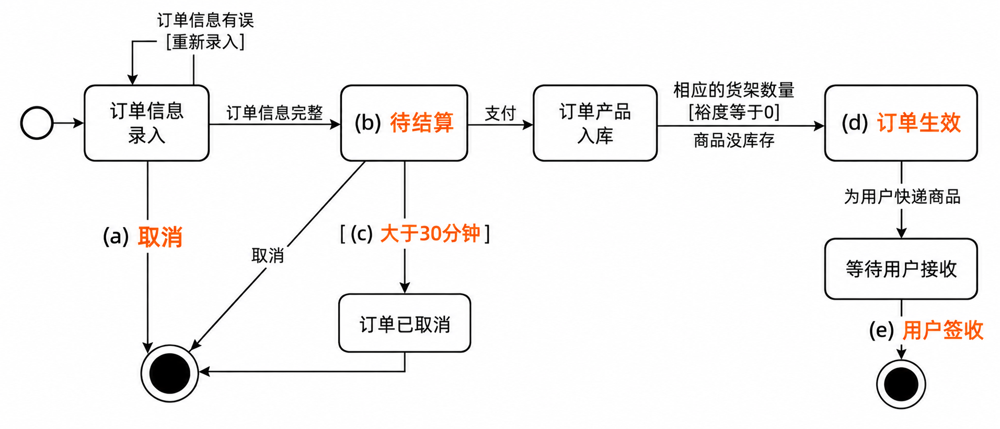
  - 建模线索：待结算订单在主动取消或超时后进入取消终态；发货完成后订单生效，顾客签收后交易完成。

#### 案例三：商品交易平台分析类图（题目 75–77）

**案例背景**：畜牧饲料公司建设面向互联网的商品交易平台，用户分为商家、顾客、管理员。商家注册后获得店铺，店铺拥有库存，库存保存商品记录；商家添加商品或追加库存，设置商品上下架和库存量。顾客可直接下单，也可先将商品加入购物车，再选择商品生成订单。

- 商品交易平台需求概念图（清理水印并按题图关系重绘）：
- **题目 75：分析类与设计类**
  - 分析类描述应用领域中的概念，主要从需求和业务概念中识别；设计类描述软件设计层的接口与协作，是分析类的细化和改进。
  - 题图中的类属于分析类。
  - 分析类主要在需求分析和架构设计中产生；设计类主要在概要设计阶段产生。
- **题目 76：图中类关系**
  - 顾客、商家、管理员与用户之间为泛化，表示一般类与特殊类的继承关系。
  - 商家与库存之间为依赖，表示一个类的实现需要另一个类协助。
  - 库存与商品之间为聚合，表示整体—部分关系，部分可脱离整体独立存在。
- **题目 77：补充类及属性**
  - 可增加类：店铺。
  - 商品：标识、名称、描述、单价。
  - 库存：标识、库存明细（商品标识、库存数量）。
  - 订单：标识、订单明细（商品标识、订购数量）、订单金额。
  - 购物车：用户标识、购物车明细（商品标识、数量）。

#### 本组题的总复习线索

1. **先分清图的用途**：用例图表达参与者可见的系统功能；类图表达静态领域结构；状态图表达对象生命周期内状态变化；活动图表达活动控制流。
2. **关系看端点和生命周期**：泛化是继承；依赖是使用；聚合是可独立存在的整体—部分；组合强调部分随整体生灭；实现用于类到接口。
3. **类看职责**：实体保存业务状态，边界承接系统交互，控制组织用例流程；需求阶段识别分析类，设计阶段再细化为设计类。

## 2.7 多媒体

### 2.7.1 多媒体概述

#### ITU-T（原 CCITT）五大媒体分类体系与题库标答勘误辨析（感觉媒体 vs 表示媒体 vs 表现媒体 vs 存储媒体 vs 传输媒体）（题库 2.6 节题目 19）⭐⭐⭐

[考查：综合知识（ITU-T / CCITT 五大媒体标准分类：感觉媒体 Perception Medium［文字、声音、图像、视频、动画］vs 表示媒体 Representation Medium［ASCII、JPEG、MP3、MPEG 等数据编码］vs 表现媒体 Presentation Medium［显示器、音箱、打印机、键盘、鼠标、扫描仪等硬件 I/O 设备］vs 存储媒体 Storage Medium vs 传输媒体 Transmission Medium；以及第三方题库漏印“编码”二字标答 B 的双保险应试策略）]

在《系统架构设计师教程（第 2 版）》第 2 章 **2.7.1 多媒体概述（p87）**（部分题库误将其归入 `2.6 计算机语言·题目 19`）中，国际电信联盟 **ITU-T（原 CCITT）** 按媒体的物理属性与功能将媒体严格划分为 **五大类**。

##### 1. ITU-T 五大媒体分类定义、实例与考场排雷全景矩阵（题目 19 核心）⭐⭐⭐

| 媒体分类 | 英文标准术语 | 权威定义与唯一判别题眼 ⭐⭐⭐ | 软考标准实例（看到即秒选） | 对应题目 19 选项与考场防坑排雷 ⭐⭐⭐ |
| :--- | :--- | :--- | :--- | :--- |
| **1. 感觉媒体** | **Perception Medium** | **直接作用于人的感官**（视觉、听觉、触觉等），使人产生直接感觉的内容本身 | **声音（音频）、文字、图形、图像、视频、动画** | ✅ **全国软考真题权威标准答案（A）**：<br>题干不带“编码/格式”二字、直接问“图像、声音、视频是媒体”时，统考标准优先选 **感觉媒体（A）**！ |
| **2. 表示媒体** | **Representation Medium** | 为了传送、加工或存储感觉媒体而人为设计的**数据编码表示形式与文件格式** | **图像编码（JPEG、PNG、GIF）、声音编码（MP3、WAV、PCM）、视频编码（MPEG、H.264）、文本编码（ASCII、GBK、UTF-8）** | ⚠️ **本题题库标称答案（B）**：<br>题库录入时漏印了“编码”二字（原意为“图像编码、声音编码、视频编码”或“计算机内数字化编码数据”）。考场上凡见<strong>“……编码”或具体格式名</strong>，100% 秒选 **表示媒体（B）**！ |
| **3. 表现媒体**<br> | **Presentation Medium** | 进行信息**输入**（将感觉媒体转换为电信号）和**输出**（将电信号还原为感觉媒体）的**物理硬件设备（I/O 设备）** | - **输入表现媒体**：键盘、鼠标、麦克风、摄像头、扫描仪<br>- **输出表现媒体**：显示器、扬声器/音箱、打印机、投影仪 | 🚫 **本题头号误选陷阱（D）**：<br>切勿望文生义认为“用图像、声音、视频把内容表现出来”就是表现媒体！**表现媒体 100% 指的是摸得着的硬件 I/O 设备**！ |
| **4. 存储媒体**<br>（选项 C 干扰项） | **Storage Medium** | 用于存放表示媒体（二进制编码数据）的**物理存储介质载体** | 硬盘（HDD/SSD）、光盘（CD/DVD）、U盘、磁带、内存（RAM/ROM）、SD卡 | 见“盘、卡、带、内存”等存储硬件介质 $\to$ 秒选 **存储媒体（C）**。 |
| **5. 传输媒体** | **Transmission Medium** | 用于将媒体数据从一处传送到另一处的**物理通信载体/通道** | 双绞线、同轴电缆、光纤（光缆）、无线电波、红外线 | 见“线、缆、波”等物理通信链路 $\to$ 秒选 **传输媒体**。 |

##### 2. 五大媒体在计算机信息流转中的全链路闭环⭐⭐⭐

$$\underbrace{\text{语音 / 图像画面}}_{\text{① 感觉媒体（人感知的内容）}} \xrightarrow[\text{麦克风 / 扫描仪 / 摄像头}]{\text{② 输入表现媒体（硬件）}} \underbrace{\text{MP3 / JPEG / MPEG 编码}}_{\text{③ 表示媒体（机器编码格式）}} \xrightarrow[\text{SSD硬盘 / 光纤}]{\text{④ 存储媒体 / 传输媒体}} \xrightarrow[\text{音箱 / 显示器 / 打印机}]{\text{⑤ 输出表现媒体（硬件）}} \underbrace{\text{声音 / 图像画面}}_{\text{① 感觉媒体}}$$

> [!IMPORTANT]
> **五大媒体分类考场终极秒杀口诀**：
> - **“人眼看、人耳听的内容（文字/图像/声音/视频） $\to$ 【感觉媒体（A）】！”**
> - **“电脑里的二进制编码与格式（ASCII / JPEG / MP3 / MPEG / 某某编码） $\to$ 【表示媒体（B）】！”**
> - **“摸得着的输入输出硬件（显示器/音箱/打印机/键盘/鼠标/扫描仪） $\to$ 【表现媒体（D，无硬件绝不选 D）】！”**
> - **“存数据的盘是【存储媒体（C）】，传信号的线是【传输媒体】！”**

### 2.7.2 多媒体系统的关键技术

#### 奈奎斯特采样定理：已知量决定乘 2 还是除以 2（题库 2.7 题目 1）

[考查：综合知识]

采样定理的工作式是 $f_s \ge 2 f_{\max}$。同一条式子有两个方向，先看题干给出的是哪一个量：

- 给出采样频率 $f_s$，求信号最高频率：$f_{\max} \le f_s / 2$。
- 给出信号最高频率 $f_{\max}$，求最低采样频率：$f_s \ge 2 f_{\max}$。

题库 2.7 题目 1 给出 $f_s = 3\,\text{kHz}$，信号最高频率可能是 $1.5\,\text{kHz}$。$6\,\text{kHz}$ 是把 $3\,\text{kHz}$ 当成了 $f_{\max}$ 再乘 2。$3\,\text{kHz}$ 表示每个最高频率周期只采到 1 个点。

页面解析写「采样频率必须大于最高频率的两倍」，标答仍取 $f_s / 2 = 1.5\,\text{kHz}$。PCM 采样步骤里已经采用 $f_s \ge 2 f_{\max}$，见 [2.2.6 PCM 采样](02-%E8%AE%A1%E7%AE%97%E6%9C%BA%E7%B3%BB%E7%BB%9F%E5%9F%BA%E7%A1%80%E7%9F%A5%E8%AF%86.md)。恰好等于两倍时，若正弦的采样点落在过零点，这一相位不能恢复；本题标答仍是 $1.5\,\text{kHz}$。

页眉为「2024年上半年」题目 1，截图没有科目名。本地真题库没有这道原题。相近题是 2015 下半年软件设计师上午 Q12，考的是采样频率等于每秒采样次数，解析写明采样频率至少为最高频率的两倍。

## 2.8 系统工程

### 2.8.1 系统工程概述

#### 系统工程定义：分析对象与四个最优（题库 2.8 题目 17）

[考查：综合知识]

系统工程按总体协调的需要，把自然科学和社会科学中的思想、理论和方法合在一起，用计算机作为工具，分析系统的结构、要素、信息和反馈，以达到最优规划、最优设计、最优管理和最优控制的目的。

- **分析对象**：结构、要素、信息和反馈。要素是组成单元，结构是要素之间的关系，信息在要素之间传递，反馈把结果送回去调节。
- **四个目的**：最优规划、最优设计、最优管理和最优控制。
- **相邻概念各归其位**：
  - 需求：生命周期里要获取、细化的目标。探索性研究识别利益攸关者需求，概念阶段细化利益攸关者需求，开发阶段细化系统需求。
  - 知识：霍尔三维结构的知识维，指各阶段要用的专业学科。
  - 文档：记录载体。和模型的对照见 2.8.4。
  - 实现：方案确定之后的制造和投运。
- **判别**：
  - 看到「结构、、信息和反馈」，填要素。
  - 看到「结构、元素、和反馈」，填信息。元素与要素同指组成单元。
  - 看到「最优规划、最优、最优管理和最优控制」，填设计。
- **题源**：题库章节练习题目 17，路径为新第 2 版第二章第八节系统工程。截图没有年份和科目名。界面只给第一空的选项，标答 D 要素；解析把第二空补成设计，这一空没有单独选项。本地真题库没有这道原题。

#### 分析对象空位：元素已写出时填信息（题库 2.8 题目 27）

[考查：综合知识]

题干把要素写成元素，空位夹在元素和反馈之间，填信息。四个选项是知识、需求、文档、信息。信息在要素之间传递。

同一段还有三处括号，这一题的选项对不上那三空：

- 最优（规划）、最优设计、最优管理和最优控制。
- 时间维、（逻辑）维、知识维。
- 「做出研制方案及生产计划」是时间维的研制阶段。拟定阶段的措辞是「提出具体的计划方案」。

- **判别**：
  - 「结构、、信息和反馈」：要素。
  - 「结构、元素、和反馈」：信息。
- **题源**：题库章节练习题目 27，路径为新第 2 版第二章第八节系统工程。截图没有年份和科目名。界面把「请作答此空」标在第一空，标答 D 信息。页面解析只重复了选 D。本地同组词的题是题目 17，空位是要素。

### 2.8.2 系统工程方法：霍尔三维结构、切克兰德方法、钱学森综合集成法与 WSR ⭐⭐⭐

[考查：综合知识（硬系统/软系统方法论、霍尔三维结构时间维/逻辑维/知识维定义、阶段划分与步骤顺序）]

#### 一、经典系统工程四大方法论全景对比矩阵

| 方法论名称 | 提出者 / 年代 | 适用系统类型 | 核心哲学思想与技术特征 | 典型考查角度与题眼 |
|---|---|---|---|---|
| **霍尔三维结构 (Hall)** ⭐⭐⭐ | A.D. Hall (1969) | **硬系统（工程/物理系统）** | 强调明确的目标、定量化数学模型与最优解；由**时间维、逻辑维、知识维**构成三维空间 | ⭕ **“硬系统工程”**<br>⭕ **“时间维7阶段 × 逻辑维7步骤 × 知识维”** |
| **切克兰德方法 (Checkland)** ⭐⭐ | P. Checkland (1981) | **软系统（社会/管理/人类活动系统）** | 强调目标模糊、多价值观冲突；核心是<strong>“比较与学习”</strong>（定性分析），通过7步骤循环迭代达成共识 | ⭕ **“软系统工程”**<br>⭕ **“学习与认识”**<br>⭕ **“概念模型与现状比较”** |
| **综合集成法** ⭐ | 钱学森等 (1990) | **开放的复杂巨系统** | **从定性到定量的综合集成法（M-S）**；将人（专家体系）、数据与信息、计算机技术三者有机结合 | ⭕ **“开放的复杂巨系统”**<br>⭕ **“人机结合、定性定量综合集成”** |
| **WSR 系统方法** ⭐ | 顾基发、朱志昌 (1994) | **复杂管理与工程决策** | **物理（Wuli）- 事理（Shili）- 人理（Renli）** 三维协同；物理管物，事理管事，人理管人 | ⭕ **“物理-事理-人理”**<br>⭕ **“东方系统思想与实践融合”** |

#### 二、霍尔三维结构深度剖析（硬系统工程基石）

霍尔三维结构将系统工程的整个过程置于时间、逻辑、知识三个相互正交的坐标轴构成的立体空间中：

##### 1. 时间维（Time Dimension）—— 工作进程的 7 个阶段

时间维表示系统工程项目从构思到淘汰的全生命周期时间跨度，分为 **7 个阶段**：

| 阶段序号 | 阶段名称 | 核心职责与任务 | 官方教材标准表述与判别词 | 易错陷阱 |
|:---:|---|---|---|---|
| 1 | **规划阶段 (Program Planning)** | 确定系统的总体目标和长远规划，分析必要性与可行性 | **“确定长远发展方向与总体目标”** | ❌ 误以为规划阶段出具体方案 |
| 2 | **拟定阶段 (Project Planning / 拟订方案)** ⭐ | 针对规划提出的任务深入调研，编制出具体的工程项目计划 | **“提出具体的计划方案”** | ⭕ **高频考点**：具体实施方案由拟定阶段提出！ |
| 3 | **研制阶段 (System Development)** | 进行详细架构设计、工程开发并研制出样机/初始原型 | **“研制出样机、原型或初始系统”** | ❌ 颠倒研制与生产顺序 |
| 4 | **生产阶段 (Production)** | 按照研制定型的图纸进行批量生产、加工制造与出厂质检 | **“定型、批量制造与生产”** | 生产基于研制成果 |
| 5 | **安装阶段 (Installation)** | 将系统设备或构件运输至现场进行安装、调试与试运行 | **“现场安装、组装与调试”** | 投运前的物理就位 |
| 6 | **运行阶段 (Operation)** | 系统正式投入运营交付使用，进行日常运行、监控与维护 | **“系统正常运行与维护保障”** | 生命周期中最长阶段 |
| 7 | **更新阶段 (Retirement / Replacement)** | 系统技术老化、性能落后，进行更新改造或报废退役 | **“系统更新改造、报废与退役”** | 时间维的收尾阶段。问「不包括」时，更新留在七阶段名单内 |

> 💡 **时间维 7 阶段速记口诀**：**“规、拟、研、生、安、运、更”**（规划长远定目标，拟定具体出方案，研制样机再生产，安装运行到更新）。

##### 2. 逻辑维（Logic Dimension）—— 解决问题的 7 个思维步骤

逻辑维表示在时间维的**每一个具体阶段中**，分析与解决问题所必须遵循的逻辑思维与工作程序，分为 **7 个步骤**：

| 步骤序号 | 步骤名称 | 核心工作内容 | 关键原理与高频陷阱 |
|:---:|---|---|---|
| 1 | **明确问题 (Problem Formulation)** | 收集原始信息，认清系统面临的困难与瓶颈，界定问题边界 | 解决问题的逻辑起点 |
| 2 | **确定目标 (Identification of Objectives)** | 确定系统应达到的性能指标、质量约束与期望达成的结果 | 目标作为后续评价的基准 |
| 3 | **系统综合 (Systems Synthesis)** ⭐ | 发挥创造性思维，广泛搜集并**提出尽可能多的候选系统方案** | ⭕ **注意先后顺序**：**先综合出多种备选解**！ |
| 4 | **系统分析 (Systems Analysis)** ⭐ | 对各个候选方案建立数学模型，分析其可行性、代价与预期效果 | ⭕ **先综合后分析**：**后分析推演各方案优劣**！ |
| 5 | **优化与选择 (Optimization / Evaluation)** | 对各候选方案进行综合评估，调整参数寻找局部/全局最优方案 | 方案排序与量化评价。方案比较在此，不单列时间维的评估阶段 |
| 6 | **决策 (Decision Making)** | 决策者在经过优化的方案中选择最满意、最可行的方案定案 | 选定唯一执行方案 |
| 7 | **实施计划 (Planning for Action)** | 制定落实所选方案的详细执行步骤、里程碑节点与资源调度 | 逻辑维收尾并转化为行动 |

> 💡 **逻辑维 7 步骤速记口诀**：**“问、目、综、分、优、策、施”**（明确问题定目标，**先综后分**莫搞颠，优化决策出计划）。

##### 3. 知识维（Knowledge Dimension / 专业维）

完成系统工程各阶段、各步骤所需的各种专业科学技术与管理学科门类，包括：工程技术、管理科学、计算机与信息科学、经济学、法律、社会学、环境工程等。

#### 三、核心易错陷阱与命题套路总结

1. **规划 vs 拟定陷阱**：
   - 题干问“提出长远目标、发展规划、论证必要性” $\implies$ 选 **规划阶段**；
   - 题干问“**提出具体的计划方案**、编制工程实施计划” $\implies$ 选 **拟定阶段（拟订方案阶段）**！
2. **综合 vs 分析顺序陷阱**：
   - 人类日常习惯“先分析后综合”，但**霍尔逻辑维是“先综合后分析”**（先用发散思维综合出全部候选方案，再用收敛思维建立模型分析评价每一个方案）！
3. **知识维伪概念陷阱**：
   - 命题人常编造“方法维”、“空间维”、“操作维”混淆知识维，三维牢记只有：**时间维（工作进程） × 逻辑维（思维步骤） × 知识维（专业学科）**。
4. **评估 vs 更新陷阱**：
   - 题干问时间维「不包括」哪一阶段时，先写出规划、拟订方案、研制、生产、安装、运行、更新。更新留在名单内。
   - 评估不进入时间维。候选方案的比较和选择属于逻辑维第五步「优化」，发生在每个时间阶段内部。
   - 系统工程生命周期的收尾叫退役；霍尔时间维的收尾叫更新。

#### 时间维不含评估：更新留在七阶段末尾（题库 2.8 题目 19）

[考查：综合知识]

霍尔时间维的七个阶段是规划、拟订方案、研制、生产、安装、运行、更新。题干问时间维不包括哪一阶段时，先把这七个写全，再对选项。规划、研制、更新都在名单里。评估不在名单里。

方案比较和选择发生在每个时间阶段内部，属于逻辑维第五步「优化」。系统工程生命周期的收尾阶段叫退役，霍尔时间维的收尾阶段叫更新。

- **判别**：
  - 「霍尔 + 时间维 + 不包括」：对完七阶段之后，剩下的是评估。更新留在名单末尾。
  - 「运行之后的下一阶段」：更新。
  - 「某个时间阶段里比较候选方案」：仍停在该时间阶段，比较工作属于逻辑维的优化。
- **题源**：题库章节练习题目 19，路径为新第 2 版第二章第八节系统工程。截图没有年份和科目名。页面解析写明时间维七阶段，并写明评估不属于这七个阶段。本地同考点题是  的「提出具体计划方案 → 拟定」，考的是阶段职责，不是成员排除。

### 2.8.3 系统工程的生命周期

[考查：综合知识（生命周期七阶段的目的；利益攸关者需求与系统需求的分界；与霍尔时间维七阶段区分）]

#### 系统工程生命周期七阶段与需求对象边界 ⭐⭐⭐

这套阶段用于系统工程生命周期。霍尔三维结构的时间维是另一套：规划、拟定、研制、生产、安装、运行、更新。题干出现「探索性研究、概念、开发」时，用本节，不用霍尔时间维。

| 阶段 | 目的 |
|---|---|
| 探索性研究 | 识别利益攸关者的需求，探索创意和技术 |
| 概念 | 细化利益攸关者的需求，探索可行概念，提出有望实现的解决方案 |
| 开发 | 细化系统需求，创建解决方案的描述，构建系统，验证并确认系统 |
| 生产 | 生产系统，并进行检验和验证 |
| 使用 | 运行系统，以满足用户需求 |
| 保障 | 提供持续的系统能力 |
| 退役 | 存储、归档或退出系统 |

- **判别**：
  - 「识别需求、探索创意和技术」，并且还没有比较可行概念：探索性研究。
  - 「细化利益攸关者的需求、比较可行概念、提出有望实现的解决方案」：概念。提出方案要先有可行概念。
  - 「细化系统需求、创建解决方案描述」，以及构建、验证并确认：开发。
  - 「生产、检验、验证」：生产。
- **易混点**：概念阶段和开发阶段都在细化需求。概念阶段的对象是利益攸关者需求；开发阶段的对象是系统需求，并要创建解决方案描述。
- **题源**：题库章节练习，路径为新第 2 版第二章第八节系统工程。截图没有年份和试卷题号。问「细化系统需求、创建解决方案描述」属于哪个阶段，答案是开发。页面把概念阶段写成「细化需求」，省掉了「利益攸关者」和「系统」。本地真题库没有另一道可核验的同考点原题。

### 2.8.4 基于模型的系统工程

#### MBSE 三大支柱：建模语言、建模工具、建模思路（题库 2.8 题目 11）

[考查：综合知识]

MBSE（Model-Based Systems Engineering，基于模型的系统工程）用形式化模型代替文档，作为系统设计的主要载体。三大支柱是：

- **建模语言**：把系统写下来的符号，如 SysML、UML。
- **建模工具**：建模型的环境，如 MagicDraw、Enterprise Architect、Papyrus。
- **建模思路**：组织模型的方法，如面向对象、面向服务、面向数据。

建模结构是模型画出来之后的组成，建模理论、建模顺序都不是这三项的名称。

- **题源**：题库章节练习题目 11，路径为新第 2 版第二章第八节系统工程。截图没有年份和科目名。本地真题库没有这道原题。

## 2.9 系统性能

### 2.9.1 性能指标

[考查：综合知识（通用性能指标、Web 服务器性能指标 vs 功能指标界定）]

**Web 服务器三大核心性能指标体系（速率、容量、时延）** ⭐⭐

- **性能指标定义**：客观量化系统运行速率、数据吞吐与承载能力的度量集合。
- **三大核心指标（白名单）**：
  1. **响应延迟（Latency / Response Time）**：从客户端发送 HTTP 请求到完整接收服务器响应所经历的时间，反映服务器的“单次处理时延效率”。
  2. **吞吐量（Throughput / QPS / TPS / 数据传输速率）**：单位时间内 Web 服务器成功处理的事务数、请求数或传输的数据字节数，反映服务器的“并发处理生产率”。
  3. **最大并发连接数（Max Concurrent Connections）**：在系统维持可用且满足 SLA 延迟的前提下，Web 服务器能同时维持的最大活跃 TCP 会话数量，反映服务器的“网络 I/O 承载容量”。
- **经典设陷排雷（性能 vs 功能一刀切）**：
  - ❌ **“链接正确跳转”不属于性能指标**：超链接有效性与重定向状态码（200/301/302）判定属于**功能测试（Functional Testing）**，验证的是业务逻辑正确性（做对没有），与系统快慢、容量高低无关。
- **口诀速记**：**“响应延迟看快慢，吞吐并发量容量；链接跳转测功能，莫与性能混一堂。”**

### 2.9.2 性能计算

[考查：综合知识（计算题）/ 案例分析 / 论文素材]

**阿姆达尔定律（Amdahl's Law）核心模型与解题法** ⭐⭐⭐

- **定律定义**：量化定义了通过改进系统中某个组件/部件的性能，使系统整体性能（处理速度）提高的程度。
- **核心数学公式**：
  $$S = \frac{1}{(1 - f) + \frac{f}{k}}$$
  - $S$：系统总加速比（Speedup，整体处理速度提高至原来的倍数，即 $T_{old} / T_{new}$）；
  - $f$：可改进部件在原系统执行时间中所占的比例（$0 \le f \le 1$）；
  - $k$：该可改进部件自身的性能提高倍数（局部加速比）；
  - $1 - f$：不可改进（串行/受约束）部分的执行时间比例。
- **考场秒杀：基准 100 特值拆解法（极力推荐，零公式记忆风险）**：
  1. **设基准**：设系统原始总耗时为 $T_{old} = 100$；
  2. **切分两段**：根据百分比，可改进部分原耗时为 $100 \times f$，未改进部分耗时为 $100 \times (1 - f)$；
  3. **计算优化耗时**：可改进部分新耗时为 $(100 \times f) \div k$；
  4. **合并新总耗时**：$T_{new} = 100 \times (1 - f) + \frac{100 \times f}{k}$；
  5. **求系统提速倍数**：$S = \frac{T_{old}}{T_{new}} = \frac{100}{T_{new}}$。
  - *实例速算*：$f = 60\%, k = 5 \implies T_{new} = 40 + (60 \div 5) = 52 \implies S = 100 \div 52 \approx 1.923$ 倍。
- **架构哲学与性能天花板（极限加速比）**：
  - 若将该部件性能提升至极限（$k \rightarrow \infty$，耗时压缩趋近于 0），系统的最大加速比为：
    $$S_{max} = \frac{1}{1 - f}$$
  - **架构启示（木桶短板效应）**：系统性能提升的上限受限于未被改进的不可优化/串行部分 $(1 - f)$。若系统有 40% 的不可优化串行处理，无论给并行组件投入多少算力硬件（如无限增加 CPU 核心），系统的总体加速比永远无法超过 $\frac{1}{0.4} = 2.5$ 倍。因此架构调优首要任务是**降低不可并行的串行比例**。
- **口诀速记**：**“阿姆达尔算加速，特值 100 最清楚；可改除以加速比，加上未改成新底；原时除以新总时，倍数秒得不犹豫。”**

**多处理机系统开销扩展模型与性能上限计算（阿姆达尔工程变体）** ⭐⭐

[考查：综合知识（多机系统加速比、并行协同开销、求极限算性能天花板）]

- **一、问题背景与公式物理内涵**：
  - 假设单个 CPU 的性能基准为 1，由 $n$ 个同构 CPU 组成的多处理机系统，其实际系统性能 $P$ 为：
    $$P(n) = \frac{n}{1 + (n - 1)a}$$
  - **分子 $n$（理想能力）**：若无任何协同损耗，性能应随 CPU 数量线性叠加（$n \times 1 = n$）。
  - **分母 $1 + (n - 1)a$（开销惩罚）**：实际系统中，由于引入多机通信、总线仲裁、锁同步与缓存一致性开销（常数 $a$），每增加一个从机节点就会引入 $a$ 的开销惩罚，累计惩罚为 $(n - 1)a$。
  - **实例验证**：当 $a = 0.1, n = 4$ 时，$P = \frac{4}{1 + 3 \times 0.1} = \frac{4}{1.3} \approx 3.08$（即 4 个 CPU 只能跑出约 3 台的吞吐）。

- **二、系统性能天花板推导（极限求解）**：
  - 题目核心题眼：**“不管 $n$ 如何增加，$P$ 都不会超过某个上限”** $\to$ 对 $P(n)$ 求 $n \to +\infty$ 的极限：
    $$\lim_{n \to \infty} P(n) = \lim_{n \to \infty} \frac{n}{1 + (n - 1)a} = \lim_{n \to \infty} \frac{1}{\frac{1}{n} + \left(1 - \frac{1}{n}\right)a}$$
  - 当 $n \to \infty$ 时，$\frac{1}{n} \to 0$：
    $$\lim_{n \to \infty} P(n) = \frac{1}{0 + (1 - 0)a} = \frac{1}{a}$$
  - **秒杀定式**：**多处理机系统的理论性能极限 $P_{max} = \frac{1}{a}$**。
  - **代入计算**：当 $a = 0.1$ 时，极限性能上限为 $P_{max} = \frac{1}{0.1} = 10$。

- **三、阿姆达尔定律与多机开销模型的同构映射**：

  | 维度 | 经典阿姆达尔定律（Amdahl's Law） | 多处理机系统开销扩展模型 |
  |---|---|---|
  | **研究对象** | 单机内部增加核心，部分代码无法并行 | 多机集群横向扩展，节点间存在通信开销 |
  | **核心公式** | $$S = \frac{1}{(1 - f) + \frac{f}{n}}$$ | $$P = \frac{n}{1 + (n - 1)a} = \frac{1}{a + \frac{1 - a}{n}}$$ |
  | **不可消除项** | **$(1 - f)$**（必须串行执行的执行时间比例） | **$a$**（单节点不可消除的边际协同损耗常数） |
  | **性能上限（$n \to \infty$）** | $$S_{max} = \frac{1}{1 - f}$$ | $$P_{max} = \frac{1}{a}$$ |

- **四、架构设计启示（横向扩展 Scale-Out 的物理边界）**：
  - **边际效应递减**：增加节点并不能带来线性的系统收益。当节点数量非常大时，增加新 CPU 对性能的提升微乎其微。
  - **架构调优的真正抓手**：盲目堆叠机器无法突破 $\frac{1}{a}$ 的天花板，架构师的核心职责是**通过架构重构降低常数 $a$**（如采用无共享架构 Shared-Nothing、本地缓存、无状态服务、减少分布式锁）。一旦 $a$ 从 0.1 降至 0.01，性能上限就能从 10 飙升至 100。

- **五、速记口诀**：
  > **“多机扩展有上限，分子分母除以 $n$；”**  
  > **“无穷远处看倒数，天花板上是 $\frac{1}{a}$；”**  
  > **“阿姆达尔防串行，多机协作防开销！”**

### 2.9.3 性能设计

### 2.9.4 性能评估

[考查：综合知识 / 案例分析（系统性能评估方法、Web 服务器性能测试三法）]

**Web 服务器性能评测三大正统方法（基准、压力、可靠性）** ⭐⭐

- **性能评测三大方法体系**：
  1. **基准性能测试（Benchmark Testing）**：在预设的标准软硬件环境与规范工作负载下，测量服务器的基础性能基线（如固定并发下的响应时间与 QPS），主要用于**不同版本、不同服务器软件（如 Nginx vs Apache）或不同硬件配置之间的横向对照评估**。
  2. **压力测试（Stress Testing）**：通过持续施加超出系统额定能力的极限重载甚至极端异常输入，测试服务器在资源饱和（CPU 100%、内存耗尽、连接池溢出）下的**崩溃破坏阈值、降级表现与故障恢复能力**。
  3. **可靠性测试（Reliability Testing / 稳定性测试 / 疲劳测试）**：在正常或预期最大负载下，让服务器**持续长周期不间断运行（如连续 7×24 小时或 30 天）**，核心目的是检测是否存在**内存泄漏（Memory Leak）、句柄未释放、缓冲区缓慢溢出或性能逐级衰减**等隐蔽故障。
- **异类干扰项排雷**：
  - ❌ **功能测试**：验证业务逻辑正确性，非性能评估。
  - ❌ **黑盒/白盒测试**：依据是否对源代码内部逻辑可见划分的方法分类，非服务器性能评测方法。
- **口诀速记**：**“基准标定测底线，压力拔高探极限，可靠长跑查泄漏！”**

#### 系统运行监视的三大途径、工具定位矩阵与三类性能数据 ⭐⭐⭐

[考查：综合知识（定义分类、Win/Linux 工具职责辨析、三类性能数据特征与存储策略）]

- **一、系统监视三大途径**：
  1. **系统命令（System Commands）**：终端即时交互、轻量、直接反馈当前或近期某维度的状态快照。如 UNIX/Linux 中的 `ps`、`last`、`top`、`vmstat`；Windows 中的 `tasklist`、`netstat`。
  2. **系统记录文件（Log Files）**：查阅系统日志文件了解系统在特定时间内的运行状态，主要用于离线历史审计与故障排查。如 Linux 的 `/var/log/messages`、`/var/log/secure`、`/var/log/wtmp`；Windows 的事件查看器日志（`.evtx`）。
  3. **集成化监控工具（Integrated Monitoring Tools）**：**集成命令、文件记录和可视化技术**的综合性监控工具，支持持续性能计数器采样、数据收集器集日志归档与图形化报表/曲线动态分析。典型代表为 **Windows 的 `Perfmon`（性能监视器）**；在云原生架构中对应 Prometheus + Grafana、Zabbix 等监控平台。

- **二、五大常考系统命令/工具职责与层级矩阵（一词破题）**：

| 工具名称 | 所属平台 | 监控方式分类 | 核心职责（唯一判别题眼） | 记忆锚点与高频排雷 |
| :--- | :--- | :--- | :--- | :--- |
| **`Perfmon`** | Windows | **方式三：集成命令+文件记录+可视化** | 图形化实时折线图/报表 + 性能计数器采集 + 数据收集器集日志归档 | **Performance Monitor（性能监视器 GUI）**；题干见“可视化+文件记录”秒选 |
| **`netstat`** | Win / Linux | 方式一：系统命令（CLI） | 即时查看 **TCP/UDP 网络连接状态（`LISTEN`/`ESTABLISHED`）、端口、路由表** | **Net**work **Stat**istics；❌ 切勿因前缀写“Windows 的”就误当成 GUI 可视化工具 |
| **`ps` / `top`** | UNIX / Linux | 方式一：系统命令（CLI） | `ps` 抓取**进程瞬时状态快照**；`top` 终端**动态实时刷新高负载进程排名** | **Top** = 进程 CPU/内存排行榜；虽动态刷新但仍属纯字符命令（CLI），非图形可视化工具 |
| **`last`** | UNIX / Linux | 方式一：系统命令（CLI） | 读取 `/var/log/wtmp`，查阅**用户历史登录/登出记录与系统重启审计** | **Last** login（最后谁登录过）；❌ 切勿与看进程排名的 `top` 混用 |
| **`iptables`** | Linux | 非监视工具（安全控制） | 配置 Linux 内核（Netfilter）**包过滤防火墙规则与 NAT 转发策略** | IP **Tables**（防火墙规则表）；属于安全访问控制（防），不属于性能监视（看） |

- **三、系统性能监视收集的 3 类性能数据对比（教材原话高频考点）**：

| 性能数据类型 | 核心判别题眼词 | 存储与压缩策略 | 服务对象与核心用途 |
| :--- | :--- | :--- | :--- |
| **① 常规性能数据**<br>（Routine Data） | 识别**短期趋势（如内存泄漏）**；经 1~2 个月收集后**求平均值** | **需要压缩存储**（用更紧凑的格式保存平均值结果） | 帮助技术人员在**业务增长时作出容量规划**，并用于日后评估该规划的效果 |
| **② 比较基准的性能数据**<br>（Baseline Data） | 将**当前状态与历史记录数据相比较**；发现**缓慢、历经长时间才发生的变化** | **不必对其进行压缩存储**（因为只是定期收集） | 帮助技术人员**排除系统问题并调整系统基线** |
| **③ 服务水平报告数据**<br>（SLA Report Data） | 确保系统能满足一定的**服务或性能水平（SLA）** | 收集和维护频率取决于特定的业务需要 | 提供给**并不是性能分析人员的决策者**（管理层/业务方） |

- **四、高频设陷点与秒杀口诀**：
  - ❌ **空 1 混淆系统命令与系统调用**：`ps`、`last` 是管理员在 Shell 敲击执行的用户态程序（**系统命令**），绝非内核 C 语言 API（系统调用）。
  - ❌ **空 2 忽视“可视化技术”与“文件记录集成”定语**：误选 `Windows 的 netstat` 或 `Linux 的 top`。
  - **口诀速记**：
    > **“系统监视分三途：命令交互把态摸（`ps`/`top`看进程、`last`查登录、`netstat`看网络），文件记录查历史，Perfmon 图形全集成；”**  
    > **“常规数据看短期（查内存泄漏、压存做容量），基准对比抓慢变（不压缩调系统），服务报告交领导（保 SLA 水平）！”**

## 2.10 运筹优化与应用数学基础：约束满足问题（CSP）⭐⭐

[考查：综合知识（应用数学与逻辑推理、约束满足问题 CSP、矩阵与网络推导）]

### 2.10.1 约束满足问题（CSP）与矩阵网络推导法

- **一、模型本质**：
  约束满足问题（Constraint Satisfaction Problem, CSP）由一组变量、变量的有限定义域以及一组约束关系（如倍数、差值、不重复性）构成。求解目标是为每个变量赋一个值，使得所有约束条件同时得到满足。在系统分析、项目资源调度、测试用例正交排布中广泛应用。
- **二、核心破题三大法宝（以九项目成本矩阵为例）**：
  1. **找核心枢纽节点**：优先寻找连接约束最多（如同时连着垂直倍数边与水平差 1 链）的交叉节点（如中心节点 $A_{22}$），作为假设突破口；
  2. **顺着连续约束链排查边界**：对于连续差 1 的链条（如 $A_{22} \to A_{23} \to A_{33}$），它会连续锁定以该节点为中心的连续 3 个整数区间；若取极小值（如 2）或极大值（如 8），极易引发越界（$<1$ 或 $>9$）或与相邻倍数节点重复冲突；
  3. **代入排除验证法**：选择题给出有限备选项（如 2, 4, 6, 8）时，直接代入每个选项推导链条，一旦发现某个节点“无合法可用数字”立即排除，推至唯一合法解。

## 2.11 电子商务安全协议与网络协议栈安全体系（SET vs HTTPS vs PGP/MOSS/IPSec）（题库 2.3 节题目 116）⭐⭐⭐

[考查：综合知识（电子商务安全电子交易协议 `SET`［三方 CA 证书、双重数字签名 Dual Signature、保证交易双方无法抵赖、商家不见银行卡号/银行不见商品名］vs 通用 Web 安全传输通道 `HTTPS/SSL` vs 安全电子邮件协议群 `PGP / S/MIME / PEM / MOSS` vs 网络层 `IPSec`［`AH` 不加密 vs `ESP` 加密］）]

在软考系统架构设计师第 2 章与第 4 章交叉题库中，**`SET`（Secure Electronic Transaction，安全电子交易协议）** 是专门为 **B2C 电子商务信用卡支付交易**设计的安全协议。由于 `SET` 要求消费者（持卡人）、商家、银行（支付网关）三方均持有 CA 数字证书，并对每笔交易采用<strong>【双重数字签名（Dual Signature）】</strong>，因此**能保证交易双方无法抵赖（不可否认性，选项 A）**。

### 1. 电子商务与互联网常见安全协议全景对比矩阵（题目 116 核心矩阵）⭐⭐⭐

| 协议缩写 | 英文全称与中文名 | 所属层次与应用领域 | 核心安全机制与是否支持“交易双方抗抵赖” | 考场设陷与排雷铁律 ⭐⭐⭐ |
| :--- | :--- | :--- | :--- | :--- |
| **`SET`**<br>（✅ **题目 116 正解 A**） | **S**ecure **E**lectronic **T**ransaction<br>（**安全电子交易协议**） | **应用层**<br>（B2C 信用卡三方电子支付交易） | - **三方 CA 数字证书**（持卡人、商家、银行）<br>- **双重数字签名（Dual Signature）**：**✅ 保证交易双方无法抵赖**<br>- **隐私隔离**：**商家只见订单信息（不见银行卡号），银行只见支付卡号（不见商品名）** | ✅ **本题唯一正解 A**：<br>见题眼<strong>“交易双方无法抵赖 / 信用卡三方支付 / 双重数字签名 / 商家不见卡号”</strong> $\to$ 100% 秒选 **`SET`**（`T` = Transaction 交易）！ |
| **`HTTPS`**<br>*(HTTP + SSL/TLS)*<br> | HyperText Transfer Protocol Secure<br>（**安全超文本传输协议**） | **传输层与应用层之间**<br>（浏览器 $\leftrightarrow$ Web 服务器通道，端口 `443`） | - 握手阶段通常仅做**服务器单向证书认证**<br>- 数据传输采用双方共享的**对称会话密钥 + HMAC**<br>- **❌ 不能保证交易双方对逐笔订单无法抵赖**，且商家解密后能看到全部明文（含卡号） | 🚫 **本题头号误选陷阱 B**：<br>`HTTPS` 只保护“**点对点传输管道防窃听/防篡改**”，不解决业务交易层“买家或商家赖账（抗抵赖）”！ |
| **`PGP` / `MOSS`**<br>`S/MIME` / `PEM`<br>（选项 C / D 干扰项） | - **`PGP`**：Pretty Good Privacy<br>- **`MOSS`**：MIME Object Security Services<br>- **`S/MIME`**：安全多用途互联网邮件扩展 | **应用层**<br>（**安全电子邮件协议群**） | 用于对<strong>电子邮件（Email）</strong>进行加密与数字签名（其中 `PGP` 基于去中心化信任网，`S/MIME` 基于 X.509 CA 证书） | 🚫 **排除 C、D**：<br>`PGP`、`MOSS`、`S/MIME`、`PEM` 四兄弟全属**安全电子邮件协议**，不用于在线电子交易！ |
| **`IPSec`**<br>（`AH` + `ESP` + `IKE`） | IP Security<br>（**互联网网络层安全协议族**） | **网络层（IP 层）**<br>（站点到站点 VPN / IP 包级安全） | - **`AH`（认证头）**：仅提供数据源认证、完整性与防重放，**❌ 不提供数据加密（机密性）**！<br>- **`ESP`（封装安全载荷）**：**✅ 同时提供加密（机密性）+ 完整性 + 数据源认证**！ | ⚠️ **高频延伸考点**：<br>问“IPSec 中哪种子协议不提供加密”选 **`AH`**；问“既加密又认证”选 **`ESP`**！ |

> [!IMPORTANT]
> **安全协议家族考场秒杀口诀**：
> - **“电子交易防抵赖，三方证书双签名，商家不见银行卡 $\to$ 认准 `T`（Transaction）秒选【`SET`（A）】！”**
> - **“Web 通道防窃听，端口 `443` 找【`HTTPS`（排 B）】；加密邮件四兄弟，认准【`PGP / S/MIME / PEM / MOSS`（排 C/D）】！”**
> - **“网络层上看 `IPSec`：`AH` 只认证【不加密】，`ESP` 加密认证【全包揽】！”**

  - 【题库章节练习】 2.3 节题目 116（下列安全协议中，【**A. SET**】能保证交易双方无法抵赖）。

## 2.12 计算机软件著作权保护条例：人身权 vs 财产权继承边界与“学研设计思想”合理使用（题库 2.3 节题目 187）⭐⭐⭐

[考查：综合知识（《计算机软件保护条例》软件著作权人身权［署名权永久保护、不可转让、不可继承］vs 财产权［死后第 50 年 12 月 31 日止、可许可、可转让、可继承］、第 17 条“为学习和研究软件内含的设计思想和原理而安装显示传输存储软件”合理使用双免条款、第 6 条“只保护程序代码与文档表达，不保护设计思想与算法”）]

### 1. 软件著作权“人身权 vs 财产权”与“合理使用”全景判别表（题目 187）⭐⭐⭐

| 权利/制度分类 | 包含具体权利或法定条件 | 保护期限（起止点铁律） | 能否转让 / 能否死后继承 | 对应选项正误与排雷（题目 187） |
| :--- | :--- | :--- | :--- | :--- |
| **1. 著作人身权（核心：署名权）** | **署名权（开发者身份权）**、发表权、修改权 | - **署名权**：**永久保护（不受限制）**<br>- **发表权**：自然人终生及死后第 50 年 12 月 31 日（仅限行使一次） | **❌ 严禁转让！**<br>**❌ 自然人死亡后，继承人【不能继承署名权】！** | ✅ **本题正解 C（选不正确项）**：<br>C 项称“继承人能继承软件著作权的【所有权利】”直接违反《条例》第 15 条（继承人**只能继承除署名权以外的经济/财产权利**）！ |
| **2. 著作财产权（经济权利）** | 复制权、发行权、出租权、信息网络传播权、翻译权、**许可使用权（A）**、**转让权（B）**、获得报酬权 | - **自然人**：终生 + **死后第 50 年的 12 月 31 日**<br>- **法人/其他组织**：首次发表后 **第 50 年的 12 月 31 日**（开发完成 50 年未发表的不再保护） | **✅ 可许可他人行使并获酬（A 正确）**<br>**✅ 可全部或部分转让并获酬（B 正确）**<br>**✅ 自然人死后可由继承人继承** | 选项 A（许可权）、选项 B（转让权）均为《条例》第 18、19 条正确表述。 |
| **3. 法定“合理使用”豁免（第 17 条）** | **为了学习和研究软件内含的设计思想和原理**，通过**安装、显示、传输或者存储**软件等方式使用软件 | 保护期内全程适用 | **✅ 可以【不经软件著作权人许可，不向其支付报酬】（双免待遇）** | 🚫 **本题头号误选陷阱 D（表述完全正确）**：<br>D 项是《条例》第 17 条一字不差的原文！结合第 6 条（著作权**只保护代码/文档表达，不保护设计思想、处理过程、操作方法或数学概念**），学研设计思想绝不侵权！ |

> [!IMPORTANT]
> **软件著作权继承与合理使用秒杀口诀**：
> - **“署名身份跟终身（无期限、不转让、不继承，说死后继承【所有权利】必错，秒选 C）！”**
> - **“财产权益五十年（自然人死后 / 法人首次发表后第 50 年 12 月 31 日止，可许可 A、可转让 B、可继承）！”**
> - **“学研设计思想装显存，不经许可不给钱（《条例》第 17 条合理使用 D 项 100% 正确，切勿凭直觉当盗版误选）！”**

## 2.13 数据存储架构与五类应用文件专业英语词汇体系（Master / Look-up / Transaction / Audit / History Files）（题库 2.3 节题目 159）⭐⭐⭐

[考查：专业英语完形填空与综合知识（系统数据存储设计五类应用文件 `Master files` 主文件 vs `Look-up files` 查找文件 vs `Transaction files` 事务文件 vs `Audit files` 审计文件 vs `History files` 历史文件、数据库分类与参照完整性 `Referential integrity`）]

在系统设计的数据存储架构（Data Storage Architecture）专业英语真题（题库 2.3 节题目 159～163 五连空）中，存储格式主要分为<strong>文件（Files）</strong>与<strong>数据库（Databases）</strong>两大家族。

### 1. 应用系统五类文件（Five Types of Application Files）英文判别词全景矩阵 ⭐⭐⭐

| 文件英文术语与中文名 | 考场核心英文题眼（看到即秒选） | 核心业务职责与典型实例 | 对应题号与考场防坑排雷 ⭐⭐⭐ |
| :--- | :--- | :--- | :--- |
| **1. `Master files`**<br>（**主文件**） | **`store core information that is important to the business and to the application`**<br>*(存储对业务及应用程序至关重要的核心基础信息)* | 存放企业核心实体主干档案（如客户主档案、客户邮寄地址信息、订单核心主记录），记录长期保留且随业务发生被更新。 | ✅ **题目 159（问题 1 / 第 1 空）正解 A**：<br>见 **`store core information`** 100% 锁定 `Master files`！切勿被后半句举例中的 `order` 误导选 C！ |
| **2. `Look-up files`**<br>（**查找文件 / 字典表**） | **`contain static values, such as a list of valid codes or the names of cities... used for validation`** | 存放很少变动的静态枚举/字典编码（如有效状态码、城市名称列表、税率表），专门用于输入数据的**合法性校验（`validation`）**。 | ✅ **同篇问题 2（第 2 空）正解 B**：<br>见 **`static values` + `used for validation`** 秒选 `Look-up files`！ |
| **3. `Transaction files`**<br>（**事务文件 / 流水文件**） | **`contain information that can be used to update a master file`**<br>*(包含可用于更新主文件的增量业务事件信息)* | 存放日常发生的单次业务变动流水（如每日收银流水、客户改址申请单），用于定期或实时**更新主文件（`update a master file`）**。 | 🚫 **题目 159 辨析提示 C**：<br>只有题干明确出现 **`used to update a master file`** 时才选 `Transaction files`！ |
| **4. `Audit files`**<br>（**审计文件**） | **`record "before" and "after" images of data as it is altered`**<br>*(记录数据被修改前后的镜像快照)* | 记录主文件或关键数据变更前后的对照快照，专门用于安全合规审计、变更追踪与故障恢复。 | 见 **`before and after images`** 秒选 `Audit files`。 |
| **5. `History files`**<br>（**历史文件 / 归档文件**） | **`store past transactions (e.g., old customers, past orders) that are no longer needed for active processing`** | 存放已经完结、不再需要高频在线处理的过往历史归档数据，通常可离线压缩存放供备查。 | 见 **`past transactions / no longer needed`** 秒选 `History files`。 |

#### 2. 同篇专业英语后 3 空（第 3～5 空：数据库分类与参照完整性）连环锚点 ⭐⭐⭐

| 连环空位 | 考场核心英文题眼 | 标准答案与核心机理解析 |
| :--- | :--- | :--- |
| **第 3 空（问题 3）** | `based on older, sometimes outdated technology that is seldom used to develop new applications` | **`Legacy databases`（遗留数据库）**：基于老旧/过时技术构建、极少用于开发新应用但仍在运行存量核心系统的数据库。 |
| **第 4 空（问题 4）** | `collections of records that are related to each other through pointers` | **`Hierarchical / Network databases`（层次/网状数据库）**：通过物理或逻辑<strong>指针（`pointers`）</strong>将彼此关联的记录连接成树形或网状结构的早期数据库模型。 |
| **第 5 空（问题 5）** | `ensuring that values linking the tables together through the primary and foreign keys are valid and correctly synchronized` | **`Referential integrity`（参照完整性）**：关系数据库中确保通过<strong>主键与外键（`primary and foreign keys`）</strong>关联各表的取值合法且同步的完整性约束。 |

> [!IMPORTANT]
> **数据存储架构五连空专业英语秒杀口诀**：
> - **“第 1 空看 `store core information`（存业务核心信息） $\to$ 必选【`Master files`（主文件 A）】，绝不被 `order` 带偏选 `Transaction files`（C，它是 `used to update a master file`）！”**
> - **“第 2 空看 `static values + validation` $\to$ 选【`Look-up files`（查找文件）】；第 3 空看 `outdated technology` $\to$ 选【`Legacy databases`（遗留数据库）】！”**
> - **“第 4 空看 `through pointers` $\to$ 选【`Hierarchical / Network databases`】；第 5 空看 `primary and foreign keys` $\to$ 选【`Referential integrity`（参照完整性）】！”**

## 2.14 CORBA 服务端构件模型三题大一统：对象适配器（Object Adapter / POA）vs ORB vs 伺服对象（Servant）（题库 2.3 节题目 72 / 118 / 209）⭐⭐⭐

[考查：综合知识（CORBA 服务端构件模型分层架构：`对象适配器 Object Adapter / 可移植对象适配器 POA`［屏蔽 ORB 内核细节、提供抽象接口、在底层传输平台与对象实现间协调］vs `对象请求代理 ORB`［客户端与服务端通信软总线］vs `伺服对象 Servant`［CORBA 对象的真正业务代码实现］vs `适配器激活器 Adapter Activator` / `伺服对象激活器 Servant Activator`）]

在《系统架构设计师教程（第 2 版）》第 2 章 <strong>2.3 计算机软件（中间件与构件模型）</strong>中，**CORBA（公共对象请求代理体系结构）服务端构件模型**连续在历年真题中考查了 3 道核心单选题（题库题目 72、题目 118、题目 209）。

### 1. CORBA 体系与服务端构件模型五大核心部件正交判别表（三题同构秒杀）⭐⭐⭐

| 核心部件名称 | 所处位置与层次 | 考场必考核心职责原话（题眼一对一映射） | 对应真题题号与防坑排雷 ⭐⭐⭐ |
| :--- | :--- | :--- | :--- |
| **1. 对象适配器**<br>（**`Object Adapter`**，标准实现为**可移植对象适配器 `POA`**） | **服务端内部中间适配层**<br>（夹在 `ORB 内核` 与 `Servant` 之间） | ① **“用于屏蔽 ORB 内核的实现细节，为服务器对象的实现者提供抽象接口，以便他们使用 ORB 内部的某些功能”**（题目 209）<br>② **“在底层传输平台（ORB）与对象实现（Servant）之间进行协调”**（题目 118 第 1 空）<br>③ 负责生成对象引用、注册/激活对象、通过 `Skeleton` 向 `Servant` 分派请求 | ✅ **题目 209 正解 B（对象适配器）**<br>✅ **题目 118 第 1 空正解 D（可移植对象适配器 POA）**<br>🚫 **排雷铁律**：只要题干写“**屏蔽 ORB 内核细节**”，宾语是 ORB，主语 100% 是**对象适配器（POA）**，绝不能选 ORB！ |
| **2. 伺服对象**<br>（**`Servant`**） | **服务端最上层业务实现层**<br>（由应用开发者用 C++/Java 等编写） | ① **“是 CORBA 对象的真正实现（包含具体业务方法代码）”**（题目 72）<br>② **“是最终完成客户请求的服务对象实现”**（题目 118 第 2 空）<br>③ 对应题目 209 中的<strong>“服务器对象的实现者”</strong> | ✅ **题目 72 正解 A（伺服对象）**<br>✅ **题目 118 第 2 空正解（伺服对象）** |
| **3. 对象请求代理**<br>（**`ORB`**，Object Request Broker） | **横跨客户端与服务端的底层通信总线** | **“充当客户端与服务端之间的透明通信软总线（中间件内核），屏蔽分布对象的位置、平台与实现语言差异”** | 🚫 **题目 72 & 题目 209 连续两次误选陷阱 C**！<br>凡题干限定在<strong>“CORBA 服务端构件模型内部”</strong>或将 ORB 作为被屏蔽宾语时，**一律先排除 ORB**！ |
| **4. 适配器激活器**<br>（**`Adapter Activator`**） | 挂载在父 POA 上的可选回调组件 | **“当 POA 收到发往某个尚不存在的子 POA（Child POA）的请求时，负责按需动态创建子对象适配器（子 POA）”** | 题目 209 选项 D 干扰项：看名字前半截 **`Adapter`**，它只管按需创建**子 POA**！ |
| **5. 伺服对象激活器/管理器**<br>（**`Servant Activator / Manager`**） | 挂载在 POA 上的对象生命周期回调组件 | **“当目标对象不在激活对象映射表（Active Object Map）中时，由 POA 调用它按需动态实例化并激活伺服对象（Servant）”** | 题目 118 选项 A 干扰项：看名字前半截 **`Servant`**，它只管按需激活 **Servant**！ |

> [!IMPORTANT]
> **CORBA 服务端构件模型三题终极通关口诀**：
> - **“见『屏蔽 ORB 内核细节 / 底层传输与对象实现间协调』 $\to$ 选【对象适配器 Object Adapter / POA】（209 题选 B、118 题第 1 空选 D）！”**
> - **“见『CORBA 对象的真正实现 / 最终完成客户请求的服务对象实现』 $\to$ 选【伺服对象 Servant】（72 题选 A、118 题第 2 空）！”**
> - **“见『跨网络透明通信软总线』才选【ORB】；题干里已有『ORB 内核』作宾语，主语绝不选 ORB！”**

## 2.15 DO-178B 机载软件适航标准：A~E 五级安全等级（失效状态类别与代码覆盖率要求）与 CMMI 对比（题库 2.4 节题目 16）⭐⭐⭐

### 2.4.4 安全攸关软件的安全性设计

[考查：综合知识（DO-178B 航空机载软件适航标准五级安全等级 `A~E`：失效状态类别教材原话、软件异常导致的失效后果、代码结构覆盖率强制要求与审定目标数；及 DO-178B vs CMMI 对比说明；选非题反向设问识别张冠李戴错项的方法学）]

在《系统架构设计师教程（第 2 版）》第 2 章 **2.4.4 安全攸关软件的安全性设计**中，**DO-178B（机载系统和设备合格审定中的软件考虑，Software Considerations in Airborne Systems and Equipment Certification）** 是国际民航适航领域针对机载软件的权威标准（现已升级为 DO-178C，但考试仍考 DO-178B）。该标准将机载软件按<strong>失效状态类别（Failure Condition Category）</strong>从高到低分为 **A、B、C、D、E 五级**，各级对应不同的软件异常失效后果和强制代码结构覆盖率要求。

#### DO-178B 五级安全等级全景正交判别矩阵（题目 16 核心矩阵）⭐⭐⭐

| 软件安全等级 | 失效状态类别（教材原文关键词） | 软件异常导致的失效后果（题干判别词，教材原话）⭐⭐⭐ | 代码结构覆盖率强制要求 | 审定目标数 |
| :---: | :--- | :--- | :--- | :---: |
| **A 级**（最严） | **灾难性的**（Catastrophic） | **航空器无法安全飞行和着陆**（飞机完全丧失飞行能力） | **MC/DC 覆盖 + 判定覆盖 + 语句覆盖**（三层叠加，最严格） | **66** |
| **B 级** | **危害性的**（Hazardous / Severe-Major） | **严重降低航空器能力或机组应对不利运行情况的能力**（机组能力严重受损，但尚可勉强控制） | **判定覆盖 + 语句覆盖** | **65** |
| **C 级** | **重大的**（Major） | **显著降低安全裕度或明显增加机组工作负担**（可控，但安全余量明显压缩） | **语句覆盖** | **57** |
| **D 级** | **轻微的**（Minor） | **轻微降低安全裕度**（影响极小，机组能从容处置） | **无强制代码结构覆盖率要求** | **28** |
| **E 级**（最宽） | **无影响的**（No Effect） | **不影响航空器运行能力，不增加机组工作负担**（如客舱娱乐系统） | **无** | **0** |

> [!IMPORTANT]
> **DO-178B 五级安全等级考场终极秒杀口诀**：
> - **"A 级最严灾难性（飞机不能飞着陆），覆盖率三叠：MC/DC + 判定 + 语句，审定目标 66 条！"**
> - **"B 级危害性严重降机组能力（不是无影响！），只需判定+语句覆盖，65 条！"**
> - **"C 级重大性显著降安全裕度，语句覆盖即够，57 条！"**
> - **"D 级轻微性无强制覆盖，28 条；E 级无影响（客舱娱乐），0 条审定目标！"**
> - **"选非题铁律：看哪个选项把 B 级（危害性/Hazardous）失效后果说成了 E 级（无安全性影响/No Effect），就是张冠李戴错项，秒选！"**

#### DO-178B vs CMMI 对比要点（题目 16 B 选项教材原话）⭐⭐⭐

| 标准 | 适用视角与措辞特点 | 对软件工程师的理解性 |
| :--- | :--- | :--- |
| **CMMI** | 集成系统 / 软件 / 硬件**多视角**，措辞兼顾多种应用场景，因此**容易产生歧义** | 通用广泛但模糊 |
| **DO-178B** | 专注于**机载软件单一视角**，术语精准指向航空电子领域，**更容易为软件工程师所理解**（但**不代表容易做到**） | 精准但实施成本极高 |

> 考场防坑：B 选项说"DO-178B 比 CMMI 更容易为软件工程师所理解"——这是**教材原话、正确描述**；D 选项将 B 级（危害性）的失效后果张冠李戴到 E 级头上——这是**本题唯一错误选项**（题目问"错误的是"，选 D）。

## 2.16 信息系统性能评价指标体系：吞吐量（Throughput）vs 并发用户数 vs 系统响应时间与利特尔法则（题库 2.5 节题目 123）⭐⭐⭐

[考查：综合知识（信息系统四大核心性能评价指标［吞吐量 Throughput、并发用户数 Concurrent Users、系统响应时间 Response Time、资源利用率 Utilization］、物理量纲与概念边界辨析［单位时间内处理请求数量 = 吞吐量（QPS/TPS/BPS）vs 瞬时在线承载量 = 并发数 vs 经历耗时 = 响应时间 vs 时间占比 = 利用率］、排队论与容量规划黄金定律：利特尔法则 $N = X \times R$ 及压测曲线三阶段演进）]

在《系统架构设计师教程（第 2 版）》第 2 章 **计算机系统基础知识（系统性能工程与容量规划）** 中，性能评价指标是客观衡量信息系统服务能力、定位系统瓶颈和进行架构扩容决策的核心依据。系统架构师必须严格区分各项指标的物理量纲与数学关联：

### 1. 信息系统四大核心性能评价指标全景对照矩阵 ⭐⭐⭐

| 性能评价指标 | 物理本质与量纲 | 官方规范定义（教材判别词）⭐⭐⭐ | 常见工程度量单位 | 考场设陷与排雷铁律 ⭐⭐⭐ |
| :--- | :---: | :--- | :---: | :--- |
| **1. 吞吐量**<br>*(Throughput)*<br>（✅ **题目 123 正解 B**） | **流速 / 速率（Rate）**<br>$\frac{\text{数量}}{\text{时间}}$ | **系统在【单位时间内】处理请求（事务/数据包）的数量** | **QPS**（每秒查询数）<br>**TPS**（每秒事务数）<br>**bps**（每秒比特数） | ✅ **题目 123 唯一正解 B**：<br>只要题干出现<strong>“单位时间内处理……的数量”</strong>，100% 对应且仅对应**吞吐量**！ |
| **2. 并发用户数**<br>*(Concurrent Users)*<br> | **瞬时存量（Capacity）**<br>$\text{数量}$ | 系统在<strong>【同一时刻（某一瞬间）】</strong>可以同时承载的正常使用系统功能的用户/请求数量 | **个、人、连接数** | 🚫 **选项辨析陷阱 D**：<br>并发用户数是**瞬时状态量**，**根本不包含“除以单位时间”的速率维度**！1000 人同时在线（并发数=1000），若每人 10 秒发一次请求，吞吐量仅为 100 QPS。 |
| **3. 系统响应时间**<br>*(Response Time)*<br>（选项 A） | **时延（Latency）**<br>$\text{时间}$ | 从用户发出请求开始，到系统接收、处理完毕并将结果**完整返回呈现给用户所经历的时间**（包含网络传输、排队与服务处理） | **ms（毫秒）、s（秒）** | 衡量的是<strong>“耗时”</strong>，而非处理的“数量”。 |
| **4. 资源利用率**<br>*(Resource Utilization)*<br>（选项 C） | **时间占比（Ratio）**<br>$\text{无量纲百分比}$ | 在给定的时间区间中，**各种软硬件资源（CPU、内存、磁盘 I/O、网络）被实际使用的时间与整个时间之比** | **$\%$（百分比）** | 反映资源的繁忙度，不能代表单位时间内产出的请求量。 |

### 2. 管道水流模型与利特尔法则（Little's Law）量化计算⭐⭐⭐

```mermaid
flowchart LR
    subgraph PipeModel ["系统性能核心指标水流模型（利特尔法则：N = X × R）"]
        direction LR
        Pipe --> Out["【流出管口流速】\n吞吐量 X (单位: 个/秒, TPS/QPS)\n(✅ 正解 B)"]
    end
    
    Time["【穿过管道单次耗时】\n系统响应时间 R (单位: 秒, 选项 A)"]
    Pipe -.-> Time
```

- **利特尔法则公式**：
  $$\mathbf{N = X \times R} \quad \Longleftrightarrow \quad \mathbf{X = \frac{N}{R}} \quad \Longleftrightarrow \quad \mathbf{R = \frac{N}{X}}$$
  - $N$：并发活跃请求数（系统内的平均请求数，单位：个）；
  - $X$：系统吞吐量（Throughput，单位：TPS 或 请求/秒）；
  - $R$：系统平均响应时间（Response Time，单位：秒）。
- **实战计算示例**：若全链路平均响应时间 $R = 200\text{ ms} = 0.2\text{ s}$，系统维持并发数 $N = 1000$ 个，则系统实际吞吐量 $X = \frac{1000}{0.2} = \mathbf{5000\text{ TPS}}$！

### 3. 性能压测动态曲线三阶段演进规律⭐⭐⭐

1. **轻载区（Light Load）**：并发数较小，系统资源充足，**吞吐量随并发数增加呈线性上升，平均响应时间保持平稳低位**；
2. **最佳工作区（Knee Point）**：资源利用率达到拐点，**吞吐量达到系统峰值上限**；
3. **饱和过载区（Saturation / Overload）**：若继续盲目增加并发用户数，硬件上下文切换加剧，**吞吐量不仅不再上升反而急剧滑坡甚至归零**，而**平均响应时间因排队无限堆积呈指数级恶化暴涨**（系统濒临雪崩）。

> [!IMPORTANT]
> **信息系统性能评价指标考场秒杀口诀**：
> - **“见『单位时间处理数量』，百分之百秒杀【吞吐量（B）】；”**
> - **“见『同时在线承载用户』，瞬时状态是【并发数（D）】；”**
> - **“见『发出到返回历经耗时』，毫秒秒级看【响应时间（A）】；”**
> - **“见『部件使用时间占比』，无量纲百分比归【利用率（C）】！”**
> - **“利特尔法则记心中：【并发数 $N =$ 吞吐量 $X \times$ 响应时间 $R$】，算吞吐用并发除以秒！”**

  - 【题库章节练习 / 题库 2.5 节题目 123】（信息系统的性能评价指标是客观评价信息系统性能的依据，其中，【**B. 吞吐量**】是指系统在单位时间内处理请求的数量）。

## 2.17 软硬件系统性能指标分类体系：计算机主机（时钟/运算精度/周期）vs 网络设备（端口吞吐/丢包率）vs 数据库管理系统 DBMS（并发事务/索引/连接数）（题库 2.9 节题目 4）⭐⭐⭐

[考查：综合知识（IT 基础设施软硬件系统性能指标分类体系［计算机主机硬件指标、网络通信与交换设备指标、数据库管理系统 DBMS 性能指标、软件质量属性］、各指标专属归属边界辨析［计算机：时钟频率/主频、运算精度（字长）、存取周期、内存容量、运算速度（MIPS/MFLOPS）；网络设备：端口吞吐量、包转发率（Mpps）、背板带宽、信道丢包率；DBMS：最大并发事务处理能力（TPS）、最大连接数、单表/索引容量；软件质量：可移植性/可维护性］）]

在《系统架构设计师教程（第 2 版）》第 2 章 **2.9 系统性能（软硬件性能评价）** 中，性能指标是软硬件性能指标的集成。在系统架构设计与性能评估中，不同设备与软件子系统承担着不同层级的处理任务，其评价指标具有严格的专业分类与物理量纲边界，严禁跨系统混淆与张冠李戴：

### 1. 软硬件系统性能指标四大领域全景对照矩阵 ⭐⭐⭐

| 性能评价领域 | 核心考查主体 | 官方规范核心性能指标清单（教材原文）⭐⭐⭐ | 考场高频设陷与排雷铁律 ⭐⭐⭐ |
| :--- | :--- | :--- | :--- |
| **一、计算机主机硬件指标**<br>*(Computer Host)*<br>（✅ **题目 4 空 1 正解 D**） | **CPU、内存与主机体系结构** | ① **时钟频率（主频）**；<br>② **运算速度**（MIPS、MFLOPS、TFLOPS）；<br>③ **运算精度（选项 D ✅）**（由字长 Word Length 与浮点有效尾数位数决定）；<br>④ **内存容量**与**存储器存取周期（Memory Cycle Time）**；<br>⑤ 数据处理速率（PDR）、RASIS 特性（可靠/可用/可维护/安全）。 | ✅ **本题第 1 空唯一正解 D（运算精度）**：<br>考查计算机主机的基础运算能力，运算精度直接反映 CPU 字长运算质量，与时钟频率、存取周期平级！<br>🚫 **排雷**：绝不能选属于网络通信的“端口吞吐量（B）”或属于软件模型的“可移植性（C）”。 |
| **二、网络通信与交换设备指标**<br>*(Network Equipment)*<br> | **交换机、路由器、通信接口卡** | ① **端口吞吐量**；<br>② **线速包转发率（Packet Forwarding Rate，Mpps）**；<br>③ **背板带宽（Backplane Bandwidth，Gbps/Tbps）**；<br>④ **信道丢包率（Packet Loss Rate，选项 A ❌）**、时延与时延抖动（Jitter）。 | 🚫 **选项辨析陷阱 B**：<br>凡带<strong>“端口（Port）”</strong>字样的指标，如“端口吞吐量”、“端口速率”，100% 专属于**交换机与路由器等网络互连设备**，切勿张冠李戴放到“计算机主机”名下！ |
| **三、数据库管理系统指标**<br>*(DBMS Metrics)*<br>（✅ **题目 4 空 2 核心**） | **关系型/非关系型数据库引擎** | ① **最大并发事务处理能力（TPS / Transactions Per Second）**；<br>② **数据库所允许的最大连接数（Max Connections）**；<br>③ **数据库所允许的索引数量**与单表索引上限；<br>④ 数据库大小、单表最大记录数（行数）、缓存命中率（Buffer Hit Ratio）。 | ✅ **本题第 2 空考点**：<br>衡量 DBMS 处理能力的核心指标就是<strong>“最大并发事务处理能力（TPS）”</strong>！ |
| **四、软件系统质量属性**<br>*(Software Quality Attributes)*<br>（选项 C 干扰项） | **应用软件、中间件架构** | ① **可移植性（Portability，选项 C ❌）**；<br>② 可维护性、可扩展性、易用性、可测试性、模块独立性（内聚与耦合）。 | 🚫 **定性与定量混淆陷阱**：<br>“可移植性”属于软件工程质量模型（ISO/IEC 25010）的**非功能性定性质量属性**，并非底层硬件运行性能参数。 |

### 2. 系统各层性能评价指标物理拓扑模型 ⭐⭐⭐

```mermaid
flowchart TD
    subgraph Host ["【计算机主机硬件指标】(本题空 1)"]
        H1["时钟频率 (主频)"]
        H2["【运算精度 (字长/浮点位数)】(✅ 选 D)"]
        H3["存储器存取周期 / 内存容量"]
        H4["运算速度 (MIPS / FLOPS)"]
    end

        N1["【端口吞吐量】(🚫 误选项 B)"]
        N2["【信道丢包率】(🚫 选项 A) / 时延抖动"]
        N3["包转发率 (Mpps) / 背板带宽"]
    end

    subgraph DBMS ["【数据库管理系统 DBMS 指标】(本题空 2)"]
        D1["【最大并发事务处理能力 (TPS)】"]
        D2["数据库允许的最大连接数"]
        D3["允许的索引数量 / 库表容量上限"]
    end

    subgraph Soft ["【软件系统质量属性】(定性架构属性)"]
        S1["【可移植性】(🚫 选项 C)"]
        S2["可维护性 / 可扩展性 / 易用性"]
    end

    Host <---> Net
    Host <---> DBMS
    DBMS <---> Soft
```

> [!IMPORTANT]
> **软硬件性能指标分类考场秒杀口诀**：
> - **“时钟主频算精度（D），字长周期归主机（计算机硬件）；”**
> - **“端口吞吐（B）看交换，丢包延迟（A）问网络；”**
> - **“并发事务（TPS）查数据（DBMS），移植扩展（C）定软件！”**

## 2.18 计算机系统 RASIS 五大质量特性体系：可靠性（R）vs 可用性（A）vs 可维护性（S）vs 完整性（I）vs 安全性（S）与 MTBF/MTTR 可用性计算（题库 2.9 节题目 10）⭐⭐⭐

[考查：综合知识（计算机系统 RASIS 五维可信质量模型［可靠性 Reliability、可用性 Availability、可维护性 Serviceability、完整性 Integrity、安全性 Security］、各字母标准英文词源与法定定义、选非题偷梁换柱排雷［可扩充性 Scalability/Extensibility 属于弹性架构范畴，非 RASIS 成员］、可用性数学模型计算公式 $A = \frac{\text{MTTF}}{\text{MTTF} + \text{MTTR}}$ 与三指标正交关系）]

在《系统架构设计师教程（第 2 版）》第 2 章 **2.9 系统性能（计算机可靠性与系统评价）** 中，**RASIS** 是计算机与高可用关键业务系统中最权威的质量特性评估体系。该模型聚焦于保障计算机系统稳定、可靠、安全、防篡改的可信运行状态：

### 1. 计算机系统 RASIS 五维特性全景正交判别矩阵 ⭐⭐⭐

$$\mathbf{R - A - S - I - S} = \text{Reliability} + \text{Availability} + \text{Serviceability} + \text{Integrity} + \text{Security}$$

| RASIS 字母 | 核心特性名称 | 对应英文全称 | 教材法定权威定义（题眼一对一判别词）⭐⭐⭐ | 核心量化指标 / 关键属性 | 考场高频设陷与排雷铁律 ⭐⭐⭐ |
| :---: | :--- | :--- | :--- | :---: | :--- |
| **`R`** | **可靠性**<br>*(选项 A)* | **`Reliability`** | **系统在指定的条件下和规定的时间内，能够【无故障持续运行】的能力**（关注“多久不坏”） | **MTBF / MTTF**<br>（平均无故障时间） | 衡量系统不出毛病的持久度。 |
| **`A`** | **可用性**<br>*(选项 B)* | **`Availability`** | **系统在需要使用时能够【正常投入使用并对外提供服务】的程度/比例**（关注“坏了能扛多久”） | **$A = \frac{\text{MTTF}}{\text{MTTF}+\text{MTTR}}$**<br>（如 99.9%、99.999%） | 综合反映可靠性与修复速度。 |
| **`S`** | **可维护性 / 可服务性** | **`Serviceability`** | **系统在发生故障后，能够被技术人员【迅速排除故障并恢复正常运行】的难易程度与速度**（关注“修得快不快”） | **MTTR**<br>（平均修复时间） | 维护支持与修复能力。 |
| **`I`** | **完整性**| **`Integrity`** | **系统保证【数据和处理过程准确、一致、有效且未被未授权篡改】的特性** | **防篡改、数据一致性校验** | 🚫 ：<br>考生常误以为“完整性”仅属于数据库 ACID，请死记：**RASIS 中的第 4 个字母 `I` 100% 正是 `Integrity`（完整性）**！ |
| **`S`** | **安全性** | **`Security`** | **系统保护内部硬件、软件资产及信息免受【恶意网络攻击、未授权访问与数据泄露】的能力** | **CIA 三要素**<br>（机密性、完整性、可用性） | 防御外部恶意攻击与越权威胁。 |
| ❌ **非 RASIS 项** | **可扩充性 / 可扩展性**<br>（✅ **题目 10 正解 C**） | **`Scalability`** / `Extensibility` | **系统在软硬件层面上平滑扩展计算容量、存储容量或业务功能的能力** | 吞吐线性度、扩容平滑度 | ✅ **本题正解 C（不属于）**：<br>RASIS 关注的是“系统的稳定可靠运行质量”，**“可扩充性”属于系统弹性架构设计的范畴，字母缩写中根本没有可扩充性**！ |

### 2. RAS 可用性（Availability）量化计算模型⭐⭐⭐

```mermaid
flowchart LR
    subgraph Timeline ["系统运行全生命周期时序模型"]
        direction LR
        Normal["【正常无故障运行时期】\n平均时长: MTTF / MTBF (可靠性 R)"] --> Fault["【突发故障点】"]
        Fault --> Repair["【停机诊断与修复时期】\n平均时长: MTTR (可维护性 S)"]
        Repair --> Normal2["恢复正常运行"]
    end
```

- **核心公式**：
  $$\mathbf{A = \frac{\text{MTTF}}{\text{MTTF} + \text{MTTR}} \times 100\%} \quad \text{或} \quad \mathbf{A = \frac{\text{MTBF}}{\text{MTBF} + \text{MTTR}} \times 100\%}$$
  - **$\text{MTTF}$（Mean Time To Failure）**：平均无故障时间（从启动到发生故障的平均运行时间）；
  - **$\text{MTTR}$（Mean Time To Repair）**：平均修复时间（从故障发生到修复恢复的平均耗时）；
  - **$\text{MTBF}$（Mean Time Between Failures）**：平均故障间隔时间（$\text{MTBF} = \text{MTTF} + \text{MTTR}$，在可忽略修复时间时近似等于 $\text{MTTF}$）。
- **实战计算**：若 $\text{MTBF} = 990\text{ 小时}$，$\text{MTTR} = 10\text{ 小时}$，则系统可用性：
  $$A = \frac{990}{990 + 10} = \frac{990}{1000} = \mathbf{99\%}$$

> [!IMPORTANT]
> **计算机 RASIS 特性考场秒杀口诀**：
> - **“RASIS 牢记五个词：【靠（可靠 R）用（可用 A）维（可维护 S），完（完整 I）安（安全 S）】；”**
> - **“前三 RAS 老硬件，后加 IS 保安全；”**
> - **“见『可扩充性（C）』直接踢，选非考题秒拿分！”**

  - 【题库章节练习 / 题库 2.9 节题目 10】（下列不属于计算机RASIS特性的是【**C. 可扩充性**】）。

## 2.19 运筹与应用数学基础：三集合容斥原理（Inclusion-Exclusion Principle）与文氏图切片计算（2025年上半年 / 题库题目 17）⭐⭐⭐

[考查：综合知识（离散数学与应用数学基础、三集合容斥原理公式法 $|A \cup B \cup C| = (|A|+|B|+|C|) - (|A\cap B|+|B\cap C|+|A\cap C|) + |A\cap B\cap C|$、奇加偶减交替符号底层计数原理、文氏图 7 区域独立切片剥洋葱推导法、全集补集逆向求解思维与考场数字心理锚定排雷）]

在系统架构设计师（高级）综合知识科目中，**运筹与应用数学**是常客考点（涵盖离散集合运算、容斥原理、线性规划、决策树、博弈论与排队论等）。其中，**三集合容斥原理（Inclusion-Exclusion Principle）** 是考查频次最高、计算陷阱最密集的定量分析题型。

### 1. 三集合容斥原理标准公式与符号交替本质 ⭐⭐⭐

设有全集 $U$，包含三个子集合 $A$（如会 Java）、$B$（如会 C）、$C$（如会 Python）：

$$\mathbf{|A \cup B \cup C| = (|A| + |B| + |C|) - (|A \cap B| + |B \cap C| + |A \cap C|) + |A \cap B \cap C|}$$

#### 为什么公式最后必须【加上】三者交集 $|A \cap B \cap C|$？

通过对文氏图各区域元素被计入次数的追踪，可清晰揭示“奇加偶减”的数学必然性：

| 元素所在区域 | 包含集合数 | 第一步：单集合相加 $\sum \vert A_i\vert$ 计入次数 | 第二步：减两两交集 $-\sum \vert A_i \cap A_j\vert$ 扣除次数 | 前两步净计入次数 | 第三步：加三者交集 $+\vert A \cap B \cap C\vert$ 修正 | 最终并集中净计入次数 |
| :--- | :---: | :---: | :---: | :---: | :---: | :---: |
| **仅属于 1 个集合**（如只会 Java） | 1 | **1 次** | **0 次** | **1 次** | 0 次 | **1 次** ✅ |
| **恰好属于 2 个集合**（只会 Java & C） | 2 | **2 次** | **-1 次** | **1 次** | 0 次 | **1 次** ✅ |
| **同时属于 3 个集合**（三者全能） | 3 | **3 次** | **-3 次** | **0 次（被全部扣光！）** | **+1 次（必须加回）** | **1 次** ✅ |

> [!CAUTION]
> **命题陷阱预警**：如果不加回 $|A \cap B \cap C|$，三者公共部分在总并集中的计数为 $3 - 3 = 0$，意味着“三门都会的精英”被完全从并集统计中抹去了！因此最后一步**必须加上 1 次三者交集**。

---

### 2. 文氏图（Venn Diagram）7 区域切片“剥洋葱法”（应对复杂变式题杀手锏）

当考题变形为求解“**恰好掌握两门语言的人数**”或“**仅掌握一门语言的人数**”时，直接套公式无法求解，必须使用**文氏图 7 区域独立切片法（自内向外剥洋葱）**：

```mermaid
flowchart TD
    subgraph Venn_Slices ["文氏图 7 独立切片结构（自内向外推导）"]
        Center["【核心层】三种都会：xyz = 20"]
        
        P1["Java & C 独占：28 - 20 = 8"]
        P2["C & Python 独占：32 - 20 = 12"]
        P3["Java & Python 独占：35 - 20 = 15"]
        
        S1["只会社 Java：45 - (8+15+20) = 2"]
        S2["只会社 C：53 - (8+12+20) = 13"]
        S3["只会社 Python：55 - (15+12+20) = 8"]
        
        Center --> P1
        Center --> P2
        Center --> P3
        P1 & P3 --> S1
        P1 & P2 --> S2
        P2 & P3 --> S3
    end
```

#### 本题文氏图 7 区域精准数据回填：
1. **核（三种都会）**：$20$ 人；
2. **两门独占（恰好会两门）**：
   - 仅 Java & C：$28 - 20 = 8$ 人；
   - 仅 C & Python：$32 - 20 = 12$ 人；
   - 仅 Python & Java：$35 - 20 = 15$ 人；
   - *恰好掌握两门总人数*：$8 + 12 + 15 = \mathbf{35\text{ 人}}$；
3. **单门独占（恰好只会一门）**：
   - 仅 Java：$45 - (8 + 15 + 20) = 2$ 人；
   - 仅 C：$53 - (8 + 12 + 20) = 13$ 人；
   - 仅 Python：$55 - (15 + 12 + 20) = 8$ 人；
   - *恰好掌握一门总人数*：$2 + 13 + 8 = \mathbf{23\text{ 人}}$；
4. **并集汇总（至少会一门）**：
   $$|A \cup B \cup C| = \text{单门}(23) + \text{双门}(35) + \text{三门}(20) = \mathbf{78\text{ 人}}$$
5. **全集求补（三种都不会，题目所求）**：
   $$|\overline{A \cup B \cup C}| = |U| - |A \cup B \cup C| = 100 - 78 = \mathbf{22\text{ 人（正解 D）}}$$

---

### 3. 实战速算模型与考场排雷口诀

> [!IMPORTANT]
> **三集合容斥原理考场秒杀口诀**：
> - **“三集合求并集：【一重加、二重减、三重加回别漏单】；”**
> - **“单加算 3 次，双减扣 3 次，净剩为 0 必须加回 1 次；”**
> - **“算完并集莫拍腿，全集减去才算完（$100 - 78 = 22$，秒选 D）；”**

  - 【2025年上半年真题 / 题库题目 17】（某公司有100人，其中会Java语言的有45人，会C语言的有53人，会Python语言的有55人，既会Java语言也会C语言的有28人，既会C语言也会Python语言的有32人，既会Python语言也会Java语言的有35人，三种语言都会的有20，那么三种语言都不会的有【**D. 22**】人）。

## 2.20 存储高可用与磁盘阵列架构：RAID 常用级别（0/1/5/6/10）特性对比、双重校验（P+Q）机制与有效容量计算（题库 2.9 节题目 22）⭐⭐⭐

[考查：综合知识（计算机硬件基础、高可用存储架构、RAID 0/1/5/6/10 特性全景对比矩阵、RAID 6 双重分布式奇偶校验 P+Q 机制、磁盘最小配置数门槛与容错盘数、有效可用存储容量数学计算公式与考场 RAID 5/6 混淆设陷排雷）]

在系统架构设计师（高级）第 2 章 **2.9 系统性能（存储系统与高可用架构）** 中，**RAID（独立磁盘冗余阵列，Redundant Array of Independent Disks）** 是衡量系统存储高可靠性、高吞吐与容错恢复的核心技术。

### 1. RAID 常用主流级别全景综合对比矩阵 ⭐⭐⭐

| RAID 级别 | 核心技术机制 | 最少磁盘数 | 允许损坏磁盘数（容错度） | 有效可用容量计算公式 | 空间利用率 | 写惩罚与性能特点 | 架构设计典型场景 |
| :---: | :--- | :---: | :---: | :---: | :---: | :--- | :--- |
| **RAID 0** | 数据纯条带化（Striping）分割并发读写，**无冗余** | **2 块** | **0 块**（坏 1 块数据全毁） | **$N \times C$** | **$100\%$** | 读写速度最快，无校验开销 | 对数据安全性无要求的高性能临时缓存、渲染农场 scratch 盘 |
| **RAID 1** | 数据镜像对拷（Mirroring），完全互为备份 | **2 块** | **$N - 1$ 块**（2 盘容错 1 盘） | **$1 \times C$** | **$50\%$**（2 盘） | 读性能好，写性能受限，利用率极低 | 操作系统启动卷、核心高安全小容量元数据库 |
| **RAID 5** | 数据条带化 + **分布式单奇偶校验（P）** | **3 块** | **1 块** | **$(N - 1) \times C$** | **$\frac{N-1}{N}$** | 读性能好；小写有写惩罚（读旧-算新-写回） | 兼顾成本、容量与可靠性的一般企业级文件服务器 |
| **RAID 6**<br>*(本题考点)* | 数据条带化 + **分布式双重独立校验（P + Q）** | **4 块** | **2 块**（任意 2 块损坏不丢数据） | **$(N - 2) \times C$** | **$\frac{N-2}{N}$** | 校验开销大，写惩罚高于 RAID 5；防二次故障 | **大容量单盘（8TB~80TB）阵列必备**（避免漫长重建期间暴毙） |
| **RAID 10**<br>*(RAID 1+0)* | **先做两两 RAID 1 镜像，再做顶层 RAID 0 条带化** | **4 块**<br>*(必须偶数)* | 极值可达 **$\frac{N}{2}$ 块**<br>*(同镜像组不能全坏)* | **$\frac{N}{2} \times C$** | **$50\%$** | 随机读写极高，无写惩罚，重建极快 | **核心 OLTP 交易数据库**、高并发高负载核心存储首选 |

---

### 2. 深度剖析：为什么 RAID 6 必须扣除 2 块盘容量

#### （1）RAID 5 的局限与“二次失效”危机
- 在 RAID 5 中，仅有一份奇偶校验 $P$。当单盘损坏时，阵列处于“降级模式”；
- 现代硬盘单盘容量已达数十 TB（如本题的 **80T**），更换新盘后，全阵列重构数据需要持续高负荷读取数天。在此期间，若另外某块磁盘发生坏道（URE）或直接故障，**整个 RAID 5 阵列将彻底崩溃，数据全损**。

#### （2）RAID 6 的双重独立校验（P + Q）
- RAID 6 引入了两个独立的校验算法（例如横向 XOR 异或校验生成 $P$ 数据，Reed-Solomon 伽罗华域多项式编码生成 $Q$ 数据）；
- $P$ 和 $Q$ 校验数据交替分布式保存在阵列的所有磁盘中，等效占用了 **2 块物理硬盘** 的存储开销；
- **核心价值**：即便在重构过程中有第二块硬盘发生硬件损坏，RAID 6 依靠 $P$ 和 $Q$ 的联立数学方程组依然能够 100% 还原丢失的数据！
- **容量与门槛**：
  - 最低起步盘数：必须满足至少 2 块数据盘 + 2 块校验盘，即 **$N \ge 4$**；
  - 有效容量公式：
    $$\text{有效可用容量} = (N - 2) \times C = (4 - 2) \times 80\text{T} = \mathbf{160\text{T（正解 C）}}$$

---

### 3. 实战计算速查与考场排雷口诀

> [!IMPORTANT]
> **RAID 级别考场秒杀口诀**：
> - **“RAID 0 无冗余唯快不破（$N$ 盘全算容量，错 0 盘）；”**
> - **“RAID 1 纯镜像保命对折（最少 2 盘，容错 1 盘，容量除以 2）；”**
> - **“RAID 5 减一盘单校验（最少 3 盘，容错 1 盘，$(N-1) \times C$）；”**
> - **“RAID 10 先镜像再条带，四盘起步折半算（$\frac{N}{2} \times C$，利用率 50%）！”**

  - 【题库章节练习 / 题库 2.9 节题目 22】（假如 4 块 80T 的硬盘，采用 RAID6 的容量是【**C. 160T**】）。

## 2.21 系统性能评价与调优技术：数据库系统（DBMS）性能调整范畴（计算资源/存储空间/设计优化/运行参数）vs 外部网络基础设施边界（题库 2.9 节题目 26）⭐⭐⭐

[考查：综合知识（系统性能评价与性能调整技术、数据库管理系统 DBMS 性能调整的四大内部范畴：主机 CPU 与内存资源监控、硬盘剩余空间与日志/临时表空间管理、数据库设计与模式优化、DBMS 运行参数与连接池配置；外部网络基础设施：网络拓扑结构 Spine-Leaf/星型/环型等底层物理/逻辑组网工程的边界排雷）]

在系统架构设计师（高级）第 2 章 **2.9 系统性能（性能设计与调优技术）** 中，**数据库系统的性能调整（Database Performance Tuning）** 是一项跨越硬件宿主、操作系统、存储子系统与数据库引擎的多层系统工程，核心目标是在既定负载下最大化吞吐量（TPS/QPS）并降低事务响应时延。

### 1. 数据库系统性能调整四大核心范畴全景对比矩阵 ⭐⭐⭐

| 调优维度与分层 | 核心调优对象与具体调优手段 | 性能影响机理与关键指标 | 考场设陷与排雷铁律 ⭐⭐⭐ |
| :--- | :--- | :--- | :--- |
| **1. 操作系统与计算硬件**<br>*(选项 A 属此类)* | - **CPU 使用状况**：监控 CPU 用户态/内核态利用率、运行队列长度与上下文切换频次<br>- **内存资源**：调整 Buffer Pool/数据高速缓存命中率，避免内存页大量换出（Paging/Swapping） | 防止 CPU 算力饱和引发线程调度排队；高缓存命中率消除磁盘物理 I/O 延迟 | ✅ **属于调优范畴（A）**：监控和调整 CPU 分配、绑定与并发线程池是 DBMS 性能优化的底层基础。 |
| **2. 存储与表空间管理**| - **硬盘剩余空间**：预留充足磁盘空间防打满，优化自动扩展（Auto-Extend）步长<br>- **临时表空间（Temp）**：确保 `ORDER BY` / `GROUP BY` / `Hash Join` 溢出有足够空间<br>- **事务日志（Redo/Undo）**：合理规划重做日志盘与归档盘大小，实行日志盘与数据盘物理分离 | 硬盘打满将触发致命的事务挂起与检查点停顿；临时空间不足引发查询报错或磁盘抖动 | 🚫 **本题头号误选陷阱（D）**：切勿将“硬盘剩余空间”误判为静态容量规划！空间告警和表空间扩容是保障运行吞吐的命脉。 |
| **3. 数据库设计优化**<br>*(选项 B 属此类)* | - **模式设计**：规范化与反规范化折中，增加合理冗余减少昂贵的多表关联<br>- **索引策略**：建立覆盖索引、复合索引与前缀索引，消除全表扫描<br>- **物理与逻辑切分**：大表水平分表、垂直拆分、冷热数据分级存储 | 从根本上降低数据访问的逻辑 I/O 与时间复杂度，最具杠杆效应的架构优化手段 | ✅ **属于调优范畴（B）**：数据库表结构与索引设计优化是调优体系中收益最高的关键环节。 |
| **4. DBMS 管理与运行参数** | - **连接池管理**：控制最大/最小连接数，复用连接避免频繁 TCP 三次握手<br>- **锁与并发控制**：优化事务隔离级别，减少锁粒度（行级锁），降低死锁与锁等待<br>- **网络交互调优**：增大单次传输数据包大小（`max_allowed_packet`），批量批处理减少网络往返（RTT） | 降低系统并发阻塞与死锁率，减少应用端与数据库之间的网络轮询与通信碎片 | ✅ **属于调优范畴**：包括参数微调、SQL 慢查询执行计划改写与批处理通信优化。 |
| **5. 外部网络基础设施**<br>*(选项 C 正解排除项)* | - **网络拓扑结构**：星型、环型、树型、Spine-Leaf 等数据中心网络物理与逻辑互联架构<br>- **底层网络设备**：交换机、路由器硬件布线工程，STP 生成树协议 | 属于网络系统设计与机房工程在机房规划期的基础设施，独立于数据库引擎 | 🚫 **本题正解排除项（C）**：数据库系统及 DBA **无法也不可能通过改变外部“网络拓扑结构”来调整数据库性能**！ |

---

### 2. 深度剖析：为什么“硬盘剩余空间”是调优核心，而“网络拓扑结构”被排除？

#### （1）硬盘剩余空间对数据库吞吐量的“生死影响”
- **事务日志写盘阻断**：在主流关系型数据库（Oracle、MySQL InnoDB、PostgreSQL）中，事务提交强制依赖 WAL（Write-Ahead Logging）预写日志。若日志所在磁盘剩余空间不足，数据库将**强制暂停所有写事务，触发全局检查点紧急刷盘**，导致吞吐瞬间归零。
- **复杂查询排序溢出（External Sort Spill）**：当内存工作区（如 `sort_buffer_size`）无法容纳查询结果集排序或哈希连接时，数据必须溢出到临时表空间。若硬盘剩余空间枯竭，复杂业务查询将直接抛出异常中断。

#### （2）网络瓶颈下数据库系统的“真正调优手段”
- 当网络带宽或时延制约数据库性能时，数据库调优手段是**应用与协议层优化**：
  1. **连接池复用**：避免高频短连接带来频繁的三次握手与四次挥手开销；
  2. **批量提交（Batch Processing）**：将单条操作合并批量发送，最大化降低网络往返延迟（RTT）；
  3. **数据包大小适配**：调大通信缓冲区，减少大结果集的网络分片；
  4. **精简载荷**：严禁 `SELECT *`，仅传输必要字段以节约网络载荷。
- 而**修改物理布线、重组交换机、将网络拓扑改为另一种拓扑结构**，完全属于网络基础设施工程，绝非数据库系统本身的性能调整内容。

---

### 3. 实战排雷口诀与知识体系闭环

> [!IMPORTANT]
> **数据库系统性能调整考场秒杀口诀**：
> - **“DBMS 调优四维度：【算力（CPU/内存）、存储（硬盘空间与日志）、设计（反范式与索引）、管理（连接/锁/参数）】；”**
> - **“硬盘剩余空间是性能命脉（空间满则事务停，选 D 必中计）；”**
> - **“拓扑结构属网络机房工程，数据库调优管不到物理组网（正解排除 C）！”**

  - 【题库章节练习 / 题库 2.9 节题目 26】（数据库系统的性能调整内容不包括【**C. 网络拓扑结构**】）。

## 2.22 系统性能评价指标体系：数据库管理系统（DBMS）性能指标（并发事务/最大连接数/负载均衡）vs 操作系统（OS）底层调度指标（系统上下文切换）（题库 2.9 节题目 28）⭐⭐⭐

[考查：综合知识（系统性能指标评价体系、DBMS 数据库管理系统核心指标：最大并发事务处理能力 TPS、最大连接数 Max Connections、负载均衡能力、响应时间、缓冲池命中率；操作系统 OS 内核性能指标：系统上下文切换 Context Switch、CPU 利用率、就绪队列深度、缺页中断率；跨层指标混淆设陷排雷）]

在系统架构设计师（高级）第 2 章 **2.9 系统性能（性能指标与性能评价）** 中，建立清晰的**多层软硬件性能指标分层视图**是进行架构评估、容量规划与性能调优的前提。软考常通过跨层混淆（如将 OS 调度指标与 DBMS 业务指标混编）来考查对系统分层架构本质的理解。

### 1. 计算机系统四层性能指标全景对比矩阵 ⭐⭐⭐

| 软件/硬件分层 | 核心性能指标名称 | 指标技术物理含义 | 考场设陷与排雷铁律 ⭐⭐⭐ |
| :--- | :--- | :--- | :--- |
| **1. 数据库管理系统（DBMS）**<br>*(题目 28 主题)* | - **最大并发事务处理能力**（TPS/QPS）<br>- **最大连接数**（Max Connections）<br>- **负载均衡能力**（分布式集群流量调度）<br>- 事务平均响应时间、死锁发生率<br>- 缓冲池命中率（Buffer Cache Hit Ratio） | 直接衡量数据库在处理 ACID 事务、维护客户端会话并发、数据缓存命中及主从/分布式横向伸缩的能力 | ✅ **选项 A、C、D 均属此类**：<br>“最大连接数”直接决定数据库并发容量与内存开销；“最大并发事务处理能力”是数据库吞吐核心指标；“负载均衡能力”是分布式数据库集群能力。 |
| **2. 操作系统（OS）与内核调度**<br>*(选项 B 正解排除项)* | - **系统上下文切换**（Context Switch）<br>- **CPU 利用率**（User%、Sys%、Wait%）<br>- **进程/线程就绪队列长度**（Run Queue）<br>- **内存缺页中断率与换页率**（Page Fault / Paging）<br>- 系统调用频次（System Calls/s） | 衡量操作系统内核在 CPU 调度、多任务并发切换、虚拟内存置换与硬件中断处理上的系统开销 | 🚫 **本题正解排除项（B）**：<br>“系统上下文切换”是 OS 内核切换 CPU 寄存器与页表的过程，**属于操作系统的性能指标**，绝不属于数据库指标！ |
| **3. 网络传输子系统** | - 带宽（Bandwidth）、吞吐量（Throughput）<br>- 网络往返时延（RTT）、网络抖动（Jitter）<br>- 交换机端口丢包率（Packet Loss Rate） | 衡量数据包在网络链路、网卡及路由交换设备中的传输效率与质量 | 🚫 衡量网络物理及逻辑链路表现，与单机进程内部逻辑解耦。 |
| **4. Web 与应用中间件** | - 并发请求数、吞吐量（QPS/RPS）<br>- HTTP 请求响应时延、容器线程池占用率<br>- JVM 垃圾回收停顿时间（GC Pause Time） | 衡量 Web 容器（Tomcat/Nginx）与应用运行时在接收 HTTP 请求、业务逻辑执行及内存回收上的表现 | 🚫 属于应用服务层与语言运行时指标，位于 DBMS 之上。 |

---

### 2. 深度剖析：“系统上下文切换”与“最大连接数”的技术边界

#### （1）为什么“系统上下文切换”是操作系统指标而非数据库指标？（选项 B 正解）
- **上下文切换的底层本质**：当操作系统内核进行多任务分时调度、处理硬件中断或系统调用时，CPU 必须将当前进程/线程的<strong>硬件上下文（通用寄存器、程序计数器 PC、栈指针 SP、页表基址寄存器 CR3/TTBR0）</strong>保存到内核栈/PCB，并加载下一个任务的上下文。
- **性能表征**：高频的上下文切换（如 $> 10000\text{ CS/s}$）会导致 CPU 算力大量浪费在内核管理开销上，并引发 CPU L1/L2 Cache 严重颠簸失效。这是操作系统的核心调度负荷指标，DBA 或数据库管理系统无法将其作为自身的原生业务指标。

#### （2）为什么“最大连接数”是数据库管理系统的核心性能指标？
- **连接的内存开销与资源消耗**：在数据库系统（如 Oracle、MySQL、PostgreSQL）中，每个客户端建立的连接都对应一个会话（Session）。DBMS 会为每个连接单独分配私有内存空间（如 Connection Buffer、Sort Buffer、Join Buffer、线程私有堆栈）。
- **容量与性能瓶颈**：如果连接数设置过大，并发高峰期会导致数据库主机物理内存被耗尽发生 OOM；如果设置过小，则会拒绝服务抛出 `Too many connections`。因此，“最大连接数”直接定义了数据库系统的最大并发承载极限，是核心的 DBMS 容量与性能指标。

---

### 3. 实战排雷口诀与知识体系闭环

> [!IMPORTANT]
> **系统性能指标分层秒杀口诀**：
> - **“DBMS 指标查三力：【并发事务能力强、最大连接容量大、负载均衡扩展好（A/C/D 全归数据库）】；”**
> - **“上下文切换归内核，换页队列属 OS（看到上下文切换直接判给操作系统，秒选排除 B）！”**

  - 【题库章节练习 / 题库 2.9 节题目 28】（下列不属于数据库管理系统性能指标的是【**B. 系统上下文切换**】）。

## 2.23 多道程序系统性能计算：单处理机并发甘特图时序推演、计算与 I/O 重叠优化及 CPU 满载下界秒杀法（题库 2.9 节题目 36）⭐⭐⭐

[考查：综合知识（单处理机多道程序系统、并发作业执行甘特图时序推演、CPU 算力互斥与 I/O 资源互斥、计算与 I/O 任务重叠流水优化、系统最短执行时间理论物理下界 $\sum \text{CPU}$ 秒杀法、长短任务优先级调度）]

在系统架构设计师（高级）第 2 章 **2.9 系统性能（性能计算与多道程序并发评价）** 中，**多道程序系统（Multiprogramming System）** 的执行时间计算是考查处理机与 I/O 设备利用率、并发吞吐与作业调度优化的经典题型。核心考查考生通过甘特图（Gantt Chart）精确推演时序并发关系与运用资源约束快速求出理论下界的能力。

### 1. 多道批处理并发调度三大底层定律 ⭐⭐⭐

| 底层调度定律 | 技术定义与物理约束 | 考场设陷与排雷铁律 ⭐⭐⭐ |
| :--- | :--- | :--- |
| **定律一：单设备互斥使用** | - **CPU 算力互斥**：单处理机在同一瞬时只能服务一个任务的计算，严禁多任务并发计算。<br>- **I/O 设备互斥**：单 I/O 通道同一瞬时只能服务一个任务的数据传输。 | 🚫 **误区排雷**：切勿将多任务“交替分时”误认为“时间上重叠计算”；单 CPU 下计算任务必须严格串行！ |
| **定律二：计算与 I/O 重叠并行** | 任务 A 在占用 CPU 计算时，任务 B 可以同时占用 I/O 设备传输数据。计算与 I/O 分属独立硬件通道，可实现真正的**时域重叠（Overlap）**。 | ✅ **性能优化核心**：调度优化的本质就是**通过合理的任务切换，尽可能让 CPU 计算与 I/O 传输时刻处于并行重叠状态**，消灭 CPU 等待 I/O 的气泡。 |
| **定律三：理论物理下界定理**<br>*(考场秒杀利器)* | 系统最短执行时间必严格满足：<br>$$\text{总完工时间} \ge \max\left( \sum \text{所有任务 CPU 纯耗时},\ \text{某任务到达时间} + \text{该任务全流程工时} \right)$$ | ✅ **秒杀排雷**：<br>- P1 纯计算 $= 40 + 40 = 80\text{ ms}$<br>- P2 纯计算 $= 100 + 40 = 140\text{ ms}$<br>- CPU 纯计算总和 $= 80 + 140 = \mathbf{220\text{ ms}}$！<br>即便系统在 220ms 内 CPU 满载无 1 毫秒空闲，**总时间也绝对不可能小于 220ms**！ |

---

### 2. 题目 36 优化后最优甘特图（Gantt Chart）推演全貌

- **任务工序参数**：
  - P1（$t=0$ 到达）：$C_{11}(40\text{ms}) \to IO_1(60\text{ms}) \to C_{12}(40\text{ms})$
  - P2（$t=20$ 到达）：$C_{21}(100\text{ms}) \to IO_2(40\text{ms}) \to C_{22}(40\text{ms})$

| 时间轴（ms） | 0 ~ 20 | 20 ~ 40 | 40 ~ 100 | 100 ~ 140 | 140 ~ 180 | 180 ~ 220 |
| :---: | :---: | :---: | :---: | :---: | :---: | :---: |
| **CPU 占用** | **P1**（算 20ms） | **P1**（算 20ms） | **P2**（算 60ms） | **P2**（算 40ms） | **P1**（算 40ms） | **P2**（算 40ms） |
| **I/O 占用** | 空闲 | 空闲 | **P1**（IO 60ms） | 空闲 | **P2**（IO 40ms） | 空闲 |
| **重叠状态** | 串行装填 | P2 到达等待 | **【计算与 I/O 完美重叠 60ms】** | P1 完工等待 CPU | **【计算与 I/O 完美重叠 40ms】** | P2 最终收尾 |
| **关键事件** | P1 开始计算 | $t=20$ P2 到达就绪 | $t=40$ P1 切 I/O，P2 占 CPU | $t=100$ P1 完工 IO 等 CPU | $t=140$ P2 切 I/O，P1 获 CPU；$t=180$ P1 全毕 | $t=180$ P2 切 CPU；$t=220$ 全部完成 |

> [!NOTE]
> **甘特图推演核心结论**：
> 在整个 220ms 执行周期中，CPU 在 $[0, 220]$ 期间**全程处于 100% 满负荷工作状态，零空闲气泡**！I/O 设备在 $[40, 100]$ 与 $[140, 180]$ 两个区间全部与 CPU 计算无缝并行重叠，达到了理论上的最短系统执行时间 **220ms**。

---

### 3. 实战排雷口诀与秒杀公式

> [!IMPORTANT]
> **多道程序并发甘特图秒杀口诀**：
> - **“多道并发看瓶颈，单核 CPU 算力独占不能并；”**
> - **“纯算相加求底线（$80 + 140 = 220$），任你重叠再巧妙，小于下界莫去挑（秒杀排除 D 200）；”**
> - **“短算先行早放机，计算 I/O 齐步跑，零泡满载选标高（选 C 220）！”**

  - 【题库章节练习 / 题库 2.9 节题目 36】（任务P1 依次执行40ms计算，60ms I/O任务，40ms 计算，任务P2 依次执行100ms计算，40ms I/O任务，40ms ，任务P2晚启动20ms，经过优化后，系统执行时间是【**C. 220**】ms）。

## 2.24 系统性能评价基准与 Web 服务指标体系：基准测试程序（Benchmark/SPEC/TPC）与 Web 服务器核心指标（并发/延时/吞吐）vs 网络传输丢包率（题库 2.9 节题目 38）⭐⭐⭐

[考查：综合知识（系统性能评价方法、基准测试程序 Benchmark 体系架构与四层分类［真实应用/核心程序/简单基准/综合套件］、SPEC［CPU 计算性能 SPECint/SPECfp］vs TPC［数据库事务性能 TPC-C/tpmC］、Web 服务器三大黄金性能评价指标［吞吐量 QPS/RPS、响应延迟、最大并发连接数］vs 选非题底层网络链路传输指标［丢包率/包转发率］正交界定与排雷）]

在系统架构设计师（高级）第 2 章 **2.9 系统性能（性能评估与性能指标体系）** 中，**性能评价标准程序（Benchmark）** 与 **分布式 Web/应用服务器性能指标体系** 是衡量系统承载容量、吞吐效率与进行架构选型的核心基础。

### 1. 基准测试程序（Benchmark）四级体系架构全景对比 ⭐⭐⭐

基准测试程序的法定权威定义为：**“把应用程序中应用最频繁的那部分核心程序作为评价计算机性能的标准程序，称为基准测试程序（Benchmark）。”**

| 基准程序分级 | 核心实现机制与测试对象 | 权威度与代表性 | 优缺点与考场排雷 ⭐⭐⭐ | 典型代表案例 |
| :--- | :--- | :---: | :--- | :--- |
| **1. 实际真实应用**<br>*(Real Applications)* | 直接运行生产环境的真实业务软件完整代码（如 CAD 设计软件、大型数值流体力学计算、全套电商交易系统） | **最高**（★★★★★） | 最真实反映实际负载，但**测试环境搭建极其复杂、周期长，难以进行跨硬件标准化对比** | 生产业务系统镜像 |
| **2. 核心程序**<br>*(Kernel Programs)* | **提取实际应用程序中执行最频繁、计算密度最高的核心程序段**作为评估基准（空 1 考点） | **高**（★★★★☆） | 抓住系统主要矛盾，测试成本适中，兼顾了真实性与可复现性 | **Linpack**（解稠密线性方程组，TOP500 超算基准） |
| **3. 简单基准程序**<br>*(Synthetic/Toy)* | 人工合成的针对特定运算的小型代码段，测量特定基本操作速度 | **一般**（★★☆☆☆） | 代码量小、易受编译器定向优化，**无法反映现代复杂多级 Cache、分支预测及并发 I/O 的真实瓶颈** | **Dhrystone**（整数/字符串）<br>**Whetstone**（浮点运算） |
| **4. 综合基准测试套件**<br>*(Comprehensive Suites)* | 行业标准化委员会制定的一整套标准化、场景化的多工况综合基准程序 | **公认最权威**<br>（★★★★★） | 软考高级考查频度最高，标准化严密，具备极高横向可比性：<br>- **SPEC**：评估 **CPU 计算算力**（包含 SPECint 整数与 SPECfp 浮点）<br>- **TPC**：评估 **数据库与联机事务处理（OLTP/OLAP）** 系统，核心指标为 **tpmC**（每分钟处理事务数） | **SPEC CPU 2017**<br>**TPC-C / TPC-E / TPC-H** |

---

### 2. Web 服务器性能评价三大黄金指标 vs 网络链路指标正交界定 ⭐⭐⭐

Web 服务器（如 Nginx、Apache、Tomcat）是运行在<strong>应用层（OSI 第 7 层）</strong>的 HTTP/HTTPS 服务端软件。评价其性能优劣，行业标准聚焦于以下三大业务处理维度：

```mermaid
flowchart LR
    subgraph Web_Server_Metrics ["Web 服务器三大核心性能评价指标（应用层/系统层）"]
        M1["【吞吐量 Throughput (D)】\n单位时间成功处理请求数\n衡量单位：QPS / RPS / MB/s"]
        M2["【最大并发连接数 (B)】\n服务器能同时保持并正常响应的\n最大连接上限 (Max Connections)"]
        M3["【响应延迟 Latency (C)】\n发出请求到接收完整响应的时延\n衡量单位：毫秒 ms"]
    end
    
    subgraph Network_Metrics ["底层网络传输性能指标（二层/三层，非 Web 指标）"]
        N1["【丢包率 Packet Loss (A 正解)】\n网络传输中丢失数据包比例\n原因：链路信道噪声、交换机/路由器队列溢出"]
        N2["网络抖动 (Jitter)、包转发率 (PPS)"]
    end
    
    Web_Server_Metrics -.->|"运行于应用层\n处理计算业务"| Host["Web 服务器主机"]
    Network_Metrics -.->|"运行于链路与路由交换\n仅负责比特包传输"| Router["网络信道与交换路由设备"]
```

#### 为什么【丢包率（A）】不是 Web 服务器的性能指标？（选非题核心）
- **指标宿主不同**：丢包率（Packet Loss Rate）反映的是**数据通信物理介质质量、网线/光纤衰减、网络交换机与路由器缓冲区排队溢出、广域网拥塞**等<strong>网络传输子系统（二层/三层）</strong>的通信质量指标。
- **责任边界解耦**：当客户端访问变慢并出现丢包时，属于网络通信链路故障，不能归咎于 Web 服务器本身的程序处理性能不足；Web 服务器软件的设计与调优也无法直接控制外部物理网络的丢包率。
- 因此，在选非题中，**A. 丢包率** 不属于 Web 服务器性能评估指标，为唯一正确答案！

---

### 3. 实战排雷口诀与知识体系闭环

> [!IMPORTANT]
> **系统性能评估指标分类秒杀口诀**：
> - **“应用频发核程序，基准测试（Benchmark）是标准；”**
> - **“丢包延迟问链路，别赖主机 Web 端（丢包率是网络指标，非 Web 指标，秒选 A）；”**
> - **“Web 评价看三宝：【并发（B）、延时（C）、吞吐（D）好】；”**

## 2.25 计算机系统性能评估方法体系：指令执行速度法（加法指令/MIPS）vs 等效指令速度法（Gibson加权）vs 综合理论性能法（CTP/MTOPS）vs 基准程序法（Benchmark）（题库 2.9 节题目 40）⭐⭐⭐

[考查：综合知识（计算机系统性能评估发展演进与四大经典方法体系、指令执行速度法［单条加法指令代表整机速度/MIPS］vs 等效指令速度法［吉普森混合法 Gibson mix/指令出现频度 wi 统计加权平均］vs 综合理论性能法［CTP/计算单元有效计算率/字长加权调整求和/MTOPS］vs 基准测试程序法［Benchmark/最频繁核心代码实测/目前公认最好］精准特征词映射与考场排雷）]

在系统架构设计师（高级）第 2 章 **2.9 系统性能（性能评估与性能评价方法）** 中，**计算机系统性能评估方法** 经历了从“简单单指令粗估”到“统计加权平均”，再到“体系结构理论核算”与“真实工作负载基准实测”的完整技术演进。软考常通过题干特征词挖空来精准考查四大方法的本质机理。

### 1. 计算机系统性能评价四大经典方法全景对比矩阵 ⭐⭐⭐

| 评估方法名称 | 技术计算本质与核心机制 | 度量指标与单位 | 考场核心判别关键词 ⭐⭐⭐ | 优缺点与应用阶段 |
| :--- | :--- | :---: | :--- | :--- |
| **1. 指令执行速度法**<br>*(题目 40 第 1 空正解 A)* | **单一简单指令代表整机**：取定点加法指令的执行时间衡量整机速度，认为其他指令耗时为加法的倍数或等同 | **MIPS**<br>*(每秒百万条指令)* | **“加法指令的运算速度”**、早期计算机速度主要指标 | 优点简单直接；缺点是无法反映乘除、浮点及现代流水线/超标量/Cache 复杂特性。 |
| **2. 等效指令速度法**| **统计加权平均**：通过统计典型应用程序中各类指令出现的比例（权值 $w_i$），计算加权平均执行时间：$$T = \sum_{i=1}^n w_i t_i$$ | 加权等效时间 / MIPS | **“各类指令在程序中所占比例（$w_i$）”**、**“加权平均”**、**“吉普森混合法（Gibson mix）”** | 弥补了单一指令以偏概全的缺陷；但静态权重仍难以真实反映动态 Cache 命中和分支预测。 |
| **3. 综合理论性能法**<br>*(CTP / 题目 40 第 2 空 C)* | **微体系部件理论核算**：先算出处理部件每个计算单元的**有效计算率**，再按**不同字长加权调整**，所有计算单元理论性能之和即为整机 CTP | **MTOPS**<br>*(每秒百万次理论运算)* | **“计算单元的有效计算率”**、**“按不同字长加以调整”**、**“理论性能之和”**、**“CTP”** | 国际及我国曾广泛用于高性能超级计算机出口管制与技术指标认证；纯理论计算，不测实际负载。 |
| **4. 基准程序法**<br>*(Benchmark 测试程序)* | **真实典型工作负载实测**：提取真实应用中用得最多、最频繁的核心代码段或成套业务套件（如 SPEC、TPC）进行真实运行压测 | 跑分分值 / 事务吞吐 TPS | **“用得最多、最频繁的核心程序”**、**“目前一致承认测试性能较好/最客观的方法”** | 能够综合反映 CPU、存储、I/O 架构、操作系统及编译器优化的全方位系统能力。 |

---

### 2. 深度剖析：“指令执行速度法”与“等效指令速度法”的考场防混排雷

#### （1）为什么第 1 空是“指令执行速度法”而非“等效指令速度法”？
- **审题抓关键机制**：题干原句明确为“通常采用**加法指令的运算速度**来衡量计算机的速度”。
- **吉普森混合法（等效指令速度法）** 的本质是**混合（Mix）与加权（Weighted）**，必须有指令集分类统计比例（$w_i$）。若无“比例”、“加权”，仅提“加法指令”，100% 对应 **指令执行速度法**。

#### （2）综合理论性能法（CTP）的标准认定（第 2 空）
- CTP（Composite Theoretical Performance）是国家软考大纲与国际通行的权威指标：
  $$\text{CTP} = \sum (\text{计算单元有效计算率} \times \text{字长调整系数})$$
- 只要题干中出现“**每个计算单元的有效计算率**” + “**按不同字长调整**”，必锁定 **综合理论性能法（CTP）**，度量单位为 **MTOPS**。

---

### 3. 实战排雷口诀与知识体系闭环

> [!IMPORTANT]
> **性能评价四大方法考场秒杀口诀**：
> - **“性能评价看演进，单一加法指令法（MIPS 代表整机，选 A）；”**
> - **“吉普森法抓比例（各指令比例加权平均，别与加法混淆）；”**
> - **“计算单元调字长，综合理论法（CTP/MTOPS）立奇功；”**
> - **“最频核心基准法（Benchmark 跑分），公认客观最全面！”**

## 2.26 系统性能与运筹基础：线性规划模型（可行域凸多边形/目标函数等值线平移）与整数规划极值判定（题库 2.9 节题目 48）⭐⭐⭐

[考查：综合知识（运筹学与系统性能优化、线性规划基本模型与数学建模、二元一次不等式组的可行域确定、凸五边形顶点坐标联立求解、目标函数等值线平移与斜率比较法、非负整数规划验证与越界陷阱排雷）]

在系统架构设计师（高级）第 2 章 **2.9 系统性能（数学与运筹学基础：系统资源最优化配置）** 中，**线性规划（Linear Programming）** 是解决有限软硬件资源（如算力、内存、信道带宽、人员工时）约束下，最大化系统吞吐量或最小化运营成本的核心数学方法。

### 1. 线性规划数形结合求解三大核心步骤 ⭐⭐⭐

| 求解阶段 | 核心数学动作与几何表征 | 考场设陷与排雷铁律 ⭐⭐⭐ |
| :--- | :--- | :--- |
| **1. 绘制可行域与找顶点** | 将所有约束不等式转为等式方程，在平面直角坐标系中求出两两直线的交点；将交点逐一代入全部不等式，剔除越界点，确定**闭合凸多边形的所有真实顶点** | 🚫 ：直接尝试整点 $(3, 3)$ 算出 $2(3)+3(3)=15$，但代入 $x+2y \le 8$ 得 $3+6=9>8$，属于越界无效假解！ |
| **2. 目标函数等值线与斜率法** | 将目标函数 $z = ax + by$ 改写为斜截式直线：$$y = -\frac{a}{b}x + \frac{z}{b}$$通过比较<strong>目标线斜率（$-\frac{a}{b}$）</strong>与**边界线斜率**的大小关系，判断目标线向极值方向平移时**最后脱离凸多边形的顶点** | ✅ **斜率判断法**：<br>- 边界线 $x+2y=8$ 斜率为 $k = -0.5$；<br>- 目标线 $2x+3y=z$ 斜率为 $k = -\frac{2}{3} \approx -0.67$；<br>- 因 $\vert -0.67\vert > \vert -0.5\vert$（目标线更陡），平移时最后脱离右下顶点 **$B(4, 2)$**！ |
| **3. 顶点代入检验法（考场最稳解法）** | 线性规划的最优解必定在凸多边形的<strong>顶点（或整条边界线段）</strong>上取得。将求得的所有可行顶点直接代入目标函数 $z$，数值最大者即为最大值 | ✅ **直接代入验证**：<br>- $O(0, 0) \implies z = 0$<br>- $A(4, 0) \implies z = 8$<br>- $D(0, 3) \implies z = 9$<br>- $C(2, 3) \implies z = 13$<br>- $B(4, 2) \implies z = \mathbf{14}$（最大值，选 B） |

---

### 2. 题目 48 完整坐标拓扑与关键点对照

```text
  y (纵轴)
  ^
4 |                · (0, 4) [直线 x+2y=8 与 y 轴交点]
  |
3 | D(0, 3)--------C(2, 3) ------------------------- y = 3 (水平边界 L2)
  | |               \        × (3, 3) [越界点！代入 3+2*3=9 > 8，算得 15 无效]
  | |   【可行域】    \
2 | |   凸五边形内部   \     B(4, 2) ★【目标函数平移最终脱离点：z = 2*4 + 3*2 = 14】
  | |   O-D-C-B-A        \   |
1 | |                     \  |
  | |                      \ |
--+-+-----------------------++-----------------------> x (横轴)
  O |                       A(4, 0)                 (8, 0)
    0    1    2    3    4    5    6    7    8
                        |
                      x = 4 (垂直边界 L1)
```

---

### 3. 实战排雷口诀与秒杀公式

> [!IMPORTANT]
> **线性规划极值求解考场秒杀口诀**：
> - **“线性规划看极值，凸多边形顶点试；”**
> - **“不等联立求交点，代入约束把伪除（剔除 (3,3) 等越界伪点）；”**
> - **“斜率陡峭偏右下（切于 (4,2) 算得 14，选 B）；”**
> - **“切忌拍脑算越界，十五（C）看似大，不在域中等于零！”**

  - 【题库章节练习 / 题库 2.9 节题目 48】（非负整数变量x和y，在x≤4，y≤3和x+2y≤8的约束条件下，目标函数2x+3y的最大值为【**B. 14**】）。

## 2.27 处理机性能计算：定点运算速度 MIPS（单指令耗时/倒数关系）、浮点运算 MFLOPS 与微秒/纳秒量纲抵消法则（题库 2.9 节题目 57）⭐⭐⭐

[考查：综合知识（计算机系统性能评价、处理机定点运算速度 MIPS 计算模型、机器周期与单指令执行耗时、时间成本与运算速度倒数关系、微秒 10^-6 与百万 10^6 天然抵消心算法则、CPI 与时钟频率关系）]

在系统架构设计师（高级）第 2 章 **2.9 系统性能（性能指标与处理机性能计算）** 中，**处理机定点与浮点运算速度计算（MIPS / MFLOPS）** 是考查硬件执行周期、时钟频率与算力吞吐之间映射关系的必考基础题。软考最经典的设陷手法就是利用<strong>“单条指令耗时”</strong>作为数值诱饵，诱导考生忽略<strong>“速度是时间的倒数”</strong>这一基本物理规律。

### 1. 处理机算力指标核心定义与换算全景矩阵 ⭐⭐⭐

| 算力指标 | 英文全称与定义 | 核心计算公式 | 考场极速换算技巧与量纲抵消法则 ⭐⭐⭐ |
| :--- | :--- | :--- | :--- |
| **1. 峰值 MIPS**<br>*(题目 57 主题)* | **Million Instructions Per Second**<br>（每秒百万条定点指令数） | $$\text{MIPS} = \frac{1}{T_{\text{指令}}\ (\text{秒}) \times 10^6} = \frac{f}{\text{CPI} \times 10^6}$$ | **【微秒天然抵消公式】**：<br>若单条指令耗时为 **$T\ \mu\text{s}$（微秒）**，则：$$\mathbf{\text{MIPS} = \frac{1}{T}}$$（因 $1\ \mu\text{s} = 10^{-6}\text{ s}$ 与 $10^6$ 恰好抵消，直接倒数即可秒杀！） |
| **2. MFLOPS** | **Million Floating-point Operations Per Second**<br>（每秒百万次浮点运算） | $$\text{MFLOPS} = \frac{\text{浮点操作总数}}{T_{\text{执行}}\ (\text{秒}) \times 10^6}$$ | 衡量科学计算与浮点协处理器性能，与定点指令数 MIPS 形成正交区分。 |
| **3. CPI** | **Cycles Per Instruction**<br>（执行一条指令所需的平均时钟周期数） | $$\text{CPI} = \frac{\text{程序总时钟周期数}}{\text{程序总指令数}}$$ | 流水线理想状态下 $\text{CPI} = 1$；非流水或复杂指令下 $\text{CPI} > 1$。 |
| **4. 机器周期 / 时钟周期** | 时钟周期 $T_{\text{clock}} = \frac{1}{f}$；<br>机器周期通常包含若干个时钟周期 | $$T_{\text{指令}} = \text{机器周期数} \times \text{每个机器周期时间}$$ | 本题：$T_{\text{指令}} = 5 \times 3\ \mu\text{s} = 15\ \mu\text{s}$。 |

---

### 2. 深度剖析：“15”与“0.067”的本质对立（倒数陷阱排雷）

#### （1）选项 15 的计算问题
- **时间量纲 vs 速率量纲**：
  - 题目给出“5 个机器周期，每个机器周期 3 微秒”，计算出的 $5 \times 3 = \mathbf{15\ \mu\text{s}}$，其物理意义是**完成单条基本指令所需的“执行时间（耗时）”**；
  - 题目所求的 **MIPS** 是**每秒钟能执行多少百万条指令（速率）**；
  - 速度与时间互为倒数：$\text{速度} = \frac{1}{\text{耗时}}$。考生往往算完 $5\times 3=15$ 后，看到选项 B 赫然写着 15，便潜意识将其作为答案，完全忽视了求速度必须取倒数！

#### （2）微秒级与纳秒级极速心算口诀
- **若单指令耗时为微秒（$\mu\text{s}$）**：
  $$\text{MIPS} = \frac{1}{T_{\mu\text{s}}} = \frac{1}{15} \approx \mathbf{0.067\text{ MIPS（正解 D）}}$$
- **若单指令耗时为纳秒（$\text{ns}$）**：
  $$\text{MIPS} = \frac{1000}{T_{\text{ns}}}$$
  例如耗时 $2000\text{ ns}$ 时，$\text{MIPS} = \frac{1000}{2000} = 0.5\text{ MIPS}$。

---

### 3. 实战排雷口诀与秒杀公式

> [!IMPORTANT]
> **处理机 MIPS 性能计算考场秒杀口诀**：
> - **“周期相乘算耗时，求速切记倒过来（耗时是 15，速度取倒数）；”**
> - **“微秒（$\mu\text{s}$）直接除以一（$\frac{1}{T}$ 即 MIPS），纳秒（$\text{ns}$）千除耗时真；”**
> - **“十五（B）是成本非产出，倒数零点零六七（选 D 0.067）正道行！”**

  - 【题库章节练习 / 题库 2.9 节题目 57】（假设某计算机中基本指令的执行需要5个机器周期，每个机器周期为3微秒，则该计算机的定点运算速度为【**D. 0.067**】MIPS）。

## 2.28 网络与信息安全体系分层模型：四层规划（物理线路安全/网络安全/系统安全/应用安全）与数据库容灾（系统+应用双栖）边界辨析（题库 2.9 节题目 58）⭐⭐⭐

[考查：综合知识（信息安全策略与网络逻辑设计、安全体系四层规划模型［物理线路安全/网络安全/系统安全/应用安全］、各层核心防护对象与技术手段全景矩阵、数据库容灾 Database DR 的双重属性［系统安全：保障 DBMS 基础系统服务存活；应用安全：保障持久化业务数据不丢失与业务接管］、选 C 误混物理线缆传输与逻辑数据容灾排雷）]

在系统架构设计师（高级）第 2 章 **2.9 系统性能与安全体系架构**（及第 18 章 安全架构设计理论与实践）中，**网络安全体系设计** 是信息系统逻辑设计工作的重中之重。依据国家安全标准与企业架构规范，安全规划通常划分为 **物理线路安全**、**网络安全**、**系统安全** 与 **应用安全** 四大纵深防御层次。

### 1. 信息安全体系四层规划全景对比矩阵 ⭐⭐⭐

| 安全设计层次 | 核心防护范围与控制对象 | 典型威胁与风险 | 核心防御技术与落地措施 ⭐⭐⭐ | 考场辨析题眼与题目映射 |
| :--- | :--- | :--- | :--- | :--- |
| **1. 物理线路安全**<br>*(选项 A/C 混淆项)* | 物理设备、机房环境、动力保障与通信传输介质实体 | 地震、火灾、水浸、雷击、断电、线缆被物理切断、搭线窃听、电磁辐射泄漏 | **机房门禁防盗、气体灭火、防静电地板、UPS 冗余供电与柴油发电机、屏蔽双绞线、地下专用光纤通信管道、Tempest 防电磁泄漏技术** | 🚫 **选 C 排雷**：只管“物理介质防损毁/防窃听”，绝不负责上层数据库数据逻辑备份！ |
| **2. 网络安全**<br>*(选项 A/B 混淆项)* | 逻辑通信信道、网络拓扑、传输报文与边界防护 | 外部网络黑客攻击、端口扫描、ARP 欺骗、网络嗅探、越权通信、DDoS 拒绝服务攻击 | **防火墙（ACL 规则）、隔离区（DMZ）、入侵检测/防御系统（IDS/IPS）、VPN 加密隧道（IPSec/SSL）、VLAN 虚拟局域网隔离、防 DDoS 流量清洗** | 管的是“数据在网络流动中的边界防卫与加密传输”，非数据库内数据本身。 |
| **3. 系统安全**<br>*(✅ 题目正解 D 属性之一)* | **操作系统（OS）、宿主服务器硬件与数据库（DBMS）等基础平台系统软件** | OS 提权漏洞、零日漏洞、系统崩溃、主机病毒木马、非授权系统管理操作、系统级服务单点故障 | **操作系统漏洞修补与内核加固、防病毒系统、基于角色的主机访问控制（RBAC）、系统审计日志、双机热备（Active-Standby）、DBMS 引擎级高可用** | ✅ **数据库容灾属性之一**：DBMS 作为系统级软件，其高可用与故障自动转移保障了平台持续生存。 |
| **4. 应用安全**<br>*(✅ 题目正解 D 属性之二)* | **面向用户的具体业务系统软件代码、业务逻辑与持久化业务数据** | SQL 注入、XSS 跨站脚本、CSRF、敏感业务数据泄露、业务数据被勒索加密或意外销毁删除 | **输入验证与安全编码、统一身份认证与单点登录（SSO）、敏感字段加密（AES/国密）、业务审计、数据增量/全量备份与【数据库容灾】** | ✅ **数据库容灾核心属性**：数据库存储核心业务数据，容灾直接保障业务流程不中断与数据零丢失（RPO/RTO）。 |

---

### 2. 深度拆解：为什么数据库容灾属于“系统安全 + 应用安全”？

“数据库容灾（Database Disaster Recovery）”是指当生产中心遭遇软硬件致命故障或自然灾害破坏时，通过备份、复制与倒换技术，保证数据资产安全并在灾备中心迅速恢复业务系统的综合工程。它在安全四层分层中呈现典型的<strong>“双栖”</strong>特征：

```mermaid
flowchart TD
    subgraph Sec_Model ["信息系统安全体系四层立体模型"]
        direction TB
        App["【应用安全层】\n直接面向业务应用与核心数据资产\n核心防护：代码防漏洞、数据加密、业务数据级容灾备份"]
        Sys["【系统安全层】\n面向 OS 操作系统与 DBMS 基础软件平台\n核心防护：系统补丁加固、防病毒、主机高可用集群与引擎容灾"]
        Net["【网络安全层】\n面向逻辑通信与数据包传输\n核心防护：防火墙 ACL、IDS/IPS、VPN 加密隧道、VLAN 隔离"]
        Phy["【物理线路安全层】\n面向物理环境与布线设施\n核心防护：机房防雷防汛、防物理破坏、Tempest 防电磁泄漏、双路供电"]
    end

    Sys ==>|"保障 DBMS 软件服务\n抗灾难不崩溃 (高可用)"| DR["【数据库容灾】\n(系统安全 + 应用安全\n正解 D)"]
    App ==>|"保障核心业务数据\nRPO→0 / RTO→0 (数据防损)"| DR
```

#### （1）系统安全维度：DBMS 平台抗灾难持续运行
- 数据库管理系统（DBMS，如 Oracle、MySQL、PostgreSQL）是承上启下的核心系统软件；
- 数据库容灾涉及操作系统级的心跳监测、存储级数据块镜像（如 SAN 存储复制）、双机冷热备自动倒换（Failover）以及集群 Paxos 投票切换机制；
- 这些机制从**系统底层平台维度**保障了计算环境的高可用性与可恢复性，属于**系统安全**。

#### （2）应用安全维度：业务数据持久化防损与业务接管
- 数据库中所持久化的表、行、字段是所有上层企业业务软件的数字资产；
- 跨机房的主从日志复制（Binlog/Redo 同步）、异地双活数据镜像、事务一致性校验以及数据回滚，核心目标是**确保应用软件在遭遇严重灾难时业务不瘫痪、关键数据不丢失**；
- 数据库容灾与具体的业务连续性管理（BCM）紧密绑定，属于**应用安全**。

#### （3）考场排雷：为什么绝对不能选“物理线路安全（C）”？
- **误选根源**：很多考生联想到“两地三中心异地容灾需要拉一条专线光缆来同步数据”，从而产生“物理线路安全”的直觉误导；
- **本质界定**：光纤专线只是传输比特流的物理载体（类似于高速公路）。“物理线路安全”管的是“这条光纤别被人挖断、别在机房着火烧断、别被搭线偷听”；而“数据库容灾”管的是“如果一边的数据库被炸了，另一边的数据库怎么秒级把数据还原并拉起业务”（类似于车里的货物怎么保全）；
- 数据库容灾是纯粹的**数据与系统级逻辑工程**，绝不属于物理机房与线缆管道的“物理线路安全”。

---

### 3. 实战排雷口诀与知识体系闭环

> [!IMPORTANT]
> **安全体系分层考场秒杀口诀**：
> - **“物理线路看环境：机房防火防电磁，线缆管道别挖断；”**
> - **“网络安全管传输：防火隔离走 VPN，入侵检测防劫持；”**
> - **“系统安全护底座：OS 主机打补丁，双机热备 DBMS；”**
> - **“应用安全贴业务：代码防注入，【数据库容灾】系（系统）应（应用）双栖莫选 C！”**

  - 【题库章节练习 / 题库 2.9 节题目 58】（信息安全策略应该全面地保护信息系统整体的安全，网络安全体系设计是网络逻辑设计工作的重要内容之一，可从物理线路安全、网络安全、系统安全、应用安全等方面来进行安全体系的设计与规划。其中，数据库的容灾属于【**D. 系统安全与应用安全**】的内容）。

## 2.29 计算机系统可用性（Availability）评测维度：三大支柱（故障率/健壮性/可恢复性）与质量属性（可移植性）边界辨析（题库 2.9 节题目 62）⭐⭐⭐

[考查：综合知识（计算机系统性能评价、可靠性与可用性度量体系、系统可用性 Availability 评测的三大核心支柱［故障率 Failure rate、健壮性 Robustness、可恢复性 Recoverability］、平均无故障时间 MTTF 与平均修复时间 MTTR 关联、软件质量属性与环境适应性［可移植性 Portability］概念隔离、选 A 漏看反向设问或误将故障率剔除出可用性评测排雷）]

在系统架构设计师（高级）第 2 章 **2.9 系统性能（系统可用性与性能评估）** 中，**计算机系统可用性（Availability）的评测维度** 是衡量系统稳定运行与服务持续性的核心理论考点。软考极易考查概念边界的精准划分，特别是区分“单一系统在线可用性评测”与“软件跨环境演化属性（可移植性）”。

### 1. 计算机系统可用性评测三大支柱全景对比矩阵 ⭐⭐⭐

依据《系统架构设计师教程（第2版）》，对于使用单一系统的多数用户而言，计算机系统的可用性主要从 **故障率**、**健壮性** 和 **可恢复性** 三个方面来进行评测。

| 可用性评测维度 | 英文术语与定义 | 核心工程内涵与关注点 | 关联可靠性度量参数 | 架构落地关键战术与措施 ⭐⭐⭐ |
| :--- | :--- | :--- | :--- | :--- |
| **1. 故障率**<br>*(选项 A)* | **Failure Rate**<br>（失效率/故障频度） | 在给定的时间周期内，**系统故障和维护事件出现的次数**。<br>直接决定了系统不可用中断的频率。 | 失效率 $\lambda$、平均无故障时间（MTTF / MTBF）。<br>故障率越低，正常运行周期越长。 | **错误预防战术**：单元测试、静态分析、事务隔离、冗余消除、高质量元器件、软硬件老化替换。 |
| **2. 健壮性**<br>*(选项 B)* | **Robustness**<br>（鲁棒性/容错能力） | 系统**检测和处理故障的能力**，以及系统在**各种故障或异常工况下仍然具有的工作能力**。<br>即“在故障发生时不至于轻易挂死”。 | 容错度（Fault Tolerance）、异常捕获率、优雅降级（Graceful Degradation）覆盖率。 | **错误检测与容错战术**：Ping/Echo 心跳检测、异常处理机制、熔断限流、服务降级、请求入参强校验。 |
| **3. 可恢复性**<br>*(选项 D)* | **Recoverability**<br>（恢复能力/自愈能力） | 系统**从故障状态恢复到正常工作状态的能力**。<br>直接决定了单次故障停机持续时间的长短。 | 平均修复时间（MTTR）。<br>恢复速度越快，总不可用时间越短，系统可用度越逼近 99.999%。 | **错误恢复战术**：主备双机热备（Active-Standby）、自动故障转移（Failover）、状态回滚、重试机制、数据容灾备份。 |

---

### 2. 核心干扰项排雷：可用性 vs 可移植性（Portability）深度辨析 ⭐⭐⭐

- **可移植性（Portability）的真正范畴**：
  - 指软件系统从一种运行环境（特定的硬件架构、操作系统、运行时库、云平台）迁移转移到另一种环境的容易程度。
  - 典型手段：采用跨平台语言（Java/Python）、微服务容器化封装（Docker/K8s）、POSIX 兼容标准、解耦硬件专用指令等。
- **考场本质辨析点（为什么不属于可用性评测）**：
  - **应用对象差异**：可移植性针对的是软件的**推广、复用与跨平台维护**；而可用性针对的是**特定单一在线生产环境中的服务连续性**。
  - **因果独立性**：一个跨平台能力极强的容器化应用，如果自身没有做好故障检测与热备切换，在线上频繁崩溃且无法自愈，其**可用性极差**；反之，一个深绑特定大型机架构、完全不具备移植性的遗留银行核心系统，可能几十年不宕机，其**可用性极高**。
  - 因此，“可移植性”绝非评测计算机系统运行可用性的维度。

---

### 3. 实战排雷口诀与秒杀公式

> [!IMPORTANT]
> **系统可用性评测三大维度考场秒杀口诀**：
> - **“系统可用看三根梁：故障频度是【故障率】；”**
> - **“异常抗住不挂死，带病运转叫【健壮】；”**
> - **“宕机自愈重回血，秒级切换看【恢复】；”**
> - **“【可移植】是搬家活（跨平台），单机运行莫乱掺（选 C 不包括）！”**

  - 【题库章节练习 / 题库 2.9 节题目 62】（计算机系统的可用性可从多个方面来评测，但不包括【**C. 可移植性**】）。
