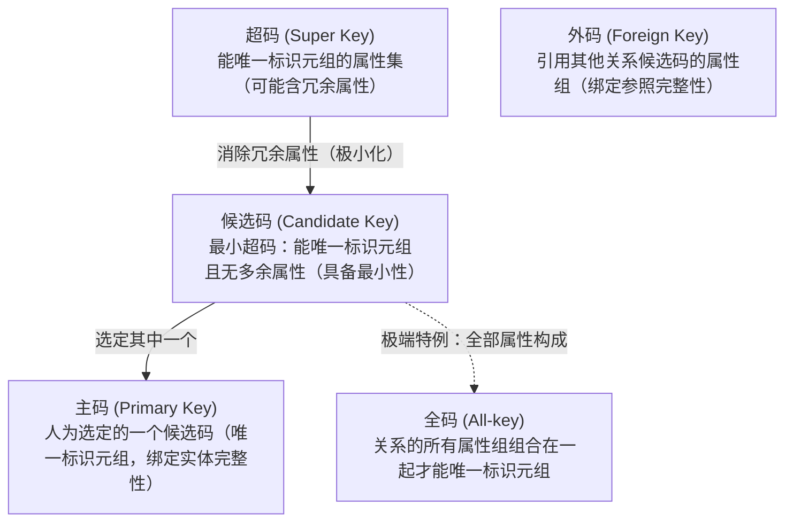
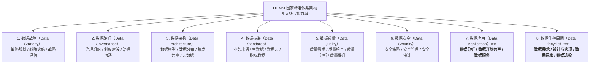

# 第 6 章 数据库设计基础知识

> 目录骨架依据《系统架构设计师教程（第 2 版）》；按专题汇集概念、例题与辨析。

## 6.1 数据库基本概念

### 6.1.1 数据管理技术发展阶段与数据库系统的基本特征（人工管理 vs 文件系统 vs 数据库系统）⭐⭐⭐

数据管理技术随着计算机硬件、软件及网络技术的发展，经历了**人工管理阶段**、**文件系统阶段**和**数据库系统阶段**三次重大演进：

#### 一、数据管理技术三个发展阶段全景对比表

| 维度对比 | 人工管理阶段（20世纪50年代中期以前） | 文件系统阶段（50年代后期至60年代中期） | 数据库系统阶段（60年代后期开始）⭐⭐⭐ |
|:---|:---|:---|:---|
| **硬件背景** | 无直接存取存储介质（仅磁带、卡片），内存极小 | 大容量磁盘、磁鼓等直接存取存储设备出现 | 大容量磁盘、高速网络、多核分布式计算架构 |
| **软件背景** | 无操作系统，无专门管理数据的软件 | 操作系统诞生，提供文件系统专门管理数据 | 数据库管理系统（DBMS）专业化运行与调度 |
| **数据面向** | 面向特定单一应用程序（数据无法脱离程序） | 面向特定单一应用程序（一个程序对应一套文件） | **面向全系统、全组织（彻底打破部门壁垒）** |
| **数据结构化** | **无结构**，由程序自行解析二进制或文本 | **记录内部有结构，但记录之间无联系**（局部结构化） | **整体结构化**⭐⭐（记录内有结构且记录间有联系，最本质跃迁） |
| **数据共享性** | **不共享**，程序独占，一组数据仅供一个程序使用 | **共享性极差**，不同程序各自复制私有数据文件 | **高共享性**⭐⭐（多用户/多应用并发安全共享数据） |
| **数据冗余度** | **冗余度极大**，每个程序重复存储全部数据 | **冗余度大**，各部门数据高度重复，极易引发**数据不一致** | **低冗余度**⭐⭐（消除不必要重复，易于扩充，保障一致性） |
| **数据独立性** | **完全不独立**（数据与程序完全死锁在一起） | **独立性差**（数据的逻辑结构或物理结构改变必须修改程序） | **高数据独立性**⭐⭐（物理独立性与逻辑独立性全面保障） |
| **统一控制功能** | 无任何控制，数据安全性与完整性全由程序员代码保证 | 无统一控制，缺乏并发控制与崩溃恢复，安全性差 | **统一管理与控制**（安全性、完整性、并发控制、故障恢复） |

#### 二、数据库系统（DBS）四大核心基本特征

1. **数据的整体结构化（与文件系统的本质区别）**：
   - 文件系统只做到了“记录内部有结构”，而**文件之间是互不关联的孤岛**；
   - 数据库系统实现了**整体结构化**：不仅单个实体记录内部包含多个属性字段，而且在**不同数据实体与记录之间也通过数据模型（如关系模型的键与约束、网状模型的指针）建立起明确的逻辑联系**。
2. **高共享性、低冗余度与易扩充性**：
   - 数据库面向全组织共享，大幅减少了不必要的数据重复存储（**冗余度低**，而非“冗余度较高”）；
   - 低冗余不仅节省存储空间，更核心的价值是**从根源上避免了数据更新时的数据不一致（Update Anomalies）**。
3. **高数据独立性（解耦程序与数据）**：
   - 通过**三级模式与两级映像**（外模式/模式映像、模式/内模式映像），将应用程序与全局逻辑结构、物理存储细节彻底解耦（物理独立性与逻辑独立性）。
4. **统一的数据控制与保护功能**：
   - 由 DBMS 集中提供：**安全性保护**（防非授权非法访问）、**完整性检查**（防垃圾无效数据进库）、**并发控制**（防并发脏读与丢失更新，如 2PL）及**数据库恢复**（宕机自动重放与回滚）。

#### 三、经典数据文件类型对照表（系统分析与设计视角）

在传统文件存储及现代数据库混合架构中，数据文件根据业务职责主要划分为：

| 文件类型 | 英文名称 | 核心定义与数据特征 | 常见应用场景与生命周期 | 题干特征词 / 判别依据 |
|:---|:---|:---|:---|:---|
| **主文件** ⭐⭐ | **Master files** | 存储企业或业务的核心业务主体记录与状态信息；数据相对持久稳定，生命周期贯穿整个业务周期。 | 客户记录（Customer Records）、员工信息（Employee Files）、账户主数据、库存主档。 | “core business information”、“customer/employee records”、“relatively permanent” |
| **查找文件** ⭐⭐ | **Look-up files** | 存储用于静态对照、输入验证或状态映射的代码与常量静态数据；通常为只读或低频维护。 | 邮政编码与城市映射（Zip Code / State）、产品分类代码表、货币代码、税率对照表。 | “used primarily for validation”、“static values/codes”、“look up references” |
| **事务文件** | **Transaction files** | 存储业务日常运行中发生的临时交易或动作记录；用于阶段性批处理更新主文件。 | 每日订单流水、POS 交易明细、库存变动日志、考勤打卡流水。 | “day-to-day business transactions”、“used to update master files” |
| **历史文件 / 归档文件** | **History / Archive files** | 存储已归档的历史非活跃记录，用于法规遵从、历史追溯与统计分析。 | 往年结案订单、已离职员工档案、历史交易冷备份。 | “past transactions”、“archival purposes”、“infrequently accessed” |

> [!IMPORTANT]
> **数据库特征与选非题排雷指南**：
> 1. **反向选非陷阱**：题干问“不正确的是”，选项声称“冗余度较高”必定是错误描述（数据库核心特征是**低冗余**）；
> 2. **警惕极端用词“消除冗余”**：数据库特征是“低冗余”而非“零冗余/绝对消除冗余”；在实际架构设计中，适度的控制冗余（如数据仓库雪花模型反规范化、主从复制备份）是系统性能调优的标准手段；
> 3. **共享性范畴**：数据库天然支持为**各类不同用户（程序员、DBA、普通终端用户）**提供多并发共享访问。

  - 【题库章节练习】 题目 26（关于数据库的特征，以下描述不正确的是 $\to$ 选【B. 数据间联系密切、冗余度较高】）。

---

### 6.1.2 数据模型与三要素（数据结构静态特性、数据操作动态特性与约束条件）⭐⭐⭐

数据模型（Data Model）是数据库系统的核心与基石，是对现实世界数据特征的形式化抽象。它从抽象层次上描述了系统的**静态特征（数据结构）**、**动态行为（数据操作）**以及**完整性规则（数据的约束条件）**，其主要作用是**为数据库系统的信息表示与操作提供一个统一的抽象框架**。
在设计流程中，数据模型通常划分为**概念数据模型**（按用户观点建模，独立于 DBMS，如 E-R 模型）、**逻辑数据模型**（按计算机系统观点建模，面向特定 DBMS，如关系模型）和**物理数据模型**（面向底层物理介质与存取路径）。

#### 一、数据模型的三要素全景对照表

无论何种数据模型，在理论体系中均严格由以下**三大要素**构成（经典逻辑数据模型如层次、网状、关系等亦是依据其**数据结构**的组织拓扑命名的）：

| 数据模型三要素 | 官方权威学术定义 | 描述的核心系统特性 | 考场高频命题题眼 | 在关系模型中的具体落地 |
|:---|:---|:---|:---|:---|
| **数据结构**⭐⭐⭐<br>（Data Structure） | 描述数据库的**对象类型的集合**。<br>描述对象包括数据的内容、性质以及对象之间的相互联系。 | **静态特性**⭐⭐⭐<br>（Static Characteristics） | “**对象类型的集合**”<br>“表示系统的**静态特性**” | 单一的**关系（二维表 Table）**结构及其属性列、域定义 |
| **数据操作**⭐⭐⭐<br>（Data Operation） | 描述对数据库中各种对象实例允许执行的**操作及有关操作规则的集合**。 | **动态特性**⭐⭐⭐<br>（Dynamic Characteristics） | “**允许执行的操作集合**”<br>“操作规则的集合”<br>“表示系统的**动态特性**” | **关系代数运算与 SQL 增删改查**（SELECT / INSERT / UPDATE / DELETE） |
| **数据的约束条件**⭐⭐⭐<br>（Data Constraints） | 描述数据结构内部及相互之间的**语义制约与完整性规则的集合**。<br>用于保证数据的有效性、正确性和一致性。 | **语义正确与相容性** | “**一组完整性规则的集合**”<br>“语义制约” | **三大完整性约束**：<br>1. 实体完整性（PK 唯一非空）；<br>2. 参照完整性（FK 引用有效）；<br>3. 用户定义完整性（CHECK/NOT NULL） |

> [!IMPORTANT]
> **数据模型三要素极速秒杀口诀**：
> - **“模型三要素：结构、操作与约束；”**
> - **“对象类型集，骨架静态选【数据结构】；”**
> - **“增删改查行，行为动态选【数据操作】；”**
> - **“语义合法性，规则约束选【数据的约束条件】；”**
> - **“整体核心用，表示操作【抽象框架】！”**
> 
> **极速排雷提醒**：
> 1. 见“**静态特性**” $\to$ 唯一秒杀 **数据结构**！切勿误选“数据完整性”（数据完整性是系统质量属性，不是三要素名称）；
> 2. 见“**动态特性**” $\to$ 唯一秒杀 **数据操作**；
> 3. 考查“**主要作用**” $\to$ 必选**提供信息表示与操作的抽象框架**！严防将单一要素（仅静态/只操作/专门约束）以偏概全。

  - 【题库章节练习】 题目 36（在数据模型的三要素中，哪一个描述了对象类型的集合，用于表示系统的静态特性 $\to$ 选【A. 数据结构】）。
  - 【题库章节练习】 题目 37（在数据库系统设计中，数据模型的主要作用是什么 $\to$ 选【C. 提供数据库系统信息表示与操作的抽象框架】）。

#### 二、传统遗留逻辑数据库模型 vs 现代关系模型全景矩阵

| 逻辑模型名称 | 英文术语 | 组织结构拓扑 | 实体间联系与指针机制 | 优缺点与应用特征 | 经典代表产品 |
|:---|:---|:---|:---|:---|:---|
| **网状数据库** ⭐⭐⭐ | **Network database** | **有向图（Graph / Web）** | **通过显式物理/逻辑指针（Pointers）相互关联**；允许一个记录有多个双亲（打破单亲限制），天然直接支持 M:N 复杂网状联系。 | • 优势：数据存取性能极高、表达复杂关系直接。<br>• 劣势：**结构复杂、缺乏物理与逻辑独立性**；导航式数据操作极度依赖程序硬编码指针，增删指针容易造成数据损坏。 | CODASYL DBTG、IDS、IDMS |
| **层次数据库** ⭐⭐ | **Hierarchical database** | **倒置树（Inverted Tree）** | 严格遵循**父子树形层次（Parent-Child）**；有且仅有一个根节点，双亲与子女之间只能表达 1:N 联系；除根节点外**任何子节点有且仅能有一个父节点**。 | • 优势：层次分明、树形结构检索高效。<br>• 劣势：无法直接表示多对多（M:N）联系；插入和删除约束过于严苛（删除父节点连带删除子节点）。 | IBM IMS（信息管理系统） |
| **关系数据库** ⭐⭐⭐ | **Relational database** | **二维表（Two-dimensional Table）** | 基于严格集合论与谓词逻辑；实体间联系**完全通过公共属性值（主键 / 外键 Foreign Key）动态逻辑匹配建立，严禁暴露底层物理指针**。 | • 优势：**逻辑/物理数据独立性极高**、SQL 声明式语言简单易用、标准化规范化（范式理论）。<br>• 劣势：处理高维复杂嵌套对象时存在对象-关系阻抗失配。 | Oracle、MySQL、PostgreSQL、SQL Server |
| **面向对象数据库** ⭐ | **Object-Oriented database** | **复杂对象图 / 类继承层次** | 采用面向对象范式；支持类、继承、封装、多态及对象标识符（OID）直接引用复杂对象。 | • 优势：完美支持 CAD/GIS/多媒体复杂嵌套工程数据。<br>• 劣势：查询优化器复杂，缺乏像 SQL 一样大一统的数学理论与国际标准。 | ObjectStore、Versant |

> [!IMPORTANT]
> **数据模型高频秒杀口诀与排雷指南**：
> 1. **判别指针关联（Pointers）**：“`collections of records that are related to each other through pointers`” $\implies$ **网状数据库（Network database）**！网状模型本质是通过指针链（Sets / Pointers）构建实体间图拓扑。
> 2. **警惕学术伪概念陷阱**：试卷中出现的 `Linked table database` 是出题人利用“链接（Linked）/表（Table）”等字面构造的**学术臆造词**，计算机学术体系与软考大纲中根本不存在该数据模型！千万不要望文生义！
> 3. **主文件 vs 查找文件速记**：`Master files` 存核心主数据（客户/员工）；`Look-up files` 存验证静态代码（邮编/税率）。

  - 【 软考架构师专业英语】Dennis 系统分析与设计数据存储架构节选：（Network databases）are collections of records that are related to each other through pointers. $\to$ 选【D. Network database】。

#### 三、企业战略数据模型分类：数据库模型（OLTP）vs 数据仓库模型（OLAP）⭐⭐⭐

企业战略数据模型是企业顶层信息化与数据架构规划的核心成果，从业务支撑层级上划分为**数据库模型**与**数据仓库模型**两大支柱：

##### 1. 企业战略数据模型两大分类对照表

| 战略模型类别 | 核心描述对象与职责 | 对应计算形态与服务对象 | 核心设计诉求与数据特征 | 考场标志性题眼 |
|:---|:---|:---|:---|:---|
| **数据库模型** ⭐⭐⭐<br>（Database Model） | **日常事务处理中的数据及其关系** | **联机事务处理（OLTP）**<br>面向基层业务人员与生产一线操作 | • 强调实时性、高并发写入、高可靠 ACID；<br>• 严格遵循规范化设计（3NF），减少冗余，客观反映日常生产经营内在联系；<br>• 是办公自动化、ERP、CRM、设计/生产自动化及 Intranet 的基础环境。 | “**描述日常事务处理中的数据及其关系**”<br>“生产经营内在联系的基础” |
| **数据仓库模型** ⭐⭐⭐<br>（Data Warehouse Model） | **企业管理决策者所需信息及其关系** | **联机分析处理（OLAP）**<br>面向中高层管理者与战略决策者 | • 强调面向多维主题、跨系统深度清洗集成；<br>• 相对稳定（批量加载，基本无原地修改/删除）；<br>• 反映多年历史演变快照，支持多维切片与趋势预测。 | “**描述企业管理决策者所需信息及其关系**”<br>“辅助管理决策过程” |

##### 2. 数据仓库（DW）四大核心法定特征（W.H.Inmon 经典定义）

数据仓库是一个**面向主题的（Subject-Oriented）**、**集成的（Integrated）**、**相对稳定的/非易失的（Non-Volatile）**且**反映历史变化的（Time-Variant）**数据集合，用于支持管理决策过程：

1. **面向主题（Subject-Oriented）**：操作型数据库面向**具体业务应用程序**（如开单、考勤），而数据仓库围绕**企业重大决策分析主题**（如“销售收入”、“高净值客户”、“供应链风险”）组织数据。
2. **集成的（Integrated）**：数据从多个分散、异构的操作型数据库源头经过 **ETL（抽取/清洗/转换/加载）**，消除单位不一致、字段同名异义、编码冲突等语义摩擦，形成全局统一的数据视图。
3. **相对稳定的 / 非易失的（Non-Volatile）**：数据仓库主要执行**批量定期加载**与**复杂多维分析查询**，数据一旦写入仓库，**极少发生随机原地 UPDATE 或 DELETE 操作**。
4. **反映历史变化的（Time-Variant）**：操作型数据库通常只保留**当前瞬时最新值（Current Value）**，而数据仓库必须带有**显式时间维度（时间戳/历史快照）**，通常保留 5~10 年数据，用于长周期趋势预测与同比环比分析。

> [!IMPORTANT]
> **企业战略数据模型极速秒杀口诀与排雷指南**：
> - **“日常事务数据库，管理决策数仓挑；”**
> - **“数仓四大硬特征：主题、集成、稳且变；”**
> - **“批量只读相对稳，长年快照历史变！”**
> 
> **极速排雷提醒**：
> 1. 见“**日常事务处理中的数据及其关系**” $\implies$ 唯一秒杀 **数据库模型**；
> 2. 见“**企业管理决策者所需信息及其关系**” $\implies$ 唯一秒杀 **数据仓库模型**；
> 3. 警惕“**组织架构模型**”：组织架构是企业行政管理划分，根本不是数据模型，见此直接排除！

### 6.1.3 数据库管理系统与事务 ACID 特性（原子性、影子拷贝技术、一致性、完整性约束）⭐⭐⭐

事务（Transaction）是数据库系统运行的基本工作单位，是由一系列对数据库执行操作的指令构成的逻辑单元，相当于操作系统中的进程。事务必须具备 **ACID 四大基本特性**：

#### 一、事务 ACID 四大特性与 DBMS 底层实现机制全景对照表

| 特性名称 | 官方核心定义 | 考场高频判别题眼 | DBMS 底层实现机制与核心技术 | 典型破坏场景 / 违背现象 |
|:---|:---|:---|:---|:---|
| **原子性**⭐⭐⭐<br>（Atomicity） | 事务包含的所有数据库操作**要么全做，要么全不做**；是一个不可分割的工作单位。 | “不可分割”、“要么全做要么全不做” | **影子拷贝（Shadow Copying / 影子分页）**<br>撤销日志（Undo Log / 恢复子系统） | 事务执行一半系统断电，部分数据已写入而部分未写入（脏数据残留）。 |
| **一致性**⭐⭐⭐<br>（Consistency） | 数据库只能从**一个一致性合法状态转变到另一个一致性状态**，不能破坏任何预设的语义规则。 | “一致性状态变到另一个一致性状态”、“转账前后总金额守恒” | **完整性约束检查**（主外键、NOT NULL、CHECK、断言）<br>应用层业务逻辑校验 | A 账户扣减 100 元，B 账户因异常未增加，系统总金额凭空减少。 |
| **隔离性**⭐⭐⭐<br>（Isolation） | 多个并发事务执行时，各事务的内部操作**相互独立、互不干扰**；并发执行的结果与各个事务串行执行完全一致。 | “并发执行互不干扰”、“串行化”、“隔离级别” | **并发控制子系统**：<br>• **封锁协议（Locking, 如 2PL 两阶段封锁）**<br>• **多版本并发控制（MVCC）** | 脏读（Dirty Read）、不可重复读（Non-repeatable Read）、幻读（Phantom Read）。 |
| **持久性**⭐⭐⭐<br>（Durability） | 事务一旦提交（Commit），其对数据库中数据的改变必须是**永久性的**，后续即使发生系统宕机崩溃也不会丢失。 | “提交后永久保存”、“即使宕机崩溃也不丢失” | **恢复管理子系统**：<br>• **重做日志（Redo Log）**<br>• **预写式日志（WAL, Write-Ahead Logging）**<br>• 磁盘强制刷新（fsync） | 事务提示提交成功，但机器断电重启后发现刚才写入的数据消失。 |

#### 二、影子拷贝（Shadow Copying / 影子分页）实现机制

影子拷贝是经典关系数据库管理系统（DBMS）中无需复杂日志重放即可保障事务原子性的优雅技术：
1. **写副本而不动原件**：事务启动时维护一个当前数据库页表的影子指针；所有写操作在新分配的磁盘空闲页中进行，原磁盘页保持只读未受污染状态；
2. **原子指针单步切换**：当事务成功完成并提交时，操作系统只需执行一步**单扇区/单指针原子写入**，将指向活动数据库的根指针直接切换重定向到新影子副本；
3. **回滚与故障恢复极简**：若事务中途崩溃或中止，数据库只需释放影子副本所占用的临时磁盘块，根指针依然稳固指向修改前的旧状态，天然达成“要么全做、要么全不做”。

> [!IMPORTANT]
> **ACID 极速秒杀口诀**：
> - **“原子全做全不做，影子拷贝/Undo 保（A $\to$ 影子拷贝）；”**
> - **“状态合法一致性，完整约束检查牢（C $\to$ 完整性约束）；”**
> - **“并发隔离不干扰，封锁协议两阶段（I $\to$ 2PL / MVCC）；”**
> - **“持久落盘永不丢，重做日志刷盘防（D $\to$ Redo / WAL）！”**
> 
> **核心陷阱排雷**：千万不要将数据库内核事务级的“**影子拷贝**”与运维转储层面的“**完全备份 / 差异备份 / 增量备份**”相混淆！

#### 三、两段锁协议（2PL, Two-Phase Locking）机制与并发调度定理 ⭐⭐⭐

两段锁协议是数据库管理系统（DBMS）在并发控制子系统中保障事务**隔离性（Isolation）**与**可串行化调度（Serializability）**的经典封锁规范。

##### 1. 两阶段严格划分与单向时序硬约束

一个遵循 2PL 的事务在其生命周期中对锁的操作必须严格分为两个互斥阶段，且分界点不可逆：

| 阶段名称 | 别名 / 英文名称 | 允许的操作 | 严禁的操作 | 转换规则 / 状态机特征 |
|:---|:---|:---|:---|:---|
| **第一阶段** | **获得封锁阶段**<br>（Growing Phase / 扩展阶段） | 申请并获得任何数据项上的排他锁（X锁）或共享锁（S锁） | **严禁释放任何锁** | 事务启动后即进入此阶段；随着业务执行不断申请锁。 |
| **第二阶段** | **释放封锁阶段**<br>（Shrinking Phase / 收缩阶段） | 释放事务已持有的任何锁 | **严禁再申请获得任何新的锁** | **一旦事务释放了第一把锁，即不可逆地跨入收缩阶段**；后续绝不能反向申请新锁。 |

> [!WARNING]
> **设陷排雷（D 选项陷阱）**：
> 题目常出现“只允许事务在一个阶段中加锁或解锁”的伪表述。必须明确：每个遵循 2PL 的事务**在其完整执行过程中必须先后经历加锁和解锁这两个阶段**，而不是限制在某一个阶段单选。

##### 2. 两段锁协议的核心定理与死锁本质关系

- **可串行化充分条件定理**：
  $$\text{所有事务遵循 2PL} \implies \text{任何并发调度均必定是冲突可串行化的（Conflict Serializable）}$$
  - **充分而非必要**：满足 2PL 一定可串行化；但存在某些可串行化的调度并不满足 2PL。
- **死锁独立性定理（2PL 不能避免死锁）**：
  - **核心悖论**：2PL 保证并发正确性（可串行化），但**绝不能防止死锁（Deadlock）**！
  - **死锁诱因**：事务 $T_1$ 持有 $A$ 申请 $B$，$T_2$ 持有 $B$ 申请 $A$，两者均在合法的“获得封锁阶段”，但形成循环互斥等待，系统陷入死锁；
  - **免死锁解法**：必须辅以**一次封锁法（Conservative 2PL，事务开始前一次性申请全部锁）**或**顺序封锁法**（按规定全局顺序加锁），但一次封锁法会降低系统并发度。

##### 3. 2PL 演进变种（防止级联回滚）

- **严格两段锁（Strict 2PL, S2PL）**：除遵守 2PL 外，要求**所有的排他锁（X锁）必须保持到事务提交或中止后才能一次性释放**。避免了“脏读”并杜绝了**级联回滚（Cascading Rollback）**。
- **强两段锁（Rigorous 2PL）**：要求**所有锁（包括共享锁 S 锁和排他锁 X 锁）都必须保持到事务提交或中止后才能释放**，调度直接等价于事务提交顺序的严格串行化。

> [!IMPORTANT]
> **2PL 考场秒杀口诀**：  
> **“2PL 必保可串行，加锁解锁两阶段；加锁期间不放锁，放锁之后不再加；可串行化能实现，循环等待死锁存！”**

#### 四、DBMS 数据库语言功能分类体系（DDL、DML、DCL 与综合语言 SQL）⭐⭐⭐

数据库管理系统（DBMS）为用户和开发人员提供专门的数据语言作为交互接口。根据其执行的职能领域与操作对象，主要分为三大子语言及大一统的 SQL：

##### 1. 数据库语言四大分类全景对照表

| 语言类别 | 全称（英文） | 核心操作对象 | 核心功能与业务语义 | 典型 SQL 关键字与示例 |
|:---|:---|:---|:---|:---|
| **数据定义语言**⭐⭐⭐<br>（DDL） | **Data Definition Language** | **模式骨架 / 元数据**<br>（库、表、视图、索引、触发器） | 定义、修改、删除数据库的**三级模式结构与逻辑/物理模式定义**。定义的结果存入数据字典（系统目录）。 | `CREATE TABLE / VIEW / INDEX`<br>`ALTER TABLE ADD COLUMN`<br>`DROP TABLE`<br>`TRUNCATE TABLE` |
| **数据操纵语言**⭐⭐⭐<br>（DML） | **Data Manipulation Language** | **行记录 / 实体数据内容**<br>（表内元组） | 实现对数据库中**已有具体数据的基本操作（检索、插入、修改和删除）**，即 CRUD 增删改查。 | `SELECT ... FROM ... WHERE ...`<br>`INSERT INTO ... VALUES ...`<br>`UPDATE ... SET ... WHERE ...`<br>`DELETE FROM ... WHERE ...` |
| **数据控制语言**⭐⭐⭐<br>（DCL） | **Data Control Language** | **安全权限 / 事务状态**<br>（用户、角色、事务上下文） | 负责数据库的**安全性保护、并发控制授权及事务状态提交与回滚**。 | `GRANT SELECT ON ... TO user`<br>`REVOKE DELETE ON ... FROM user`<br>`COMMIT`<br>`ROLLBACK` |
| **结构化查询语言**⭐⭐<br>（SQL） | **Structured Query Language** | **综合超集**<br>（集定义、操纵、控制于一体） | 关系数据库的**国际标准化大一统综合语言**。它并非独立的某类单一功能子语言，而是**完整包含了 DDL、DML、DCL 全部功能的一体化综合语言体系**。 | 涵盖全部关系数据库语法（ANSI/ISO SQL 标准） |

##### 2. 数据操纵语言（DML）核心理论分类

- **按语言声明性特征划分**：
  - **非过程化 DML（声明式语言，Declarative）**：**现代关系数据库 SQL 的核心特征**。用户只需在语句中指出“**要什么数据（What）**”，无需指定“**如何一步步去物理查找（How）**”，具体的存取路径和物理检索算法由 DBMS 查询优化器自动生成并执行。
  - **过程化 DML**：早期层次数据库和网状数据库的特征。用户不仅要指定需要的数据，还必须显式编写指针寻道、游标遍历逻辑，指明具体的存取路径。
- **按使用方式划分**：
  - **交互式 DML（自含型语言）**：终端用户直接在命令行或 SQL 客户端中即时键入执行；
  - **嵌入式 DML（宿主型语言）**：将 SQL 语句嵌入高级编程语言（如 C/C++、Java、Python），通过预编译器或游标（Cursor）协调单行与集合之间的阻抗失配。

> [!IMPORTANT]
> **数据库语言分类秒杀口诀与排雷指南**：
> 1. **看操作对象对号入座**：
>    - 操作“表结构/列/索引/库” $\to$ **DDL**（数据定义）；
>    - 操作“数据记录/增删改查” $\to$ **DML**（数据操纵）；
>    - 操作“权限授权/收权” $\to$ **DCL**（数据控制）；
> 2. **排除上位概念泛化**：题干特指“实现数据基本操作（检索、插入、修改、删除）的语言”时，**标准学术答案唯一专指 DML**；切勿因为日常敲 SQL 误选了综合超集 SQL！

  - 【题库章节练习】 题目 2（数据库系统运行的基本工作单位是事务...数据库的（原子性）是指操作序列要么全做要么全不做。设计时用（影子拷贝）实现。数据库从一个一致性状态变到另一个一致性状态的性质称为（一致性）。设计时用（完整性约束）检查实现 $\to$ 问题 2 选【A. 影子拷贝】）。
  - 【题库章节练习】 题目 18（关于两段锁协议的描述，以下哪项是正确的 $\to$ 选【C. 两段锁协议分为获得封锁阶段和释放封锁阶段】）。
  - 【题库章节练习】 题目 34（在数据库管理系统中，用于实现对数据库中数据的基本操作（如检索、插入、修改和删除）的语言是 $\to$ 选【B. 数据操纵语言（DML）】）。

#### 五、并发操作带来的三种典型数据不一致性与时序判定（丢失修改 vs 不可重复读 vs 读脏数据）⭐⭐⭐

在没有并发控制（如封锁协议）的环境下，多个事务并发交叉执行会破坏事务的**隔离性（Isolation）**，导致数据不一致性。主要表现为以下三种经典问题：

##### 1. 三大数据不一致性核心定义与时序对照表

| 不一致性类型 | 英文名称 | 权威学术定义 | 核心时序特征 | 产生根源与判别题眼 |
|:---|:---|:---|:---|:---|
| **丢失修改** ⭐⭐⭐ | **Lost Update** | 事务 $T_1$ 与 $T_2$ 从数据库中读入同一数据并修改；$T_2$ 的提交结果破坏并覆盖了 $T_1$ 的提交结果，导致 $T_1$ 的修改丢失。 | $T_1$ 读 $A \to T_2$ 读 $A \to T_1$ 写 $A \to T_2$ 写 $A$（$T_2$ 覆盖 $T_1$） | “**两事务均写入，后写覆盖先写**”<br>“初值被覆盖，先写者的修改丢失” |
| **不可重复读** ⭐⭐⭐ | **Non-repeatable Read** | 事务 $T_1$ 读取某数据后，事务 $T_2$ 对该数据执行了**更新或删除并写回**；当 $T_1$ 在同一事务生命周期内**再次读取该数据时，得到了不同的值**。 | $T_1$ 读 $A \to T_2$ 改写 $A$ 并提交 $\to T_1$ 再读 $A$（前后两次读值不一致） | “**同一事务两次读取同一数据，结果不同**”<br>“中间穿插了其他事务的写操作” |
| **读“脏”数据** ⭐⭐⭐ | **Dirty Read** | 事务 $T_1$ 修改某数据并写回磁盘；事务 $T_2$ 读取该数据后，$T_1$ 因故障被**撤销回滚（Rollback）**使数据恢复原值；此时 $T_2$ 读到的就是现实中不存在的“脏”数据。 | $T_1$ 写 $A \to T_2$ 读 $A \to T_1$ **Rollback** 回滚撤销（$T_2$ 读到了废弃无效数据） | “**读到了未提交且后续被回滚的数据**”<br>“必含事务 Rollback / 撤销中途修改” |

> [!IMPORTANT]
> **并发数据不一致性极速秒杀口诀与排雷指南**：
> - **“一读再读值不同，中间被写【不可重复读】；”**
> - **“前人写完未提交，后人读了前人滚【读脏数据】；”**
> - **“两人同读两人写，后写覆盖前人汗【丢失修改】！”**
> 
> **快速排除法铁律**：
> 1. **排除丢失修改**：若某事务**自始至终只有 Read 读取操作、没有任何 Write 写入操作**，该事务**绝对不可能存在丢失修改**！
> 2. **排除读脏数据**：时序表中**若无任何事务发生回滚（Rollback / 撤销）**，一律**不得选读脏数据**！
> 3. **锁定不可重复读**：只要发现同一个事务先后执行了两次 `Read(X)`，而两次读取之间有另一个事务执行了 `Write(X)`，**100% 属于不可重复读**！

  - 【题库章节练习】 题目 69（系统中有三个事务 T1、T2、T3 并发操作 R1=120、R2=50... T1 与 T2 间并发操作问题 $\to$ 选【A. 存在T1不能重复读的】）。

### 6.1.4 数据库的完整性与安全性控制（有效性/正确性/一致性 vs 安全性正交边界与三大完整性约束）⭐⭐⭐

在数据库系统中，**数据的完整性（Integrity）**与**数据的安全性（Security）**是保障数据资产的两大核心基石。必须精准辨析两者的学术定义、防范对象及工程实现机制：

#### 一、数据完整性与数据安全性的正交对比全景表

| 维度对比 | 数据的完整性（Data Integrity）⭐⭐⭐ | 数据的安全性（Data Security）⭐⭐⭐ |
|:---|:---|:---|
| **法定核心定义** | 指数据的**有效性（Validity）**、**正确性（Correctness）**和**一致性/相容性（Consistency）**。 | 指保护数据库防止因**非法使用**造成的数据泄露、非法修改或恶意破坏。 |
| **防范核心目标** | **防垃圾数据进库（Garbage In, Garbage Out）**。<br>防止不符合客观真实语义的数据进入系统。 | **防坏人进门破坏与偷看（防越权与窃密）**。<br>防止未经授权的非法访问或特权滥用。 |
| **防范对象特征** | 针对**合法用户**的输入误操作、应用软件逻辑缺陷、并发冲突或系统故障。 | 针对**非法攻击者**、非授权用户或合法用户的恶意越权行为。 |
| **DBMS 底层技术手段** | 1. **实体完整性**（主码约束 PK，唯一且非空）；<br>2. **参照完整性**（外码约束 FK，被引用值存在）；<br>3. **用户定义完整性**（`CHECK` 约束、`NOT NULL`、触发器）；<br>4. 事务并发控制机制与崩溃恢复日志 | 1. 用户身份认证与口令鉴别；<br>2. 存取控制机制（自主访问控制 DAC、强制访问控制 MAC）；<br>3. 视图安全隔离机制；<br>4. 数据加密存储与传输加密（SSL/TLS）；<br>5. 安全审计与操作追踪日志 |

#### 二、关系模型的三大完整性约束落地规则

1. **实体完整性（Entity Integrity）**：
   - **规则**：若属性（或属性组）$A$ 是基本关系 $R$ 的主属性（Primary Key），则 $A$ **不能取空值（NOT NULL），且必须全局唯一**。
   - **理由**：关系模型以主码唯一定位现实世界的实体，主码若为空或重复则意味着该实体无法辨识。
2. **参照完整性（Referential Integrity）**：
   - **规则**：若属性组 $F$ 是基本关系 $R$ 的外码，它参照基本关系 $S$ 的主码 $K_s$，则 $R$ 中每个元组的 $F$ 上的值必须要么**取空值（NULL）**，要么**等于 $S$ 中某个元组的主码值**。
   - **理由**：防止出现“悬挂指针”或引用不存在的无效实体。
3. **用户定义完整性（User-defined Integrity）**：
   - **规则**：针对具体应用环境制定的语义约束（如字段取值范围 `CHECK(score BETWEEN 0 AND 100)`、非空 `NOT NULL`、枚举值约束等）。
   - **贯穿全过程**：完整性设计必须贯穿数据库设计全生命周期，**在数据需求分析阶段收集数据时，就必须调查该数据的有效范围**。

> [!IMPORTANT]
> **数据完整性与安全性极速秒杀口诀**：
> - **“完整性管数据真：有效、正确与一致（防垃圾进库）；”**
> - **“安全性管权限严：合法访问防泄密（防坏人进门）；”**
> - **“题干问完整，选项见安全直接排除，锁定『有效、正确、一致』！”**
> 
> **三大约束对号入座**：
> - **主键唯一非空** $\to$ **实体完整性**；
> - **外键合法引用** $\to$ **参照完整性**；
> - **取值区间 CHECK** $\to$ **用户定义完整性**！

  - 【题库章节练习】 题目 12（在数据库系统中，数据的完整性是指数据的 $\to$ 选【A. 有效性、正确性和一致性】）。

### 6.1.5 数据库三级模式结构与两级映像机制（逻辑独立性 vs 物理独立性全景辨析）⭐⭐⭐

数据库系统采用外模式、概念模式、内模式三级模式结构（ANSI/SPARC 模型），并在三级模式之间提供两级映像机制。这是数据库管理系统实现**数据高度独立性**的核心架构设计：

#### 一、三级模式结构与数量特征对照表

```text
【用户 / 应用程序】
        ↕
   [ 外模式 ] （子模式 / 用户模式，对应 SQL 中的视图 VIEW）
        ↕  ←──【外模式 / 概念模式映像】──→ 保障「数据的逻辑独立性」
  [ 概念模式 ] （模式 / 全局逻辑模式，对应 SQL 中的基本表 TABLE）
        ↕  ←──【概念模式 / 内模式映像】──→ 保障「数据的物理独立性」
   [ 内模式 ] （存储模式 / 物理存储与索引结构）
        ↕
【物理存储介质（磁盘数据文件）】
```

| 模式层次 | 标准名称与别名 | 在 SQL 语言中的对应实体 | 数量与基数特征 | 描述的核心内容与面向主体 |
|:---|:---|:---|:---|:---|
| **外模式**⭐⭐⭐ | **子模式（Subschema）**<br>用户模式 | **视图（VIEW）** | **可以有多个**（不同部门与应用可各自定义专属视图） | 数据库用户（包括程序员与终端用户）能够看见和使用的**局部数据的逻辑结构和特征**。提供视图安全隔离。 |
| **概念模式**⭐⭐⭐ | **模式（Schema）**<br>全局逻辑模式 | **基本表（TABLE）** | **全局唯一**（一个数据库只有一个概念模式） | 数据库中**全体数据的逻辑结构和特征的全局统一描述**。独立于具体的物理存储细节与各部门局部视图。 |
| **内模式**⭐⭐⭐ | **存储模式（Storage Schema）**<br>物理模式 | **物理文件、内部记录组织、B+树/聚簇索引、数据压缩与加密** | **全局唯一**（一个数据库只有一个内模式） | 数据在数据库内部的**物理存储结构和存取方式的描述**。直接与磁盘物理介质和操作系统文件系统交互。 |

#### 二、两级映像与两大独立性底层机理

DBMS 在三级模式之间提供了两级映像，分别实现了数据的**逻辑独立性**与**物理独立性**：

| 映像名称 | 映像所处层次 | 变更触发场景 | 调整动作与实现目标 | 保障的核心独立性 |
|:---|:---|:---|:---|:---|
| **外模式 / 概念模式映像**⭐⭐⭐ | 定义在**外模式**与**概念模式**之间 | 数据库全局逻辑结构发生变更（如**基本表新增属性字段、修改字段类型、表发生垂直或水平拆分**） | DBA 修改该映像（调整视图定义），保持上层外模式不变，从而**原有的应用程序无需修改代码**。 | **数据的逻辑独立性**<br>（Logical Data Independence） |
| **概念模式 / 内模式映像**⭐⭐⭐ | 定义在**概念模式**与**内模式**之间 | 数据库物理存储方式发生变更（如**更换底层物理存储介质从 HDD 迁移到 SSD、修改文件存储组织、调整聚簇索引与 B+ 树**） | DBA 修改该映像，保持全局概念模式不变，上层外模式及**应用程序完全无需修改任何代码**。 | **数据的物理独立性**<br>（Physical Data Independence） |

> [!IMPORTANT]
> **三级模式两级映像极速秒杀口诀**：
> - **“外模逻辑内模物，两级映像两隔离；”**
> - **“改底层物理（存储介质/文件组织/索引） $\to$ 调概念/内模 $\to$ 保物理独立性（程序不变）；”**
> - **“改全局逻辑（增删字段/拆分表格） $\to$ 调外模/概念 $\to$ 保逻辑独立性（程序不变）！”**
> 
> **极速秒杀题眼**：
> 1. 见“**物理存储方式改变，应用程序不变**” $\to$ 唯一秒杀 **概念模式/内模式映像**（保物理独立性）！
> 2. 见“**数据逻辑结构（字段/表）改变，应用程序不变**” $\to$ 唯一秒杀 **外模式/概念模式映像**（保逻辑独立性）！
> 3. 见“**一个数据库有几个**” $\to$ 秒杀 **外模式多个，概念模式和内模式唯一**！
> 4. 见“**局部数据的逻辑结构和特征**” / “**用户模式/视图**” $\to$ 唯一秒杀 **外模式**！严防因“逻辑”二字误选“逻辑模式（概念模式/全体数据）”。

  - 【题库章节练习】 题目 30（当数据的物理存储方式改变时，应用程序不变，这由保证 $\to$ 选【A. 概念模式/内模式映像】）。
  - 【题库章节练习】 题目 66（数据库的三级模式结构中，描述局部数据的逻辑结构和特征的是 $\to$ 选【B. 外模式】）。
  - 【题库章节练习】 题目 67（数据库三级模式中，（概念模式）描述了记录的类型和记录间的联系、操作、数据的完整性和安全性，（外模式）是用户需要使用的部分数据的描述 $\to$ 问题 1 选【A. 概念模式】）。
  - 【题库章节练习】 题目（数据库的三级模式中，是描述局部数据的逻辑结构和特征的 $\to$ 选【A. 外模式】）。

### 6.1.6 分布式数据库系统与分布透明性（分片透明性 vs 位置透明性 vs 局部数据模型透明性）⭐⭐⭐

[考查：综合知识 / 架构设计]

分布式数据库系统（DDBS）由一组分布在网络不同物理计算机节点上的局部数据库系统构成，各节点具有**逻辑上相互关联、物理上各自独立、地理上物理分散**的典型特征。
为了使上层用户和应用程序能够像使用传统单机数据库一样无感操作分布式数据，系统必须提供**分布透明性（Distribution Transparency）**。

#### 一、分布透明性三层金字塔架构与特征全景对照表

分布透明性从高到低由三个核心抽象层次构成（层级越高，向用户屏蔽的技术细节越多）：

```text
▲ 【用户 / 全局应用程序视角】
│      ↕
│  [ 分片透明性 ]（最高层次：用户只面对单一逻辑关系，根本不知道数据是否分片、如何分片）
│      ↕
│  [ 位置透明性 ]（次高层次/中间层：用户知道数据被分片，但不知道各分片保存在哪台物理节点）
│      ↕
│  [ 局部数据模型透明性 ]（最低层次/引擎适配层：用户知道分片与节点，但无需知道各节点 DBMS 是什么模型和语言）
▼ 【底层物理网络与异构局部 DBMS 节点】
```

| 透明性层次 | 层次定位 | 核心定义与屏蔽内容 | 典型场景与 SQL 代码特征 | 变更/迁移适应能力 |
| :--- | :--- | :--- | :--- | :--- |
| **分片透明性** ⭐⭐⭐<br>（Fragmentation Transparency） | **最高层次**<br>（逻辑抽象顶峰） | 用户或应用程序**完全不知道数据是否进行了分片、如何进行分片**。全局只面对单一逻辑关系表。 | 用户仅执行：<br>`SELECT * FROM Orders WHERE Date > ''`<br>底层实际被水平拆分为 `Orders_2026` 与 `Orders_2027`，用户对此毫不知情。 | 数据分片策略发生调整（如将按月分片调整为按季度分片）时，**全局应用程序完全无需修改任何代码**。 |
| **位置透明性** ⭐⭐⭐<br>（Location Transparency） | **次高层次**<br>（网络与节点抽象） | 用户或应用程序**知道数据进行了分片**，但**完全不知道这些逻辑分片具体存放在网络中的哪台主机或哪个物理站点（Site）上**。 | 用户在查询中显式指定分片名：<br>`SELECT * FROM Orders_North UNION ALL SELECT * FROM Orders_South`<br>但程序无需知道 `Orders_North` 究竟保存在北京节点还是上海节点。 | 某分片由北京机房物理迁移到保定机房（物理 IP / 节点变动）时，只需修改系统全局目录，**应用程序代码完全无需修改**。 |
| **局部数据模型透明性** ⭐⭐⭐<br>（Local Data Model Transparency） | **最低层次**<br>（异构引擎适配层） | 用户或应用程序知道分片及其存储节点，但**完全不需要了解各局部站点具体采用何种 DBMS 数据模型（如关系型、文档型、键值型）和本地查询语言**。 | 北京节点使用 MySQL（关系型），上海节点使用 MongoDB（文档型）。全局查询统一采用标准 SQL，由分布式中间件翻译为局部方言。 | 局部节点升级或更换数据库底层引擎（如 MySQL 替换为 PostgreSQL）时，上层全局查询不受影响。 |

#### 二、数据分片的基本方式与三大完备性准则

在分布式数据库设计中，数据分片是构建分布透明性的基础：
1. **四种基本分片方式**：
   - **水平分片（Horizontal Fragmentation）**：按元组（行）进行划分，即按某种选择条件将关系划分成若干互不相交的子集（如按地区、时间切分数据）；
   - **垂直分片（Vertical Fragmentation）**：按属性（列）进行划分，即将关系的属性划分为若干子集，每个子集必须包含关系的主码（PK），以便后续无损连接恢复；
   - **导出分片（Derived Fragmentation）**：某关系的水平分片条件并非取决于自身属性，而是取决于其它关系的属性（外键依赖导出）；
   - **混合分片（Hybrid Fragmentation）**：水平分片与垂直分片的递归组合嵌套。
2. **分片的三大设计准则（完备性条件）**：
   - **完备性准则（Completeness）**：全局关系中的每一个数据项，必须分配到某一个或多个分片中，不能丢失任何数据；
   - **可重构性准则（Reconstruction）**：必须保证从所有分片中可以通过关系代数运算（并、连接）完全无损地还原出全局关系；
   - **不相交性准则（Disjointness）**：对于水平分片，各分片之间的元组必须互不重叠（交集为空）。

#### 三、数据分布两大机制（数据分片 vs 数据复制）与考场概念偷换排雷 ⭐⭐⭐

在分布式数据库（DDB / 分布式 RDBMS）架构设计中，数据分布主要通过**数据分片（分割，Partitioning）**与**数据复制（Replication）**两种核心模式实现：

| 数据分布模式 | 细分类型 | 核心切分对象与机制 | 判定依据与代数重构 | 考场高频设陷点（张冠李戴） ⭐⭐⭐ |
|:---|:---|:---|:---|:---|
| **数据分割** ⭐⭐⭐<br>（分片，Partitioning） | **水平分割**<br>（Horizontal） | **单表内部的不同行（元组）** | 结构相同，按谓词切分行集合；通过 **并（UNION）** 运算还原。 | 偷换为“将不同表存储在不同节点”或“按字段切分” |
| | **垂直分割** ⭐⭐⭐<br>（Vertical） | **单表内部的不同列（属性/字段）** | 按列拆分子表，**每个分片必须包含主码**；通过 **自然连接（JOIN）** 运算还原。 | **头号偷换陷阱**：声称“垂直分割是将不同表存储在不同服务器上”（把不同业务表分库不是垂直分割！） |
| | **导出分片** ⭐⭐⭐<br>（Derived） | **单表内部的行（元组）** | **本质是水平分片**；划分谓词由另一个关联关系的属性导出（外键关联）。 | 偷换为“垂直分片的一种”或“按自身字段拆分” |
| **数据复制** ⭐⭐⭐<br>（Replication） | 全量 / 部分复制 | **完整或部分数据副本** | 将同一份数据的多个副本存储到不同物理节点；**由 RDBMS 复制引擎统一维护一致性**。 | 误以为“数据复制提升了写性能”（以冗余换读并发与高可用，写性能因一致性而下降） |

> [!IMPORTANT]
> **分布透明性与数据分布极速秒杀口诀与排雷指南**：
> - **“分片最高不知切，位置次高不知站，模型最低不知库（三层透明性）；”**
> - **“横切看行（水平按行分），纵切看列（垂直按列分且带主键）；”**
> - **“表内切分叫分片，不同分库莫混淆；”**
> - **“复制副本保多活，一致管理归引擎；”**
> - **“题干见『错误』，先圈否定词，秒杀张冠李戴项！”**
> 
> **排雷题眼**：
> 1. 见“**垂直分割**” $\implies$ 必须对应**单表内部的列（字段）**！凡声称“将不同表存储到不同服务器”一律直接判定为错误项秒杀；
> 2. 见“**导出分片**” $\implies$ 必为**水平分片**，切分规则由外键主表属性导出！

  - 【题库章节练习】 题目 32（在分布式数据库系统中，以下哪个选项描述的是分布透明性的最高层次 $\to$ 选【B. 分片透明性】）。
  - 【题库章节练习】 题目 115（以下关于RDBMS数据分布的叙述中，错误的是 $\to$ 选【A. 数据垂直分割是将不同表的数据存储到不同的服务器上】）。

### 6.1.7 经典系统开发方法与结构化生命周期法（特点、核心长板 vs 固有局限与 Jackson/面向对象演进）⭐⭐⭐

[考查：综合知识 / 系统架构设计]

结构化方法（Structured Methodology）也称为**生命周期法（SDLC）**，是软件工程历史上最成熟、应用最广泛的传统工程化开发方法。
其核心思想是把系统的生命周期划分为若干相互衔接的阶段，运用**自顶向下、逐步求精和模块化**的原则进行系统分析与设计。

#### 一、结构化方法的组成与核心设计特征

1. **三大组成部分**：
   - **结构化分析（SA, Structured Analysis）**：以**数据流图（DFD）**、**数据字典（DD）**和**加工说明（IPO/判定树/判定表）**为核心建模工具，完成逻辑模型的构建；
   - **结构化设计（SD, Structured Design）**：以**模块结构图（SC）**为工具，依据模块独立性原则（**高内聚、低耦合**），将 DFD 转换为系统物理软件结构；
   - **结构化程序设计（SP, Structured Programming）**：基于顺序、选择和循环三种基本控制逻辑进行单入口单出口的编码实现。
2. **四大核心工程化特点**：
   - **开发目标清晰化**：严格从用户宏观需求自顶向下逐层分解；
   - **开发工作阶段化**：将开发过程划分为可行性研究、需求分析、概要设计、详细设计、实现与测试等互斥阶段；
   - **开发文档规范化**：每一个阶段结束时必须产出规范严谨的工程文档，并通过严格评审后方可进入下一阶段；
   - **设计方法结构化**：全局遵循逐步细化和模块化分工。

#### 二、结构化方法的能力边界：核心长板 vs 四大固有缺陷全景矩阵

| 维度 | 核心表现 | 底层成因与客观事实 | 考场正误判断与辨析依据 |
| :--- | :--- | :--- | :--- |
| **核心长板** ⭐⭐⭐<br>（最大适用战场） | **特别适合数据处理领域** | 企事业单位日常的业务报表、账务核算、库存流水等系统，具有**业务流程清晰规范、数据流转路径稳定**的特征，与结构化方法的“输入-处理-输出（IPO）”高度契合。 | 凡是声称“**不适合于数据处理领域的问题**”纯属**反向篡改事实**（常作为选非题的正确选项）！ |
| **致命缺陷 1** ⭐⭐⭐<br>（重过程轻数据） | **很少考虑数据结构** | 结构化方法本质是**面向功能与过程分解（面向数据流）**，把数据看作只是在功能管道中流动的原料，缺乏对数据结构本身的抽象与封装。 | 很多考生误以为结构化方法不缺数据结构，**但正统理论明确将“很少考虑数据结构”定性为结构化方法的严重缺陷**！ |
| **致命缺陷 2** ⭐⭐<br>（交付周期冗长） | **开发周期长** | 严格遵循瀑布流转，前期需要耗费巨大精力撰写与冻结文档，在开发后期之前**无法向用户展示任何可运行的软件原型**。 | 客观缺陷。常导致用户长时间看不到成果而失去信心。 |
| **致命缺陷 3** ⭐⭐<br>（抗变更能力弱） | **难以适应需求变化** | 早期强制冻结需求，但实际项目中用户需求往往动态模糊。一旦后期发生需求变更，返工修改前期层层文档的代价呈指数级爆炸。 | 客观缺陷。与敏捷开发、原型法形成鲜明对照。 |
| **致命缺陷 4** ⭐⭐<br>（规模扩展瓶颈） | **不适应大规模、复杂系统** | 当系统规模极其庞大、业务实体交互纵横交错时，自顶向下的 DFD 分解和模块结构图（SC）会迅速膨胀至人类心智难以掌控的程度。 | 客观缺陷。面对复杂巨系统，必须依赖构件化、微服务或面向对象（OO）架构。 |

#### 三、系统开发方法技术演进路线对比

为了克服结构化方法的固有缺陷，软件工程方法学经历了显著的技术跃迁：

| 方法名称 | 核心驱动导向 | 解决结构化方法的什么痛点？ | 典型技术与建模工具 |
| :--- | :--- | :--- | :--- |
| **结构化方法** | **面向过程 / 数据流** | 规范化软件工程起点，确立了阶段化与文档化规范。 | DFD 数据流图、数据字典 DD、HIPO 图、模块结构图 SC |
| **Jackson / Warnier 方法** ⭐⭐⭐ | **面向数据结构** | **直接弥补结构化方法“很少考虑数据结构”的不足**：以输入/输出的数据结构为推导起点，映射生成程序控制结构。 | Jackson 结构图（顺序、选择、重复）、Warnier 图 |
| **原型化方法** | **面向需求探索** | **解决结构化方法“难以适应需求变化、周期长”的不足**：快速构建可运行界面与用户交互迭代，快速收敛需求。 | 水平原型（UI探索）、垂直原型（技术预研） |
| **面向对象方法（OO）** ⭐⭐⭐ | **面向对象 / 实体交互** | **从根本上解决“数据与操作割裂”的不足**：将属性（数据结构）与行为（方法操作）强力封装为对象，通过继承、多态提高复用性与应对复杂巨系统的能力。 | UML 统一建模语言（用例图、类图、时序图等） |

> [!IMPORTANT]
> **结构化开发方法极速秒杀口诀与排雷指南**：
> - **“自顶向下逐步求，模块分明数据流；特别适合数据理，大而复杂莫选它；”**
> - **“周期长来变更改，很少考虑数据构；要想以数定结构，Jackson 方法补漏洞！”**
> - **反向选非陷阱**：
>   - 问“**不属于结构化方法的不足**” $\implies$ 抓反向词 **“不适合数据处理领域”**（它本就最适合数据处理，说不适合纯属造假，必选）；
>   - 选项见“**很少考虑数据结构**” $\implies$ 坚定确认其为**真实存在的致命缺点**，千万不要误排除！

  - 【题库章节练习】 题目 46（结构化方法属于的开发方法。它是目前最成熟、应用较广泛的一种工程化方法。但与此同时，该方法也存在着一定的局限性。（不适合于数据处理领域的问题）不属于结构化方法的主要不足和局限性 $\to$ 选【A. 不适合于数据处理领域的问题】）。

## 6.2 关系数据库

### 6.2.1 关系数据库基本概念与三大完整性约束规则 ⭐⭐⭐

[考查：综合知识 / 案例分析]

关系模型（Relational Model）是建立在严格集合代数理论基础上的数据模型，由**关系数据结构**、**关系操作集合**和**关系完整性约束**三部分组成。其中，完整性约束是数据库管理系统（DBMS）保证数据正确性、相容性和一致性的核心机制。

#### 一、关系模型三大完整性约束规则全景矩阵

| 约束类型 | 核心语义与官方权威定义 | 约束的核心对象 | 空值（NULL）合法性规则 | SQL DDL 级语法实现 | 考场判别词与典型用例 |
| :--- | :--- | :--- | :--- | :--- | :--- |
| **实体完整性** ⭐⭐⭐<br>（Entity Integrity） | **主属性（Primary Attribute）不能取空值**。<br>若属性 $A$ 是基本关系 $R$ 的主属性，则属性 $A$ 不能取空值（NULL）。主码用于在客观世界中唯一标识一个实体，若主属性为空，则意味着实体无法区分与存在。 | **关系的主键（主码）** | **绝对不允许为空**（`NOT NULL` + `UNIQUE`）；若为主键复合属性，则**任何一个分量均不可为空**！ | `PRIMARY KEY (employeeID)` 或 `PRIMARY KEY (sno, cno)` | “**主键/员工编号/仓库编号不能为空且唯一标识一个记录**”、“主属性不可为空” |
| **参照完整性** ⭐⭐⭐<br>（Referential Integrity） | **外码（Foreign Key）与主码之间的引用相容性**。<br>设属性组 $F$ 是基本关系 $R$ 的外码，它引用关系 $S$ 的主码 $K_s$。则 $F$ 的每个分量取值必须满足：**要么取空值（NULL），要么等于 $S$ 中某个元组的主码值**。 | **关系的外键（外码）** | **允许为空**（当该外码不是自身关系主码组成部分，且业务允许实体间暂时脱钩时，如新员工未分配部门）。 | `FOREIGN KEY (employeeID) REFERENCES E(employeeID)` | “**仓库关系的负责人引用员工关系的员工编号**”、“外码取空值或目标表有效主码” |
| **用户定义完整性** ⭐⭐⭐<br>（User-defined Integrity） | **具体业务领域中属性取值的语义约束**。<br>反映某一具体应用所涉及的数据必须满足的语义要求与业务规则，由应用环境决定。 | **关系中的普通非主属性** | 由具体业务规则决定（可设置 `NOT NULL` 或允许 `NULL`）。 | `NOT NULL`、`CHECK (fee >= 0 AND fee <= 500)`、`UNIQUE`、`DEFAULT` | “**仓库的地址不能为空**”、“挂号费在 0~500 之间”、“年龄必须大于 18 岁” |

#### 二、高频考点深度辨析与排雷指南

1. **“依次 / 分别”设问的审题陷阱**：
   - 软考常将教材的默认介绍次序（实体 $\to$ 参照 $\to$ 用户定义）作为诱饵，故意在题干中打乱顺序陈述（例如先描述跨表引用，再描述主码非空唯一，最后描述字段非空）。
   - **破解法门**：审题先给题干条件标号 ①、②、③，逐个判定后再对照选项，绝不凭“第一项肯定是实体完整性”的思维定势选答。
2. **复合主键的实体完整性严格性**：
   - 若主键由多个属性组成（复合主键，如选课表的 `(sno, cno)`），实体完整性要求**组成主码的每一个属性都绝不能取空值**，而非“只要有一个不为空即可”。
3. **外码为空与级联操作规则（Referential Action）**：
   - 关系模型中，外码取空值并不违反参照完整性（除非该外码同时也是当前表的主键部分，此时受实体完整性制约不得为空）；
   - 当被引用的主表记录被删除或更新时，DBMS 支持四种外键约束动作：
     - **RESTRICT / NO ACTION（拒绝/限制）**：存在引用时禁止删除/修改主表记录；
     - **CASCADE（级联）**：主表删除/修改，从表外键记录同步级联删除/修改；
     - **SET NULL（置空）**：主表删除/修改，从表外键自动置为 NULL；
     - **SET DEFAULT（置默认值）**：主表变动，从表外键设为预设默认值。
4. **外键引用本质、空值合法性与主属性例外（题目 88 实战）⭐⭐⭐**：
   - **外键引用的本质与定义**：外键是从表（参照关系）中的属性列，它引用的目标是被参照关系的**码（主码 Primary Key 或候选码 Candidate Key / UNIQUE 约束列）**，绝不仅限于主键；
   - **同域异名原则**：外键的属性名与被参照属性的名称**无需完全相同**，只要它们定义在**同一个域（Domain，数据类型与取值语义相同）**上即可（如 `belong_dept_no` 引用 `dept_id`）；
   - **空值（NULL）的法定合法性**：参照完整性要求外键的值**要么取空值（NULL），要么等于被参照关系中已有的对应属性值**。空值在业务上代表该实体暂时脱钩（如员工暂未分配部门）；
   - **实体完整性最高优先级例外**：当外键同时作为当前关系的主键（或复合主键的分量，如选课表 `(Sno, Cno)` 中的外键属性）时，受实体完整性绝对制约，**此时绝对不允许为空（NOT NULL）**！

5. **跨表复杂业务约束与触发器（Trigger）机制（题目 104 实战）⭐⭐⭐**：
   - **外键（参照完整性）的能力局限**：外键只能保证从表属性的值在主表中“存在或为空”，**完全无法对跨表字段进行数值大小比对、区间计算或算术检验**（如“工资是否在最低与最高工资之间”）；
   - **单表 CHECK 约束的局限**：`CHECK` 约束适用于单表内部静态字段取值（如 `CHECK(score BETWEEN 0 AND 100)`），但在标准 SQL 中不支持跨表子查询；
   - **触发器（Trigger）的工程使命**：对于涉及**跨表数值区间比较、动态业务规则校验或多表联动（如库存自动扣减）**的复杂用户定义完整性，必须使用**触发器（TRIGGER）**或存储过程实现；
   - **触发器挂载表“抓现行”铁律**：**哪个表发生 DML（增删改）数据变动，触发器就必须建立在哪个表上**！录入或修改员工数据（`EMP` 表）时需要校验工资，触发器必须建立在 `EMP` 表上（`BEFORE/AFTER INSERT OR UPDATE ON EMP`）。建在基准表（`P` 表）上对日常向员工表非法写入数据完全无法起到拦截作用。

> [!IMPORTANT]
> **三大完整性约束极速秒杀口诀**：
> - **“审题先抓【依次】词，标上一二三再比；”**
> - **“主码非空唯一标，实体完整不可逃；”**
> - **“跨表关联外键引，参照完整空或存；”**
> - **“属性同域名可异，候选唯一皆可引；”**
> - **“外键一旦入主键，实体优先必非空；”**
> - **“外键只管存不存在（参照保引用），不能比对大小区间；”**
> - **“单表简单用 CHECK，跨表复杂靠【触发】；”**
> - **“触发器装谁身上？谁进数据装在谁身上（EMP 进数据装 EMP）！”**
> - **“普通字段定规则，用户定义任施展！”**

  - 【题库章节练习】 题目 1（某数据库中有员工关系 E、产品关系 P、仓库关系 W 和库存关系 I... 若要求仓库关系的负责人引用员工关系的员工编号，员工关系 E 的员工编号、仓库关系 W 的仓库编号和产品关系 P 的产品编号不能为空且唯一标识一个记录，并且仓库的地址不能为空，则依次要满足的完整性约束是 $\to$ 选【B. 参照完整性、实体完整性、用户定义完整性】）。
  - 【题库章节练习】 题目 88（在关系数据库中，关于参照完整性的描述，以下哪项是正确的 $\to$ 选【B. 外键可以为空值，也可以是被参照关系对应属性中的值】）。
  - 【题库章节练习】 题目 104（设有职务工资关系P（职务，最低工资，最高工资），员工关系EMP（员工号，职务，工资），要求任何一名员工，其工资值必须在其职务对应的工资范围之内，实现该需求的方法是 $\to$ 选【C. 建立EMP上的触发器程序审定该需求】）。

#### 三、关系数据库操作特性与代数闭包性（一次一集合 Set-at-a-time vs 传统一次一记录 Record-at-a-time）⭐⭐⭐

关系模型不仅在数据结构上实现了整体结构化，更在**数据操作方式**上实现了对传统层次、网状数据库的范式革命：

##### 1. 传统数据库 vs 关系数据库数据操作方式对比表

| 维度对比 | 传统层次/网状数据库（遗留系统） | 现代关系数据库（RDBMS）⭐⭐⭐ |
|:---|:---|:---|
| **数学理论基石** | 图论（有向图/倒置树）、物理内存指针链 | **严格集合论与一阶谓词逻辑** |
| **基本操作单位** | **记录 / 元组**（Record / Tuple） | **集合 / 关系**（Set / Relation） |
| **操作方式特征** ⭐⭐⭐ | **“一次一记录”（Record-at-a-time）**<br>过程化导航式存取：程序员必须编写循环代码，依赖游标/指针一条一条地顺序遍历记录。 | **“一次一集合”（Set-at-a-time）**<br>非过程化集合操作：用户只需声明“要什么数据”，系统对整个关系集合批量执行投影、选择与关联。 |
| **操作的对象与结果** ⭐⭐⭐ | 单个物理记录或记录指针 | **操作的对象和结果均是【集合（关系）】**<br>即使查询结果只有 1 行甚至 0 行，在数学上依然是单元素集或空集。 |
| **嵌套组合能力** | 差，难以进行任意代数复合与子查询嵌套 | **极强**：具备**代数闭包性（Algebraic Closure）**，输出结果可直接无缝作为后续操作的输入。 |

##### 2. 关系代数闭包性（Closure Property）的架构意义

1. **形式化定义**：
   - 关系代数中所有操作符（选择 $\sigma$、投影 $\Pi$、连接 $\Join$、并 $\cup$、差 $-$ 等）均以**关系（元组集合）**作为操作数，并且运算结果**仍然是一个关系（元组集合）**。
2. **架构价值**：
   - 正是因为代数闭包性，现代关系数据库才能实现**复杂 SQL 子查询的多层任意嵌套**（如 `FROM (SELECT ...)`），以及查询优化器对关系代数语法树的**等价代换与重写优化**。

> [!IMPORTANT]
> **关系操作特性极速秒杀口诀与排雷指南**：
> - **“指针遍历一次一记录，关系代数一次一集合；”**
> - **“元组只是单元素，操作出入皆成集；”**
> - **“代数闭包能嵌套，前序输出后序入！”**
> 
> **极速排雷提醒**：
> 1. 题干问“关系数据库操作，操作的对象和结果都是” $\to$ 唯一秒选 **集合（C）**！切勿误选“元组”（元组是集合内部的元素，操作层级是集合）；
> 2. 考查操作方式 $\to$ 必选**一次一集合（Set-at-a-time）**与**非过程化**。

  - 【题库章节练习】 题目 31（关系数据库操作，操作的对象和结果都是 $\to$ 选【C. 集合】）。

#### 四、关系数据库基本概念核心要素与码（Key）层级体系全景矩阵 ⭐⭐⭐

[考查：综合知识 / 案例分析]

关系模型严格基于集合论与谓词逻辑建立，其底层由一系列严格的形式化概念构成。在系统架构设计与数据库建模中，清晰区分**现实世界实体、信息世界模型与计算机关系术语**的对应关系，以及各种“码（Key）”的作用对象，是规范化设计与完整性保障的前提。

##### 1. 关系模型基础术语与概念粒度三级映射表

| 关系模型术语 | 英文术语 | 传统/物理概念类比 | 核心学术定义与本质特征 | 唯一性标识该实体的机制 ⭐⭐⭐ |
|:---|:---|:---|:---|:---|
| **关系** ⭐⭐⭐ | **Relation** | **二维表（Table）** | 属性域笛卡尔积的子集，元组的集合。 | **关系名（表名）**<br>（在数据库系统中唯一标识一个关系） |
| **元组** ⭐⭐⭐ | **Tuple** | **表中的一行记录（Row / Record）** | 关系中的每一个元素，对应现实世界中的一个具体实体实例。 | **候选码 / 主码（Primary Key）**<br>（在关系中**唯一标识一个元组**） |
| **属性** ⭐⭐⭐ | **Attribute** | **表中的一列字段（Column / Field）** | 二维表中的列，描述实体的某一项特征。关系的度（Degree）即属性个数。 | **属性名（字段名）**<br>（在关系模式中唯一标识一列属性） |
| **域** | **Domain** | 字段取值范围 / 数据类型 | 属性允许取值的集合（如性别域为 `{男, 女}`，年龄域为 `0~120`）。 | 数据类型约束、CHECK 约束 |
| **关系模式** | **Relation Schema** | 表结构定义（DDL 表结构） | 关系的型（Type），描述关系的形式化结构：$R(U, D, DOM, F)$。 | 关系名与属性集合定义 |
| **数据库** | **Database** | 多个表的集合 | 互相关联的关系集合与系统元数据。 | **数据库名 / 实例名** |

##### 2. 关系中各类“码（Key）”的层级体系与严格判定标准

在关系模式 $R(U, F)$ 中，围绕“**唯一标识一个元组**”这一核心使命，衍生出具有严格包含与递进关系的码体系：



| 码类型 | 英文名称 | 官方权威学术定义与数学性质 | 核心考点与命题题眼 |
|:---|:---|:---|:---|
| **超码**<br>（Super Key） | Super Key | 能在关系中**唯一标识一个元组**的属性集 $K$。超码可能包含无关的冗余属性。 | 只要能唯一确定一行即为超码（候选码 + 任何其他属性仍然是超码）。 |
| **候选码** ⭐⭐⭐<br>（Candidate Key） | Candidate Key | **最小超码**：不仅能唯一标识一个元组，而且**其任意真子集都不能唯一标识一个元组**（兼具唯一性与最小性）。一个关系可有多个候选码。 | “能唯一标识一个元组，且不含多余属性”；<br>候选码可能不唯一（如身份证号、学号）。 |
| **主码** ⭐⭐⭐<br>（Primary Key） | Primary Key | 从候选码集合中**人为选定用来唯一标识元组的一个候选码**。 | “**唯一标识一个元组**”；<br>绑定**实体完整性**（主属性绝对非空且唯一）。 |
| **全码** ⭐⭐<br>（All-key） | All-key | 当关系模式中的**所有属性组组合在一起才能唯一标识一个元组**时，该属性组称为全码。 | 极端特例：表中没有任何单一或部分属性可作为码，全部属性并集方为码。 |
| **主属性 vs 非主属性** ⭐⭐⭐ | Primary vs Non-prime Attribute | **包含在任何一个候选码中的属性**称为**主属性**；不包含在任何候选码中的属性称为**非主属性**。 | 软考高频陷阱：“主属性”是指包含在**任一候选码**中的属性，绝不仅限于主码中的属性！ |
| **外码** ⭐⭐⭐<br>（Foreign Key） | Foreign Key | 关系 $R$ 中的属性组 $F$ 并非 $R$ 的码，但 $F$ 是另一个关系 $S$ 的主码（或候选码），则称 $F$ 为 $R$ 的外码。 | 绑定**参照完整性**；作用是维护两表引用关联，值要么为空，要么等于目标表有效主码值。 |

> [!IMPORTANT]
> **主码与概念粒度极速秒杀口诀与排雷指南**：
> - **“表名定关系，列名定属性；”**
> - **“主键（主码）候选码，唯一标识在元组；”**
> - **“任一候选主属性，全部属性是全码；”**
> - **“外码引用两表联，实体参照两分明！”**
> 
> **极速排雷提醒**：
> 1. 题干问“关系数据库中的‘主码’是指” $\to$ 唯一秒杀**能唯一标识一个元组（A）**！绝对不能选“唯一标识关系”（关系由表名标识）；
> 2. 区分**主属性**定义：只要包含在“**某个候选码**”中就是主属性，不必须包含在主码中。

  - 【题库章节练习】 题目 68（关系数据库中的“主码”是指 $\to$ 选【A. 关系中的某一属性或属性组，能唯一标识一个元组】）。
  - 【题库章节练习】 题目 114（关系 $R(A, B, C)$ 满足下列函数依赖：$F\{B \to C, B \to A, A \to BC\}$，关系 $R$ 的候选关键字为 $\to$ 选【B. A和B】）。

##### 3. 候选码推导四步法（L/R/N/LR 属性四分法）与主属性判定（题目 114 实战）⭐⭐⭐

在关系数据库规范化设计中，求取关系模式 $R(U, F)$ 的全部候选码（Candidate Key）是范式判定的前提，必须遵循严格的数学判定逻辑：

###### （1）属性“出入度”四大分类法（L / R / N / LR）

根据函数依赖集 $F$ 中每个属性出现的**左右侧位置**，将全集属性 $U$ 划分为互斥的四大类别：

| 属性类别 | 位置特征与定义 | 核心判别规则 | 在候选码中的最终地位 |
| :--- | :--- | :--- | :--- |
| **L 类属性** ⭐⭐⭐<br>（纯左侧属性） | 仅在函数依赖的**左侧**出现，从未在右侧出现 | 没有任何其他属性可以决定它，只能由自身标识。 | **100% 必须包含在每一个候选码中**！ |
| **R 类属性** ⭐⭐⭐<br>（纯右侧属性） | 仅在函数依赖的**右侧**出现，从未在左侧出现 | 只能被其他属性决定，自身无法推导任何外部属性。 | **100% 绝对不可能包含在任何候选码中**！凡含 R 类的选项直接排除！ |
| **N 类属性** ⭐⭐⭐<br>（孤立属性） | 在函数依赖集 $F$ 的**左右两侧均未出现** | 不参与任何依赖关系，任何依赖都无法推出它。 | **100% 必须包含在每一个候选码中**！漏选必错！ |
| **LR 类属性** ⭐⭐<br>（双侧属性） | 在函数依赖的**左侧和右侧均有出现** | 既能决定其他属性，又能被其他属性决定。 | **可能入码，可能不入码**。需与 L 类、N 类组合测试闭包。 |

###### （2）候选码极速推导四步法

1. **第一步（锁定基石属性组）**：提取所有 **L 类属性** 和 **N 类属性**，构成基础属性组 $K_{\text{base}} = L \cup N$。
2. **第二步（测算基石闭包）**：计算 $K_{\text{base}}$ 的属性闭包 $K_{\text{base}}^+$：
   - 若 $K_{\text{base}}^+ = U$，则 $K_{\text{base}}$ 是关系 $R$ 的**唯一候选码**（此时无需再测试任何 LR 类属性）；
   - 若 $K_{\text{base}}^+ \ne U$，则转入第三步。
3. **第三步（组合遍历与代换）**：将 LR 类属性依次单个（或两两组合）添加到 $K_{\text{base}}$ 中测算闭包：
   - 若 $(K_{\text{base}} \cup \{X\})^+ = U$，则该组合为一个候选码；
   - 利用依赖关系中的“右推左”等价性（如若 $C \to B$，则候选码中的 $B$ 可由 $C$ 代换，衍生出新的候选码）。
4. **第四步（主属性与非主属性法定判定）**：
   - **主属性（Prime Attribute）**：**包含在任何一个候选码中的属性**（所有候选码属性集的**并集**）；
   - **非主属性（Non-prime Attribute）**：不包含在任何候选码中的属性（主属性并集的**补集**）。

> [!IMPORTANT]
> **候选码与主属性极速秒杀口诀**：
> - **“纯右不入码（见 R 类直接排除选项），纯左孤立必在码（L+N 锁死核心）；”**
> - **“双侧属性做组合，等价代换找全码；”**
> - **“单码独立莫合并（A和B 绝非 AB 超码）；”**
> - **“任一候选主属性（并集为主属性，补集为非主属性）！”**

#### 五、关系模式形式化五元组定义与工程实践简化（R(U, D, DOM, F)）⭐⭐⭐

[考查：综合知识 / 概念辨析]

在关系数据库理论中，关系模式是对关系的型的描述，其数学形式化定义为一个严格的**五元组**：
$$R(U, D, DOM, F)$$

##### 1. 关系模式五元组分量全景对照表

| 五元组分量 | 英文全称 / 数学含义 | 中文标准学术名称 | 核心物理与逻辑语义 | 易混点与考场设陷警示 ⭐⭐⭐ |
|:---|:---|:---|:---|:---|
| **$R$** | **Relation Name** | **关系名** | 唯一标识该关系模式的名称（即表名）。 | 关系名标识二维表整体，非元组标识符。 |
| **$U$** | **Universe of Attributes** | **属性名集合** | 组成该关系的全部属性名称的集合：$U = \{A_1, A_2, \dots, A_n\}$。 | 属性列的名称全集。 |
| **$D$** ⭐⭐⭐ | **Domains** | **属性所来自的域集合** | 属性取值的取值范围/集合：$D = \{D_1, D_2, \dots, D_k\}$。 | **单字母 $D$ 才是域**！切勿与 $DOM$ 倒置。 |
| **$DOM$** ⭐⭐⭐ | **Domain Mapping / Image** | **属性向域的映象集合** | 属性到域的对应绑定函数映射：$DOM: U \to D$，表示每个属性 $A_i$ 取哪个域 $D_j$。 | **高频陷阱词**！看到“DOM”容易误当成域（Domain），其真实内涵是**映象（映射规则）集合**。 |
| **$F$** | **Functional Dependencies** | **数据依赖关系集合** | 描述属性组之间存在的函数依赖、多值依赖等语义约束集合。 | 规范化范式推导（1NF/2NF/3NF/BCNF）的核心依据。 |

##### 2. 关系模式工程简化与理论抽象机理

- **为什么工程中常简记为 $R(U)$ 或 $R(U, F)$？**
  1. **域与映象的物理直现**：在数据库建表与物理实现中，属性的域 $D$ 及其映象 $DOM$ 通常已经直接通过**字段的数据类型与长度（如 `VARCHAR(50)`, `INT`, `DECIMAL(10,2)`）**加以明确限定；
  2. **理论研究焦点聚焦**：在关系数据库规范化设计理论中，讨论的核心是属性间的冗余与依赖，因此略去 $D$ 和 $DOM$，形式化简记为二维二元组 $R(U, F)$ 或仅指明属性集合 $R(U)$。

> [!IMPORTANT]
> **关系模式五元组极速秒杀口诀与排雷指南**：
> - **“$R$ 表名，$U$ 属性全集；”**
> - **“单字母 $D$ 是域集合，三字母 $DOM$ 是映象集；”**
> - **“$F$ 是依赖集合，建表类型即 $D$ 与 $DOM$！”**
> - **排雷提醒**：题干问“DOM 代表什么” $\to$ 唯一秒杀**属性向域的映象集合（C）**！严防望文生义错选“属性所来自的域（B）”。

  - 【题库章节练习】 题目 73（在关系数据库模式的五元组表示中，R(U, D, DOM, F)，DOM代表什么 $\to$ 选【C. 属性向域的映象集合】）。

### 6.2.2 关系运算（关系代数 vs 关系演算：元组关系演算与域关系演算全景辨析）⭐⭐⭐

[考查：综合知识（符号公式推导、量词求解、极值判定）]

关系数据库的查询与操作语言以严格的形式化数学逻辑为基础。关系运算主要分为**关系代数（Relational Algebra）**与**关系演算（Relational Calculus）**两大类：
- **关系代数**：**过程化语言（Procedural）**。通过明确的操作符步骤（并、交、差、笛卡尔积、投影 $\Pi$、选择 $\sigma$、连接 $\Join$、除 $\div$）构造查询过程；
- **关系演算**：**非过程化语言（Non-procedural / 声明式）**。只陈述“要什么数据”，不指定具体执行步骤。以数理逻辑中的一阶谓词逻辑为基础，又细分为：
  1. **元组关系演算（Tuple Relational Calculus, TRC）**：以**元组（行变量 $t$）**为基本变量；
  2. **域关系演算（Domain Relational Calculus, DRC）**：以**属性域（列变量）**为基本变量（如 QBE 查询）。

#### 一、元组关系演算（TRC）表达式基本结构与数理逻辑全解

元组演算表达式的标准通用形式为：
$$\{ t \mid P(t) \}$$
- **$t$**：元组变量，表示结果集由满足谓词条件的**完整行记录**构成；
- **$P(t)$**：一阶谓词公式，用于判断元组 $t$ 是否有资格入选结果集。

在跨关系联合查询时，表达式常引入存在量词 $(\exists)$ 或全称量词 $(\forall)$：
$$R^* = \{ t \mid (\exists u)(R(t) \land S(u) \land t[i] < u[j]) \}$$

#### 二、元组关系演算三大核心要素解构

1. **输出主体锁定原则（看头定主体）**：
   - 表达式最前端声明的 `{ t | ... }`，若条件中紧随 `R(t)`，则**结果集输出的元组 100% 只能来自关系 R**！
   - 严禁将比较对象 $S(u)$ 的元组反向当作结果输出（考场秒杀第一步）。
2. **列分量索引映射（物理顺序）**：
   - $t[i]$ 表示元组 $t$ 在关系 R 中的**从左向右第 $i$ 个属性列**；
   - $u[j]$ 表示元组 $u$ 在关系 S 中的**从左向右第 $j$ 个属性列**。
3. **量词与极值判定准则（存在 vs 全称）**：

| 量词形态 | 符号语法 | 严格数学语义 | 极值秒杀等价条件（针对 $t[i] < u[j]$） | 考场快速验算技巧 |
| :--- | :--- | :--- | :--- | :--- |
| **存在量词** ⭐⭐⭐ | **$(\exists u)(S(u) \land \dots)$** | 在关系 S 中**存在至少一行记录**使得条件成立 | **$t[i] < \max(u[j])$** | 只要找出 S 表中对应列的**最大值**，只要 $t[i]$ 小于该最大值，必定存在！ |
| **全称量词** ⭐⭐⭐ | **$(\forall u)(S(u) \to \dots)$** | 对于关系 S 中的**每一行记录（所有行）**条件均严格成立 | **$t[i] < \min(u[j])$** | 必须找出 S 表中对应列的**最小值**，$t[i]$ 必须比该最小值还要小！ |

#### 三、元组关系演算的“代码双重循环”执行模型与微观单步演算

形式化数学符号本质上等价于程序员熟悉的**双重嵌套循环（Nested-Loop Join / Filter）**：

```python
# 元组演算 R* = { t | (∃u)(R(t) ∧ S(u) ∧ t[3] < u[2]) } 的代码执行等价模型：
R_star = []

for t in R:  # 外层循环：遍历待检验的主体表 R 的每一行 t
    matched = False
    for u in S:  # 内层循环：在对照表 S 中寻找满足条件的行 u
        if t[3] < u[2]:  # R 的第 3 列数值严格小于 S 的第 2 列数值
            matched = True
            break  # 存在量词 (∃) 只要找到一个满足即代表当前 t 成立，跳出内层循环
    if matched:
        R_star.append(t)  # 把通过安检的 R 表行记录装入最终结果集
```

##### 题目 6 微观单步演算全过程（逐行代入测试）：
1. **提取对照表 S 的第 2 列取值池**：
   - 表 S 的第 2 列（B 列）取值为：$\text{S.B} \in \{7, 5, 9, 10\}$，其中**最大值为 10**。
2. **逐行检验表 R 的第 3 列（C 列）**：
   - **R 表第 1 行 $(1, 2, 3)$**：$t[3] = 3$。在 S.B 中存在 $7 > 3$（满足条件！）。**通过，入选**；
   - **R 表第 2 行 $(4, 5, 6)$**：$t[3] = 6$。在 S.B 中存在 $7 > 6$（满足条件！）。**通过，入选**；
   - **R 表第 3 行 $(7, 8, 9)$**：$t[3] = 9$。在 S.B 中存在 $10 > 9$（满足条件！）。**通过，入选**；
   - **R 表第 4 行 $(10, 11, 12)$**：$t[3] = 12$。S.B 最大值仅为 10，没有任何数比 12 大（不满足！）。**淘汰剔除**。
3. **最终输出结果**：$R^* = \{(1, 2, 3), (4, 5, 6), (7, 8, 9)\}$（C 选项）。

##### 题目 84 全称量词演算全过程（全称大于比最大）：
1. **解析表达式**：$T=\{t \mid R(t) \land \forall u(S(u) \to t[3] > u[1])\}$
   - 结果集元组 $t$ 必须出自关系 $R$（主体表，排查直接剔除含 $S$ 表特有记录的选项）；
   - 对照关系 $S$ 的第 1 列（A 列，即 $u[1]$）：$S.A \in \{3, 4, 5, 6\}$；
   - 全称量词 $\forall u$ 要求 $t[3]$ 必须大于 $S.A$ 中的**所有数值**，等价于：$t[3] > \max(\{3, 4, 5, 6\}) \implies t[3] > 6$。
2. **逐行检验表 R 的第 3 列（C 列）**：
   - 第 1 行 $(1, 2, 3)$：$t[3] = 3 \ngtr 6$，淘汰；
   - 第 2 行 $(4, 5, 6)$：$t[3] = 6 \ngtr 6$（严格大于，无等号），淘汰；
   - 第 3 行 $(7, 8, 9)$：$t[3] = 9 > 6$，通过；
   - 第 4 行 $(10, 11, 12)$：$t[3] = 12 > 6$，通过。
3. **最终输出结果**：$T = \{(7, 8, 9), (10, 11, 12)\}$（C 选项）。

> [!IMPORTANT]
> **元组关系演算极速秒杀口诀与排雷指南**：
> - **“看头先定谁家行（`{t|R(t)}` 必出 R），客体选项直接扔；”**
> - **“分量索引数列序，符号比较看仔细；”**
> - **“大于全称（$\forall$）比最大（$> \max$），大于存在（$\exists$）比最小（$> \min$）；”**
> - **“小于全称（$\forall$）比最小（$< \min$），小于存在（$\exists$）比最大（$< \max$）；”**
> - **“全称蕴涵对应 SQL `> ALL`，存在且合对应 SQL `> ANY`！”**

  - 【题库章节练习】 题目 6（给定元组演算表达式 $R^* = \{ t \mid (\exists u)(R(t) \land S(u) \land t[3] < u[2]) \}$，若关系 R(A,B,C)、S(A,B,C) 如下图所示，求 $R^*$ $\to$ 选【C. $R^* = \{(1, 2, 3), (4, 5, 6), (7, 8, 9)\}$】）。
  - 【题库章节练习】 题目 84（关系 R、S 如下图所示，元组演算表达式 $T=\{t \mid R(t) \land \forall u (S(u) \to t[3] > u[1])\}$ 运算的结果为 $\to$ 选【C. $\{(7, 8, 9), (10, 11, 12)\}$】）。

#### 二、SQL 复杂嵌套查询与全称量词（$\forall$）：双重否定（Double NOT EXISTS）与除法运算 ⭐⭐⭐

在关系代数与 SQL 查询中，“**包含所有/选修了全部/在所有仓库都存在**”这类全称量词（$\forall$）查询对应关系代数的**除法运算（$\div$）**。由于 SQL 语言本身没有提供 `FOR ALL` 谓词，必须通过**一阶谓词逻辑转换与嵌套子查询**来实现。

##### 1. 数理逻辑转换原理（双重否定即肯定）

$$\forall x P(x) \iff \neg \exists x (\neg P(x))$$

- **业务命题**：“查询在**所有**仓库 $W$ 中都存在的产品 $P$”；
- **等价逻辑转换**：“**不存在（NOT EXISTS）**任何一个仓库 $W$，在该仓库中**不存在（NOT EXISTS）**产品 $P$ 的库存记录”。

##### 2. SQL 双重否定模板与现代分组聚合对照表

| 实现解法 | 核心技术原理 | SQL 典型模板代码 | 优缺点与适用题型 |
|:---|:---|:---|:---|
| **经典双重否定嵌套**⭐⭐⭐<br>（关系演算解法） | 利用两层相关子查询（Correlated Subquery），外层判定“无缺失仓库”，内层判定“仓库有库存”。 | ```sql
SELECT name FROM P
WHERE NOT EXISTS (          -- 不存在这样一个仓库 W:
    SELECT * FROM W
    WHERE NOT EXISTS (      -- 在该仓库中不存在产品 P 的库存:
        SELECT * FROM I
        WHERE P.productID=I.productID 
          AND W.warehouseID=I.warehouseID
    )
)
``` | • 严格吻合形式化逻辑定义；<br>• **综合知识上午题必考套路**；<br>• 缺点：多层嵌套在无索引时性能较差。 |
| **现代分组聚合计数**⭐⭐⭐<br>（关系代数解法） | 按主体分组，统计其关联对象的去重数量，比对是否等于客体对象的总数。 | ```sql
SELECT productID FROM I
GROUP BY productID
HAVING COUNT(DISTINCT warehouseID) = (
    SELECT COUNT(*) FROM W
);
``` | • 执行效率高，易于被 SQL 优化器并行化；<br>• **案例分析下午题/工程实践首选**；<br>• 易于扩展到“包含至少 N 个仓库”等弹性业务。 |

> [!IMPORTANT]
> **全称量词双重否定秒杀口诀与排雷铁律**：
> - **“题干见【所有/全部/选修全部】，SQL 必选【双重 NOT EXISTS】；”**
> - **“外层不存在缺货仓库，内层不存在单仓库存；”**
> - **“双否嵌套即全称，外层选 EXISTS 反成缺货人！”**
> 
> **极速排雷提醒**：
> 1. 遇到该类模板题，**两层子查询的谓词必须全部为 `NOT EXISTS`**！
> 2. 若外层误选 `EXISTS`，语义瞬间颠倒为：“**存在某个仓库中没有该产品**” $\implies$ 查出的是“至少在一个仓库缺货的产品”，与题意背道而驰！

  - 【题库章节练习】 题目 15 / 问题 3（某数据库中有员工关系 E、产品关系 P、仓库关系 W 和库存关系 I... 若需得到在所有仓库中都存在的产品的名称 $\to$ 选【B. NOT EXISTS】）。

#### 三、关系代数经典运算全景：广义笛卡尔积“行乘列加”定律与连接运算族 ⭐⭐⭐

广义笛卡尔积（Cartesian Product）是所有关系连接运算（等值连接、自然连接、外连接）的数理母体与理论基石：

##### 1. 广义笛卡尔积的数理定义与“行乘列加”定律 ⭐⭐⭐

- **形式化定义**：$R \times S = \{ (r, s) \mid r \in R \land s \in S \}$，将两个关系的元组进行两两无条件全排列拼接。
- **行列计算两大黄金定律（行乘列加）**：
  1. **元组数（行数 / 基数 Cardinality）相乘**：
     $$N(R \times S) = N(R) \times N(S) = m \times n$$
     - *数学依据*：离散计数乘法原理。从 $R$ 中任选一行有 $m$ 种选法，从 $S$ 中任选一行有 $n$ 种选法，全交叉配对组合总数为 $m \times n$。
  2. **属性数（列数 / 度数 / 目数 Degree）相加**：
     $$\text{Deg}(R \times S) = \text{Deg}(R) + \text{Deg}(S) = k_1 + k_2$$
     - *数学依据*：新元组横向包含 $R$ 的所有属性和 $S$ 的所有属性，字段横向并排拼接。

##### 2. 连接运算分类全景对照表

连接运算（Join）是从两个关系的笛卡尔积中选取属性间满足一定条件的元组。连接运算根据匹配规则与对未匹配元组的保留策略，分为**等值连接**、**自然连接**与**外连接家族**：

| 连接运算类别 | 符号表示 | 核心匹配条件与属性列处理规则 | 对未匹配（悬挂）元组的处理 | 典型应用与考场题眼 |
|:---|:---|:---|:---|:---|
| **等值连接** ⭐⭐<br>（Equi-Join） | $R \underset{A=B}{\Join} S$ | 条件为属性等值（$R.A = S.B$）；<br>**不去除重复属性列**，结果属性数 = $R$属性数 + $S$属性数。 | **直接丢弃**未匹配元组 | “条件为属性等值”、“保留所有同名属性列” |
| **自然连接** ⭐⭐⭐<br>（Natural Join） | $R \bowtie S$ | 是一种特殊的等值连接：<br>1. 必须在**两关系的同名公共属性组**上做等值比较；<br>2. **结果集中自动去掉重复的公共属性列**（列数 = $k_1 + k_2 - p$）。 | **直接丢弃**未匹配（悬挂）元组 | “同名属性等值匹配”、“去除重复属性列” |
| **左外联接** ⭐⭐⭐<br>（Left Outer Join） | $R \mathbin{⟕} S$ | 以**左表 $R$ 为主基准**：<br>1. 包含自然连接的所有匹配元组；<br>2. 保留左表 $R$ 中所有未能匹配的元组，右表 $S$ 属性填充 `NULL`。 | **保留左表**全部悬挂元组，右侧补 NULL | “以左表为基准”、“左表记录全部保留” |
| **右外联接** ⭐⭐⭐<br>（Right Outer Join） | $R \mathbin{⟖} S$ | 以**右表 $S$ 为主基准**：<br>1. 包含自然连接的所有匹配元组；<br>2. 保留右表 $S$ 中所有未能匹配的元组，左表 $R$ 属性填充 `NULL`。 | **保留右表**全部悬挂元组，左侧补 NULL | “以右表为基准”、“右表记录全部保留” |
| **完全外联接** ⭐⭐⭐<br>（Full Outer Join） | $R \mathbin{⟗} S$ | **保留两表全部信息**：<br>1. 包含自然连接的所有匹配元组；<br>2. 保留左表 $R$ 与右表 $S$ 中所有未能匹配的元组，未匹配侧均填充 `NULL`。 | **保留两侧**全部悬挂元组，各自缺失侧补 NULL | “保留两表所有记录”、“全外连接” |

##### 3. 外连接元组计数公式与集合容斥模型

设关系 $R$ 包含 $N(R)$ 个元组，关系 $S$ 包含 $N(S)$ 个元组，自然连接成功匹配的元组数为 $N(\text{匹配})$：
- $R$ 独有的未匹配（悬挂）元组数：$N(R\text{独有}) = N(R) - N(R\text{匹配})$；
- $S$ 独有的未匹配（悬挂）元组数：$N(S\text{独有}) = N(S) - N(S\text{匹配})$。

当两表公共属性在对侧**不存在一对多行数膨胀**（即每个匹配项在对侧仅对应 1 行）时，元组计数公式为：
1. **左外联接元组数**：
   $$N(\text{左外}) = N(\text{匹配}) + N(R\text{独有}) = N(R)$$
2. **右外联接元组数**：
   $$N(\text{右外}) = N(\text{匹配}) + N(S\text{独有}) = N(S)$$
3. **完全外联接元组数**：
   $$N(\text{完全外}) = N(\text{匹配}) + N(R\text{独有}) + N(S\text{独有}) = N(\text{左外}) + N(\text{右外}) - N(\text{匹配})$$

> [!IMPORTANT]
> **笛卡尔积与连接运算极速秒杀口诀与排雷指南**：
> - **“笛卡尔积行乘列加：元组两两配必相乘（$m \times n$），字段排排挂必相加（$k_1 + k_2$）；”**
> - **“同名等值去重列，自然连接 $\bowtie$ 两头缩；”**
> - **“左外以左为主表，匹配全留空项补；”**
> - **“右外以右为主表，对侧缺失全填空；”**
> - **“完全外联大包圆，左外加右外减自然！”**
> 
> **极速排雷提醒**：
> 1. **笛卡尔积行列维度防颠倒**：问“元组数（行数）”选乘法 $m \times n$；问“属性数（列数）”选加法 $k_1 + k_2$！
> 2. **外连接必含匹配项**：千万不要误把“左外联接”当成“左表单独多出来的悬挂项”（误算为 $N(R) - N(\text{匹配})$）。左外联接的结果集**必定完整包含左表全部记录**！
> 3. **自然连接 vs 等值连接**：等值连接条件可以任意指定（如 $R.A = S.B$），且不会合并列；自然连接强制要求同名属性组等值，且强制合并同名列。

  - 【题库章节练习】 题目 21 / 问题 2（关系 $R$、$S$ 中，公共属性列为 $(A1, A2)$，$R$ 表 4 行与 $S$ 表 4 行自然连接匹配 2 行，求左外、右外和完全外联接的元组个数 $\to$ 选【D. 4, 4, 6】）。
  - 【2024年上半年 题目57】关系 $R$ 有 $m$ 个元组，关系 $S$ 有 $n$ 个元组，则 $R$ 和 $S$ 的笛卡尔积有个元组 $\to$ 选【D. $m \times n$】。

#### 四、关系代数表达式等价变换与查询优化（启发式规则：早选择、早投影、避免笛卡尔积）⭐⭐⭐

[考查：综合知识 / 数据库查询优化]

关系代数表达式的查询优化（Query Optimization）是关系数据库管理系统（RDBMS）查询编译器的核心技术。其核心目标是在**保持数理逻辑等价（查询结果完全相同）**的前提下，寻找一种**中间临时开销最小、磁盘 I/O 最少、CPU 比较次数最低**的物理执行路径。

##### 1. 查询树启发式优化三大黄金法则全景表

| 优化维度 | 启发式规则名称 | 核心操作动作 | 底层性能成因与物理收益 | 考场标志性判别依据 |
| :--- | :--- | :--- | :--- | :--- |
| **行维度** ⭐⭐⭐<br>（基数压缩） | **选择运算尽早做**<br>（早选择 / Pushdown Selection） | 将选择算子 $\sigma$ 尽可能下推到**最底层的单表叶子节点**上执行。 | **极大压缩中间关系的行数（元组基数）**。<br>避免让不符合业务条件的无效记录参与耗时的跨表关联运算。 | 凡是“在两表连接之前先做选择过滤”的表达式，性能显著优于“连接后再做选择”。 |
| **列维度** ⭐⭐⭐<br>（宽度剪裁） | **投影运算尽早做**<br>（早投影 / Pushdown Projection） | 在执行跨表连接之前，尽早利用 $\pi$ 剔除后续不需要的冗余属性。 | **大幅削减中间关系的列数（单行字节宽度）**。<br>减少内存页占用与磁盘临时换页开销，尤其针对大文本、长字符字段。 | 连接前先剪裁属性列；只保留关联键与最终输出列。 |
| **算子维度** ⭐⭐⭐<br>（杜绝相乘） | **避免笛卡尔积（能连不积）**<br>（Combine Selection & Join） | 将笛卡尔积（$\times$）与关联条件合并，**直接采用自然连接（$\bowtie$）或等值连接**。 | **彻底杜绝 $M \times N$ 级无用伪元组生成**！<br>笛卡尔积是数据库执行的“性能灾难”；连接可直接利用哈希（Hash Join）或索引匹配。 | 包含 $\times$（笛卡尔积）的表达式，在查询效率评比中坚决排除或直接排在连接之后！ |

##### 2. 关系运算 4 个等价表达式效率梯队实战研判（题目 107 全解）

设有关系 $R(A_1, A_2, A_3)$ 和 $S(A_1, A_3, A_4)$，公共属性为 $(A_1, A_3)$。4 个逻辑等价表达式的执行路径与物理代价梯队如下：

1. **第一梯队（效率最高）：$E_2 = \pi_{A_1, A_4} (\sigma_{A_2 < '2022'}(R) \bowtie \sigma_{A_4 = '95'}(S))$**：
   - **步骤**：先对 $R$ 单表过滤行（$\sigma$），先对 $S$ 单表过滤行（$\sigma$） $\to$ 两表仅在过滤后的极小数据集上执行**自然连接（$\bowtie$）** $\to$ 最终投影；
   - **优势**：同时贯彻了“**早选择**”与“**避免笛卡尔积**”，中间临时表规模最小，比较次数最少，效率拔得头筹。
2. **第二梯队（效率次高）：$E_1 = \pi_{A_1, A_4} (\sigma_{A_2 < '2022' \;\land\; A_4 = '95'} (R \bowtie S))$**：
   - **步骤**：直接对全量 $R$ 和 $S$ 做自然连接 $\to$ 在连接生成的大表上执行选择过滤 $\to$ 投影；
   - **劣势**：虽然避免了笛卡尔积，但未下推选择，连接时参与的元组基数较大。
3. **第三梯队（效率较低）：$E_4 = \pi_{A_1, A_4} (\sigma_{R.A_3 = S.A_3} (\sigma_{A_2 < '2022'}(R) \times \sigma_{A_4 = '95'}(S)))$**：
   - **步骤**：下推了单表选择，但随后执行了**笛卡尔积（$\times$）**产生两两交叉组合 $\to$ 再执行 $\sigma$ 过滤；
   - **致命痛点**：笛卡尔积生成了大量无用伪元组，其 I/O 与 CPU 代价远高于 $E_2$ 的直接自然连接。
4. **第四梯队（效率最低）：$E_3 = \pi_{A_1, A_4} (\sigma_{A_2 < '2022' \;\land\; R.A_3 = S.A_3 \;\land\; A_4 = '95'} (R \times S))$**：
   - **步骤**：全量执行全表笛卡尔积 $R \times S$ 制造 $N(R) \times N(S)$ 级数据大爆炸 $\to$ 再做过滤；最差路径。

> **综合效率排序**：$$E_2 \;>\; E_1 \;>\; E_4 \;>\; E_3$$

> [!IMPORTANT]
> **关系代数查询优化极速秒杀口诀**：
> - **“优化法则三板斧，行滤列裁算子升；”**
> - **“早选择缩减行数，早投影剪裁宽度；”**
> - **“能用连接（$\bowtie$）莫相乘（$\times$），笛卡尔积大灾难；”**
> - **“既下选择又自然，唯有 E2 拔头筹！”**

  - 【题库章节练习】 题目 107（在关系 $R(A_1, A_2, A_3)$ 和 $S(A_1, A_3, A_4)$ 上进行关系运算的 4 个等价的表达式... 如果严格按照表达式运算顺序，则查询效率最高的是 $\to$ 选【B. E2】）。

### 6.2.3 关系数据库设计基本理论（数据规范化 Normalization 理论与三大范式体系）⭐⭐⭐

[考查：综合知识 / 案例分析 / 专业英语]

在关系数据库设计中，规范化理论是逻辑结构设计的理论基石。其核心在于解决关系模式中的**数据冗余**以及伴随而来的**插入异常、删除异常和修改异常**。

#### 一、数据规范化（Normalization）的本质定义与核心目标

1. **权威定义（系统分析与设计 SAD 经典英文表述）**：
   > **Normalization** is the process of creating table designs by **assigning specific fields or attributes to each table** in the database. A table design specifies the fields and identifies the primary key in a particular table or file.
   - **数据规范化（Normalization）**：通过为数据库中的每个表分配具体字段或属性来创建关系表设计的过程。一个表设计明确了具体字段并识别确定了该表的主键（Primary Key）。
2. **规范化的本质目标与三大操作异常根源**：
   若关系模式未经过严格规范化（如设计成单张大宽表），将带来严重的物理与逻辑缺陷：
   - **数据冗余（Data Redundancy）**：同一事实在多个元组中重复存储，浪费空间且导致并发锁竞争；
   - **修改异常（Update Anomalies）**：修改某一事实时，必须同步修改所有重复记录，极易产生数据不一致；
   - **插入异常（Insertion Anomalies）**：由于主键非空制约或缺乏关联数据，导致本应存入的数据无法独立入库；
   - **删除异常（Deletion Anomalies）**：在删除某一部分无用数据时，意外连带删除了其它重要业务事实。
   > **消除途径**：通过**无损分解（Lossless Join Decomposition）**与**保持函数依赖（Dependency Preservation）**，将低范式关系模式投影分解为更高范式的规范子表集合。

#### 二、关系数据库三大经典范式递进进阶表（Normal Forms Progression）

题干中指出：*“The three normal forms constitute a progression in which the third normal form (3NF) represents the best design. Most business-related databases must be designed in that form.”*（三大范式构成一个渐进过程，其中第三范式代表了绝大多数商业数据库的最佳设计形态）：

| 范式级别 | 英文名称 | 核心判别规则与消除的依赖类型 | 未达标时的典型缺陷与反例 | 架构权衡与设计结论 |
|:---|:---|:---|:---|:---|
| **第一范式（1NF）** ⭐⭐⭐ | **First Normal Form** | **属性不可分（原子性）**。<br>二维表中每个属性（列）都是不可再分割的最小基本数据项。 | 某列为“家庭成员（张三,李四）”或嵌套表；无法直接通过标准 SQL 谓词索引与查询。 | 关系模型的**法定最低底线**；不满足 1NF 则根本不构成关系数据模型。 |
| **第二范式（2NF）** ⭐⭐⭐ | **Second Normal Form** | 满足 1NF，且**消除非主属性对候选码的部分函数依赖**。<br>即每个非主属性必须**完全函数依赖**于主键。 | 复合主键 $(SNO, CNO)$ 下，非主属性 $SNAME$ 仅依赖于 $SNO$；导致学生姓名重复冗余，选课前无法单独录入学生。 | 针对**复合主键**有效；若候选码均为单属性，满足 1NF 则天然直接满足 2NF。 |
| **第三范式（3NF）** ⭐⭐⭐ | **Third Normal Form** | 满足 2NF，且**消除非主属性对候选码的传递函数依赖**。<br>即 $X \to Y \to Z$ 中不能存在非主属性 $Z$ 依赖于另一非主属性 $Y$。 | 主键为 $SNO$，存在 $SNO \to DEPT \to DEPT\_MGR$；系主任依赖于系名，修改系主任需刷全系学生记录。 | **商业/企业级 OLTP 系统的黄金设计标准**⭐⭐；完美平衡数据一致性与查询关联性能。 |
| **BC范式（BCNF）** ⭐⭐ | **Boyce-Codd Normal Form** | 严格于 3NF，**消除任何属性（包括主属性）对候选码的部分与传递依赖**。<br>即关系中的**每个决定因素都必须包含候选码**。 | 存在多个复合候选码且互相重叠时，主属性之间可能存在非平庸函数依赖。 | 理论上更纯粹，但在极端场景下可能破坏某些函数依赖的保持，通常 3NF 即可满足绝大多数业务。 |

#### 三、系统架构级概念全景辨析矩阵（排雷与防混淆指南）

软考题目常在**设计层次**与**英文术语**上设置跨维度干扰项，必须精准区分以下四种架构手段：

| 核心技术术语 | 中文释义 | 所属设计阶段 | 架构操作对象 | 核心目标与解决的痛点 | 典型应用场景与题眼 |
|:---|:---|:---|:---|:---|:---|
| **Normalization** ⭐⭐⭐ | **数据规范化** | **逻辑结构设计** | 关系模式、属性字段、范式分解 | **消除更新/插入/删除异常，消除数据冗余，保障数据一致性** | “assigning specific fields or attributes”、“three normal forms”、“eliminate functional dependency” |
| **Partitioning** ⭐⭐⭐ | **表分区 / 分片** | **物理结构设计** | 底层存储空间、数据块、磁盘阵列 | **优化海量大表 I/O 吞吐、支撑高并发读写、实现冷热数据分离** | “horizontal/vertical split”、“physical storage”、“order_year 表空间分片” |
| **Denormalization** ⭐⭐ | **反规范化** | **逻辑/物理优化** | 引入冗余字段、派生列、预连接宽表 | **减少多表 JOIN 关联开销，换取极高单表读取性能** | “trade consistency for query speed”、“OLAP 数据仓库建模”、“星型/雪花模型” |
| **Replication** ⭐⭐ | **数据复制** | **分布式高可用架构** | 数据库实例、从库副本、Binlog 管道 | **保障系统高可用（HA）、灾难备份与读写分离扩展** | “master-slave replica”、“failover”、“high availability” |

> [!IMPORTANT]
> **规范化与表设计极速秒杀口诀**：
> - **“属性分配定表型，范式递进选【规范（Normalization）】；”**
> - **“一范原子二去部，三范消除传依赖；”**
> - **“物理分片大表拆，底层存储是【分区（Partitioning）】；”**
> - **“冗余换取查询快，跨表合并【反规范（Denormalization）】；”**
> - **“副本同步高可用，主从备份叫【复制（Replication）】！”**
> 
> **低范式四大固有缺陷秒杀法则（防伪割裂设陷）**：
> - **“范式不到 3NF，四大缺陷齐齐来：”**
> - **“重复存储叫【冗余】，漏改部分【不一致】；”**
> - **“光杆员工【插不进】（插入异常），删掉亲属【人没了】（删除异常）！”**
> - **排雷铁律**：在考查低范式缺陷的单选题中，凡声称“存在冗余但无修改不一致”的选项纯属偷换概念的伪命题！数据冗余与修改不一致、插入异常、删除异常是**绝对捆绑共生的固有结构缺陷**，必须选包含全部四大异常的全集选项！

  - 【题库章节练习】 题目 61 / 问题 4（is the process of creating table designs by assigning specific fields or attributes to each table in the database... The three normal forms constitute a progression... $\to$ 选【A. Normalization】）。
  - 【题库章节练习】 题目 8 / 问题 2（员工关系 EMP(员工号，姓名，性别，部门，部门电话，部门负责人，家庭住址，家庭成员，成员关系)... 关系 EMP 属于（1NF），且（存在冗余、修改操作的不一致，以及插入异常和删除异常）问题；为了解决这一问题，应该将员工关系 EMP 分解为（3NF 三个子表） $\to$ 问题 2 选【D. 存在冗余、修改操作的不一致，以及插入异常和删除异常】）。
  - 【题库章节练习】 题目 76 / 问题 2（给定关系模式 R(U, F)，属性集 U={A1, A2, A3, A4, A5, A6}，F={A1→A2, A1→A3, A3→A5, A1A5→A6}。候选码为（A1A4），R属于 $\to$ 选【A. 1NF】）。

#### 三、模式分解的两大衡量准则（保持函数依赖 vs 无损连接及 3NF/BCNF 分解定理）⭐⭐⭐

关系模式规范化分解的本质是将一个具有冗余和异常的大关系模式 $R$ 分解为若干个小关系模式 $\rho = \{R_1, R_2, \dots, R_k\}$。评价一个分解是否优良，学术界与工程界遵循两大**独立正交**的衡量准则：

##### 1. 模式分解两大衡量准则全景对比表

| 衡量准则 | 英文术语 | 核心关注维度与数学形式化定义 | 违反该准则的直接工程后果 | 考场标志性判别词 / 题眼 |
|:---|:---|:---|:---|:---|
| **保持函数依赖** ⭐⭐⭐ | **Dependency Preservation** | **语义规则与完整性约束**：<br>要求分解后各子模式函数依赖集并集的闭包等于原依赖集的闭包，即 $(\bigcup_{i=1}^k F_{R_i})^+ = F^+$。<br>两依赖集在数理逻辑上**逻辑等价（相互逻辑蕴涵）**。 | 数据更新或插入时，**无法仅在单张子表内利用局部索引完成约束校验**；必须执行昂贵的跨表 JOIN 关联查询才能校验完整性，写入性能急剧恶化。 | “**函数依赖集逻辑等价**”<br>“闭包相同 $(\cup F_i)^+ = F^+$”<br>“局部可检验约束” |
| **无损连接** ⭐⭐⭐ | **Lossless Join** | **数据实例与元组信息完整性**：<br>对模式 $R$ 的任意合法关系实例 $r$，分解后的各投影通过自然连接能够完全恢复为原关系：<br>$r = \pi_{R_1}(r) \bowtie \pi_{R_2}(r) \bowtie \dots \bowtie \pi_{R_k}(r)$。 | 执行自然连接重构原表时，**会丢失原有元组信息，或者产生大量虚假的“伪元组（Spurious Tuples）”**，造成查询结果严重失真。 | “**通过自然连接还原原模式**”<br>“不丢失信息且不产生伪元组”<br>“$R_1 \bowtie R_2 = R$” |

##### 2. 无损连接充要条件定理（两子模式分解）

设将关系模式 $R$ 分解为两个子模式 $\rho = \{R_1, R_2\}$，函数依赖集为 $F$。该分解**具有无损连接性**的充分必要条件是：
$$(R_1 \cap R_2) \to (R_1 - R_2) \in F^+ \quad \text{或} \quad (R_1 \cap R_2) \to (R_2 - R_1) \in F^+$$
> **通俗口诀**：“**公共属性是至少一个子模式的超键（候选键）**”。若公共属性无法决定任一侧独有属性，自然连接必产生伪元组！

##### 3. 范式模式分解可达性定理（3NF vs BCNF）

在规范化模式分解的理论体系中，并非所有高范式都能完美兼顾这两大准则：

1. **3NF 分解定理**：
   - 对于任意关系模式，**总能找到一个既具有无损连接性、又保持函数依赖的 3NF 分解**；
   - 这也是为什么在实际系统架构设计中，**通常推荐规范化到 3NF 作为黄金平衡点**（兼顾一致性与单表写入校验性能）。
2. **BCNF 分解定理**：
   - 对于任意关系模式，**总能找到一个具有无损连接性的 BCNF 分解**；
   - 但是，**不一定能保证该分解保持函数依赖**！当面临主属性对候选键的部分或传递依赖时，消除异常（达到 BCNF）与保持依赖往往不可兼得。

> [!IMPORTANT]
> **模式分解两大准则极速秒杀口诀与排雷指南**：
> - **“还原原表自然接，不丢不假叫【无损】；”**
> - **“约束单表可校验，逻辑等价保【依赖】；”**
> - **“字面相同是陷阱，闭包相等才算真；”**
> - **“三范无损保依赖，BC无损依赖弃！”**
> 
> **极速排雷提醒**：
> 1. **严防张冠李戴**：看到“自然连接还原” 100% 对应【无损连接】，严禁选保持函数依赖！
> 2. **字面相同 vs 逻辑等价**：选项声称“具有相同函数依赖集”是错的；分解后依赖集在形式上往往不同，只要闭包等价（逻辑等价）即可。

  - 【题库章节练习】 题目 23（关于保持函数依赖分解的定义，以下说法正确的是 $\to$ 选【C. 保持函数依赖分解要求分解后的模式集合的函数依赖集与原模式的函数依赖集逻辑等价】）。
  - 【题库章节练习】 题目 79 / 问题 1（假设关系 $R(A_1, A_2, A_3)$ 上的一个分解为 $\rho=\{(A_1, A_2), (A_1, A_3)\}$，实例为 $(a,a,b), (a,c,d), (a,e,f)$... 根据实例推出 $R$ 的函数依赖集 $F$ 为... 分解 $\rho$ $\to$ 问题 1 选【B. $F=\{A_1 A_3 \to A_2, A_1 A_2 \to A_3\}$】）。

##### 4. 根据关系实例推导函数依赖与模式分解性质综合实战（反例证伪法 + Rissanen定理 + 本地依赖投影）⭐⭐⭐

在软考数据库真题中，常给出一段关系实例（元组数据）并要求推导函数依赖集 $F$，进而判定模式分解 $\rho$ 的性质。必须掌握三步闭环解题法：

1. **第一步：实例反例证伪法（秒杀伪函数依赖）**：
   - **数理定义**：函数依赖 $X \to Y$ 要求在关系的合法实例中，对于任意两个元组，只要其 $X$ 值相等，其 $Y$ 值就**必须严格相等且唯一**（“一左对应唯一右”）。
   - **反例判据**：只要在关系实例中发现相同的 $X$ 值对应了两个或以上不同的 $Y$ 值（“**一左拖多右**”），则函数依赖 $X \to Y$ **绝对不成立**，直接排除包含该依赖的选项！
2. **第二步：两子模式无损连接性判别（Rissanen 定理）**：
   - 对于二元分解 $\rho = \{R_1, R_2\}$，无损连接的充要条件是：
     $$(R_1 \cap R_2) \to (R_1 - R_2) \in F^+ \quad \text{或} \quad (R_1 \cap R_2) \to (R_2 - R_1) \in F^+$$
   - **物理意义**：公共属性集必须充当至少一个分表的**超键**。若公共属性谁也决定不了，自然连接时必因笛卡尔积交叉匹配而产生大量**伪元组（Spurious Tuples）**，导致信息失真（有损连接）。
3. **第三步：保持函数依赖性判别（单表局部可维护性）**：
   - 依赖集 $F$ 中的每个非平凡依赖 $X \to Y$，其属性集 $XY$ 必须能够完整包含在某个单一子模式中（即存在某个 $R_i$ 使得 $XY \subseteq R_i$）。
   - 若依赖跨越了两个分表，则在单表上执行写操作时无法本地利用索引维护该约束，必须发起代价高昂的跨表 JOIN，故**不保持函数依赖**。

##### 5. 单属性候选码范式免疫定理与传递链分解跃升（题目 85 实战：单属性码天然达 2NF vs 传递依赖违背 3NF）⭐⭐⭐

在关系数据库范式判定与模式分解中，“单属性候选码”与“复合候选码”在面对部分函数依赖时具有本质的数学差异：

###### （1）核心定理与数学证明

1. **单属性候选码 2NF 免疫定理**：
   - **形式化陈述**：设关系模式 $R(U, F)$，若 $R$ 的某个候选码 $K$ 为**单属性**（即 $|K| = 1$），且 $R \in 1\text{NF}$，则 **$R$ 必然满足 2NF**！
   - **数理证明**：2NF 的破坏条件是“存在非主属性对候选码的**部分函数依赖**”，即存在候选码 $K$ 的**真子集** $K' \subsetneq K$ 使得 $K' \to Y$（$Y$ 为非主属性）。若候选码 $K$ 是单属性（例如 $K=\{A\}$），其真子集只有空集 $\emptyset$，根本不存在非空的真子集，因此在数学上**绝对不可能发生部分函数依赖**！故只要满足 1NF，便直接越过 1NF 门槛，自动满足 2NF。
2. **传递函数依赖与 3NF 门禁**：
   - 3NF 要求在 2NF 基础上，消除非主属性对候选码的**传递函数依赖**；
   - 若存在 $A \to B \to C$（且 $B \not\to A$），则非主属性 $C$ 传递函数依赖于候选码 $A$，此时模式被 3NF 门禁拦截，最高**定格在 2NF**。
3. **模式分解与范式跃升机制**：
   - 将存在传递链的关系 $R(A, B, C)$ 投影分解为 $R_1(A, B)$ 与 $R_2(A, C)$：
     - $R_1(A, B)$：依赖集为 $A \to B$，候选码为 $A$。无传递依赖，跃升至 **3NF**（同时满足 BCNF）；
     - $R_2(A, C)$：由于 $A \to B \land B \to C \implies A \to C$，在 $R_2$ 局部投影上其依赖为 $A \to C$，候选码为 $A$。无传递依赖，跃升至 **3NF**（同时满足 BCNF）；
   - **结论**：原关系模式 $R$ 属于 2NF，分解后的子模式 $R_1$ 和 $R_2$ 均跃升至 3NF！

###### （2）范式判定极速决策矩阵

| 模式对象 | 属性集与函数依赖 | 候选码 | 依赖类型分析 | 最高范式 |
| :--- | :--- | :--- | :--- | :--- |
| **原模式 $R$** | $U=\{A, B, C\}$<br>$F=\{A \to B, B \to C\}$ | $A$（单属性码） | • 码为单属性，绝无部分依赖（达 2NF）；<br>• 存在 $A \to B \to C$ 传递依赖（破 3NF） | **2NF** |
| **子模式 $R_1$** | $U_1=\{A, B\}$<br>$F_1=\{A \to B\}$ | $A$（单属性码） | • 决定项 $A$ 为超码，无任何部分或传递依赖 | **3NF**（BCNF） |
| **子模式 $R_2$** | $U_2=\{A, C\}$<br>$F_2=\{A \to C\}$ | $A$（单属性码） | • 决定项 $A$ 为超码，无任何部分或传递依赖 | **3NF**（BCNF） |

  - 【题库章节练习】 题目 85（关系模式 $R(U, F)$，其中 $U=\{A, B, C\}$，$F=\{A \to B, B \to C\}$。若将 $R$ 分解为 $R_1(U_1, F_1)$ 和 $R_2(U_2, F_2)$，其中 $U_1=\{A, B\}$，$U_2=\{A, C\}$，则 $R$、$R_1$ 和 $R_2$ 最高达到的范式级别依次是 $\to$ 选【D. 2NF, 3NF, 3NF】）。

#### 四、函数依赖核心分类与 Armstrong 公理系统全景（完全 vs 部分 vs 传递函数依赖及推理体系）⭐⭐⭐

在关系数据库规范化理论中，函数依赖（Functional Dependency）是衡量数据冗余与操作异常的微观度量尺，而 **Armstrong 公理系统** 是一套用于推导函数依赖闭包 $F^+$ 的完备数理逻辑体系。

##### 1. 函数依赖基础形式分类：平凡函数依赖 vs 非平凡函数依赖（Trivial vs Non-trivial FD）⭐⭐⭐

设 $R(U)$ 是属性集 $U$ 上的关系模式，$X, Y \subseteq U$。函数依赖 $X \to Y$ 在集合论视角下分为两大基石类别：

| 分类名称 | 英文术语 | 形式化数学定义 | 核心判定本质与物理意义 | 典型示例 | 在高级范式（BCNF/3NF）中的地位 |
| :--- | :--- | :--- | :--- | :--- | :--- |
| **平凡函数依赖** ⭐⭐⭐ | **Trivial FD** | **$Y \subseteq X$**<br>（右侧属性集是左侧的子集） | **自反公理恒等式，无信息增量**。<br>依据自反律，只要左端已知，右端必然自明成立，不需要任何业务语义约束。 | • $A \to A$<br>• $AB \to B$<br>• $ABC \to AB$ | **范式定义时必须显式排除**！若不排除，任何普通属性均满足 $A \to A$，会导致所有正常关系均无法达到 BCNF。 |
| **非平凡函数依赖** ⭐⭐⭐ | **Non-trivial FD** | **$Y \not\subseteq X$**<br>（右侧属性集不包含于左侧） | **产生实质性业务语义约束**。<br>右侧至少包含一个左侧原本没有的新属性。真正反映实体间内在制约关系。 | • $A \to C$<br>• $AB \to BC$<br>• $学号 \to 姓名$ | **规范化理论的核心研究与消除对象**！所有的模式分解、数据异常消除均针对非平凡函数依赖。 |
| **完全非平凡函数依赖** | **Completely Non-trivial** | **$X \cap Y = \emptyset$**<br>（左右两侧完全无公共交集） | **最纯粹的跨属性依赖**。<br>两侧属性完全正交独立，无任何平凡分量夹杂。 | • $A \to C$<br>• $(Sno, Cno) \to Grade$ | 经典规范化推导中最常见的标准依赖形态。 |

> [!IMPORTANT]
> **平凡与非平凡函数依赖极速秒杀口诀与排雷指南**：
> - **“右属左侧叫平凡（自反公理必恒真），右不属左非平凡；”**
> - **“两边交集全为空，完全非平凡最纯粹；”**
> - **“切莫顾名思义猜，长短多寡非判据；”**
> - **“范式门禁防自反，全凭【非平凡】把关！”**
> 
> **极速排雷提醒**：
> 1. **严防“长短/复杂度”常识错觉**：像 $ABC \to AB$ 虽有 3 个属性决定 2 个属性，但右侧包含在左侧中，属于**平凡依赖**！
> 2. **部分重叠属性也是非平凡**：如 $AB \to BC$，虽然包含公共属性 $B$，但因为包含了新属性 $C$（满足 $\{B, C\} \not\subseteq \{A, B\}$），整体依然严格属于**非平凡依赖**！

  - 【题库章节练习】 题目 87（在关系模式 $R(A, B, C, D)$ 中，已知函数依赖 $A \to B$ 存在。以下哪个选项描述的是非平凡的函数依赖 $\to$ 选【C. $A \to C$】）。

##### 2. 函数依赖三大分类全景对照表（完全 vs 部分 vs 传递）⭐⭐⭐

设 $R(U)$ 是属性集 $U$ 上的关系模式，$X, Y \subseteq U$：

| 函数依赖类型 | 符号表示 | 形式化数学定义 | 核心判别特征与生活类比 | 对应范式消除目标与高频考题用例 |
|:---|:---|:---|:---|:---|
| **完全函数依赖** ⭐⭐⭐<br>（Full FD） | $X \xrightarrow{f} Y$ | $X \to Y$，并且对于 $X$ 的**任意真子集 $X' \subsetneq X$**，都有 $X' \not\to Y$（即 **$Y$ 不依赖于 $X$ 的任何真子集**）。 | **极小性、不可分割**：$X$ 内部无多余属性，少掉任何一个字段依赖关系立即瓦解。 | • **选课表中**：`(学号, 课程号) → 成绩` 是完全依赖。<br>• **第二范式（2NF）基石**：2NF 要求每一个非主属性都完全函数依赖于码。 |
| **部分函数依赖** ⭐⭐⭐<br>（Partial FD） | $X \xrightarrow{p} Y$ | $X \to Y$，但存在 $X$ 的**某个真子集 $X' \subsetneq X$**，使得 $X' \to Y$ 成立。 | **存在搭车冗余**：$X$ 中有属性是多余的，仅凭一部分子集就能单独决定 $Y$。 | • **选课表中**：`(学号, 课程号) → 姓名` 是部分依赖（因为 `学号 → 姓名`）。<br>• **2NF 重点消灭对象**！ |
| **传递函数依赖** ⭐⭐⭐<br>（Transitive FD） | $X \xrightarrow{t} Y$ | $X \to Y$（$Y \not\subseteq X$），$Y \not\to X$，且 $Y \to Z$（$Z \not\subseteq Y$），则 $X \to Z$ 是传递依赖。 | **跨级间接决定**：中间存在非候选码桥梁 $Y$。 | • **学生表中**：`学号 → 系别 → 系主任`。<br>• **第三范式（3NF）重点消灭对象**！ |

> [!IMPORTANT]
> **完全函数依赖与 2NF 黄金定律**：
> 1. **学术定义防望文生义**：完全函数依赖唯一标准定义是“**Y 不依赖于 X 的任何真子集**”！切勿受汉语口语误导选“依赖于所有属性”；
> 2. **单属性码必达 2NF 定理**：若关系模式的所有候选码均为**单属性**，则该关系模式**天然不可能存在任何部分函数依赖**！只要满足 1NF 则必直接满足 2NF！

##### 2. Armstrong 三大基本公理（A1 - A3）

设关系模式 $R(U, F)$，$U$ 为属性全集，$X, Y, Z, W \subseteq U$：

| 基本公理 | 英文术语 | 形式化逻辑定义 | 核心物理意义与生活类比 | 常见设陷与排雷 |
|:---|:---|:---|:---|:---|
| **自反律（A1）** ⭐⭐⭐ | **Reflexivity** | 若 $Y \subseteq X \subseteq U$，则 $X \to Y$ 为 $F$ 所蕴涵。 | **大包小（平凡依赖）**：包含子集的属性组合天然决定子集。例如：`(学号, 姓名) → 学号`。 | 若 $Y \not\subseteq X$，则不能应用自反律。 |
| **增广律（A2）** ⭐⭐⭐ | **Augmentation** | 若 $X \to Y$ 为 $F$ 所蕴涵，且 $Z \subseteq U$，则 $XZ \to YZ$ 为 $F$ 所蕴涵。 | **两头加外挂**：既然 $X$ 能决定 $Y$，给两边同时加上任意相同的上下文属性 $Z$，决定关系依然成立。 | 左右两端必须挂接相同的属性集 $Z$。 |
| **传递律（A3）** ⭐⭐⭐ | **Transitivity** | 若 $X \to Y$ 且 $Y \to Z$ 为 $F$ 所蕴涵，则 $X \to Z$ 为 $F$ 所蕴涵。 | **中间搭桥梁**：$X$ 决定 $Y$，$Y$ 再决定 $Z$，则 $X$ 可跨级直接决定 $Z$。 | 必须保证前者的右端与后者的左端完全对齐。 |

##### 3. Armstrong 三大常用导出推理规则

由上述三条基本公理，可以严格推导出一系列极为实用的导出规则：

| 导出规则 | 英文术语 | 形式化逻辑定义 | 核心操作动作 | 典型应用与反向推论 |
|:---|:---|:---|:---|:---|
| **合并规则** ⭐⭐⭐ | **Union Rule** | 若 $X \to Y$ 且 $X \to Z$，则 $X \to YZ$ 为 $F$ 所蕴涵。 | **右侧由小并大**：同源决定项合并。 | 若 $X$ 分别决定 $Y$ 和 $Z$，则 $X$ 决定它们的并集 $YZ$。 |
| **分解规则** ⭐⭐⭐ | **Decomposition Rule** | 若 $X \to Y$ 且 $Z \subseteq Y$，则 $X \to Z$ 为 $F$ 所蕴涵。 | **右侧由大拆小**：提取右侧任意子集。 | **推论**：$X \to YZ \iff X \to Y \land X \to Z$（右侧可自由拆合）。 |
| **伪传递规则** ⭐⭐⭐ | **Pseudo-transitivity** | 若 $X \to Y$ 且 $WY \to Z$，则 $WX \to Z$ 为 $F$ 所蕴涵。 | **局部代换传递**：用 $X$ 替换 $WY$ 中的 $Y$。 | 传递律的通用推广形态。 |

##### 4. 函数依赖“左右拆分不对称性”核心铁律 ⭐⭐⭐

在历年软考真题中，命题人最喜欢利用“对称性直觉”设置概念陷阱，必须死死锁死以下原则：

1. **右侧（被决定项）自由分解与合并**：
   $$X \to A_1 A_2 \dots A_n \iff X \to A_1 \land X \to A_2 \land \dots \land X \to A_n$$
   - 函数依赖的右端可以任意拆分为单一属性，也可以由多个单一属性合并为一个大属性集。
2. **左侧（决定项）绝对禁止随意拆分**：
   $$A_1 A_2 \dots A_n \to Y \quad \not\implies \quad A_1 \to Y \quad \text{或} \quad A_2 \to Y$$
   - **反例透视**：在学生选课关系中，`(学号, 课程号) → 成绩`，但绝不可能推导出 `学号 → 成绩` 或 `课程号 → 成绩`！左侧是组合决定，拆散后函数依赖彻底崩塌！

> [!IMPORTANT]
> **Armstrong 公理与推理规则极速秒杀口诀与排雷指南**：
> - **“真子集全都不顶用（不依赖任何真子集），缺一不可叫【完全】；”**
> - **“自反大包小，增广两头加，传递搭桥梁（三基本公理）；”**
> - **“合并右并拢，分解右拆细，伪传局部换（三导出规则）；”**
> - **“右边拆合随心意，左边拆开天塌地！”**
> 
> **极速排雷提醒**：
> 1. **完全函数依赖判据**：必须牢记为“**Y 不依赖于 X 的任何真子集**”；
> 2. **分解规则特征**：唯一判据是“右侧取子集变小”（$Z \subseteq Y \implies X \to Z$）；
> 3. **警惕左侧拆分伪命题**：凡是选项声称“$XY \to Z \implies X \to Z$”者，一律直接判定为伪命题秒杀排除！

  - 【题库章节练习】 题目 29（Armstrong 公理系统中的分解规则是指 $\to$ 选【C. 若 $X \to Y$，$Z \subseteq Y$，则 $X \to Z$】）。
  - 【题库章节练习】 题目 69（关系数据库设计中的“完全函数依赖”是指 $\to$ 选【A. 如果 $X \to Y$，且 $Y$ 不依赖于 $X$ 的任何真子集】）。
  - 【题库章节练习】 题目 95（函数依赖的公理系统（Armstrong公理系统）中的合并规则是指为F所蕴涵 $\to$ 选【C. 若 $A \to B$，$A \to C$，则 $A \to BC$】）。

### 6.2.4 模式分解两大评价准则与 3NF/BCNF 分解核心定理（无损连接性 vs 保持函数依赖性）⭐⭐⭐

[考查：综合知识 / 案例分析]

在关系数据库规范化设计中，为了消除低范式关系中的数据冗余、更新异常与增删异常，必须将高冗余的关系模式分解为若干个低冗余的子关系模式。模式分解绝非任意拆分，必须严格遵循两大核心评价准则：

#### 一、模式分解两大核心评价准则全景矩阵

| 评价准则 | 核心物理与工程含义 | 判定算法与形式化充要条件 | 违反该准则的工程灾难 |
|:---|:---|:---|:---|
| **无损连接性** ⭐⭐⭐<br>（Lossless Join） | 分解后的各个子关系通过**自然连接（$\Join$）**后，其结果与原关系模式的元组**完全恒等**（不丢失信息，亦不产生伪元组）。 | **二元分解充要公式**（$\rho = \{R_1, R_2\}$）：<br>$$(U_1 \cap U_2) \to (U_1 - U_2) \in F^+ \quad \text{或} \quad (U_1 \cap U_2) \to (U_2 - U_1) \in F^+$$<br>（即：**两子关系的公共属性集必须是其中至少一个子模式的超码**）。多元分解采用 Chasing 算法（表格法）。 | **产生伪元组（虚假虚构数据）**！查询结果被污染失真，严重破坏系统的数据正确性与实体完整性。 |
| **保持函数依赖** ⭐⭐⭐<br>（Preserve FD） | 原关系模式中定义的所有业务函数依赖，在分解后的各个子模式内部**能被各自的局部投影依赖闭包完整覆盖推导**。 | **依赖覆盖检验法**：<br>求各子关系的投影依赖集 $F_i = \Pi_{R_i}(F)$，验证对原依赖集中的每个 $X \to Y \in F$，是否满足：<br>$$Y \subseteq X^+_{(F_1 \cup F_2 \dots \cup F_k)}$$<br>若存在某一依赖被拆散在多个表中且无法由局部依赖推导，则该依赖丢失。 | 无法在单表执行 `INSERT / UPDATE` 时就地执行局部完整性约束，**必须跨表执行高昂的全表 JOIN 校验**，导致在线事务性能雪崩。 |

#### 二、规范化分解实战深度剖析（题目 113 对照实验）

设原关系模式 $R(U, F)$，属性集 $U=\{A, B, C\}$，函数依赖集 $F=\{A \to B, B \to C\}$：
1. **原模式范式诊断**：
   - 候选码为 $A$（单属性码天然杜绝部分函数依赖，起步必达 2NF）；
   - 存在传递函数依赖 $A \to B \to C$（非主属性 $C$ 传递依赖于码 $A$），故 $R$ **止步于 2NF**。
2. **方案 A（题目 113 设陷方案）：$\rho = \{R_1(A, B), R_2(A, C)\}$**：
   - **无损连接性**：公共属性 $U_1 \cap U_2 = \{A\}$，已知 $A \to B$ 且 $A \to C$，公共属性决定差集 $\implies$ **无损连接成立**；
   - **保持函数依赖性**：
     - $R_1(A, B)$ 上保留 $F_1 = \{A \to B\}$；$R_2(A, C)$ 上保留 $F_2 = \{A \to C\}$；
     - 检验 $B \to C$：在 $F_1 \cup F_2$ 中计算 $B$ 的闭包，因无任何依赖以 $B$ 为左端，故 $B^+ = \{B\}$，无法推导 $C$ $\implies$ **依赖 $B \to C$ 彻底丢失**！
   - **综合定性**：**无损连接，但不保持函数依赖**（子模式 $R_1, R_2$ 虽达 3NF，但丧失了约束独立性）。
3. **方案 B（规范化标准黄金方案）：$\rho' = \{R_1(A, B), R_3(B, C)\}$**：
   - **无损连接性**：公共属性 $U_1 \cap U_3 = \{B\}$，在 $R_3$ 中 $B \to C$ 成立（公共属性是 $R_3$ 的候选码） $\implies$ **无损连接成立**；
   - **保持函数依赖性**：$F_1=\{A \to B\}$，$F_3=\{B \to C\}$，$F_1 \cup F_3 = F$ $\implies$ **保持函数依赖成立**！
   - **综合定性**：**既无损连接，又保持函数依赖**，且各子模式均达到 **3NF（及 BCNF）**。

#### 三、两大规范化分解核心定理（软考金牌定理）⭐⭐⭐

在关系数据库设计中，关于模式分解能否同时兼顾高范式、无损与保依赖，有着两条里程碑式的数学定理：

1. **3NF 分解定理（两全其美定理）**：
   > **定理 1**：对于任何一个关系模式 $R$ 及其函数依赖集 $F$，**必然存在**一个模式分解 $\rho$，使得每个子模式都达到 **3NF**，并且该分解**既具有无损连接性，又保持函数依赖**！
2. **BCNF 分解定理（难以兼得定理）**：
   > **定理 2**：对于任何一个关系模式 $R$ 及其函数依赖集 $F$，**必然存在**一个模式分解 $\rho$，使得每个子模式都达到 **BCNF**，并且该分解**具有无损连接性**；**但是，并不总能保证同时保持函数依赖**！

> [!IMPORTANT]
> **模式分解极速秒杀口诀与排雷指南**：
> - **“二元无损看交集，交集决定差集真（公共属性是任一子模式的超码即无损）；”**
> - **“保依赖看投影像，丢失跨表算失守；”**
> - **“同源同决（A→B, A→C）莫当桥，逆推 B→C 纯幻觉；”**
> - **“3NF 两全美（既无损又保依赖），BCNF 难保全依赖！”**
> 
> **极速排雷提醒**：
> 1. **严防直觉逆推幻觉**：切勿以为有了 $A \to B$ 和 $A \to C$ 就保留了 $B \to C$！这是考场头号逻辑陷阱；
> 2. **二元无损秒杀抓超码**：只要两个子关系的公共属性列是其中任何一张表的键，自然连接就绝对不会产生多余伪行（无损）！

  - 【题库章节练习】 题目 113（假设关系模式R(U, F)，U={A, B, C}，F={A→B, B→C}。若将其分解为ρ={R1(A, B), R2(A, C)}。那么关系模式R、R1、R2分别达到了（2NF、3NF、3NF）；分解ρ（无损连接但不保持函数依赖） $\to$ 问题 2 选【C. 无损连接但不保持函数依赖】）。

### 6.2.5 综合题补充：分布式数据库与关系设计

[考查：综合知识 / 数据库综合题]

#### 一、透明性、函数依赖与范式

- **分片透明性**屏蔽数据是否分片及其分片方式；位置透明性屏蔽数据所在结点。题干说用户不必关心数据如何切分，选分片透明性。
- **合并规则**：若 X→Y 且 X→Z，则 X→YZ。相同决定项的右部可以合并；反向由 X→YZ 推出 X→Y、X→Z 是分解规则。
- **分布式数据库自治性**：各结点能够独立管理本地数据，仍可参与全局协调。
- **候选键用属性闭包求证**：对 F={AC→B，B→DE}，(AC)+=ABCDE；A、C 均未出现在依赖右部，必须包含在键中，因此 AC 为最小键。
- **范式判断依次检查部分依赖和传递依赖**：F={A1→A2，A1→A3，A2→A4} 中，A1+ 覆盖全部属性，A1 是单属性键，所以无部分依赖、达到 2NF；A2→A4 的决定项不是超键且右侧是非主属性，故不满足 3NF，最高为 2NF。

#### 二、人员分配关系的规范化

人员分配（人员编号，人员姓名，小区编号，物业经理姓名，人员职责）按人员编号与小区编号的组合唯一识别一条分配记录。单属性决定依赖为人员编号→人员姓名、小区编号→物业经理姓名；人员职责由人员与小区的组合确定。姓名和经理姓名分别只依赖联合键的一部分，违反 2NF。

规范化为人员信息（人员编号，人员姓名）、小区信息（小区编号，物业经理姓名）、人员分配（人员编号，小区编号，人员职责）。前两表以各自编号为主键；分配表以（人员编号，小区编号）为联合主键，并将两编号设为外键。题干中的“人员编号和小区编号唯一”按组合唯一理解；若解释为两个编号各自单独唯一，会与人员可在不同小区承担不同工作相矛盾。

#### 三、订票关系的规范化与并发控制

代理商编号与航班编号组成机票代理关系的联合主键。扩充后的代理商名称、客服电话只依赖代理商编号，属于对联合键的部分依赖，造成重复存储及更新异常。将代理商资料放回代理商表，机票代理表仅保留代理商编号、航班编号和票价；用连接或视图满足查询。若为性能保留冗余副本，须明确同步与一致性策略。

并发事务的三类经典异常是丢失修改、读脏数据和不可重复读。读写锁允许多个读锁共存，写锁与读写操作互斥；竞争会造成等待、降低并发度，锁升级和不一致的加锁顺序还可能引发死锁。订票扣减宜用带剩余票数条件的原子更新，并根据受影响行数确认售票结果，避免应用端基于过期读数覆盖库存。

## 6.3 数据库设计

### 6.3.1 数据库设计的基本步骤与核心对比矩阵 ⭐⭐⭐

[考查：综合知识 / 案例分析]

数据库设计是将现实世界中的客观业务对象和处理需求，转化为数据库管理系统支持的高效、可靠的数据模型与物理实现的全过程。通常划分为六个阶段：

| 阶段 | 核心任务与设计活动 | 关键交付物（产出物） | 依赖环境 | 考场高频题眼与判别词 |
|:---|:---|:---|:---|:---|
| **1. 需求分析** | 调查现实世界处理对象，**确定系统边界**与新系统功能，收集支持系统目标的基础数据与处理要求 | **数据字典**、**数据流图（DFD）**、需求说明书 | 独立于软硬件与 DBMS | “**确定系统边界**”、“收集基础数据”、“数据字典” |
| **2. 概念结构设计** | 综合归纳抽象用户需求，建立真实反映现实世界的信息结构；消除**属性冲突、命名冲突、结构冲突** | **分 E-R 图**、**全局 E-R 图**（实体-联系图） | **独立于任何具体计算机软硬件及 DBMS** | “**E-R 图**”、“**独立于具体 DBMS**”、“三类冲突消除” |
| **3. 逻辑结构设计** | 将概念模型（E-R 图）转化为选定 DBMS 支持的数据模型（如**关系模式**）；依据规范化理论进行**关系规范化**；设计外模式（视图）；按性能需求进行**反规范化** | **关系模式集合**、**子模式/外模式（视图）**、完整性约束 | **依赖于数据模型（如关系模型），但独立于硬件与底层存储** | “**关系规范化**”、“**E-R 转换为关系模式**”、“消除冗余与更新异常”、“定义视图” |
| **4. 物理设计** | 为逻辑模型选取最适合应用环境的物理存储结构与存取方法；评估时间空间效率 | **存取路径（B+树/散列索引）**、**聚簇配置（Cluster）**、表空间存储与分区策略 | **严重依赖具体 DBMS 引擎与底层硬件存储介质** | “**存取方法/索引**”、“**聚簇设计**”、“存储记录格式与分区” |
| **5. 数据库实施** | 编写 DDL 建立实际数据库模式、编写加载程序载入基础数据、编制与调试应用程序、试运行 | 运行中的物理数据库、已填充的测试/生产数据、应用程序代码 | 软硬件系统集成环境 | “建立数据库结构”、“装入数据”、“编制和调试应用程序” |
| **6. 数据库运行与维护** | 监控数据库性能、空间管理、安全性控制、**数据库转储（备份）**与**故障恢复（REDO/UNDO）**、系统重组与重构 | 运行维护日志、性能优化方案、备份副本 | 生产运维环境 | “数据转储与恢复”、“日志管理”、“性能监控与重组” |

> [!IMPORTANT]
> **各阶段标志性活动与高频错位排雷指南**：
> 1. **存储路径 $\implies$ 物理设计**：底层的存储介质选择、数据存储路径、聚簇索引配置严格属于**物理设计**，绝非概念设计或逻辑设计；
> 2. **消除三大冲突（命名/属性/结构） $\implies$ 概念设计**：自底向上集成各局部 E-R 图为全局 E-R 图时消除命名冲突（同名异义、异名同义）、属性冲突和结构冲突，严格属于**概念设计**，绝非逻辑设计；
> 3. **定义用户视图（外模式） $\implies$ 逻辑设计**：根据不同用户权限和业务场景定义子模式（外模式视图），严格属于**逻辑设计**，绝非物理设计；
> 4. **数据库重组（整理碎片不改结构） $\implies$ 运行维护**：数据库投入生产运行后，DBA 清理磁盘碎片、回收空闲空间以恢复 I/O 吞吐，严格属于**运行维护阶段**；
> 5. **依照选定 DBMS 转换 $\implies$ 逻辑模式**：概念模型（信息模型 / E-R 图）完全独立于 DBMS；依照选定的数据库管理系统软件转换生成的交付物必然是**逻辑模式**（包含全局基本表模式与用户外模式视图），再依照软硬件环境落盘存储的产物才是**物理模式 / 内模式**；
> 6. **软件设计四大支柱活动（数、构、界、过） $\implies$ 数据设计为地基**：软件设计阶段包含四大既独立又联系的核心活动：**数据设计**（转化信息模型为数据结构/模式）、**软件结构设计**（定义构件拓扑与层次调用）、**人机界面设计**（通信与UI交互）、**过程设计**（构件内部算法与逻辑控制）。**用例（Use Case）属于需求分析阶段产物**，绝非软件设计活动；“好的数据设计将改善程序结构和模块划分，降低过程复杂性”。

  - 【题库章节练习】 题目 21（以下关于数据库设计的描述，正确的是 $\to$ 选【D. 运行维护阶段需进行数据库重组】）。
  - 【题库章节练习】 题目 19（在需求分析基础上建立信息模型，并依照选定的数据库管理系统软件，转换成为数据的（逻辑模式），再依照软硬件环境实现数据的合理存储 $\to$ 选【B. 逻辑模式】）。
  - 【题库章节练习】 题目 44（软件设计包括四个既独立又相互联系的活动：（数据设计）、软件结构设计、人机界面设计和（过程设计） $\to$ 问题 1 选【B. 数据设计】）。

### 6.3.2 数据需求分析
1. **核心任务**：对现实世界要处理的对象（组织、部门、企业等）进行详细调查，深入了解现行系统概况，确定新系统功能，**明确划分系统边界**（确定哪些由新系统处理、哪些属于外部环境或人工处理），收集支持系统目标的基础数据及其处理方法。
2. **核心工具与交付物**：
   - **数据流图（DFD）**：自顶向下表达业务数据流动、变换与加工过程；
   - **数据字典（DD）**：对系统中所有数据项、数据结构、数据流、数据存储、处理过程和外部实体进行完整形式化定义，是后续概念设计的唯一权威基准。
3. **数据字典（DD）的六类条目与层级体系** ⭐⭐⭐：
   - ① **数据项（Data Item）**：**不可再分的最小逻辑数据单位**（如“学号”、“年龄”）。描述：名称、含义、类型、长度、取值范围。
   - ② **数据结构（Data Structure）**：反映数据项之间的组合关系（由若干数据项或子数据结构组成）。
   - ③ **数据流（Data Flow）**：数据结构在系统内部各加工处理环节之间的传输与流通。
   - ④ **数据存储（Data Store）**：数据持久保存的逻辑逻辑单元（也是后续物理建表的雏形）。
   - ⑤ **处理过程（Process）**：对输入数据流进行加工逻辑的具体描述。
   - ⑥ **外部实体（External Entity）**：系统边界之外与系统交互的人员、部门或外部系统。
4. **与后续阶段的衔接定位与排雷**：
   - 数据字典与数据流图是**需求分析阶段的法定核心技术交付文档**；
   - 数据字典是**概念结构设计（绘制全局 E-R 图）的唯一出发点与基准依据**；
   - **严防混淆**：立项任务书、可行性分析报告属于立项规划期管理文件，绝非数据库需求分析刻画数据流动与语义的技术交付物。

5. **结构化分析模型（SA）星型拓扑架构——三大模型与核心数据字典（DD）⭐⭐⭐**：
   - 在系统分析与数据库建模方法学中，经典的结构化分析模型是以**数据字典（Data Dictionary, DD）为正中心的核心枢纽（Core）**，向外支撑和维系三大维度的分析模型：

| 分析模型类别 | 描述的核心系统维度 | 采用的经典建模工具 | 配套说明文档 | 在数据字典中的对应定义 |
|:---|:---|:---:|:---:|:---|
| **数据模型** ⭐⭐⭐<br>（Data Model） | 表达系统中的数据对象以及实体间的逻辑关联关系（静态数据结构） | **实体-联系图（E-R 图）** | 数据对象规格说明 | 实体、属性及关系的完整语义定义 |
| **功能模型** ⭐⭐⭐<br>（Functional Model） | 表达数据在系统内部的流动、变换、加工处理与输出过程 | **数据流图（DFD）** | 加工规格说明（PSPEC） | 数据流、处理过程、数据存储的精确定义 |
| **行为模型** ⭐⭐⭐<br>（Behavioral Model） | 表达系统在不同运行状态之间的转换以及因外部事件触发的行为响应 | **状态转换图（STD）** | 控制规格说明（CSPEC） | 触发事件、动作及控制数据的定义 |
| **模型核心枢纽** ⭐⭐⭐<br>（Model Core） | **数据字典（DD）**：三大模型之间的粘合剂与唯一权威词条库。所有模型中出现的数据元素必须在数据字典中获得唯一且无二义性的严格定义。 |

> [!IMPORTANT]
> **结构化分析模型星型架构秒杀口诀与排雷指南**：
> - **“字典居中央，三维绕身旁；”**
> - **“数据看 E-R，功能靠 DFD，行为状态图（STD），字典是心脏！”**
> 
> **极速排雷提醒**：
> 1. 见“**系统结构化分析模型的核心**” $\implies$ 唯一秒杀 **数据字典（DD）**！切勿以偏概全误选实体联系图（E-R 图仅是数据模型的工具）；
> 2. 见“**功能模型**” $\implies$ 对应 **数据流图（DFD）**；
> 3. 见“**行为模型**” $\implies$ 对应 **状态转换图（STD）**；
> 4. 见“**数据模型**” $\implies$ 对应 **实体-联系图（E-R 图）**。

  - 【题库章节练习】 题目 23（在数据库设计的需求分析阶段应完成包括在内的文档 $\to$ 选【C. 数据字典和数据流图】）。
  - 【题库章节练习】 题目 50（系统结构化分析模型包括数据模型、功能模型和行为模型，这些模型的核心是 $\to$ 选【C. 数据字典】）。

### 6.3.3 概念结构设计
1. **核心任务**：从用户需求抽象出信息世界模型，其核心特点是**完全独立于具体的计算机硬件环境和 DBMS 引擎**。
2. **核心方法**：采用 **E-R 模型（实体-联系模型）** 进行描述。
3. **E-R 图设计与集成冲突排雷**：
   - **属性冲突**：同一属性在不同局部视图中的类型、取值范围或单位不一致（如工号有的设为数字、有的设为字符串；长度不同等）；
   - **命名冲突**：同名异义（不同实体具有相同名称）或异名同义（同一实体在不同部门叫法不同）；
   - **结构冲突**：同一对象在一个局部视图中作为“实体”，而在另一个局部视图中作为“属性”；或者同一联系在不同视图中联系类型不一致（如 1:1 vs 1:N）。

#### 超类实体、子类与派生属性

- **超类实体（超类型）**：概括多个较低层实体类型共有属性的高层实体类型；子类是超类的特例，继承超类属性并可增加自身属性。子类与超类通过相同的实体标识符关联。
- **包裹单示例**：以“客户”为超类，属性为姓名、电话、单位名称、详细地址；“寄件人”和“收件人”为子类。包裹单分别引用寄件人和收件人的实体标识。
- **派生属性**：可由同一实体的其他属性计算得到的属性。图中的“总计”可由资费、挂号费、保价费和回执费相加得到，即 `总计 = 资费 + 挂号费 + 保价费 + 回执费`。若为审计保留当时金额快照，应将其作为业务记录留存，并明确它与实时派生值的区别。

#### 强实体与弱实体（E-R 图判别，案例简答口径）

- **强实体**：拥有唯一主键、不依赖其他实体即可独立标识与存在的实体（如医院场景中的医生、患者、药品、处方、发票等，实例由自身标识符区分）。
- **弱实体**：没有自己的完整主键，或主键部分依赖于所依赖强实体的主键；其存在以强实体存在为前提（如依赖处方的“开药信息”、依赖住院信息的“床位分配”；E-R 图中弱实体画双矩形、对应联系画双菱形）。
- **判别口诀**：删掉宿主还有没有意义——“有独立编号是强实体；离开宿主无法标识的是弱实体”。

### 6.3.4 逻辑结构设计 ⭐⭐⭐
1. **核心任务**：将独立于 DBMS 的概念结构（E-R 图）转化为选定的数据库管理系统所支持的逻辑数据模型（在现代商业应用中主要指**关系数据模型**）。
2. **关键动作与设计活动**：
   - **E-R 模型向关系模式转换**：实体转化为关系模式；联系根据联系类型（1:1、1:N、M:N）转化为独立关系模式或合并到端关系模式中；
   - **关系模式规范化**：利用关系数据库规范化理论，对初始关系模式进行无损连接与保持函数依赖的投影分解，消除数据冗余、插入异常、删除异常和更新异常，通常要求达到 3NF 或 BCNF；
   - **关系模式反规范化（逆规范化）设计** ⭐⭐⭐：
     - **技术动机**：高范式规范化分解会导致关系模式拆分过细，在面临高并发联机查询或大规模报表分析时，多表 JOIN 连接操作将引发严重的 I/O 和 CPU 性能瓶颈；
     - **阶段定性**：反规范化改动的是关系模式本身的逻辑属性与表结构，严格发生在**逻辑结构设计阶段**；
     - **四大经典手段**：
       - ① **增加冗余列**：在从表中增加高频查询的主表属性（如在订单明细表中存客户名、商品名），彻底消除跨表关联查询；
       - ② **增加派生列**：在表中增加由其他属性通过算术运算或聚合函数计算出的结果列（如订单表存总金额），避免每次重复执行 SUM/COUNT 计算；
       - ③ **合并表（重新组表）**：将存在 1:1 联系或高频同时访问的两个主从表合并为一张大宽表，直接单表检索；
       - ④ **分割表**：包括逻辑垂直分割（将高频访问列与大文本/低频列拆为两表）和逻辑水平分割（按业务状态拆分历史表与当前表），减小单表检索数据量与锁冲突。
     - **主要代价与防范措施**：引入数据冗余，导致存储开销上升；大幅增加 INSERT/UPDATE/DELETE 时的写操作成本与并发锁竞争；存在严重的数据不一致风险，必须由应用程序事务或触发器严密维护同步。
   - **外模式（视图）设计**：根据不同用户权限和业务场景，定义外模式（用户视图），保证数据安全性与逻辑独立性。
   - **完整性约束设计**：形式化定义实体完整性、参照完整性与用户自定义业务规则。
   - 【真题】2024年5月系统架构设计师综合知识 第14题（在数据库设计的阶段进行关系反规范化 $\to$ 选【C. 逻辑设计】）。

#### 医药销售系统商品详情反规范化示例

规范化设计中，药品、供应商、库存分属不同关系。若商品详情高频展示药品、供应商名称和当前库存，可在药品表增加**冗余列**（供应商名称、当前库存量）以减少连接；这不是派生列（由其他列计算）或重新组表。冗余的供应商名称和库存需在其源数据变化时同步维护，否则会出现更新不一致。用户查询场景适合“增加冗余列”这一术语；若把整张供应商/库存表并入药品表，才属于重新组表。

反规范化时先确认主数据来源：供应商名称以供应商表为准，库存以库存表为准；药品表中的复制字段只作为查询冗余。根据写入入口选择应用事务或数据库触发器维护，多入口写入时避免遗漏同步路径。

#### 邮政包裹单逻辑模型与设计流程

关系型数据库逻辑模型设计可依次形成：①包含实体及联系的上下文数据模型；②为每个实体添加主键的主键模型；③补齐非主键属性的全属性模型；④经规范化形成规范化模型。邮政包裹单题按参考答案建模为收件人（电话为主键）、寄件人（电话为主键）、包裹单（编号为主键）。实现时包裹单可用寄件人/收件人标识作为外键；电话可能变更或多人共用，生产系统通常考虑稳定的客户ID，将电话作为普通属性。

### 6.3.5 物理设计 ⭐⭐⭐
1. **核心任务**：为一个给定的逻辑数据模型选取一个最适合应用环境的物理结构，包括确定数据库在物理设备上的**存储结构**和**存取方法**。
2. **四大经典物理存储结构选型矩阵**：
   | 存储结构类型 | 记录在物理块中的组织方式 | 等值查询（`=`） | 范围查询（`BETWEEN`/`<`/`>`） | 排序（`ORDER BY`） | 典型适用场景与考场判别词 |
   |:---|:---|:---:|:---:|:---:|:---|
   | **① 堆存储**<br>（Heap File） ⭐⭐⭐ | **完全无序**。新记录直接寻找有空闲空间的数据块追加（Append） | 差（全表扫描） | **极差（必须全表扫描）** | 差（必须全表排序） | 仅适用于**高并发、高吞吐快速追加写入**，极少复杂检索的流水日志表、临时表。 |
   | **② 顺序存储**<br>（Sequential File） | 记录按主键大小在物理连续磁盘块中**紧凑有序存放** | 中等（二分查找） | 较好（但缺乏高层索引导航） | 好（物理天然有序） | 适用于**静态或只读历史归档数据**；大并发动态插入/删除时容易引起大规模数据块移动。 |
   | **③ 哈希存储**<br>（Hash Storage） ⭐⭐⭐ | 利用散列函数 $H(key)$ 将记录**伪随机打散映射**到各个散列桶中 | **极优（$O(1)$ 瞬间直达）** | **完全不支持**<br>（打乱顺序，必退化为全表扫描） | **完全不支持**<br>（桶间无大小顺序） | 仅适用于**超高并发、严格等值单点精确查找**（如用户登录认证表、Token 会话表）。 |
   | **④ B\*/B+树存储**<br>（Tree Storage） ⭐⭐⭐ | 多路平衡树：非叶节点做快速分流路由，**叶子节点有序存放全部数据并通过双向链表相连** | 极优（树高极低，$O(\log N)$ 极速定位） | **极优（黄金之王）**<br>（定位起点后沿链表顺序流式扫描） | **极优**<br>（利用叶子有序性避免额外全排序） | 适用于**综合读写频繁、需要大量范围统计、区间查询与排序列的核心业务基表与主键索引**。 |
3. **关键设计决策与技术措施**：
   - **B\*/B+树范围查询底层机理**：从树根至叶子仅需 3~4 次 I/O 即可精准命中范围起点（下界），随后直接沿叶子节点的双向链表（兄弟指针）连续流式预读下一数据块直至遇到上界，中途无需任何树形回溯，I/O 效率最高；
   - **聚簇（Clustering）设计**：将经常需要一起连接查询或连续范围扫描的记录物理上存放在相邻的数据块中，大幅减少多表连接时的磁盘 I/O 次数；
   - **存储位置与分区配置**：将频繁更新的日志与数据分别存放于不同磁盘驱动器；将大表进行范围分区或列表分区，分布在不同表空间与冷热存储介质上。
   - 【题库章节练习】 题目 26（在数据库物理设计中，以下哪种存储结构最适合于频繁的范围查询操作 $\to$ 选【D. B*树存储】）。

#### 大型 Oracle 数据库性能调优：I/O、索引、聚簇与 SQL

[考查：综合知识 / 案例分析（物理设计与性能调优）]

性能调优先根据执行计划、I/O 等待和负载数据定位瓶颈，再调整服务器、操作系统、DBMS 参数和物理存储；仅凭“硬件较好”或“查询慢”不能直接确定问题在索引。

- **索引不是每条 SQL 的默认配置**：索引占用空间，并增加插入、更新、删除时的维护成本。DML 通常维护受影响的索引项，不等于每次更新都重建整张索引。索引是否被使用由优化器按统计信息、选择率、表大小和估算成本决定；小表或低选择率查询可能全表扫描更合算。应按过滤条件、连接键、排序/分组需求选择索引，并检查实际执行计划。
- **按查询形态选索引**：B 树适合范围查找和有序访问；哈希结构在数据库支持且查询为等值匹配时可能合适。复合索引的列顺序应匹配常用谓词与访问模式，建立前先核对写入开销和实际收益。
- **聚簇（Cluster）**：将逻辑上经常一起访问的数据物理邻近存放，适合稳定、频繁的连接或范围访问，可减少磁盘 I/O；若关联模式不稳定或更新密集，维护聚簇也会增加成本，不能默认对所有表聚簇。原题拼写 “Culster” 应为 “Cluster”。
- **SQL 调优**：只返回所需列和行；减少不必要的多表访问；对高频、重复的汇总查询评估物化视图；在语义等价且执行计划更优时改写相关子查询或 OR 条件；用集合化/批量处理替代嵌套游标和多重循环。提交事务应及时释放锁，但必须服从业务事务边界，不应每条语句都机械提交。

题目要求列 4 条，而随题参考答案又注明“列举 5 个小点即可”；答题可从上述策略中选够题干要求的数量。OR 改写为 IN、物化视图和子查询改写都需以语义等价与执行计划验证为准。

### 6.3.6 数据库实施 ⭐⭐⭐
1. **实施阶段标准四部曲**：
   - **① 建立实际的数据库结构**：使用 DBMS 提供的 DDL 语句在系统中定义并固化元数据结构。核心包含四大描述：
     - **模式与子模式描述**：定义基本表（CREATE TABLE）与外模式视图（CREATE VIEW）；
     - **完整性描述**：定义主键、外键参照、UNIQUE、CHECK 及 NOT NULL 约束；
     - **安全性描述**：创建数据库用户与角色，配置访问控制权限（GRANT/REVOKE）；
     - **物理存储参数描述**：指定数据文件与日志文件的存放路径、表空间配置、存储区大小（Extent）、数据块预留空间（PCTFREE/PCTUSED）等，落实物理设计决策。
   - **② 装入数据（数据加载，Bulk Load）**：
     - **独立性定性**：数据加载是在骨架结构建立完毕后的**独立第二大步骤**，操作对象是具体的业务实体数据而非元数据结构；
     - **海量加载工程优化**：在大批量历史数据迁移导入时，为防止索引分裂与约束校验拖垮性能，最佳工程实践是**导入前暂时禁用外键约束与非聚簇索引 $\to$ 批量导入数据 $\to$ 重新启用约束并重建索引**。
   - **③ 编制与调试应用程序**：
     - 编写事务处理逻辑、存储过程、触发器及后端业务调用接口，并结合模拟数据进行功能联调。
   - **④ 数据库试运行（准生产环境联合演练）**：
     - 组织核心业务人员输入典型事务数据，全链路测试系统功能与响应性能；
     - **实战检验数据库系统的转储和故障恢复机制**，确保在发生事务故障、系统故障或介质故障时系统可正常恢复。
   - 【题库章节练习】 确定系统边界与关系规范化阶段划分（确定系统边界应在数据库设计的（需求分析）阶段进行；关系规范化是在数据库设计的（逻辑设计）阶段进行 $\to$ 问题 1 选【A. 需求分析】）。
   - 【题库章节练习】 题目 9 数据库实施子活动与建立结构范畴辨析（在数据库实施过程中，以下哪个步骤不属于“建立实际的数据库结构”阶段的内容 $\to$ 选【C. 进行数据加载】）。

### 6.3.7 数据库运行维护

[考查：综合知识 / 案例分析]

数据库运行维护阶段的核心职责是保障数据库系统的高可用性、数据安全性与一致性，核心技术涵盖**数据库转储（备份）**与**故障恢复**。

#### 一、数据库转储（备份）技术二维正交矩阵 ⭐⭐⭐

数据库转储从“**事务运行状态**”与“**转储数据范围**”两个正交维度进行严格分类：

| 维度 | 分类 | 核心机制与定义 | 优势与劣势 | 题干判别词与典型场景 |
|---|---|---|---|---|
| **事务状态维度** | **静态转储** | 转储期间**必须锁定数据库，不允许任何并发事务执行**（停服冷备） | • 优势：后备副本天然处于一致性状态<br>• 劣势：**必须中断业务**，严重影响系统高可用 | 离线夜间批处理系统、可停机维护窗口 |
| **事务状态维度** | **动态转储** | 转储操作与用户业务事务**并发运行**，业务不停机（在线热备） | • 优势：**业务无中断**，支撑 7×24 高并发<br>• 劣势：副本不一致，**必须配合日志文件（Log File）**重放 | “**有正在运行的事务**”、“在线交易系统”、“业务不中断” |
| **数据范围维度** | **全局转储**<br>（海量转储） | 每次转储数据库中的**全部数据** | • 优势：恢复步骤最简、独立可用<br>• 劣势：备份数据量大、耗费时间与存储空间 | “**转储全部数据**”、“完整基线备份” |
| **数据范围维度** | **增量转储** | 每次仅转储**自上次转储后发生更新或新增的数据** | • 优势：备份速度快、节约存储空间<br>• 劣势：恢复时需要按依赖链路依次重放 | “**仅转储更新数据**”、“增量备份” |

**双维度交叉四象限**：
1. **静态全局转储**：停机 + 全量备份；
2. **动态全局转储**：不停机（有正在运行的事务） + 全量备份（**高并发在线交易整库备份首选**）；
3. **静态增量转储**：停机 + 增量备份；
4. **动态增量转储**：不停机 + 仅备份更新数据。

#### 二、核心定理：动态转储与日志文件（Log File）的协同机制

1. **为什么动态转储必须配日志？**  
   在动态转储过程中，由于事务还在不断读写修改数据，**转储副本本身并不反映某一确定时刻的一致状态**。
2. **恢复机制（Redo / Undo）**：  
   为了在灾难发生时恢复到一致状态，**系统必须在动态转储的同时建立事务日志文件（Log File）**，登记转储期间的所有更新操作。故障恢复时：
   - 先装入动态转储的后备数据副本；
   - 再利用日志文件，对故障前未提交的事务执行 **UNDO（撤销/回滚）**，对故障前已提交但未写入磁盘的事务执行 **REDO（重做）**，最终使数据库精准恢复至全局一致性状态。

#### 三、数据库故障分类与恢复机制（事务故障 vs 系统故障 vs 介质故障；未提交 UNDO 撤销 vs 已提交 REDO 重做）⭐⭐⭐

在关系数据库运行维护中，事务处理必须确保 ACID 特性，其中**原子性（Atomicity）**与**持久性（Durability）**的核心技术支柱就是**故障恢复机制（Recovery Mechanism）**。

##### 1. 数据库三大经典故障类型与恢复手段对照表

| 故障类别 | 故障成因与典型场景 | 对数据库状态的影响 | 核心恢复机制与技术手段 | 考场高频命题特征 |
|:---|:---|:---|:---|:---|
| **事务故障** ⭐⭐⭐<br>（Transaction Failure） | 事务在运行至正常提交前因程序错误（计算溢出、死锁被选为牺牲者、逻辑校验失败等）被迫非正常终止。 | 仅影响**当前特定事务**；已向磁盘写入的部分脏数据破坏事务原子性。 | **反向扫描日志文件，执行 UNDO（撤销）**：利用日志记录中的旧值（Before Image）将该事务的所有更新全部回滚。 | “**事务故障恢复时，对未提交事务需执行（UNDO）**”<br>“只撤销当前单个事务” |
| **系统故障** ⭐⭐⭐<br>（System Crash / 软故障） | 硬件掉电、操作系统崩溃、DBMS 核心进程异常宕机等，导致内存缓冲区全部丢失，但**磁盘外存物理数据完好**。 | 所有正在内存运行的事务非正常终止；未刷盘的已提交数据丢失，已落盘的未提交脏数据残留。 | **重启后正向/反向扫描日志**：<br>1. **对未提交事务执行 UNDO**（保证原子性）；<br>2. **对已提交事务执行 REDO**（保证持久性）。 | “系统断电崩溃后重启”、“日志扫描”、“构造 UNDO 和 REDO 队列” |
| **介质故障** ⭐⭐⭐<br>（Media Failure / 硬故障） | 磁盘磁头损坏、存储阵列硬件毁损、火灾/强磁场破坏等物理介质毁灭性破坏。 | **外存磁盘中的数据库物理文件与日志全部或部分毁损**。 | **重装转储副本 + 重放日志**：<br>1. 装入最新的后备数据副本（静态/动态转储）；<br>2. 装入转储以来的日志文件副本，重做所有已提交事务。 | “磁盘损坏”、“重装最近的转储副本”、“重放日志文件” |

##### 2. 事务完成状态与恢复动作正交判定矩阵

| 故障发生时刻事务状态 | 日志特征 | 对应恢复动作 | 捍卫的 ACID 特性 | 为什么必须这样处理？ |
|:---|:---|:---:|:---:|:---|
| **未提交事务** ⭐⭐⭐<br>（Uncommitted） | 日志中仅有 `START`，**无 `COMMIT`** | **UNDO（撤销）** | **原子性（Atomicity）** | 事务中途夭折，逻辑上不应成立；必须利用日志旧值反向回滚抹除脏写。若执行 REDO 会将未成功修改写死，彻底摧毁数据一致性。 |
| **已提交事务** ⭐⭐⭐<br>（Committed） | 日志中**已有 `COMMIT`** 记录 | **REDO（重做）** | **持久性（Durability）** | 事务已经向用户确认成功，但部分脏页可能留在内存尚未落盘；必须利用日志新值正向重做，确保永久生效。 |

#### 四、检查点（Checkpoint）恢复技术与 REDO/UNDO 队列构建规则 ⭐⭐⭐

传统的日志恢复必须从头至尾扫描全部历史日志，开销极大。DBMS 引入**检查点（Checkpoint）记录**优化系统故障恢复性能：

##### 1. 检查点写入周期的系统动作
1. 将当前内存日志缓冲区中的所有日志记录强制刷盘；
2. 在日志文件中写入一个 `CHECKPOINT` 记录（登记当前所有活跃事务清单）；
3. 将当前内存数据缓冲区的所有脏数据页强制写入磁盘物理数据库；
4. 将检查点在日志中的物理地址写入重新开始文件。

##### 2. 带检查点的系统故障恢复三类事务判定准则
系统崩溃重启时，恢复子系统从检查点开始正向扫描日志，快速划分三类事务：
- **① 检查点之前已提交完成的事务（如 $T_1$）**：**无需任何处理**！检查点机制已保证其脏数据在故障前全部完成刷盘，无需重复重做；
- **② 在检查点之后提交完成的事务（如 $T_2$）**：放入 **REDO 队列**执行重做，保证持久性；
- **③ 故障发生时仍未提交的事务（如 $T_3$）**：放入 **UNDO 队列**执行撤销，保证原子性。

> [!IMPORTANT]
> **数据库故障恢复极速秒杀口诀与排雷指南**：
> - **“未完撤销已完重，检查点前不用管；”**
> - **“未提交事务选 UNDO，已提交事务选 REDO；”**
> - **“软故查日志（事务/系统故障靠 UNDO/REDO），硬伤装副本（介质故障装转储副本+重放日志）！”**
> 
> **极速排雷提醒**：
> 1. 见“**未提交事务**” $\implies$ 唯一秒杀 **UNDO（B）**！严防望文生义错选 REDO；
> 2. 见“**已提交事务**” $\implies$ 唯一秒杀 **REDO（A）**；
> 3. 见“**介质故障 / 磁盘损坏**” $\implies$ 选 **重装副本 + 运行日志**。

  - 【题库章节练习】 题目 86（事务故障恢复时，对未提交事务需执行 $\to$ 选【B. UNDO】）。

#### 五、数据库运行维护的四大主要内容与任务范畴（性能监测改善、故障恢复、重组 vs 重构）⭐⭐⭐

数据库系统投入正式运行并承载业务后，标志着进入**运行与维护阶段（运维期）**。这一阶段由 DBA 与架构运维团队主导，其核心任务不是重新设计表结构，而是**保障系统高可用、高可靠、高性能与数据安全**。

##### 1. 数据库运行维护的四大核心任务全景对照表

| 维护任务领域 | 核心工作职责与具体技术手段 | 对应的生命周期阶段 | 软考高频命题特征与判别词 |
|:---|:---|:---:|:---|
| **1. 数据库性能监测与改善** ⭐⭐⭐ | 持续监控数据库缓冲区命中率、I/O 吞吐、锁等待与死锁、CPU 使用率及慢查询日志；针对瓶颈调整 DBMS 运行参数、重写慢 SQL 或优化存取路径。 | **运行维护期** | “**性能监测**”、“**性能改善**”、“**慢查询调优**”、“**参数调整**” |
| **2. 数据库故障分析与恢复** ⭐⭐⭐ | 制定定期数据转储计划（全量/增量备份），日常监控日志生成与落盘；在发生事务故障、系统崩溃或介质损坏时迅速实施数据恢复。 | **运行维护期** | “**故障恢复**”、“**定期转储**”、“**日志回滚与重做**” |
| **3. 数据库安全性与完整性控制** ⭐⭐ | 根据人员流动与组织调整，定期审计用户权限，修改/回收授权；监控数据审计日志与非法入侵；根据业务规则变化维护和检查完整性约束。 | **运行维护期** | “**安全性控制**”、“**完整性审计**”、“**权限回收与调整**” |
| **4. 数据库重组与重构** ⭐⭐⭐ | • **数据库重组（Reorganization）**：清理由于频繁增删改产生的存储碎片，重新安排数据存储位置与回收未分配空间，**不改变数据库原有的逻辑结构和物理结构**。<br>• **数据库重构（Restructuring）**：因新业务需求或重大性能瓶颈，**部分修改数据库的逻辑结构**（如垂直/水平分表、增加反范式冗余列）或**物理结构**（如调整存储介质、重建聚簇索引）。 | **运行维护期** | • “**不改变逻辑与物理结构**” $\implies$ **重组**<br>• “**修改逻辑或物理结构**” $\implies$ **重构** |

##### 2. 数据库生命周期任务阶段划分对照矩阵（设计期 vs 运维维护期）

软考命题常设置“生命周期阶段归属”陷阱，必须严格划清各阶段的活动边界：

| 阶段划分 | 核心阶段工作与主要产出 | 是否属于运行维护内容 | 典型排雷误区 |
|:---|:---|:---:|:---|
| **需求分析阶段** | 调查现实世界用户需求，**确定系统边界**，编制数据字典与数据流图（DFD） | ❌ 否（设计前期） | 确定系统边界属于需求分析 |
| **概念结构设计阶段** | 建立独立于具体 DBMS 的概念模型，绘制**全局 E-R 图** | ❌ 否（设计前期） | E-R 图独立于机器与软件 |
| **逻辑结构设计阶段** | 将 E-R 图转换为关系模式；依据规范化理论进行**数据库正规化（规范化）**消除冗余；设计外模式 | ❌ 否（设计中期） | **数据库正规化是在设计期确定表结构，绝不属于日常运维！** |
| **物理结构设计阶段** | 为逻辑数据模型选取最适合应用环境的物理结构（确定存取方法如索引、选择聚簇与表空间存储安排） | ❌ 否（设计后期） | 物理结构设计属于设计期 |
| **数据库实施阶段** | 用 DDL 建立数据库结构（模式、完整性、安全性、物理参数）；装入数据（数据加载）；编制应用程序；试运行 | ❌ 否（上线实施期） | 装入数据与试运行属于实施期 |
| **数据库运行与维护阶段** | 性能监测与改善、故障备份与恢复、安全性完整性控制、**数据库重组与重构**、运维性能调优（如**反规范化**） | ✔️ **是（运行维护期主要内容）** | 运维期追求读性能用**反规范化**（反范式），非正规化 |

> [!IMPORTANT]
> **数据库维护任务极速秒杀口诀与排雷指南**：
> - **“维护四件事：监控调优、备份恢复、安全审计、重组重构；”**
> - **“不改结构是【重组】，动了结构叫【重构】；”**
> - **“【正规化】在逻辑设计建表期，运维读优化靠【反范式】！”**
> 
> **极速排雷提醒**：
> 1. 题干问“**不属于数据库维护的主要内容**” $\implies$ 常见高频正确选项为 **数据库正规化（规范化）**、**概念设计** 或 **确定系统边界**；
> 2. 见“**清理碎片、不改变原有逻辑和物理结构**” $\implies$ 必选 **数据库重组**；
> 3. 见“**修改逻辑结构或物理结构以适应新需求**” $\implies$ 必选 **数据库重构**。

  - 【题库章节练习】 题目 12（某公司的数据库管理员正在制定数据库维护计划。根据系统架构设计师的知识，以下哪项不属于数据库维护的主要内容 $\to$ 选【D. 数据库正规化】）。

##### 3. 数据库重构（Restructuring）中视图评价与验证的工程安全机制 ⭐⭐⭐

数据库重构因业务扩展或性能架构调整，对现有生产库的部分逻辑结构或物理结构进行调整。这一变更会强烈冲击基于基表构建的**视图（外模式）**层：

1. **视图重写与连锁变更隐患**：
   - 视图是基于基本表的导出虚表，基表结构（字段拆分、合并、表垂直/水平拆分）的改动必然迫使上层视图的 SQL 逻辑（JOIN 关系、SELECT 列列表、WHERE 过滤谓词）全面重写。
2. **视图作为安全性控制手段的本质**：
   - **列级安全性（投影隔离）**：屏蔽薪资、身份证、商业机密等核心涉密列，仅向特定角色开放白名单字段；
   - **行级安全性（选择隔离）**：利用 `WHERE` 谓词强制绑定租户隔离、部门隔离或数据密级，防止横向/纵向越权访问。
3. **为什么重构时对视图进行评价验证的核心目的是“保证不因重构而引起数据泄密”？**
   - **工程风险防范**：在重构重写视图过程中，开发人员极易因 SQL 变更遗漏关键 `WHERE` 过滤条件或误包含涉密字段，导致原本被严格隔离的底层敏感数据直接向普通用户“裸奔”；
   - **测试验收底线**：因此在重构实施与验收阶段，对视图进行专项评价与验证的**第一优先级就是安全性审计——确保重构后的视图权限边界严格未受破坏，严防引起数据泄密**。

> [!IMPORTANT]
> **视图机制与重构验收排雷对照表**：
> - ❌ **确保逻辑独立性**：虽然这是视图机制在 DBMS 架构上的“固有技术优势”，但绝非重构实施时进行“评价、测试与验证”的主要防线目的；
> - ❌ **提高查询效率**：普通视图是虚拟表，每次执行都需动态展开，不提升查询效率；性能优化依赖索引与反规范化；
> - ❌ **减少存储空间**：除物化视图外，普通视图不占物理数据块空间；释放空间属于数据库重组或数据归档；
> - ✔️ **保证不因重构而引起数据泄密**：这是数据库运维重构实施中，对视图进行安全验收与合规测试的**唯一核心正确目的**！

  - 【题库章节练习】 题目 25（在数据库重构过程中，对视图进行评价和验证的主要目的是什么 $\to$ 选【C. 保证不因重构而引起数据泄密】）。

## 6.4 应用程序与数据库的交互

### 6.4.1 库函数级别访问接口

### 6.4.2 嵌入 SQL 访问接口

### 6.4.3 通用数据接口标准与数据库访问中间件（ODBC vs JDBC vs RPC vs MOM）⭐⭐⭐

在分布式应用与多层体系架构中，应用程序往往需要访问异构的后台数据库系统（如 Oracle、MySQL、SQL Server、PostgreSQL 等）。如果直接依赖数据库专有的网络通信协议和专有客户端驱动，应用程序将与具体 DBMS 高度耦合。为此，业界引入了**通用数据接口标准**与**数据库访问中间件**。

#### 一、通用数据接口标准核心概念与机理

1. **数据库访问中间件的定位**：
   - 位于应用程序与底层异构数据库管理系统（DBMS）之间，通过提供**统一的抽象层 API**，向上屏蔽不同数据库产品底层网络通信协议、连接机制和数据类型的物理差异；
   - **核心价值**：允许开发人员**使用相同或高度相似的代码/SQL 语句访问不同的数据库资源**，极大地提高了应用程序的兼容性、可移植性与可维护性。
2. **工业级代表标准**：
   - **ODBC（Open Database Connectivity，开放数据库互连）**：微软主导制定的通用数据库访问接口规范，主要用于 C/C++ 等原生应用环境及 Windows 平台，采用统一的 ODBC 管理器（Driver Manager）调度特定数据库的 ODBC 驱动程序（Driver）；
   - **JDBC（Java Database Connectivity，Java 数据库连接）**：Java 平台标准数据访问接口规范（由 `java.sql` 和 `javax.sql` 包构成），通过接口抽象定义了 Connection、Statement、ResultSet 等标准对象，由各数据库厂商提供具体的实现驱动（Type 1 到 Type 4 纯 Java 驱动）。

#### 二、分布式基础中间件全景对比矩阵 ⭐⭐⭐

软考（架构师与软件设计师）中对“中间件分类”考查极其高频，极易混淆数据库访问、过程调用、异步消息与事务管理：

| 中间件类别 | 英文简称 / 代表技术 | 核心定位与设计目标 | 典型架构特征与运作机制 | 题干核心判别词 / 考点题眼 |
|:---|:---|:---|:---|:---|
| **数据库访问中间件** ⭐⭐⭐ | **ODBC / JDBC** / MyCat / ShardingSphere | **屏蔽异构数据库差异，提供统一抽象数据访问** | 通过中间抽象层向下封装厂商驱动，向上暴露统一标准 SQL 接口，支持连接池与数据源切换 | “**通过一个抽象层访问数据库**”<br>“**代码相同或相似访问不同数据库**”<br>“**ODBC、JDBC**” |
| **远程过程调用中间件** ⭐⭐⭐ | **RPC**（gRPC, Dubbo, ONC RPC, Thrift） | **屏蔽网络细节，实现跨网络透明调用** | 追求**位置透明性**；通过客户端**存根（Stub）**和服务器端**骨架（Skeleton）**封装网络通信与序列化 | “**像调用本地函数一样执行远程过程**”<br>“**Stub / Skeleton**”<br>“**位于不同地址空间的过程执行**” |
| **面向消息中间件** ⭐⭐⭐ | **MOM**（RabbitMQ, Kafka, RocketMQ, JMS） | **提供平台无关的高效可靠异步数据交流与系统解耦** | 基于**消息队列（Message Queue）**；支持点对点（P2P）与发布-订阅（Pub/Sub）；具备**削峰填谷**能力 | “**高效可靠的消息传递机制**”<br>“**平台无关的数据交流**”<br>“**异步通信、解耦、消息排队模型**” |
| **事务处理监控中间件** ⭐⭐⭐ | **TPM / TP Monitor**（Tuxedo, CICS, Seata） | **保障高并发环境下的分布式事务一致性（ACID）** | 提供分布式事务协调（2PC 两阶段提交）、事务隔离、进程调度、负载均衡与故障自动恢复 | “**事务完整性、ACID、两阶段提交**”<br>“**高并发交易环境、Tuxedo**” |

> [!IMPORTANT]
> **中间件分类极速秒杀口诀**：
> - **“数据抽象 ODBC/JDBC，数据库中间件屏蔽底；”**
> - **“本地调用透明 Stub，远程过程 RPC 立奇功；”**
> - **“异步队列消息排，面向消息 MOM 解耦通；”**
> - **“ACID 两阶段提，事务中间件保始终。”**

  - 【题库章节练习】 题目（通过一个抽象层访问数据库，从而允许使用相同或相似的代码访问不同的数据库资源。典型的技术如 Windows 平台的 ODBC 和 Java 平台的 JDBC 等。利用高效可靠的消息传递机制进行平台无关的数据交流，并可基于数据通信进行分布式系统的集成 $\to$ 第一空选【A. 数据库中间件】；第二空选【面向消息中间件（MOM）】）。

### 6.4.4 ORM 与持久层技术框架（Hibernate vs iBatis/MyBatis vs JDO vs 原生 JDBC；阻抗不匹配与架构选型权衡）⭐⭐⭐

[考查：综合知识 / 架构设计 / 案例分析]

在企业级应用开发中，应用程序处理的是内存中的面向对象模型（类、对象、关联、继承、多态），而后台存储使用的是关系数据库模型（二维表、行、列、主键、外键约束）。为了桥接两者的范式鸿沟，业界演进出了从底层基础连接协议到高层对象映射的完整数据持久化技术生态。

#### 一、持久层技术演进的哲学本质：解决“对象-关系阻抗不匹配” ⭐⭐⭐

1. **阻抗不匹配（Object-Relational Impedance Mismatch）的核心矛盾**：
   - **粒度不匹配**：面向对象中有简单类和复杂聚合类；关系数据库中只有关系（表）和标量字段；
   - **继承与多态不匹配**：面向对象具有天然的 `extends` 继承层次与多态重写；关系数据库没有原生的表继承语义（通常需映射为单表继承、类表继承或具体表继承）；
   - **同一性（Identity）不匹配**：面向对象通过内存地址指针（`==`）或业务主键判定对象唯一性；关系数据库严格依赖主键值（Primary Key）标识行；
   - **关联关系表达不匹配**：面向对象通过单向/双向对象引用直接导航（如 `order.getItems`）；关系数据库通过外键关联（Foreign Key）与笛卡尔积 JOIN 关联；
   - **数据导航效率**：面向对象按对象图（Object Graph）连续点号导航易引发 $N+1$ 次查询问题；关系数据库擅长批量 SQL 集合运算。
2. **ORM（Object-Relational Mapping，对象关系映射）的核心价值**：
   - 自动完成 Java/C# 对象与数据库二维表记录之间的双向转换；
   - 屏蔽底层繁复的 JDBC 样板代码（创建 Connection、PreparedStatement、处理 ResultSet 游标、手动关闭连接等），大幅提高业务研发效率与代码可维护性。

#### 二、常见持久层技术与框架全景对比矩阵 ⭐⭐⭐

| 技术/框架名称 | 架构定位与自动化级别 | SQL 生成与控制权 | 对象生命周期与级联映射 | 框架体量与上手难度 | 典型适用场景与考场核心判别词 ⭐⭐⭐ |
|:---|:---|:---|:---|:---|:---|
| **JDBC**<br>（Java Database Connectivity） | **底层标准 API 规范**<br>（非持久化框架） | 完全手工编写原生 SQL，无任何自动生成 | 无对象状态映射；需手写代码逐字段遍历 `ResultSet` 组装 POJO | 极简原生 API，无额外依赖；但样板代码极其冗长 | • 底层驱动底座，不属于应用级持久化封装框架；<br>• 极端极致性能、批量高性能 ETL 场景。 |
| **iBatis**<br>（MyBatis 前身） ⭐⭐⭐ | **轻量级半自动持久化框架**<br>（SQL Mapper，SQL 映射器） | **开发者自主编写 SQL**，框架负责输入参数与结果集的高效映射 | 弱生命周期管理；专注于“输入参数 $\to$ SQL 执行 $\to$ POJO 实体封装”，不维护庞大状态机 | **以小巧、上手快速著称**；核心库体积极小，学习曲线非常平缓 | • **“以小巧、上手快速著称，适合不需要太多复杂功能的场景”**（题眼秒杀词）；<br>• 业务 SQL 复杂、需要精细调优数据库执行计划/索引提示的高并发互联网系统。 |
| **Hibernate** ⭐⭐⭐ | **重量级全自动 ORM 框架**<br>（Full ORM） | **框架全自动生成与执行 SQL**（支持面向对象的 HQL/JPQL 查询） | 强生命周期状态机（Transient 瞬时态、Persistent 持久态、Detached 游离态），支持深层级联更新与延迟加载（Lazy Loading） | **功能极其庞大完备，架构重量化**；学习曲线陡峭，配置与调试复杂 | • 领域模型复杂、业务强面向对象驱动、重 CRUD、追求跨数据库移植的企业管理信息系统（MIS）；<br>• 不以小巧见长。 |
| **JDO**<br>（Java Data Objects） | **抽象持久化统一规范**<br>（规范接口标准） | 抽象统一查询语言（JDOQL），由底层实现引擎翻译 | 支持透明持久化，试图统一关系型与非关系型存储 | 规范体系庞大抽象，第三方独立实现较少，普及度低 | • Sun 主导的早期持久化规范标准，并非轻量小巧的通用框架。 |

#### 三、持久层架构选型的核心权衡法则（Trade-offs）

1. **执行性能与调优自由度权衡**：
   - **绝对性能对比**：精心调优的原生 JDBC > 轻量级半自动 iBatis/MyBatis > 全自动重量级 ORM（Hibernate）。ORM 引入的反射、类型转换、脏检查（Dirty Checking）和二级缓存管理均带来固定的 CPU 与内存开销，**绝不存在“ORM 在任何场景下性能均显著超越原生 JDBC”的说辞**；
   - **SQL 可控性**：当面临高并发大表联查、特定数据库方言（Hint）、执行计划深度调优时，iBatis 直接控制原生 SQL 的优势显著强于 Hibernate 的黑盒自动生成。
2. **持久层框架与数据库连接池（Connection Pool）的架构边界**：
   - **职责分离**：持久化框架（Hibernate/iBatis）解决的是**数据与对象模型的映射逻辑**；
   - **连接池协同**：数据库连接池（如 HikariCP、Druid、C3P0）解决的是**底层 TCP/Socket 物理数据库连接的预热、分配、生命周期管理与高并发复用**，防止频繁创建销毁连接耗尽数据库资源。生产环境中持久层框架必须底层集成独立的连接池使用。

> [!IMPORTANT]
> **持久层框架极速秒杀口诀与考场排雷指南**：
> - **“JDBC 是接口不是框架，底座驱动手写 SQL；”**
> - **“Hibernate 大而全全自动，对象映射重如钟；”**
> - **“iBatis/MyBatis 半自动，小巧轻快 SQL 控；”**
> - **“见『小巧、上手快速』$\implies$ 唯一秒杀 iBatis；”**
> - **“见『全自动 ORM、复杂级联』$\implies$ 锁定 Hibernate！”**

  - 【题库章节练习】 题目 3（在数据持久化技术中，以下哪个框架以小巧、上手快速著称，适合不需要太多复杂功能的场景 $\to$ 选【B. iBatis】）。

#### 四、ORM 与持久层的安全防线：SQL 注入攻防机理与防御边界（Prepared Statement vs 动态拼接）⭐⭐⭐

应用程序与数据库交互过程中，安全性是架构设计的生命线。在 OWASP Top 10 中，**SQL 注入（SQL Injection, SQLi）**长期位居最致命的应用安全威胁之一。

##### 1. SQL 注入的核心本质与攻击手法
- **本质缺陷**：**指令与数据边界混淆**。应用程序未对外部用户输入做严格校验与隔离，直接将其以字符串形式拼接入 SQL 语句，导致恶意数据被数据库 SQL 引擎误解析为执行指令，篡改了原有的业务逻辑与权限边界。
- **典型攻击手法**：
  1. **逻辑绕过认证**：通过注入 `' OR '1'='1` 或 `admin' --`，破坏 WHERE 认证子句，实现无密码越权登录；
  2. **联合查询注入（UNION-based Injection）**：利用 `UNION SELECT` 关键字将攻击者构造的恶意子查询结果与主查询结果集强行合并输出，横向跨表窃取权限外的敏感数据（如用户密码、系统配置）；
  3. **盲注与报错注入**：利用布尔盲注（True/False 响应差异）、时间盲注（`SLEEP` 延时）或数据库主动抛出的报错信息推断数据库元数据结构。

##### 2. 治本防线：预处理语句（Prepared Statement）与参数化查询
- **底层防御机理（治本银弹）**：
  - 数据库收到带有占位符（如 `?` 或 `:param`）的 SQL 模板后，在编译期完成词法、语法解析并**锁定抽象语法树（AST，Abstract Syntax Tree）**；
  - 语法结构一旦锁定，后续传入的用户输入**只被严格当作纯数据字面量（Literal Value）填入参数槽位**，绝不可能被再次作为 SQL 指令重新编译，从而在底层彻底杜绝常规注入。
- **为什么黑名单与敏感词过滤不是银弹？**
  - 过滤单引号或正则替换极易被编码混淆（URL 编码、Hex、Unicode 变体）或宽字节注入（双字节字符吃掉反斜杠转义符）绕过，属于治标不治本的被动防护。

##### 3. ORM 框架的安全角色与架构死角
- **ORM 的正向安全收益**：
  - ORM 框架（如 Hibernate、MyBatis 的 `#{}`、Django ORM）通过将数据库操作抽象为对象和方法，底层**默认并自动采用参数化查询和预处理机制**，将用户输入与 SQL 指令在驱动层彻底物理隔离；
  - **核心结论**：**“减少 SQL 注入风险”正是现代 ORM 框架的核心设计收益与安全基线**（宣称“ORM 无法减少 SQL 注入风险”属于明显的技术硬伤）。
- **ORM 环境下的死角与死灰复燃陷阱**：
  - **动态列名与表名无法参数化**：SQL 规范中占位符 `?` 只能绑定字段值，无法用于表名、列名及 `ORDER BY` 排序方向；
  - **滥用文本替换符**：在 MyBatis 等框架中，若开发者为了动态排序误用 **`${columnName}`**（文本直接原样替换）而非 `#{columnName}`，且直接接收前端入参，就会在 ORM 项目中重新引入高危 SQL 注入；
  - **架构解决方案**：在动态列名/排序等无法参数化的场景中，必须在应用层强制实施**白名单严格校验（Whitelist Validation）**或枚举映射，非法入参直接拒绝。

> [!IMPORTANT]
> **SQL 注入与 ORM 安全考点秒杀口诀**：
> - **“审题排雷第一戒：选非题画圈找错项，越是正统理论越排除；”**
> - **“预编译锁定语法树，指令数据严隔离，参数化是治本方；”**
> - **“ORM 默认参数化，极大削减注入面；”**
> - **“动态表列 ORDER BY，滥用 ${} 漏死灰，架构白名单守关隘！”**

  - 【题库章节练习】 题目 7（下面关于 SQL 注入的说法错误的是 $\to$ 选【A. 使用 ORM 框架可以自动处理查询和参数化输入，但无法减少 SQL 注入的风险】）。

### 6.4.5 企业应用集成（EAI）中的数据库交互：共享数据库模式（Shared Database）的机制、优势与局限边界 ⭐⭐⭐

[考查：综合知识 / 架构设计 / 案例分析]

在企业应用集成（Enterprise Application Integration, EAI）与多系统协同架构中，应用程序与数据库的交互不仅局限于单系统内部，还承担着跨系统数据共享与业务集成的重任。**共享数据库（Shared Database）**是企业应用集成在数据级集成（Data-level Integration）维度的经典模式。

#### 一、共享数据库集成模式的核心机制与优势

1. **基本机制**：
   - 多个独立的应用程序绕过应用服务层，**共同访问底层同一个物理/逻辑共享数据库**；
   - 由架构团队统筹制定一套全局统一的**数据库模式（Unified Schema）**、数据字典和表结构定义，以此处理并承载不同业务子系统的集成与数据交换需求。
2. **主要架构优势**：
   - **数据实时性高**：应用直接向同一数据库读写，数据一旦提交立刻对所有系统可见，无需编写额外的数据同步通信管道与轮询机制；
   - **规约统一格式**：为不同的应用程序提供了统一的数据存储结构、数据类型与格式定义，在一定程度上规范了数据资产，减少了跨系统格式转换的样板代码。

#### 二、共享数据库的四大核心固有局限与架构暗坑 ⭐⭐⭐

虽然共享数据库直观简单，但在现代大型复杂系统架构中，其面临着严苛的局限与挑战（软考高频设陷点）：

| 局限维度 | 深度剖析与架构本质 | 考场绝对化设陷题眼 |
|:---|:---|:---|
| **数据语义不一致** ⭐⭐⭐<br>（Semantic Heterogeneity） | **物理统一 $\neq$ 语义一致**。共享数据库仅统一定义了表字段、类型与约束等“语法/格式”规范，但**无法完全解决不同应用程序之间数据语义不一致的深层冲突**。<br>例如：同一字段“客户/Customer”，CRM 系统定义为“签署合同的独立法人”，而客服系统定义为“终端咨询的自然人”；状态码 `1` 在各子系统业务状态机中流转含义不同。这类业务语境的语义冲突缺少上层业务逻辑抽象与适配，底层共享库根本无能为力。 | ❌ 常见设陷：“只要统一定义模式，就**能够解决/彻底消除**不同应用间数据语义不一致的问题”（夸大效果，必错） |
| **外部封装应用（COTS）集成受阻** ⭐⭐⭐ | 企业的现实 IT 资产中常包含已采购的第三方商业套装软件（COTS，如 SAP ERP、CRM、财务软件）或高度封装的构件。**这些已封装应用通常强制绑定并锁死了私有数据库模式，调整和集成余地极小**，绝不允许外部应用随意更改其 Schema 或直接侵入读写，导致共享数据库方案在此类场景下彻底受阻。 | 选项描述：“限制来自外部已封装应用，只能采用自己定义的模式，调整余地小”属于**客观事实**，切勿误判为错误项！ |
| **并发性能瓶颈与锁争用** | 所有应用的高并发读写请求集中冲击同一个数据库，对热点业务表（如用户表、账户余额表）产生严重的行锁/表锁竞争，极易导致死锁、排队激增，使共享数据库成为全系统的**吞吐量性能瓶颈**与单点故障源（SPOF）。 | “多个应用频繁读写相同数据，会使共享数据库成为性能瓶颈”（客观事实） |
| **紧密耦合与模式演进困难** | 应用程序与共享表结构产生高度强耦合。任何一个系统对表结构增加约束、重命名或重构字段，都可能引发其他集成系统运行崩溃（级联破坏），导致数据库模式演化极其缓慢沉重。 | 缺乏接口与服务抽象层隔离 |

#### 三、EAI 四层集成范式对照表（共享数据库与服务集成的权衡）

| 集成层次 | 典型代表方式 | 侵入性与耦合度 | 处理“语义冲突”的能力 | 适用场景 |
|:---|:---|:---|:---|:---|
| **界面级集成** | 统一门户（Portal）、微前端 | 极低（黑盒） | 仅在展示层聚合，不处理深层语义 | 异构系统统一操作入口 |
| **数据级集成** ⭐⭐⭐ | **共享数据库**、ETL 数据同步、联邦数据库 | **高耦合**（模式绑定） | **较弱**（仅统一存储格式，需 ETL/规则转换辅助，无法单靠模式消除语义冲突） | 数据吞吐大、业务逻辑简单、同构自研系统 |
| **控制/应用级集成** | API 接口调用、RPC、面向消息中间件（MOM） | 中度解耦 | **强**（通过 Adapter 适配器与 DTO 进行参数和契约转换） | 业务逻辑交互、异步事件驱动 |
| **业务流程级集成** | ESB（企业服务总线）、BPM/工作流引擎 | **低耦合**（面向服务） | **最强**（通过规范数据模型 CDM、数据编排全面抹平语义差异） | 跨企业跨部门端到端复杂业务流程整合 |

> [!IMPORTANT]
> **共享数据库集成极速排雷口诀**：
> - **“数据集成共享库，统一步调连一张；”**
> - **“结构格式好统一定，数据语义难抹平；”**
> - **“外部封装 COTS 锁死库，强行共享行不通；”**
> - **“并发争用易成颈，紧密耦合变动恐！”**

  - 【题库章节练习】 题目（共享数据库是一种重要的企业应用集成方式。以下关于共享数据库集成方式的叙述中，错误的是 $\to$ 选【B. 共享数据库为不同的应用程序提供了统一的数据存储与格式定义，能够解决不同应用程序中数据语义不一致的问题】）。

## 6.5 NoSQL 数据库

### 6.5.1 分类与特点：键值缓存代表技术（Memcached vs Redis 全景技术矩阵与架构权衡）⭐⭐⭐

[考查：综合知识 / 架构设计 / 案例分析]

在现代高并发 Web 与分布式系统架构中，关系型数据库（RDBMS）受限于磁盘 I/O 吞吐与复杂的事务锁机制，常成为全系统性能瓶颈。为此，以 **Memcached** 和 **Redis** 为代表的高性能分布式内存键值（Key-Value）缓存系统被广泛引入架构中作为二级缓存与加速引擎。

#### 一、Memcached 与 Redis 核心技术指标全景权威对比表 ⭐⭐⭐

软考（架构师与软件设计师）中对两者差异性的考查极其细致，下表汇总了官方教程的核心定性对比：

| 评估维度 | Memcached | Redis | 命题关键词与考场排雷要点 ⭐⭐⭐ |
|:---|:---|:---|:---|
| **支持的数据结构** | **仅支持单一的 Key-Value 键值对**<br>（Value 仅被视作纯文本字符串或原始字节流，复杂结构需客户端自行序列化） | **支持丰富原生的容器数据结构**：<br>String、List、Hash、Set、Sorted Set（ZSet）、Bitmap、HyperLogLog、GEO、Stream | 🚫 **张冠李戴陷阱**：声称“Memcached 支持 list、set、hash”必定错误；丰富容器类型是 Redis 的标志性杀手锏 |
| **数据持久化支持** | **不支持持久化**<br>（纯内存缓存，服务重启或宕机后数据全部丢失） | **全面支持多种持久化机制**：<br>1. **RDB 快照**（全量二进制快照，恢复极快）；<br>2. **AOF 日志**（命令追加记录，安全性高，支持秒级/每次写入刷盘） | 题干问“断电不丢失/持久化” $\to$ 唯一锁定 Redis |
| **线程与并发模型** | **多线程并发模型**<br>（基于 Libevent 线程池，能充分榨干多核 CPU 算力） | **核心业务命令采用单线程模型**<br>（基于 Reactor 模式的非阻塞 I/O 多路复用；高版本多线程仅辅助网络收发） | 🚫 **高频定性考点**：经典软考口径中，**Redis 业务执行属于单线程**，避免了上下文切换与锁竞争；Memcached 为多线程 |
| **内存管理机制** | **内置 Slab Allocation 机制**<br>（预先将大内存划分为 Slab Class 和固定规格的 Chunk 槽位，彻底避免操作系统外部内存碎片） | **无内置专属内存池**<br>（直接挂载外部通用内存分配器如 jemalloc / tcmalloc / glibc malloc，依赖内存淘汰策略与惰性/定期删除） | 🚫 **选非排雷**：声称“Memcache 不能进行内存管理”属于明显技术硬伤 |
| **分布式与高可用** | **服务端无分布式与集群能力**<br>（各节点完全无状态、孤立运行；“集群”纯靠客户端一致性哈希算法做路由分发） | **服务端官方原生提供完备的高可用生态**：<br>1. **主从复制（Replication）**读写分离；<br>2. **Sentinel 哨兵**（监控、心跳与自动仲裁故障转移）；<br>3. **Redis Cluster**（官方原生 16384 哈希槽分片集群） | **题眼秒杀词**：“支持主从、sentinel、cluster 等分布式存储方式” $\to$ 必选 Redis |
| **事务支持** | **弱支持**<br>（仅能保证多命令连续执行，无完整隔离性与回滚机制） | **有限支持**<br>（MULTI / EXEC / WATCH 乐观锁；保证命令按序原子执行，但不支持传统关系库的语句级回滚） | 缓存系统均不建议承载重度强事务 |
| **Value 大小限制** | 单个 Key 默认最大 250 字节，**Value 默认最大 1 MB** | 单个 Key 最大 512 MB，**单个 Value 最大 512 MB** | 大 Value 场景需特别注意 |

#### 二、Redis 核心架构机理深度进阶

1. **单线程模型支撑数十万 QPS 极高吞吐的三大支柱**：
   - **纯内存高速操作**：绝大多数请求都在 RAM 内存中完成寻址与计算，无机械磁盘寻道或 SSD 块写入瓶颈；
   - **I/O 多路复用机制**：基于 Linux 的 `epoll`（或 macOS 的 `kqueue`）内核事件驱动模型，单线程即可非阻塞并发监听成千上万个客户端网络连接；
   - **零锁竞争与零上下文切换**：完全消除了多线程环境下的线程调度切换、CPU 缓存失效、互斥锁（Mutex）与死锁风险，最大限度压榨单核 CPU 计算潜能。
2. **Redis Cluster 原生分布式分片核心机理**：
   - **16384 虚拟哈希槽（Hash Slots）**：整个集群划分为固定的 0~16383 号槽。数据根据 Key 经过算法映射到具体槽：
     $$\text{Slot} = \text{CRC16}(Key) \pmod{16384}$$
   - **去中心化拓扑与平滑扩缩容**：集群节点通过 Gossip 协议互相同步集群元数据与节点存活状态，无需依赖外部中心（如 ZooKeeper）。节点扩缩容时只需在主节点之间迁移部分槽位及其数据，业务零感知。

> [!IMPORTANT]
> **Memcached vs Redis 考场秒杀口诀**：
> - **“单纯键值 Memcached，五彩斑斓看 Redis；”**
> - **“Memcached 多线程吃多核，Redis 单线程免锁争；”**
> - **“纯内存易失 Memcached，AOF/RDB 固 Redis；”**
> - **“Slab 划分 Memcached，jemalloc 依 Redis；”**
> - **“客户端路由 Memcached，主从哨兵 Cluster 归 Redis！”**

  - 【题库章节练习】 题目 3（分布式数据库缓存技术有 Memcache 与 Redis，关于两者的说法正确的是 $\to$ 选【D. Redis 支持主从、sentinel、cluster 等分布式存储方式】）。

### 6.5.2 NoSQL 体系框架与架构选型：RDBMS vs NoSQL 全景对比与适用场景（CAP/BASE、弱模式 Schemaless、高并发吞吐 vs 复杂事务与严格关系结构）⭐⭐⭐

[考查：综合知识 / 架构设计 / 案例分析]

随着互联网高并发、海量非结构化数据与分布式系统的兴起，传统关系型数据库（RDBMS）的架构局限逐步显现。**NoSQL（Not Only SQL）**数据库应运而生，通过打破关系模型与强 ACID 束缚，为现代高吞吐、弹性扩展的分布式架构提供了强大底座。

#### 一、NoSQL 四大经典主流流派全景矩阵

| NoSQL 类型 | 代表产品 | 数据模型与存储组织 | 核心优势 | 典型适用场景 | 架构局限 |
|:---|:---|:---|:---|:---|:---|
| **键值存储（Key-Value）** | Redis, Memcached, RocksDB | 简单的键值映射对（Key-Value） | 极高并发读写、内存级超低延迟、结构极简 | 内容缓存、Session 共享、计数器、分布式锁 | 缺乏结构化查询能力，不支持复杂范围检索 |
| **文档数据库（Document）** | MongoDB, CouchDB | JSON/BSON 格式的半结构化文档 | **无模式（Schemaless）**，支持嵌套对象与数组，字段可动态扩展 | 内容管理（CMS）、电商商品详情、用户配置、日志事件 | 跨文档事务支持较弱，弱化外键与 JOIN |
| **列族数据库（Column-Family）** | Apache HBase, Cassandra | 稀疏多维哈希表（RowKey + ColumnFamily + Column + Timestamp） | 海量数据横向扩展能力极强，高吞吐批量写入，自动分片（Region） | 物联网传感器海量时序流水、用户行为大日志、搜索引擎底层 | 单行多列事务较弱，不支持复杂 SQL 关联 |
| **图数据库（Graph）** | Neo4j, JanusGraph | 节点（Node）、边（Edge）与属性（Property）构成的图模型 | 深度多跳遍历（Multi-hop Traversal）性能极高，直观建模复杂网状关系 | 社交网络好友关系、风控反欺诈洗钱图谱、知识图谱 | 分布式跨机分片（Graph Partitioning）代价极高 |

#### 二、传统 RDBMS vs NoSQL 数据库核心架构权衡全景对比表 ⭐⭐⭐

软考高级核心命题考点聚焦于“何时选用关系型、何时选用 NoSQL”，下表系统归纳两者的本质权衡（Trade-offs）：

| 对比维度 | 传统关系型数据库（RDBMS，如 MySQL, Oracle） | NoSQL 数据库（如 Redis, MongoDB, HBase） | 命题设陷与选型判别规则 ⭐⭐⭐ |
|:---|:---|:---|:---|
| **核心设计哲学** | **ACID 理论**（强调强一致性、事务原子性与持久性） | **BASE 理论**（基本可用 Basically Available、软状态 Soft State、**最终一致性 Eventual Consistency**） | • 追求**强一致性、金融级严密审计** $\implies$ 必选 RDBMS；<br>• 容忍短暂最终一致性、追求高可用 $\implies$ 选 NoSQL |
| **数据模型与结构** | **严格的关系结构与模式（Strict Schema）**：依赖二维表、主键、**外键完整性约束**及规范化（3NF） | **无模式或弱模式（Schemaless / Dynamic Schema）**：支持半结构化、嵌套文档、动态增减列，**弱化甚至摒弃外键约束** | 🚫 **核心排雷**：<br>• 见“**数据模型复杂且需要严格的关系结构**” $\implies$ **只能选 RDBMS**！<br>• 绝不能误认为“数据复杂就用 NoSQL”！NoSQL 的特长是“结构多变、半结构化”，而非“维系严格关系结构” |
| **读写性能与并发能力** | 受限于多版本并发控制（MVCC）、行/表级排他锁、日志刷盘与外键级联检查，**单机高并发写入与读写吞吐易达瓶颈** | 舍弃复杂事务排他锁、去除外键级联开销、利用内存存取与 LSM-Tree 顺序写，**读写性能极高，支持超高并发海量吞吐** | • **系统对数据库性能要求较高** $\implies$ **最为合适选 NoSQL**（原题正解） |
| **事务与多表支持** | **原生支持复杂跨行、跨表事务（ACID）**，支持多表深度关联查询（JOIN） | **普遍仅支持单行/单文档级原子性**，极少支持跨节点复杂分布式事务；通常应用层自行反规范化预聚合，**不支持复杂 JOIN** | • 业务涉及多步骤复杂事务（如核心扣款） $\implies$ 必选 RDBMS |
| **扩展能力（Scalability）** | **主要依赖纵向向上扩展（Scale-up，堆硬件配置）**；分库分表（Sharding）中间件配置与跨库维护极其繁琐 | **原生支持横向向外扩展（Scale-out，分布式弹性扩容）**；内置数据自动分片（Sharding）与多副本复制 | • PB 级海量暴增数据、弹性扩容集群 $\implies$ 选 NoSQL |

#### 三、系统架构选型极速决策指南

1. **坚决选用关系型数据库（RDBMS）的典型场景**：
   - 核心交易、账务核算系统（强 ACID 事务与资金安全是第一优先级）；
   - 数据实体间关联严密、高度规范化，依赖严格的外键参照完整性来防止产生垃圾孤儿数据；
   - 报表统计需多表动态笛卡尔积或深度 JOIN 运算。
2. **最为合适选用 NoSQL 数据库的典型场景**：
   - **对吞吐与性能要求极高、高并发读写密集型系统**（如秒杀缓存、大促实时高频计数、海量点击流）；
   - **海量半结构化/弱模式数据**（如字段频繁增减的电商多规格 SKU 商品、用户自定义动态表单）；
   - **TB/PB 级海量日志、时序流水与非结构化归档**（利用列族水平弹性横向扩展能力）；
   - **高度网状复杂关联关系的图挖掘场景**（如社交好友度、欺诈团伙关系链挖掘）。

> [!IMPORTANT]
> **NoSQL 选型与排雷终极口诀**：
> - **“严格关系外键定，强保 ACID 归关系；”**
> - **“性能爆表并发涌，海量弹性找 NoSQL；”**
> - **“文档半构无固定模式，键值列族横向走；”**
> - **“见『严格关系』万不可选，见『性能极高』放心选！”**

  - 【题库章节练习】 题目（在以下哪种情况下，使用 NoSQL 数据库最为合适 $\to$ 选【C. 系统对数据库性能要求较高】）。

#### 关系数据库与 NoSQL 特征比较及社交网络迁移案例（题库题目 9–15）

| 特征 | 关系数据库 | NoSQL 数据库 |
|---|---|---|
| 数据一致性 | 实时一致性（典型比较） | 弱一致性（典型题库口径） |
| 数据类型 | 结构化数据 | 非结构化或半结构化数据 |
| 事务 | 较强事务能力 | 弱事务性／跨记录事务能力通常较弱 |
| 水平扩展 | 通常较弱 | 通常较强 |
| 数据容量 | 题库概括为有限 | 面向海量数据 |

- 填空答案：(a) 弱一致性；(b) 非结构化；(c) 弱事务性；(d) 海量数据。
- **社交网络系统症状—成因—NoSQL 特点映射**：

  | 症状 | 集中式关系数据库中的成因 | NoSQL 特点对应 |
  |---|---|---|
  | 个性化动态内容带来高并发读写，响应变慢 | 写入 I/O 压力大，多表连接增加查询开销 | 高并发访问和较高吞吐 |
  | 功能增加后数据格式多变，维护困难 | 预定义元组／表结构对模式变化适配成本较高 | 灵活存储结构支持多种格式 |
  | 海量数据超过容量上限 | 集中式存储受初始设计容量约束，横向扩展困难 | 海量存储与水平扩展 |
  | 过载或中心节点故障导致宕机 | 集中式数据库容易形成性能瓶颈和单点 | 分布式存储、复制和故障切换可改善可用性 |

- NoSQL 四类：键值型以键定位值；列族型以行键组织多列和列族，常用于分布式海量数据；文档型存储 JSON 等半结构化文档；图数据库用节点和边表达关系并支持多跳遍历。答题先写模型与适用场景，再举题库实例。
- 采用风险（题库历史口径）：产品成熟度和支持体系不一、标准或接口分散、SQL 缺失带来学习迁移成本、部分产品的事务／查询／管理功能有限。当前实际选型需核验具体产品和版本。
- **边界提醒**：题库的“一致性、事务和高可用”对比是典型化归纳，不适用于所有 NoSQL 产品。分布式部署不会自动消除单点；需要相应的副本、故障检测与切换设计，并验证业务一致性与恢复目标。
- 题源：第六章第五节 NoSQL 数据库，页内题目 9–15 为同一案例的重复与扩展问法；题目 12–14 重复题目 9–11 的子问，已合并整理。
### 6.5.4 NoSQL 四类模型、优缺点与项目选型（题目 18）

| 模型 | 数据组织 | 适合的访问模式 | 常见边界 |
|---|---|---|---|
| 键值 | Key 映射 Value | 按键读取、缓存、会话与轻量状态 | 值内复杂检索与多对象关联不便 |
| 列族 | 行键、列及列族 | 分布式海量、稀疏数据，按分区键读取 | 查询路径须围绕键设计 |
| 文档 | JSON/BSON 等自描述文档 | 字段较灵活的档案、配置与内容 | 需治理 schema 版本和字段质量 |
| 图 | 顶点、边及属性 | 多跳关系、路径遍历、关联分析 | 产品及跨图查询能力各异 |

- 优势：数据模型与访问模式匹配时，可简化部分数据表达，提升特定读写负载的吞吐和横向扩展能力；结构灵活时能减少应用层映射工作。
- 局限：产品间查询与运维方式不统一；事务、一致性、复杂关联查询及功能支持有差异。题库中“NoSQL 不支持 ACID、功能简单”属概括性／历史口径，不宜绝对化。
- 选型原则：以查询和写入模式、事务边界、一致性需求、数据规模及团队运维能力决定是否采用；可以与关系数据库、Redis 缓存及对象存储协同，而非强行整库替换。
- 题源：第六章第五节 NoSQL 数据库，页内题目 18。
## 6.6 数据仓库与联机分析处理（OLAP）

### 6.6.1 数据仓库系统体系结构与组件构成 ⭐⭐

[考查：综合知识 / 架构设计]

- **数据仓库（Data Warehouse, DW）定义**：面向主题的、集成的、非易失的、随时间变化的数据集合，用以支持管理决策过程。
- **经典四层体系结构与组件构成**：
  1. **数据源（Data Sources）**：数仓的数据输入基础，涵盖内部操作型业务数据库（OLTP 库）、外部数据、日志文件与历史归档数据。通过 ETL 工具进行清洗、抽取与转换；
  2. **数据的存储与管理（Data Storage and Management）**：数仓的核心底座，包含企业级数据仓库（EDW）与部门级数据集市（Data Mart），提供元数据管理和高性能物理存储；
  3. **OLAP 服务器（On-Line Analytical Processing Server）**：多维数据分析引擎（ROLAP、MOLAP、HOLAP），支持切片（Slice）、切块（Dice）、钻取（Drill-down / Drill-up）与旋转（Pivot）等多维数据立方体聚合计算；
  4. **前端展示与分析工具（Front-end Tools）**：查询工具、报表工具（Reporting Tools）、数据分析工具、数据挖掘工具（Data Mining）及商业智能（BI）应用。
- **高频排除陷阱：OLTP 服务器 ❌ 绝不属于数据仓库内部组件**：
  - **OLTP（联机事务处理，T = Transaction）**：属于企业上游的日常业务数据库系统（如订单系统、银行柜台），负责高并发日常交易、行级增删改查与强 ACID 事务保障；
  - 虽然 OLTP 库是数仓的数据源之一，但 **OLTP 服务器本身是独立的外部业务操作型系统，绝不是数据仓库系统的内部组成部件**。
- **OLTP vs OLAP 核心特征对比表**：

| 维度 | OLTP（联机事务处理） | OLAP（联机分析处理） |
|:---|:---|:---|
| **核心定位** | 日常事务操作（运营支撑） | 综合决策分析（管理支撑） |
| **所属体系** | **业务操作型数据库（外部源）** | **数据仓库的核心计算引擎（内部部件）** |
| **核心操作** | 读写兼备、高频小事务、增删改查（CRUD） | 绝大部分为复杂大批量只读、聚合计算 |
| **数据特性** | 当前最新、细节数据、高度离散 | 历史综合、多维聚合、随时间变化 |
| **建模范式** | 严格规范化（3NF），消除数据冗余 | 反规范化（星型/雪花模型），允许冗余提升查询性能 |
| **典型代表** | 银行柜台转账、电商下单、刷卡机 | 商业智能（BI）、销售多维下钻、趋势报表分析 |

- **口诀**：**“A 析 T 务差一字：OLAP 是数仓核心心，OLTP 是外头业务根，数仓包含前四层，别把事务迎进门。”**

## 6.4 数据库缓存与高性能分布式架构 ⭐⭐⭐

[考查：案例分析 / 综合知识]

在高并发、低延迟的在线事务系统中（如大型电商物流仓储系统要求 1 秒内响应），传统数据库面对海量读写请求极易成为 I/O 瓶颈，必须引入分布式内存缓存集群（如 Redis / Memcached）构建多级存储架构。

### 6.4.1 缓存与数据库数据一致性更新方案

| 方案类别 | 核心机制 | 优缺点与适用场景 |
| :--- | :--- | :--- |
| **同步更新或失效缓存** | 应用在 MySQL 提交后同步写入或删除 Redis 缓存键 | • **优点**：缩短缓存陈旧窗口；<br>• **缺点**：数据库和缓存不是同一原子事务，调用失败或并发读写仍可能造成短暂不一致；<br>• **说明**：普通失效策略不自动保证强一致，强一致需分布式事务或额外校验；<br>• **适用**：读写路径可控、允许短暂重试的场景 |
| **异步准实时更新** | 应用更新数据库后立即返回，通过消息队列（MQ）或监听数据库 Binlog（如 Canal/CDC）异步刷新缓存 | • **优点**：写操作极快，系统吞吐量高；<br>• **缺点**：存在毫秒到秒级的延迟窗口（最终一致）；<br>• **适用**：用户浏览历史、商品普通静态描述、统计报表等允许短暂不一致的场景 |

#### Redis 商品排行榜与 MySQL 缓存同步

- **排行榜类型**：使用 Sorted Set（ZSet），药品 ID 作为唯一 member，销量或热度作为 score；按 score 排序并读取排名。重复的药品成员会更新同一条记录，适合维护商品排名。
- **读路径**：Cache-Aside。先读 Redis；未命中时查询 MySQL，再回填缓存。设置合理 TTL 作为失效兜底。
- **写路径**：以 MySQL 为持久化事实来源，事务提交后删除/失效对应 Redis 键；避免先更新缓存再写库。若缓存删除失败，用重试、消息队列或 binlog/CDC 补偿；消息处理应可重试且幂等。
- **同步方式**：应用程序维护、数据库触发器、批处理校对、消息队列、事务 outbox 或 CDC 均可使用。严格实时一致需要协调跨库事务/校验；常见缓存旁路和异步消息实际提供的是最终一致性，并存在短暂延迟窗口。

### 6.4.2 缓存分片算法：传统哈希 vs 一致性哈希

1. **传统取模哈希**：$\text{Hash}(Key) \pmod N$。节点数 $N$ 发生变动（扩容/缩容）时，全网映射关系发生剧变，导致几乎全部缓存瞬间失效（雪崩）。
2. **一致性哈希（Consistent Hashing）**：将哈希空间构造为 $0 \sim 2^{32}-1$ 的闭合圆环。节点与数据 Key 均映射在环上，数据沿顺时针寻找最近节点。
   - **核心优势**：节点增减时，**仅影响环上相邻的一小段数据**，其余节点映射完全不受影响，极大降低缓存重组代价。
   - **数据倾斜与虚拟节点**：节点较少时易分布不均造成局部倾斜，通过为每个物理节点引入数十至数百个**虚拟节点（Virtual Nodes）**实现均匀散落。

### 6.4.3 缓存异常三兄弟与布隆过滤器

1. **缓存穿透**：查询**缓存和数据库中都绝对不存在的数据**（恶意黑客伪造非法 ID），请求直接穿透到 DB。
   - **核心解法**：**布隆过滤器（Bloom Filter）**。由二进制位数组与 $k$ 个哈希函数组成。数据存在时对应位必全为 1；**只要有任意一位为 0，则数据必然不存在**（可直接拦截拒绝）。优点是常数级 $O(k)$ 空间极小、查询极快；缺点是存在假阳性误判率且不支持直接删除。
2. **缓存击穿**：某个**高频热点 Key** 突然到期失效，海量并发同一瞬间打垮数据库。解法：互斥排他分布式锁、热点 Key 逻辑永不过期。
3. **缓存雪崩**：**大量 Key 集中在同一时间段失效**或缓存集群整体宕机。解法：TTL 设置随机扰动（Jitter）、集群高可用多副本、服务熔断限流降级。

- **实战大题案例精析**：[经典案例分析：全国仓储货物管理系统数据库缓存设计（25分）](https://github.com/Goodyzhang/ruankao.skill/blob/main/materials/%E7%B3%BB%E7%BB%9F%E6%9E%B6%E6%9E%84%E8%AE%BE%E8%AE%A1%E5%B8%88/%E6%A1%88%E4%BE%8B%E5%88%86%E6%9E%90/%E4%B8%93%E9%A2%98%E6%A1%88%E4%BE%8B/%E7%BB%8F%E5%85%B8%E6%A1%88%E4%BE%8B-%E5%85%A8%E5%9B%BD%E4%BB%93%E5%82%A8%E8%B4%A7%E7%89%A9%E7%AE%A1%E7%90%86%E7%B3%BB%E7%BB%9F%E6%95%B0%E6%8D%AE%E5%BA%93%E7%BC%93%E5%AD%98%E8%AE%BE%E8%AE%A1.md)

## 6.7 数据工程与国家标准：数据管理能力成熟度评估模型（DCMM，GB/T 36073-2018）⭐⭐⭐

[考查：综合知识 / 架构设计]

数据管理能力成熟度评估模型（Data Management Capability Maturity Assessment Model，简称 **DCMM**）是我国首个数据管理领域自主制定的国家标准（GB/T 36073-2018）。该模型旨在帮助组织统筹构建符合我国企业实践的数据治理体系，评估数据资产管理现状，驱动数据要素价值释放。

### 6.7.1 DCMM 8 大核心能力域与 28 个过程域全景架构 ⭐⭐⭐

DCMM 将组织的数据管理能力划分为 **8 大核心能力域（8 Data Domains）**，进一步细化为 **28 个过程域（Process Domains）**：



| 核心能力域 | 英文名称 | 下辖主要过程域（28 个过程域） | 核心关注点与管理目标 | 考场高频设陷与排雷要点 ⭐⭐⭐ |
|:---|:---|:---|:---|:---|
| **数据战略** | Data Strategy | 数据战略规划、数据战略实施、数据战略评估 | 明确数据在组织整体战略中的定位与目标，保障资源投入 | 战略层顶层设计 |
| **数据治理** | Data Governance | 数据治理组织、数据制度建设、数据治理沟通 | 建立跨部门数据治理委员会与权责长效机制 | 组织体系与长效制度保障 |
| **数据架构** | Data Architecture | 数据模型、数据分布、数据集成与共享、元数据管理 | 规范企业逻辑/物理数据模型，管理元数据字典 | 避免信息孤岛与模型烟囱 |
| **数据标准** | Data Standards | 业务术语、参考数据和主数据、数据元、指标数据 | 统一业务定义口径、消除主数据冲突（如统一客户ID） | 格式与语义标准化基线 |
| **数据质量** | Data Quality | 数据质量需求、数据质量检查、数据质量分析、数据质量提升 | 全生命周期端到端监控脏数据，形成闭环改进 | 提升数据准确性、完整性与一致性 |
| **数据安全** | Data Security | 数据安全策略、数据安全管理、数据安全审计 | 敏感数据分级分类、防泄漏、合规审计与加密脱敏 | 筑牢数据安全底线 |
| **数据应用** ⭐⭐⭐ | Data Application | **数据分析、数据开放共享、数据服务** | 释放数据资产潜能，对外赋能与赋智，支撑业务决策 | 🚫 **核心排雷**：DCMM **绝无“数据维护”或“数据测试”独立域**；数据的最终目的是**应用赋能**！ |
| **数据生存周期** ⭐⭐⭐ | Data Lifecycle | **数据需求、数据设计和实现、数据运维、数据退役** | 管控数据“从生到死”的全流程状态演化与存储成本 | 🚫 **高频误选**：日常口语说的“数据维护”是**内嵌在生存周期内部的过程域**，非一级顶层域 |

### 6.7.2 DCMM 5 级成熟度梯度进阶模型 ⭐⭐⭐

DCMM 根据企业数据管理能力的成熟演进规律，自低向高划分为 **5 个能力等级**：

| 成熟度等级 | 级别名称 | 核心特征与标志性管理状态 | 考场核心判别词 ⭐⭐⭐ |
|:---:|:---|:---|:---|
| **第 1 级** | **初始级** *(Initial)* | 数据管理处于**被动、无序状态**；缺乏统一规章制度，完全依赖个别技术人员的个人经验与应急救火。 | “**被动、无序**”、“**依赖个人经验**” |
| **第 2 级** | **受管理级** *(Managed)* | 意识到数据重要性；在**特定项目或单一业务部门**内部建立了数据管理规程，但跨部门壁垒严重，缺乏全局标准。 | “**项目级**”、“**部门级局部管理**” |
| **第 3 级** | **稳健级** *(Robust)* | 数据管理上升为**全组织/企业级统一制度与标准化规范**；打破部门壁垒，建立了统一的数据资产字典与平台。 | “**全组织级**”、“**企业级统一标准制度**” |
| **第 4 级** | **量化管理级** *(Quantitatively Managed)* | 数据管理全流程建立了**可量化度量指标体系（KPI/SLA）**；实现对数据质量、安全效能的数字化度量监控与预测。 | “**量化度量**”、“**定量监控与评估**” |
| **第 5 级** | **优化级** *(Optimizing)* | 数据成为驱动业务创新的核心生产要素；具备行业标杆示范引领能力，实现**自适应持续改进与动态创新**。 | “**自适应优化**”、“**行业标杆持续创新**” |

> [!IMPORTANT]
> **DCMM 考场极速秒杀口诀**：
> - **“8 大能力域 8 字口诀：战·治·架·标，质·安·用·生；”**
> - **“排雷先除伪概念：见『数据维护』『数据测试』『数据存储』直接秒杀排除；”**
> - **“5 级成熟度顺口溜：初·受·稳·量·优；项目是 2 级（受管理），企业是 3 级（稳健级），量化是 4 级，标杆持续是 5 级！”**

  - 【题库章节练习】 题目（数据管理能力成熟度评估模型（DCMM）将组织数据管理能力划分为8个能力域，分别为：数据战略、数据治理、数据架构、数据标准、数据质量、数据安全、 $\to$ 选【A. 数据应用和数据生存周期】）。
