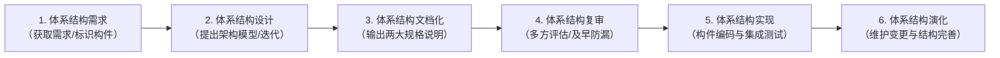
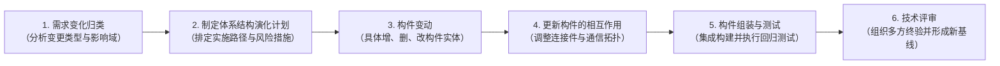
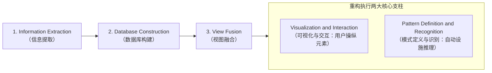
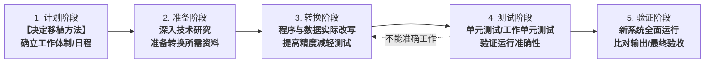
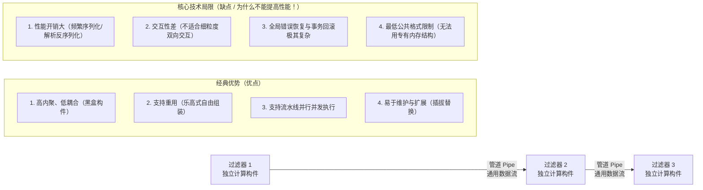
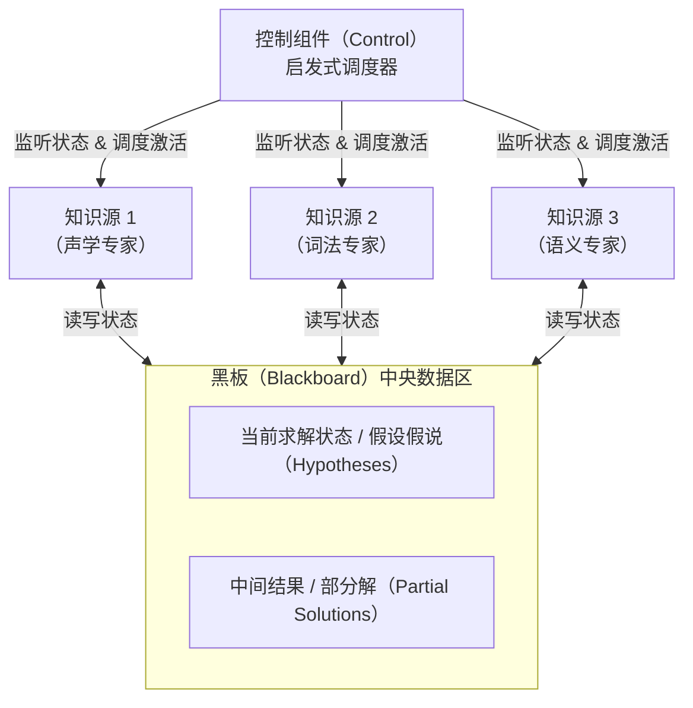
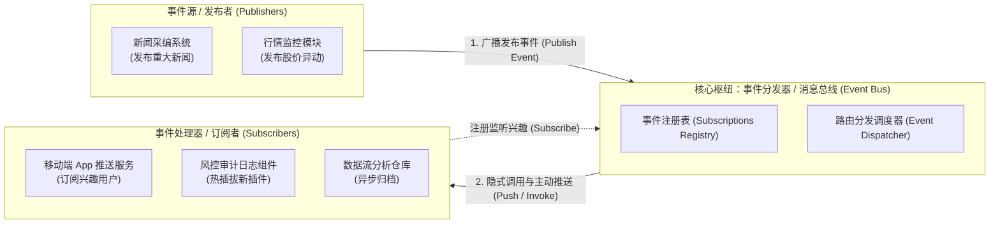
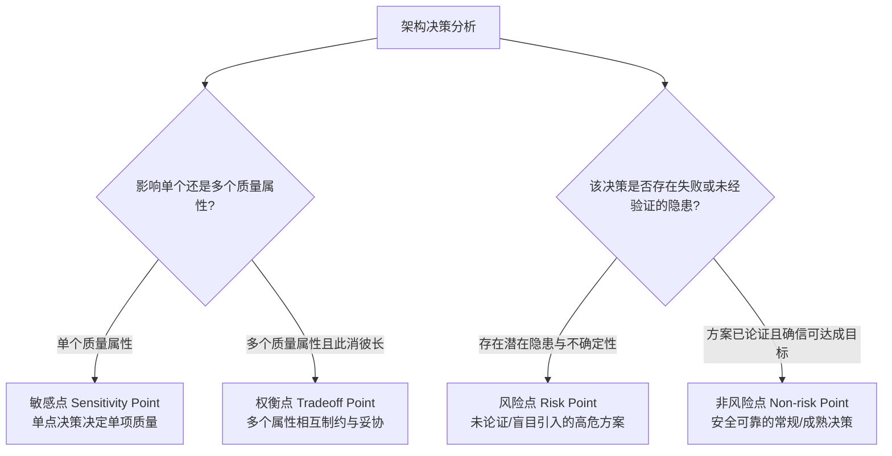
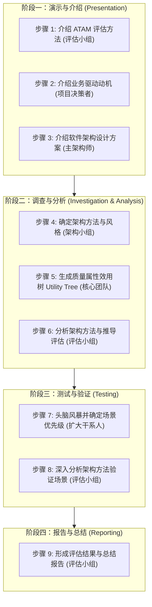
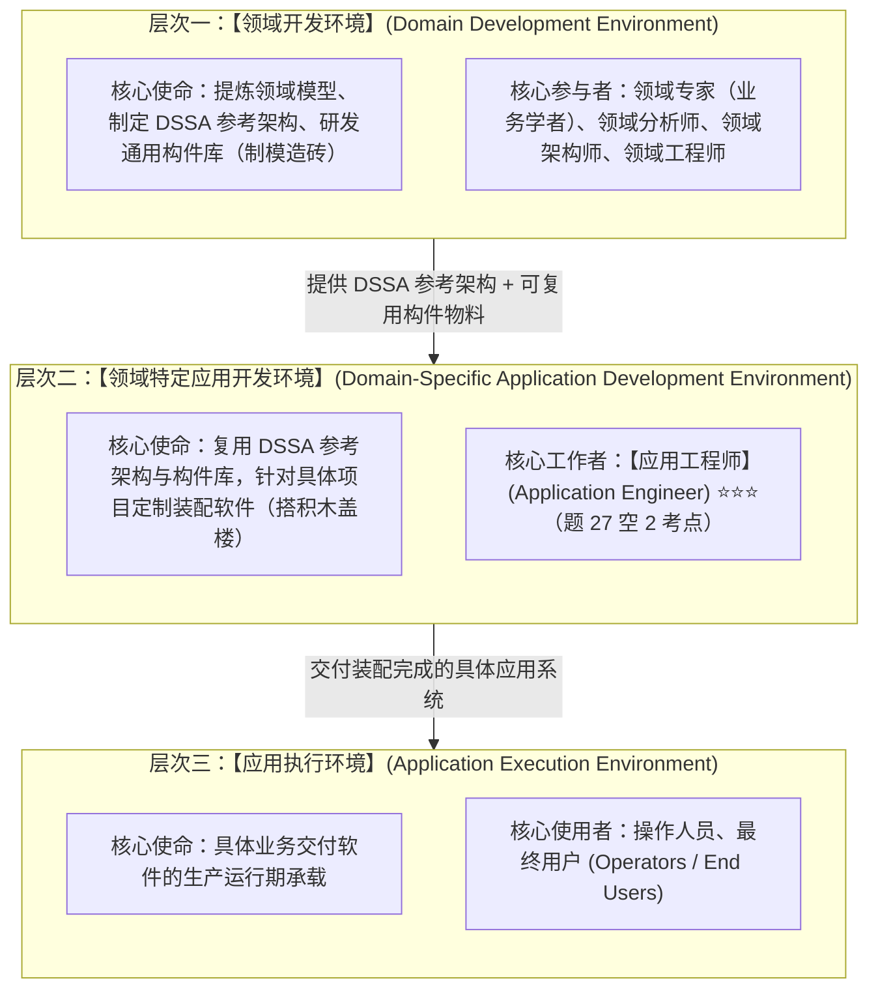

# 第 7 章 系统架构设计基础知识

> 目录骨架依据《系统架构设计师教程（第 2 版）》；按专题汇集概念、例题与辨析。

## 7.1 软件架构概念

### 7.1.1 软件架构的定义

[考查：综合知识（定义内涵、架构三大顶层结构类别体系、专业英语题）]

**一、软件架构的本质内涵（SEI / Bass 经典定义）**

- **系统架构的整体视角**：系统架构是一个系统的表示，包含了功能到软硬件构件的映射、软件架构到硬件架构的映射，以及对这些人机交互组件的关注。系统架构关注于**整个系统，包括硬件、软件和人员（Hardware, Software, and Humans）**。
- **架构结构的多元性**：软件架构并不是单一的静态视图，而是由一组相互关联的“结构（Structures）”或“视图（Views）”组成的。软件架构结构根据其所展示元素的性质，被划分为**三大主要类别（Three Major Categories）**。

**二、SEI 软件架构三大顶层结构类别全景矩阵（Bass / Clements 体系）⭐⭐⭐**

| 顶层结构大类 (Major Categories) | 核心视角与本质定义 | 所展示的元素 (Elements) | 元素间的核心关系 (Relations) | 下辖的典型子结构 (Sub-structures) | 题干判别词与考法特征 |
|---|---|---|---|---|---|
| **1. 模块结构<br>(Module structures)** | **静态代码资产视角**：将决策体现为一组需要被构建或采购的代码或数据单元 | 模块、类、数据包、程序库（编译期的代码或数据单元） | 组成关系（is part of）、调用依赖（uses）、泛化继承（is a） | **分解结构** (Decomposition)<br>**使用结构** (Uses)<br>**分层结构** (Layered)<br>**类结构** (Class / Generalization)<br>**数据模型** (Data model) | `code or data units`<br>`constructed or procured`<br>代码资产、模块分解、类继承 |
| **2. 构件-连接器结构<br>(Component-and-Connector / C&C structures)** | **动态运行时行为视角**：将决策体现为系统如何被结构化为一组具有运行时行为和交互的元素 | 运行时构件（进程、线程、服务、对象、Client/Server）与连接器（管道、RPC、消息总线） | 挂接/通信（attachments）、消息传递、数据流传递 | **进程结构** (Process)<br>**并发结构** (Concurrency)<br>**共享数据结构** (Shared data)<br>**客户端-服务器结构** (Client-server) | `runtime behavior and interactions`<br>进程通信、动态并发、消息流转 |
| **3. 分配结构<br>(Allocation structures)** | **外部环境映射视角**：将决策体现为软件系统如何在其环境中关联到**非软件结构**（如物理硬件、文件系统、网络拓扑、组织团队等） | 软件元素与非软件环境实体（CPU、网络、存储、人员团队） | 分配/映射（allocated to）、部署于（migrates to/hosted on）、负责（assigned to） | **部署结构** (Deployment: 映射到 CPU/网络)<br>**实现结构** (Implementation: 映射到文件目录/配置库)<br>**工作分配结构** (Work assignment: 映射到研发团队) | `relate to non software structures`<br>`CPUs, file systems, networks`<br>`development teams` |

**三、深度设陷排雷点**

1. **宏观顶层大类 vs 细分微观子结构（层级越级陷阱）**：
   - 题干问“软件架构可分为**三大主要类别（three major categories）**”时，选项中只有 **Module structures**、**Component-and-connector structures** 与 **Allocation structures** 属于该层级！
   - **Uses structures（使用结构）**、**Class structures（类结构）** 只是模块结构的下级子结构；**Concurrency structures（并发结构）** 只是 C&C 结构的下级子结构，切勿层级倒错。
2. **“开发团队（development teams）”的架构学归宿**：
   - 架构不仅管技术，还管人与工程落地！**工作分配结构（Work assignment structure）**属于分配结构的重要子结构，负责把软件模块的开发、集成、测试分配给具体的组织团队。
   - 只要题干中出现 `relate to non software structures (CPUs, file systems, networks, development teams, etc.)`，100% 锁定 **Allocation structures（分配结构）**。

**四、审题秒杀口诀**

> **“代码采购看模块，静态资产类与用；”**  
> **“运行交互连构件，进程并发总线通；”**  
> **“映射环境归分配，软硬团队非软件；”**  
> **“宏观大类仅三席，莫把子级充祖宗！”**

### 7.1.2 软件架构设计与生命周期

[考查：综合知识（架构设计驱动力、非功能需求四大分类、专业英语题）]

**一、架构设计的核心驱动：非功能需求（Nonfunctional Requirements）⭐⭐⭐**

- **架构设计定义**：架构设计（Architecture Design）详细规定了系统所采用的总体架构，以及软硬件组件在各个物理设备上的部署与放置（Placement of software and hardware）。
- **架构选型的第一步**：**将非功能需求（Nonfunctional requirements）细化为更加具体的指标规范**（Refine nonfunctional requirements into detailed requirements），据此决定采用二层、三层还是多层架构（Two-tier, three-tier, or n-tier architecture），并完成软件构件在物理节点上的映射分布。
- **功能需求 vs 非功能需求的分工**：
  - **功能需求（Functional Requirements）**：定义业务“做什么”（用例、交互、业务流），决定业务层代码逻辑编写；
  - **非功能需求（Nonfunctional Requirements）**：定义系统“达到什么品质”（吞吐量、并发数、延迟、容灾能力），**直接驱动并决定系统架构风格与底层硬件规格选型**。

**二、Dennis 架构设计四大非功能需求分类体系（专业英语核心高频考点）**

| 需求分类 (Requirement Category) | 核心定义与关切维度 (Focus & Definition) | 核心判别词 (Decisive Keywords) | 典型架构决策映射 |
|---|---|---|---|
| **1. Operational requirements<br>(操作/运行环境需求)** | 规定系统必须在何种软硬件及网络运行环境中运行，以及该环境随时间的变化 | `operating environment(s)`<br>`perform and change over time`<br>`system integration` | 操作系统兼容、移动端/桌面端多端适配、旧系统平滑集成 |
| **2. Performance requirements<br>(性能需求)** | 关注系统运行时的关键量化指标与能力 | `response time`（响应时间）<br>`capacity`（容量/吞吐量）<br>`reliability`（可靠性/可用度） | 负载均衡、读写分离、分布式缓存（Redis）、消息队列削峰 |
| **3. Security requirements<br>(安全需求)** | 保护信息系统免受恶意破坏、未经授权访问和数据丢失的能力 | `protect from disruption and data loss`<br>`intentional act`<br>`access control` | 传输加密（TLS）、统一鉴权、访问控制、容灾冷热备份、安全审计 |
| **4. Cultural & political requirements<br>(文化与政治需求)** | 适应系统所在国家/地区的法律合规、语言习惯与政策规范 | `specific to the countries`<br>`language, currency`<br>`legal regulations` | 国际化（i18n）、多币种结算、等保合规、跨境数据出境合规 |

**三、计算架构三大基础分类与 C/S 多层架构（Two-tier / Three-tier / N-tier）演进体系 ⭐⭐⭐**

0. **架构设计的终极目标（Architecture Design 核心定义，历年英语题 4 考点）**：
   > **“Architecture design is to determine what parts of the application software will be assigned to what hardware.”**  
   > 架构设计的使命是将正在开发的系统主要软件构件识别出来，并**分配/映射到系统将要运行的各种硬件构件上**。

1. **软件四大基本逻辑构件（Basic Software Components，历年英语题 5、6、7 考点）**：
   - **① 数据存储（Data Storage，空 2 选 C）**：文件或数据库物理持久化存储（`require data to be stored and retrieved, small file or large database`）；
   - **② 数据访问逻辑（Data Access Logic，空 3 选 D）**：处理数据存取、检索与更新的逻辑，通常体现为 SQL 查询（`processing required to access data, database queries in SQL`）；
   - **③ 应用业务逻辑（Application Logic，空 4 选 C）**：数据流图、用例与功能性需求中记录的核心业务规则（`logic documented in DFDs, use cases, and functional requirements`）；
   - **④ 表示逻辑（Presentation Logic）**：向用户展示信息并接收用户交互指令（`display of information to user and acceptance of user's commands`）。

2. **系统三大宏观硬件组件（Three Primary Hardware Components，历年英语题 8 考点）⭐⭐⭐**：
   - **Clients（客户端，选 B）**：承载表示逻辑与部分前端业务；
   - **Servers（服务器，选 B）**：承载核心业务逻辑、数据访问与数据存储；
   - **Network（网络，选 B）**：连接客户端与服务器的通信管道与网络基础设施。
   - 🚫 **单机元件负迁移排雷**：架构师眼中的硬件是分布式环境下的客户端、服务器与网络，**绝不是冯·诺依曼计算机的 CPU、内存（memories）与 I/O 硬件**！看到单机硬件直接排除！

3. **三大基础计算架构形态对比（Dennis 体系）**：
   - **基于服务器的架构（Server-based architecture）**：主机-终端模式（Host/Terminal）。表示逻辑、业务逻辑、数据访问和数据存储**全部驻留并运行在中央单台主机上**，客户端仅为无本地处理能力的哑终端。**集中式单体无分层，绝无可能存在所谓的 two-tier / three-tier 多层划分**！
   - **基于客户端的架构（Client-based architecture）**：PC 局域网文件共享模式（如 PC 运行 Access 操作局域网共享盘）。表示、业务和数据访问全在客户端 PC 运行，服务器仅充当简单文件共享磁盘，无法做应用服务切分。
   - **客户端-服务器架构（Client-server architecture / C/S）**：表示逻辑位于客户端，数据逻辑由服务器承载，业务逻辑在两端或中间层灵活切分。**所有的两层（two-tier）、三层（three-tier）与多层（n-tier）架构切分，其理论上位体系 100% 属于 Client-server 架构**！

4. **C/S 多层拓扑演进与选型权衡全景矩阵**：

| 架构形态 (Architecture) | 逻辑构件物理分布 (Component Placement) | 核心优点 (Pros) | 核心局限与权衡代价 (Cons / Trade-offs) |
|---|---|---|---|
| **两层 C/S<br>(Two-tier)** | 客户端承担表示与业务（胖客户端），服务器负责数据存储与访问 | 结构直观、开发调试简单、网络往返次数少 | 客户端依赖重、业务逻辑升级需全量分发更新，客户端越权风险高 |
| **三层 C/S<br>(Three-tier)** | 客户端负责表示；**应用服务器（App Server）独立承载业务逻辑**；数据库服务器负责数据 | 瘦客户端易于分发维护；业务逻辑集中收敛；支持异构客户端；高安全性 | 相比两层增加了网络通信延迟与系统复杂度；应用服务器易成性能单点 |
| **多层 C/S<br>(N-tier)** | 将应用层进一步拆分为 Web 呈现集群、微服务业务层、缓存总线等多层物理节点 | 模块高度解耦；可按服务独立伸缩扩容；容错隔离能力极强 | 网络负载加重；全链路追踪与联调排错难度极高；运维与部署门槛高 |

5. **专业英语审题秒杀口诀**：
   > **“软分给硬是架构（Architecture design 空 1）；”**  
   > **“存数（Data storage 空 2）查数（Data access logic 空 3）跑业务（Application logic 空 4），再加表示（Presentation）共四样；”**  
   > **“硬件莫选 CPU，客户服务连网络（Clients, servers, network 空 5）！”**  
   > **“两层三层与多层，必属 C/S 客户端-服务器（client-server）；”**  
   > **“主机终端单体跑（server-based），文件共享算客端（client-based）。”**

  - 【历年真题综合知识 / 专业英语 5 空大题 题目 4-8】（确定应用软件哪些部分分配到何种硬件是【**A. architecture design**】；四大基本功能第一项存取数据是【**C. data storage**】；第二项 SQL 查询是【**D. data access logic**】；第三项 DFD 和用例记录的是【**C. application logic**】；第四项表示逻辑；系统三大硬件组件是【**B. clients, servers, and network**】）。

**四、Safety（功能安全）与 Security（信息安全）经典学术边界与设陷排雷 ⭐⭐⭐**

1. **核心概念与对抗目标对比**：

| 维度 | Security（信息安全/网络安全） | Safety（功能安全/工业安全） |
|---|---|---|
| **核心关切** | **防范外部人为的“恶意/蓄意行为”（Against Intentional / Malicious Acts）** | **防范内部非故意的“偶发故障/意外事故”（Against Accidental Failures / Hazards）** |
| **保护目标** | 保护软件与信息资产免受破坏、窃取与非法篡改（CIA：机密性、完整性、可用性） | 保护人身生命安全、物理环境与重要装备免受破坏与人员伤亡 |
| **典型考法判别词** | `intentional act`（蓄意行为）、`unauthorized access`（未授权访问）、`disruption and data loss`（业务中断与数据丢失）、`malware/virus` | `accidental failure`（意外故障）、`hazard`（公害/险情）、`fail-safe`（故障安全导向）、`human injury`（人身伤害） |
| **典型应用场景** | 网上银行、电商交易、政务外网、数据库脱敏与传输加密 | 航空航天航电系统、自动驾驶刹车控制、核电站停堆监控、轨道交通联锁 |
| **标准架构机制** | TLS 传输加密、RBAC 细粒度权限模型、国密散列存密、安全审计日志 | 冗余备份（N-Version 编程）、看门狗定时器、故障静默机制、形式化验证 |

2. **高频混淆设陷警示**：
   - **“防止数据丢失（data loss）”不等于数据管理（Data Management）**：数据管理是业务功能层面的增删改查；抵御外部入侵或恶意破坏导致的数据丢失是标准的 **Security requirements**。
   - **中英混淆陷阱**：中文均常译作“安全性”，但英文专业题中出现 `intentional act` 时 **100% 锁定 Security**，严禁误选 Safety。

3. **审题秒杀口诀**：
   > **“架构选型看品质，非功需求驱动之（空 1 选 Nonfunctional B）；”**  
   > **“防蓄意（intentional act）叫 Security（空 5 选 B），防事故（accident/hazard）叫 Safety；”**  
   > **“数据丢失归安防，切莫望文猜管数。”**

  - 【历年真题综合知识 / 专业英语 5 空大题 题目 16-20】（架构设计第一步是将【**B. nonfunctional requirements**】细化为更详细需求以选择架构与设备构件布局；在【**D. client-server architecture**】中还需要决定采用二层、三层还是 N 层；四大非功能需求中规定运行环境的是【**A. Operational requirements**】；聚焦响应时间、容量与可靠性的是【**C. Performance requirements**】；防御蓄意破坏（intentional act）与数据丢失的是【**B. Security requirements**】）。

#### 五、软件架构生命周期各阶段核心关切与需求模型转换（题库 7.1 节题目 26）⭐⭐⭐

[考查：综合知识（架构生命周期各阶段核心关切、需求模型向架构模型转换、双向可追踪性 Traceability 机制）]

1. **需求模型向软件架构模型转换的两大核心关注点**：
   - **问题空间向解空间的跨越**：
     - **需求模型**（用例图、用例规约、DFD、业务领域模型）表达的是客户视角的**问题空间（Problem Space）**；
     - **软件架构模型**（构件、连接件、拓扑配置、接口契约）表达的是工程实现视角的**解空间（Solution Space）**。
   - **核心关注点 1：如何根据需求模型构建软件架构模型**：解决从无到有的抽象与映射机制，将业务职责划分为架构构件，并确定构件间的连接方式；
   - **核心关注点 2：如何保证模型转换的可追踪性（Traceability）**：建立需求项与架构构件之间的双向追踪矩阵（Traceability Matrix）：
     - **正向追溯（需求 $\to$ 构件）**：确保每一项功能和质量需求均有具体的架构构件落地承载，**严防需求遗漏**；
     - **反向追溯（构件 $\to$ 需求）**：证明每一个架构构件均有明确的需求支撑来源，**杜绝无源镀金（Gold-plating）**；
     - **变更影响分析（Impact Analysis）**：当客户需求发生变更时，借助追踪矩阵能够精准定位受影响的构件与接口，极大降低演化维护风险。

2. **软件架构生命周期各阶段核心关切全景对号矩阵**：

| 生命周期阶段 | 阶段核心使命 | 官方教材法定核心关注点 ⭐⭐⭐ | 典型方法/工具/活动 | 考场高频混淆项与排雷 |
| :--- | :--- | :--- | :--- | :--- |
| **① 需求阶段** | 问题空间跨越至解空间，奠定架构雏形 | **1. 如何根据需求模型构建软件架构模型**<br>**2. 如何保证模型转换的可追踪性（Traceability）** | 需求分析、用例建模、质量需求场景化、建立需求跟踪矩阵 | 🚫 **排雷**：！分析质量属性属于评估阶段；需求转换的关键是**构建模型与保证可追踪性**！ |
| **② 设计阶段** | 详细规约系统组成，完成架构风格选型与文档化 | **如何描述软件架构模型** | 架构风格模式选择、ADL（架构描述语言）、4+1 视图、UML 构件图 | 描述模型属于设计/文档化阶段，模型转换完成后才进行形式化描述。 |
| **③ 分析与评估阶段** | 在代码实现前验证架构方案，量化权衡冲突 | **如何分析软件架构质量属性** | SAAM、ATAM、CBAM、效用树、敏感点与权衡点识别 | 属于架构评估阶段。质量属性在需求阶段是输入约束，在此阶段才是被分析与权衡的对象。 |
| **④ 演化与实现/部署阶段** | 软硬件构件在物理环境中的落地映射 | **如何选择合适的部署方案** | 软硬件配置、容器化编排、集群拓扑放置、网络分区规划 | 属于部署阶段的工作，切勿与前期模型转换混淆。 |

3. **审题秒杀口诀**：
   > **“需求跨界建模型，双向追踪链条清（转换选 C）；”**  
   > **“描述模型归设计，质量分析在评估（A 属设计，B 属评估）；”**  
   > **“部署方案找机器，阶段对号莫混淆（D 属部署）！”**

  - 【题库章节练习 / 第七章第一节 题目 26】（在软件架构设计的需求阶段，关于需求模型向软件架构模型转换的主要关注点是【**C. 如何构建软件架构模型和保证可追踪性**】；A 选项描述架构模型属于设计阶段，B 选项分析质量属性属于评估阶段，D 选项选择部署方案属于部署阶段）。

#### 六、软件架构设计活动核心过程与构件职责边界（题库 7.1 节题目 31）⭐⭐⭐

[考查：综合知识（软件架构设计三大核心活动、构件职责边界“只设计不实现”、外部独立评审原则）]

1. **软件架构设计的核心活动定义**：
   - 软件架构设计包括**提出架构模型**、**产生架构设计**和**进行设计评审**等活动，是一个**迭代的过程**。

2. **三大核心活动的关键规约与排雷准则**：
   - **① 提出架构模型（初期选型）**：在建立软件架构的初期，一般需要选择一个合适的架构风格（如分层风格、微服务风格、事件驱动风格等），作为系统总体骨架的基础；
   - **② 产生架构设计（构件映射与设计）**：将架构分析阶段已标识的构件映射到架构中，分析这些构件之间的交互关系，**将已标识构件集成到软件架构中，设计这些构件（的高层规格、接口与通信交互协议），但【不予以实现】**；
     - 🚫 **生命周期越界高频陷阱**：构件的代码编写与具体业务逻辑实现属于后续的**详细设计与编码实现阶段**，绝不是架构设计活动的工作！
   - **③ 进行设计评审（独立外部评审）**：一旦得到了详细的软件架构设计，需要**邀请独立于系统开发的外部人员对系统进行评审**；
     - 🚫 **评审主体认知盲区排雷**：初学者易直觉误以为“外部人员不熟悉系统，评审应由内部核心开发人员主导”。在软件架构评估标准（如 ATAM、SAAM 等方法）与高可靠工程规范中，**评审团队必须保持独立性与利益回避**，以跳出团队自身思维定势与主观偏见，确保评审结论客观公正。

3. **考场避坑秒杀口诀**：
   > **“架构设计三步走，模型设计与评审；”**  
   > **“初期首要把风格，构件映射定协议；”**  
   > **“只管规约不实现（排除 C 选项实现构件），越界编码莫轻信；”**  
   > **“评审必须请外援（D 选项独立外部人员正确），利益回避保客观！”**

  - 【题库章节练习 / 第七章第一节 题目 31】（软件架构设计活动描述错误的是【**C. 软件架构设计活动将已标识构件集成到软件架构中，设计并实现这些构件**】；A 选项初期选择合适架构风格，B 选项将分析阶段构件映射到架构并分析关系，D 选项详细设计后邀请独立于系统开发的外部人员对系统进行评审均正确）。

#### 七、软件架构实现阶段三大主要研究方向与技术活动（题库 7.1 节题目 38）⭐⭐⭐

[考查：综合知识（架构实现阶段三大法定研究方向、技术活动映射、排除设计阶段“多视图表示”干扰项）]

1. **软件架构实现阶段的核心定性**：
   - 软件架构实现阶段（Architecture Implementation Phase）是将高层抽象的软件架构模型转化为具体可执行软件代码并投入运行的过程。
   - 其核心目标在于：**缩小概念鸿沟（Semantic Gap）、保持实现代码与架构设计的一致性（Conformance），防止架构漂移（Architecture Drift）与侵蚀（Architecture Erosion）**。

2. **三大主要研究方向与技术活动全景对号矩阵**：

| 研究方向 | 核心内涵与技术活动 | 典型解决手段与代表技术 | 软考设陷排雷点 |
| :--- | :--- | :--- | :--- |
| **① 基于软件架构的开发过程支持** | 研究架构在整个开发过程中的指导与协调作用，为团队协作和工程管理提供基础设施支撑。 | **项目组织结构设计**、**架构驱动的配置管理（SCM）**、开发工具链与持续集成流水线集成。 | 侧重于团队与过程支撑，切勿与技术实现本身混淆。 |
| **② 从软件架构向实现过渡的途径** | 解决从高层架构模型向底层具体代码落地的映射机制，搭起设计与代码之间的桥梁。 | **将程序设计语言元素引入软件架构阶段**、**模型映射（Model Mapping）**、设计模式应用、自动/半自动代码生成（MDD/MDA）。 | 核心是“模型转代码”，关注编程语言元素与架构映射。 |
| **③ 基于软件架构的测试技术** | 以软件架构为基准开展系统级验证，检验系统实现是否违背既定架构约束。 | **基于架构的集成测试用例生成**、**架构一致性测试（Conformance Testing）**、接口契约校验。 | 侧重于架构级测试与一致性检验，防范架构漂移。 |
| 🚫 **设计阶段排除项：多视图表示** | Kruchten 4+1 视图模型、SEI 视图体系、UML 架构建模等。 | 用不同维度的视图向各类利益相关者清晰表达架构设计方案。 | **属于架构设计与文档化阶段**的研究内容，绝对不属于实现阶段！反向设问直接秒杀（题目 38 选 D）。 |

3. **考场避坑秒杀口诀**：
   > **“架构实现三方向，过程过渡与测试；”**  
   > **“组织配置保过程，语言映射架桥梁；”**  
   > **“一致检验靠测试，防漂防蚀守底线；”**  
   > **“多重视图归设计（D 选项多视图表示属于设计阶段），反向设问秒杀 D！”**

  - 【题库章节练习 / 第七章第一节 题目 38】（在软件架构的实现阶段研究中，不属于主要研究方向的是【**D. 软件架构的多视图表示**】；A 选项基于软件架构的开发过程支持、B 选项从软件架构向实现过渡的途径、C 选项基于软件架构的测试技术均属于实现阶段的三大主要研究方向）。

#### 八、软件架构生命周期各阶段架构关注度分布与核心焦点（题库 7.1 节题目 48）⭐⭐⭐

[考查：综合知识（架构全生命周期关注度分布、设计与实现双重心、各阶段核心关注点对号）]

1. **各阶段架构关注度分布的核心结论**：
   - 软件架构贯穿于软件的整个生命周期，但在不同阶段对软件架构的关注力度并不相同。
   - **在【设计与实现】阶段，对软件架构的关注最多，工作量最大，也最重要**。

2. **生命周期四大阶段架构关注焦点对号全景表**：

| 生命周期阶段 | 官方教材法定核心关注焦点 ⭐⭐⭐ | 典型工程任务与产物 | 架构关注力度定位 |
| :--- | :--- | :--- | :--- |
| **① 需求分析阶段** | **主要关注问题域（Problem Domain）** | 识别业务用例、质量需求场景化、提炼非功能约束 | 关注度适中（输入准备期） |
| **② 设计阶段** | **主要将需求转换为软件架构模型** | 架构风格选择、ADL 描述、视图建模（4+1 视图） | **关注力度最大、最重要 ⭐⭐⭐** |
| **③ 软件实现阶段** | **主要关注将架构设计转换为实际的代码** | 构件映射、框架装配、代码生成、架构一致性测试 | **关注力度最大、工作最多 ⭐⭐⭐** |
| **④ 软件部署阶段** | **主要通过组装软件组件提高系统实现与交付效率** | 拓扑放置、中间件调优、容器编排、配置管理 | 关注度次之（运行交付期） |

3. **考场避坑秒杀口诀**：
   > **“架构贯穿全周期，关注力度各不同；”**  
   > **“需求分析看问题域，设计转模型，实现转代码；”**  
   > **“部署组装提效率，设计实现挑大梁（正解 B 设计与实现）；”**  
   > **“莫因需求先入主，设计落地关注高！”**

  - 【题库章节练习 / 第七章第一节 题目 48】（在不同阶段对软件架构关注力度不同，对软件架构关注最多的阶段是【**B. 设计与实现**】）。

### 7.1.3 软件架构的重要性与架构权衡原则（题库 7.1 节题目 43、46、47）⭐⭐⭐

[考查：综合知识（架构的核心价值、质量属性驱动、权衡妥协哲学、不存在最佳架构、架构重要性 6 大内涵 vs 需求工程边界）]

1. **软件架构的战略定位与核心使命**：
   - 软件架构是**降低成本、改进质量、按时和按需交付产品的关键因素**。
   - 软件架构设计需要满足系统的**质量属性（Quality Attributes）**，如性能、安全性和可修改性等，并能够指导设计人员和实现人员的工作。

2. **功能需求 vs 质量属性的架构学分工全景矩阵**：

| 维度 | 功能需求 (Functional Requirements) | 质量属性 (Quality Attributes / 非功能需求) |
| :--- | :--- | :--- |
| **关切核心** | 系统**“做什么”（What to do）** | 系统**“做得有多好”（How well to do）** |
| **表现形式** | 业务用例（Use Cases）、业务流程、数据流（DFD）、交互操作 | 性能（并发/延迟）、安全性、可用性、可修改性、可测试性 |
| **架构学地位** | 是软件系统存在的**基本前提与业务基础** | **直接驱动并塑造软件架构**（驱动架构风格选择、构件切分与技术选型） |
| **考场排雷** | 🚫 只要功能完整，质量不会自动满足；功能决定详细业务代码，质量属性决定架构顶层骨架！ | 题干出现“……，如性能、安全性和可修改性”时，**必选质量属性（上位概念）**，排除功能需求！ |

3. **质量属性分类体系（开发期 vs 运行期）**：
   - **开发期（设计/维护期）质量属性**：面向开发人员与架构师，关注维护演化效率。典型包括：**可修改性（Modifiability）**、**可测试性（Testability）**、**可重用性（Reusability）**、**可理解性**、**可集成性**。
   - **运行期质量属性**：面向最终用户与运维生产环境，关注运行品质。典型包括：**性能（Performance）**、**安全性（Security）**、**可用性（Availability）**、**互操作性**、**易用性**。

4. **架构设计的核心哲学：满意原则与权衡折中（Trade-off）（题库 7.1 节题目 46）**：
   - **不存在“最佳架构”（No Best Architecture）**：软件工程中不存在放之四海皆准的理论最优架构。质量属性之间往往相互制约，架构设计是在特定资源、成本与进度约束下的**折中与权衡（Trade-off）**；
   - **候选架构与逐步求精**：在设计架构之初，会根据需求确定**多个候选架构**，并从中选择一个**较优的架构**，随着软件开发对架构进行微调以达到最佳实用效果；
   - **指导设计与实现**：软件架构定义了构件边界与交互接口规约，自上而下**指导详细设计人员和实现人员（编码人员）的工作**；
   - **支持管理与规划**：软件架构确定了组件之间的依赖关系，直接支持项目的任务分解（WBS）、人员组织与进度计划管理活动。

5. **软件架构设计的 6 大法定核心重要性 vs 需求工程边界（题库 7.1 节题目 47）⭐⭐⭐**：
   - 《系统架构设计师教程（第 2 版）》明文界定了软件架构设计的 **6 大核心价值**：
     1. **满足系统的性能、可维护性等质量属性**：品质主要由架构顶层骨架决定，代码局部优化作用有限；
     2. **使不同的利益相关人（Stakeholders）达成一致的目标**：作为高层抽象蓝图，屏蔽代码细节，成为投资人、客户、业务人员与工程师达成共识的统一沟通基准；
     3. **体现系统最早的一组关键设计决策**：代表了最早且最重要的系统设计决策，在全生命周期中推翻和修改架构决策的代价最高；
     4. **支持项目计划和项目管理等活动**：明确构件依赖与边界，直接支持 WBS 任务分解、团队分工、进度排期与成本估算；
     5. **有效管理系统复杂性**：通过抽象、模块化与分层解耦，控制大型软件的认知与演化负担；
     6. **形成可复用、可转移的组织级资产**：构建软件产品线核心资产库，支持后续项目的低成本快速复用。
   - 🚫 **需求工程专属边界排雷（题目 47 命题陷阱）**：
     - **“捕获并了解用户需求”专属于需求工程（需求获取与分析）阶段**；
     - **架构设计的给出必须建立在需求明确的基础上**！架构解决的是“如何按结构实现需求”，它既不能替代需求获取，更不能用于反向捕获用户需求！

6. **考场避坑秒杀口诀**：
   > **“成本质量按需交，架构抓总关键素；”**  
   > **“功能为基定做什么，质量塑骨（题目 43 选质量属性）定做得好；”**  
   > **“架构永远无最佳（题目 46 排除 A 最佳架构），权衡折中选较优；”**  
   > **“需求负责抓诉求，架构接单定骨架；”**  
   > **“品质共识管计划（题目 47 正品项），反向捕获必是坑（题目 47 选 B 错误项）；”**  
   > **“审题先圈【错误项】，四项读全破定势！”**

  - 【题库章节练习 / 第七章第一节 题目 43】（软件架构设计需要满足系统的【**C. 质量属性**】，如性能、安全性和可修改性等）。
  - 【题库章节练习 / 第七章第一节 题目 46】（关于软件架构描述错误的是【**A. 根据用户需求，能够确定一个最佳的软件架构，指导整个软件的开发过程**】；B 满足质量属性、C 确定依赖支持计划、D 指导设计和实现人员工作均正确）。
  - 【题库章节练习 / 第七章第一节 题目 47】（关于软件架构重要性的叙述中，错误的是【**B. 良好的架构设计能够更好地捕获并了解用户需求**】；A 满足系统品质、C 利益相关者达成一致目标、D 支持项目计划与管理活动均正确）。

### 7.1.4 基于构件的软件架构与构件组装失配问题（题库 7.1 节题目 1）⭐⭐⭐

[考查：综合知识（基于构件的软件工程 CBSE、构件组装失配三大标准分类、细分假设冲突全景对号、排除人为操作干扰项）]

在《系统架构设计师教程（第 2 版）》第 7 章 **7.1 节 软件架构概述** 中，构件化软件开发（CBSE）通过复用预先开发的构件来构建大型软件系统。在**构件组装（Component Assembly）**阶段，由于构件往往由异构团队、第三方组织在不同时间独立开发，各部件在设计时往往基于不同的假设，从而必然引发**失配（Mismatch）**问题。

#### 1. 构件组装失配的本质根源：假设存在冲突（Assumption Conflict）⭐⭐⭐

- **核心定性**：架构层面的构件组装失配，**绝非**运行期人为误操作（如“操作不当”），而是系统各构件在环境、协议、控制流与数据流规约上的**“假设不一致”**。
- **失配解决两步走**：
  - ① **检测出失配问题**（通过架构分析、接口规约匹配检验）；
  - ② **消除失配问题**（通过适配器模式 Adapter、包装器 Wrapper、协议中介或粘合代码消除冲突）。

#### 2. 构件组装失配三大法定分类与细分假设冲突矩阵 ⭐⭐⭐

| 失配大类 | 关注核心视角 | 官方细分假设冲突类别 ⭐⭐⭐ | 典型工程实战场景与考场对号 | 考场易混与排雷点 |
| :--- | :--- | :--- | :--- | :--- |
| **① 由构件引起的失配**<br>*(Component-induced)* | **构件自身内在属性** | **1. 基础设施假设冲突**<br>*(Infrastructure)*<br><br>**2. 控制模型假设冲突**<br>*(Control Model)*<br><br>**3. 数据模型假设冲突**<br>*(Data Model)* | ① **操作系统/底层平台不符**：构件假设运行在专用 Linux 驱动环境，宿主系统却是 Windows Server；<br>② **执行控制机制不符**：构件内部假设单线程顺序执行，宿主系统却采用多线程并发抢占调度；<br>③ **内部存储模型不符**：构件假设输入数据采用二叉树存储，系统传入的却是哈希表。 | 🚫 **排雷**：控制模型是构件内部的执行流机制（单/多线程），不要因看到“调度”就误当成连接子！底层平台环境是**基础设施**！ |
| **② 由连接子引起的失配**<br>*(Connector-induced)* | **构件间的通信中介与管道** | **1. 交互协议假设冲突**<br>*(Interaction Protocol)*<br><br>**2. 连接子数据模型假设冲突**<br>*(Connector Data Model)* | ① **通信协议不兼容**：构件 A 要求通过长连接 WebSocket 交互，API 网关通道却仅支持 HTTP/1.1 短连接；构件要求同步阻塞 RPC，信道仅提供异步 Pub/Sub 消息；<br>② **传输报文编码冲突**：传输层采用二进制 Protobuf 协议，系统消息总线仅支持 SOAP/XML。 | 🚫 **排雷**：连接子专管“构件之间怎么通信与报文长什么样”，凡是通信协议（RPC/MQ/HTTP）与网络传输序列化格式冲突，必归连接子！ |
| **③ 全局体系结构假设冲突**<br>*(Global Architecture)* | **系统顶层拓扑与宏观规约** | **全局调度机制与拓扑假设冲突** | ① **协调机制冲突**：构件假设系统具有全局集中式的事务协调器（如 2PC），而全局架构采用去中心化的 Saga 分布式补偿机制；<br>② **资源争用冲突**：两个构件均假设自己独占系统的全局控制中心。 | 侧重于宏观全局拓扑、全局中心化 vs 去中心化的架构范式冲突。 |
| 🚫 **命题人臆造排除项** | **人为运维与运行故障** | **“由构件操作不当引起的失配”** | 属于系统投产后的人为误操作或管理失误，**绝对不属于**构件组装阶段的失配问题！ | ⚠️ **反向设问秒杀正解（题目 1 正解 D）**！看到“操作不当”闭眼排除！ |

#### 3. 考场避坑与审题秒杀铁律 ⭐⭐⭐

> [!IMPORTANT]
> **构件组装失配秒杀口诀**：
> - **“失配全因假设冲，构件连接全局构（三大官方标准类）；”**  
> - **“底层系统是设施，内部线程控模型（构件失配）；”**  
> - **“通信协议两端连，报文序列看信道（连接子失配）；”**  
> - **“人为操作莫掺和，反向不包秒杀 D（排除操作不当）！”**  
> - **“四项读完全局审，莫凭首项 A 乱定！”**

  - 【题库章节练习 / 第七章第一节 题目 1】（在构件组装阶段失配问题主要不包括【**D. 由构件操作不当引起的失配**】；主要包括由构件引起的失配、由连接子引起的失配、由于系统成分对全局体系结构的假设存在冲突引起的失配）。

### 7.1.5 遗留系统（Legacy System）的演化策略与四象限评价矩阵（题库 7.1 节题目 23）⭐⭐⭐

[考查：综合知识（遗留系统定义、技术水平/业务价值双维度评价、四大演化策略全景对号、继承策略完全兼容底线、集成策略封装原则）]

在《系统架构设计师教程（第 2 版）》第 7 章 **7.1 节 软件架构概述** 中，遗留系统（Legacy System）的处置与现代化演进是企业架构治理的核心环节。

#### 1. 遗留系统的本质特征与双维度评价矩阵 ⭐⭐⭐

- **遗留系统的官方定义**：遗留系统是指任何基本上**不能进行修改以满足新变化了的业务需求**，但仍在支撑当前企业核心业务日常运行的信息系统。
- **评价两大核心维度**：
  1. **技术水平（Technology Level）**：系统的技术架构先进性、组件耦合度、文档完备性、技术支持与维护成本；
  2. **业务价值（Business Value）**：系统承载业务对企业核心运营的支撑程度、业务中断的容忍度、创造的商业利润。

```mermaid
quadrantChart
    title 遗留系统四象限评价与四大演化策略全景矩阵
    x-axis 低技术水平 (Low Tech) --> 高技术水平 (High Tech)
    y-axis 低业务价值 (Low Value) --> 高业务价值 (High Value)
    quadrant-1 改造策略 (Reengineering)<br>演化最佳策略 / 系统再工程
    quadrant-2 继承策略 (Inheritance)<br>必须【完全兼容】功能与数据模型
    quadrant-3 淘汰策略 (Retirement)<br>全面下线 / COTS商用软件替换
    quadrant-4 集成策略 (Integration)<br>功能代码不变 / API与中间件包装
```

#### 2. 四大演化策略核心规范与考场排雷矩阵 ⭐⭐⭐

| 象限与策略 | 维度特征 | 核心演化宗旨与工程行动 | 官方原著法定执行底线 ⭐⭐⭐ | 考场易错设陷排雷 |
| :--- | :---: | :--- | :--- | :--- |
| **第一象限<br>改造策略**<br>*(Reengineering)* | **高技术<br>高价值** | **遗留系统演化的最佳策略**。对系统进行全面技术重塑与现代化升级。 | 采用**系统再工程（Reengineering）**，包括架构重构、微服务拆分、**将旧数据模型向新数据模型转化**。 | ⚠️ 属于高水平高价值的最佳路径，涉及数据模型主动转化与重塑，切莫与继承策略混淆！ |
| **第二象限<br>继承策略**<br>*(Inheritance)* | **低技术<br>高价值** | **高价值业务平稳接管**。系统技术虽然老旧脆弱，但业务每分每秒依赖它，演化风险极高。 | **在开发新系统时，必须【完全兼容】遗留系统的功能模型和数据模型**。 | 🚫 **核心排雷（题目 23 考点）**：新系统必须 100% 完整继承原数据模型与业务规则，**严禁破坏旧模型**！绝不能脑补成“将旧数据模型向新数据模型转化”！ |
| **第三象限<br>淘汰策略**<br>*(Retirement)* | **低技术<br>低价值** | **低效资产彻底出清**。系统既无商业价值，技术又陈旧不可维护，无需做历史包袱兼容。 | 直接全面下线淘汰；若部分基础功能仍需保留，可直接采购成熟商用现货（COTS）软件替换。 | 考查是否需要花费昂贵成本做兼容演化——淘汰策略完全无需向后兼容！ |
| **第四象限<br>集成策略**<br>*(Integration)* | **高技术<br>低价值** | **优质技术资产再利用**。系统技术架构优良、运行极其稳定，但与当前核心主营业务无强相关。 | **系统本身的功能和代码保持不变**，通过封装标准 API 接口、Web Service 或中间件供外部系统按需调用。 | 🚫 **核心排雷**：切莫盲目重构（过度开发）或草率下线（浪费资产），最经济合规的方式是“原样保留代码 + 封装接口集成”。 |

#### 3. 考场避坑排雷与秒杀口诀 ⭐⭐⭐

> [!IMPORTANT]
> **遗留系统演化策略秒杀口诀**：
> - **“技术不高价值高，接班必选【继承】跑；”**
> - **“功能数据全兼容（正解 C 完全兼容），莫转模型惹心跳（排除 B 转化模型）；”**
> - **“高高在上做【改造】，演化最佳再工程；”**
> - **“低低在下全【淘汰】，商用采购替换掉；”**
> - **“技术尚可价值低，包装【集成】连起来！”**

  - 【题库章节练习 / 第七章第一节 题目 23】（具有低水平、高价值特点的系统适合用【**继承策略**】演化；实施该策略时，应【**C. 完全兼容遗留系统的功能模型和数据模型**】）。

## 7.2 基于架构的软件开发方法

### 7.2.1 体系结构的设计方法概述（ABSD 方法的三大理论与工程基础·题库 7.2 节题目 16、42）⭐⭐⭐

[考查：综合知识（ABSD 方法本质、三大顶层理论与工程基础、与子过程活动/驱动机制的本质区别、概念层级偷换排雷）]

1. **ABSD 方法的核心理念与理论定位**：
   - ABSD（Architecture-Based Software Development，基于体系结构的软件开发）是一种**以体系结构为中心、业务/质量需求驱动**的现代软件工程方法。
   - 它视软件开发为一个不断迭代和演化的过程，早期建立高层体系结构骨架，随后通过复审与实现逐步求精。

2. **ABSD 方法的“三大基础”（Three Foundations）全景对号矩阵 ⭐⭐⭐**：

| 三大基础要素 | 核心职责与工程内涵 | 解决的核心问题 | 考场设陷与避坑排雷 |
| :--- | :--- | :--- | :--- |
| **① 功能分解<br>(Functional Decomposition)** | 官方教材原文：**“功能的分解，使用已有的基于模块的内聚和耦合技术”**。<br>用来**确定系统必须执行的功能**，并将系统功能**自顶向下分解为具体的功能构件（Components）**。 | 功能需求建模与系统功能边界划分 | 属于三大基础之一！负责将业务职责切分为架构单元。<br>🚫 **核心排雷（题目 42 易错点）**：绝不能因看到“基于模块的内聚和耦合技术”这一传统模块化术语就误以为是面向过程旧技术而将其排除！原著白纸黑字将其列为第 1 基础！ |
| **② 体系结构风格选择<br>(Architectural Style Selection)** | 官方教材原文：**“通过选择架构风格来实现质量和业务需求”**。<br>通过选用匹配的经典体系结构风格，**来实现系统的宏观质量和商业需求**。 | 宏观架构骨架约束与非功能质量属性承载 | 属于三大基础之一！宏观架构模式支撑质量属性达成。 |
| **③ 软件模板的使用<br>(Use of Software Templates)** | 官方教材原文：**“软件模板的使用，软件模板利用了一些软件系统的结构”**。<br>定义可以**复用的结构和构件实现规范**，利用已有的成熟软件模板来**具体实现质量和商业需求**。 | 微观构件实现落地与资产复用规范 | 属于三大基础之一！<br>🚫 **核心排雷（题目 16 易错点）**：容易主观误以为“软件模板”只是低级编码工具而排除它；原著明确将其列为三大基础之一！ |
| 🚫 **子过程活动排除项：需求获取** | 属于“体系结构需求”子过程内部的某个具体工作环节，或者通用需求工程活动。 | 获取原始用户需求与业务背景 | **反向设问直接秒杀（题目 16 选 D）**！需求获取是子过程中的活动，绝不是顶层三大方法学基础！ |
| 🚫 **顶层机制排除项：组合驱动架构** | 官方教材原文：**“强调由业务、质量和功能需求的组合驱动架构设计”**。<br>属于 ABSD 方法的**基本定义与顶层驱动机制（Driving Mechanism）**。 | 顶层驱动引擎与架构设计指导哲学 | **反向设问直接秒杀（题目 42 选 D）**！命题人通过概念层级偷换，将其混入“三大基础”选项设陷！驱动机制 $\neq$ 理论与工程基础！ |

3. **考场避坑秒杀口诀**：
   > **“ABSD 筑三基石，分解风格加模板；”**  
   > **“功能分解借内聚（第 1 基础借模块内聚耦合技术），莫疑传统是老款；”**  
   > **“风格选择宏承质，模板利用系统构（第 3 基础利用软件系统结构）；”**  
   > **“组合驱动是机制（排除 D 组合驱动架构），需求获取是子环（排除 D 需求获取）；”**  
   > **“审清设问抓内鬼，基础机制分两端！”**

  - 【题库章节练习 / 第七章第二节 题目 16】（在基于架构的软件开发（ABSD）方法中，不属于 ABSD 方法的三个基础之一的是【**D. 需求获取**】；ABSD 方法的三大基础是：功能分解、体系结构风格选择和软件模板使用）。
  - 【题库章节练习 / 第七章第二节 题目 42】（下面不属于 ABSD 方法的三个基础的是【**D. 强调由业务、质量和功能需求的组合驱动架构设计**】；ABSD 的三大基础官方原著法定表述为：① 功能的分解，使用已有的基于模块的内聚和耦合技术；② 通过选择架构风格来实现质量和业务需求；③ 软件模板的使用，软件模板利用了一些软件系统的结构）。

4. **体系结构风格选择深入：C2 体系结构风格拓扑规则与消息机制（题库 7.2 节题目 23）⭐⭐⭐**：
   - **风格起源与本质**：C2（Component-and-Connector 2，或 Chiron-2）是由加州大学欧文分校提出的一种基于构件和连接件、基于异步消息通知的层次化软件体系结构风格。最初用于 GUI 界面系统，后广泛应用于分布式反应式系统。
   - **四大严密拓扑组织规则（机械对仗铁律）**：
     1. **构件与连接件均具备一个顶部（Top）和一个底部（Bottom）**；
     2. **构件与构件之间绝不允许直接连接**（两个业务构件必须通过连接件进行中介解耦）；
     3. **连接件之间可以直接连接**，但连接时必须严格遵循“方向对仗”——**由其中一个连接件的底部，连接到另一个连接件的顶部**；
     4. **构件与连接件交互规范**：
        - 构件的**顶部**应连接到连接件的**底部**；
        - 构件的**底部**应连接到连接件的**顶部**。
   - **消息传递机制与流向契约**：
     - **向下发送请求（Request）**：构件通过其“底部”向下发送请求，请求位于其下方的构件执行服务；
     - **向上发送通知（Notification）**：构件内部状态改变时，通过其“顶部”向上广播通知，通知位于其上方的构件；
     - **基底无关性（Substrate Independence）**：构件对其底层基底完全无知，上层不依赖下层具体实现，支持任意拔插替换。
   - **高频混淆对比：C2 风格 vs 传统分层系统**：

| 维度 | C2 体系结构风格 ⭐⭐⭐ | 传统分层系统（Layered System） |
| :--- | :--- | :--- |
| **连接机制** | **构件之间绝不直连**，必须通过显式连接件中介 | 构件通常通过**直接的接口/函数调用**进行交互 |
| **连接件地位** | 独立的显式拓扑实体，具有明确的 Top/Bottom 端口 | 通常无显式连接件实体，依靠 API 协议或运行时环境调度 |
| **拓扑规则** | **连接件底接顶，构件顶接连接底，构件底接连接顶** | 仅按层级高低依赖，无顶/底端口方向对齐规则 |
| **核心特性** | 基于事件消息、异步解耦、**基底无关性** | 自顶向下依赖、通常为同步阻塞调用 |

   - **经典体系结构风格决定性判据速查**：
     - **C2 风格**：`构件和连接件都有一个顶部和一个底部`、`构件间不允许直接连接`、`连接件底接顶`；
     - **管道-过滤器**：`数据流驱动`、`过滤器转换`、`管道无状态单向传输`；
     - **事件驱动 / 隐式调用**：`发布-订阅`、`事件广播`、`触发而非显式调用`；
     - **黑板系统**：`知识源`、`黑板中央共享存储`、`控制器调度`、`非确定性问题求解`。

   - **考场避坑秒杀口诀**：
     > **“顶底相扣 C2 现，构件之间绝不连；”**  
     > **“连接件间底接顶，构件顶接连接底；”**  
     > **“休被分层引错路，拓扑严格专属 C！”**

     - 【题库章节练习 / 第七章第二节 题目 23】（系统中的构件和连接件都有一个顶部和一个底部，构件的顶部应连接到某连接件的底部，构件的底部则应连接到某连接件的顶部，构件和构件之间不允许直接连接，连接件直接连接时，必须由其中一个的底部连接到另一个的顶部；上述组织规则描述的是【**C. C2**】架构风格）。

### 7.2.2 概念与术语（ABSD 视角与视图体系·题库 7.2 节题目 11）⭐⭐⭐

[考查：综合知识（ABSD 概念术语、设计元素、两大检查视角二分法、四大特定视图体系）]

1. **体系结构检查视角的战略价值与二分法**：
   - 考虑体系结构时，重要的是**从不同的视角（Perspective）来检查**，这促使软件设计师考虑体系结构的不同属性。
   - **两大法定检查视角对号全景表**：

| 检查视角 (Perspective) | 核心展示内容 (Focus) | 驱动评估的属性 (Evaluation Purpose) | 考场判别题眼与设陷排雷 |
| :--- | :--- | :--- | :--- |
| **① 静态视角<br>(Static Perspective)** | **展示功能组织（Functional Organization）** | **判断质量特性（Quality Attributes）**<br>（如可修改性、可维护性、模块内聚性） | 题干：“展示功能组织的【**静态视角**】能判断质量特性”<br>🚫 **排雷**：切勿因看到“功能”就选“功能视角”！ |
| **② 动态视角<br>(Dynamic Perspective)** | **展示并发行为（Concurrent Behavior）** | **判断系统行为特性（Behavioral Characteristics）**<br>（如并发性能、死锁、同步通信时延） | 题干：“展示并发行为的【**动态视角**】能判断系统行为特性”<br>🚫 **排雷**：切勿因看到“行为”就选“行为视角”！ |

2. **四大特定视角/视图（Specific Views）与设计元素记录**：
   - 选择的特定视角或视图也就是：**逻辑视图（Logical View）**、**进程视图（Process View）**、**实现视图（Implementation View）** 和 **配置视图（Configuration View / 部署视图）**。
   - **设计元素与逻辑视图**：
     - 使用【**逻辑视图**】来记录**设计元素的功能和概念接口**；
     - 设计元素的功能定义了它本身在系统中的角色，这些角色包括功能、性能等。

3. **考场避坑秒杀口诀**：
   > **“功能组织看静态（静态视角展示功能组织），并发行为看动态（动态视角展示并发行为）；”**  
   > **“四大视图立四席：逻辑、进程、实现与配置（配置视图）；”**  
   > **“设计元素定角色，功能接口归逻辑（逻辑视图）！”**

  - 【题库章节练习 / 第七章第二节 题目 11】（展示功能组织的【**A. 静态视角**】能判断质量特性；展示并发行为的【**动态视角**】能判断系统行为特性；特定视图包括逻辑视图、进程视图、实现视图和【**配置视图**】；使用【**逻辑视图**】来记录设计元素的功能和概念接口）。

4. **ABSD 需求描述工具与方案实现载体全景对号（用例/场景 vs 风格/模板）⭐⭐⭐**：
   - **需求描述工具（How to Describe Requirements）**：
     - **功能需求**：用【**用例（Use Case）**】来组织和描述；
     - **质量需求**：用【**质量场景（Quality Scenario）**】来详细刻画和描述。
   - **方案实现载体（How to Implement Requirements）**：
     - **体系结构风格（Architectural Style）** 与 **软件模板（Software Template）**：用于【**实现**】系统的质量需求和商业需求。
   - **三大活动法定产物与目的（连环三空）**：
     - **文档化输出**：主要输出结果是【**体系结构规格说明**】和测试体系结构需求的【**质量设计说明书**】；
     - **复审主要目的**：标识潜在的【**风险**】，及早发现体系结构设计中的【**缺陷和错误**】；
     - **质量需求描述**：用【**质量场景**】描述质量需求。

   | 维度 | 功能需求 | 质量需求 | 商业需求 |
   | :--- | :--- | :--- | :--- |
   | **描述工具** | **用例**（Use Case） | **质量场景**（Quality Scenario） | 商业目标与约束 |
   | **实现手段** | 功能构件 / 模块 | **体系结构风格** + **软件模板** | 整体系统架构与方案组合 |

   > [!IMPORTANT]
   > **ABSD 需求与实现审题秒杀口诀**：
   > - **“功能用例定边界，质量场景测属性；”**
   > - **“风格模板齐上阵，实现商业质量求；”**
   > - **“文档产出两说明，复审及早除隐患！”**

     - 【题库章节练习 / 第七章第二节】（基于体系结构的软件设计（ABSD）方法中，体系结构文档化的主要输出结果是体系结构规格说明和测试体系结构需求的质量设计说明书；体系结构复审的主要目的是标识潜在的风险，及早发现体系结构设计中的缺陷和错误；用【**B. 质量场景**】描述质量需求）。

5. **ABSD 核心方法学范式与顶层描述机制（视角与视图 vs 用例与场景·题库 7.2 节题目 19、25）⭐⭐⭐**：
   - **定义与驱动机制**：ABSD（Architecture Based Software Development）强调由**商业需求、质量需求和功能需求**的组合驱动软件架构设计。
   - **架构与需求的两大描述范式（官方工整双句式）**：
     - 它强调采用【**视角与视图（Perspective and View）**】来**描述软件架构**；
     - 它强调采用【**用例和质量场景（Use Case & Quality Scenario）**】来**描述需求**（功能需求用用例，质量需求用质量场景）。
   - **抽象层级与易混淆排雷（视角与视图 vs 构件和类图）**：
     - **顶层架构范式**：软件体系结构是全局性、多维度的抽象实体，单一图表无法描述全貌。必须从不同**视角**（静态视角、动态视角）审视，并采用特定**视图**（逻辑视图、进程视图、实现视图、配置视图）进行宏观刻画。
     - **底层设计元素与图元**：构件（Component）、连接件（Connector）属于特定视图内部所容纳的设计元素；类图（Class Diagram）、序列图（Sequence Diagram）属于面向对象 UML 建模的具体图元，用于详细设计阶段，**绝对不可越级代指顶层架构描述范式**。
   - **ABSD 核心机制全景对照矩阵**：

| 维度 / 领域 | ABSD 法定工具 / 描述范式 | 考场易混淆干扰项与设陷雷区 |
| :--- | :--- | :--- |
| **描述软件架构** ⭐⭐⭐ | **视角与视图**（Perspective & View） | 🚫 易混淆为：构件和类图、UML 图、框架结构 |
| **描述需求** ⭐⭐⭐ | **用例**（功能）+ **质量场景**（质量） | 🚫 易混淆为：需求规格说明、非功能列表、用例与类图 |
| **实现需求** | **体系结构风格** + **软件模板** | 🚫 易混淆为：设计模式、具体算法 |
| **记录设计元素功能接口** | **逻辑视图**（Logical View） | 🚫 易混淆为：实现视图、进程视图 |

   - **考场避坑秒杀口诀**：
     > **“商业质量功能合，驱动 ABSD 架构生；”**  
     > **“视角视图描架构，用例场景写需求；”**  
     > **“风格模板做实现，构件类图莫乱填！”**

     - 【题库章节练习 / 第七章第二节 题目 19】（基于软件架构的设计 (ABSD) 强调由商业、质量和功能需求的组合驱动软件架构设计；它强调采用【**B. 视角与视图**】来描述软件架构，采用【用例和质量场景】来描述需求）。
     - 【题库章节练习 / 第七章第二节 题目 25】（基于软件架构的设计（ABSD）强调由商业、质量和功能需求的组合驱动软件架构设计；采用视角和视图来描述软件架构，采用【**C. 用例与质量场景**】来描述需求）。

6. **体系结构多视图建模与“关注点分离”思想（4+1 视图模型体系·题库 7.2 节题目 44-45、70、88、95）⭐⭐⭐**：
   - **多视图建模的核心哲学——关注点分离（Separation of Concerns, SoC）**：
     - 在软件体系结构的建模与描述中，**多视图（Multiple Views）是一种描述软件体系结构的重要途径，其体现了【关注点分离】的思想**；
     - 系统的每一个不同侧面的视图反映了一组系统相关人员（利益相关者 Stakeholders）所关注的系统的特定方面，多视图表示从不同的视角描述特定系统的体系结构，并将这些视图组织起来以描述整体模型；
     - 宏观方法论 vs 微观范式排雷：关注点分离是顶层架构哲学；面向对象（OO）是具体设计范式，UML 是表达标记语言，切勿层级混淆。
   - **Kruchten 4+1 视图模型全景对号矩阵**：
     - “4+1”视图模型是描述软件体系结构的常用模型，从逻辑视图、开发视图、进程视图、物理视图和统一场景来描述软件架构。
     - **“1”的核心定位**：**在 4+1 模型中，“1”指的是【统一场景（Scenarios / 用例）】**。场景视图用于刻画最终用户的核心用例，起着**粘合、验证并统一驱动其余 4 个视图**的关键作用。

   | 视图名称 (View) | 核心面向人员 (Stakeholders) | 核心关切与展示内容 (Focus & Concerns) | 常用 UML 图元表达 | 考场标志判别词 |
   | :--- | :--- | :--- | :--- | :--- |
   | **逻辑视图<br>(Logical View)** | 最终用户 (End Users) | 系统的**功能需求**、业务概念、类与对象模型 | 类图、对象图、状态图 | `功能需求`、`类与接口`、`服务功能`、`领域概念` |
   | **开发视图<br>(Development View)** | 软件开发人员 / 程序员 | 软件模块组织、包结构、子系统、代码库物理组织 | 包图、组件图 | **`在开发环境中`**、**`静态组织结构`**、`模块组织`、`子系统划分`、`实现代码结构` |
   | **进程视图<br>(Process View)** | 系统集成人员 / 运维人员 | 系统的**并发性、线程/进程同步、性能指标与伸缩性** | 序列图、活动图、通信图 | **`并发和同步特征`**、`并发`、`多线程/进程同步`、`响应时间/吞吐量` |
   | **物理视图<br>(Physical / 部署视图)** | 系统工程师 / 网络运维人员 | 软件构件到**物理硬件节点、网络拓扑与通信路径的映射** | 部署图 (Deployment Diagram) | `网络拓扑`、`软硬件映射`、`节点配置` |
   | **场景视图 (+1)<br>(Scenarios / 用例视图)** | 所有利益相关者 | **核心用例与执行场景**，串联、驱动并验证其余 4 个视图 | 用例图 (Use Case Diagram)、活动图 | **`统一场景`**、`串联 4 个视图`、`验证一致性` |

   - **考场避坑秒杀口诀**：
     > **“多重视图各一面，关注点分离（空 44 选 A）是根基；”**  
     > **“对象模型归逻辑（题目 81 选 A 逻辑视图），开发环境静态构（题目 88 空 2 选开发 B）；”**  
     > **“模块管理找开发，并发同步看进程（题目 81 空 3 选过程）；”**  
     > **“逻辑（用户）看功能，类图对象画实体（题目 70 选 D 用户）；”**  
     > **“物理软硬布网络，统一场景串全盘（空 45 指统一场景）！”**

     - 【题库章节练习 / 第七章第二节 题目 44-45】（在软件体系结构的建模与描述中，多视图是一种描述软件体系结构的重要途径，其体现了【**A. 关注点分离**】的思想。其中，4+1模型是描述软件体系结构的常用型，在该模型中，“1”指的是【**统一场景**】）。
     - 【题库章节练习 / 第七章第二节 题目 70】（题干展示包含 Customer、Order 等实体的类图，问属于架构设计中的何种模型，用于何种视图描述系统 $\to$ 第二空选择【**D. 用户**】）。
     - 【题库章节练习 / 第七章第二节 题目 81】（1995年Kruchten提出的“4+1”视图中，用来描述设计的对象模型和对象之间的关系的是【**A. 逻辑视图**】；描述软件模块的组织与管理的是开发视图；描述设计的并发和同步特征的是过程视图）。
     - 【题库章节练习 / 第七章第二节 题目 83】（1995年Kruchten提出的“4+1”视图中，用来描述设计的并发和同步特征的是【**C. 过程视图**】；描述设计的对象模型和对象关系的是逻辑视图；描述软件模块的组织与管理的是开发视图）。
     - 【题库章节练习 / 第七章第二节 题目 88】（4+1 视图模型中，用于捕捉设计的并发和同步特征的是【过程视图 / 进程视图】；描述了在开发环境中软件的静态组织结构的是【**B. 开发视图**】）。
     - 【题库章节练习 / 第七章第二节 题目 95】（架构设计主要关注软件组件的结构、属性和交互作用，并通过多种【**D. 视图**】全面描述特定系统的架构）。

### 7.2.3 基于体系结构的开发模型（ABSD / ABSDM 六大子过程与核心交付物）⭐⭐⭐

[考查：综合知识（ABSD 开发模型定义、驱动机制、六大子过程时序与核心产物对号）]

1. **ABSD 方法的战略定位与驱动机制**：
   - **体系结构驱动（Architecture-Driven）**：ABSD（Architecture-Based Software Development）是一种以体系结构为中心的软件开发方法。它强调由商业、质量和功能需求驱动软件体系结构的形成，以体系结构为主线贯穿整个软件生命周期。
   - **迭代与演化**：ABSD 视软件开发为一个不断迭代和演化的过程，早期建立高层架构骨架，随后通过复审与实现逐步求精。

2. **ABSDM 六大子过程生命周期时序全景**：



3. **ABSD 六大子过程核心活动与交付物全景对号矩阵 ⭐⭐⭐**：

| 子过程 | 核心使命与工程活动 | 法定核心交付物 / 产物 | 软考高频设陷与避坑排雷 |
| :--- | :--- | :--- | :--- |
| **① 体系结构需求** | 获取用户需求与商业诉求，定义质量属性场景，**标识系统中所要用到的构件**。 | 需求规格说明、质量属性场景表、**构件列表** | 🚫 **排雷**：此阶段负责“标识构件”，绝不编写构件代码！ |
| **② 体系结构设计** | 迭代过程。选择架构风格，映射构件，定义连接件与拓扑。若系统可从已有系统导出大部分，则使用已有系统的设计过程。 | 体系结构初步模型、候选架构方案 | 🚫 **排雷**：设计是迭代过程，不追求“一步到位最优架构”。 |
| **③ 体系结构文档化** ⭐⭐⭐ | 架构是抽象概念，实现必须先文档化。为下游复审与实现提供权威法定基准。 | **1. 体系结构规格说明**<br>**2. 测试体系结构需求的质量设计说明书** | 🚫 **极高频考点**：本阶段产出**两份法定文档**！“质量设计说明书”是用来“测试体系结构需求”的，切勿与实现测试混淆！ |
| **④ 体系结构复审** ⭐⭐⭐ | **在实现编码前**，由**架构师、用户代表和领域专家**共同对架构方案进行正式审查与评估，及早识别潜在风险与设计缺陷。 | 复审评估报告、**体系结构基线（Baseline）** | 🚫 **命题内鬼排雷**：架构阶段质量控制靠**复审（Review）**，官方 6 阶段中**根本不存在并列的“体系结构测试”**！ |
| **⑤ 体系结构实现** | 自上而下将架构模型转换为实际代码。由详细设计人员与程序员**实现各构件并进行组装集成与测试**。 | 可执行软件构件、集成系统版本 | 🚫 **排雷**：代码编写与测试是“实现”阶段的内部活动，不是顶层并列阶段。 |
| **⑥ 体系结构演化** | 响应运行期需求变更、新技术升级或硬件拓扑迁移，对已有体系结构进行受控修改与优化。 | 演化后的新架构规格说明与更新版系统 | 🚫 **排雷**：演化是维护期的长期活动，“变更”是演化中的动作，非顶层阶段名。 |

4. **考场避坑秒杀口诀**：
   > **“需求设计文档化（前三步），复审实现再演化（后三步）；”**  
   > **“文档产出两说明（规格说明 + 质量设计说明书），复审把关防蔓延；”**  
   > **“架构质量靠复审，切莫手滑选测试！”**

  - 【题库章节练习 / 第七章第二节 题目 1】（ABSDM 划分为体系结构需求、设计、文档化、【**A. 体系结构复审**】、【体系结构实现】和体系结构演化 6 个子过程；输出体系结构规格说明和测试体系结构需求质量设计说明书的是【**体系结构文档化**】）。

#### 二、ABSDM 核心工件依据与架构演化流程链（需求来源三要素、实现双基准与演化六步走·题库 7.2 节题目 40）⭐⭐⭐

[考查：综合知识（架构需求三大来源、架构实现两大法定依据、架构演化六步严格时序）]

1. **架构需求获取的三大来源**：
   - 官方教材明文规定，ABSDM 模型中架构需求获取的来源严格由**三方面**构成：
     1. **系统质量目标**：系统必须满足的非功能性质量属性场景（性能、安全性、可用性、可修改性等）；
     2. **系统商业目标**：投资人、市场和业务方对系统商业成功设定的战略指标与成本/时间约束；
     3. **开发人员商业目标**：开发组织团队自身的技术资产沉淀、构件库复用、人员技能提升与长期演进诉求。
   - 🚫 **高频设陷排除**：**架构需求来源绝不包括“竞品系统分析”**（市场调研工具）或宽泛粗糙的“用户原始需求文档”。

2. **架构实现的基础依据（两大基准）**：
   - 体系结构实现是将抽象蓝图落地为代码的过程。
   - **直接基础依据**：以体系结构复审通过后的**【文档化后的架构说明书】（体系结构规格说明）** 与 **【测试体系结构需求的质量设计说明书】** 为基准，自上而下指导详细设计人员和程序员进行构件编码实现与组装集成。

3. **架构演化（Architecture Evolution）六步严格时序**：
   - 体系结构演化是受控应对需求变更的渐进完善过程，其官方标准流程包含严格的六个步骤：
     $$\text{① 需求变化归类} \longrightarrow \mathbf{② 体系结构演化计划} \longrightarrow \mathbf{③ 构件变动} \longrightarrow \text{④ 更新构件的相互作用} \longrightarrow \text{⑤ 构件组装与测试} \longrightarrow \text{⑥ 技术评审}$$
   - 🚫 **命题题眼排雷**：在实际开展**“构件变动”**（增删改构件）之前，**必须先制订【体系结构演化计划】**！严禁未做计划直接动手修改代码。

4. **考场避坑秒杀口诀**：
   > **“需求来源看三方：系统质量与商业，开发人员商业标（排除竞品分析空 1）；”**  
   > **“架构实现两说明：架构说明书（空 2 选 B）基准立，质量设计书并肩；”**  
   > **“演化归类计划先，构件变动（空 3 制定计划）莫妄动，组装评审定终局！”**

  - 【题库章节练习 / 第七章第二节 题目 40】（ABSDM 模型中，架构需求获取的来源不包括【竞品系统分析】；架构实现的基础依据是【**B. 文档化后的架构说明书**】与质量设计说明书；架构演化步骤中，“构件变动”前需【制定体系结构演化计划】）。

### 7.2.4 体系结构需求

[考查：综合知识 / 案例分析（需求获取、标识构件、需求规格说明）]
- 体系结构需求过程主要是**获取用户需求，理解商业背景，标识系统中所要用到的构件**。
- 该过程将现实世界的问题空间映射为高层需求模型，并明确系统必须满足的质量属性场景（性能、安全性、可用性等）。

### 7.2.5 体系结构设计

[考查：综合知识（架构风格选择、迭代设计、构件与连接件映射）]
- 体系结构设计是一个**反复迭代的过程**。架构师根据需求模型选择匹配的架构风格，映射概念构件，规划构件之间的连接件（Connectors）与配置拓扑。
- 《系统架构设计师教程》强调：如果要开发的系统能够从已有的系统中导出大部分，则可以使用已有系统的设计过程，实现高层次的软件复用。

### 7.2.6 体系结构文档化

[考查：综合知识（两大法定核心文档、文档完整性与准确性）]
- 绝大多数体系结构都是抽象的，由一些概念上的构件组成。因此要去实现体系结构，还必须把体系结构文档化。
- **两大法定输出文档**：
  1. **体系结构规格说明（Architecture Specification）**：全面定义系统的架构视图、构件规约、连接接口与拓扑约束；
  2. **测试体系结构需求的质量设计说明书（Quality Design Specification）**：明确针对非功能质量属性的度量标准与验证用例设计，作为后续复审评估与实现测试的法定依据。

### 7.2.7 体系结构复审（设计-文档-复审三联迭代微循环与复审目的·题库 7.2 节题目 15、74）⭐⭐⭐

[考查：综合知识 / 案例分析（复审角色、把关机制、及早发现缺陷、设计微循环闭环、ATAM 架构评估体系）]
- **参与主体**：由**架构师、用户代表和独立领域专家**共同参与。
- **核心作用**：在设计方案确定后、实现编码开展前进行。复审能够及早发现架构设计中的潜在隐患和质量缺陷，降低下游重构成本。
- **复审结果**：通过后形成**架构基线**；若未通过，必须回退至体系结构设计阶段进行重新调整和迭代。

#### 零、ABSDM 早期设计迭代微循环与复审把关机制（题库 7.2 节题目 74）⭐⭐⭐

1. **三位一体设计微循环机制**：
   - 官方教程《系统架构设计师教程（第 2 版）》明文指出：**“体系结构设计、文档化和复审是一个迭代过程。”**
   - **设计微循环流向**：体系结构设计 $\longrightarrow$ 体系结构文档化 $\longrightarrow$ 体系结构复审；
   - **复审未通过处理**：必须回退至**体系结构设计**重新调整优化，再文档化、再复审，直到复审通过形成架构基线。
2. **体系结构复审的法定目的与审查范畴**：
   - **核心目的**：**表示潜在的风险，及早发现体系结构设计中的缺陷和错误**；
   - **审查重点**：包括体系结构能否满足需求、质量需求是否在设计中得到体现、层次是否清晰、构件划分是否合理、文档表达是否明确、构件设计是否满足功能与性能的要求等。
3. **宏观生命周期 vs 微观微循环排雷**：
   - 🚫 **排除【体系结构演化】**：演化发生在系统交付运行后或跨平台移植后，针对新需求修改系统架构；绝不能与早期的“设计-文档-复审”微循环混淆！
4. **考场避坑秒杀口诀**：
   > **“需求标识概念件，【设、文、审】三联迭代转（空 1 选设计 B）；”**  
   > **“复审把关找风险，及早纠错立基线（空 2 选复审）；”**  
   > **“交付投产需求变，后续才是演化篇（切莫提前选演化）！”**

  - 【题库章节练习 / 第七章第二节 题目 74】（在 ABSDM 模型中，【**B. 体系结构设计**】、文档化和复审是一个迭代过程；【体系结构复审】的目的是表示潜在的风险，及早发现体系结构设计中的缺陷和错误）。

#### 一、体系结构复审与评估核心方法：ATAM（架构权衡分析方法）⭐⭐⭐

1. **ATAM 产生背景与核心定位**：
   - SEI（美国卡内基梅隆大学软件工程研究所）提出的经典架构评估方法。
   - 主要在**系统开发之前（设计期/编码前）**，针对复杂的非功能质量需求对候选或既定软件架构进行系统化评估和方案折中。
   - **以“属性”为核心（Attribute-centered）**：ATAM 将重点聚焦在软件系统的关键质量属性上，通过科学手段揭示架构决策对各属性的综合影响。

2. **ATAM 四大核心质量属性基石（“性、可、安、修”牢记四字口诀）**：
   - **性能（Performance）**：系统在特定负载下的响应速度、吞吐量和资源利用效率（如延迟、事务处理峰值）。
   - **可用性（Availability）**：系统在出现故障、软硬件宕机或异常冲击时，保持持续运行并迅速恢复服务的能力（如心跳检测、双机热备、3秒自动切换）。
   - **安全性（Security）**：系统抵抗恶意攻击、保护敏感数据以及抵御未授权访问的能力（如身份认证、传输加密、访问控制、防篡改）。
   - **可修改性（Modifiability）**：系统在需求变更、软硬件平台升级或拓扑演进时，进行快速、低成本调整的能力（如构件解耦、中间件适配、配置外部化）。
   > ⚠️ **命题避坑陷阱**：ATAM 经典定义的评估基石中包含的是**可用性（Availability）**，绝对不是**易用性（Usability）**！易用性属于通用人机交互质量属性，但不是 ATAM 四大核心评估支柱。

3. **核心分析手段——效用树（Utility Tree）**：
   - **自顶向下展开**：根节点为“效用（Utility）”，一级分支为质量属性（如性能、可用性、安全性、可修改性），二级分支为细分质量特性，叶子节点为**具体的质量属性场景（Quality Attribute Scenarios）**。
   - **优先级决策矩阵**：在叶子节点上，针对每个场景标注优先级二维元组：**(对成功的重要性, 实现的难易程度/风险)**，通常取值范围为高（H）、中（M）、低（L）。例如 `(H, H)` 表示该场景对系统商业成功极其关键且技术实现难度极大，属于架构评估与方案设计的最高优先级关注点。

4. **架构评估核心概念辨析（敏感点 vs 权衡点 vs 风险点）**：
   - **敏感点（Sensitivity Point）**：对**单个特定质量属性**产生显著影响的架构设计决策构件或特性参数。
   - **权衡点（Tradeoff Point）**：对**多个质量属性**产生交叉影响的架构决策，往往带来**此消彼长**的冲突关系（例如采用端到端强加密显著提高“安全性”，但会增加 CPU 开销并导致“性能”下降）。
   - **风险点（Risk）**与**非风险点（Non-risk）**：可能导致系统出现不可接受质量退化的决策为风险点；已被证实可行且受控的决策为非风险点。

5. **高频混淆概念专题辨析：可用性（Availability） vs 易用性（Usability）**：

| 维度 | 可用性（Availability）⭐⭐⭐ | 易用性（Usability） |
| :--- | :--- | :--- |
| **关注核心** | 系统容灾容错、高可靠与抗宕机能力 | 人机界面交互体验与用户操作便捷性 |
| **典型工程场景** | “数据库主节点故障，备用节点在 3 秒内完成热切换并接管服务” | “客户端界面菜单布局、快捷键设置与 Windows 标准操作习惯保持一致” |
| **主要技术手段** | 心跳检测（Heartbeat）、故障转移（Failover）、双机热备、数据冗余 | 界面交互规范统一、撤销/重做支持、操作引导与即时帮助 |
| **ATAM 体系地位** | **ATAM 官方四大法定核心基石之一** | 属于通用质量属性，**非 ATAM 四大基石** |

  - 【题库章节练习 / 第七章第二节 题目 15】（架构权衡分析方法 (ATAM) 是一种系统架构评估方法，主要在系统开发之前，针对性能、【**C. 可用性**】、安全性和可修改性等质量属性进行评价和折中）。

### 7.2.8 体系结构实现与配置管理支持（架构开发过程中的 SCM 体系·题库 7.2 节题目 22）⭐⭐⭐

[考查：综合知识（体系结构实现落地、贯穿全过程的软件配置管理 SCM 六大法定活动、配置状态报告 CSA vs 配置审计 Audit、反向排除项目风险管理）]

1. **软件配置管理（SCM）的核心战略定位**：
   - 体系结构实现是将高层模型转化为代码的过程。配置管理（Software Configuration Management, SCM）**贯穿软件开发的整个生命周期**。
   - **核心目标**：通过技术与行政手段对软件产品及其演化过程进行控制与规范，**记录软件产品的演化过程，确保在生命周期各个阶段都能得到精确的产品配置**，防止架构漂移（Drift）与侵蚀（Erosion）。

2. **软件配置管理（SCM）法定六大核心活动全景对号矩阵 ⭐⭐⭐**：

| SCM 核心活动 | 官方标准与工程内涵 | 解决的核心问题 | 考场设陷排雷点 |
| :--- | :--- | :--- | :--- |
| **① 制定配置管理计划** | 规划 SCM 资源、角色职责、工具链、基线发布时间表与审批流程。 | 确立配置管理规范与制度基准 | SCM 启动的纲领性文件。 |
| **② 配置库管理与版本控制<br>(Version Control)** | 建立开发库、受控库与产品库；跟踪记录配置项的历史变更、分支与标签。 | 管理资产演进，支持历史回滚与并行开发 | 属于核心技术活动（选项 A）。 |
| **③ 配置控制与变更管理<br>(Change Control)** | 建立变更控制委员会（CCB），严格执行变更申请、技术评估、审批、签出与基线冻结。 | 控制基线修改，严防未经授权的任意改动 | 属于核心控制活动（选项 C）。 |
| **④ 配置状态报告<br>(Status Accounting, CSA)** ⭐⭐⭐ | 记录配置项的演化历史，跟踪已批准变更的执行情况，向干系人通报基线变更状态。 | **信息透明**：回答“系统当前由哪些配置项构成、谁在何时批准了何种变更” | 🚫 **核心排雷（题目 22 易错点）**：切莫当成泛化行政周报！CSA 是 SCM 四大经典支柱之一！ |
| **⑤ 配置审计<br>(Configuration Audit)** ⭐⭐⭐ | 在基线建立或版本正式发布前开展正式审查：<br>1. **功能配置审计（FCA）**：验证是否满足需求规格说明；<br>2. **物理配置审计（PCA）**：验证构件、设计文档及构建产物是否齐全。 | **真伪核验**：验证软件产品的“功能一致性”与“物理完整性” | 审计（查真伪完整） vs 状态报告（记变更历史），二者职责分明。 |
| **⑥ 发布管理与交付** | 制作软件发布包、归档母盘、编写版本说明书并向客户或运行环境安全交付。 | 软件资产的正式外发与基线封存 | SCM 交付闭环。 |
| 🚫 **独立项目管理排除项：风险管理** | 识别项目不确定性与威胁，开展定性/定量风险分析，制定规避/减轻/转移/接受应对策略。 | 控制项目商业与工程风险 | **反向设问直接秒杀（题目 22 选 B）**！风险管理是与配置管理平级并列的项目管理知识域，绝不属于 SCM 内部活动！ |

3. **考场避坑秒杀口诀**：
   > **“配置管理贯全程，标识版本变更控；”**  
   > **“状态报告（CSA）记演化，审计（FCA/PCA）核验真与全；”**  
   > **“风险管理另立户（排除 B 风险管理），莫把报告当周报！”**

  - 【题库章节练习 / 第七章第二节 题目 22】（配置管理贯穿软件开发的整个过程；不属于配置管理的是【**B. 风险管理**】；配置管理活动包括版本控制、变更管理、配置状态报告、配置审计等；风险管理是与配置管理平级并列的项目管理过程）。

### 7.2.9 体系结构的演化与软件架构重构（Software Architecture Reconstruction / SAR 专业英语体系）⭐⭐⭐

[考查：综合知识（ABSDM 演化子过程 6 步法严格时序、构件变动前置/后置条件、技术评审终验把关、最后 5 题专业英语/软件架构演化与逆向重构）]

#### 零、ABSDM 体系结构演化六步法标准时序全景（题库 7.2 节题目 41）⭐⭐⭐

1. **体系结构演化的核心驱动与生命周期定位**：
   - 在 ABSDM 中，演化是应对外部环境变化、技术迭代和业务扩展的持续过程。
   - **架构需求获取的三大来源**：
     1. **系统质量目标（System Quality Goals）**；
     2. **系统商业目标（System Business Goals）**；
     3. **开发人员商业目标（Developer Business Goals）**。
   - **架构实现的基础依据**：复审后的【**体系结构规格说明（书）**】与【**质量设计说明书**】。

2. **ABSDM 体系结构演化六步法标准时序流程链 ⭐⭐⭐**：



3. **六步法关键工程动作与考场设陷排雷矩阵**：

| 演化步骤 | 核心使命与工程活动 | 紧邻前置/后置约束 | 考场易错设陷排雷 |
| :--- | :--- | :--- | :--- |
| **Step 1. 需求变化归类** | 将外部需求变更按功能、性能、环境或平台进行分类，评估变更波及范围。 | 演化启动第一步 | 先分类评估，严禁直接动手修改！ |
| **Step 2. 制定演化计划** ⭐⭐⭐ | 评估演化技术可行性，排定演化实施路线图、资源配置与回滚预案。 | **“构件变动”的法定前置步骤** | 🚫 **核心排雷（题目 41 考点）**：“构件变动”前必须制定演化计划！切勿倒错选成技术评审！ |
| **Step 3. 构件变动** | 依据演化计划，对受影响的构件进行具体新增、修改、替换或废弃。 | 紧随“制定演化计划”之后 | 属于具体构件代码与资产层面的变动。 |
| **Step 4. 更新构件相互作用** ⭐⭐⭐ | 构件变动后，调整和更新构件间的连接件（Connectors）、接口契约与消息流拓扑。 | **“构件变动”的法定紧后步骤** | 构件变动必然打破原交互平衡，必须立即更新相互作用！ |
| **Step 5. 构件组装与测试** | 按照更新后的架构拓扑组装各构件，开展构件级与系统级集成测试、回归测试。 | 紧随“更新相互作用”之后 | 测试验证演化后功能与质量属性是否达标。 |
| **Step 6. 技术评审** ⭐⭐⭐ | 组织架构师、领域专家及用户代表，对演化后的体系结构开展正式技术评审，确立新架构基线。 | **演化全流程的收尾终验关卡** | 🚫 **核心排雷**：辨析提示 C！技术评审是演化完毕后的终检验收，绝非动手前的审批！ |

4. **考场避坑秒杀口诀**：
   > **“需求归类定计划，动改构件调交互；”**  
   > **“组装测试把关紧，技术评审收官尾；”**  
   > **“变动之前需计划（题目 41 选 B 制定演化计划），莫把评审提在前！”**

  - 【题库章节练习 / 第七章第二节 题目 41】（ABSDM 模型中，架构需求获取的来源不包括【个人技术偏好等干扰项】（来源涵盖系统质量目标、系统商业目标、开发人员商业目标）；架构实现的基础依据是【体系结构规格说明书】与质量设计说明书；架构演化步骤中，“构件变动”前需【**B. 制定演化计划**】）。

**一、软件架构重构的定义与基本属性**
- **经典定义**：软件架构重构（Software Architecture Reconstruction, SAR）是一个**解释性（interpretive）、交互式（interactive）和反复迭代（iterative）**的过程，包含了多项活动，旨在从遗留系统的现有实现工件（源代码、编译产物、运行追踪日志等）中恢复并重构出高层抽象的软件架构视图。

**二、SEI 经典架构重构五大活动全景矩阵（Kazman / Clements 体系）**



| 重构活动阶段 | 标准英文术语 | 核心职责与工程动作 | 软考决定性判别题眼（Decisive Keywords） |
| :--- | :--- | :--- | :--- |
| **活动 1：信息提取** | **Information extraction** | 分析系统现有的设计和实现工件（AST、符号表、动态跟踪），构造系统的逆向底层模型。 | `analyzing a system's existing design and implementation artifacts to construct a model` |
| **活动 2：数据库构建** | **Database construction** | 将视图或模型中包含的**元素和关系（elements and relations）**转换为标准格式存入数据库中。 | `converts elements and relations contained in the view into a standard format for storage in a database` |
| **活动 3：视图融合** ⭐⭐⭐ | **View fusion** | 定义并操作数据库中存储的信息，**理顺、扩充并在元素之间建立连接**。消除单一逆向视角的片面性。 | **`reconcile, augment, and establish connections between the elements`** |
| **活动 4：重构-人机支柱** ⭐⭐⭐ | **Visualization and interaction** | 为架构师提供图形化机制，使其能够直观查看、聚类折叠并**直接手动操纵架构元素**。 | **`The former provides a mechanism for the user to manipulate architectural elements`** |
| **活动 5：重构-自动支柱** ⭐⭐⭐ | **Pattern definition and recognition** | 定义重构模式匹配规则，利用算法引擎自动在元素网络中搜索并识别候选架构结构。 | **`the latter provides facilities for architecture reconstruction`** |

> [!IMPORTANT]
> **SAR 专业英语连环题秒杀口诀**：
> - **“代码分析抽模型，入库先存元与关（elements and relations）；”**
> - **“协调理顺建连接，必选融合视图见（reconcile $\to$ view fusion）；”**
> - **“重构支柱成双对，前者操纵人交互（manipulate elements $\to$ visualization and interaction），后者识别模式先（pattern definition）！”**

  - 【历年系统架构设计师综合知识专业英语 5 空大题】题目 55 & 题目 56（`Software architecture reconstruction is an interpretive, interactive, and iterative process...`；题目 55 考查空 3 `The ( view fusion ) activity involves defining and manipulating the information stored in database to reconcile, augment, and establish connections between the elements`）。

#### 三、软件逆向工程、设计恢复、重构与再工程经典学术分类谱系（Chikofsky 体系·题库 7.2 节题目 46、47）⭐⭐⭐

[考查：综合知识（逆向工程定义、设计恢复机制、再工程定义、重构定义、双向工程 CASE 工具边界、平台勘误排雷）]

1. **Chikofsky & Cross 软件演化经典概念谱系**：
   - **① 正向工程（Forward Engineering）**：传统的自顶向下开发过程，从高层抽象业务需求和系统设计出发，逐步物理实现为可执行软件。
   - **② 逆向工程（Reverse Engineering）**：**分析已有程序以在比源代码更高抽象层次上建立程序表示的过程**。逆向工程是设计的恢复过程，只进行“分析和理解”，**不改变现有系统的结构和功能**。
   - **③ 设计恢复（Design Recovery）** ⭐⭐⭐：逆向工程的核心组成部分，**是指借助工具从已有程序中抽象出有关数据设计、总体结构设计和过程设计等方面的信息**。
   - **④ 重构（Restructuring）**：在**同一抽象级别**上改变系统的内部结构，而不改变系统的外部可见行为。
   - **⑤ 再工程（Re-engineering）**：**不仅从现有系统中恢复设计信息，而且使用该信息去改变或重构现有系统，以改善其整体质量**。再工程是“逆向工程 + 新需求考虑 + 正向工程”的综合演化方法论。

2. **核心概念边界辨析与排雷矩阵 ⭐⭐⭐**：

| 演化概念 (Concept) | 核心过程与特征 (Process & Characteristics) | 抽象级别变动 (Abstraction Level) | 是否修改系统行为与代码 | 典型考法题眼与判别词 |
| :--- | :--- | :--- | :--- | :--- |
| **设计恢复<br>(Design Recovery)** ⭐⭐⭐ | **借助工具从已有程序中抽象出有关数据设计、总体结构设计和过程设计等方面的信息** | 自底向上提升（代码 $\to$ 设计模型） | **绝对不改变系统本身**，仅抽取设计规格 | **`借助工具`**<br>**`抽象出数据设计、总体结构设计和过程设计`** |
| **逆向工程<br>(Reverse Engineering)** | 分析程序，力图在比源代码更高抽象层次上建立程序的表示过程 | 自底向上提升（代码 $\to$ 高层抽象） | **绝对不改变系统本身**，仅获取理解 | **`更高抽象层次上建立表示`**<br>`只分析理解不修改` |
| **重构<br>(Restructuring)** | 在不改变外部行为的前提下，调整内部结构（代码重构、模块拆分） | **保持在同一抽象级别** | **仅改变内部结构，不改变外部可见行为** | **`同一抽象级别上转换形式`**<br>`改善内部质量而不改变外部行为` |
| **再工程<br>(Re-engineering)** ⭐⭐⭐ | **不仅从现有系统中恢复设计信息，而且使用该信息去改变或重构现有系统，以改善其整体质量** | 跨越完整闭环（逆向 $\to$ 新需求 $\to$ 正向） | **重新设计与实现，系统整体脱胎换骨** | **`不仅恢复设计，而且改变/重构以改善整体质量`** |
| **双向工程<br>(Round-trip Engineering)** | CASE 建模工具特有能力：源码逆向生成模型，修改模型自动正向同步更新源码 | 双向联动 | 工具自动化同步特性，非软件演化方法论 | **`代码与模型实时双向闭环同步`**（工具链特性） |

3. ⚠️ **做题平台标答严重录入勘误排雷**：
   - 部分刷题软件在题目 47 的第二空错误标注标答为“C. 正向工程”，其解析套用“正向工程符合题目所考查的知识点要求”无逻辑废话。
   - **官方真题与学术标准正解 100% 锁定【D. 再工程】**！正向工程是从需求向代码推进的传统流程，绝不可能“从现有系统中恢复设计信息”。

4. **考场避坑秒杀口诀**：
   > **“顺流而下正向工，代码抽图设计恢（第一空锁定设计恢复）；”**  
   > **“同级微调叫重构，图码互改双向联；”**  
   > **“抽完再改图质量，脱胎换骨再工程（第二空锁定再工程）！”**

  - 【题库章节练习 / 第七章第二节 题目 46】（在软件逆向工程的相关概念中，借助工具从已有程序中抽象出有关数据设计、总体结构设计和过程设计等方面信息的是【**A. 设计恢复**】；不仅从现有系统中恢复设计信息而且改变或重构现有系统以改善质量的是【再工程】）。
  - 【题库章节练习 / 第七章第二节 题目 47】（在软件逆向工程的相关概念中，【逆向工程】是指借助工具从已有程序中抽取出有关数据设计、总体结构设计和过程设计等方面的信息；【**D. 再工程**】是指不仅从现有系统中恢复设计信息，而且使用该信息去改变或重构现有系统，以改善其整体质量）。

### 7.2.10 基于构件的软件开发与构件库三大分类方法（题库 7.2 节题目 38）⭐⭐⭐

[考查：综合知识（基于构件的软件开发 CBD/CBSE、构件库三大分类方法机制与判别词、排除检索匹配干扰项）]

1. **基于构件的软件开发（CBD / CBSE）与构件库管理**：
   - 基于构件的软件开发（Component-Based Software Development, CBSD/CBD）核心在于构件的获取、复用与集成。
   - 为了有效组织和快速检索构件，必须对构件进行科学分类与编目。构件库分类方法建立在对应用领域的理解和领域工程分析基础之上。

2. **构件分类三大法定方法全景对号矩阵 ⭐⭐⭐**：

| 分类方法 | 核心机制与组织结构 | 官方标准定义与技术内涵 | 典型考场判别词（Decisive Keywords） |
| :--- | :--- | :--- | :--- |
| **① 关键字分类法<br>(Keyword)** ⭐⭐⭐ | **树形结构 / 有向无回路图（DAG）** | 根据**领域分析**的结果，将应用领域的概念按照**从抽象到具体的顺序逐次分解**为树形或有向无回路图结构。 | **`概念从抽象到具体逐次分解`**<br>**`树形或有向无回路图结构（DAG）`**<br>`层次分类体系` |
| **② 刻面分类法<br>(Facet)** ⭐⭐⭐ | **多维正交属性向量组合** | 利用 **Facet（刻面）** 描述构件执行的功能、被操作的数据、构件应用的语境或任意其他特征。每个刻面代表构件的一个独立特征维度，通过刻面值的组合精确定位构件。 | **`利用 Facet 描述`**<br>**`执行的功能、被操作的数据、应用的语境`**<br>`多维特征`、`Prieto-Diaz 刻面分类` |
| **③ 超文本方法<br>(Hypertext)** ⭐⭐⭐ | **网状非线性超链接与全文关联** | 基于**全文检索技术**，使得检索者在阅读文档过程中可以按照**人类的联想思维方式任意跳转**到包含相关概念或构件的文档。适用于非结构化文档或网状概念组织。 | **`基于全文检索技术`**<br>**`人类的联想思维方式任意跳转`**<br>`网状非线性链接` |
| 🚫 **检索/匹配干扰项：语义匹配法** | 构件检索与服务适配技术 | 基于本体语义、接口规约匹配等高级检索与适配技术，**绝不属于构件的三大分类方法体系**！ | 看到“语义匹配法”在构件分类三分类题目中直接排除！ |

3. **考场避坑秒杀口诀**：
   > **“构件分类法有三，关键字、刻面与超文本；”**  
   > **“抽象到具体树形分，关键字分类（第一空选 A）莫当词；”**  
   > **“刻面 Facet 属性多，功能数据语境合（第二空选刻面）；”**  
   > **“联想思维网状跳，超文本里任纵横（第三空选超文本）；”**  
   > **“语义匹配属检索，莫把匹配混分类！”**

  - 【题库章节练习 / 第七章第二节 题目 38】（基于构件的软件开发中，构件分类方法归纳为三大类：根据领域分析结果将概念从抽象到具体逐次分解为树形或有向无回路图结构的是【**A. 关键字分类法**】；利用 Facet 描述功能、数据、语境的是刻面分类法；按人类联想思维任意跳转文档的是超文本方法）。

### 7.2.11 软件测试阶段划分与开发依据法定对号矩阵（V 模型体系·题库 7.2 节题目 65）⭐⭐⭐

[考查：综合知识（单元测试、集成测试、系统测试、验收测试的技术依据与测试目的对号）]

1. **软件测试核心阶段与抽象层级定义**：
   - 在软件工程生命周期与测试 V 模型中，测试活动与早期的开发设计阶段存在严格的对称性与法定依据对应。
   - 越早期的设计产物，指导越晚期的宏观系统级测试；越微观的详细设计产物，指导越底层的模块级测试。

2. **软件测试阶段 $\longleftrightarrow$ 技术依据法定全景对号矩阵 ⭐⭐⭐**：

| 测试阶段 (Testing Phase) | 核心测试对象 (Target) | 核心测试目的 (Purpose & Focus) | 法定技术依据 (Technical Basis) ⭐⭐⭐ | 考场标志判别题眼 |
| :--- | :--- | :--- | :--- | :--- |
| **① 单元测试<br>(Unit Testing)** | 可独立编译的程序模块、构件或类 | 检查**模块内部**能否正确实现逻辑功能、性能与内部接口，发现模块内代码差错 | **【软件详细设计说明书】**<br>*(Low-Level Design / LLD)* | `模块内部逻辑`<br>`算法与局部数据结构`<br>`独立编译的模块/类` |
| **② 集成测试<br>(Integration Testing)** ⭐⭐⭐ | 多个已编译模块组装的子系统/集成软件 | 检查**模块之间以及模块与已集成软件之间的接口关系**，验证集成软件是否符合设计要求 | **【软件概要设计文档】**<br>*(High-Level Design / 架构设计文档)* | **`检查模块之间的接口关系`**<br>**`验证已集成的软件`**<br>`子系统调用协议` |
| **③ 系统测试<br>(System Testing)** ⭐⭐⭐ | 完整的、集成的计算机系统（软硬件整体） | 在**真实/仿真运行环境**下，验证完整配置项能否正确连接，满足系统整体功能与非功能（并发、性能、安全）要求 | **【软件需求规格说明书】(SRS)**<br>*(或用户需求 / 开发合同)* | **`真实工作环境`**<br>`完整的系统配置项`<br>`端到端性能与安全性` |
| **④ 验收测试<br>(Acceptance Testing)** | 交付给最终用户的可运行产品 | 由用户主导，验证软件是否满足业务预期，决定是否签署接收并投入生产运行 | **【用户原始需求 / 技术开发合同】** | `用户主导验收`<br>`商务合同履约`<br>`投入实际生产运行` |

3. **高频层级倒错设陷排雷**：
   - 🚫 **“模块”与“模块间接口”的本质分界**：
     - 看到“模块内功能/算法” $\implies$ 锁定**单元测试**，依据**详细设计**；
     - 看到“**模块之间**、**模块和已集成软件之间的接口关系**” $\implies$ 100% 锁定**集成测试**，依据**概要设计（总体设计）**！切勿因看到“模块”两字就顺拐误选“详细设计说明书”。

4. **考场避坑秒杀口诀**：
   > **“细设单测抓内里（详细设计 $\longleftrightarrow$ 单元测试）；”**  
   > **“概设集测拼接口（概要设计 $\longleftrightarrow$ 集成测试，空 2 选 C）；”**  
   > **“需求规约测全系（需求规格 $\longleftrightarrow$ 系统测试）；”**  
   > **“合同用户把字签（开发合同/用户需求 $\longleftrightarrow$ 验收测试）！”**

  - 【题库章节练习 / 第七章第二节 题目 65】（【集成测试】的目的是检查模块之间，以及模块和已集成的软件之间的接口关系，并验证已集成的软件是否符合设计要求。其测试的技术依据是【**C. 软件概要设计文档**】）。

### 7.2.12 架构质量属性之可修改性四大法定考量维度（题库 7.2 节题目 68）⭐⭐⭐

[考查：综合知识（可修改性定义、四大法定考量方面、与产品线可变性排雷）]

1. **可修改性（Modifiability）的官方权威定义**：
   - 可修改性是指系统能够**快速地以较高的性能价格比对系统进行变更的能力**。
   - 通常以某些具体的变更为基准，通过考查这些变更的代价来衡量可修改性。

2. **可修改性四大法定考量维度全景对号矩阵 ⭐⭐⭐**：

| 考量维度 | 标准英文术语 | 核心关注焦点与业务语义 | 典型工程考查场景与题眼 |
| :--- | :--- | :--- | :--- |
| **① 可维护性** ⭐⭐⭐<br>*(Maintainability)* | **Maintainability** | 主要体现在**缺陷与问题的修复**上：在错误发生后“修复”软件系统。为可维护性做好准备的体系结构往往能做局部修改并使对其他构件的负面影响最小化。 | **`缺陷与问题修复`**<br>`局部修改影响最小化`<br>`错误发生后的修复` |
| **② 可扩展性** ⭐⭐⭐<br>*(Extendibility)* | **Extendibility** | 关注**使用新特性来扩展软件系统**，以及使用改进版本替换构件并删除不需要或不必要的特性和构件。松耦合构件支持在不影响客户情况下替换构件。 | **`使用新特性扩展系统`**<br>`松耦合构件替换`<br>`集成新构件` |
| **③ 结构重构** ⭐⭐⭐<br>*(Restructuring)* | **Restructuring** | 关注**重新组织软件系统的构件以及构件之间的相互关系**，调整依赖拓扑，以消除技术债务、降低耦合度，适应新的演化。 | **`重新组织软件系统的构件`**<br>**`重新组织构件之间的关系`**<br>`调整依赖拓扑` |
| **④ 可移植性** ⭐⭐⭐<br>*(Portability)* | **Portability** | 关注**在不同的操作环境（软硬件计算平台、操作系统、中间件）之间进行系统迁移**，要求业务层代码少修改或无感知。 | **`不同操作环境之间迁移`**<br>`跨硬件平台/跨操作系统`<br>`信创适配迁移` |
| 🚫 **高频命题干扰项** | **可变性 (Variability)** | 属于**软件产品线（SPL）领域工程**的核心概念（共性与可变性分析），**绝不属于**架构可修改性的四个法定方面！ | 看到“可变性”在可修改性多选题中直接秒杀排除！ |

3. **考场避坑秒杀口诀**：
   > **“修 bug 叫可维护，加功能叫可扩展；”**  
   > **“调拓扑叫重构，换平台叫移植（四大法定考量方面）；”**  
   > **“四位一体可修改，莫把产品线可变性（排除 D 可变性）混其中！”**

  - 【题库章节练习 / 第七章第二节 题目 68】（【**D. 可变性**】不属于可修改性考虑的内容；可修改性包含四个方面：可维护性、可扩展性、结构重构和移植性）。

### 7.2.13 系统演化与构建：系统移植（System Porting）五阶段生命周期模型（题库 7.2 节题目 90）⭐⭐⭐

[考查：综合知识（系统移植定义、五阶段标准生命周期时序、各阶段核心使命与决策出口、测试异常回退机制）]

1. **系统移植的战略地位与工程内涵**：
   - 系统移植（System Porting）是将现有系统（包括软件源码、数据和配置资产）从原有的宿主软硬件计算环境，迁移、适配并重构到目标新平台的过程。
   - 它是**软件复用、系统构建以及遗留系统演化升级**的重要实现方法。面对平台指令集、操作系统 API、中间件协议及数据库异构性，必须遵循严格规范的阶段式工程生命周期。

2. **系统移植五阶段标准生命周期流程链**：



3. **系统移植五大阶段核心职责与考场设陷排雷矩阵 ⭐⭐⭐**：

| 阶段名称 | 核心活动与工作内涵 | 法定核心产物 / 决策标志 | 考场标志判别题眼（Decisive Keywords） | 易错设陷排雷 |
| :--- | :--- | :--- | :--- | :--- |
| **① 计划阶段** ⭐⭐⭐<br>*(Planning)* | 全面**调查整理现有系统**；从**移植技术、系统内容（是否提炼重构）、系统运行**三个方面深入探讨如何转换。 | **【决定移植方法】** ⭐⭐⭐<br>**确立移植工作体制**<br>**排定移植工作日程** | **`决定移植方法`**<br>`调查整理现有系统`<br>`从技术/内容/运行三方面探讨`<br>`确立移植工作体制及日程` | 🚫 **核心排雷（题目 90 考点）**：容易混淆准备阶段！“决定移植方法”是顶层战略技术路线拍板，**必须在计划阶段完成**！ |
| **② 准备阶段**<br>*(Preparation)* | 在移植方法确定后，开展针对具体关键技术点的**深入专门研究**，准备转换所需的全部标准资料、工具链与依赖环境。 | 转换技术方案、对照规约、工具链环境、准备好的基础资料 | **`进行移植方面的研究`**<br>**`准备转换所需的资料`**<br>`作业质量对以后生产效率产生很大影响` | 属于方法确立后的资料备料与战术技术攻坚，绝非此时才定方法！ |
| **③ 转换阶段**<br>*(Transformation)* | 实际落地实施，**将程序设计和数据转换成新机器/新平台能够根据需要工作的状态**。 | 转换完成的代码构件、迁移后的数据库资产 | **`将程序设计和数据转换成新机器能工作`**<br>**`提高转换工作的精度`**<br>`减轻下一阶段的测试负担` | 提高转换精度是减轻测试阶段负担、提升移植效率的关键。 |
| **④ 测试阶段**<br>*(Testing)* | 进行**程序单元、工作单元测试**，核实程序能否在新系统中准确地工作。 | 单元测试用例、缺陷清单、测试评估报告 | **`进行程序单元、工作单元测试`**<br>`核实程序能否准确工作`<br>**`当有不能准确工作的程序时回到转换阶段重新工作`** ⭐⭐⭐ | 🚫 **核心排雷（回退路径）**：测试不符**回到转换阶段重新工作**！切莫答成回退到计划阶段重选方法！ |
| **⑤ 验证阶段**<br>*(Verification)* | 在新系统中进行全面试运行与双轨核验，由最终用户主导完成**最终验收（Acceptance）**并正式投产割接。 | 最终用户验收报告、新旧系统比对验证报告、生产割接方案 | **`在新系统中最终验证`**<br>`最终验收并投入生产运行`<br>`全面功能与性能比对` | 验证阶段在新环境中完成全面试运行与最终验收。 |

4. **考场避坑秒杀口诀**：
   > **“系统移植五步走，计划准备转测验；”**  
   > **“计划阶段定方法（决定移植方法选计划），体制日程一并全；”**  
   > **“准备阶段研资料（资料准备在准备），转换精细减测试；”**  
   > **“测试不准回转换（缺陷回退至转换阶段），新机验证终验收！”**

  - 【题库章节练习 / 第七章第二节 题目 90】（系统移植也是系统构建的一种实现方法，在移植工作中，【**A. 计划阶段**】需要最终确定移植方法；移植工作分为计划、准备、转换、测试、验证五阶段；计划阶段调查整理现有系统，探讨如何转换，决定移植方法并确立工作体制及日程）。

### 7.2.14 统一过程（RUP）二维生命周期模型与核心工作流体系（题库 7.2 节题目 73）⭐⭐⭐

[考查：综合知识（RUP 二维矩阵、四大阶段与里程碑、6个核心过程工作流 vs 3个核心支持工作流、商业建模定位）]

1. **统一过程（RUP）的二维生命周期模型本质**：
   - RUP（Rational Unified Process）是一种以**用例驱动（Use-Case Driven）**、**以体系结构为中心（Architecture-Centric）**、**迭代和增量（Iterative & Incremental）**的面向对象软件开发过程。
   - 其生命周期模型呈**二维结构**：
     - **水平轴（时间维）**：体现生命周期的动态结构，分为四大阶段，每次通过这四个阶段就会产生一代软件；
     - **垂直轴（静态维）**：体现逻辑过程的内容与活动，组织为 9 个核心工作流。

2. **水平时间维：四大阶段与法定里程碑全景矩阵 ⭐⭐⭐**：

| 生命周期阶段 | 核心工程使命与焦点 | 阶段结束法定里程碑 (Milestone) ⭐⭐⭐ | 考场标志判别题眼 |
| :--- | :--- | :--- | :--- |
| **① 初始阶段<br>(Inception)** | 确定系统业务范围边界、评估商业可行性、确定项目范围与预算 | **【生命期目标里程碑】**<br>*(Lifecycle Objective Milestone)* | `划定业务范围边界`<br>`评估商业可行性`<br>`生命期目标` |
| **② 细化阶段<br>(Elaboration)** ⭐⭐⭐ | 深入分析问题域、**建立软件架构基线**、淘汰最高技术风险、制定构建计划 | **【生命周期架构里程碑】**<br>*(Lifecycle Architecture Milestone)* | **`建立架构基线`**<br>`淘汰最高技术风险`<br>**`生命周期架构`** |
| **③ 构建阶段<br>(Construction)** | 批量开发剩余构件与功能、实现并集成系统、完成测试并产出首个可用版本 | **【初始运行能力里程碑】**<br>*(Initial Operational Capability Milestone)* | `批量构件开发集成`<br>`开发剩余功能`<br>**`初始运行能力`** |
| **④ 移交阶段<br>(Transition)** | 进行系统测试、Beta 测试、用户培训与割接，完成向最终用户的系统交付 | **【产品发布里程碑】**<br>*(Product Release Milestone)* | `用户培训与割接`<br>`Beta 测试`<br>**`产品发布`** |

3. **垂直静态维：九大核心工作流法定归属全景矩阵 ⭐⭐⭐**：

| 工作流分类 | 工作流名称 | 核心工程职责与主要产物 | 考场易混与设陷排雷 |
| :--- | :--- | :--- | :--- |
| **6 个核心过程工作流**<br>*(Core Process Workflows)*<br>（直接产出业务软件资产） | **1. 商业建模<br>(Business Modeling)** ⭐⭐⭐ | 使用**业务用例模型（Business Use Case）**对企业组织结构和现实业务流程建模。 | 🚫 **核心排雷（题目 73 考点）**：商业建模排在 6 个过程工作流之首，切勿误以为是非过程支持！ |
| | **2. 需求 (Requirements)** | 建立**系统用例模型（System Use Case）**，将业务诉求转化为计算机软件交互边界。 | 系统用例图、软件需求规格说明。 |
| | **3. 分析与设计 (Analysis & Design)** | 将需求转化为设计模型与体系结构描述，定义设计类、接口契约与包结构。 | 软件架构文档 (SAD)、设计类图、协作图。 |
| | **4. 实现 (Implementation)** | 编写源代码、开展单元测试，将设计模型落实为可执行代码构件。 | 源码文件、编译目标文件、单元测试用例。 |
| | **5. 测试 (Test)** | 寻找缺陷、验证集成软件质量、度量产品可靠性与性能。 | 测试计划、集成/系统测试用例、缺陷报告。 |
| | **6. 部署 (Deployment)** | 制作安装包、打包发行版、部署至生产环境并开展割接上线。 | 部署拓扑图、安装手册、发行软件母盘。 |
| **3 个核心支持工作流**<br>*(Core Supporting Workflows)*<br>（提供管理与基础设施支撑） | **1. 项目管理<br>(Project Management)** ⭐⭐⭐ | 规划进度与里程碑、管控资源与团队、评估项目风险并度量工程进展。 | 🚫 **反向设问秒杀正解（题目 73 选 A）**！为项目提供管控保障，属于核心支持工作流！ |
| | **2. 配置与变更管理<br>(Configuration & Change)** | 建立配置库、跟踪版本演变分支、管理变更控制委员会（CCB）流程。 | 配置项基线、变更申请单、版本历史分支。 |
| | **3. 环境 (Environment)** | 为研发团队配置软硬件开发环境、搭建工具链、定制软件开发过程规约。 | 开发工具套件、环境配置规约、过程指南。 |

4. **考场避坑秒杀口诀**：
   > **“水平四阶段：初细构移（初始、细化、构建、移交）；”**  
   > **“里程碑对齐：目标、架构、初运与发布；”**  
   > **“垂直六过程：商需设实测部（商业建模排首位）；”**  
   > **“垂直三支持：管配环（项目管理选 A 属支持，配置环境齐护航）！”**

  - 【题库章节练习 / 第七章第二节 题目 73】（统一过程开发方法分【初始、细化、构建、移交】四个阶段；RUP 中有 9 个核心工作流，分为 6 个核心过程工作流和 3 个核心支持工作流，其中不属于核心过程工作流的是【**A. 项目管理工作流**】）。

### 7.2.15 系统设计两大核心阶段划分：外部设计（概要设计）vs 内部设计（详细设计）（题库 7.2 节题目 97）⭐⭐⭐

[考查：综合知识（系统设计定义、外部设计 vs 内部设计官方术语映射、核心职责与接口规约、V模型测试依据对应）]

1. **经典系统设计两大阶段标准术语对号**：
   - 在经典软件工程理论与系统架构规范中，系统设计自顶向下分为两个宏观与微观层级阶段：
     - **外部设计（External Design）** $\equiv$ **概要设计 / 总体设计（High-Level Design / Architectural Design）**
     - **内部设计（Internal Design）** $\equiv$ **详细设计（Low-Level Design / Detailed Design）**

2. **系统设计两大阶段核心职责与视角对比矩阵 ⭐⭐⭐**：

| 对比维度 | 外部设计（概要设计）⭐⭐⭐ | 内部设计（详细设计）⭐⭐⭐ |
| :--- | :--- | :--- |
| **标准别名** | **外部设计 $\equiv$ 概要设计（总体设计）** | **内部设计 $\equiv$ 详细设计** |
| **核心视角** | **宏观黑盒视角**（模块间如何交互、对外接口） | **微观白盒视角**（模块内具体怎么做、内部算法） |
| **工作依据** | **软件需求规格说明书（SRS）** | **外部设计说明书（概要设计文档）** |
| **核心职责** | **确定软件体系结构、设计各部分功能与对外接口、模块关联关系** | **设计具体一个模块的实现、局部数据结构、内部算法逻辑** |
| **对应测试阶段（V模型）** | **集成测试（Integration Testing）**（检验模块间接口） | **单元测试（Unit Testing）**（检验模块内部逻辑） |
| **考场判别标志词** | **`确定此系统的软件结构`**<br>**`设计出各个部分的功能和接口`**<br>`相互如何关联` | **`设计具体一个模块的实现`**<br>`内部算法流程与局部变量`<br>`过程设计与细节规约` |

3. **高频混淆设陷排雷**：
   - 🚫 **生活化语意直觉排雷**：切莫因为日常口语中“写软件是做内部实现”而误选“内部设计”！在软件工程术语中，“外部”指的是站在模块外部看它的黑盒边界（软件结构、功能分配、对外暴露的接口）；“内部”则是指深入到模块内部去抠算法流程和局部变量。
   - 🚫 **V 模型生命周期测试映射**：
     - **外部设计（概要设计）** $\longrightarrow$ 作为 **集成测试** 的检验技术依据（检验接口与组装）；
     - **内部设计（详细设计）** $\longrightarrow$ 作为 **单元测试** 的检验技术依据（检验内部代码与逻辑）。

4. **考场避坑秒杀口诀**：
   > **“外部设计即概要，结构接口对外瞧（题干选外部设计 A）；”**  
   > **“内部设计即详细，单模算法内部抠；”**  
   > **“概要接口连集测，详细算法引单测！”**

  - 【题库章节练习 / 第七章第二节 题目 97】（系统设计是软件开发的重要阶段，【**A. 外部设计**】主要是按系统需求说明来确定此系统的软件结构，并设计出各个部分的功能和接口；内部设计又称详细设计，其主要职能是设计具体一个模块的实现）。

### 7.2.16 软件工程设计阶段四大核心活动与职责矩阵（Pressman 经典模型·题库 7.2 节题目 84）⭐⭐⭐

[考查：综合知识（软件设计四大活动划分、数据设计核心作用与降低过程复杂性、体系结构设计定义、接口设计三层通信、过程设计微观算法转化）]

1. **Pressman 经典软件工程设计四大核心活动生命周期全景**：
   - 经典软件工程理论（Roger S. Pressman 体系）将从需求分析到工程实现的设计阶段严格划分为四大基本活动：
     - **① 数据设计（Data Design）**：将分析模型（如 E-R 图、数据流图中的数据字典）转化为具体的数据结构与数据库模式。**高质量的数据设计能够改善程序结构和模块划分，降低过程复杂性**（数据结构决定程序控制结构）。
     - **② 体系结构设计（Architectural Design）**：定义软件系统各部件之间的宏观关系。通过建立模块化程序结构，表示出各模块之间的控制与调用层次拓扑关系。
     - **③ 接口设计（Interface Design）**：刻画软件系统的内外通信边界。包括三层通信关系：软件与人（UI 用户界面）、软件与其他软硬件系统/OS（外部接口）、软件内部各构件之间（内部接口）。
     - **④ 过程设计（Procedural Design）**：将体系结构中的结构化构件转化为具体的软件微观过程性算法描述（使用自然语言、PDL 伪代码、N-S 盒图、PAD 图、判定表等完成算法规约）。

2. **软件设计四大核心活动职责与判别矩阵表 ⭐⭐⭐**：

| 设计活动 | 英文术语 | 核心使命与转换对象 | 考场决定性判别题眼（Decisive Keywords） | 易混淆设陷排除 |
| :--- | :--- | :--- | :--- | :--- |
| **数据设计** ⭐⭐⭐ | **Data Design** | 将概念/信息模型转换为具体数据结构或数据库物理表 | **`改善程序结构和模块划分`**<br>**`降低过程复杂性`**<br>`数据结构设计` | 🚫 **核心排雷（题目 84 易错点）**：切勿误选“算法设计”！顶层不存在算法设计，良好数据设计直击过程复杂度根源！ |
| **体系结构设计** ⭐⭐⭐ | **Architectural Design** | 定义系统宏观骨架，刻画模块间相互关系与控制拓扑 | **`开发模块化程序结构`**<br>**`表示模块间的控制关系`**<br>`主要部件及其关系` | 关注的是宏观结构与调用关系，而非微观单个模块的算法实现。 |
| **接口设计** ⭐⭐⭐ | **Interface Design** | 刻画系统与外部实体及内部组件间的信息交互规则 | **`描述软件与用户之间的交互`**<br>`软件内部各部件之间的接口`<br>`与其他硬件系统的接口` | 涵盖人机交互（UI）以及系统内外通信协议。 |
| **过程设计** ⭐⭐⭐ | **Procedural Design** | 将体系结构部件进一步转换为微观算法和控制流程 | **`将部件转换成软件的过程性描述`**<br>`算法逻辑与控制流程`<br>`PDL/盒图/PAD图/判定表` | 算法是过程设计内部的产物，属于最底层的详细逻辑实现。 |

3. **核心机制深入剖析：为什么高质量的“数据设计”能降低过程复杂性？**
   - **理论本源**：Niklaus Wirth 提出著名公式：$$\text{Programs} = \text{Algorithms} + \text{Data Structures}$$
   - **工程内涵**：数据结构直接制约程序的控制逻辑。若数据模型设计混乱、未达范式或缺乏正交性，处理流程中势必充斥海量临时状态变量、复杂分支条件与冗余清洗校验代码，极大推高过程圈复杂度；反之，若建立高度规范、语义正交的数据结构，处理算法将自然平滑、模块内聚极高，从而直接**降低过程复杂性**。

4. **考场避坑秒杀口诀**：
   > **“数据设计定结构，降低复杂善模块（空 1 选数据设计 B）；”**  
   > **“体系结构造骨架，控制关系模块连（空 2 选体系结构设计）；”**  
   > **“接口描摹三交互（人机/软硬/内构），过程落地算法精；”**  
   > **“顶层莫选算法设（排 C 算法设计），过程之中算法藏！”**

  - 【题库章节练习 / 第七章第二节 题目 84】（在软件设计中，高质量的【**B. 数据设计**】将改善程序结构和模块划分，降低过程复杂性；【体系结构设计】的目的是开发一个模块化程序结构，并表示各模块间的控制关系；【接口设计】描述了软件与用户、其他系统以及内部构件之间的交互）。

## 7.3 软件架构风格

### 7.3.1 软件架构风格概述⭐⭐⭐

[考查：综合知识（概念定义 / 核心要素）]

- **软件架构风格的经典定义（教程原话题眼）**：
  > 软件架构风格是描述某一**特定应用领域**中系统组织方式的**惯用模式（Idiomatic Pattern）**，反映了领域中众多系统所共有的**结构和语义（Structural and Semantic）**特征，并指导如何将各个模块和子系统有效地组织成一个完整的系统。
- **架构风格的核心组成三要素**：
  1. **构件（Component）**：具有特定功能的计算单元或数据存储；
  2. **连接件（Connector）**：协调构件之间交互的机制与通信通道；
  3. **约束（Constraints）**：构件与连接件的拓扑连接规则及配置限制。

### 7.3.2 数据流体系结构风格

[考查：综合知识（架构风格选型辨析）]

数据流风格强调"数据在构件间流动并被逐步变换"，内部再分两种，判别关键是**数据传递粒度**：

| 子风格 | 数据传递方式 | 工作机制 | 典型代表 |
|---|---|---|---|
| **顺序批处理** | **整批交接**：每步把全部输入处理完，产出完整中间结果再交下一步 | 各处理步骤为独立功能模块，顺序执行；前一步完全结束后下一步才开始 | 传统编译器（词法→语法→语义→代码生成，每阶段产出完整中间产物）、薪资批量核算、全量 ETL 批跑 |
| **管道-过滤器** | **流式增量**：数据连续通过管道，过滤器边读边处理；前级未处理完，后级已开始 | 每个过滤器是独立变换构件，管道负责数据传送；支持增量与并发 | Unix 管道、图像处理流水线、增量编译 / 实时数据流 |

**判别词**：

- 题干出现"作为一个整体传递 / 完整中间结果 / 一批数据处理完再交下一步" → **顺序批处理**。
- 题干出现"流水线 / 流式 / 增量 / 边接收边处理 / 数据持续流入" → **管道-过滤器**。

**易错点**：

- 传统编译器"依次经过词法、语法、语义等阶段"的表象很像流水线，但各阶段以**整个源程序**为单位交接，属于顺序批处理而非管道-过滤器。
- 看到"依次经过多个处理阶段"不能直接锁管道-过滤器，先看数据粒度（整批还是流式）。

#### 管道-过滤器体系结构优缺点权衡（Trade-Off）全景剖析 ⭐⭐⭐

[考查：综合知识（优缺点判断 / 适用场景） / 案例分析（架构评估）]



- **一、三大核心优点（为什么选它？）**：
  1. **软件构件具有良好的高内聚、低耦合特点**：每个过滤器是完全自包含的处理黑盒，只关注自身的数据转换算法，不关心上游与下游的具体实现；
  2. **支持重用（可重用性极高）**：只要遵循统一的管道 I/O 协议，任何两个过滤器都可以像积木一样任意重组复用（如 Unix 经典的 `grep | awk | sort | uniq` 命令行流水线）；
  3. **支持并行执行（流水线并发）**：各个过滤器独立运行在不同的进程或线程中，在流式数据驱动下同时处于工作状态（上游处理第 N 批数据，下游同时处理第 N-1 批数据），充分发挥现代多核 CPU 的并发吞吐潜力；
  4. **易于维护和扩展**：可以轻松添加新过滤器或替换旧过滤器，无需改动系统其他部分。

- **二、四大固有缺陷（为什么绝对不能说“提高性能”？）**：
  1. **导致性能下降（性能惩罚 / Overhead）**：
     - **数据解析与重新格式化开销**：数据在各过滤器之间流动时，必须反复在“内存结构化对象”与“通用流格式”之间进行序列化和反序列化（Parsing），造成大量的 CPU 算力浪费；
     - **管道缓冲与 IPC 开销**：多进程/线程管道涉及大量内存数据复制和上下文切换开销；虽然流水线提高了**吞吐量**，但单个数据项的**端到端处理响应时间（Latency）通常变长**，综合性能通常下降而非提高！
  2. **交互性差（不适合交互式系统）**：数据是单向流动且前赴后继的，无法支持用户即时打断、动态交互或细粒度请求/响应；
  3. **错误处理与状态恢复极其困难**：过滤器彼此无状态且独立，下游一旦崩溃，难以实现跨过滤器的全局分布式事务回滚；
  4. **最低公共特性限制（Lowest Common Denominator）**：每个过滤器被迫将数据视为通用字节流/文本流，无法直接利用特定高效的专有硬件或内存数据结构。

  1. 【题库章节练习/真题回忆版】（第五章 软件工程基础知识（新第2版）/ 第七节 软件项目管理，题目 24）：题干“以下关于管道过滤器体系结构的优点的叙述中，不正确的是” $\to$ 正确项选“提高性能”（干扰项：软件构件具有良好的高内聚低耦合的特点、支持重用、支持并行执行）。
  3. 【题库章节练习】 题目 49（软件架构风格描述某一特定领域中的系统组织方式和惯用模式，反映了领域中众多系统所共有的（结构和语义）特征。对于语音识别、知识推理等问题复杂、解空间很大、求解过程不确定的这一类软件系统，通常会采用（黑板）架构风格。对于因数据输入某个构件，经过内部处理，产生数据输出的系统，通常会采用（管道-过滤器）架构风格 $\to$ 问题 3 选【C. 管道-过滤器】）。

### 7.3.3 调用/返回体系结构风格

### 7.3.4 以数据为中心的体系结构风格（仓库风格：数据库系统 vs 黑板系统）⭐⭐⭐

[考查：综合知识 / 案例分析（仓库双构件定义、黑板风格辨析与典型选型）]

#### 一、仓库风格（Repository Style）两大核心构件官方定义 ⭐⭐⭐

根据《系统架构设计师教程》，在仓库风格中，系统严格由**两种不同的构件**组成：
1. **中央数据结构（Central Data Structure）**：**说明当前状态**（集中保存全系统的全局共享数据，表征系统当前状态）；
2. **一组独立构件（Independent Components）**：**在中央数据存储上执行**（包含业务计算逻辑或领域专家知识源，围绕中央数据存储进行读取、分析、更新与写回）。

> [!IMPORTANT]
> **仓库风格双构件与双子类秒杀口诀**：
> - **“两类构件分两头：【中央数据结构】定状态，【独立构件】围着采；”**
> - **“两种形态看控制：输入事务驱动是【传统数据库】，黑板状态驱动是【黑板系统】！”**
> - **排雷提醒**：切勿将构件名称误选为“事件”（事件驱动风格/隐式调用元素）或“数据库”（具体实现子类之一，非构件名称）。

  - 【真题】2018年下半年系统架构设计师综合知识 第54题（在仓库风格中，有两种不同的构件，其中，（中央数据结构）说明当前状态，（独立构件）在中央数据存储上执行 $\to$ 问题 1 选【B. 中央数据结构】）。

#### 二、仓库风格两大子形态对比矩阵（传统数据库 vs 黑板系统）

| 仓库子风格 | 控制驱动方式 | 数据区主动性 | 典型应用场景与标志性判别词 |
|:---|:---|:---|:---|
| **传统数据库系统**<br>（Database System） | 事务流驱动（输入事务类型选择执行程序） | **被动仓库**（Passive Repository）：数据区只被动响应客户端查询或更新 | 企事业单位管理信息系统（MIS）、ERP、电商订单核心交易系统 |
| **黑板体系结构**⭐⭐⭐<br>（Blackboard Architecture） | 内部状态与多专家协同驱动 | **主动黑板**（Active Blackboard）：黑板状态变化主动通知或触发知识源 | **语音识别（Hearsay-II 系统）**、**知识推理**、图像模式识别、复杂信号处理、医疗智能会诊<br>• **标志题眼**：“**问题复杂、解空间很大、求解过程不确定**” |

#### 三、黑板架构风格（Blackboard）铁三角组成与运行机理



1. **三大核心部件**：
   - **黑板（Blackboard）**：全局统一的共享工作区，按抽象层次组织数据，记录求解的当前状态、假设和中间结论；
   - **知识源（Knowledge Sources, KS）**：相互独立的领域专家模块。**各知识源之间严禁直接通信与相互调用**，它们完全通过监听黑板上的数据变动来触发自身，计算后将新线索或假说写回黑板；
   - **控制组件（Control）**：中央启发式调度器，评估黑板状态，依据预设的启发式策略决定在多个就绪的知识源中优先激活哪一个执行。
2. **适用场景核心结论**：
   - 专为**没有现成确定算法、解空间极其庞大、求解过程非确定性、需要多学科专家知识协作逐步逼近收敛**的难题而生（如语音识别）。

---

### 7.3.5 虚拟机体系结构风格（解释器风格 vs 基于规则的系统）⭐⭐⭐

[考查：综合知识（解释器风格定义、优缺点与 DSL 选型）]

虚拟机风格（Virtual Machine Architecture）通过软件构建一台虚拟计算机，提供一套与硬件平台解耦的抽象运行环境。包含两大经典子风格：

| 虚拟机子风格 | 核心组件 | 核心机制与业务语义 | 典型应用与架构权衡 |
|:---|:---|:---|:---|
| **解释器风格**⭐⭐⭐<br>（Interpreter） | **形式化文法定义**<br>**解释引擎（Interpreter Engine）**<br>**抽象语法树（AST）**<br>**符号表与状态存储** | 将特定领域问题抽象为一套自定义的**形式化文法（DSL）**，解释引擎对输入的文法代码逐行/逐节点解释翻译并执行 | • **典型应用**：**业务规则引擎（风控/电商促销规则）**、SQL 解析引擎、Shell/Python 脚本解释器、跨平台虚拟机（JVM）<br>• **核心优势**：极高灵活性，**修改规则无需重新编译和重启系统**<br>• **核心缺陷**：**执行效率低（解释开销大），复杂文法调试定位困难** |
| **基于规则的系统**<br>（Rule-based System） | 规则库（IF-THEN）<br>规则解释器 / 推理机<br>工作内存（事实 Fact） | 通过模式匹配（如 Rete 算法）触发规则执行 | 专家系统、决策支持系统 |

> [!IMPORTANT]
> **黑板风格 vs 解释器风格核心排雷指南**：
> 1. 见“**语音识别、知识推理、解空间很大、求解过程不确定、专家协作**” $\implies$ 唯一秒杀 **黑板风格**（属于仓库风格）；
> 2. 见“**定义特定领域语言（DSL）、动态规则解析、模拟虚拟机执行、解释执行慢**” $\implies$ 唯一秒杀 **解释器风格**（属于虚拟机风格）；
> 3. 见“**数据输入某个构件，经内部处理产生数据输出、流式增量**” $\implies$ 唯一秒杀 **管道-过滤器风格**（属于数据流风格）。

  - 【题库章节练习/真题回忆版】 综合题（软件架构风格描述某一特定领域中的系统组织方式和惯用模式，反映了领域中众多系统所共有的（结构和语义）特征。对于语音识别、知识推理等问题复杂、解空间很大、求解过程不确定的这一类软件系统，通常会采用（黑板）架构风格。对于因数据输入某个构件，经过内部处理，产生数据输出的系统，通常会采用（管道-过滤器）架构风格 $\to$ 问题 2 选【C. 黑板】）。

### 7.3.6 独立构件体系结构风格

#### 一、事件驱动体系结构风格（Event-Driven System / 隐式调用风格 / 发布-订阅）（题库 7.1/7.3 题目 40）⭐⭐⭐

[考查：综合知识（定义内涵、触发与隐式调用机制、发布-订阅模式、优缺点权衡、与黑板系统绝对排雷）]

##### 1. 事件驱动系统的核心运行机理

事件驱动系统（Event-Driven Architecture）也被经典软件工程理论称为**基于事件的隐式调用风格（Implicit Invocation Style）**，其最主流的工业实践即为**发布-订阅系统（Publish-Subscribe System）**。

- **核心运行逻辑**：
  1. **事件触发（Trigger / Publish）**：构件并不直接通过显式过程调用（RPC/函数调用）去调用另一个构件，而是仅仅**宣布/广播一个或多个事件（Events）**；
  2. **事件注册（Register / Subscribe）**：系统的其他独立构件向系统/事件分发器**注册（订阅）**自己感兴趣的特定事件；
  3. **隐式调用（Implicit Invocation）**：当某个事件被触发时，中央事件分发器/消息总线（Event Bus）会自动匹配订阅规则，**隐式调用所有注册了该事件的过程或回调函数**。



##### 2. 经典优缺点权衡（Trade-off 考场考点）⭐⭐⭐

| 维度 | 官方标准定义与技术内涵 | 考场判别题眼 |
| :--- | :--- | :--- |
| **三大核心优点<br>（Pros）** | 1. **极强的松耦合性（Decoupling）**：事件发布者完全不需要知道有哪些订阅者存在，发布者与订阅者在空间和时间上均解耦；<br>2. **卓越的可复用性与可扩展性（Extensibility）**：向系统添加新构件时，**只需注册新事件监听即可，原有发布者与其他现有构件完全无需修改代码**；<br>3. **天然支持高并发与异步处理**。 | **“用户注册兴趣”、“触发推送”**<br>**“新增插件组件无需修改现有代码”**<br>“即插即拔、发布订阅” |
| **三大固有缺陷<br>（Cons / 软考常考）** | 1. **构件放弃了对系统计算控制权的掌握**：构件触发事件时，无法预知哪些过程会被调用，无法保证其调用顺序，甚至无法确定是否会被成功执行；<br>2. **数据传递问题**：通过事件传递大对象数据，或依赖全局共享数据时，容易引发资源竞争与性能瓶颈；<br>3. **全局过程正确性推理极其困难**：由于缺乏显式控制流，系统运行时行为高度动态化，难以进行静态数学建模与死锁验证。 | **“构件放弃对计算控制权的掌握”**<br>**“无法保证过程执行顺序”**<br>**“正确性推理困难”** |

##### 3. 事件驱动系统 vs 黑板体系结构 绝对排雷对照 ⭐⭐⭐

| 对比维度 | **事件驱动系统（Event-Driven / Pub-Sub）** | **黑板体系结构（Blackboard Architecture）** |
| :--- | :--- | :--- |
| **所属顶层风格** | **独立构件体系结构风格** | **以数据为中心的体系结构风格（仓库风格子类）** |
| **核心业务使命** | **消息异步解耦与广播分发**：一处产生，多处按需订阅接收。 | **人工智能复杂非确定性求解**：多学科专家围着黑板写假说、读草稿，逐步协作逼近唯一答案。 |
| **核心构成三要素** | 事件源（发布者）、事件总线（分发器）、事件处理器（订阅者） | **中央黑板**（共享状态与假说）、**知识源**（算法专家）、**控制核**（启发式调度） |
| **经典工程场景** | 移动端新闻按兴趣推送、股票行情阈值告警、电商降价弹窗通知、IoT 烟感喷淋联动 | **语音识别（Hearsay-II 系统）**、机器翻译推理、雷达信号解调 |
| 🚫 **考场致命雷区** | 绝不是需要多个算法专家协同推导未知公式的场景。 | **绝不是消息通知系统！** 看到发新闻、发通知、发警报选黑板 100% 掉入生活隐喻陷阱！ |

  - 【题库章节练习 / 第七章 题目 40】（某公司拟开发一个新闻系统，该系统可根据用户的注册兴趣，向用户推送其感兴趣的新闻内容，该系统应该采用【**A. 事件驱动系统**】架构风格最为合适）。

#### 二、C2 风格（GUI 场景的灵活可扩展风格）

[考查：综合知识 / 案例分析（架构风格选型）]

> C2（Composition-2）由 Richard N. Taylor 等提出，面向 **GUI、交互式应用**与**插件化平台**。

- **核心思想**：系统分**上下两层 + 中间连接器**：
  - 上层：表示 / 业务逻辑组件；
  - 下层：底层服务（存储、外部资源）组件；
  - **连接器（Connector）**：异步消息分发器，负责路由 request / notify。
- **关键约束**：
  - **同层禁止直连**：上层组件之间、下层组件之间**都不能直接调用**；
  - 组件只能与"自己正下方/正上方"的连接器交互，**禁止跨层直连**；
  - 连接器承担**异步消息分发**（request 向下、notify 向上）。
- **结构示意**：

  ```mermaid
  flowchart TB
      subgraph Top["上层（表示/业务逻辑）"]
          A1["组件A"] ~~~ A2["组件B"] ~~~ A3["组件C"]
      end
      subgraph Mid["中间连接器（Connector）"]
          C["消息总线 / 事件总线"]
      end
      subgraph Bot["下层（系统服务）"]
          B1["组件D"] ~~~ B2["组件E"] ~~~ B3["组件F"]
      end
      Top -. request .-> Mid
      Mid -. notify .-> Top
      Bot -. request .-> Mid
      Mid -. notify .-> Bot
      Top ---|"禁止同层直连"| Top
      Bot ---|"禁止同层直连"| Bot
  ```

- **核心优势"灵活可扩展"是怎么来的**：
  1. 所有组件不直接耦合 → 添加新组件 = 在连接器上注册消息处理者，**不改旧组件**；
  2. 同层之间无依赖 → 上下层独立演化；
  3. 异步消息 → 天然支持**并发、动态加载、远程部署**；
  4. 连接器即插即拔 → 换协议/换总线时业务组件完全无感。

#### GUI 场景 4 风格对比（C2 / MVC / SOA / 管道-过滤器）

| 维度 | **C2 风格** | **MVC 风格** | **SOA 风格** | **管道-过滤器** |
|---|---|---|---|---|
| **核心机制** | 分层 + 连接器 | 模型-视图-控制器 | 服务契约 + ESB | 数据流过滤 |
| **通信方式** | 异步消息（request/notify） | 同步事件 + 观察者 | 服务调用（REST/SOAP） | 流式数据传递 |
| **适用场景** | **GUI、交互式应用**、插件平台 | 桌面/Web 应用 UI | **跨系统/企业级**集成 | 数据处理流水线 |
| **典型代表** | IDE、桌面 GUI、插件应用 | Spring MVC、Rails | WebService、微服务 | 编译器、ETL、Unix 管道 |
| **关键优势** | **灵活、可扩展、动态组合** | 关注点分离 | 跨平台/跨语言集成 | 模块独立、可并发 |
| **关键弱点** | 学习成本、消息路由开销 | 控制器易膨胀 | 服务治理复杂、ESB 瓶颈 | 不适于交互系统 |

#### 关键词 → 风格映射

| 题干关键词 | 锁定风格 |
|---|---|
| **GUI + 灵活可扩展 + 插件 + 动态组合** | **C2** |
| 模型 / 视图 / 控制器 / 关注点分离 | **MVC** |
| 数据流 / 流水线 / 批处理 / 过滤器 | **管道-过滤器** |
| 服务 / ESB / 跨企业 / 集成 | **SOA** |

#### "C2 vs MVC" GUI 双胞胎辨析口诀
> **C2 讲"灵活可扩展"**（连接器 + 同层禁直连）；  
> **MVC 讲"关注点分离"**（模型/视图/控制器）；  
> 看到"**灵活可扩展 / 插件化 / 动态组合**" → **C2**；  
> 看到"**模型视图控制器 / 三层分离**" → **MVC**。

## 7.4 软件架构复用与软件架构评估 ⭐⭐⭐

[考查：综合知识（概念辨析/评估方法对比） / 案例分析（敏感点与权衡点识别/效用树） / 论文写作]

### 7.4.1 软件架构复用的定义及分类

- **基本概念**：软件架构复用（Software Architecture Reuse）是指在两次或多次不同的软件开发过程中，重复使用相同或相似的软件体系结构元素、设计决策和架构模式。
- **两大复用策略维度（组织规划维度）**：
  1. **机会复用（Opportunistic Reuse / 偶发复用）**：
     - **特征**：在开发过程中**毫无预先规划**，程序员在编写代码或设计模块时，只要偶然发现有可复用的资产（如历史项目类库、开源脚本），就随手拿来复用；
     - **缺点**：缺乏组织级质量把控，构件异构严重，极易引入隐蔽的技术债务与协议失配。
  2. **系统复用（Systematic Reuse / 计划复用）**：
     - **特征**：在软件项目或产品线研发**启动之前**，就在组织级战略层面进行系统化规划，通过领域分析预先界定通用共性与可变性，定制开发可复用构件与参考架构；
     - **优点**：质量可控、接口规范、与参考架构高度兼容，是**软件产品线（SPL）成功落地的基石**。
- **两大约束维度（业务领域维度）**：
  1. **水平重用（Horizontal Reuse / 横向重用）**：
     - **特征**：重用**跨不同业务领域**的通用软件元素。
     - **典型代表**：通用数据结构、标准排序算法库、加解密算法库、人机界面（GUI）通用控件、底层网络协议栈、ORM 数据库访问层。
  2. **垂直重用（Vertical Reuse / 纵向重用）**：
     - **特征**：重用**特定应用领域内部**专用的高阶业务软件元素。
     - **典型代表**：银行清算对账构件、医院挂号计费构件、电商优惠券结算引擎。

### 7.4.2 软件架构复用的对象及管理载体

- **合法复用对象范畴**：
  1. **需求资产**：领域用例模型、质量属性场景规约、业务规则清单；
  2. **设计资产**：系统架构设计规格书、概念构件模型、UML 设计图、设计模式；
  3. **实现资产**：源代码构件、标准类库、数据表结构 DDL、配置模板；
  4. **测试与过程资产**：测试计划、自动化测试用例与测试脚本、缺陷消除方案、项目计划模板。
  - 🚫 **排雷**：**“临时生成的中间数据”、“运行时堆栈变量”、“特定会话产生的临时日志”绝对不能作为可复用资产！**
- **管理可复用资产的核心设施**：
  - **构件库（Component Repository）**是管理可复用资产最重要的核心基础设施。构件库必须具备构件入库认证、检索索引（关键字分类/刻面分类/超文本检索）、版本演进和安全管控机制。

### 7.4.3 软件架构复用的基本过程

软件架构复用的完整工程生命周期涵盖三大核心阶段：
1. **构造 / 获取可复用资产（Asset Acquisition）**：通过全新领域工程研发、商业采购（COTS）、开源评估以及遗留系统逆向工程重构抽取，产出符合规范的资产并进行入库认证；
2. **管理可复用资产（Asset Management）**：在构件库中对资产进行编目分类、依赖关系追踪、版本维护与缺陷管理；
3. **使用可复用资产（Asset Usage）**：在具体的应用工程项目中，通过构件检索、接口适配、参数化配置与组装，将资产实例化并集成到最终产品中。

---

### 7.4.4 软件架构评估核心概念深度辨析（敏感点/权衡点/风险点/非风险点）⭐⭐⭐

架构评估是在系统设计完成后、大规模编码前，由评估小组对体系结构能否满足既定质量属性诉求所开展的系统化审查。



| 评估核心概念 | 官方标准定义（教程题眼原话） | 经典工程案例（真题题眼） | 审题秒杀特征 |
| :--- | :--- | :--- | :--- |
| **敏感点**<br>（Sensitivity Point） | 为实现某种特定质量属性，一个或多个系统组件所具有的特性。 | • “为了达到防篡改与保密性要求，对传输数据采用 256 位国密 SM4 加密。”<br>• “为提高数据库查询速度，对交易流水表建立复合覆盖索引。” | **只挂钩单个质量属性**（只影响安全性，或只影响性能）。 |
| **权衡点**<br>（Tradeoff Point） | 影响**多个质量属性**的特性，是多个质量属性相互制约与妥协的敏感点。 | • “改变加密算法的密钥长度，能大幅提升系统**安全性**，但会导致加解密耗时增加从而显著降低系统**吞吐性能**。”<br>• “为提升**可用性**增加异地双活节点，但引入了**一致性**同步延迟与巨额**成本**。” | **同时挂钩 2 个及以上质量属性**，表现为此消彼长（Trade-off）。 |
| **风险点**<br>（Risk Point） | 架构设计中潜在的、可能导致系统无法满足质量属性要求的未知隐患或不确定性决策。 | • “秒杀架构方案假设高并发峰值只有 2000 QPS，未设计流量削峰限流与熔断降级机制。”<br>• “在主交易链路选用了一款尚未在工业界验证过的新型开源数据库。” | 未经严谨论证，可能引发系统灾难的技术盲区。 |
| **非风险点**<br>（Non-risk Point） | 已经被充分理论证明或工程实践验证，确信能够可靠支撑质量目标的良好架构决策。 | • “系统采用成熟的 Nginx 集群配合 Keepalived 实现反向代理高可用，不会引发单点故障。”<br>• “在日志模块采用成熟的 Logback 异步落盘方案，避免阻塞业务主线程。” | 决策明确、风险可控、成熟可靠。 |

---

### 7.4.5 三大经典软件架构评估方法对比（SAAM vs ATAM vs CBAM）⭐⭐⭐

| 对比维度 | **SAAM**<br>（场景分析法） | **ATAM**⭐⭐⭐<br>（架构权衡分析法） | **CBAM**<br>（成本效益分析法） |
| :--- | :--- | :--- | :--- |
| **全称** | Software Architecture Analysis Method | Architecture Tradeoff Analysis Method | Cost-Benefit Analysis Method |
| **历史地位** | 最早提出基于场景评估的先驱方法 | 工业界与软考**最主流、最核心**的多属性权衡评估法 | ATAM 的经济学延伸，聚焦财务 ROI 决策 |
| **首要关注点** | **侧重可修改性**（Modifiability） | **多质量属性综合权衡**（性能、可用性、安全、可修改性） | **经济学投资回报率（ROI）、实施成本与价值收益量化** |
| **核心评估工具** | 场景分析（非直接场景/直接场景） | **效用树（Utility Tree）**、质量属性场景分析 | 效益曲线、成本收益矩阵、投资优先级排序 |
| **主要评估步骤** | 场景开发 $	o$ 描述架构 $	o$ 场景分类 $	o$ 单个场景评估 $	o$ 覆盖交互分析 $	o$ 总体评价 | **4 大阶段、9 大步骤**（详见下节） | 整理场景 $	o$ 评估收益 $	o$ 估算成本 $	o$ 计算 ROI 优先级 |
| **核心评估产出** | 场景修改影响度、组件间功能重叠度 | **敏感点、权衡点、风险点、非风险点清册**，风险主题 | 架构演进策略的商业投资优先级排序矩阵 |

---

### 7.4.6 ATAM 评估四大阶段与九大步骤实操规约 ⭐⭐⭐

ATAM（Architecture Tradeoff Analysis Method）采用严格的 4 大阶段、9 大步骤推进：



- **效用树（Utility Tree）实操规范**：
  1. **根节点**：系统总体效用（Utility）；
  2. **第二层**：高层质量属性（如性能、可用性、安全性、可修改性）；
  3. **第三层**：质量属性细分维度（如性能分为：吞吐量、响应时延、抖动率）；
  4. **第四层（叶子节点）**：具体的质量属性场景描述，并在末端标注 **(业务重要度, 架构实现难度)** 二维优先级元组，如 `(H, M)` 表示重要度高（High）、实现难度中等（Medium）。

---

### 7.4.7 核心考点速查矩阵与秒杀口诀 ⭐⭐⭐

> [!IMPORTANT]
> **软件架构复用与评估秒杀口诀**：
> - **“临时起意是【机会】，提前谋划是【系统】；跨行通用是【水平】，垂直深耕是【垂直】；”**
> - **“单点影响单属性为【敏感】，一升一降两相克是【权衡】；隐患未知是【风险】，确凿无疑【非风险】；”**
> - **“首创场景改代码（可修改性）是【SAAM】，效用权衡大一统是【ATAM】，算账投资讲钱财（ROI）是【CBAM】！”**

## 7.5 特定领域软件体系结构（DSSA） ⭐⭐⭐

[考查：论文写作 / 综合知识 / 案例分析]

### 7.5.1 DSSA 的定义与四大特征

**特定领域软件架构（Domain-Specific Software Architecture，DSSA）**是在一个特定应用领域中，为一组具有相同特征的系统提供可复用的软件架构、领域模型以及相应支撑资产的方法学。根据 Will Tracz 的经典定义，DSSA 包含**一个领域模型、一个参考需求和一个参考架构**，以及支持在该领域中开发应用的设施和工具。

DSSA 必须具备以下 **4 个方面的基本特征**：
1. **一个严格定义的问题域和/或解决域**：具有明确的业务边界，不追求无边界的大一统；
2. **具有普遍性**：使其可以用于领域中某个特定应用的开发；
3. **对整个领域能有合适程度的抽象**：既高于具体系统的实现细节，又具备指导具体系统构建的落地能力；
4. **具备该领域固定的、典型的在开发过程中的可重用元素**：沉淀领域专用的可复用构件、连接子、规则模板与算法库。

### 7.5.2 DSSA 的三大基本活动（领域工程）

DSSA 的建立依赖于**领域工程（Domain Engineering）**，其核心涵盖三大基本活动：

```
输入（现有系统案例/专家知识） 
  ──> 1. 领域分析 ──(输出)──> 🌟 领域模型 (Domain Model) 
  ──> 2. 领域设计 ──(输出)──> 🌟 特定领域软件架构 (DSSA / 参考架构) 
  ──> 3. 领域实现 ──(输出)──> 🌟 可重用构件库 (Reusable Components)
  ──> 赋能后续【应用工程】：组装构件快速构建具体产品
```

| 领域工程活动 | 主要目标（真题秒杀词眼） | 核心产出与工作内容 | 主导/核心人员 |
| :--- | :--- | :--- | :--- |
| **领域分析**<br>（Domain Analysis） ⭐⭐⭐ | 获得**领域模型（Domain Model）**<br>*(2024 上半年 Q29 考点)* | 描述领域中系统之间共同的需求，即**领域需求**。界定领域边界，识别领域共性与可变性，定义统一的领域字典、术语和实体关系模型。 | 领域专家（提供知识）+ 领域分析师（主导建模） |
| **领域设计**<br>（Domain Design） ⭐⭐⭐ | 获得 **DSSA（参考架构 Reference Architecture）** | 描述领域模型中表示需求的参考解决方案。定义组件层次拓扑、构件接口语法与语义、连接子（Connector）交互规约与设计约束。 | 领域设计人员 / 领域架构师 |
| **领域实现**<br>（Domain Implementation） ⭐⭐⭐ | 依据领域模型和 DSSA **开发和组织可重用信息（可重用构件库）** | 研发、采集和沉淀可重用产品单元与构件库（代码构件、自动化工具链、配置文件模板、测试用例库），为具体业务系统构建提供资产支撑。 | 领域实现人员 / 领域工程师 |

> 💡 **秒杀口诀**：  
> - **“分析搞清做什么，输出【领域模型】（29 题选 D）；”**  
> - **“设计搭建通用架，输出【DSSA 架构】；”**  
> - **“实现编写造零件，输出【可重用构件】！”**

  - [2024 上半年上午 Q29](https://github.com/Goodyzhang/ruankao.skill/blob/main/materials/%E7%B3%BB%E7%BB%9F%E6%9E%B6%E6%9E%84%E8%AE%BE%E8%AE%A1%E5%B8%88/%E9%A2%98%E5%BA%93/%E5%8E%86%E5%B9%B4%E7%9C%9F%E9%A2%98/%E7%BB%BC%E5%90%88%E7%9F%A5%E8%AF%86/2024-%E4%B8%8A%E5%8D%8A%E5%B9%B4-%E4%B8%8A%E5%8D%88.md)（在特定应用领域软件体系结构的设计中，【**D. 领域分析**】阶段的主要目标是获得领域模型）。

### 7.5.3 参与 DSSA 的四类人员角色

DSSA 的建设是一个高度跨学科、跨岗位的系统工程，涉及四类核心角色：

| 角色名称 | 角色定位 | 核心职责与分工 |
| :--- | :--- | :--- |
| **领域专家**<br>（Domain Expert） | 业务知识权威 | 提供领域核心业务规则与机理知识，解答概念疑问，负责评审和验证领域模型与参考架构的业务合规性与正确性。 |
| **领域分析师**<br>（Domain Analyst） | 需求抽象专家 | 由资深系统分析师担任。控制领域分析的全过程，负责与领域专家深度沟通，从多个历史系统中抽提领域共性与可变点，产出标准化领域模型与领域字典。 |
| **领域架构师**<br>（Domain Architect） | 架构设计掌舵人 | 由高级系统架构设计师担任。负责对领域模型进行技术抽象与体系结构设计，定义构件契约、交互协议与参考架构（DSSA），把控系统的非功能质量属性。 |
| **领域工程师**<br>（Domain Engineer） | 资产实现专家 | 由高级软件研发工程师担任。依据 DSSA 参考架构，负责具体可复用构件的编码开发、遗留代码重构抽取、商业构件适配、构件测试以及构件库的维护更新。 |

### 7.5.4 DSSA 的建立过程（五阶段与并发递归特性）

建立 DSSA 是一个**并发（Concurrent）、递归（Recursive）和反复进行（Iterative）**的渐进演化过程，标准建立流程划分为五个阶段：

1. **定义领域范围**：界定问题域边界，确定该领域应用需要满足的利益相关者核心诉求；
2. **定义领域特定元素**：梳理领域特定的数据流、控制流、实体对象，构建标准化**领域字典**与专业术语表；
3. **定义领域特定的设计和实现需求约束**：明确该领域通用的非功能性需求（如吞吐量、响应时延、合规安全、算力限制等物理约束）；
4. **定义领域模型和参考架构**：构建 UML 领域概念模型，产生指导全领域系统的分层/管道/事件驱动参考架构，精确说明构件的语法接口与行为语义；
5. **产生、搜集可重用的产品单元**：通过全新研发、现有代码提取、遗留系统逆向剥离以及商业采购等途径，为构件库补充高质量的可重用构件，为业务落地提供直接物料。

### 7.5.5 DSSA 的三层次系统模型与人员角色分工矩阵（题库 7.1 节题目 27）⭐⭐⭐

[考查：综合知识（DSSA 三层次系统模型名称、各层次工作目标、应用工程师工作环境、四类角色工作边界与防混淆）]

在《系统架构设计师教程（第 2 版）》第 7 章 **7.1 节 软件架构概述** 中，DSSA 不仅是一套静态架构，而是一个由**三层次系统模型**支撑的规模化软件复用体系。

#### 1. DSSA 三层次系统模型全景架构



#### 2. 三层次环境与人员角色规范对照矩阵 ⭐⭐⭐

| 环境层次 | 法定标准名称 | 核心职责与产出物 | 主要工作/使用角色 | 考场易错设陷排雷 ⭐⭐⭐ |
| :--- | :--- | :--- | :--- | :--- |
| **层次一** | **领域开发环境**<br>*(题 27 空 1 正解)* | 提炼领域通用共性，沉淀资产：输出领域模型、参考架构（DSSA）、通用构件库、领域字典 | ① **领域专家**（提供业务规约与机理验证）<br>② **领域分析师**（控制分析流程/抽取模型）<br>③ **领域架构师**（设计参考架构与交互规约）<br>④ **领域工程师**（编码通用构件/维护构件库） | 🚫 **核心排雷（思维定势）**：切莫受瀑布生命周期影响误选臆造词“领域需求环境”！它是按“资产供给流水线”划分的！ |
| **层次二** | **领域特定应用开发环境** | 消费资产，面向具体需求装配：复用第一层的构件和架构，定制、组装并生成交付系统 | **【应用工程师】（Application Engineer）** ⭐⭐⭐ | 🚫 **核心排雷（角色认知颠覆）**：领域专家（医生、院士、教授）是业务权威，**绝对不写代码**！真正动手用积木组装具体交付系统的是**应用工程师**！ |
| **层次三** | **应用执行环境** | 生产环境承载：提供软件运行所需的操作系统、中间件、网络与数据库支撑，供用户使用 | **操作员（Operators）、最终用户（End Users）** | 运行时环境供终端用户使用，领域架构师绝不会在此做日常一线客服接单。 |

#### 3. 考场避坑排雷与秒杀口诀 ⭐⭐⭐

> [!IMPORTANT]
> **DSSA 三层次系统模型秒杀口诀**：
> - **“DSSA 三层走，领域开发（层次一选 B）在前头；”**
> - **“应用开发（层次二）装构件，应用工程（第二空）把活揽；”**
> - **“末层执行（层次三）给用户，莫把需求当环境；”**
> - **“专家顾问不写码，分析建模架构框，应用落地靠工程！”**

  - 【题库章节练习 / 第七章第一节 题目 27】（DSSA 通常是一个具有三个层次的系统模型，包括【**B. 领域开发**】环境、领域特定应用开发环境和应用执行环境，其中【**应用工程师**】主要在领域特定应用开发环境中工作）。

### 7.5.6 软件产品线（Software Product Line, SPL）的双生命周期模型与演化机制 ⭐⭐⭐

[考查：综合知识（双生命周期定义/资产库范畴/建立方式） / 案例分析（可变性管理/构件复用） / 论文写作]

#### 1. 软件产品线的核心定义与战略本质

**软件产品线（Software Product Line, SPL）**是指一组具有**公共的、系统化的软件资产集合（即核心资产库）**，且能够满足特定市场细分领域或特定任务目标的软件密集型系统的集合。

- **核心本质**：软件产品线从根本上摆脱了传统单一系统“从零定制开发”的手工作坊模式，转变为**“以预先规划的核心资产库为基础，按既定生产方式批量派生系列化定制产品”的工业化软件装配模式**。
- **与单项复用的本质区别**：
  - 单项复用通常是**机会复用（偶发、零碎、事后拼凑）**；
  - 软件产品线是**系统复用（组织战略级、全局预先规划、参考架构统领、可变性受控管理）**。

---

#### 2. 软件产品线的双生命周期模型（Two-Life-Cycle Model）⭐⭐⭐

软件产品线工程由两个高度协同、重叠迭代的生命周期活动构成：**领域工程（Domain Engineering）** 与 **应用工程（Application Engineering）**。

```mermaid
flowchart TD
    subgraph DE["【领域工程】(Domain Engineering) —— 资产供给端（造积木/定规则）"]
        direction TB
        DA["1. 领域分析 (Domain Analysis)<br>界定产品线范围 / 识别共性与可变性"] --> DD["2. 领域设计 (Domain Design)<br>制定产品线参考架构 (PLRA)"]
        DD --> DI["3. 领域实现 (Domain Implementation)<br>研发可复用构件 / 建立核心资产库 (Core Assets)"]
    end

    subgraph AE["【应用工程】(Application Engineering) —— 业务交付端（搭积木/出产品）"]
        direction TB
        AR["1. 应用需求工程 (App Requirements)<br>分析特定客户差异化诉求"] --> AD["2. 应用设计 (App Design)<br>实例化/特化参考架构"]
        AD --> AI["3. 应用实现 (App Implementation)<br>复用核心资产 + 编写少量特异代码 -> 交付成品"]
    end

    DE ==="【核心资产库 Core Assets】<br>(参考架构、构件库、测试用例、工具链)"===> AE
    AE -.->"【反馈回路 Feedback Loop】<br>(新共性特征提炼、缺陷报告、构件升级建议)"-.-> DE
```

##### 领域工程 vs 应用工程深度对照表

| 维度 | **领域工程（Domain Engineering）** | **应用工程（Application Engineering）** |
| :--- | :--- | :--- |
| **核心使命** | **“造积木”**：建立和演化支持全产品线复用的通用基础资产。 | **“搭积木”**：针对具体客户/项目的定制诉求，快速派生和交付独立系统。 |
| **主要活动** | 领域分析、领域设计（DSSA/参考架构）、领域实现（构件库研发与认证）。 | 应用需求分析、应用架构特化、构件绑定组装、特定代码补充与集成测试。 |
| **产出物** | **核心资产库（Core Assets）**、产品线参考架构、可变性模型、自动化装配工具。 | **具体交付软件产品（Derived Products）**。 |
| **考场设陷排雷** | 🚫 **严禁混淆**：不要将企业信息化工程、系统集成工程混称为产品线生命周期！产品线法定双周期**唯有“领域工程”与“应用工程”**！ |

---

#### 3. 软件产品线的核心资产库与可变性管理机制

- **核心资产库（Core Assets）的法定范畴**：
  核心资产不仅指可执行的二进制代码，而是贯穿全生命周期的全套工程财富：
  1. **架构与设计资产**：产品线参考架构（PLRA）、接口设计规范、设计模式与拓扑契约；
  2. **需求与业务资产**：领域用例模型、特性模型（Feature Model）、通用业务规则说明书；
  3. **实现与源码资产**：通用业务构件、基础设施中间件封装库、统一数据访问层；
  4. **过程与质量资产**：产品线测试计划、自动化测试脚本库、构建部署脚本（CI/CD 流水线）、代码审查准则。
- **可变性管理（Variability Management）的三大绑定时机**：
  - **编译期绑定（Compile-time Binding）**：通过条件编译宏指令（如 `#ifdef`）、模板元编程实现；
  - **链接/构建期绑定（Build/Link-time Binding）**：通过不同模块静态库链接、Maven/Gradle 依赖配置打出不同安装包；
  - **运行期绑定（Run-time Binding）**：通过配置文件读取、反射工厂、动态链接库（DLL/SO）、微服务插件注册或依赖注入（DI）实现（灵活性最高）。

---

#### 4. 软件产品线建立的四大方式（演化路径选型）

企业根据自身历史资产积累与商业战略，可采用四种不同的产品线构建策略：

| 建立方式 | 实施路径与核心特征 | 优缺点对比 | 适用场景 |
| :--- | :--- | :--- | :--- |
| **演化方式**<br>（Evolutionary） | **从现有系统中逐步抽取、重构和沉淀**通用核心构件，演进为产品线。 | 初期投资小、见效快、风险低；但可能继承遗留系统的架构缺陷。 | 企业已开发过多个同类相似系统，技术积累丰富。 |
| **革命方式**<br>（Revolutionary） | **从零开始（Scratch）全面规划与研发**全新核心资产库与参考架构。 | 架构纯粹、无历史包袱、契合未来战略；但初期成本极高、周期长、商业风险大。 | 开辟全新技术赛道或现有遗留系统已彻底腐化无法重构。 |
| **逐步方式**<br>（Staged） | 介于演化与革命之间，**分阶段、按子系统逐步替换和过渡**到产品线架构。 | 风险平衡、投入可控；但过渡期接口兼容治理成本高。 | 中大型企业复杂业务核心系统改造。 |
| **购买方式**<br>（Leveraged / COTS） | **采购商业现成框架、行业参考架构或并购外部成熟套件**作为产品线底座。 | 上线速度最快；但定制灵活性受限、源代码不可控、存在供应商锁定风险。 | 缺乏特定领域自研能力但需紧急抢占市场的企业。 |

---

#### 5. 核心考点速查矩阵与秒杀口诀 ⭐⭐⭐

> [!IMPORTANT]
> **软件产品线核心考点秒杀口诀**：
> - **“产品线走双周期，领域工程造积木，应用工程搭成装；”**
> - **“核心资产非仅码，需求架构测全包；”**
> - **“从旧提纯走【演化】，从零推翻是【革命】，分步推进叫【逐步】，借鸡生蛋靠【采购】；”**
> - **“偶发复用是【机会】，战略引领是【系统】，产品线落地必系统！”**
