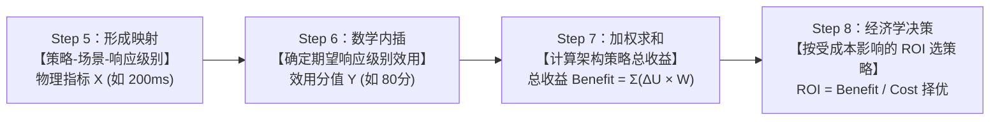

# 第 8 章 系统质量属性与架构评估

> 目录骨架依据《系统架构设计师教程（第 2 版）》；按专题汇集概念、例题与辨析。

## 8.1 软件系统质量属性

### 8.1.1 质量属性概念

### 8.1.2 面向架构评估的质量属性

[考查：综合知识 / 案例分析（非功能需求归类填表）]

#### 六大质量属性判别表（性能 / 安全性 / 可用性 / 可修改性 / 可测试性 / 易用性） ⭐⭐⭐

- **六属性关注点（教材口径，官方解析原文骨架）**：

| 属性 | 关注什么 | 判别词 |
|---|---|---|
| **性能** | 系统对事件的**响应**：响应时间、吞吐量、并发/容量 | N 秒内、并发数、吞吐量、支持 N 个设备/用户 |
| **安全性** | **保护合法用户正常使用 + 阻止非法用户攻击** | XSS / SQL 注入 / 攻击、认证、授权、加密、**审计**、不可否认 |
| **可用性** | 系统**产生故障的可能性**（MTBF）和**从故障中恢复的能力**（MTTR） | 7×24、可用率 99.9%、故障恢复时间、冗余 / 备份 |
| **可修改性** | 修改多快多省、修改的影响面 | 关注点分离、信息隐藏、接口抽象 |
| **可测试性** | 系统**发现错误**的能力 | 可观测、可控制、内置测试 |
| **易用性** | 完成期望任务的**容易程度**、用户支持种类 | 学习成本、操作效率、界面友好 |

- **口诀**：性能管"快不快、撑不撑得住"；安全管"挡不挡得住、查不查得到"；可用性管"在不在线、坏了多久能回来"。
- **三大易错点（归类填表题高频陷阱）**：
  - ❌ **容量/并发 → 性能**，不归可用性（"支持 100 个设备" = 容量指标）。
  - ❌ **审计 → 安全性**（追溯非法操作、可审查性），不归可用性 / 可测试性。
  - ❌ **7×24 → 可用性**（在线时间比例），不是性能；**故障恢复时间 → 可用性**（MTTR），不是可修改性。
#### 质量属性生命周期阶段与核心度量：可用性（故障恢复时间 MTTR）vs 可修改性（维护代价）& 运行期 7 大属性 vs 开发期分类矩阵（题库 8.1 节题目 47、题目 48）⭐⭐⭐

[考查：综合知识（可用性 Availability 官方定义与衡量基准、故障恢复时间 MTTR 归属判别、可用性 vs 可修改性 vs 可靠性概念边界、运行期质量属性 7 大方面［性能、安全性、可用性、可伸缩性、互操作性、可靠性、鲁棒性］vs 开发期质量属性正交分类、可伸缩性 Scalability 与可扩展性 Extendibility 易混排雷）]

在《系统架构设计师教程（第 2 版）》第 8 章 **8.1.1 软件系统质量属性** 中，质量属性不仅依据关注的技术维度进行划分，还依据其在**软件系统生命周期中所关注的不同阶段**明确划分为**运行期质量属性**与**开发期（非运行期）质量属性**。

##### 1. 可用性（Availability）的核心内涵与真题对号（题目 47 第 1 空）⭐⭐⭐

- **官方教程标准定义**：**可用性（Availability）** 是指“系统能够正常运行的时间比例。通常用两次故障之间的时间长度（MTBF）或在出现故障时系统能够恢复正常的速度（MTTR）来表示”。
- **真题考查核心**：“**系统出错后不能在要求的时间内恢复到正常状态**” $\implies$ 题干直击系统发生故障后的**恢复速度与恢复时限（MTTR）**，直接决定了系统能否维持高比例的正常可用服务时间，**100% 属于可用性（Availability）范畴**！
- **三大高频易混属性本质正交辨析**：

| 对比维度 | **可用性（Availability）** ⭐⭐⭐<br>*(题目 47 正解 A)* | **可靠性（Reliability）** ⭐⭐⭐ | **可修改性 / 可维护性** ⭐⭐⭐|
| :--- | :--- | :--- | :--- |
| **关注的核心阶段** | **线上运行期（Runtime）** | **线上运行期（Runtime）** | **线下设计/开发/维护期（Development-time）** |
| **衡量核心目标** | **故障后系统能否快速“恢复对外服务”**（自愈、倒换） | **系统能否长时间“不崩溃、不出错”持续工作** | **技术团队修复代码缺陷或扩展新特性的“成本与代价”** |
| **标准度量指标** | **恢复速度（MTTR）**、在线正常运行时间比例（如 99.99%） | **平均无故障时间（MTBF）**、无故障运行概率 | **人时/人天工时**、改动模块数量、局部性影响程度 |
| **典型工程场景** | 备库 30 秒自动完成主从切换、服务熔断降级自愈 | 航天控制系统连续运行 1000 小时致命故障率 < 0.001% | 研发排查修复线上 Bug 平均耗时 2 小时且不扩散影响 |
| **考场排雷铁律** | 题干出现**“系统出错后多快恢复正常状态/服务”** $\implies$ **秒选可用性！** | 题干出现**“在规定条件下无故障持续维持功能”** $\implies$ **选可靠性！** | 题干出现**“人员修复缺陷、添加新功能花费的工时代价”** $\implies$ **选可修改性！** |

##### 2. 运行期 7 大质量属性 vs 开发期质量属性分类全景矩阵（题目 47、48 第 2 空通关秘籍）⭐⭐⭐

官方教程将质量属性明确按生命周期阶段二分，下表为考场一击必杀的分类全景：

| 质量属性大类 | 关注阶段与主体 | 包含的具体质量属性（教程官方口径 7+8）⭐⭐⭐ | 考场高频易混陷阱与判别口诀 |
| :--- | :--- | :--- | :--- |
| **运行期质量属性**<br>*(Runtime)* | **系统已上线运行部署**，面向最终用户或外部通信的表现 | 包含 **7 个方面**：<br>1. **性能**（响应时间、吞吐量）<br>2. **安全性**（防未授权访问、机密完整性）<br>3. **可用性**（故障恢复时间、在线服务比例）<br>4. **可伸缩性（Scalability）**（加机器/节点抗并发）<br>5. **互操作性**（跨系统/外部接口数据互通）<br>6. **可靠性**（持续无故障工作）<br>7. **鲁棒性 / 健壮性（Robustness）**（容错、抗异常输入） | 💡 **口诀：“性安用，缩互靠棒”**<br>⚠️ **高频陷阱 1（题目 48 命题点）**：<br>**可伸缩性（Scalability，加机器承载高并发）是运行期！**<br>🚫 **可扩展性（Extendibility，加代码特性/松耦合插件）是开发期！**<br>⚠️ **高频陷阱 2**：<br>“可测试性”、“可移植性”不是运行期，是开发期！ |
| **开发期质量属性**<br>*(Development-time)* | **架构设计、代码实现与维护演化阶段**，面向开发团队的表现 | 包含 **8 个典型方面**：<br>1. **可修改性**（局部变更代价）<br>2. **可维护性**（修复代码缺陷工时）<br>3. **可扩展性**（新增业务功能模块）<br>4. **结构重构**（调整构件依赖拓扑）<br>5. **移植性**（适配异构 OS/数据库）<br>6. **可测试性**（单元/集成自动化测试容易度）<br>7. **可重用性**（资产库跨项目复用）<br>8. **易理解性**（代码及架构文档可读性） | 💡 **口诀：“改维扩构移，测重理”**<br>所有静态看源码、改工程才能体现的属性，统统归入开发期。 |

> [!IMPORTANT]
> **题目 47、题目 48 秒杀口诀**：
> - **“线上挂了要快起，恢复时间算可用（47 空 1 选 A）；”**  
> - **“线下改码修缺陷，维护代价归修改（47 排除 C）；”**  
> - **“运行阶段看七样：性安用，缩互靠棒（性能、安全、可用、伸缩、互操作、可靠、鲁棒，48 选 D 安全性）；”**  
> - **“伸缩加机抗并发（运行期），扩展加码添功能（开发期），一字之差莫混淆（48 排除 A 可扩展性）！”**

  - 【题库章节练习 / 第八章第一节 题目 47】（“系统出错后不能在要求的时间内恢复到正常状态，这与【**A. 可用性**】质量属性相关）。
  - 【2024年上半年上午 Q23】（基于软件系统的生命周期，可以将软件系统的质量属性分为【**B. 开发期质量属性和运行期质量属性**】）。
  - 【题库章节练习 / 第八章第一节 题目 48】（在软件系统的质量属性中，属于运行期质量属性的是【**D. 安全性**】）。
  - 【题库章节练习 / 第八章第一节 题目 55】（当用户数和数据量增加时，软件系统维持高服务质量的能力，称为【**A. 可伸缩性**】）。
  - 【题库章节练习 / 第八章第一节 题目 65】（用于衡量在规定的条件和时间内软件完成规定功能能力的指标是【**A. 平均失效间隔时间（MTBF）**】，关注系统在非正常情况（如用户非法操作、软硬件故障）下仍能正常运行的质量属性是【**鲁棒性（健壮性，Robustness）**】）。
  - 【题库章节练习 / 第八章第一节 题目 66】（在软件运行阶段，关注系统在非正常情况（如用户进行了非法操作、相关的软硬件系统发生了故障等）下仍能够正常运行的能力的质量属性是【**A. 鲁棒性（健壮性，Robustness）**】）。
  - 【题库章节练习 / 第八章第一节 题目 69】（在软件系统的质量属性中，属于开发期质量属性的是【**B. 可维护性**】）。
  - 【题库章节练习 / 第八章第一节 题目 74】（在运行期质量属性中，指的是系统在一定时间内正常工作的时间所占比例的是【**C. 可用性**】）。
  - 【题库章节练习 / 第八章第一节 题目 82】（在基于体系结构的软件设计方法中，采用【**B. 视角与视图**】来描述软件架构，采用【**用例**】来描述功能需求，采用【**质量属性场景**】来描述质量需求）。
  - 【题库章节练习 / 第八章第一节 题目 126】（在软件架构评估中，【**C. ATAM**】方法采用效用树这一工具来对质量属性进行分类和优先级排序，效用树的结构包括【**树根（效用）、质量属性、属性分类、质量属性场景**】）。
  - 【题库章节练习 / 第八章第二节 题目 2】（ATAM 主要包括场景和需求收集、【**A. 架构视图和场景实现**】、属性模型构造和分析、属性模型折中等 4 个阶段，ATAM 方法要求在系统开发之前，首先对这些质量属性进行【**优先级排序**】和折中）。
  - 【题库章节练习 / 第八章第二节 题目 15】（在系统架构评估中，基于调查问卷或检查表的方法的主要缺点是【**很大程度上依赖于评估人员的主观判断**】，场景通常采用【**A. 触发机制、环境和影响**】来描述）。
  - 【题库章节练习 / 第八章第二节 题目 16】（在 SAAM 方法的评估步骤中，主要用于体现系统所支持的各种活动的步骤是【**B. 场景开发**】）。
  - 【题库章节练习 / 第八章第二节 题目 20】（在软件架构评估中，【**权衡点**】是影响多个质量属性的特性，是多个质量属性的【**敏感点**】；提高加密级别提高安全性但耗费处理时间影响性能，处理机密消息有严格延迟要求时，加密级别属于【**B. 权衡点**】）。
  - 【题库章节练习 / 第八章第二节 题目 22】（某架构设计为提高性能采用缓存机制但导致数据实时性下降属于【**权衡点**】；某系统为提高可用性在多个数据中心部署冗余服务属于【**A. 敏感点**】）。

##### 3. 可伸缩性（Scalability）官方定义与四大运行期属性概念边界（题目 55 题眼：加人加量加数据维持质量）⭐⭐⭐

- **官方教程标准定义（题目 55 原著题干原文）**：
  > **“可伸缩性是指当用户数和数据量增加时，软件系统维持高服务质量的能力，例如通过增加服务器来提高能力。”**

| 质量属性 | 官方标准定义与关注焦点 ⭐⭐⭐ | 典型触发条件（题干题眼） | 核心度量指标 | 考场对号与排雷铁律（题目 55 剖析） |
| :--- | :--- | :--- | :--- | :--- |
| **可伸缩性**<br>*(Scalability)*<br>*(题目 55 正解 A)* | **抵抗业务规模膨胀的能力**：通过动态调整/增加硬件计算与存储资源，维持既有高服务质量 | **“当用户数和数据量增加时”**、**“增加服务器来提高能力”** | 吞吐量线性增长比率、水平扩容节点上限、扩容延迟 | ✅ **题目 55 题干原文逐字考查**，见“加人加量加数据”秒选可伸缩性！ |
| **可靠性**<br>*(Reliability)*| **持续无故障正确运行的能力**：在应用/系统错误或意外/错误输入面前维持软件系统功能特性的基本能力 | **“在规定条件下持续无故障运行”**、**“异常数据/错误输入下仍维持正确功能”** | **平均无故障时间（MTBF）**、无故障运行概率 | 🚫 ：题干无任何系统故障或异常输入，考查的是规模扩展（Scale）而非故障防范。 |
| **性能**<br>*(Performance)* | **系统对事件响应的敏捷度与吞吐能力**：提供及时响应服务的能力 | **“在 N 秒内完成响应”**、**“每秒处理 N 笔交易”**、**“带宽占用率”** | **响应时间（Latency）**、**吞吐量（TPS/QPS）**、计算资源利用率 | 性能是当前固定资源下的运行效率，伸缩性是面对负载增加时扩展性能的能力。 |
| **可用性**<br>*(Availability)* | **系统正常提供对外服务的在线时间比例与故障自愈恢复能力** | **“系统出错后多快恢复正常”**、**“7×24 小时连续运行”**、**“双机热备自动倒换”** | **故障恢复时间（MTTR）**、在线可用率（如 99.99%） | 可用性衡量“在不在线、挂了多久能好”。 |

> [!IMPORTANT]
> **四大属性考场秒杀口诀**：
> - **“加人加量加数据，加机维持选【伸缩】（55 空 2 选 A）；”**  
> - **“故障异常不崩溃，持续无错选【可靠】（排除 D）；”**  
> - **“快慢时延吞吐率，度量时效选【性能】（排除 B）；”**  
> - **“在线时长快自愈，恢复时间选【可用】（排除 C）！”**

##### 4. 可靠性（Reliability）量化度量指标（MTBF/MTTF）与运行期鲁棒性（Robustness）概念边界（题库 8.1 节题目 65、题目 66）⭐⭐⭐

[考查：综合知识（软件可靠性权威定义、三大 M 指标［MTBF、MTTR、MTTF］与可用性计算公式、可靠性指标 vs 性能响应时间/吞吐量辨析、运行期鲁棒性 Robustness 官方定义与非法操作边界）]

在《系统架构设计师教程（第 2 版）》第 8 章 **8.1 软件系统质量属性**（及第 9 章 **软件可靠性基础知识**）中，**可靠性（Reliability）**与**鲁棒性（Robustness，健壮性）**是极其重要的运行期质量属性：

###### 1. 可靠性（Reliability）标准定义与量化指标体系（题目 65 第 1 空命题点）⭐⭐⭐

- **权威标准定义（题目 65 题干原句）**：
  > **“软件可靠性是指在规定的条件和时间内，软件完成规定功能的能力。”**
- **三大核心量化度量指标**：
  - **① 平均失效间隔时间（MTBF，Mean Time Between Failures，题目 65 正解 A）**：针对**可修复系统**，两次故障之间的平均正常运行工作时间；$MTBF$ 越长，说明系统越稳定耐用、可靠性越高。
  - **② 平均失效前/等待时间（MTTF，Mean Time To Failure）**：针对**不可修复系统**（如深空探测器），从系统开始运行到发生首次故障的平均工作时长。
  - **③ 失效率（$\lambda$）**：单位时间内发生失效的概率，常与 MTBF 呈倒数关系：$\lambda = 1 / MTBF$。

###### 2. 经典三 M 度量指标（MTBF vs MTTR vs MTTF）全景正交对比 ⭐⭐⭐

下表为考场中避免“将可靠性指标错填为性能指标或可用性指标”的核心裁判标准：

| 度量指标 | 英文全称 | 核心含义与工程属性 ⭐⭐⭐ | 关联质量属性 | 考场易混排雷（题目 65 深度剖析） |
| :--- | :--- | :--- | :--- | :--- |
| **MTBF**<br>*(题目 65 正解 A)* | **Mean Time Between Failures** | **两次故障之间的平均无故障运行工作时间** | **可靠性（Reliability）** | ✅ **衡量系统“耐不耐用、抗不抗崩”**；考查规定条件和时间内完成功能必选 MTBF！ |
| **MTTR** | **Mean Time To Repair** | **系统发生故障后，维修人员或自愈机制将其恢复正常服务的平均耗时** | **可用性（Availability）** | ⚠️ **衡量系统“挂了之后多久能修好”**；直接决定系统在线率，不是可靠性指标！ |
| **MTTF** | **Mean Time To Failure** | **系统从全新投入运行到首次发生故障的平均时长**（报废寿命） | **可靠性（Reliability）** | 针对不可修复系统；与 MTTR 共同构成可修复系统的 $MTBF = MTTF + MTTR$。 |
| **响应时间**| **Response Time** | 系统从接收用户请求到处理完成并返回响应的耗时（如 200ms） | **性能（Performance）** | 🚫 ：题干“规定时间内”是指统筹考察周期，绝非单次网络响应时延！ |
| **吞吐量** | **Throughput (TPS/QPS)** | 系统在单位时间内能够并发处理的事务/请求总数量 | **性能（Performance）** | 衡量当前固定资源下的并发承载力，属于性能指标。 |

> [!NOTE]
> **系统可用性（Availability）高频计算公式**：
> $$A = \frac{MTTF}{MTTF + MTTR} = \frac{MTBF - MTTR}{MTBF} \approx \frac{MTBF}{MTBF + MTTR}$$
> （要提高可用性 $A$，既可以延长无故障运行时间 $MTBF$，也可以极力压缩故障修复时间 $MTTR$）。

###### 3. 运行期鲁棒性（Robustness，健壮性）标准定义与边界（题目 65、题目 66 命题点）⭐⭐⭐

- **教程官方权威定义**：
  > **“鲁棒性（Robustness）是指软件系统在非正常情况（如用户进行了非法操作、相关的软硬件系统发生了故障等）下仍能够正常运行的能力。”**
- **架构考场避坑排雷**：
  - ❌ **误区：见“非法操作”就选安全性**！
    - **安全性（Security）**：关注防御黑客未授权渗透、提权入侵、窃取数据机密性与防篡改；
    - **鲁棒性（Robustness）**：关注**系统自身的防御性容错能力**——当用户乱输入非预期非法字符、点击非法按钮，或底层第三方依赖服务宕机时，系统**不会抛出未捕获异常白屏崩溃，能够妥善兜底降级、优雅提示并维持核心功能运转**。

> [!IMPORTANT]
> **可靠性指标与鲁棒性秒杀口诀**：
> - **“规定条件和时间，完成功能是【可靠】（定义题眼）；”**  
> - **“度量指标认准 M：修不好看 MTTF，修得好选 MTBF（题目 65 空 1 选 A）；”**  
> - **“时延响应吞吐率，通通属于【性能】包（排除 B、C）；”**  
> - **“坏了修好多快好，MTTR 算【可用】；”**  
> - **“非法误操与非正常，耐造容错叫【鲁棒】（题目 65 空 2 选 鲁棒性）！”**

#### 分布式架构风格与运行期质量属性：REST 架构风格六大核心约束与可伸缩性（Scalability）本质 vs 传统 Web 服务（SOAP/UDDI）架构对比（题库 8.1 节题目 51）⭐⭐⭐

[考查：综合知识（REST 架构风格定义与六大约束、无状态 Statelessness 与运行期可伸缩性 Scalability 的因果关系、RESTful vs 传统 SOAP/WSDL/UDDI Web 服务架构全方位对比、无状态架构权衡 Trade-off 与现代 Token/JWT 实战）]

在《系统架构设计师教程（第 2 版）》第 8 章 **8.1 软件系统质量属性**（及第 15 章 **15.2 Web 服务与 REST**）中，**可伸缩性（Scalability）** 是极其关键的运行期质量属性。**表述性状态转移（Representational State Transfer, REST）** 是目前因特网的核心架构风格之一，其最核心的设计哲学正是**以“服务端无状态”换取极高的“横向伸缩性（Scalability）”与“高可用性”**。

##### 1. REST 架构风格六大核心约束官方体系 ⭐⭐⭐

REST 是由 Roy Fielding 博士在其博士论文中提出的从网络架构风格衍生出的混合架构风格，其六大约束构成了其核心架构特征：

| 架构约束 | 英文术语 | 核心内涵与架构收益 ⭐⭐⭐ | 考场易混陷阱与设问点 |
| :--- | :--- | :--- | :--- |
| **1. 客户/服务器分离** | **Client-Server** | 用户界面关注点（客户端）与数据存储关注点（服务端）完全解耦，允许各自独立演化 | 促进跨平台 UI 演化与服务端逻辑复用。 |
| **2. 无状态** ⭐⭐⭐ | **Stateless** | **服务器端不保存客户端请求之间的任何上下文状态**；每个请求必须包含处理该请求所需的全部信息（身份凭据、上下文参数） | 🚫 **核心考点（题目 51 命题点）**：任何声称 REST“具有状态相关特性”或“服务端维护会话”的说法均为**致命事实错误**！ |
| **3. 可缓存** | **Cacheable** | 请求响应中的数据必须被隐式或显式标记为可缓存或不可缓存，以允许客户端或中间代理重用响应数据 | 极大减少客户端-服务器交互次数，提升性能与降低网络带宽。 |
| **4. 统一接口** | **Uniform Interface** | 简化系统架构并使交互可见。包含四大子原则：**① 资源标识（URI）；② 通过表述操作资源；③ 自描述消息（MIME/格式）；④ 超媒体即应用状态引擎（HATEOAS）** | 借助 URI 与超链接实现去中心化寻址，无需集中式仓库。 |
| **5. 分层系统** | **Layered System** | 限制构件行为，使每个构件只能“看到”与其直接交互的紧邻层；允许在客户端与终端服务间透明引入代理、网关、防火墙、负载均衡器与缓存 | 客户端无法感知连接的是终端服务器还是中介代理。 |
| **6. 按需代码（可选）** | **Code on Demand** | 允许服务器通过向客户端传输可执行脚本或代码（如 JavaScript、Applet）来临时扩展客户端功能 | 六大约束中**唯一可选**的约束。 |

##### 2. RESTful Web 服务 vs 传统 Web 服务（SOAP/WSDL/UDDI）架构全景对比矩阵 ⭐⭐⭐

下表为软考架构师考场中区分两类 Web 服务优势与特征的核心裁判标准：

| 架构对比维度 | **RESTful Web 服务** ⭐⭐⭐<br>*(题目 51 考查主体)* | **传统 Web 服务（SOAP/WS-* 体系）** ⭐⭐⭐ | 考场对号与排雷铁律（题目 51 剖析） |
| :--- | :--- | :--- | :--- |
| **服务发现机制** | **去中心化寻址**：基于 **URI** 和超链接技术，客户端通过 URL 直接定位与发现服务资源 | **集中式服务信息仓库**：高度依赖 **UDDI**（统一描述、发现和集成协议）集中式注册中心进行发布与查找 | 选项 A 正确说明了 REST 无需集中式仓库的优势（排除 A）。 |
| **状态维护与伸缩性** | **严格无状态（Stateless）**：服务节点平权，无需维护会话亲和性（Session Sticky），**横向伸缩性极强** | **可支持有状态会话**：通过 WS-Context、HTTP Session 维护状态，易受单机绑定限制，集群伸缩代价高 | ✅ **题目 51 正解 B**：宣称 REST“具有状态相关特性”完全违背无状态本质！ |
| **协议与工具依赖** | **基于轻量级 Web 框架**：仅需基本开发工具与基础 HTTP 库即可构建，构建过程简单且成本较低 | **协议栈沉重繁琐**：依赖全套 WS-* 规范（WS-Security, WS-Addressing 等），工具链与学习成本高 | 选项 C 正确说明了 REST 轻量、低成本优势（排除 C）。 |
| **标准与规范来源** | **基于 W3C/IETF 成熟标准**：HTTP 动词（GET/POST/PUT/DELETE）、URI、MIME 类型、JSON/XML 数据交换格式 | 建立在专属的 SOAP 封套、WSDL 接口契约定义等规范之上 | 选项 D 正确说明了 REST 基于工业标准成熟的优势（排除 D）。 |
| **服务测试便捷度** | **测试极度简单**：直接使用浏览器或轻量命令行工具（cURL）即可完成基本功能测试与排错 | 必须使用专门的 SOAP 调试客户端（如 SoapUI）解析 WSDL 生成复杂 XML 报文 | 教材原文列出的 REST 第 ⑤ 大优势。 |

##### 3. 架构权衡（Trade-off）与现代无状态会话实战⭐⭐⭐

1. **REST 无状态约束的架构权衡（Trade-off）**：
   - **获得的架构收益**：
     - **极强的横向伸缩性（Scalability）**：任意请求可被随机分发到集群任意节点，扩容无需担心会话丢失或内存广播；
     - **高可靠性（Reliability）与可用性**：单节点宕机不影响用户继续发起后续请求，无状态节点秒级故障自愈；
     - **简单性与可见性**：监控与反向代理网关只需查看单个请求报文即可理解全部上下文。
   - **付出的架构代价**：
     - **网络传输开销增大**：由于服务端不存 Session，客户端每次请求都必须重复发送完整的认证凭据（如 JWT Token、用户上下文），增加了单个数据包的网络带宽负载。
2. **高并发工业级无状态实践 vs 传统有状态反模式**：
   - ✅ **无状态黄金解法**：**客户端持有自包含且防篡改的令牌（如 JWT，JSON Web Token）**，客户端请求显式携带，服务端各节点仅需本地 CPU 公钥/密钥验签，实现 $O(1)$ 无状态处理；
   - 🚫 **有状态架构反模式 1（会话黏性 Sticky Session）**：网关绑定 IP/Cookie 强行路由至单节点，破坏集群负载均衡平权，节点故障引发大面积掉线；
   - 🚫 **有状态架构反模式 2（全节点 Session 广播内存复制）**：节点数量增长时网络广播风暴开销呈 $O(N^2)$ 激增，彻底阻断集群横向扩容。

> [!IMPORTANT]
> **REST 核心约束与伸缩性秒杀口诀**：
> - **“REST 核心六大约束：C/S 分离、无状态、可缓存、统一接口、分层系统、按需代码；”**  
> - **“服务端绝不留状态，无状态带来高伸缩（题目 51 题眼：选项 B 称‘状态相关’必错！）；”**  
> - **“去中心化看 URI，轻量框架好测试，成熟标准成本低；”**  
> - **“代价是重复传上下文网络开销大，工程落地靠 JWT 客户端自包含令牌验签！”**

  - 【题库章节练习 / 第八章第一节 题目 51】（与传统 Web 服务相比，REST 服务的主要优势不包括【**B. 支持缓存，具有状态相关特性，所构建的应用系统具有较强的伸缩性**】）。
#### 质量属性场景六要素与易用性（Usability）深度剖析（表 8-5 五类刺激意图、四大关注方面与修复能力排雷）（题库 8.1 节题目 70、76、125）⭐⭐⭐

[考查：综合知识 / 案例分析（质量属性场景六要素［刺激源、刺激、环境、制品、响应、响应度量］、易用性 Usability 质量属性场景表 8-5 官方标准分类、五类刺激意图［学、用、错、配、满］与其法定响应机制精细对号、易用性官方关注四大方面［学习曲线、操作效率、满意度、使错误影响最低］、系统修复能力归属可用性/可维护性概念排雷）]

在《系统架构设计师教程（第 2 版）》第 8 章 **8.1.2 面向架构评估的质量属性** 中，质量属性场景主要关注可用性、可修改性、性能、可测试性、易用性和安全性等 6 类质量属性。**易用性质量属性场景主要关注用户在使用系统时的容易程度，包括系统的学习曲线、完成操作的效率、对系统使用过程的满意程度等**。

> [!IMPORTANT]
> **易用性核心关注四大方面 vs 系统修复能力（题目 125 核心考点）**：
> - **官方教材与 ISO 9241 易用性法定关注范畴**：
>   1. **系统的学习曲线（Learning Curve）**：新手学习掌握系统特性的容易程度与培训成本（选项 D 在）；
>   2. **完成操作的效率（Efficiency）**：熟练用户执行任务的速度与步骤复杂度（选项 A 在）；
>   3. **对系统使用过程的满意程度（Satisfaction）**：用户在交互中的心理舒适度与体验，如进度条消除未知等待焦虑（选项 C 在，法定核心支柱！）；
>   4. **使错误的影响最低（Error Prevention & Recovery）**：防呆防错设计与步进撤销机制。
> - **系统修复能力属性归属排雷**：
>   - **“系统修复能力”**：指系统故障后的自愈容错能力（属于**可用性/可靠性**，如 MTTR）或代码缺陷修复代价（属于**可修改性/可维护性**，定义为“主要体现在问题的修复上”）；它衡量底层系统架构与运维研发，**绝非面向最终用户交互体验的易用性**！

##### 1. 易用性质量属性场景六要素官方定义（表 8-5 全景骨架）（题目 76 考点）⭐⭐⭐

- **通用六要素法定骨架（题目 76 第 1 空）**：
  > **质量属性场景由且仅由 6 大部分组成**：**刺激源（Source of stimulus）、刺激（Stimulus）、环境（Environment）、制品（Artifact）、响应（Response）、响应度量（Response measure）**。
  > 考场秒杀口诀：“**源、激、环、制、应、量**”！
- **易用性场景六要素具体实例化**：
  - **刺激源**：最终用户。
  - **刺激**：想要学习系统特性、有效使用系统、使错误的影响最低、适配系统、对系统满意（共 5 大用户意图，口诀：“**学、用、错、配、满**”）。
  - **环境**：系统运行时或配置时。
  - **制品**：系统。
  - **响应**：系统针对上述 5 类刺激分别提供的细分交互与处理机制。
  - **响应度量**：任务时间、错误数量、解决问题的数量、用户满意度、用户知识的获得、成功操作在总操作中所占的比例、损失时间 / 丢失的数据量。

##### 2. 五类刺激意图与法定响应机制全景映射矩阵（题目 70 核心得分点）⭐⭐⭐

| 用户刺激意图（Stimulus） | 官方对应系统响应机制（Response）⭐⭐⭐ | 典型工程交互手段 | 考场设陷排雷铁律（题目 70 深度剖析） |
| :--- | :--- | :--- | :--- |
| **1. 学习系统特性** | • 帮助系统与环境联系紧密<br>• 界面为用户所熟悉<br>• 在不熟悉的环境中界面是可以使用的 | 新手引导气泡、遵循平台原生 UI 规范、上下文帮助浮窗 | 旨在降低初学者认知与学习门槛。 |
| **2. 有效使用系统** ⭐⭐⭐<br>*(题目 70 考查焦点)* | • **数据和（或）命令的聚合**<br>• **已输入的数据和（或）命令的重用**<br>• **支持在界面中的有效导航**<br>• 具有一致操作的不同视图<br>• 全面搜索<br>• 多个同时进行的活动 | 宏录制与一键批量操作（A 项）、表单历史数据回填（B 项）、面包屑与快捷跳转（C 项）、多标签页多任务并行 | 🚫 ：<br>考生望文生义以为“数据和命令的聚合”是后台架构模式，实际上它正是人机交互中把多次点击聚合为一键批处理的提效手段，**属于“有效使用系统”**！ |
| **3. 使错误的影响最低** | • **撤销（Undo）**、**取消**<br>• 从系统故障中恢复<br>• 识别并纠正用户错误<br>• 检索忘记的密码<br>• 验证系统资源 | Ctrl+Z 步进撤销、表单提交前前端格式校验防呆、找回密码邮件/短信验证 | 旨在提供操作“后悔药”，防止操作失误或系统故障造成数据损失。 |
| **4. 适配系统** | • 定制能力<br>• 国际化 | 用户自定义快捷键/布局/皮肤、多语言包与多时区货币切换 | 旨在满足不同群体与不同地域的个性化定制诉求。 |
| **5. 对系统满意** ⭐⭐⭐<br>*(✅ 题目 70 正解 D 归属)* | • **显示系统状态**<br>• 与客户的节奏合拍 | 文件上传进度条、数据同步状态灯、防止未知假死白屏的加载骨架屏 | ✅ **题目 70 正解 D**：<br>“显示系统状态”消除用户等待焦虑与恐慌，属于使客户**“对系统的满意”**，绝非“有效使用系统”！ |

> [!IMPORTANT]
> **易用性场景与关注维度秒杀口诀（题目 70、76、125 通杀）**：
> - **“六要素牢记：源、激、环、制、应、量；第 1 空必填【响应和响应度量】！”**  
> - **“易用场景五刺激（人机交互看用户）：学、用、错、配、满（题目 76 秒选 C 易用性）！”**  
> - **“日常‘可用’是好用（易用性 Usability），考场‘可用’看宕机（可用性 Availability）！”**  
> - **“有效使用看提效：聚合重用导航好；显示状态消除慌，合拍节奏用户满！”**  
> - **“学得快是【学习曲线】，用得快是【操作效率】，心里爽是【用户满意】（题目 125 易用性三支柱）；”**  
> - **“系统坏了修不修得好，归属可用与维护，绝非界面【易用性】（题目 125 秒选 B 系统修复能力）！”**

  - 【题库章节练习 / 第八章第一节 题目 70】（在易用性质量属性场景中，不属于系统为支持"有效使用系统"而可能提供的响应是【**D. 显示系统状态**】）。
  - 【题库章节练习 / 第八章第一节 题目 76】（质量属性场景由刺激源、刺激、环境、制品、（响应和响应度量）六部分组成，其中想要学习系统特性、有效使用系统、使错误影响最低、适配系统、对系统满意属于【**C. 易用性**】质量属性场景的刺激）。
  - 【题库章节练习 / 第八章第一节 题目 125】（以下哪个方面不是易用性关心的方面【**B. 系统修复能力**】）。

#### 质量属性核心内涵与分类层级：可修改性（Modifiability）四大子维度（维/扩/构/移）vs 架构评估 8 大顶层属性（可变性）辨析（题库 8.1 节题目 39）⭐⭐⭐

[考查：综合知识 / 案例分析（可修改性 Modifiability 官方定义与衡量基准、可修改性包含的四个方面［可维护性 Maintainability、可扩展性 Extendibility、结构重构 Reassemble、移植性 Portability］、架构评估 8 项顶层独立质量属性中的“可变性 Variability”概念边界与软件产品线 SPL 属性归属、考场真伪子属性设陷排雷）]

在《系统架构设计师教程（第 2 版）》第 8 章 **8.1.2 面向架构评估的质量属性** 中，**可修改性（Modifiability）** 是指“能够快速地以较高的性能价格比对系统进行变更的能力。通常以某些具体的变更为基准，通过考查这些变更的代价来衡量可修改性”。官方教程白纸黑字明确界定了**可修改性所包含的四个具体方面（子维度）**：

##### 1. 可修改性（Modifiability）四大子维度官方定义与工程映射矩阵 ⭐⭐⭐

| 子维度名称 | 英文官方术语 | 教程标准定义与核心关注点 ⭐⭐⭐ | 典型工程动作与实战场景 | 考场设陷与排雷铁律（题目 39 深度剖析）⭐⭐⭐ |
| :--- | :--- | :--- | :--- | :--- |
| **1. 可维护性** | **Maintainability**<br>*(选项 A 在)* | **主要体现在问题的修复上**：在错误/缺陷发生后“修复”软件系统；强调**局部性修改**，将对其他构件的负面影响降到最低 | 线上 Bug 紧急修复、崩溃日志打桩热补丁、微服务接口向下兼容局部修改 | 属于可修改性的第 1 个核心方面（排除 A）。 |
| **2. 可扩展性** | **Extendibility**<br>*(选项 B 在)* | **关注使用新特性来扩展软件系统**，以及使用改进版本替换构件并删除无用特性；强调**构件松散耦合**与低成本集成 | 引入全新的支付渠道插件、支持新的数据导出格式、通过微服务注册中心插拔新服务 | 属于可修改性的第 2 个核心方面（排除 B）。 |
| **3. 结构重构** ⭐⭐⭐ | **Reassemble**<br>*(选项 C 在)*| **处理重新组织软件系统的构件及构件间的关系**，例如通过将构件移动到一个不同的子系统来改变其拓扑位置与依赖关系 | 单体大服务按领域驱动（DDD）拆分限界上下文、将耦合模块下沉为公共中台服务 | 🚫 ：<br>考生望文生义认为“结构重构”是代码重构动词，误以为不是质量属性！**教程原文明确将结构重构（Reassemble）列为可修改性的第 3 个组成方面**！ |
| **4. 移植性** | **Portability** | **使软件系统适用于不同的运行环境**（不同的硬件架构、操作系统、数据库、中间件平台等） | x86 迁移至国产 ARM 麒麟 OS、从 Oracle 数据库平滑迁移至 MySQL/PostgreSQL | 属于可修改性的第 4 个核心方面（四兄弟之一）。 |

##### 2. 顶级分水岭：可修改性（Modifiability） vs 可变性（Variability）全景正交对比 ⭐⭐⭐

考生极易因“可变性”名字中带“可”字，而将其误当成可修改性的子属性。下表彻底理清两者在软件架构中的层级与定位差异：

| 对比维度 | **可修改性（Modifiability）** ⭐⭐⭐<br>*(单一系统内部变更代价)* | **可变性（Variability）** ⭐⭐⭐<br>*(✅ 题目 39 正解 D：属于顶层平行属性)* |
| :--- | :--- | :--- |
| **1. 架构层级地位** | 属于面向架构评估的 **8 项基础质量属性之一** | **同样属于面向架构评估的 8 项基础质量属性之一**（两者在架构大纲中地位**完全平级并列**！） |
| **2. 官方标准定义** | 能够快速地以较高的性能价格比对系统进行**局部变更**的能力 | 指体系结构**经扩充或变更而成为全新体系结构的能力** |
| **3. 关注的核心范围** | **“单一现有系统内部”**的演化：修 Bug、加新构件、调拓扑、换底层平台 | **“跨产品族 / 衍生新系统”**的演进：架构能否孕育出一批新产品/新架构 |
| **4. 典型代表应用** | 敏捷重构、持续集成、插件化架构、模块解耦 | **软件产品线架构（Software Product Line, SPL）**、领域工程核心资产库、变异点（Variation Point）配置 |
| **5. 考场裁决铁律** | 包含四兄弟：**【可维护性、可扩展性、结构重构、移植性】** | 题干问**“不属于可修改性考虑的内容”** $\implies$ **100% 秒选 可变性（D）**！ |

> [!IMPORTANT]
> **可修改性子维度与可变性秒杀口诀**：
> - **“可修改性四兄弟，简称【维-扩-构-移】（题目 39 必背骨架）：”**  
> - **“【维】可维护修 Bug（A），【扩】可扩展添功能（B），【构】结构重构挪位置（C 原文在列），【移】移植环境跨平台；”**  
> - **“可变性（D）是产品线平级大掌柜（8 项独立属性之一），绝非可修改性小跟班，见它秒选不属于！”**

  - 【题库章节练习 / 第八章第一节 题目 39】（【**D. 可变性**】不属于可修改性考虑的内容）。
  - 【题库章节练习 / 第八章第一节 题目 71】（【**D. 可靠性**】不属于可修改性的组成部分）。

#### 架构风格选型与质量属性场景综合判定：即时战略游戏战役地图自定义（解释器风格 vs 性能 vs 可修改性）（题库 8.1 节题目 97）⭐⭐⭐

[考查：综合知识 / 案例分析（解释器架构风格 Interpreter 核心特征与虚拟机机制、玩家自定义战役地图/DSL/动态规则引擎场景选型、层次系统 Layered System 职责局限排雷、性能场景［高并发+低时延］判定、可修改性场景［二次开发代价/工期］判定、架构权衡点 Trade-off 辨析）]

在《系统架构设计师教程（第 2 版）》第 8 章 **8.1 软件系统质量属性** 与 **第 6 章 软件架构设计（经典架构风格）** 中，针对业务系统具有高度可编程、动态非预定业务逻辑自定义的诉求，架构选型与质量属性的综合联动考查极其频繁：

##### 1. 解释器架构风格（Interpreter Style）核心机理与四大经典应用场景 ⭐⭐⭐

- **架构核心内涵**：
  - 解释器风格（通常亦称为**虚拟机风格**）包含一个**被解释的语言源程序**、一个**解释器引擎**以及**反映当前执行状态的数据结构（如符号表、执行栈）**。
  - **核心本质**：通过引入一层软件虚拟机，将用户编写的外部高级脚本或规则表达式动态翻译为底层硬件可执行的操作。
- **四大典型工程应用场景（考场直接秒杀）**：
  1. **游戏战役地图与任务触发器**（如题目 97）：支持玩家在不重新编译游戏引擎的前提下，自定义单位属性、行为逻辑与胜利条件；
  2. **企业级业务规则引擎 / 动态风控系统**：支持风控专家在线热加载反欺诈规则（如 Drools、Aviator、QLExpress），无需停机发布；
  3. **领域特定语言（DSL）解析**：如 SQL 查询解析器、报表计算公式编译器；
  4. **通信协议解析与硬件指令模拟器**：支持跨平台指令集模拟（如 JVM 字节码执行、QEMU）。

##### 2. 经典四大架构风格横向正交对比矩阵（题目 97 排雷铁律）⭐⭐⭐

| 架构风格 | 核心机制与构件关系 | 核心解决的痛点 | 为什么不能选它支撑“战役地图自定义”？（题目 97 剖析） |
| :--- | :--- | :--- | :--- |
| **解释器风格**<br>*(Interpreter)*<br>*(✅ 题目 97 正解 B)* | 包含解释引擎、语法分析器、执行状态；在运行时动态解析并执行外部脚本规则 | **零停机、零编译动态热加载非预定的自定义业务逻辑** | ✅ **100% 契合需求**：玩家作为非程序员，仅需通过地图编辑器输出脚本，由解释器执行！ |
| **层次系统**<br>*(Layered System)*| 按照关注点分离自上而下分层，每层仅向上提供服务、向下调用服务 | 模块解耦、隐藏底层细节、依赖单向性、易于分工维护 | 🚫 ：分层只是组织代码的静态骨架，新增对象行为依然必须程序员修改业务层源码重新编译！ |
| **黑板风格**<br>*(Blackboard)* | 由知识源（KS）、黑板共享数据结构、控制中心三大构件组成 | **非确定性、无固定算法、需多领域专家协同推导的复杂非结构化问题**（如语音识别、信号处理） | 游戏战役规则解析是确定性语法执行，与黑板的“多专家启发式假设推导”完全不符。 |
| **事件驱动系统**<br>*(Event-Driven)* | 事件发布者发出事件，系统通过事件分发器隐式调用注册的订阅者回调 | 构件间松耦合异步通信、GUI 交互响应 | 事件驱动仅负责“消息传递与通知”，本身不负责“定义与执行一套规则脚本语法”。 |

##### 3. 本题两大质量属性场景精准判定与架构权衡（Trade-off）深度剖析 ⭐⭐⭐

1. **场景一（第 2 空：性能 Performance）**：
   - **题干陈述**：“在并发用户数量为 10000 人时，用户的请求需要在 1 秒内得到响应”。
   - **属性判定**：直指系统面对并发负载时的**响应时间（Latency ≤ 1s）** 与 **吞吐能力（10000 并发）**，100% 属于**性能（Performance）**。
2. **场景二（第 3 空：可修改性 Modifiability）**：
   - **题干陈述**：“对游戏系统进行二次开发的时间不超过 3 个月”。
   - **属性判定**：官方教材明确定义——“**可修改性通常以某些具体的变更为基准，通过考查这些变更的代价（成本、时间、人力）来衡量**”。此处以工期代价（≤ 3 个月）作为约束，100% 属于**可修改性（Modifiability）**。
3. **架构权衡点（Trade-off Point）深度穿透**：
   - 引入**解释器风格**极大地提升了系统的**可修改性（Modifiability）**与玩家扩展性；
   - 但解释器虚拟机在运行期进行逐行词法语法解析与指令派发，其执行效率显著低于 C++/C# 原生编译机器码，会对游戏高并发下的**性能（Performance）**造成负面影响；
   - 这在 ATAM 架构评估中构成了极其典型的**权衡点（Trade-off Point）**！

> [!IMPORTANT]
> **解释器与三空场景考场终极秒杀口诀**：
> - **“地图编辑跑脚本，自定义规则动态解：架构风格必选【解释器（B）】！”**  
> - **“模块分层好解耦，代码静态管依赖：层次系统（A）不能动态解规则；”**  
> - **“万人并发秒级回，响应时延度【性能】；二次开发定月数，变更代价看【可修改】；”**  
> - **“解释灵活改代码，损耗效率费 CPU：可修改性与性能构成经典【权衡点】！”**

  - 【题库章节练习 / 第八章第一节 题目 97】（某大型多人即时战略游戏支持玩家自行创建战役地图、定义对象行为与关系，应采用【**B. 解释器**】架构风格；“并发用户 10000 人在 1 秒内响应”属于【**性能**】质量属性场景；“二次开发时间不超过 3 个月”属于【**可修改性**】质量属性场景）。

#### 经典软件架构风格与系统性能权衡全景：分层性能代价、对象管理层损耗、隐式调用并发与解释器预编译优化（题库 8.1 节题目 124）⭐⭐⭐

[考查：综合知识（架构风格与质量属性折中 Trade-off、层次化架构风格性能代价规律、面向对象风格引入对象管理层的性能损耗排雷、隐式调用/事件驱动并发处理战术、解释器风格性能瓶颈与 JIT/预编译优化策略）]

在《系统架构设计师教程（第 2 版）》第 8 章 **8.1 软件系统质量属性** 与 **第 6 章 软件架构设计（经典架构风格）** 中，架构风格的选择直接决定了系统的基础质量属性表现。任何架构风格的优势都不是免费的，架构师必须深刻理解各种经典风格在**系统性能（Performance）**维度的内在代价与优化战术：

##### 1. 四大经典架构风格与系统性能影响及优化全景矩阵 ⭐⭐⭐

| 架构风格 | 性能特征与内在物理规律 | 官方标准性能影响结论 | 经典性能优化与提速战术 | 考场易混陷阱与正误判定（题目 124 深度剖析）⭐⭐⭐ |
| :--- | :--- | :--- | :--- | :--- |
| **1. 层次化架构风格**<br>*(Layered Style)* | **跨层通信带来额外开销**：数据必须经历逐层封装、解包、参数拷贝、栈帧分配与上下文切换 | **划分的层次越多，系统的性能越差** ⭐⭐⭐ | • **跨层短路（Bypassing Layers）**：对性能极敏感链路允许跨层直接调用；<br>• **引入层级缓存**：各层独立缓存热点数据减少下层透传 | ✅ **选项 A 正确**：客观存在的技术折中事实，切莫误当成错误叙述！ |
| **2. 面向对象架构风格**<br>*(Object-Oriented)* | **抽象与代理带来间接寻址开销**：若额外引入“对象管理层”，增加调用拦截、反射查找、生命周期同步与锁竞争 | **引入对象管理层不但不能提高性能，反而会降低系统性能** ⭐⭐⭐ | • **对象池化（Object Pool）**：复用重型对象减少 GC 开销；<br>• **轻量级对象设计（享元模式 Flyweight）**；<br>• **减少不必要的深层代理包装** | 🚫 **选项 C 错误（题目 124 正解）**：声称“引入对象管理层可提高性能”违背架构常识，加中间层必然损耗性能！ |
| **3. 隐式调用架构风格**<br>*(Implicit Invocation)*<br>*(事件驱动 / 发布-订阅)* | **组件解耦天然支持异步与并行**：事件触发后，事件分发器与各订阅者处理函数之间相互独立无强依赖 | **可以通过处理函数的并发调用提高系统处理性能** ⭐⭐⭐ | • **事件线程池 / 异步并发调用**：利用多核 CPU 并发执行监听器回调；<br>• **高性能无锁事件环形队列（Disruptor）**；<br>• **事件合并与批量分发** | ✅ **选项 B 正确**：解耦的处理函数天然具备高并发调度优势，显著提升吞吐率。 |
| **4. 解释器架构风格**<br>*(Interpreter Style)* | **逐句动态解析执行缓慢**：运行期词法语法解析、指令分发与虚拟栈操作导致吞吐极低、延迟大 | **执行性能极低，是所有架构风格中运行速度最慢的风格之一** | • **部分解释代码预先编译（JIT 即时编译）** ⭐⭐⭐：将热点脚本预先编译为机器码并缓存；<br>• **字节码预编译与操作码缓存（Opcode Cache）** | ✅ **选项 D 正确**：预编译是消除解释器性能鸿沟的工业级标准手段（如 JVM JIT、V8）。 |

##### 2. 架构考场核心铁律：中间层（Indirection）的性能悖论 ⭐⭐⭐

1. **“所有问题都可以通过增加一个间接层解决，除了间接层过多导致的问题”**（David Wheeler 计算机科学公理）：
   - 增加中间层（如分层架构中的多层、面向对象中的对象管理层/代理层）带来的收益是：**松耦合、信息隐藏、易于扩展、安全隔离与关注点分离（可修改性、安全性）**；
   - 增加中间层付出的代价是：**调用链路延长、CPU 缓存局部性变差、数据多重复制、内存占用剧增（性能必下降）**；
   - **铁律结论**：在没有硬件加速或算法优化的前提下，**单纯在架构中引入一个管理层/中间层，绝对不可能提升原始执行性能**！
2. **反向设问（选错误项）考场审题陷阱**：
   - 考生见到“性能越差”容易产生心理排斥，误将其当成“错误言论”；必须牢记架构设计本质是权衡（Trade-off），性能下降是选择分层架构时的合法代价，陈述客观事实就是正确叙述。

> [!IMPORTANT]
> **架构风格与性能权衡秒杀口诀**：
> - **“分层解耦代价大，层数越多性能差（A 项客观真理）；”**  
> - **“加层若能提性能，天下架构尽成神（C 项加对象管理层降性能，选 C 错！）；”**  
> - **“事件解耦利并发，异步回调吞吐大（B 项正确）；”**  
> - **“解释器跑得最慢，热点预编来提速（D 项 JIT 预编译正确）！”**

  - 【题库章节练习 / 第八章第一节 题目 124】（以下关于软件架构风格与系统性能的关系叙述中，错误的是【**C. 采用面向对象架构风格的系统，可以通过引入对象管理层提高系统性能**】）。

#### 架构评估 8 项质量属性清单 + 教学用品采购系统案例（五类需求归类 + 瘦/胖客户端选型） ⭐⭐⭐

[考查：案例分析（质量属性列举 + 需求归类填表 + 架构选型简答）]

- **8 项质量属性清单（架构评估口径，8 分题逐项给分）**：
  1. **性能**：系统的响应能力——经多长时间对事件做出响应，或某段时间内处理事件的个数。
  2. **可靠性**：在应用/系统错误、意外或错误使用情况下，维持软件系统功能特性的基本能力。
  3. **可用性**：系统能够正常运行的时间比例。
  4. **安全性**：向合法用户提供服务的同时，阻止非授权用户使用企图或拒绝服务的能力。
  5. **可修改性**：快速地以较高性价比对系统进行变更的能力。
  6. **功能性**：系统能完成所期望工作的能力。
  7. **可变性**：架构经扩充或变更而成为新架构的能力。
  8. **互操作性**：系统之间（或系统与外部环境）正确地交换并使用所交换信息的能力。
- **口诀**：**性可靠、用安全、改功变互**——8 项数够再停笔。注意与上方"六大质量属性判别表"是**两个不同清单**（六属性含可测试性/易用性，无可靠性/功能性/可变性/互操作性），按题干口径选用。
- **五类需求归类判别词（表 1-1 题型）**：

| 类别 | 判别词 | 案例条目 |
|---|---|---|
| 互操作性 | 与外部（用户/系统/协议/平台）的**交互方式** | (a) UI 个性化定制、(b) 主流标准/通信协议/平台接口 |
| 性能 | **量化指标**：响应时间、**容量/存储量** | (c) 响应≤3s/竞价≤1s、(f) 存储≥10T 附件 |
| 安全性 | 加密、认证、授权、登录验证 | (e) 密码加密传输、(g) 停滞超时重新登录 |
| 可靠性 | **故障/异常输入下维持功能**（容错、恢复、健壮） | (d) 故障自诊断快恢复、(h) 识别异常报价防干扰评选 |
| 可用性 | **降级保核心**、正常运行时间比例 | (i) 过载时竞价降级、保发布公示 |

- **三大易错点**：①表内无"功能性"行时，UI 个性化定制向**互操作性**归（交互方式）；②**容量/存储量 → 性能**（量化资源指标），不是"快"才归性能；③**异常输入（异常报价）→ 可靠性**（健壮性）——非授权攻击才归安全性。
- **瘦客户端 vs 胖客户端（架构选型简答，300 字答题模板）**：
  - 优势：**安全性高**（业务逻辑在服务端）；**灵活性高**（部署灵活/客户端零安装）；**升级维护成本低**（只改服务器）；可补采分点：客户端硬件要求低、跨平台性好。
  - 不足：**性能弱**（工作集中在服务器、负担重）；**功能简单**（仅浏览/查询/简单数据输入，富交互弱）；**网络依赖强**（必须联网才能使用）。
  - 选型信号：重安全 + 易维护 + 弱终端 → 瘦客户端；重本地计算 + 富交互 + 离线可用 → 胖客户端。

#### 质量属性—设计策略（战术）对号表 ⭐⭐⭐

[考查：综合知识（"哪项策略提高某属性"对号；复合多空填策略）]

- **五大属性战术家族表**：

| 质量属性 | 战术家族 → 代表策略 |
|---|---|
| **可用性** | 故障检测（**Ping/Echo、心跳**）、故障恢复（**主动/被动冗余**、**选举**、事务、状态恢复、检查点、回滚）、故障避免（进程监视器） |
| **性能** | 资源需求（减少开销）、资源管理（并发、副本）、资源仲裁（**资源调度/队列调度**） |
| **可修改性** | 局部化（封装、**信息隐藏**、模块分离）、防止连锁反应（**维护现有接口**、**接口-实现分离**、抽象、依赖倒置）、推迟绑定（**运行时注册**、配置文件、多态） |
| **安全性** | 抵抗攻击（认证、授权、**限制访问**、加密）、检测攻击（入侵检测、**追踪审计**）、攻击恢复（审计、状态恢复） |
| **可测试性** | 输入/输出（**记录-回放**、断言、分离接口）、内部监视（内置测试、**内置监控器/监视器**） |

- **判别词**：Ping/Echo、心跳 = 探活 → 可用性；"改实现不影响调用方" = 防连锁 → 可修改性；"绑定推迟到运行期" = 推迟绑定 → 可修改性；排队仲裁资源 = 性能；口令 / 权限 / 访问控制 = 安全性；攻击报警留痕 = 追踪审计（安全性）；重现偶发缺陷 = 记录/回放（可测试性）；代码埋设探针 = 内置监控器（可测试性）。
- **易错点（ 新错）**：**空位归属错位**——复合多空题中策略本身没错、填错属性空（接口-实现分离 = 可修改性策略，被填进可用性空）。纪律：**先锁定每空属性，再按家族表对号**。
- **口径提示**：可用性与可靠性共享冗余 / 心跳（兄弟属性）；个别题库解析把"信息隐藏"标为安全性，教程口径信息隐藏 = **可修改性·局部化**，以教程为准。
- **智能机器人三场景 6 空题实战映射（题库 8.1 节题目 8，）⭐⭐⭐**：
  1. 场景 1：“主电源断电 10s 内自动启动备用电源并切换” $\to$ **可用性** $\to$ **主动冗余**；
  2. 场景 2：“前方 2 米有人或障碍物 1s 内停止并在 2s 内选新路径” $\to$ **性能** $\to$ **资源调度**；
  3. 场景 3：“远程控制命令加密抵挡入侵，**并对攻击进行报警和记录**” $\to$ **安全性** $\to$ **追踪审计（正解 B）**；
- **电子交易清算系统三场景 6 空题实战映射（2019 下半年真题 / 题库 8.1 节题目 10、题目 12，）⭐⭐⭐**：
  1. 场景 1：“数据传递时延不大于 1s，**并提供相应的优先级管理**” $\to$ **性能** $\to$ **资源仲裁（题目 10 正解 C）**；
  2. 场景 2：“系统采用双机热备，**主备机必须实时监测对方状态以实时切换**” $\to$ **可用性** $\to$ **心跳（题目 12 正解 C）**；
  3. 场景 3：“系统应能够防止 99% 的黑客攻击” $\to$ **安全性** $\to$ **抵御攻击 / 检测攻击 / 追踪审计**；
- **服务器高可用/性能/可修改性三需求设计策略映射（题库 8.1 节题目 15 & 题目 17，）⭐⭐⭐**：
  1. 需求 1（问题 1）：“提高该系统的可用性（Availability）” $\to$ **Ping/Echo（题目 15 正解 A）**（心跳检测/回显探测，属于可用性快速感知故障的【错误检测】核心战术）；
  2. 需求 2（问题 2）：“提高该系统的性能（Performance）” $\to$ **队列调度**（属于性能架构战术中的【资源仲裁】）；
  3. 需求 3（问题 3）：“提高该系统的可修改性（Modification）” $\to$ **信息隐藏（题目 17 正解 A）** / **接口-实现分离** / **运行时注册**（属于可修改性架构战术中的【局部化修改/防止连锁反应】与【推迟绑定时间】）；
- **园林绿化系统多场景与架构特性综合映射（题库 8.1 节题目 24，）⭐⭐⭐**：
  1. 场景 1：“安全防护措施对黑客攻击检测与防御” $\to$ **安全性** $\to$ **入侵检测 / 用户认证 / 授权 / 追踪审计**；
  2. 场景 2：“网络失效后 10 秒内发现错误并启用备用系统” $\to$ **可用性** $\to$ **心跳线 / 命令-响应 / 主动冗余 / 备件**；
  3. 场景 3：“实时状态视频传输保证 1024*768 分辨率、40 帧/秒速率” $\to$ **性能** $\to$ **引入并发（正解 B）**；
  4. 架构特性 1：“更改系统加密级别对安全性提升但对性能降低” $\to$ **权衡点（Tradeoff Point）**（影响多个质量属性且一升一降）；
  5. 架构特性 2：“绿化报告生成业务逻辑描述尚未达成共识，可能导致规则矛盾影响可修改性” $\to$ **风险点（Risk）**（潜在设计隐患与未解决的不确定性）；
- **信息隐蔽原句（题库 2.4 节题目 17，）**：信息隐蔽是开发整体程序结构时的法则。可能变化的决策、数据结构内部连接、操作细节和硬件相关细节封进单一模块，对外少暴露内部处理。固定效果是提高**可修改性、可测试性和可移植性**。硬件细节被单独封存时，对应空是可移植性；实现改动不影响调用方时，对应空是可修改性。
- **耦合方向**：模块之间只留稳定接口，耦合降低，内聚提高。题干动词是「提高」时，空里填质量属性，不填耦合性。可靠性看持续正确运行的能力，策略是冗余、心跳和故障恢复。隐藏内部有一点保密作用；安全性的正统战术仍是限制访问，原句的第二个空是可移植性。

#### 需求表归类与效用树综合例题：任务看板与电商折扣系统

- **需求归类**：有响应时间或吞吐上限的查询、检索和导入导出属于性能；系统故障后保住数据属于可靠性；规定时间内发现并恢复故障属于可用性；认证、授权、数据与日志保护属于安全性；多语言与输入联想属于易用性；任务路由和结果查看属于功能性；增加容量以支持更多用户、任务属于可扩展性。
- **效用树补空**：父节点代表质量属性，子节点代表质量属性场景。先从刺激、环境、响应判断父属性，再按题中场景标识填入叶节点。2022 下半年电商折扣案例的空位为 (1) 安全性、(2) 可修改性、(3) e、(4) j、(5) h、(6) k。
- **架构风格选择**：促销规则变化频繁、性能优先级较低时，解释器或规则系统可把规则与主体代码分离，降低规则变更的修改范围；需要用解释执行开销换取灵活性。若性能约束更强，应评估编译、缓存规则或混合实现。
#### 基于体系结构的软件设计（ABSD）三大描述机制：视角与视图（架构）、用例（功能）与质量属性场景（质量）（题库 8.1 节题目 82）⭐⭐⭐

[考查：综合知识（基于软件架构的设计 ABSD 驱动组合、架构描述两大核心概念［视角 Viewpoint vs 视图 View］、功能需求描述手段［用例 Use Case］、质量需求描述手段［质量属性场景 Quality Attribute Scenario］、构件与类图等底层实现元素排雷）]

在《系统架构设计师教程（第 2 版）》第 7 章 **基于体系结构的软件设计（ABSD）** 与第 8 章 **8.1 软件系统质量属性** 中，系统架构的建立依赖于严谨的描述体系与需求刻画模型：

##### 1. ABSD 核心定义与三大描述机制矩阵 ⭐⭐⭐

- **ABSD 核心驱动哲学**：
  > **“基于软件架构的设计（ABSD，Architecture Based Software Design）强调由商业、质量和功能需求的组合驱动软件架构设计。”**
- **三大描述机制法定标准映射**：

| 描述对象 | 法定标准描述机制 ⭐⭐⭐ | 英文术语 | 核心作用与工程内涵 | 考场易混干扰排雷（题目 82 剖析） |
| :--- | :--- | :--- | :--- | :--- |
| **软件架构**<br>*(Architecture)* | **视角与视图**<br>*(题目 82 正解 B)* | **Viewpoint & View** | 架构具有多维复杂性，必须针对不同利益相关者（运维、开发、业务），从不同**视角**投射出对应的**架构视图**（如逻辑视图、部署视图等） | 🚫 ：构件（Component）是物理组成单元，类图是 UML 底层图，视角与视图才是顶层描述体系！ |
| **功能需求**<br>*(Functional)* | **用例** | **Use Cases** | 捕获系统的参与者交互边界、业务流程分支、操作输入输出与功能职责 | 描述功能需求的工具是用例，不能拿“功能”本身描述功能。 |
| **质量需求**<br>*(Quality)* | **质量属性场景** | **Quality Attribute Scenarios** | 针对性能、可用性、安全性等非功能需求，采用六要素场景进行精确量化刻画 | 质量需求不可捉摸，必须依赖具体的刺激与响应度量场景。 |

##### 2. 软件架构三大概念层次分水岭：描述机制 vs 实体构件 vs 建模图元 ⭐⭐⭐

| 概念层次 | 核心范畴 | 典型代表 | 角色与定位 |
| :--- | :--- | :--- | :--- |
| **描述机制（How）** | **抽象规约与多维视点** | **视角（Viewpoint）、视图（View）** | 架构师用来向各方利益相关者表达、解释和沟通系统架构形态的**多维描述框架**。 |
| **实体组成（What）** | **物理/逻辑系统构建块** | **构件（Component）、连接件（Connector）、配置（Configuration）** | 架构由什么实体构件拼装而成（属于被描述的具体内容）。 |
| **建模图元（Notation）**| **UML 具体图形化语法** | **类图（Class Diagram）、序列图（Sequence Diagram）** | 面向对象低阶设计或代码实现层面的辅助建模图，不能代表顶层系统级架构描述。 |

> [!IMPORTANT]
> **ABSD 描述机制考场秒杀口诀**：
> - **“描述架构找视角，视点视图多维照（空 1 选 视角与视图 B）；”**  
> - **“功能需求看用例，用户交互流程跑（空 2 选 用例）；”**  
> - **“质量需求靠场景，六大要素量化好（空 3 选 质量属性场景）！”**

  - 【题库章节练习 / 第八章第一节 题目 82】（在基于体系结构的软件设计方法中，采用【**B. 视角与视图**】来描述软件架构，采用【**用例**】来描述功能需求，采用【**质量属性场景**】来描述质量需求）。

### 8.1.3 质量属性场景描述

#### 质量属性场景六要素模型与描述手段全景（题库 8.1 节题目 34、73、114）⭐⭐⭐

[考查：综合知识 / 案例分析（质量属性精确描述法定手段［质量属性场景］定义、质量属性场景六要素结构［刺激源、刺激、环境、制品、响应、响应度量］、响应要素法定定义［激励到达后采取的行动］、可测试性场景标准刺激源白名单［开发人员/增量开发人员/系统验证人员/客户验收测试人员/系统用户］、系统管理员角色在可修改性/安全性场景中的正确归属、各质量属性场景刺激源与响应度量映射）]

在《系统架构设计师教程（第 2 版）》第 8 章 **8.1.3 质量属性场景描述** 中，为了使质量属性需求具备可操作性、可验证性与定量评估依据，SEI（卡耐基梅隆大学软件工程研究所）提出了**质量属性场景（Quality Attribute Scenario）六要素模型**。

> [!IMPORTANT]
> **质量属性精确描述手段法定定义（题目 114 核心考点）**：  
> - **“为了精确描述软件系统的质量属性，通常采用质量属性场景作为描述质量属性的手段。”**  
> - **“其中，响应（Response）描述在激励到达后所采取的行动。”**  
> - **层级正交边界辨析与 ATAM 步骤定位**：
>   - **质量属性场景** 是刻画单条具体质量需求的**最小原子手段**（叶子节点）；
>   - **质量属性效用树（Utility Tree）** 则是自顶向下细化、展开并对场景进行**优先级排序与重要性权衡的宏观组织工具**（整棵大树）；
>   - **ATAM 中的位置时序**：效用树生成于 **步骤 5（生成质量属性效用树）**，刚好**紧随步骤 4（确定架构方法 / 架构方法调查）之后**！它将业务动机（步骤 2）和架构现状细化为具体的场景叶子，并赋予 `(重要度, 难度)` 优先级，为步骤 6（分析架构方法）提供检验输入。
>   - 绝不能因混淆“宏观评估框架”与“微观描述单元”，将描述手段误选为效用树！

##### 1. 质量属性场景六要素通用模型定义与规范 ⭐⭐⭐

| 要素名称 | 英文名称 | 权威定义与在场景中的作用 | 典型示例（以订单系统为例） |
| :--- | :--- | :--- | :--- |
| **1. 刺激源** | **Source of Stimulus** | **生成刺激条件的实体**（谁发起的动作：可以是特定的人、计算机系统或外部不可控环境） | 内部开发人员、系统验证人员、最终用户、恶意攻击者、外部故障时钟 |
| **2. 刺激** | **Stimulus** | **到达系统时需要被响应的条件或事件** | 提交了新的代码单元、收到高并发下单请求、网络主链路瞬时断开、输入了注入攻击载荷 |
| **3. 制品** | **Artifact** | **系统中受到刺激激励的特定物理或逻辑部分** | 单一类模块、整个分布式交易子系统、数据库连接池、网关集群 |
| **4. 环境** | **Environment** | **刺激到达时系统所处的运行条件或生命周期状态** | 正常运行期、超负荷过载运行期、系统构建/编译期、容灾演练期、停机维护模式 |
| **5. 响应** | **Response** | **刺激到达后系统执行的具体活动与行为**（题目 114 官方定义：“描述在激励到达后所采取的行动”） | 自动执行单元测试用例、将故障节点摘除并平滑漂移、记录安全审计告警日志、拒绝超额请求 |
| **6. 响应度量** | **Response Measure** | **对系统响应活动进行量化测试与评估的客观指标** | **代码分支覆盖率达 90%、20 分钟内完成回归、MTTR < 5 分钟、吞吐量 ≥ 10000 TPS、99% 请求在 200ms 内响应** |

##### 2. 六大经典质量属性场景“刺激源”与“响应度量”对照矩阵 ⭐⭐⭐

| 质量属性 | 官方标准合法刺激源（谁来发起） ⭐⭐⭐ | 典型刺激内容 | 核心响应度量（如何量化验收） ⭐⭐⭐ | 考场易混角色排雷（题目 34 深度剖析）⭐⭐⭐ |
| :--- | :--- | :--- | :--- | :--- |
| **1. 可测试性**<br>*(Testability)*<br>*(题目 34 核心)* | **① 单元开发人员**（选项 A 在）；<br>**② 增量集成开发人员**；<br>**③ 系统验证人员 / QA**（选项 B 在）；<br>**④ 客户验收测试人员 / UAT**（选项 D 在）；<br>**⑤ 系统最终用户** | 完成了单元编码、完成构建集成、提交候选版本、报告潜在缺陷 | **代码语句/分支覆盖率百分比、检出故障的概率、执行测试耗时、隔离与定位缺陷所需时间** | 🚫 ：开发人员是 TDD/单元测试的第一发起者，必在刺激源中！<br>✅ **题目 34 正解 C**：**系统管理员不在可测试性刺激源中**！ |
| **2. 可修改性**<br>*(Modifiability)* | **系统开发人员、系统维护人员、系统管理员**（调整配置）、**业务分析师** | 变更业务规则、修改数据存储结构、扩展第三方 API、重构内部模块 | **修改所需的人天成本（Cost）、直接受影响的构件数量、引入新缺陷的概率、重编译部署时间** | 系统管理员在此处负责：修改运行时系统配置参数、动态调整连接池大小。 |
| **3. 安全性**<br>*(Security)* | **未授权攻击者（黑客）、内部恶意/越权人员、授权合法用户、系统管理员**（审计） | 试图越权读取数据、SQL 注入、DDoS 拒绝服务攻击、试图篡改交易记录 | **阻止攻击的百分比、检测出入侵的延迟时间、系统被攻破后恢复数据的耗时、日志审计追溯完整性** | 系统管理员在安全性场景中充当：审查安全日志、封禁恶意 IP、撤销越权凭证。 |
| **4. 可用性**<br>*(Availability)* | **内部硬件故障（磁盘损坏/断电）、软件异常崩溃、网络中断、不可抗力灾难** | 数据库死锁、服务器宕机、心跳检测丢失 | **平均无故障时间（MTBF）、故障恢复时间（MTTR）、可用性比例（如 99.999%）** | 系统管理员在可用性场景中充当：灾备手工接管人员、应急运维指挥者。 |
| **5. 性能**<br>*(Performance)* | **周期性到达的业务请求、突发并发事件、海量传感器数据到达、系统定时器** | 10 万用户同时发起秒杀、海量订单批量导入 | **系统处理延迟（Latency / 响应时间）、吞吐量（TPS / QPS）、队列等待时长、抖动（Jitter）** | 刺激源通常为最终业务用户或上游发包系统。 |
| **6. 易用性**<br>*(Usability)* | **系统最终用户（普通用户、专家用户、特殊障碍用户）** | 用户期望高效完成某项业务操作、用户犯下误操作 | **任务完成用时、学习掌握系统所需培训时长、用户操作错误发生率、操作满意度评分** | 刺激源专属于与人机交互相关的最终各类操作人员。 |

##### 3. 考场避坑排雷铁律 ⭐⭐⭐

1. **可测试性全员参与律**：
   - 现代敏捷架构中，测试活动贯穿全生命周期。不要用落后的“开发只写不管测、测试全推给外包”思维答题；
   - **开发人员编写单元测试用例，是可测试性场景最基础合法的刺激源**！
2. **系统管理员的三大正规阵地**：
   - **可修改性**（修改配置文件、调整部署环境）；
   - **安全性**（策略配置、日志审计、密钥轮换）；
   - **可用性**（故障恢复、容灾演练）。
   - 题目问**“不属于可测试性刺激源”**，闭眼秒选 **系统管理员（C）**！
3. **网络管理员与系统管理员的楚河汉界（题目 73 排雷铁律）**：
   - **系统管理员**是应用系统的运维保障者，修改运行时配置参数、调整连接池大小是标准的【可修改性】刺激源；
   - **网络管理员**职责专属于物理交换机、路由器硬件、网线布线与底层网络通断，不参与应用软件功能需求与架构配置的可修改性；
   - 题目问**“不属于可修改性常见刺激源”**，闭眼秒选 **网络管理员（D）**！切莫因负迁移错选系统管理员！

> [!IMPORTANT]
> **刺激源角色判定秒杀口诀**：
> - **“质量属性判角色，六大场景各归位：”**
> - **“测试全员齐上阵（题目 34）：开发、验证、验收、终端用户全在列，排雷排除【系统管理员】；”**
> - **“修改用户研发与运维（题目 73）：最终用户、开发人员、系统管理员皆合法，排雷排除【网络管理员】！”**
> - **“描述手段是【场景】（题目 114 选 A 质量属性场景，排雷排除效用树 C）；”**
> - **“六要素记忆口诀：源头（刺激源）发事（刺激）撞制品，特定环境显身手；行为是响应（题目 114 第二空），数值是度量！”**

  - 【题库章节练习 / 第八章第一节 题目 34】（在可测试性质量属性场景中，以下哪个选项不属于可能的刺激源【**C. 系统管理员**】）。
  - 【题库章节练习 / 第八章第一节 题目 73】（在可修改性质量属性场景中，以下哪个选项不属于常见的刺激源【**D. 网络管理员**】）。
  - 【题库章节练习 / 第八章第一节 题目 114 / 2024上半年上午 Q20】 & （为了精确描述软件系统的质量属性，通常采用【**A. 质量属性场景**】作为描述质量属性的手段；其中，【**响应**】描述在激励到达后所采取的行动）。

## 8.2 系统架构评估

### 8.2.1 系统架构评估中的重要概念

[考查：综合知识（概念定义、角色视角、要素拆解） / 案例分析]

#### 一、场景（Scenarios）与风险承担者（Stakeholder）视角 ⭐⭐⭐

1. **风险承担者（Stakeholder）的法定标准定义（题库 8.2 节题目 61 核心考点）⭐⭐⭐**：
   - **官方权威原著界定**：在《系统架构设计师教程（第 2 版）》第 8 章 8.2.1 节明文指出：**“对架构施加各种影响以保证自己目标能够实现的人被称为风险承担者（Stakeholder）。”**
   - **考场题眼识别**：牢记三大判别词 —— **“施加各种影响” + “保证自己目标能够实现” + “人”**；
   - **选项排雷与命题陷阱**：
     - 🚫 **排除“指物”选项（敏感点、权衡点）**：敏感点与权衡点是指系统构件的特性/参数或架构决策（指物），绝不能代表人，直接排除；
     - 🚫 **排除命题人臆造词（场景描述者）**：场景是全体风险承担者共同协商讨论并描述的，软考体系中绝无“场景描述者”这一独立概念。

2. **场景（Scenarios）的定义**：
   - 在进行体系结构评估时，一般首先要精确地得出具体的质量目标，并以之作为判定该体系结构优劣的标准。
   - **为得出这些目标而采用的机制叫做场景（Scenarios）**。
   - **场景是从风险承担者（Stakeholder，利益相关者/涉众）的角度对与系统的交互的简短描述**。

3. **为什么视角是“风险承担者”而非单一“用户”或“架构师”？**
   - **以偏概全陷阱**：“用户（User）”通常仅指终端业务操作人员，主要关注运行期的易用性、性能或业务功能；
   - **风险承担者（Stakeholder）是涵盖整个系统生命周期的上位全景概念**，包括：
     - **最终用户 / 业务客户**：关注功能完整性、业务响应速度、操作界面易用性；
     - **系统架构师 / 分析师**：关注架构权衡、技术可行性、模型一致性与演化方向；
     - **软件开发团队**：关注接口规约清晰度、模块可重用性、单元可测试性；
     - **系统维护团队**：关注故障定位成本、代码可修改性、局部解耦程度；
     - **系统运维 / 管理员**：关注部署便利性、环境兼容性、高可用与灾备恢复；
     - **项目管理者 / 投资方**：关注项目预算、工期进度、合规性与总体拥有成本（TCO）。
   - 架构评估中的非功能质量属性（尤其是可修改性、可维护性、可移植性）大量源自**开发、维护与运维角色**的交互诉求。若场景仅限于“用户”，则无法覆盖开发期和维护期的关键质量目标。

4. **场景的描述维度（三方面与六要素，题库 8.2 节题目 15 考点）**：
   - **三方面基础描述（官方教程标准口径，空 2 题眼）**：
     - **触发机制 / 刺激（Stimulus / Trigger Mechanism，正解 A）**：到达系统的事件、操作或冲击（例如：峰值并发 10000 QPS 请求到达、节点突然宕机、新增第三方支付接口需求）。
     - **环境（Environment）**：刺激发生时系统所处的运行上下文（例如：正常工作状态、超负荷运行模式、系统升级维护期间）。
     - **影响 / 响应（Response / Impact）**：系统在特定环境下受到刺激后做出的活动或可度量结果（例如：500ms 内完成响应、无缝主从切换、4 小时内完成接口热插拔替换）。
   - **ATAM 六要素规范化描述**：
     - 刺激源（Stimulus Source） $\to$ 刺激（Stimulus） $\to$ 环境（Environment） $\to$ 制品（Artifact） $\to$ 响应（Response） $\to$ 响应度量（Response Measure）。

5. **架构评估其他四大核心概念速查**：详见后文【[二、四大核心概念深度辨析](08-%E7%B3%BB%E7%BB%9F%E8%B4%A8%E9%87%8F%E5%B1%9E%E6%80%A7%E4%B8%8E%E6%9E%B6%E6%9E%84%E8%AF%84%E4%BC%B0.md)】。

- **对比速记口诀**：
  > **“施加影响求目标，各类涉众是承担；目标机制叫场景，借其视角看交互；刺激环境与响应，切莫单一错当真！”**

  - 【题库章节练习 / 第八章第二节 题目 61】（在系统架构评估中，对架构施加各种影响以保证自己目标能够实现的人被称为【**C. 风险承担者**】）。
  - 【题库章节练习 / 第八章第一节 题目 1】（在架构评估中，场景是从【**C. 风险承担者**】的角度对与系统交互的描述，一般采用刺激、环境和响应三方面来对场景进行描述）。
  - 【题库章节练习 / 第八章第二节 题目 15】（在系统架构评估中，基于调查问卷或检查表的方法的主要缺点是【**很大程度上依赖于评估人员的主观判断**】，场景通常采用【**A. 触发机制、环境和影响**】来描述）。
  - 【题库章节练习 / 题目 7 / 第 63 题】（同考点：误选“用户”）。

#### 二、架构评估四大核心概念（敏感点、权衡点、风险点、非风险点）深度辨析 ⭐⭐⭐

1. **四大核心概念标准对照矩阵**：

| 核心概念 | 教材标准定义（判别词） ⭐⭐⭐ | 受力维度 | 典型实战案例 | 考场易混排雷 |
|---|---|---|---|---|
| **敏感点**<br>*(Sensitivity Point)* | 是实现**一个特定**质量属性的关键特征，该特征为一个或多个构件所共有。 | **单向聚焦**（单一特定属性） | ① 为数据库分配 64GB 独占内存（只对**性能**产生决定性影响）；<br>② 核心组件采用多副本心跳探活（只对**可用性**产生决定性影响）。 | 🚫 ：题干出现“一个特定属性”，绝无折中与冲突，必是敏感点！ |
| **权衡点**<br>*(Tradeoff Point)* | 影响**多个**质量属性的特征，通常是多个属性敏感点的集聚，表现为“此消彼长 / 互有取舍”。 | **多向制约**（多个属性冲突折中） | ① 启用国密 SM4 强加密：显著提升了**安全性**，但加解密带来额外 CPU 开销降低了**性能**；<br>② 由单体改为微服务：提升了**可修改性**，但增加了 RPC 网络通信延迟降低了**性能**。 | 必须同时牵扯两个及以上质量属性，且往往呈现出“一升一降”。 |
| **风险点**<br>*(Risk)* | 某些可能导致严重隐患或不良后果的架构决策，属于**未被充分解决的技术不确定性**。 | **潜在隐患**（未定/不成熟方案） | ① 尚未完成跨机房网络分区断网压测，直接上线分布式事务；<br>② 业务规则描述尚未达成共识，可能导致规则冲突。 | 侧重于“未经验证、规则矛盾、可能引发系统失败”。 |
| **非风险点**<br>*(Non-risk)* | 良好的架构设计决策，能够明确达成预期质量目标，**风险已知、充分掌握且完全可控**。 | **安全可靠**（成熟/经验证方案） | ① 在成熟商业操作系统上使用标准 TCP/IP 协议栈；<br>② 采用已被业界广泛验证的主备热切机制。 | 侧重于“成熟可靠、高枕无忧、不带来新隐患”。 |

2. **两大正交概念坐标系（彻底根除维度混淆与口语倒灌，题目 72 深度复盘）⭐⭐⭐**：
   - **坐标系 ①【因果影响维度：影响谁？】**：
     - **敏感点（Sensitivity）**：单靶心！单一构件特性精准驱动**单一**特定质量属性（如空间四叉树提速、独占内存）；
     - **权衡点（Tradeoff）**：双靶心对抗！构件特性同时牵动**多个冲突属性**，一升一降、互有取舍（如加密级别保安全降性能、悲观锁保一致降并发）。
   - **坐标系 ②【方案稳妥维度：稳不稳？】**：
     - **风险点（Risk）**：潜在隐患、未经充分验证、违规跳过测试、规则冲突的设计决策；
     - **非风险点（Non-risk）**：成熟可靠、已被业界充分验证的标准成熟方案（如 Linux 协议栈、标准 OAuth2.0）。
   - 🚫 **程序员口语倒灌排雷**：平时口语常说“加了锁系统对并发很敏感”，误将“冲突大、断崖下跌”当成“敏感点”；软考学术中两性打架必须叫 **Tradeoff（权衡取舍）**！

3. **秒杀判定口诀**：
   > **“单一属性是敏感，多个冲突叫权衡；潜在隐患是风险，十拿九稳非风险！”**  
   > **“两性打架做权衡（Tradeoff 折中），单一靶心是敏感（Sensitivity 聚焦）；数数属性辨青红，口语敏感莫相通！”**

  - 【题库章节练习 / 第八章第一节 题目 52】（实现一个特定质量属性的关键特征属于【**C. 敏感点**】）。
  - 【题库章节练习 / 第八章第二节 题目 1】（在架构设计中，提高加密级别可以提高安全性，但可能要耗费更多的处理时间影响性能，如果对时间延迟有严格要求，则加密级别属于【**A. 权衡点**】）。
  - 【题库章节练习 / 第八章第二节 题目 9】（公路桥梁在线管理系统 6 空大题综合判定；空 1 性能、空 2 可用性、空 3 可修改性、空 4 风险点、空 5 权衡点；空 6“对查询请求处理时间的要求将影响数据传输协议和处理过程的设计”属于【**C. 敏感点**】）。
  - 【题库章节练习 / 第八章第二节 题目 20】（在软件架构评估中，【**权衡点**】是影响多个质量属性的特性，是多个质量属性的【**敏感点**】；提高加密级别提高安全性但耗费处理时间影响性能，处理机密消息有严格延迟要求时，加密级别属于【**B. 权衡点**】）。
  - 【题库章节练习 / 第八章第二节 题目 25】（Web 服务器并发连接数是系统性能的【**B. 敏感点**】，改变加密级别影响安全与操作性是系统的【**权衡点**】）。

### 8.2.2 系统架构评估方法

[考查：综合知识（架构评估三大方式分类、SAAM 三大输入制品、SAAM 六大评估阶段、场景交互 Scenario Interaction 架构内涵与工程警示、SAAM vs ATAM vs CBAM 演进全景）]

系统架构评估主要有 3 类经典方式：
1. **基于调查问卷或检查表的方式（Questionnaire/Checklist-based）**：灵活简便，**主要缺点是很大程度上依赖于评估人员的主观判断**（题库 8.2 节题目 15 空 1 考点），导致评估结果受主观影响较大、缺乏客观一致性。
2. **基于度量的方式（Metric-based）**：建立定量模型与代码度量指标，涉及 **3 个基本活动**（题库 8.2 节题目 28 核心考点）：
   - ① **建立质量属性和度量之间的映射原则**（即确定怎样从度量结果推出系统具有什么样的质量属性）；
   - ② **从软件体系结构文档中获取度量信息**（直接从架构设计文档、UML 图提取定量指标，无需等待运行期代码）；
   - ③ **根据映射原则分析推导出系统的某些质量属性**。
   主要缺点是必须依赖详细设计或代码制品，早期概念架构阶段难以开展。
3. **基于场景的方式（Scenario-based）**：**工业界与软考最主流的核心方法**，通过捕捉利益相关者关注的具体场景（采用**触发机制、环境和影响**描述，题目 15 空 2 考点），将场景映射到架构上进行推演与定量定性评估。典型代表为 **SAAM、ATAM 与 CBAM**。

  - 【题库章节练习 / 第八章第二节 题目 28】（在基于度量的软件架构评估方式中，【**D. 通过刺激、环境和响应三方面对场景进行描述**】不属于其基本活动；基本活动包含①建立映射原则、②从架构文档获取度量信息、③分析推导质量属性）。
  - 【题库章节练习 / 第八章第二节 题目 40】（基于度量的评估方法首先建立映射原则，然后从架构文档获取度量信息，最后根据映射原则分析推导出系统的【**A. 质量属性**】）。

#### 一、基于场景的架构分析方法（SAAM）三大输入制品、六大评估阶段与场景交互机制（题库 8.1 节题目 60）⭐⭐⭐

##### 1. SAAM 的历史地位与三大主要输入（题目 60 命题点）⭐⭐⭐

- **历史与定位**：卡耐基梅隆大学软件工程研究所（SEI）的 Kazman 等人于 1994 年提出（部分试题标为 1983 年），是**最早形成文档规范并得到广泛应用的基于场景的软件体系结构分析方法**。它最初聚焦于评估系统的**可修改性（Modifiability）**，后扩展到**可移植性（Portability）、可扩展性（Extendibility）**等演化类属性，**是评估这些属性的最佳选择**（题库 8.2 节题目 44 核心考点）。
- **SAAM 的三大主要输入制品（Inputs）**：

| 输入制品名称 | 英文官方术语 | 核心内涵与在评估中的作用 ⭐⭐⭐ | 考场易混干扰项排雷（题目 60） |
| :--- | :--- | :--- | :--- |
| **① 问题描述** | **Problem Description** | 阐述系统所处的**业务领域背景、痛点、环境约束与系统边界** | 已在题干中给出，切勿选“问题说明/问题建模”。 |
| **② 需求说明**<br>*(题目 60 正解 C)* | **Requirements Statement** | 明确系统必须达到的**功能需求与非功能质量属性需求**（业务规则、SLA 指标） | ✅ **正解 C**；排除动词过程“需求建模（D）”与同义重复“问题说明（A）”。 |
| **③ 架构描述文档** | **Architecture Description** | 呈现系统**构件、连接件、拓扑结构、子系统依赖与部署视图**的设计方案 | 架构师交付的评估标的物。 |

> **极简逻辑闭环**：**“有什么业务痛点（问题描述） $\to$ 期望达成何种指标（需求说明） $\to$ 设计了什么架构蓝图（架构描述）”**，三者构成评估的完备输入前置基石。

##### 2. SAAM 分析评估六大核心步骤全流程 ⭐⭐⭐

官方教程界定的 SAAM 完整 6 个阶段顺序严密，考场常以“多空补全”或“顺序排序”形式考查：

| 步骤序号与标准名称 | 核心活动与执行内容 ⭐⭐⭐ | 考场设陷与命题点（题目 60 第二空标准答案） |
| :--- | :--- | :--- |
| **1. 形成场景 / 场景开发** ⭐⭐⭐<br>*(Scenario Development，题目 16 正解 B)* | **通过各类风险承担者协商讨论，开发一些任务场景，体现系统所支持的各种活动**（核心题眼！）；并划分直接场景（无需改动）与间接场景（需改动架构） | ⚠️ **题目 16 正解 B**！题眼：“体现系统所支持的各种活动”。切勿误选“场景交互（D）”。 |
| **2. 描述体系结构** ⭐⭐⭐<br>*(Architecture Description)* | 架构师使用构件图、连接件、数据流与控制流图等对系统架构进行清晰呈现，**体现系统的计算构件、数据构件以及构件之间的关系** | ⚠️ **题目 60 第二空填空正解**！切勿错填“需求建模”或“质量建模”。 |
| **3. 场景分类与确定优先级**<br>*(Scenario Prioritization)* | 将场景分为直接场景（无需改动即可支持）和间接场景（需要修改架构），并按重要性排序 | 区分“直接支持”与“间接修改”。 |
| **4. 单个场景评估**<br>*(Single Scenario Evaluation)* | 逐一针对每个间接场景，评估支持该场景需要修改哪些构件和连接件，并估计修改成本 | 计算修改构件的数量与工时。 |
| **5. 产生交互作用 / 场景交互** ⭐⭐⭐<br>*(Scenario Interaction)* | **核心机制**：检查是否有**两个或多个不同的修改场景映射并作用在同一个构件上** | ⚠️ **高频陷阱排雷**：绝非人机交互！场景交互预警了构件**内聚性低、职责混杂、耦合高**的脆弱风险！ |
| **6. 形成总体评估**<br>*(Overall Evaluation)* | 综合所有场景的修改成本与场景交互权重，对比备选架构，得出最终评估结论与决策建议 | 最终形成评估报告。 |

##### 3. 架构评估三大方法横向演进对比全景（SAAM $\to$ ATAM $\to$ CBAM）⭐⭐⭐

| 评估方法 | 全称与核心关注点 | 核心分析工具/机制 | 评估产出与关键特征 |
| :--- | :--- | :--- | :--- |
| **SAAM** | 软件体系结构分析方法<br>主要关注：**可修改性（Modifiability）** | 场景分类、**场景交互（Scenario Interaction）** | 发现职责重叠构件，识别架构脆弱点；三大输入（问题、需求、架构）。 |
| **ATAM** | 架构权衡分析方法<br>主要关注：**多个质量属性的折中与权衡（Tradeoff）** | **效用树（Utility Tree）**、敏感点、权衡点、风险点 | 四大活动领域，系统化量化评估多个质量属性的冲突与平衡。 |
| **CBAM** | 成本效益分析方法（Cost-Benefit）<br>主要关注：**架构决策的经济效益与投资回报（ROI）** | 效益-成本比分析、效用曲线、ROI 排序 | 在 ATAM 基础上引入经济学模型，指导在有限预算内挑选最优架构策略。 |

> [!IMPORTANT]
> **SAAM 核心输入与步骤秒杀口诀**：
> - **“SAAM 输入有三样：问题、需求、架构档（题目 60 空 1 选 需求说明 C）；”**  
> - **“评估过程走六步：开发场景、描结构（题目 60 空 2 填 体系结构描述，题目 16 考开发场景定活动选 B）；”**  
> - **“分级单评看交互，最后总体做评估；”**  
> - **“多个场景撞一处，场景交互亮警钟（高内聚低耦合预警，绝非人机交互！）！”**

  - 【题库章节练习 / 第八章第一节 题目 60】（SAAM 的主要输入是问题描述、【**C. 需求说明**】和架构描述文档，其分析过程主要包括场景开发、【**体系结构描述**】、单个场景评估、场景交互和总体评估）。
  - 【题库章节练习 / 第八章第二节 题目 12】（系统架构评估中，最早形成文档并得到广泛应用的是【**A. SAAM**】，ATAM方法中确定质量属性优先级的主要工具是【**效用树（Utility Tree）**】）。
  - 【题库章节练习 / 第八章第二节 题目 16】（在 SAAM 方法的评估步骤中，主要用于体现系统所支持的各种活动的步骤是【**B. 场景开发**】）。
  - 【题库章节练习 / 第八章第二节 题目 44】（在系统架构评估中，最适合用于评估架构的可修改性、可移植性和可扩展性的方法是【**C. 软件架构分析法（SAAM）**】）。

#### 二、成本效益分析法（CBAM）八大评估步骤与数学内插法量化决策（题库 8.2 节题目 17）⭐⭐⭐

[考查：综合知识（CBAM 8 步分析流程、从定性场景到定量效用的内插法映射、ROI 投资回报率公式与策略选择）]

在《系统架构设计师教程（第 2 版）》第 8 章 **8.2.2 系统架构评估方法** 中，**成本效益分析法（Cost-Benefit Analysis Method，CBAM）** 是在 ATAM 基础之上发展起来的、显式考虑**经济学成本（Cost）与业务收益（Benefit）**的量化架构评估方法。

##### 1. CBAM 八大标准评估步骤全景时序递进表 ⭐⭐⭐

| 步骤序号 | 步骤官方标准名称 ⭐⭐⭐ | 阶段目标与核心工程活动 | 前后依赖与考场设陷排雷 ⭐⭐⭐ |
| :---: | :--- | :--- | :--- |
| **Step 1** | **整理场景**<br>*(Collate Scenarios)* | 从 ATAM 评估中收集场景，或根据业务需求整理并选择利益相关者关注的场景 | 起始输入，复用 ATAM 场景成果。 |
| **Step 2** | **提炼场景**<br>*(Refine Scenarios)* | 确定场景的阈值边界：**最坏、当前、期望、最好**等极端质量属性响应级别 | 建立指标物理坐标区间。 |
| **Step 3** | **确定场景的优先级**<br>*(Prioritize Scenarios)* | 利益相关者采用投票法对场景的重要性进行加权打分，确定场景优先级 | 确立各场景对企业的权重系数。 |
| **Step 4** | **分配效用**<br>*(Assign Utility)* | 利益相关者对 Step 2 确定的关键响应级别端点赋予**效用分值（0~100）** | 建立效用函数的基准离散锚点。 |
| **Step 5** | **形成“策略-场景-响应级别”对应关系**<br>*(Develop Strategies & Determine Expected Levels)* | 架构师针对高优场景提出候选架构策略，并推导该策略预期能达到的**物理响应级别（如时延降至 200ms）** | 🚫 ：<br>给出的是物理指标（X 轴），是第 6 步的前置输入！ |
| **Step 6** | **使用内插法确定“期望的”质量属性响应级别的效用** ⭐⭐⭐<br>*(Determine Expected Utility by Interpolation)* | **核心数学计算**：以 Step 5 的物理指标为横坐标，在 Step 4 建立的效用曲线上利用**数学内插法（Interpolation）**精确求出纵坐标对应的**效用分值（Utility）** | ✅ **题目 17 正解 B（第 6 步核心任务）**！<br>将物理世界指标映射为经济学效用空间分值。 |
| **Step 7** | **计算各架构策略的总收益**<br>*(Calculate Total Benefit)* | 综合每个场景获得的效用增量，乘以场景权重系数进行加权求和，得到该策略的**总体收益（Benefit）** | 对应选项 A；必须以第 6 步的效用值为输入。 |
| **Step 8** | **根据受成本影响的 ROI 选择架构策略** ⭐⭐⭐<br>*(Choose Strategies based on ROI)* | 结合实施该架构策略所需的研发/硬件成本（Cost），计算投资回报率：<br>$$\text{ROI} = \frac{\text{Benefit}}{\text{Cost}}$$，在项目预算约束下**择优选定最终架构策略** | 对应选项 D；CBAM 最终决策收尾步骤。 |

##### 2. 第 5 步至第 8 步核心推导因果逻辑闭环 ⭐⭐⭐



> [!IMPORTANT]
> **CBAM 8 步考场秒杀口诀**：
> - **“整理提炼定优先（1-3），分配效用定映射（4-5）；”**  
> - **“内插期望算收益（6 选 B，7 选项 A），ROI 决策画句号（8 选项 D）！”**

  - 【题库章节练习 / 第八章第二节 题目 17】（在 CBAM 架构评估方法中，第 6 个步骤的主要任务是【**B. 使用内插法确定“期望的”质量属性响应级别的效用**】）。
  - 【题库章节练习 / 第八章第二节 题目 29】（在 CBAM 方法中，用于确定各架构策略对质量属性的影响程度的步骤是【**C. 形成“策略-场景-响应级别”的对应关系**】）。

#### 三、表现层交互式架构模式（MVC vs MVP vs MVVM）构件解耦与演进边界（题库 8.2 节题目 35）⭐⭐⭐

[考查：综合知识（MVC / MVP / MVVM 构件职责分工、M 与 V 解耦边界、被动视图与可测试性提升、双向数据绑定机制）]

在软件系统架构设计与评估中，表现层交互式架构模式（MVC、MVP、MVVM）主要用于实现**关注点分离（Separation of Concerns）**，直接影响系统的**可修改性（Modifiability）**与**可测试性（Testability）**质量属性。

##### 1. 三代表现层交互架构模式核心机理对照全景 ⭐⭐⭐

| 模式名称 | 核心构件划分 | Model 与 View 的通信关系 ⭐⭐⭐ | 控制/协调构件职责与行为 | 核心优势与工程痛点 |
| :--- | :--- | :--- | :--- | :--- |
| **MVC**<br>*(Model-View-Controller)* | **Model**（业务数据与规则）<br>**View**（UI渲染与展示）<br>**Controller**（控制器） | **允许直接通信与观察**<br>（View 监听 Model 状态变化，或 View 直接从 Model 读数） | Controller 接收用户请求，调用 Model 业务逻辑，并选择视图呈现 | 架构清晰直接；但 View 与 Model 存在双向或单向直接依赖耦合，**难以脱离 GUI 做单元测试**。 |
| **MVP**<br>*(Model-View-Presenter)*<br>*(✅ 题目 35 考点)* | **Model**（业务数据实体）<br>**View**（退化为纯 UI 被动视图）<br>**Presenter**（表现器） | **彻底隔离，严禁直接通信！** ⭐⭐⭐<br>（🚨 **题目 35 正解 A：“允许 M 与 V 直接交互”是严重错误说法**） | Presenter 充当**双向唯一中介**，持有 View 抽象接口（IView）与 Model 引用，手动编写胶水代码调度双向数据 | **极致的可测试性**（View 抽象为纯接口，单测可 Mock IView 脱离 GUI 测试 Presenter 全部逻辑）；痛点是 Presenter 极易臃肿。 |
| **MVVM**<br>*(Model-View-ViewModel)* | **Model**（业务数据模型）<br>**View**（声明式 UI 模板）<br>**ViewModel**（视图模型） | **完全解耦，通过绑定机制联动**<br>（无直接引用依赖，数据驱动视图） | ViewModel 暴露属性与命令，通过框架内置的**双向数据绑定（Data Binding）**与 View 自动联动 | 彻底消灭 Presenter 中繁重的手动 UI 胶水代码（如 `setText`、`showLoading`），实现纯粹的**数据驱动 UI 自动渲染**。 |

##### 2. 构件通信拓扑与解耦机制演进图解 ⭐⭐⭐

```mermaid
flowchart LR
    subgraph MVC_Graph ["【MVC：允许 V 与 M 直连】"]
        direction TB
        V1["View (视图)"]
        C1["Controller"]
        M1["Model (模型)"]
        V1 -->|用户动作| C1
        C1 -->|更新| M1
        M1 -.->|通知变化 / 允许直连| V1
    end

    subgraph MVP_Graph ["【MVP：切断直连，P 为唯一中介】"]
        direction TB
        V2["View (IView 接口)"]
        P2["Presenter (业务调度)"]
        M2["Model (业务数据)"]
        V2 <-->|显式接口调用| P2
        P2 <-->|数据调用| M2
        V2 x-.-x|【严禁直接交互(题目35正解A)】| M2
    end

    subgraph MVVM_Graph ["【MVVM：双向数据绑定自动化】"]
        direction TB
        V3["View (XAML / HTML)"]
        VM3["ViewModel (状态属性)"]
        M3["Model (数据实体)"]
        V3 <==>|"【双向数据绑定 (Data Binding)】"| VM3
        VM3 <-->|数据交互| M3
    end
```

> [!IMPORTANT]
> **表现层三模式考场秒杀口诀**：
> - **“MVC 三角恋，V 能知晓 M（允许直连）；”**  
> - **“MVP 立规矩，M 和 V 绝不见（题目 35 选 A 允许直连错）；”**  
> - **“MVVM 最省心，双向绑定自更新！”**

  - 【题库章节练习 / 第八章第二节 题目 35】（关于 MVP 模式说法错误的是【**A. 允许M与V直接交互**】）。

## 8.3 ATAM 方法架构评估实践

[考查：综合知识（双空选择，题号 1.2-39）]

> **题号印在第 1 章卷面（真题第 39 题），实质考点归第 8 章 8.3 节。**

### 8.3.0 ATAM 四阶段总表（必背）⭐⭐⭐

| 阶段 | 中文名称 | 一句话职责 | 关键短语（出题套路） |
|---|---|---|---|
| 阶段 1 | **演示（Presentation）** | 向利益相关人**宣讲 ATAM、领域、目标** | "介绍 / 共同理解 / 调研" |
| 阶段 2 | **调查和分析（Investigation & Analysis）** | **场景和需求收集** + **体系结构视图和场景实现** | "收集场景 / 视图与场景的实现" |
| 阶段 3 | **测试（Testing）** | 在系统开发之前，**对质量属性进行折中 / 权衡** | "**折中** / **权衡** / Tradeoff" |
| 阶段 4 | **报告 ATAM（Reporting ATAM）** | 向利益相关人**汇报结果** | "汇报 / 输出 / 给报告" |

> ⚠️ **本题关键**：题干「ATAM 主要包括场景和需求收集、、属性模型构造和分析、属性模型折中等 4 个阶段」——这与上面**四阶段表不是同一切分**！题干用的是"活动领域"维度，拆的是"收集 / 视图+场景实现 / 属性 / 折中"，第 1 空必填：**体系结构视图和场景实现**。

### 8.3.1 阶段 1——演示（Presentation）与评估对象界定（题库 8.2 节题目 43）⭐⭐⭐

[考查：综合知识（ATAM 核心评估对象为非功能质量属性、阶段 1 演示阶段三大标准步骤与角色分工）]

在《系统架构设计师教程（第 2 版）》第 8 章 **8.3 ATAM 方法架构评估实践** 中，ATAM（架构权衡分析方法）的核心使命是量化评估系统在**非功能质量属性（性能、可用性、安全性、可修改性等）之间的权衡与折中（Tradeoff）**，绝不评估“功能性需求”（功能正确性由功能测试与用例验收负责）。

#### 1. 演示阶段（Presentation）三大标准步骤与角色分工 ⭐⭐⭐

演示阶段是 ATAM 评估流程的起始阶段，核心目标是**建立评估上下文、统一术语与达成信息充分对称**，由三方角色分别完成 3 个交底步骤：

| 步骤序号 | 标准步骤名称 ⭐⭐⭐ | 主讲角色与核心交付物 | 考场高频设陷点（题目 43 第二空） |
| :---: | :--- | :--- | :--- |
| **步骤 1** | **介绍 ATAM 方法**<br>*(Present ATAM)* | **ATAM 评估小组负责人**<br>向全体参会人员宣讲 ATAM 的评估流程、角色、技术术语（效用树、敏感点、权衡点、风险点）和预期输出 | 讲规矩与方法，破除利益相关者认知壁垒。 |
| **步骤 2** | **介绍业务驱动因素** ⭐⭐⭐<br>*(Present Business Drivers)* | **项目决策者 / 业务代表 / 客户经理**<br>阐述系统建设的商业背景、核心功能目标、商业限制条件以及最重要的**高优先级质量属性期望（SLA/SDF）** | ✅ **题目 43 第二空题眼**！<br>业务方交底“为什么做系统、最看重什么指标”。 |
| **步骤 3** | **介绍要评估的体系结构** ⭐⭐⭐<br>*(Present Architecture)* | **系统总架构师（Lead Architect）**<br>向评估组与业务方展示系统当前的技术视图（构件、连接件、部署拓扑、数据流与控制流）及关键设计决策 | ✅ **题目 43 第二空题眼**！<br>技术方交底“用什么蓝图来支撑业务需求”。 |

> [!IMPORTANT]
> **ATAM 阶段 1 演示交底秒杀口诀**：
> - **“架构评估不测功，非功能质量在心中（题目 43 空 1 选 B 非功能质量属性）；”**  
> - **“阶段演示三步走：讲方法（评估组）、看业务（决策者）、摆架构（架构师）（空 2 锁定 演示阶段）！”**

  - 【题库章节练习 / 第八章第二节 题目 43】（ATAM 方法主要用于评估系统架构的【**B. 非功能质量属性**】，【**演示（Presentation）**】阶段负责介绍业务驱动因素和要评估的体系结构）。

### 8.3.2 阶段 2——调查和分析

#### 包含的主要活动领域（按教程原话拆解）⭐⭐⭐

| 活动领域序号与标准名称 | 一句话职责与核心产出 | 关键词（题眼） | 考场设陷与排雷铁律（题目 52） |
|---|---|---|---|
| **① 场景和需求收集**<br>*(Scenario & Requirements Gathering)* | 收集利益相关者场景与质量需求，构造**质量属性效用树（Utility Tree）**（叶子节点为**质量属性场景**，标注 `(重要度, 难易度/风险)` 二元组，优先分析 `(H, H)`） | "场景"、"需求"、"效用树" | 效用树叶子节点是**质量属性场景**，绝非功能用例（排除 B. 用例设计）。 |
| **② 体系结构视图和场景实现**<br>*(Architectural Views & Scenario Realization)* | 架构师展示架构视图，并把高优先级场景映射到体系结构视图上 | "**视图**"、"**场景实现**" | ❌ 切勿与开发阶段的“架构设计”（选项 A）混淆；ATAM 是评估方法，不是设计方法。 |
| **③ 属性模型构造和分析**<br>*(Attribute Model Building & Analysis)* | 针对单一质量属性（性能、可用性、安全性等）形式化建模与分析，识别影响**【1 个】**质量属性的**敏感点（Sensitivity Point）** | "**属性模型构造**"、"**分析**"、"**敏感点**" | ⚠️ **防重排雷（题目 52 误选 D 根源）**：<br>第 ③ 领域本身就已经包含了“**质量建模**（D 项）”！若第 ④ 空再填“质量建模”则严重同义重复。 |
| **④ 折中（或 属性模型折中）**<br>*(Tradeoffs，✅ **题目 52 正解 C**)* | 跨多个质量属性进行权衡博弈，识别同时影响**【多个（$\ge 2$ 个）】**质量属性且一升一降的**权衡点（Tradeoff Point）** | "**折中**"、"**权衡**"、"**Tradeoff**"、"**权衡点**" | ✅ **看英文名字直接秒杀**：<br>`ATAM` = `Architecture Tradeoff Analysis Method`，**`Tradeoff` = 权衡 = 折中（C）**！ |

> ⚠️ **两道同源真题对比锁定**：
> - **考法 2（单空题 2.3-52）**：题干给出前 3 项“场景和需求收集、体系结构视图和场景实现、属性模型构造和分析、” $\to$ 第 4 空必选 **C. 折中**（切勿被看似学术的干扰项 **D. 质量建模** 迷惑）。

### 8.3.5 ATAM 核心理论基石（以属性为核心概念）与 7 空综合实战（题库 8.2 节题目 102）⭐⭐⭐

[考查：综合知识（ATAM 评估范围四大质量属性［性能/可用/安全/可修改］、ATAM 四大活动领域、ATAM 核心概念［属性 Attribute］判定、易用性场景［Windows 操作习惯一致］、可测试性场景［开放 API 远程控制调试］、刻画排序工具［效用树 Utility Tree］、多属性决策［权衡点 Tradeoff Point］）]

在《系统架构设计师教程（第 2 版）》第 8 章 **8.2 / 8.3 系统架构评估实践** 中，题目 102 是软考历史上考查 ATAM 最具代表性、最综合的连环 7 空大题：

##### 1. ATAM 核心概念为什么必须是“属性（Attribute）”而非“用例（Use Case）”？⭐⭐⭐

- **理论本源**：ATAM 全称为 *Architecture Tradeoff Analysis Method*。架构评估的核心目标，不是评估系统功能点是否完备，而是评估系统是否满足非功能性**质量属性（Quality Attributes）**，并在相互冲突的质量属性之间进行量化折中。
- **建模机制**：ATAM 在评估时，核心工作是针对各个质量属性分别构建形式化的**“属性模型（Attribute Models）”**（如性能排队模型、可用性马尔可夫模型、安全性攻击树等），通过属性模型来预测架构决策对质量属性的敏感程度。
- **官方教材明文定论**：
  > **“ATAM 可以分为 4 个主要的活动阶段，包括需求收集、架构视图描述、属性模型构造和分析、架构决策与折中，整个评估过程强调以‘属性’作为架构评估的核心概念。”**
- **三大方法核心理论基石正交辨析（考场绝不混淆）**：
  - **SAAM**：强调以 **“场景（Scenario）”** 为核心（通过场景交互分析构件高内聚低耦合）；
  - **ABSD**：强调以 **“商业、质量和功能”** 组合驱动（用例描述功能、视角与视图描述架构）；
  - **ATAM**：强调以 **“属性（Attribute）”** 作为架构评估的核心概念（以效用树为刻画工具、以权衡点为决策抓手）。

##### 2. ATAM 经典 7 空综合大题全套知识链与考场对号矩阵 ⭐⭐⭐

| 空位序号 | 考查要点 | 标准答案 ⭐⭐⭐ | 考场判别词与判定依据（题目 102 深度剖析） |
| :---: | :--- | :--- | :--- |
| **空 1** | **ATAM 评估重点** | **可用性** | 官方四大质量属性：针对**性能、可用性、安全性和可修改性**等进行评价和折中。 |
| **空 2** | **四活动阶段之二** | **架构视图（或 体系结构视图）** | 4 个主要活动阶段：需求收集、**架构视图描述**、属性模型构造和分析、架构决策与折中。 |
| **空 3** | **ATAM 核心概念** | **属性（Attribute，正解 C）** | **本题单选题题眼**：整个评估过程强调以**“属性”**作为架构评估的核心概念（排除用例 A、视图 B、模型 D）。 |
| **空 4** | **场景属性归类 1** | **易用性（Usability）** | “系统文件保存操作与 Windows 方式保持一致” $\to$ 遵循用户固有交互习惯，减轻记忆负担与学习成本 $\to$ 属于**易用性**。 |
| **空 5** | **场景属性归类 2** | **可测试性（Testability）** | “提供开放 API 接口，支持远程对系统行为进行控制与调试” $\to$ 提升系统内部状态可见性与可控制性，便于打桩测试 $\to$ 属于**可测试性**。 |
| **空 6** | **刻画与排序工具** | **效用树（Utility Tree，题目 105 正解 D）** | 收集质量属性场景后，采用**效用树**自顶向下对质量属性进行细化分解、刻画并确定优先级 `(重要度, 难易度)`。 |
| **空 7** | **架构决策术语** | **权衡点（Tradeoff Point）** | 架构设计中“会影响多个质量属性、存在此消彼长折中”的决策特征，白纸黑字定义为**权衡点**。 |

##### 3. 效用树（Utility Tree）层级拓扑与二元组优先级标定机制（题目 105 核心得分点）⭐⭐⭐

- **效用树四级标准拓扑结构**：
  $$\text{Root: 效用 (Utility)} \longrightarrow \text{质量属性 (Quality Attributes)} \longrightarrow \text{属性细分子分类} \longrightarrow \text{叶子节点: 质量属性场景 (Scenarios)}$$
- **二元组优先级排序与评估聚焦点**：
  - 每个叶子节点（场景）标注 **`(对系统成功的重要性, 实现的技术难度/架构风险)`**，分为高（H）、中（M）、低（L）；
  - **评估攻坚法则**：架构评估时间与资源有限，评估团队必须**集中优势资源优先推演标定为 `(H, H)`（高重要度、高技术风险）的核心场景**，在此处精准识别敏感点与权衡点，消除潜在架构崩溃隐患。

> [!IMPORTANT]
> **ATAM 7 空大题考场通杀口诀**：
> - **“ATAM 核心在折中，核心概念唯【属性（选 C）】；”**  
> - **“四阶段记牢：需收、图描、模构、策折；”**  
> - **“Windows 习惯易上手（易用性），开放接口好打桩（可测试性）；”**  
> - **“刻画排序效用树（题目 105 选 D 效用树，排雷排除期望矩阵 A），多性冲突权衡点！”**

  - 【题库章节练习 / 第八章第二节 题目 102】（ATAM 在系统开发前针对性能、可用性、安全性和可修改性等进行评价和折中，4 个主要活动阶段包括需求收集、架构视图描述、属性模型构造和分析、架构决策与折中，整个评估过程强调以【**C. 属性**】作为架构评估的核心概念；“文件保存与 Windows 一致”主要与【**易用性**】相关；“开放 API 支持远程控制与调试”主要与【**可测试性**】相关；采用【**效用树**】对质量属性进行刻画与排序；影响多个质量属性的架构决策是【**权衡点**】）。
  - 【题库章节练习 / 第八章第一节 题目 105】（在识别出质量属性描述后，通常采用【**D. 效用树**】对质量属性的描述进行刻画与排序）。

### 8.3.6 ATAM 核心评估工具：效用树（Utility Tree）四层结构、运作机制与三大方法全景辨析（题库 8.1 节题目 126）⭐⭐⭐

[考查：综合知识（采用效用树分类排序的评估方法［ATAM］判定、SAAM vs ATAM vs CBAM 工具链辨析、效用树四层分层结构［树根/质量属性/属性分类/质量属性场景叶子节点］、二维优先级标记元组［重要度, 难易度/风险］与架构折中分析）]

在《系统架构设计师教程（第 2 版）》第 8 章 **8.2 / 8.3 系统架构评估实践** 中，**ATAM（Architecture Tradeoff Analysis Method）** 评估方法通过**效用树（Utility Tree）**将宽泛、抽象且互相冲突的高层质量目标，自顶向下逐步细化分解为具体的、可验证的场景：

##### 1. 软件架构评估三大经典方法标志性工具与机制全景矩阵⭐⭐⭐

| 评估方法 | 英文全称 | 核心评估焦点 | 标志性专属核心工具 / 机制 ⭐⭐⭐ | 考场易混干扰排雷（题目 126 剖析） |
| :--- | :--- | :--- | :--- | :--- |
| **SAAM**| **Software Architecture Analysis Method** | **最早的基于场景评估方法**；主要关注**可修改性（Modifiability）** | **场景开发、场景交互（Scenario Interaction）** | 🚫 ：SAAM 根本没有效用树！核心机制是多个场景映射到同一构件的“场景交互”！ |
| **ATAM**<br>*(✅ 题目 126 正解 C)* | **Architecture Tradeoff Analysis Method** | **多个质量属性的折中与权衡（Tradeoff）** | **效用树（Utility Tree）**、敏感点、权衡点、风险点/非风险点 | ✅ **题眼秒杀**：“采用效用树进行分类和优先级排序” $\implies$ **必选 ATAM**！ |
| **CBAM** | **Cost Benefit Analysis Method** | **架构决策的经济学效益与投资回报（ROI）** | **效益-成本决策模型、效用函数曲线、ROI 排序** | 在 ATAM 之后提出，引入成本（Cost）与收益（Benefit）。 |

##### 2. 效用树（Utility Tree）四层组织结构全景（题目 126 第二空考点）⭐⭐⭐

效用树自顶向下由四个标准层次构成，从抽象商业目标逐步推演至可落地的度量指标：

```
Level 1 树根 (Root)：系统总体效用 (Utility)
       │
       ├── Level 2 质量属性 (Quality Attributes)：性能 (Performance)、可用性 (Availability)、安全性 (Security)...
       │      │
       │      ├── Level 3 属性分类 / 细化维度 (Attribute Refinements)：数据延迟 (Latency)、吞吐量 (Throughput)...
       │      │      │
       │      │      └── Level 4 叶子节点 (Leaf)：质量属性场景 (Scenarios) —— 标注 (重要性, 难易度/风险)
```

| 层次级别 | 节点名称 | 权威定义与在树中的作用 ⭐⭐⭐ | 典型工程示例（以支付平台为例） |
| :---: | :--- | :--- | :--- |
| **第 1 层** | **树根（Root）** | **系统的总体效用（Utility）**：代表利益相关者对系统高质量综合表现的最高抽象期望 | 整个在线支付核心系统的高质量运行效用 |
| **第 2 层** | **质量属性**<br>*(Quality Attributes)* | 面向架构评估关注的高层独立质量属性分类 | **性能、可用性、安全性、可修改性** |
| **第 3 层** | **属性分类 / 细化维度**<br>*(Attribute Refinements)* | 对单一质量属性从不同技术维度进行的更细致分类与切片 | • 性能：细分为**“事务处理时延”**与**“并发吞吐量”**<br>• 可用性：细分为**“单点故障自愈”**与**“容灾倒换”** |
| **第 4 层** | **质量属性场景**<br>*(Leaf: Scenarios)* | **叶子节点**：具体的、可定量测试与测量的场景实例（带刺激与响应度量） | “双十一秒杀大促期间，峰值 10 万 QPS 请求到达，99.9% 支付请求在 300ms 内完成响应” |

##### 3. 效用树叶子节点优先级标定与权衡决策机制 ⭐⭐⭐

- **二维优先级元组表示法**：`(对架构成功的重要性, 实现难易度或技术风险)`
  - **重要性（Importance）**：由业务客户、最终用户等利益相关者评定，分为高（H）、中（M）、低（L）；
  - **难易度/风险（Difficulty / Risk）**：由架构师、开发团队根据技术成熟度与工期评定，分为高（H）、中（M）、低（L）。
- **架构评估推演决策优先级**：
  1. **`(H, H)` 场景（高重要性、高风险）**：**最优先分析的核心场景**！是识别架构“敏感点”与“权衡点”的主战场；
  2. **`(H, M)` / `(M, H)` 场景**：次高优先级；
  3. **`(L, L)` 场景**：无需过度投入架构折中开销。

> [!IMPORTANT]
> **ATAM 效用树考场秒杀口诀**：
> - **“多属性折中排优先，效用树下站【ATAM】（题目 126 空 1 选 C）；”**  
> - **“最早修改看交互，场景交互是【SAAM】（排除 A）；”**  
> - **“成本效益算投报，经济决策数【CBAM】（排除 B）；”**  
> - **“效用树里藏四层：根是效用干属性，枝分维度叶场景（题目 126 空 2 考点）；”**  
> - **“叶子节点带场景，双 H 优先做折中！”**

  - 【题库章节练习 / 第八章第一节 题目 126】（在软件架构评估中，【**C. ATAM**】方法采用效用树这一工具来对质量属性进行分类和优先级排序，效用树的结构包括【**树根（效用）、质量属性、属性分类、质量属性场景**】）。

### 8.3.3 阶段 3——测试

### 8.3.4 阶段 4——报告 ATAM

---

### ATAM 综合案例补充：短视频平台（网站 133～135）

<!-- soft-exam-bank-ingest:rkdr-9394-video-atam:knowledge-start -->

完整案例见 [短视频平台-ATAM-综合案例](https://github.com/Goodyzhang/ruankao.skill/blob/main/materials/%E7%B3%BB%E7%BB%9F%E6%9E%B6%E6%9E%84%E8%AE%BE%E8%AE%A1%E5%B8%88/%E6%A1%88%E4%BE%8B%E5%88%86%E6%9E%90/%E4%B8%93%E9%A2%98%E6%A1%88%E4%BE%8B/08-%E7%B3%BB%E7%BB%9F%E8%B4%A8%E9%87%8F%E5%B1%9E%E6%80%A7%E4%B8%8E%E6%9E%B6%E6%9E%84%E8%AF%84%E4%BC%B0/%E7%9F%AD%E8%A7%86%E9%A2%91%E5%B9%B3%E5%8F%B0-ATAM-%E7%BB%BC%E5%90%88%E6%A1%88%E4%BE%8B.md)。已保存八空原图与标注副本，题源为 web-bank，年份和原始考试题号未核实；分值细则为训练推定。

- 效用树先用已知叶子定位属性：全年停运上限→可用性；限定修改时间→可修改性。空号与需求编号是两套身份。
- 本图安全叶子未区分子类，3／4／7 均可选，不能凭位置强造唯一答案。图省略完整效用树的细化层，具体场景仍需可观察、可验证。
- 编码规范是修改复杂度的间接约束，不泛化为所有规范都属于可修改性；网站把未编号末段标为13，属于解析补注。
- 权衡点是多个质量属性共享的敏感特性。敏感点不由“只有一个属性”判定；风险则结合决策与优先质量目标。
- 云服务依赖在网站解析中归为风险；说明云可用性参数如何影响系统可用性，也是有效的敏感性分析。训练接受有依据的不同分析角度，不冒称官方唯一细则。
- ATAM 两次架构分析分别以效用树优先场景和利益相关者补充场景驱动。“测试”阶段属于场景评估，不等于运行单元测试。

<!-- soft-exam-bank-ingest:rkdr-9394-video-atam:knowledge-end -->

### 第二节案例题库补充：效用树、关注点与架构风格（网站 79～85）

<!-- soft-exam-bank-ingest:rkdr-9395-79-85:knowledge-start -->

- **效用树固定叶反推法（79/82/83/84 四题通用）**：先由图中已填叶子定位分支属性——攻击防御/审计→安全性，断电重定向/宕机热备→可用性，限定修改时间/人天→可修改性，响应与处理时限→性能；再为每支挑一条未占用的同属性描述。四大属性（性能、可用性、安全性、可修改性）是默认分支集，题目通常不显式给出。
- **同属性可多叶**：一个属性分支可挂多条描述（84 题 (f)流程启动≤5 秒与 (j)界面响应 0.5 秒同属性能；(g)扩容人天与 (i)界面修改人天同属可修改性），不要因"已有一条"而排除同类条目。
- **四概念对号锚点（80/82 题）**：加密级别"安全↑性能↓"是教材 §8.2.1 原例，必为权衡点（B2C 的 h、桥梁的 f）；"业务规则未达成共识可能导致矛盾"是风险句式，但 B2C 的 k 带"目前可以控制"翻转句升级为非风险点，桥梁的 n 无翻转句仍是风险；"处理时间要求影响协议设计"（桥梁 d）是"属性牵引设计"的敏感点标准句。判读顺序：先"影响谁"（单一→敏感点，多属性冲突→权衡点），再"稳不稳"（隐患→风险，可控成熟→非风险）。
- **解释器风格两大案例对照（83/84 题）**：会员促销对比"面向对象"（可修改性/灵活性/性能三维，解释器性能劣势必须承认）；机器学习平台对比"管道过滤器/隐式调用"（灵活性/可扩展性两维，强弱排序：解释器＞隐式调用＞管道过滤器，管道过滤器增删组件须停机重部署）。共同机理：规则/流程即数据（解释器引擎输入）而非代码（类方法）或静态构件拓扑；结论都必须回扣题干"灵活优先、性能可让步"或"拖拽定义＋新算法加入"的设定句。
- **DSSA 备考组合（81 题）**：Hayes Roth 定义＋四特征（严格定义的问题域/解决域、普遍性、合适抽象、可重用元素）＋三活动（领域分析→领域模型、领域设计→DSSA、领域实现→可重用构件）＋四角色（领域专家/领域分析人员/领域设计人员/领域实现人员，与活动一一对应），详见 教材 §7.5。
- **论文"论软件系统架构评估及其应用"要点（85 题）**：三类评估手段（问卷/检查表、场景、度量）；SAAM（比较架构、可修改性、场景开发→架构描述→单个场景评估→场景交互→总体评估五步）、ATAM（开发前多属性折中、属性为核心、效用树四层＋（重要性，难度）标定、描述介绍→调查分析→测试→报告四阶段两轮分析）、CBAM（成本效益量化"先改哪个"）从评估目标、质量属性、评估活动三维对比；写作时项目部分与评估部分要用同一项目闭环。

依据：教材 §7.3.5、§7.5、§8.2.1、§8.3；网站 79～85 展开解析（存各案例"网站原解析"节与批次 item-*.json）。网站未标注年份，本地笔记旁证 83 题电商折扣案例或为 2022 下半年真题，未升级身份。

<!-- soft-exam-bank-ingest:rkdr-9395-79-85:knowledge-end -->

### 第一节案例题库补充：效用树改编辨析、设计策略与等保2.0（网站 136～144）

<!-- soft-exam-bank-ingest:rkdr-9394-136-144:knowledge-start -->

来源：软考达人第八章第一节（section_id=9394）第 136～144 题，web-bank 身份， 整理。四个案例入库：[在线交易系统-效用树与风险敏感权衡-综合案例](https://github.com/Goodyzhang/ruankao.skill/blob/main/materials/%E7%B3%BB%E7%BB%9F%E6%9E%B6%E6%9E%84%E8%AE%BE%E8%AE%A1%E5%B8%88/%E6%A1%88%E4%BE%8B%E5%88%86%E6%9E%90/%E4%B8%93%E9%A2%98%E6%A1%88%E4%BE%8B/08-%E7%B3%BB%E7%BB%9F%E8%B4%A8%E9%87%8F%E5%B1%9E%E6%80%A7%E4%B8%8E%E6%9E%B6%E6%9E%84%E8%AF%84%E4%BC%B0/%E5%9C%A8%E7%BA%BF%E4%BA%A4%E6%98%93%E7%B3%BB%E7%BB%9F-%E6%95%88%E7%94%A8%E6%A0%91%E4%B8%8E%E9%A3%8E%E9%99%A9%E6%95%8F%E6%84%9F%E6%9D%83%E8%A1%A1-%E7%BB%BC%E5%90%88%E6%A1%88%E4%BE%8B.md)（136，效用树＋三概念）、[在线交易平台-质量属性与设计策略-综合案例](https://github.com/Goodyzhang/ruankao.skill/blob/main/materials/%E7%B3%BB%E7%BB%9F%E6%9E%B6%E6%9E%84%E8%AE%BE%E8%AE%A1%E5%B8%88/%E6%A1%88%E4%BE%8B%E5%88%86%E6%9E%90/%E4%B8%93%E9%A2%98%E6%A1%88%E4%BE%8B/08-%E7%B3%BB%E7%BB%9F%E8%B4%A8%E9%87%8F%E5%B1%9E%E6%80%A7%E4%B8%8E%E6%9E%B6%E6%9E%84%E8%AF%84%E4%BC%B0/%E5%9C%A8%E7%BA%BF%E4%BA%A4%E6%98%93%E5%B9%B3%E5%8F%B0-%E8%B4%A8%E9%87%8F%E5%B1%9E%E6%80%A7%E4%B8%8E%E8%AE%BE%E8%AE%A1%E7%AD%96%E7%95%A5-%E7%BB%BC%E5%90%88%E6%A1%88%E4%BE%8B.md)（137，六属性定义＋四要求归类与策略）、[特种车辆监控系统-效用树与三概念-综合案例](https://github.com/Goodyzhang/ruankao.skill/blob/main/materials/%E7%B3%BB%E7%BB%9F%E6%9E%B6%E6%9E%84%E8%AE%BE%E8%AE%A1%E5%B8%88/%E6%A1%88%E4%BE%8B%E5%88%86%E6%9E%90/%E4%B8%93%E9%A2%98%E6%A1%88%E4%BE%8B/08-%E7%B3%BB%E7%BB%9F%E8%B4%A8%E9%87%8F%E5%B1%9E%E6%80%A7%E4%B8%8E%E6%9E%B6%E6%9E%84%E8%AF%84%E4%BC%B0/%E7%89%B9%E7%A7%8D%E8%BD%A6%E8%BE%86%E7%9B%91%E6%8E%A7%E7%B3%BB%E7%BB%9F-%E6%95%88%E7%94%A8%E6%A0%91%E4%B8%8E%E4%B8%89%E6%A6%82%E5%BF%B5-%E7%BB%BC%E5%90%88%E6%A1%88%E4%BE%8B.md)（138～140 三问合并，问题3由网站策略表图核验）、[教务管理系统升级-效用树与等保2.0-综合案例](https://github.com/Goodyzhang/ruankao.skill/blob/main/materials/%E7%B3%BB%E7%BB%9F%E6%9E%B6%E6%9E%84%E8%AE%BE%E8%AE%A1%E5%B8%88/%E6%A1%88%E4%BE%8B%E5%88%86%E6%9E%90/%E4%B8%93%E9%A2%98%E6%A1%88%E4%BE%8B/08-%E7%B3%BB%E7%BB%9F%E8%B4%A8%E9%87%8F%E5%B1%9E%E6%80%A7%E4%B8%8E%E6%9E%B6%E6%9E%84%E8%AF%84%E4%BC%B0/%E6%95%99%E5%8A%A1%E7%AE%A1%E7%90%86%E7%B3%BB%E7%BB%9F%E5%8D%87%E7%BA%A7-%E6%95%88%E7%94%A8%E6%A0%91%E4%B8%8E%E7%AD%89%E4%BF%9D2.0-%E7%BB%BC%E5%90%88%E6%A1%88%E4%BE%8B.md)（144，136 的校园改编版＋等保2.0）。141 为 138～140 整题重复、142+143 为 137 的 15 分分值变体，均按重复跳过。

- **改编题的答案随条件走（136 vs 144 对照）**：两题效用树四分支同构（性能/可用性/空×2/安全＋可修改性），但 136 的 (m)"远程调试接口"是可测试性干扰项，安全叶填 (k)（数据库授权可用）；144 把 (m) 改成"部署在 WAF 后防应用层攻击"，(m) 变成安全叶正确答案、(k) 退为等价项。启示：效用树填空先核对每个字母在本题的归属，不背旧答案——条件一换，归类跟着变。
- **效用树空位守恒检查法（136/138/144 三题通用）**：先数"已占位"再补空——138 特种车辆版 (j) 已在可用性支上，(5) 只能填 (f)；136/144 版 (i) 留给问题二风险点，(5) 优先 (l)。一字母不两用、同支不重复，是排除法的两条硬约束。
- **质量属性策略族背清单（137 问题2 与 140 问题3 同族）**：性能族（增加计算资源/改善资源需求/资源管理并发复制/资源调度队列）、可用族（Ping/Echo、心跳、冗余、进程监视器/异常）、安全族（认证授权限制访问/入侵检测/恢复/审计）、可修改族（模块泛化抽象/限制模块通信/信息隐藏/中介、延迟绑定、运行时注册）。网站 140 答案表另有"抽象、运行时注册、进程监视器"，与教材口径兼容。问"平均故障恢复时间"是可用性不是可靠性（恢复时间 MTTR vs 无故障间隔 MTBF）。
- **三概念判断双例（136/139 同字母答案）**：(i) 紧耦合"已存在且必然导致修改"→风险点；(g) 处理时间要求牵引协议设计→敏感点；(f) 加密算法安全↑性能↓→权衡点（教材 §8.2.1 原例）。判读顺序：先数属性（单属性牵引→敏感点，双属性对抗→权衡点），再判"已存在且要付代价"→风险。144 版 (m) WAF 是正向防御措施，不进三概念。
- **等保 2.0 与 1.0 四区别（144 问题3）**：范围（全社会覆盖）→对象（云平台/物联网/工控/大数据/移动互联入定级）→手段（可信验证入各级各环节，主动防御）→依据（《信息系统安全等级保护基本要求》改《网络安全等级保护基本要求》，衔接《网络安全法》；GB/T 22239-2019 于  实施）。WAF 属应用层攻击防护，是引出等保话题的题眼，也是 144 效用树安全叶答案。

依据：教材 §8.1.3、§8.2.1、§8.3.6、§4.8.1 及 GB/T 22239-2019；网站 136～144 展开解析（存各案例"网站原解析"节与批次 source-capture/analysis JSON）。网站未标注年份，身份保持 web-bank。

<!-- soft-exam-bank-ingest:rkdr-9394-136-144:knowledge-end -->

## 8.4 ATAM 与 SAAM 的对比（高频考点）⭐⭐

| 维度 | SAAM（早期） | ATAM（基于 SAAM 演化） |
|---|---|---|
| **全称** | Scenarios-based Architecture Analysis Method | Architecture Tradeoff Analysis Method |
| **提出** | SEI（早期） | SEI（基于 SAAM 演化） |
| **关注** | 场景分析（单维度质量属性评估，主要针对可修改性） | **多个质量属性的权衡 / 折中**（multi-quality tradeoff） |
| **评估时机与对象** | ⭐ **针对最终架构而非详细设计进行评估**（2024上半年 Q50 空 1 正解） | 针对架构方案与多个质量属性之间的冲突与平衡（2024上半年 Q50 空 2 正解） |
| **过程** | 收集场景 → 评估场景在架构上的支持（直接场景 vs 间接场景） | **场景收集 → 视图与场景实现 → 属性构造 → 属性折中**（4 个活动领域） |
| **典型应用** | 单维场景评估 | **系统开发之前评估多个质量属性的优先级** |
| **与 ATAM 的关系** | ATAM 的**前身** | ATAM 是**继承者** |

> **口诀**：「**最终架构看 SAAM（空 1 选 SAAM），属性折中看 ATAM（空 2 选 ATAM）；经济收益看 CBAM；四步活动：收、构、析、折**」
> ⚠️ 题目里"ATAM 是在 SAAM 基础之上发展起来的"是题干引言，**不是题目考察点**——考的是 ATAM 内部活动领域，不是 ATAM vs SAAM 辨析。

  - [2024 上半年上午 Q50](https://github.com/Goodyzhang/ruankao.skill/blob/main/materials/%E7%B3%BB%E7%BB%9F%E6%9E%B6%E6%9E%84%E8%AE%BE%E8%AE%A1%E5%B8%88/%E9%A2%98%E5%BA%93/%E5%8E%86%E5%B9%B4%E7%9C%9F%E9%A2%98/%E7%BB%BC%E5%90%88%E7%9F%A5%E8%AF%86/2024-%E4%B8%8A%E5%8D%8A%E5%B9%B4-%E4%B8%8A%E5%8D%88.md)（【**SAAM**】针对最终架构而非详细设计进行评估；【**ATAM**】用于分析多种质量属性之间的折中）。

### 关键短语 → 锁定（出题套路）

| 题干关键短语 | 锁定 |
|---|---|
| "场景和需求收集" | 活动领域① |
| "**体系结构视图和场景实现**" / "**视图 + 实现**" | 活动领域② ✅ **本题第 1 空** |
| "属性模型构造" + "属性模型分析" | 活动领域③ |
| "属性模型折中" + "**权衡**" + "**Tradeoff**" | 活动领域④ |
| "**优先级排序 + 折中**"（系统开发前） | ② "优先级排序" + ④ "折中" |

### 易错与避坑清单

- ❌ **"架构视图和场景实现" ≠ "架构设计"**：前者是**活动领域②**（属于调查和分析），后者是**架构开发活动**（与 ATAM 是不同层次）
- ❌ **"架构描述和需求评估" ≠ 任何活动**：听起来对，但**不是四个活动领域之一** —— 字面诱惑陷阱
- ❌ **"架构风格和场景分析" / "架构设计和目标分析"**：混入"风格""设计""目标"等字面相近词 → 不是 ATAM 四个活动
- ❌ **优先级排序 ≠ 折中**：是先**优先级排序**再**折中**——是两个动作、一起做（这是本题第 2 空的关键所在）
- ✅ **"视图+实现"是活动领域②的指纹**

### 答题模板（考场上套）

```
第 1 步：识别题干是不是"ATAM 主要活动领域"双空题
第 2 步：第 1 空 → 看"（场景和需求收集）之后是什么活动"
        永远在 ① 之后的是 ② "体系结构视图和场景实现"
第 3 步：第 2 空 → "对这些质量属性进行和折中"
        永远在 ④ "折中"前面的是"优先级排序（Prioritization）"
        → 锁定「优先级排序」
第 4 步：兜底
        D（架构描述和需求评估）= 字面诱惑陷阱 → 排除
        B（架构风格和场景分析）= 移花接木 → 排除
        C（架构设计和目标分析）= 误以为"目标分析" → 排除
```

### 自测题（举一反三）

1. 【填空】ATAM 四个活动领域 = 场景和需求收集 → **** → 属性模型构造和分析 → 属性模型
   - 答案：**体系结构视图和场景实现** + **折中**
2. 【填空】ATAM 要求在系统开发之前，首先对这些质量属性进行和折中。
   - 答案：**优先级排序**
3. 【单选】ATAM 是在基础之上发展起来的？
   - A. SAAM ✅  B. CBAM  C. ARID  D. ADD
   - 答案：A
4. 【单选】下列哪个**不是**ATAM 的四个活动领域之一？
   - A. 场景和需求收集  B. **架构描述和需求评估** ❌  C. 体系结构视图和场景实现  D. 属性模型折中
   - 答案：B（字面诱饵）
5. 【单选】ATAM 最核心目的是？
   - A. 单维场景评估  B. **多质量属性折中（tradeoff）** ✅  C. 代码静态分析  D. 部署视图构建
   - 答案：B（ATAM 是 AT = Architecture Tradeoff 的目标）
6. 【单选】属性模型构造和分析是在 ATAM 的哪个阶段？
   - 答案：**调查和分析**阶段
7. 【单选】关于 SAAM 与 ATAM 的关系，下列说法**正确**的是？
   - A. ATAM 是 SAAM 的替代品，两者无关  B. ATAM 在 SAAM 基础上**演化**而来  C. SAAM 比 ATAM 更新  D. SAAM 关注多维折中，ATAM 关注单维场景
   - 答案：B
8. 【填空】教程原句：ATAM 主要包括场景和需求收集、、属性模型构造和分析、属性模型折中等 4 个阶段。
   - 答案：**体系结构视图和场景实现**

### 关联知识点串联

- 与本章 8.2"系统架构评估方法"形成"评估技术"的体系：8.2 列评估方法，8.3 进入 ATAM 具体实践
- 与第 1 章 1.1 节"软件架构的常用分类"中"4+1 视图"——ATAM 的"体系结构视图"就是回到 4+1 的不同视图做场景评估
- 与第 14 章"云原生架构"——质量属性折中在云原生场景尤为常见（可伸缩性 vs 成本）
