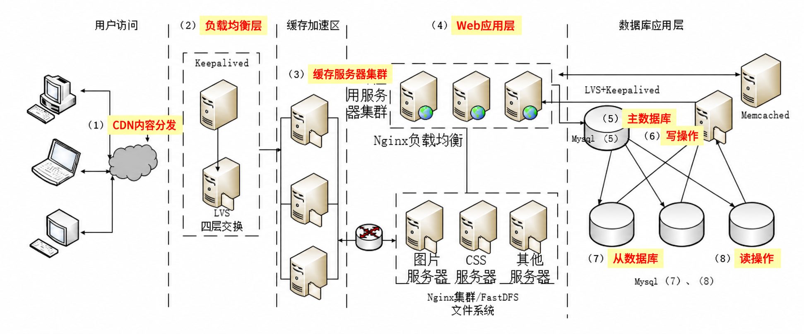

# 第 10 章 软件架构的演化和维护

> 目录骨架依据《系统架构设计师教程（第 2 版）》；按专题汇集概念、例题与辨析。

## 10.1 软件架构演化和定义的关系

### 10.1.1 演化的重要性

### 10.1.2 演化和定义的关系

#### 一、软件架构经典三元组定义 SA = {组件, 连接件, 约束} 与演化映射关系 ⭐⭐⭐

[考查：综合知识（三元组各要素一对一法定定义辨析、静态与动态架构演化变动对象判定）]

依据《系统架构设计师教程（第 2 版）》第 10 章 10.1 节，要研究软件架构的演化（Architecture Evolution），首先必须明确软件架构的经典形式化定义：**软件架构是由组件、连接件和约束构成的集合**，即：
$$\text{SA} = \{ \text{组件 (Component)}, \text{连接件 (Connector)}, \text{约束 (Constraint)} \}$$

##### 1. 软件架构三元组要素职责与考场防混淆全景对比表 ⭐⭐⭐

| 三元组要素 | 英文对照 | 官方教程法定核心定义 | 架构演化中的典型变更动作举例 | 考场一对一秒杀题眼词 ⭐⭐⭐ | 高频命题张冠李戴陷阱 |
|:---|:---|:---|:---|:---|:---|
| **组件**<br>（构件） | **Component** | 软件架构的基本要素和结构单元，表示系统中主要的**计算元素和数据存储模块**。 | 新增/删除/替换业务微服务模块（如新增实时风控计算引擎、拆分订单数据库模块）。 | **“主要的计算元素”**<br>**“数据存储模块”**<br>“基本结构单元” | 干扰项常将选项 A 的组件定义伪装成连接件或约束。 |
| **连接件** ⭐⭐⭐ | **Connector** | 表示**组件间的交互关系和通信机制**，支配组件之间的信息传递与控制流交互。 | 将组件间调用由“同步 RPC / HTTP”演化替换为“Kafka / RabbitMQ 异步消息总线”或管道机制。 | **“组件间的交互关系”**<br>**“通信机制”** | 🚫 **头号混淆源**：<br>极易因“通信规则”字面联想被误判为“约束”！牢记**交互关系与通信机制 100% 属于【连接件】**！ |
| **约束** ⭐⭐⭐<br>（配置） | **Constraint**<br>(Configuration) | 表示**组件和连接件之间的拓扑关系和配置**，为组件和连接件提供额外数据支撑（架构的约束数据或架构的参数）。 | 规定禁止跨层拓扑直连、将单链路拓扑动态重组为星型多活拓扑、调整限流/连接池等架构参数配置。 | **“拓扑关系和配置”**<br>**“额外数据支撑”**<br>**“架构约束数据/架构参数”** | 🚫 **本题法定正解**：<br>只要题干问`约束`，唯一标准答案必锁 **“组件和连接件之间的拓扑关系和配置”**！ |

##### 2. 软件架构演化与三元组的内在统一关系
1. **静态与动态演化的本质**：软件架构演化的实质就是对 $\text{SA}$ 三元组中的**组件、连接件、约束**执行**增加、删除、修改或重配置**操作，从而使软件系统从初始架构状态 $\text{SA}_0$ 迁移至新架构状态 $\text{SA}_1$。
2. **运行时动态演化的核心抓手**：在云原生与自适应系统中，若在不改动单个微服务业务代码（**组件不变**）、不更换通信协议（**连接件不变**）的前提下，通过动态调整集群拓扑结构（如主从拓扑切换、多活分流拓扑重组）与实时下发限流/权重参数来应对流量洪峰，其本质是演化了三元组中的 **【约束（拓扑关系和配置）】**。

> [!IMPORTANT]
> **软件架构三元组秒杀口诀**：
> - **“组件管计算存储（干活单元），连接件管交互通信（传话桥梁），约束管拓扑配置（全局图纸与架构参数）！”**  
> - **“见『计算元素+数据存储』选组件；见『交互关系+通信机制』选连接件；见『拓扑关系+配置/架构参数』必选约束！”**

  - 【题库章节练习】 题目 1（在软件架构定义 $\text{SA}=\{\text{组件}, \text{连接件}, \text{约束}\}$ 中，下列关于`约束`的描述正确的是 $\to$ 选【B. 约束是组件和连接件之间的拓扑关系和配置】）。

#### 二、软件架构三要素“演化特点”与 10.2 面向对象架构演化四过程映射（题 1 vs 题 5 连环防坑指南）⭐⭐⭐

[考查：综合知识（三要素“静态定义” vs “演化特点”双语境辨析、A/B 主宾互换优选法、10.2 面向对象演化四子过程映射）]

在《系统架构设计师教程（第 2 版）》第 10 章 10.1.2 节与 10.2 节中，命题人极常设置 **“题目 1（考三元组静态定义）”与“题目 5（考三要素演化特点）”的连环套陷阱**。必须严格区分以下两套官方教材原话口径：

##### 1. 静态定义（题 1）vs 演化特点（题 5）vs 面向对象演化四过程（10.2 节）全景穿透表 ⭐⭐⭐

| SA 三元组要素 | 语境 A：问【静态定义】（题目 1 口径） | 语境 B：问【演化特点】（题目 5 口径）⭐⭐⭐ | 对应 10.2 面向对象架构演化子过程 ⭐⭐⭐ | 考场常见主宾颠倒与连环设陷 |
|:---|:---|:---|:---|:---|
| **组件**<br>（Component） | 系统中主要的**计算元素和数据存储模块**（基本要素和结构单元）。 | **组件演化主要体现在组件中模块的增加、删除或修改**（**题目 5 正解 D**）。 | **10.2.1 对象演化（Object Evolution）**<br>（类图/对象图中对象实例的添加 `AO`、删除 `DO`）。 | 🚫 选项 A 将连接件的“交互消息增删变”张冠李戴给组件演化。 |
| **连接件**<br>（Connector） | 组件间的**交互关系和通信机制**。 | **连接件演化主要体现在组件交互消息的增加、删除或改变**。 | **10.2.2 消息演化 + 10.2.3 复合片段演化**<br>（顺序图中交互消息 `AM`/`DM`/`MM`/`SM` 及 `alt`/`loop`/`opt` 控制流增删改）。 | 🚫 选项 B 将组件的“模块增删改”张冠李戴给连接件演化。 |
| **约束**<br>（Constraint） | **组件和连接件之间**的**拓扑关系和配置**（题目 1 正解 B）。 | **为组件和连接件提供额外数据支撑（架构的约束数据、架构的参数、前/后置条件）的变更**。 | **10.2.4 约束演化（Constraint Evolution）**<br>（前置/后置条件与架构约束参数 `AC`/`DC`/`MC` 的变更与检验）。 | 🚫 **连环套陷阱（题目 5 误选 C 根源）**：<br>在问“演化特点”时，拓扑连接变动已拆解为模块增删与交互消息增删，约束重在提供**额外数据支撑/架构参数**；且当 A/B 互换主宾、D 还原原话时，必选 D！ |

> [!IMPORTANT]
> **三要素“演化特点”考场秒杀口诀**：
> - **“组件演化改模块（模块/对象增删改），连接件演化改消息（交互消息与复合片段增删变），约束演化撑数据（额外支撑数据与架构参数）！”**  
> - **“铁三角做题定律：单选题中一旦看到『A 和 B 主语谓语交叉对调，而 D 将其中之一还原配对』，100% 答案就在互换组 D 中产生！”**

  - 【题库章节练习】 题目 5（在软件架构演化过程中，关于软件架构三要素演化特点的描述，正确的是 $\to$ 选【D. 组件演化主要体现在模块的增加、删除或修改】）。

## 10.2 面向对象软件架构演化过程

[考查：综合知识（UML 2.0 顺序图与类图视角下的面向对象架构演化四子过程、演化算子英文缩写 `AO`/`DO`/`AM`/`DM`/`MM`/`SM`/`ACF`/`DCF`/`FTM`/`FCC` 辨析、复合片段演化性质及 `FCC` 双向执行转移影响分析）]

依据《系统架构设计师教程（第 2 版）》第 10 章 10.2 节，面向对象软件架构演化过程主要借助 **UML 类图（静态结构）** 与 **UML 2.0 顺序图（动态交互）** 来建模与追踪，分为 **对象演化、消息演化、复合片段演化、约束演化** 四个核心子过程：

#### 一、10.2 面向对象软件架构演化四子过程及操作算子全景对比表 ⭐⭐⭐

| 演化子过程 | 对应 SA 三元组要素 | 法定演化算子（缩写 + 全称 + 含义）⭐⭐⭐ | 核心演化实质与跨过程联动规律 ⭐⭐⭐ | 考场高频设陷点 |
|:---|:---|:---|:---|:---|
| **10.2.1 对象演化**<br>（Object Evolution） | **组件演化**<br>（模块增删） | - **`AO`** (`Add Object`，添加对象)<br>- **`DO`** (`Delete Object`，删除对象) | 在顺序图中增删参与交互的对象实例。<br>🔗 **联动铁律**：孤立对象无交互意义，故 **`AO` 必伴随 `AM`（添加消息）**；**`DO` 必联动执行 `DM`（删除与该对象关联的全部收发消息）**。 | 误认为 `DO` 可以只删对象生命线而保留其发送或接收的悬空消息。 |
| **10.2.2 消息演化**<br>（Message Evolution） | **连接件演化**<br>（交互通信变更） | - **`AM`** (`Add Message`，添加消息)<br>- **`DM`** (`Delete Message`，删除消息)<br>- **`MM`** (`Modify Message`，修改消息)<br>- **`SM`** (`Swap Message`，消息换序) | 在对象生命线之间增删交互消息、修改消息名称/参数或对调两条消息的发送先后次序。<br>🔗 **联动铁律**：`MM` 与 `SM` 极易打破原有的前后置条件与时序依赖，需触发 **10.2.4 约束演化** 检验。 | 误认为 `SM`（消息换序）只改变局部顺序图画法、不影响时态属性与约束。 |
| **10.2.3 复合片段演化** ⭐⭐⭐<br>（Combined Fragment Evolution） | **连接件演化**<br>（控制流与消息序列变更） | - **`ACF`** (`Add Combined Fragment`，添加复合片段)<br>- **`DCF`** (`Delete Combined Fragment`，删除复合片段)<br>- **`FTM`** (`Fragment Type Modification`，复合片段类型改变)<br>- **`FCC`** (`Fragment Condition Change`，**复合片段条件改变**) | 复合片段是对象交互关系的控制描述（可表示不同场合的交互），**其演化在形式化语义上等价于消息序列演化**。<br>🔗 **联动铁律**：**当 `FCC` 改变复合片段内部执行的条件时，同时影响“符合条件的执行转移”与“不符合条件的执行转移”**！ | 🚫 **本题 C 项致命设陷**：<br>谎称“`FCC` 改变条件时，**仅会影响符合条件**的执行转移”；或误把 B 项“复合片段的演化等价于消息序列演化”当错项。 |
| **10.2.4 约束演化**<br>（Constraint Evolution） | **约束演化**<br>（额外数据支撑与时态属性检验） | - **`AC`** (`Add Constraint`，添加约束)<br>- **`DC`** (`Delete Constraint`，删除约束)<br>- **`MC`** (`Modify Constraint`，修改约束) | 对交互的前置条件、后置条件、不变式或**时态属性（Temporal Properties）**进行调整与形式化模型检测，确保架构演化后的一致性与无死锁性。 | 忽略复合片段演化（如 `FTM`/`FCC`）会使对象间交互的约束或时态属性产生变化。 |

#### 二、结构化分析（SA）三大核心模型（DFD / STD / E-R）与面向对象分析（OOA / UML）范式对比防坑指南（题库 10.2 节题目 7）⭐⭐⭐

[考查：综合知识（结构化分析 SA 功能模型 DFD、行为模型 STD、数据模型 E-R 图及中心数据字典 DD 映射；SA 与 OOA/UML 跨流派建模工具辨析；SA 到 SD 模块结构图 SC 演化）]

在《系统架构设计师教程（第 2 版）》第 5 章与第 10 章 10.2 节题库练习（题目 7）中，常将**结构化分析方法（SA）**的三大核心模型与**面向对象分析方法（OOA / UML）**的视图混编考查，专门检验考生是否严守**“方法学范式前置边界”**：

##### 1. 结构化分析（SA）三大模型 + 中心枢纽 vs 面向对象分析（OOA / UML）全景对照表 ⭐⭐⭐

| 建模维度 | 结构化分析（SA）法定建模工具 ⭐⭐⭐ | 结构化分析核心要素与职责 | 面向对象分析（OOA / UML）对应工具 | 考场跨流派设陷与排雷铁律 ⭐⭐⭐ |
|:---|:---|:---|:---|:---|
| **功能模型**<br>（Functional Model） | **数据流图**<br>（**DFD**, Data Flow Diagram）<br>✅ **题目 7 问题 1 正解 C** | 由**外部实体、加工（处理/功能）、数据存储、数据流**四大要素组成，描述数据在系统中如何流转及被加工变换。 | **用例图**<br>（Use Case Diagram，从外部执行者视角捕获功能需求） | 🚫 **本题头号跨流派陷阱**：<br>看到“功能模型”切忌条件反射选“用例图”！题干只要锁定**“在结构化分析方法中”**，功能模型 100% 选 **DFD**，见“用例图/类图/对象图”立即排除！ |
| **行为模型**<br>（Behavioral Model）<br>（动态/控制模型） | **状态转换图**<br>（**STD**, State Transition Diagram）<br>✅ **题目 7 问题 2 正解** | 由**状态、事件、动作/状态迁移**组成，描述系统如何响应外部事件以及状态随时间的动态变迁。 | **状态图 / 活动图 / 顺序图 / 通信图** | 🚫 切勿把表示数据流转加工的 DFD 或表示静态实体的 E-R 图误选为行为模型。 |
| **数据模型**<br>（Data Model）<br>（信息模型） | **实体联系图**<br>（**E-R 图**, Entity-Relationship Diagram） | 由**实体、属性、联系（1:1 / 1:N / M:N）**组成，描述系统静态数据对象及其相互关系。 | **类图 / 对象图**<br>（Class / Object Diagram） | 🚫 **同流派张冠李戴干扰项（选项 A）**：<br>E-R 图虽属结构化分析，但表示的是**数据模型**而非功能模型。 |
| **核心中心枢纽**<br>（中心库） | **数据字典**<br>（**DD**, Data Dictionary） | 位于 **DFD、STD、E-R 图三大模型的正中心**，对三类模型中的所有图形元素（数据流、数据项、数据存储、加工、实体等）进行精确定义。 | 模型元数据库 / 词汇表（Glossary） | 牢记**“三大模型围着数据字典（DD）转”**。 |
| **向设计阶段演化**<br>（SA $\to$ SD 映射） | **模块结构图**<br>（**SC**, Structure Chart） | 进入**结构化设计（SD，概要设计）**阶段后，分析阶段的 **DFD** 通过**变换分析**或**事务分析**映射导出为**模块结构图（SC）**。 | 设计类图 / 组件图 / 部署图 / 包图 | 区分概要设计的**模块结构图（SC）**与详细设计的**程序流程图 / N-S 图 / PAD 图**。 |

> [!IMPORTANT]
> **结构化分析（SA）三大模型秒杀口诀**：
> - **“先看流派再看图：结构化（SA）绝不选 UML（用例图/类图/对象图秒排）！”**  
> - **“结构化三剑客：功（功能模型）DFD、行（行为模型）状态（STD）、数（数据模型）E-R，数据字典（DD）坐中央；到了结构化设计（SD），DFD 导出模块结构图（SC）！”**

### 10.2.1 对象演化

1. **添加对象（`AO`, Add Object）**：当系统引入新的业务功能模块或拆分现有职责时，需要在顺序图中执行 `AO` 添加新对象生命线，并配合 `AM` 建立新对象与其他对象的消息交互。
2. **删除对象（`DO`, Delete Object）**：当移除冗余模块时执行 `DO`。执行 `DO` 前必须先通过 `DM` 清理所有以该对象为源（发送方）或目标（接收方）的交互消息，避免出现悬空通信。

### 10.2.2 消息演化

消息演化直接反映对象间交互关系的调整，包括 **`AM`（AddMessage，添加消息）**、**`DM`（DeleteMessage，删除消息）**、**`MM`（ModifyMessage，修改消息属性/参数/返回值）**、**`SM`（SwapMessage，交换消息先后次序）** 和 **`CM`（ChangeMessage，改变消息的源或目标）**。其中 `SM` 改变了事件发生的偏序关系，极易引发并发竞争或时态约束违背。

#### 一、消息演化的两类划分标准（第 1 类无约束冲突 vs 第 2 类触发约束不满足）⭐⭐⭐

[考查：综合知识（10.2.2 消息演化第 1 类与第 2 类的分类判据、三同一异极性排除法、与 10.2.4 约束演化的联动）]

在《系统架构设计师教程（第 2 版）》第 10 章 10.2.2 节中，依据 **“消息演化后是否触及现有架构约束、是否导致原有约束不再满足”**，将全部消息演化操作划分为两大类别：

| 演化分类 | 核心分类标尺（与现有约束的关系）⭐⭐⭐ | 教程典型场景与考场对应选项 | 后续架构演化联动要求 | 考场秒杀判别词 |
|:---|:---|:---|:---|:---|
| **第 1 类演化**<br>（无约束冲突） | 演化的消息与现有约束**无直接关联**，或演化后**未涉及任何约束相关变化**（原有约束依然满足）。 | 1. `AddMessage`（题库常错印为 `AddressMessage`）的大多数操作（选项 A）<br>2. 改变消息的源或目标（`CM`）后产生的新消息**与某约束无直接关联**（选项 B）<br>3. 消息演化**未涉及任何约束相关变化**（选项 D） | ❌ **无需触发约束重构**<br>（既有约束保持满足） | **“与某约束无直接关联”**<br>**“未涉及任何约束变化”**<br>**“大多数常规操作”** |
| **第 2 类演化** ⭐⭐⭐<br>（触发约束冲突） | 被操作的消息**本身是某约束的内容之一**，消息演化（如删除 `DM`、换序 `SM`、修改 `MM`）后**导致该约束不再满足**！ | 1. **删除的某条消息是某约束的内容之一，演化后约束不满足（本题 4 正解 C）**<br>2. 交换两条具有先后时序约束的消息顺序（`SM`），导致时序约束不满足 | ✅ **必须联动 `10.2.4 约束演化`**<br>（执行 `DC` 删除失效旧约束 + `AC` 添加新约束） | **“是某约束的内容之一”**<br>**“演化后约束不满足”** |

> [!IMPORTANT]
> **10.2.2 消息演化两类划分秒杀口诀**：
> - **“一类演化不碰约（与约束无直接关联、未涉及约束变化），二类演化破旧约（消息是约束内容之一、演化后约束不满足）！”**  
> - **“三同一异秒杀技：选项中一旦发现 B、D、A 都在说『与约束无关/不触碰约束』，它们必然同属第 1 类被捆绑淘汰，唯一反向说『演化后约束不满足』的 C 必为第 2 类正解！”**

  - 【题库章节练习】 10.2 节题目 4（以下属于消息演化中第 2 类演化的是 $\to$ 选【C. 删除的某条消息是某约束的内容之一，演化后约束不满足】）。

### 10.2.3 复合片段演化 ⭐⭐⭐

#### 一、复合片段的法定定性与三大核心公理（题库原话直考）
1. **公理 1（控制描述定性 - 对应选项 A）**：**复合片段（Combined Fragment）是对象交互关系的控制描述，可表示不同场合的交互**（例如通过 `opt` 表示可选场合、`alt` 表示多路条件抉择场合、`loop` 表示循环重复场合、`par` 表示并发执行场合、`break` 表示异常中断场合）。
2. **公理 2（消息序列等价性 - 对应选项 B，极易被误杀！）** ⭐⭐⭐：**复合片段的演化等价于消息序列演化，会产生分支的复合片段包含多种结构**。
   - *底层机理*：在形式化验证（如将 UML 顺序图映射为进程代数、自动机或 Petri 网）中，任何复合片段展开后本质上都是由控制算子组合而成的**一组受控消息序列（Message Sequences）**，因此对复合片段的增删改在语义上完全等价于对消息序列集合的演化。
3. **公理 3（约束与时态属性传导 - 对应选项 D）**：**复合片段演化可能使对象间交互的约束或时态属性产生变化**（如可达性、活性、安全性、响应时序发生偏移），演化后需联动验证架构约束。

#### 二、`FCC`（复合片段条件改变）的双向执行转移法则（本题必考题眼）⭐⭐⭐
- **算子对比**：
  - **`FTM`（Fragment Type Modification，复合片段类型改变）**：修改复合片段左上角的操作符类型（如将单次可选 `opt` 改为循环 `loop`，或将抉择 `alt` 改为并发 `par`）；
  - **`FCC`（Fragment Condition Change，复合片段条件改变）**：修改复合片段内部交互操作数（Interaction Operand）的**监护条件（Guard Condition，记为 $P$）**。
- **为什么 `FCC` 绝不“仅影响符合条件的执行转移”？**
  - 在任意条件控制流中，监护条件 $P$ 将系统状态迁移空间划分为互为补集的两部分：**符合条件的执行转移（$P = \text{True}$）** 与 **不符合条件的执行转移（$\neg P = \text{False}$，即走 `else` 分支或跳过/退出该复合片段）**。
  - 当执行 `FCC` 将条件由 $P$ 改为 $P'$ 时：
    - 若条件收紧（如 `[x > 0]` $\to$ `[x > 100]`），原本属于“符合条件执行转移”的状态区间 $(0, 100]$ 会被剥离并**划入“不符合条件的执行转移”**；
    - 若条件放宽（如 `[x > 100]` $\to$ `[x > 0]`），原本属于“不符合条件执行转移”的状态区间 $(0, 100]$ 则会**转入“符合条件的执行转移”**。
  - **法定结论**：**当 `FCC` 改变复合片段内部执行的条件时，不仅会影响符合条件的执行转移，而且也会影响不符合条件的执行转移（双向互补同时受影响）！** 凡在选项中见到“**仅会影响符合条件的执行转移**”，100% 判定为错误表述！

> [!IMPORTANT]
> **10.2.3 复合片段演化考场秒杀口诀**：
> - **“复合片段控交互（A 对），演化等价消息序（B 对，切莫误杀！），约束时态随演迁（D 对）！”**  
> - **“四大算子 `ACF`（增）、`DCF`（删）、`FTM`（改类型）、`FCC`（改条件）；`FCC` 一改守卫式，真假转移双受牵——见『仅影响符合条件的执行转移』必选为错（C 错）！”**

#### 三、UML 2.0 顺序图“序列片段 / 复合片段”同源译名防坑与五类消息类型（2014 下半年真题连环考法）⭐⭐⭐

[考查：综合知识（UML 2.0 顺序图循环/选择复杂交互建模元素、`序列片段` vs `组合` 截词陷阱辨析、顺序图五种法定消息类型及箭头符号）]

在 2014 年下半年系统架构设计师真题及题库第 10 章 10.2 节（题目 5）中，常将 **UML 2.0 顺序图（Sequence Diagram，又称序列图）** 的底层元模型术语与面向对象软件架构演化联合考查：

##### 1. 第一空排雷：“序列片段 / 复合片段 / 组合片段” vs “组合” vs “泳道” ⭐⭐⭐

| 选项术语 | 英文对照 | 所属 UML 视图 | 核心图形表示与职责 | 考场真题设陷与排雷铁律 ⭐⭐⭐ |
|:---|:---|:---|:---|:---|
| **序列片段** ⭐⭐⭐<br>（复合片段 / 组合片段） | **Sequence Fragment**<br>(Combined Fragment) | **UML 2.0 顺序图**<br>（序列图） | 左上角带五边形操作符标签（`loop` 循环、`alt` 多路选择、`opt` 单路可选、`par` 并行）的矩形框。 | ✅ **本题第一空唯一正解（D）**！<br>无论试卷译作“**序列片段**”、“**复合片段**”还是“**组合片段**”，**核心词根必含【片段】二字**！ |
| **组合** ❌<br>（头号截词陷阱） | **Composition** | **UML 类图**<br>（静态结构图） | **实心菱形 + 实线**，表示整体与部分之间同生共死的强生命周期包含关系（如公司与部门）。 | 🚫 **辨析提示 C 根源**：<br>出题人故意将“组合片段”截掉“片段”二字变成单独的“**组合**”！牢记**单写“组合”100% 是类图实心菱形关系**，绝不能在顺序图中选！ |
| **泳道** ❌ | **Swimlane** | **UML 活动图**<br>（行为工作流图） | 用垂直或水平分隔线将活动图划分为多个职责分区，标明每个活动由哪个部门/角色/对象执行。 | 🚫 **跨图混淆高频干扰项（B）**：<br>活动图用**泳道**划分职责；顺序图用垂直的**生命线（Lifeline）**表示对象，绝无泳道！ |
| **嵌套** ❌ | **Nesting** | **UML 状态图 / 包图** | 组合状态（超状态）内部包含子状态，或包内嵌子包。 | 🚫 非顺序图描述循环、选择交互的标准建模元素名。 |

##### 2. 第二空必背：UML 2.0 顺序图中对象之间的五种消息类型（对应 10.2.2 消息演化对象）⭐⭐⭐

| 消息类型 | 英文名称 | UML 2.0 标准箭头画法 | 发送方与接收方交互/阻塞语义 ⭐⭐⭐ |
|:---|:---|:---|:---|
| **1. 同步消息** | Synchronous Message | **实线 + 实心三角箭头**（`──▶`） | 发送者发出消息后**阻塞等待**，直到接收对象将消息处理完成并返回后才继续执行。 |
| **2. 异步消息** | Asynchronous Message | **实线 + 开放线形箭头**（`───>`） | 发送者在发送完消息后**不等待**接收方处理完毕，立即继续执行自己的后续处理。 |
| **3. 返回消息** | Return / Reply Message | **虚线 + 开放有向箭头**（`- - ->`） | 当一个对象将同步消息发送给另一个对象后，接收方返回的虚线有向边，表示原消息已处理完毕。 |
| **4. 创建消息** | Create Message | 指向目标对象**生命线头部框**的有向边（常标 `<<create>>`） | 表示在交互过程中动态实例化（创建）消息传递的目标对象。 |
| **5. 销毁消息** | Destroy Message | 指向目标对象生命线底部 **`X`（大叉号）** 的有向边（`<<destroy>>`） | 表示对消息传递目标对象的显式删除与生命周期终止。 |

  - 【题库章节练习】 10.2 节题目 1（以下关于复合片段演化的描述，错误的是 $\to$ 选【C. 当 FCC 改变复合片段内部执行的条件时，仅会影响符合条件的执行转移】）。

### 10.2.4 约束演化

#### 一、面向对象软件架构四大演化算子与约束演化“删旧加新（DC + AC）”化归法则 ⭐⭐⭐

[考查：综合知识（10.2.1~10.2.4 四大子过程演化算子缩写、约束演化信息来源、修改等同于删除+添加化归定理）]

依据《系统架构设计师教程（第 2 版）》第 10 章 **10.2 节“面向对象软件架构演化过程”**，面向对象的软件架构演化（通常基于 UML 类图与顺序图）细分为 **对象演化、消息演化、复合片段演化、约束演化** 四个子过程，其底层均遵循 **“复杂修改操作等价化归为『先删除原有元素 + 再添加新元素』”** 的形式化代数思想：

##### 1. 面向对象软件架构四大演化子过程与基本算子全景对比表 ⭐⭐⭐

| 教程节号 | 演化子过程 | 映射 SA 三元组 | 法定基本演化算子（英文缩写）⭐⭐⭐ | “修改/变更”的形式化化归定理 ⭐⭐⭐ | 考场高频设陷与排雷判据 |
|:---|:---|:---|:---|:---|:---|
| **10.2.1** | **对象演化**<br>(Object) | **组件演化** | **`AO`**（Add Object，添加对象）<br>**`DO`**（Delete Object，删除对象） | 对象增删必然触发与之交互的消息同步执行添加（`AM`）或删除（`DM`）。 | ❌ 称“删除对象（DO）不影响原有交互消息”。 |
| **10.2.2** | **消息演化**<br>(Message) | **连接件演化** | **`AM`**（加消息）、**`DM`**（删消息）<br>**`MM`**（改消息）、**`SM`**（交换顺序 Swap）<br>**`CM`**（改变/反转方向 Change） | 后 3 种操作（**`MM` 修改、`SM` 换序、`CM` 反向**）均可等同于：**先 `DM`（删除原消息）+ 再 `AM`（添加新消息）**。 | ❌ 称“消息演化只有添加和删除，不含换序/反向”。 |
| **10.2.3** | **复合片段演化**<br>(Combined Fragment) | **连接件演化** | **`ACF`**（添加复合片段）<br>**`DCF`**（删除复合片段）<br>**`MCF`**（修改复合片段，如 `opt` 改 `alt`） | **`MCF`（修改复合片段）** 可等同于：**先 `DCF`（删除原有复合片段）+ 再 `ACF`（添加新复合片段）**。 | 复合片段控制流（`alt`/`opt`/`loop`/`par`）属于交互连接机制。 |
| **10.2.4** | **约束演化** ⭐⭐⭐<br>(Constraint) | **约束演化** | **`AC`**（Add Constraint，添加约束）<br>**`DC`**（Delete Constraint，删除约束） | **对约束信息进行修改，可等同于：先 `DC`（删除原有约束）+ 再 `AC`（添加新约束）**（**题目 2 正解 D**）。 | 🚫 **三大伪造陷阱**：<br>① “仅与对象属性有关、与消息无关”❌<br>② “非规律性改变无需判断直接删除”❌<br>③ “演化后原有约束全部失效”❌ |

##### 2. 约束演化（10.2.4）三大核心命题规律拆解
1. **约束信息的双重挂靠性（既管对象，又管消息）**：
   - 在 UML 架构模型中，约束不仅挂靠在**对象属性**上（如账户余额非负约束 `{balance >= 0}`），更大量挂靠在对象间的**交互消息（Message）**与复合片段上（如消息发送守卫条件、消息往返响应时延约束 `{t2 - t1 <= 200ms}`）。因此**对象演化和消息演化都会引起约束信息的变化**，绝非“与消息无关”。
2. **规律性改变 vs 非规律性改变**：
   - **源于规律性改变**：因对象增删（`AO`/`DO`）或消息变更（`AM`/`DM` 等）连带引起的约束增删；
   - **源于非规律性改变**：独立于对象/消息增删的业务规则或非功能指标变更，**必须经过严格的一致性与安全性判断**后决定是否执行 `DC`/`AC`，绝不可“无需判断直接删除”。
3. **局部增量有效性**：约束演化后，仅被 `DC` 的约束失效，其余未变更的原有约束依然有效。

> [!IMPORTANT]
> **10.2.4 约束演化秒杀口诀**：
> - **“约束既管对象又管消息（见『仅…与消息无关』当场枪毙）；”**  
> - **“非规律变更须谨慎判断（见『无需判断直接删 / 原约束全部失效』当场枪毙）；”**  
> - **“10.2 化归通杀技：一切修改（改约束 / 改消息 / 改复合片段）皆等于『删除原有项（DC/DM/DCF）+ 添加新项（AC/AM/ACF）』！”**

  - 【题库章节练习】 题目 2（约束演化中，关于约束信息的变化，说法正确的是 $\to$ 选【D. 对约束信息进行修改，可等同于删除原有约束并添加新约束】）。

在完成对象演化（`10.2.1`）、消息演化（`10.2.2`）和复合片段演化（`10.2.3`）后，系统的拓扑配置、交互路径或时态属性可能发生偏移，需通过约束演化（`AC` / `DC` / `MC`）更新并检验对象交互的前置条件、后置条件及全局架构约束。

## 10.3 软件架构演化方式的分类

### 10.3.1 软件架构演化时期

#### 一、软件过程四大基本活动（描述、开发、有效性验证、演化）与架构演化方式衔接（题库 10.3 节题目 12）⭐⭐⭐

[考查：综合知识（软件过程四大基本活动铁序与定义、“软件过程模型 vs 软件活动”范畴辨析、“其中”回指填空法、10.3 静态演化 vs 动态演化衔接）]

依据《系统架构设计师教程（第 2 版）》第 5 章与第 10 章 **10.3 节“软件架构演化方式的分类”**，软件生命周期模型（又称软件开发模型或软件过程模型）是对软件过程的简化抽象描述；而真实的**软件过程（Software Process）**是制作软件产品的一组活动及其结果，主要由软件人员完成，核心包含以下 **4 项基本活动**：

##### 1. 软件过程四大基本活动 vs 软件过程模型 vs 10.3 架构演化分类全景对照表 ⭐⭐⭐

| 活动顺序与标准名称 | 英文对照 | 法定核心职责与题干判别词 ⭐⭐⭐ | 对应 10.3 架构演化时期与分类 | 考场高频设陷与排雷铁律 ⭐⭐⭐ |
|:---|:---|:---|:---|:---|
| **1. 软件描述** ⭐⭐⭐<br>（✅ **题目 12 问题 3 正解**） | **Software Specification** | **定义软件功能以及使用的限制（约束）**。 | 设计前 / 需求与架构规格期（静态演化起点） | 🔗 **“其中”回指铁律**：题干尾句“**其中，定义了软件功能以及使用的限制**”必然从前文已列出的四大活动名中回指选出，必选**软件描述**（切勿选不在四活动列表中的“软件需求”）。 |
| **2. 软件开发** ⭐⭐⭐<br>（✅ **题目 12 问题 1 正解 D**） | **Software Development** | **软件的设计和实现**，软件工程人员制作出能满足“软件描述”的软件产品。 | 设计期 / 实现期（编译期与加载期静态演化） | 🚫 **辨析提示 A（软件模型）根源**：<br>忽略了主语是“**软件活动**主要包括……”！**软件模型（A）**是静态抽象表示而非人员执行的活动；**软件需求（B）/软件分析（C）**仅属前期描述阶段的子集，夹在“软件描述”与“有效性验证”之间的建造活动必为**软件开发（D）**！ |
| **3. 软件有效性验证** | **Software Validation** | 软件必须经过严格的验证（确认与测试），以**保证能够满足客户的需求**。 | 集成与确认测试期（静态/上线前演化检验） | 注意与“软件描述（定功能与限制）”和“软件演化（适应变化）”区分定义。 |
| **4. 软件演化** ⭐⭐⭐<br>（✅ **题目 12 问题 2 正解**） | **Software Evolution** | **改进软件以适应不断变化的需求**。 | 运行期与维护期：<br>- 停机修改源码/图纸 $\to$ **10.3.2 静态演化**<br>- 运行时不停机重配置 $\to$ **10.3.3 动态演化** | 牢记第 4 项基本活动标准术语为**“软件演化”**（而非泛称的软件模型或软件分析）。 |

> [!IMPORTANT]
> **软件过程四大基本活动秒杀口诀**：
> - **“活动四步铁序定：一描述（定功能与使用限制）、二开发（设计与实现）、三验证（严格确认满需求）、四演化（改进软件适变化）！”**  
> - **“先辨词性防错位：『软件过程模型/软件模型』是抽象图纸不是活动，问『软件活动主要包括』见『软件模型（A）』当场秒排！”**

### 10.3.2 软件架构静态演化

发生在软件架构设计、实现及停机维护阶段（系统未运行或停止运行期间），通过对架构描述文档、源代码模块或静态配置文件的修改来实现演化。

### 10.3.3 软件架构动态演化

#### 一、软件架构演化四时期与软件动态性的三个级别（交互动态性、结构动态性、架构动态性）⭐⭐⭐

[考查：综合知识（10.3.1 架构演化四时期、静态演化 vs 动态演化分界、10.3.3 软件动态性三级别 `Data -> Instance -> Type` 递进辨析）]

依据《系统架构设计师教程（第 2 版）》第 10 章 **10.3 节“软件架构演化方式的分类”**：

##### 1. 软件架构演化四个时期与静态/动态演化分界线（10.3.1 ~ 10.3.2）
1. **四个演化时期**：按软件生命周期时间轴，架构演化发生在 **① 设计时（Design-time）**、**② 编译时（Compile-time）**、**③ 加载时（Load-time）**、**④ 运行时（Run-time）** 四个时期；
2. **静态演化（10.3.2）vs 动态演化（10.3.3）**：
   - **静态演化**：发生在 **设计时、编译时、加载时**（系统尚未运行或停机状态下的演化）；
   - **动态演化**：发生在 **运行时（Run-time）**（系统在不停机运行过程中发生的在线动态演化）。

##### 2. 软件动态性的三个标准递进级别全景对比表（10.3.3 核心必考）⭐⭐⭐

| 动态性级别（由低到高） | 英文名称 | 面向对象类比（`Data -> Instance -> Type`） | 官方教程法定核心定义与权限边界 ⭐⭐⭐ | 考场一对一秒杀题眼词 ⭐⭐⭐ | 高频设陷与防混淆指南 |
|:---|:---|:---|:---|:---|:---|
| **第 1 级：<br>交互动态性** | Interactive Dynamicity | **变数据（`Data`）**<br>（对象实例和类均锁死，仅传参变化） | 要求**数据在固定的结构下动态交互**（组件实例、连接件实例及拓扑结构均固定不变）。 | **“固定的结构下动态交互”**<br>“仅数据交互变化” | 最低级别的动态性，不涉及任何组件实例或结构的修改。 |
| **第 2 级：<br>结构动态性** ⭐⭐⭐ | Structural Dynamicity | **变实例（`Instance`）**<br>（`Class` 类库锁死，动态 `new`/销毁已有类的对象实例） | **允许对结构进行修改，通常表现为组件和连接件【实例】的添加和删除**（但**不包括新组件类型的定义**）。 | **“允许对结构进行修改”**<br>**“组件和连接件【实例】的添加和删除”** | 🚫 **辨析提示 B 根源**：<br>权限仅限已有类型的**实例（Instance）增删**，一旦题目出现“**新组件类型的定义**”绝不可选结构动态性！ |
| **第 3 级：<br>架构动态性** ⭐⭐⭐ | Architectural Dynamicity | **变类型（`Type`）与基本构造**<br>（运行时反射定义并热注入全新的 `Class` 类） | **允许对软件架构的【基本构造】进行变动，包括结构的重定义，如【新的组件类型】的定义**。 | **“基本构造进行变动”**<br>**“结构的重定义”**<br>**“新的组件类型的定义”** | 🚫 **本题 5 正解 C**：<br>最高级别的动态性！见到“**基本构造变动 / 新组件类型的定义**”100% 锁定【架构动态性】！ |

> [!IMPORTANT]
> **10.3.3 软件动态性三级阶梯秒杀口诀**：
> - **“一交互（固定结构传数据 Data），二结构（类型固定增删实例 Instance），三架构（基本构造重定义、定义新组件类型 Type）！”**  
> - **“考场分水岭：见『组件和连接件【实例】的添加删除』选【结构动态性】；见『基本构造变动 / 【新的组件类型】的定义』必选【架构动态性】（剔除伪造词『拓扑动态性』）！”**

  - 【题库章节练习】 10.3 节题目 5（在软件架构动态演化中，允许对软件架构的基本构造进行变动，如新的组件类型的定义，这属于软件动态性的哪个级别 $\to$ 选【C. 架构动态性】）。

发生在软件系统**运行过程中（Runtime）**，在不停止系统服务的前提下，动态添加/删除/替换组件、切换连接件通信机制或调整拓扑约束配置。

### 10.3.4 遗留系统（Legacy System）演化策略四象限评估模型 ⭐⭐⭐

[考查：综合知识 / 案例分析（遗留系统技术水平 vs 业务价值四象限策略判定：`改造`、`集成`、`淘汰`、`继承`，尤其高频考查第二象限“高技术+低价值/单部门信息孤岛 $\to$ 集成”与第四象限“低技术+高价值 $\to$ 继承”）]

在对企业既有遗留系统进行软件架构演化评估时，软考官方教程以 **“技术水平（技术含量）”** 为横坐标（X 轴）、**“业务价值（商业价值）”** 为纵坐标（Y 轴），将遗留系统划分为四个象限，并分别制定了四套法定演化策略：

#### 一、遗留系统演化策略四象限全景对比表 ⭐⭐⭐

| 象限编号 | 技术水平<br>（技术含量） | 业务价值<br>（商业价值） | 教材典型系统特征与症结描述（考场一对一题眼词）⭐⭐⭐ | 法定演化策略 ⭐⭐⭐ | 演化工程动作与适用理由 | 考场高频张冠李戴陷阱 |
|:---|:---:|:---:|:---|:---:|:---|:---|
| **第一象限**<br>（高水平、高价值区） | **高** | **高** | 技术含量较高且具有较高的商业价值，**系统本身还有极大的生命力**。 | **改造**<br>（Transform） | 在遗留系统的基础上，**新增功能或做改进使用**（局部演化升级）。 | 🚫 **本题 7 辨析提示 D 根源**：<br>误以为“业务价值低就要改造”，牢记**唯有【双高（技高+价高）】才选改造**！ |
| **第二象限** ⭐⭐⭐<br>（高水平、低价值区） | **高** | **低** | 技术含量较高，但业务价值较低，**仅能完成某个部门的业务管理，形成了一个个“信息孤岛”**。 | **集成**<br>（Integrate）<br>（**本题 7 正解 C**） | 通过数据互通、接口封装或企业服务总线（ESB）将该部门孤岛与其他系统**集成整合**，打破信息孤岛以释放全局价值。 | 🚫 看到“技术高、业务价值低、仅限某部门/信息孤岛”不选集成而误选改造或淘汰。 |
| **第三象限**<br>（低水平、低价值区） | **低** | **低** | 技术含量较低，且具有较低的业务价值，维护成本高昂且无保留意义。 | **淘汰**<br>（Scrap） | 废弃旧系统，**全面重新开发新的系统以代替遗留系统**。 | 误对“高技术、低价值”或“低技术、高价值”系统采取一刀切淘汰策略。 |
| **第四象限** ⭐⭐⭐<br>（低水平、高价值区） | **低** | **高** | 技术含量较低（架构老化、紧耦合、语言陈旧），但**具有极高的业务价值（承载企业核心命脉业务，不可中断）**。 | **继承**<br>（Inherit） | 在开发新系统替换遗留系统时，**完全兼容承接遗留系统的功能、数据模型与操作习惯**，确保新老系统平滑过渡。 | 极易与第二象限“集成”混淆：牢记**“技低价高（老命脉）选【继承】，技高价低（单部门孤岛）选【集成】”**！ |

#### 二、遗留系统演化四象限速记坐标图

```text
          ▲ 业务价值（商业价值）
          │
  【高】   │   第四象限：低技术 + 高价值       │   第一象限：高技术 + 高价值
          │   👉 策略：【继承 (Inherit)】     │   👉 策略：【改造 (Transform)】
          │   （老核心命脉：兼容数据平滑替代）  │   （生命力极强：原系统新增/改进）
──────────┼───────────────────────────────────┼──────────────────────────────────►
          │   第三象限：低技术 + 低价值       │   第二象限：高技术 + 低价值 ⭐⭐⭐
  【低】   │   👉 策略：【淘汰 (Scrap)】       │   👉 策略：【集成 (Integrate)】
          │   （无保留价值：全面重开发替代）    │   （仅管某部门/信息孤岛：打通集成）
          └───────────────────────────────────┴──────────────────────────────────
                        【低】                              【高】        技术水平（技术含量）
```

> [!IMPORTANT]
> **遗留系统演化四象限考场秒杀口诀**：
> - **“双高生命强，原位去【改造】；双低无价值，推倒就【淘汰】；”**  
> - **“技低价值高，核心老命脉，平滑要【继承】；”**  
> - **“技高价值低，只管单部门（信息孤岛），打通选【集成】！”**

  - 【题库章节练习 / 历年真题】 10.3 节题目 7（在对遗留系统进行评估时，对于技术含量较高、业务价值较低且仅能完成某个部门的业务管理的遗留系统，一般采用的遗留系统演化策略是 $\to$ 选【**C. 集成**】策略）。

## 10.4 软件架构演化原则

## 10.5 软件架构演化评估方法

> 演化评估中质量属性度量形态（可靠性实数值 vs 可维护性复合子指标集）：参见 [09-软件可靠性基础知识（可靠性实数值 vs 可维护性多子指标）](09-%E8%BD%AF%E4%BB%B6%E5%8F%AF%E9%9D%A0%E6%80%A7%E5%9F%BA%E7%A1%80%E7%9F%A5%E8%AF%86.md)。

### 10.5.1 演化过程已知的评估

### 10.5.2 演化过程未知的评估

### 10.5.3 软件架构演化六步与项目变更边界（2018 年下半年论文题）

- 将演化活动组织为循环：①识别并分类需求变化；②制定演化计划；③修改、增加或删除架构构件；④更新构件间交互与控制流；⑤集成构件并测试；⑥技术评审。若结果仍不满足需求，从计划阶段继续迭代。
- 变更前检查兼容性、数据迁移、依赖关系、测试范围及回滚条件；评审后再进入下一轮需求核对。

## 10.6 大型网站系统架构演化实例

### 10.6.1 第一阶段：单体架构

### 10.6.2 第二阶段：垂直架构

### 10.6.3 第三阶段：使用缓存改善网站性能 ⭐⭐⭐

[考查：综合知识 / 案例分析（本地缓存与分布式缓存集群、Redis vs Memcached vs Squid 四维架构特性辨析：数据结构、数据持久化、线程模型、支持协议）]

缓存将热点数据或静态内容放到更快的存储介质或靠近请求方的代理节点，减少重复访问应用服务器与源站，从而降低网络传输量和后端负载。题目中的描述“保存静态文件，减少网络交换量，加速响应请求”对应缓存服务器；Squid 可作为缓存代理，Memcached 常用于分布式内存对象缓存。

缓存命中可以减少源站访问，但缓存失效、更新和一致性仍需设计；未命中请求仍会进入后端处理。

#### 一、主流缓存与反向代理技术全景对比（Redis vs. Memcached vs. Squid，题库 10.6 节题目 9）⭐⭐⭐

| 对比维度 | **Redis** ⭐⭐⭐ | **Memcache (Memcached)** ⭐⭐⭐ | **Squid（反向代理缓存）** | 考场高频镜像颠倒陷阱与排雷铁律 ⭐⭐⭐ |
|:---|:---|:---|:---|:---|
| **1. 数据结构**<br>（✅ **题目 9 正解 A**） | 除支持 `key-value`（String）外，还原生支持 **`List`（列表）、`Set`（集合）、`Hash`（字典）、`ZSet`（有序集合）** 等复杂数据结构。 | **只支持简单的 `key-value` 结构**（纯字符串/字节流键值存储，复杂结构需客户端自行序列化）。 | 页面/静态资源文件/HTTP 对象级缓存。 | ✅ **选项 A 原话正解**：<br>“Memcache只支持简单的key-value结构，而Redis支持更复杂的数据结构”。 |
| **2. 数据持久化** | **支持数据持久化**（提供 **RDB 快照** 与 **AOF 追加日志** 两种落盘机制，可将内存数据保存到磁盘上，重启可恢复）。 | **不支持数据持久化**（纯粹的**全内存数据库**，数据仅驻留 RAM，服务器断电或重启即丢失）。 | 支持内存缓存与磁盘目录持久化缓存。 | 🚫 **选项 B 颠倒设陷**：<br>谎称“Redis不支持数据持久化，而Memcache支持”（实为 **Redis 支持、Memcache 不支持**）。 |
| **3. 核心线程模型**<br> | **单线程 Reactor 模型**（将任务封闭在一个核心线程中执行，配合 I/O 多路复用规避多线程锁竞争与上下文切换开销，天然保证单命令原子性）。 | **多线程 Master-Worker 模型**（天生支持多线程非阻塞 I/O，可充分利用多核处理器的并发优势，尤其适合 100KB+ 大块纯 KV 数据）。 | 进程/事件驱动代理服务器架构。 | 🚫 **选项 D 头号误选陷阱**：<br>谎称“Redis天生支持多线程，而Memcache是单线程模型”！牢记因果链：**Redis 因结构复杂怕加锁故采用【单线程】；Memcache 因纯 KV 锁简单故采用【多线程】**！ |
| **4. 协议与定位** | 分布式内存数据结构存储（RESP 协议）。 | 分布式纯内存对象缓存系统（文本/二进制协议）。 | 高性能代理缓存服务器，**支持 FTP、gopher、HTTP 和 HTTPS 协议**。 | 🚫 **选项 C 缩水设陷**：<br>谎称“Squid不支持HTTPS”（实际上 **Squid 支持 HTTPS 协议**）。 |

> [!IMPORTANT]
> **10.6.3 缓存技术（Redis vs Memcache vs Squid）考场秒杀口诀**：
> - **“Redis 单线程、多结构（List/Set/Hash/ZSet）、可落盘（RDB/AOF 持久化）；”**  
> - **“Memcache 多线程（压榨多核）、纯 KV（只支持简单 key-value）、全内存（不支持持久化）；”**  
> - **“Squid 代理全协议，FTP、HTTP、gopher 加 HTTPS 统统都支持！”**

  - 【题库章节练习】 10.6 节题目 9（以下关于缓存技术的描述，哪一项是正确的 $\to$ 选【**A. Memcache只支持简单的key-value结构，而Redis支持更复杂的数据结构**】）。

#### 二、分布式缓存案例：Redis 与关系数据库同步、可靠性及分片（题库第六节题目 19、27、28，同一案例）

[考查：案例分析（25 分，三个子问：缓存层概念与 MemCache/Redis 对比、缓存可靠性与一致性、数据同步、分片部署）]

题设企业的高并发读请求集中在部分热点数据上。分布式缓存是在应用与关系数据库之间增加独立缓存层，缓存热点结果以减轻数据库压力。题目 19、27、28 为同一案例的题库复现，按一条综合题整理；表 4-1 已去水印并将参考答案填色：


题目 27、28 重现该案例与表格，并明确给出：（1）Redis 支持多种数据结构；（2）MemCache 不支持持久化；（3）MemCache 由客户端哈希／一致性哈希分片；（4）按题库口径 Redis 5.0 及以前版本不支持多线程处理请求；（5）MemCache 使用 slab 分配机制（题目 27 称私有内存池）；（6）MemCache 不支持事务。因此，整理图按题目 27、28 将（6）填为“不支持”。题目 19 自身解析对（6）的措辞仍与题图列位及题目 2 说法矛盾，保留差异说明。Redis 6 起可用 I/O 线程处理网络读写，核心命令执行仍主要采用单线程模型。Memcached 官方说明其内存以页面分配给 slab class、再切分为 chunks；Redis Cluster 则用 16,384 个哈希槽分片，并非一致性哈希。Redis 曾有 VM 换页机制，但官方现已将其标为弃用；现代缓存部署应理解 `maxmemory` 与淘汰策略，而不把磁盘换页当作默认特性。参见 [Memcached 内存分配](https://docs.memcached.org/serverguide/performance/)、[Redis Cluster 扩展与分片](https://redis.io/docs/latest/operate/oss_and_stack/management/scaling/) 和 [Redis 已弃用的 VM](https://redis.io/docs/latest/operate/oss_and_stack/reference/internals/internals-vm/)。

数据同步可按 Cache-Aside 说明：读请求先查 Redis，未命中时读关系库并回填；写请求先成功提交关系库，再删除或更新缓存。实际系统应将关系库作为权威数据源，并考虑双写失败、并发更新、缓存失效和补偿重试；仅“写库后再更新缓存”不能保证跨库原子一致。

分布式存储与高可用部署可见主从复制、Sentinel 与 Cluster；题库称“主从、哨兵、集群”三种常见方案。严格区分：Sentinel 负责监控、故障转移与通知，本身不是数据分片方式；Redis Cluster 通过哈希槽实现分片。常见数据切片／路由可由客户端实现，也可通过 Twemproxy／Codis 等代理、Redis Cluster 客户端与服务端重定向协作，或代理叠加 Redis Cluster 实现。

题库把“MemCache 内存数据易因宕机或重启失效”作为可靠性风险，把“无事务支持”作为一致性风险。作答时应说明缓存与关系库分别写入会产生双写窗口；Redis 作为缓存也不自动成为可靠交易库。Redis 官方文档说明 MULTI/EXEC 中命令会序列化并顺序执行，但事务不提供回滚。题目 19 对空（6）的原解析有歧义；题目 27、28 给出明确答案“不支持”，本整理图据此填写。见 [Redis 事务文档](https://redis.io/docs/latest/develop/using-commands/transactions/)、[Memcached 概览](https://docs.memcached.org/) 与 [Memcached 多线程说明](https://docs.memcached.org/serverguide/hardware/)。

#### 三、缓存集群设计：数据一致性、分片与布隆过滤器（题库第六节题目 24、26）

全国仓储系统需要在 1 秒内根据地址、商品类别与库存信息计算起运仓和预计送达时间，因此将仓储中心信息、商品类别和库存等热点数据放在缓存集群中。随着仓储节点和商品数量增加，需把缓存键映射到多个缓存节点。

| 分片方法 | 基本原理 | 节点增删时的影响 |
|:---|:---|:---|
| **普通哈希／取模** | 对缓存键计算哈希，再按 `hash(key) mod N` 映射到 N 个节点之一 | N 改变后大量键的目标节点随之改变，触发大规模缓存迁移或重建 |
| **一致性哈希** | 把节点与键映射到哈希环，键归属到顺时针遇到的第一个节点 | 节点增删通常只改变环上相邻的一段键，减少重新分布；虚拟节点可改善负载均衡 |

**考场判别**：题目问“为何采用一致性哈希”，答“节点扩缩容时只需重映射少量相邻键，减少缓存搬迁和重建开销，适应业务及数据增长”。题库解析将哈希泛称为加密算法；缓存分片的哈希映射并不要求密码学安全，勿把这一表述当作必要定义。

##### 缓存与数据库的一致性

- **实时同步更新**：数据库数据更新时同步更新缓存，能更及时地保持一致，但写操作路径更长，需处理双写失败与顺序问题。
- **异步准实时更新**：先提交数据库，再通过消息队列、发布订阅或变更日志异步刷新缓存，降低同步耦合，但存在短暂不一致窗口。
- **案例判定**：题库答案根据“反馈送达时间响应小于 1 秒”选实时方案。这个时延指标本身不必然等价于强一致性要求；真实设计还应明确库存数据允许的陈旧窗口、读写路径及双写失败补偿。

##### 布隆过滤器：识别缓存穿透

布隆过滤器由位数组和多个哈希函数组成。插入元素时，将各哈希位置设为 1；查询时若任一位为 0，则元素一定不在集合中，可直接拦截不存在商品的查询；若各位均为 1，则只是“可能存在”，还要继续查缓存或数据库。它空间占用小、查询快且不保存元素本身，但有假阳性，不能还原元素，标准实现也不便删除（可用计数布隆过滤器等变体支持删除）。

**术语校准**：题库把恶意查询造成的问题称为“缓存击穿”，但针对大量不存在商品的查询，通常对应**缓存穿透**，布隆过滤器正是常见防护。缓存击穿通常指热点键过期后大量请求同时打到后端，常用互斥重建、逻辑过期等方式缓解。

### 10.6.4 第四阶段：使用服务集群改善网站并发处理能力 ⭐⭐⭐

[考查：综合知识 / 案例分析（应用服务器集群与负载均衡、10.6 节软件系统质量属性“运行期质量属性 vs 开发期质量属性”全景辨析：可维护性、可伸缩性 vs 可扩展性）]

服务集群把应用部署到多个节点，由负载均衡器分配请求，并结合健康检查将故障节点摘除。负载均衡可由软件或硬件实现；HAProxy、LVS 是常见软件方案。JBoss、Apache Tomcat、Jetty 属于 Web 应用服务器，负责运行服务端应用并处理请求，可部署为集群后由负载均衡器分流。

#### 一、软件系统质量属性：运行期质量属性 vs. 开发期质量属性（可伸缩性 vs. 可扩展性 vs. 可维护性，题库 10.6 节题目 18）⭐⭐⭐

在大型网站系统架构演化（10.6 节）与软件架构质量属性评估（第 8 章）中，**软件系统质量属性（Quality Attribute）** 是一个系统的可测量或者可测试的属性，用来描述系统满足利益相关者需求的程度。按其作用阶段严格划分为 **运行期质量属性** 与 **开发期质量属性** 两大阵营：

| 所属时期 | 质量属性名称 | 官方标准定义与考场一对一秒杀判别词 ⭐⭐⭐ | 典型架构演化手段举例 | 考场双胞胎设陷与排雷铁律 ⭐⭐⭐ |
|:---|:---|:---|:---|:---|
| **开发期质量属性**<br>*(Development-time)* | **可维护性** ⭐⭐⭐<br>*(Maintainability)*<br>（✅ **题目 18 问题 1 正解**） | 当需要**修改缺陷、增加功能、提高质量属性**时，**定位修改点并实施修改的难易程度**。 | 高内聚低耦合、模块化分层、清晰接口契约与完善的架构文档。 | ✅ **问题 1 必锁题眼**：<br>见“修改缺陷、增加功能、提高质量属性时，**定位修改点并实施修改的难易程度**”一对一选**可维护性**。 |
| **开发期质量属性**<br>*(Development-time)* | **可扩展性**<br>*(Extensibility)*<br>（🚫 **题目 18 问题 2 误选 B**） | 系统在设计阶段为迎接未来**新业务功能扩展**而预留的能力（关注**增加新功能模块/插件**时对现有系统源码的影响程度）。 | 微内核（插件化）架构、策略模式、遵循开闭原则（OCP，对扩展开放、对修改关闭）。 | 🚫 **问题 2 头号口语化诱捕项（B）**：<br>日常口语常把“加机器”误称“水平扩展”，但软考中**【可扩展性】专指开发期“加新业务功能（Feature）”**，绝不指抗用户量并发！ |
| **运行期质量属性**<br>*(Run-time)* | **可伸缩性** ⭐⭐⭐<br>*(Scalability)*<br>（✅ **题目 18 问题 2 正解 C**） | 当**用户数和数据量增加**时，软件系统**维持高服务质量的能力**（例如，**通过增加服务器来提高能力**）。 | 10.6.4 应用服务器无状态集群水平扩容（Scale-out）+ 负载均衡、10.6.7 分布式数据库分片。 | ✅ **问题 2 唯一正解（C）**：<br>见“**当用户数和数据量增加时，软件系统维持高服务质量的能力（增加服务器）**”100% 必选**可伸缩性**！ |
| **运行期质量属性**<br>*(Run-time)* | **性能 / 安全性 / 易用性 / 互操作性** | - **性能**：及时提供相应服务的能力（速度、吞吐量、持续高速性）<br>- **安全性**：向合法用户提供服务并阻止非授权使用的能力<br>- **易用性**：易于被使用的程度<br>- **互操作性**：与其他系统交换数据和相互调用服务的难易程度 | 10.6.3 分布式缓存提性能、HTTPS/防火墙保安全、SOA/REST 标准接口提互操作性。 | 注意区分“互操作性（运行期跨系统交换数据与互调服务）”与“可移植性（开发期跨软硬件环境迁移）”。 |
| **运行期质量属性**<br>*(Run-time)* | **可靠性 / 持续可用性 / 鲁棒性** | - **可靠性**：一定时间内无故障运行的能力<br>- **持续可用性**：系统长时间无故障运行的能力（常纳入可靠性）<br>- **鲁棒性（健壮性/容错性）**：在**非正常情况**（如用户进行了**非法操作**、相关的软硬件系统发生了故障等）下仍能够正常运行的能力 | 集群健康检查故障摘除、主备热切换、熔断降级、非法输入容错校验。 | 见“**非正常情况 / 用户非法操作下仍能正常运行**”必选**鲁棒性（健壮性/容错性）**。 |

> [!IMPORTANT]
> **10.6 质量属性双空连环题秒杀口诀**：
> - **“定位修改点并实施修改难易度 $\to$ 开发期【可维护性】（问题 1）；”**  
> - **“用户数和数据量增加时加服务器维持高服务质量 $\to$ 运行期【可伸缩性】（问题 2 正解 C）；”**  
> - **“功能加插件叫【可扩展】（开发期改代码），流量加机器叫【可伸缩】（运行期抗并发），非正常情况/非法操作不崩叫【鲁棒性】！”**

#### 二、分布式锁与 Zset：高并发订单状态更新（题库 10.6 节题目 20–22）

在订单支付、库存扣减等多个服务实例可能同时修改同一资源的场景，需要用分布式锁串行化临界区，避免并发更新造成状态冲突。

| 方案 | 题库参考优点 | 题库参考缺点 | 设计与运行边界 |
|:---|:---|:---|:---|
| **数据库锁** | 实现简单、无需额外中间件、适用范围较广、锁记录可持久保存 | 数据库可能形成单点；没有失效时间时异常会遗留记录；抢锁失败直接报错、需要再次尝试；一般实现不支持重入 | 可使用唯一约束锁记录或事务行锁；通过数据库高可用、租约/超时清理、等待与退避重试改善。缺陷取决于具体实现，不是数据库锁的必然属性。 |
| **Redis 锁** | 获取与释放开销低，适合高并发短时互斥 | 若没有过期机制，持有者崩溃可能导致锁长期遗留；高可用切换也须结合具体部署评估互斥保证 | 获取锁使用唯一 token 与 `SET key token NX PX ttl`；释放前比对 token，避免误删他人锁。租约到期可回收崩溃持有的锁；长任务需续租或 fencing token，避免旧持有者在租约过期后仍继续写入。 |

**答题组织**：先逐项写出题库给定的数据库锁、Redis 锁优缺点；若需展开，补充抢锁重试、锁过期和释放校验。不要把“Redis 容错性好”写成对任意故障切换都绝对安全，也不要把“数据库锁无失效时间”当作所有数据库锁实现的固有性质。

**多资源死锁判定**：A 持有 R1 并等待 R2，B 持有 R2 并等待 R1，形成循环等待。按统一顺序取得所有资源锁可打破“加锁顺序不一致”造成的循环；同时应设定有界等待与超时处理。ZooKeeper 可用临时顺序节点组织竞争者并监听前驱；etcd 提供带租约的分布式锁，持有者释放锁或租约到期后等待者可继续竞争。

**Redis Zset 常见命令（题目 22）**：

| 命令 | 用途 |
|:---|:---|
| `ZADD` | 添加或更新 member 的 score |
| `ZRANGE` / `ZREVRANGE` | 按 score 升序／降序获取指定范围 |
| `ZCARD` / `ZCOUNT` | 获取集合总元素数／统计指定 score 区间的元素数 |
| `ZRANK` / `ZREVRANK` | 查询 member 的升序／降序名次 |
| `ZSCORE` | 查询 member 的 score |

题库解析写作 `ZRANG`，应为 **`ZRANGE`**。Redis 6.2 起，`ZRANGE` 支持 `REV` 参数，并能替代 `ZREVRANGE`；答题时按题库列出旧式命令也可，写 `ZRANGE ... REV` 是较新的等价形式。

Redis 官方分布式锁模式给出了带随机唯一值的 `SET ... NX PX` 获取方式，并要求释放时校验该值；租约到期会释放锁，但任务运行时间超过租约时仍需考虑续租与旧持有者隔离。参见 [Redis 官方分布式锁模式](https://redis.io/docs/latest/develop/clients/patterns/distributed-locks/) 与 [Redis `SET` 命令](https://redis.io/docs/latest/commands/set/)。

参见 [Apache ZooKeeper 锁配方](https://zookeeper.apache.org/doc/r3.8.4/recipes.html) 与 [etcd 创建分布式锁](https://etcd.io/docs/v3.6/tasks/developer/how-to-create-locks/)；两者依赖会话/租约管理，不能忽略租约失效后旧持有者仍运行的业务隔离问题。

Zset 命令细节见 [Redis `ZRANGE` 官方文档](https://redis.io/docs/latest/commands/zrange/)。

#### 三、Web 应用负载均衡：高性能主机 vs 集群（题库第六节题目 23）

Internet Web 应用通常面对大量简单请求与高并发流量。相较于纵向扩展单台高性能主机，负载均衡集群可以将请求分发到多个应用节点，借助冗余提升可用性，并通过增加节点横向扩容。

| 关注点 | 高性能主机的局限 | 集群方案要点 |
|:---|:---|:---|
| **可用性** | 单机故障可能导致系统整体停止，冗余能力有限 | 多节点冗余，配合健康检查和故障摘除 |
| **可伸缩性** | 纵向扩容成本高，能力提升不易与投入成比例 | 横向增加节点，由负载均衡器分发流量 |
| **应用特点** | 擅长复杂单任务或有限并发 | Web 场景常是大量简单任务的高强度并发 |

**常见负载均衡办法**：

- **DNS 轮询（本题库参考分类：传输层负载均衡）**：同一主机名配置多个地址，由 DNS 解析返回不同后端节点地址，将客户端分散到不同节点。DNS 缓存和 TTL 会影响分流即时性与精度。
- **HTTP 重定向（应用层负载均衡）**：重定向服务返回目标 URL，客户端再向该地址发起请求；灵活但会增加一次客户端请求往返。

**会话与客户端亲和性**：购物车属于应用会话状态，应通过共享会话服务器／存储并配置容错机制管理；客户端亲和性可让同一用户请求持续到达同一应用节点，减少会话或缓存状态搬迁。亲和性本身不能解决单节点故障后的状态恢复。

#### 四、高并发 B2C 平台：响应式 Web、分层架构与主从复制（题库第六节题目 25、30，同一案例）

面对手机、平板和电脑访问以及秒杀促销流量，高并发商品交易平台需要把静态内容加速、请求分发、应用处理、缓存、文件与数据库读写组合起来。

**图 5-1 空位对应关系**：

| 空位 | 对应组件／操作 | 职责 |
|:---:|:---|:---|
| (1) | CDN 内容分发 | 将静态资源就近提供给用户 |
| (2) | 负载均衡层 | 把请求分配到多个后端服务节点 |
| (3) | 缓存服务器集群 | 命中时直接返回热点数据，减轻数据库压力 |
| (4) | Web 应用层 | 执行业务逻辑并访问后端服务 |
| (5) | 主数据库 | 承接权威数据写入 |
| (6) | 写操作 | 新增、更新、删除由主库处理 |
| (7) | 从数据库 | 通过主从复制维护数据副本 |
| (8) | 读操作 | 读请求可分发到从库 |



**响应式 Web 设计**：页面依据视口尺寸、设备环境和用户行为调整布局，使不同终端都能顺畅浏览和操作。常用实现技术包括流式布局、弹性布局／弹性图片和媒体查询；题目要求两种时列任意两种。

**主从复制收益与边界**：一主多从可分散读流量、提升并发读性能，并可通过增加从库扩展读取容量；多个副本有助于故障恢复与可用性。但主从复制不是备份，逻辑误删也会复制；异步复制存在延迟，写后立即读可路由主库；主库故障切换依赖额外的检测、选主与流量切换机制。

### 10.6.5 第五阶段：数据库读写分离

[考查：综合知识 / 案例分析（数据库读写分离“一主多从、主写从读”职责分工、主从复制同步机制、主从延迟一致性应对及与 10.6.7 分库分表的能力边界）]

读写分离通常由主库承接更新，从库承接查询，并通过复制同步数据。它适合查询量明显高于更新量的场景，能把读负载分散到多个副本；写入能力仍受主库限制。副本同步可能滞后，读后立即读等一致性敏感请求应按一致性要求路由到主库或采用相应复制配置。

#### 一、数据库读写分离（一主多从、主写从读、主从复制同步及能力边界）防坑指南（题库 10.6 节题目 1）⭐⭐⭐

| 核心维度 | 标准架构设计原则 ⭐⭐⭐ | 底层技术机理 | 考场高频设陷与排雷铁律 ⭐⭐⭐ |
|:---|:---|:---|:---|
| **主从职责分工** ⭐⭐⭐<br>（✅ **题目 1 正解 B**） | **主数据库（Master）负责写操作**（`INSERT`/`UPDATE`/`DELETE`）；<br>**从数据库（Slave）负责读操作**（`SELECT`）。 | 写操作必须收敛到唯一权威源头（主库）以避免多节点写锁冲突与数据分裂；互联网系统普遍**“读多写少”**，通过**一主多从**即可水平扩展读吞吐量。 | 🚫 **辨析提示 A 根源（字面语序顺配陷阱）**：<br>术语叫“**读写**分离”，数据库叫“**主从**数据库”，选项 A 故意顺向拼接成“**主读从写**”诱骗手滑！牢记**“源头（主）管写、副本（从）管读——主写从读”**！ |
| **主从数据关联** | 主从数据库通过**复制机制（Replication）**保持数据同步（如 MySQL `Binlog` $\to$ `Relay Log` 异步/半同步复制）。 | 数据先写入主库，主库记录二进制日志并推送/拉取至各从库重放，绝非独立无关联。 | 🚫 排除选项 C（主从都负责读写，违背分离分工初衷）和选项 D（主从互不关联独立工作）。 |
| **一致性代价与应对** | 存在**主从复制延迟（Replication Lag）**，可能导致**“写后立即读（Read-after-Write）”**读到旧数据。 | 复制网络传输与从库重放需要时间（毫秒至秒级）。 | 案例必答题点：将**强一致性敏感读取（如刚下单查订单）强制路由到主库**，或结合半同步复制/缓存标记。 |
| **能力天花板与演进** | 读写分离**无法突破单台主库的写入并发上限与单库存储容量上限**。 | 所有写事务及主从复制源头仍集中在一台主库，且每个从库仍存储全量数据。 | 当**写并发过高**或**单表数据量过大**时，必须向 **10.6.7 分布式数据库（分库分表 / 数据分片 Sharding）** 演进。 |

> [!IMPORTANT]
> **10.6.5 数据库读写分离秒杀口诀**：
> - **“破除『读写对主从』语序坑：源头（主库 Master）管写保唯一，副本（从库 Slave）管读抗并发，主向从库做复制——铁律『一主多从，主写从读』（选 B）！”**  
> - **“读多写少用读写分离（防主从延迟走主库）；写多表大用分库分表（数据分片 Sharding）！”**

  - 【题库章节练习】 10.6 节题目 1（在数据库读写分离架构中，以下哪种说法是正确的 $\to$ 选【**B. 主数据库负责写操作，从数据库负责读操作**】）。

### 10.6.6 第六阶段：使用反向代理和 CDN 加速网站响应 ⭐⭐⭐

[考查：综合知识 / 案例分析（10.6.6 CDN 内容分发网络解决的核心问题“用户访问延迟”、CDN vs 反向代理 vs 10.6.4 负载均衡调度器的物理部署位置与职责边界、10.6 十阶段痛点一对一映射）]

反向代理与 CDN 的基本原理都是**缓存（Cache）**，可缓存并就近分发静态资源，缩短用户到内容节点的网络路径，减轻源站压力。它们主要改善网络传输和静态内容访问；应用计算、数据库查询等源站瓶颈仍需通过缓存、集群和数据层扩展处理。

#### 一、CDN（内容分发网络）vs 反向代理 vs 负载均衡调度器（三层拦截防线全景对比表）⭐⭐⭐

| 架构组件 | 所属 10.6 演化阶段 | 物理部署位置（网络拓扑层级）⭐⭐⭐ | 主要用于解决的核心架构问题（考场一对一题眼词）⭐⭐⭐ | 底层工作原理与职责边界 | 考场高频张冠李戴陷阱 |
|:---|:---:|:---|:---|:---|:---|
| **CDN**<br>（Content Delivery Network，内容分发网络）⭐⭐⭐ | **10.6.6 第六阶段** | **网络提供商（ISP）的边缘机房**<br>（靠近用户端“第一公里”的城域网边缘节点） | **解决【用户访问延迟】问题（本题 5 正解 B）**<br>（消除跨地域长距离骨干网与跨运营商互联互通导致的网络延迟，加速网站响应） | 将静态/热点内容提前分发缓存至离用户物理与网络距离最近的边缘节点；用户请求首先访问最近的 CDN 节点直接返回，避免长途回源。 | 🚫 **本题 5 辨析提示 C 根源**：<br>虽能附带分担源站流量，但 CDN 的首要设计目的是**就近分发以解决【用户访问延迟】**，绝非做中心机房内部的【服务器负载均衡】！ |
| **反向代理**<br>（Reverse Proxy，如 Squid / Varnish / Nginx Cache） | **10.6.6 第六阶段** | **网站中心机房内部前端**<br>（中心机房入口大门的第一道防线） | **缓存中心机房静态/热点资源，拦截未命中 CDN 的回源请求，保护后端应用服务器** | 当用户请求未命中 CDN 而回源到达中心机房时，首先访问反向代理服务器；若命中反向代理缓存则直接返回，无需进入 Web 应用服务器。 | 极易与 CDN 混淆部署位置：牢记 **“CDN 在运营商边缘机房（贴近用户），反向代理在网站中心机房前端（贴近源站）”**！ |
| **负载均衡调度器**<br>（Load Balancer，如 LVS / HAProxy / F5） | **10.6.4 第四阶段** | **网站中心机房应用服务器集群入口** | **解决【服务器负载均衡】问题（选项 C）**<br>（突破单台应用服务器并发上限，将动态请求均匀分发给多台应用节点） | 对必须进入后端计算的动态请求，按轮询、加权轮询、最少连接等调度算法均衡分配给 Web 应用服务器集群，并摘除故障节点。 | 切勿将 10.6.4 负载均衡器的【服务器负载均衡】职责张冠李戴给 10.6.6 的 CDN！ |

#### 二、10.6 节大型网站架构演化十阶段“核心瓶颈 $\leftrightarrow$ 关键技术”速查表 ⭐⭐⭐

| 阶段序号与名称 | 触发该阶段演化的核心瓶颈 | 引入的标志性架构技术 |
|:---|:---|:---|
| **10.6.1 第一阶段：单体架构** | 网站初期访问量小，无需分布式开销 | 应用程序、数据库、文件全部部署在**同一台服务器**上（All-in-One）。 |
| **10.6.2 第二阶段：垂直架构** | 单机 CPU、内存、磁盘 I/O 资源互相抢占枯竭 | **应用和数据分离**：拆分为应用服务器、文件服务器、数据库服务器三台独立机器。 |
| **10.6.3 第三阶段：使用缓存改善网站性能** | **二八定律（80% 业务访问集中在 20% 热点数据上）**，数据库重复查询压力过大 | 引入**应用服务器本地缓存** + **远程分布式缓存集群（Memcached / Redis）**。 |
| **10.6.4 第四阶段：使用服务集群改善并发能力** | 单一应用服务器并发连接与计算能力达到物理上限 | 引入**负载均衡调度器（LVS / HAProxy / F5）+ 应用服务器集群**，解决**【服务器负载均衡（C）】**。 |
| **10.6.5 第五阶段：数据库读写分离** | 缓存未命中的读请求与写操作仍压垮单台数据库 | 采用主从复制（一主多从，**主写从读**），解决**【数据库读写分离（A）】**。 |
| **10.6.6 第六阶段：使用反向代理和 CDN**⭐⭐⭐ | **跨地域、跨运营商网络物理距离远，导致严重的【用户访问延迟（B）】** | 在运营商边缘部署 **CDN（内容分发网络）** 就近返回，在中心机房前端部署 **反向代理**。 |
| **10.6.7 ~ 10.6.10 第七至十阶段** | 单库单表容量与写并发触顶、复杂模糊搜索慢、单体代码库耦合度高 | **分布式文件系统+分库分表（第 7 阶）** $\to$ **NoSQL+搜索引擎（第 8 阶）** $\to$ **业务拆分（第 9 阶）** $\to$ **分布式服务化（第 10 阶）**。 |

> [!IMPORTANT]
> **10.6.6 CDN 与十阶段演进秒杀口诀**：
> - **“三阶缓存遵二八（减数据库重查），四阶集群配均衡（LVS/F5 管【服务器负载均衡】），五阶主从分读写（主写从读管【数据库读写分离】），六阶 CDN 推边缘——就近访问专治【用户访问延迟】（选 B）！”**  
> - **“CDN 与反向代理双胞胎：原理同是缓存，CDN 驻守运营商边缘机房（第一公里降延迟），反向代理驻守中心机房大门口（最后一道缓存护源站）！”**

  - 【题库章节练习】 10.6 节题目 5（在常见的系统架构分析中，CDN 内容分发主要用于解决以下哪个问题 $\to$ 选【**B. 用户访问延迟**】）。

### 10.6.7 第七阶段：使用分布式文件系统和分布式数据库系统

[考查：综合知识 / 案例分析]

分布式文件系统将文件分布保存于多个节点，支持容量与吞吐扩展；FastDFS、HDFS、MooseFS 是题目所列示例。分布式数据库通过复制、分片等方式扩展数据容量、可用性或查询能力。题目选项中的 MongoDB、MySQL 是数据库软件名称，是否构成分布式部署取决于采用的集群、复制或分片方案，单实例不自动等同于分布式数据库。

#### 本题技术与软件对应

| 技术 | 题目描述 | 常见支持软件 |
|---|---|---|
| 负载均衡 | 软件级或硬件级分流，降低后台压力 | HAProxy、LVS |
| 缓存服务器 | 保存静态或热点内容，减少重复网络与源站访问 | Squid、Memcached |
| 分布式文件系统 | 跨节点保存并快速查找文件 | FastDFS、HDFS、MooseFS |
| Web 应用服务器 | 加速并处理服务端应用请求 | JBoss、Apache Tomcat、Jetty |
| 分布式数据库 | 通过缓存、分片等方式改善数据访问能力 | MongoDB、MySQL（需相应集群部署） |

#### 读多写少场景的答题稿

采用一主多从并实行读写分离：主库处理更新，从库分担查询，适合浏览远多于更新的负载。需关注副本同步延迟；一致性敏感读取可路由到主库。

#### 分布式数据库的分布透明性三层次模型与四层模式映像机制（题库 10.6 节题目 2）⭐⭐⭐

[考查：综合知识 / 案例分析（分片透明性、位置透明性、局部数据模型/逻辑透明性的层次排序、“了解什么 vs 不必了解什么”判别词、四层模式映像对应关系及“全局透明性”伪术语排雷）]

在大型网站演化的第 7 阶段（使用分布式数据库系统）及《系统架构设计师教程（第 2 版）》第 5 章分布式数据库体系结构中，**分布透明性（Distribution Transparency）** 是指用户不必关心数据的逻辑分片、物理位置分配细节以及局部场地上数据库的数据模型。

##### 1. 底层第一公理：“【XX】透明性 $\equiv$ 看不见【XX】”与防伪词铁律

- **核心判别逻辑**：凡是称为“**XX 透明性**”，是指系统通过模式映像在底层将“**XX**”隐藏起来，使应用程序**完全看不见、不必编写或关心“XX”**（**绝不是**“代码里写了 XX 就叫 XX 透明性”！一旦代码里被迫写出了分片名，说明分片已经暴露，丧失了分片透明性，只能退化到下一层位置透明性）。
- **🚨 考场一级防伪词死命令**：分布式数据库的分布透明性**仅有“分片透明性、位置透明性、局部数据模型透明性（逻辑透明性）”三大法定层次**，**全书绝对不存在“全局透明性”这一术语**！考场上但凡选项中出现“全局透明性”，100% 属于命题人针对“操作全局关系”捏造的诱捕假词，直接排除！

##### 2. 分布透明性三层次与四层模式映像全景对照表 ⭐⭐⭐

```text
[应用程序 / 用户] ──(只写全局关系 SQL)
       ▼
【1. 全局概念模式】
       ║  ◀── 映像①：全局模式 ↔ 分片模式映像 ══► 守护【分片透明性】（最高层次：不知分片、不知场地、不知局部模型）
【2. 分片模式】
       ║  ◀── 映像②：分片模式 ↔ 分配模式映像 ══► 守护【位置透明性】（中间层次：了解分片，但不知存储场地与副本）
【3. 分配模式】
       ║  ◀── 映像③：分配模式 ↔ 局部概念模式映像 ══► 守护【局部数据模型透明性 / 逻辑透明性】（最低层次：了解分片与场地，仅不知局部数据模型）
【4. 局部概念模式】（各物理场地本地 DBMS）
```

| 透明性层次（自顶向下） | 法定标准名称 | 用户/应用程序【应当了解】的内容（已暴露） | 用户/应用程序【不必了解】的内容（被透明隐藏） | 当底层结构改变时，守护该透明性需修改的【模式映像】 | 考场题干秒判题眼词 |
| :---: | :--- | :--- | :--- | :--- | :--- |
| **第 1 层<br>（最高层次）** | **分片透明性**<br>*(Fragmentation Transparency)* ⭐⭐⭐ | 只对**全局关系（全局模式）**进行操作 | **不必考虑数据的逻辑分片**（同时也不必了解存储场地与局部数据模型，“三不知”最省心） | **全局概念模式 $\leftrightarrow$ 分片模式** 的映像<br>*(分片模式改变时修改此映像，全局模式与应用程序不变)* | **“分布透明性的最高层次”**、**“只对全局关系进行操作而不必考虑数据的分片”** |
| **第 2 层<br>（下一层次 / 中间层）** | **位置透明性**<br>*(Location Transparency)* ⭐⭐⭐ | **应当了解分片情况**（需针对逻辑分片编程） | **不必了解各片段的物理存储场地**（及数据副本复制细节，隐含复制透明性） | **分片模式 $\leftrightarrow$ 分配模式** 的映像<br>*(存储场地迁移或副本增减时修改此映像，应用程序不变)* | **“分布透明性的下一层次”**、**“应当了解分片情况，但不必了解片段的存储场地”** |
| **第 3 层<br>（最低层次）** | **局部数据模型透明性**<br>*(又称 **逻辑透明性**)* ⭐⭐⭐ | **应当了解分片情况** + **应当了解各片段存储的场地** | **不必了解局部场地上使用的是何种数据模型**（如关系型、网状型、键值型等异构模型） | **分配模式 $\leftrightarrow$ 局部概念模式** 的映像<br>*(本地异构 DBMS 模型转换由该层映像屏蔽)* | **“应当了解分片及各片断存储的场地，但不必了解局部场地上使用的是何种数据模型”** |

> [!IMPORTANT]
> **分布透明性三层次一题三空秒杀口诀**：
> - **“透明即是看不见，【全局透明】必假词！”**
> - **“最高【分片】不知片（只操全局表，改全局到分片映像）；”**
> - **“次高【位置】不知场（知片不知场，改分片到分配映像）；”**
> - **“最低【局部数据模型/逻辑】不知模（知片知场不知局部模型，改分配到局部概念映像）！”**

#### 分布式数据库两阶段提交协议（2PC）vs 两段锁协议（2PL）全景辨析与内部执行规则（题库 10.6 节题目 13）⭐⭐⭐

[考查：综合知识 / 案例分析（分布式事务两阶段提交协议 2PC 的两个法定阶段“表决阶段、执行阶段”、2PC vs 并发控制两段锁协议 2PL“扩展/加锁阶段、收缩/解锁阶段”双胞胎排雷、2PC“一票否决制”与 Redo/Undo 日志及二阶段末尾放锁规则）]

在分布式数据库系统（10.6.7 第七阶段）中，为了保证跨多个物理场地的全局分布式事务具备 **ACID 原子性（要么全提交，要么全回滚）**，广泛采用 **两阶段提交协议（Two-Phase Commit, 2PC）**。考场上命题人最常将其与并发控制中的 **两段锁协议（Two-Phase Locking, 2PL）** 交叉设陷：

##### 1. 数据库“双二协议”：两阶段提交（2PC）vs 两段锁协议（2PL）终极对比表 ⭐⭐⭐

| 对比维度 | **两阶段提交协议（2PC, Two-Phase Commit）**⭐⭐⭐<br>（**本题 13 考点**） | **两段锁协议（2PL, Two-Phase Locking）**⭐⭐⭐<br>（**本题 A、D 项双陷阱源头**） |
|:---|:---|:---|
| **所属机制与核心目标** | **分布式事务原子性（Atomicity）与一致性控制协议**<br>（协调者统一掌控各参与者节点，确保跨节点事务同时提交或同时中止回滚） | **数据库并发控制（Concurrency Control）封锁协议**<br>（规范单个事务申请锁与释放锁的时序，保证多个并发事务调度的**冲突可串行化 Serializability**） |
| **两个阶段的法定名称**⭐⭐⭐ | **阶段一：表决阶段**（Voting Phase，又称**准备阶段** Prepare）<br>**阶段二：执行阶段**（Execution Phase，又称**提交阶段** Commit） | **阶段一：扩展阶段**（Growing Phase，俗称**加锁阶段**）<br>**阶段二：收缩阶段**（Shrinking Phase，俗称**解锁阶段**） |
| **对应本题选项** | ✅ **选项 C（表决阶段、执行阶段）** | 🚫 **选项 A（加锁阶段、解锁阶段）** & **选项 D（扩展阶段、收缩阶段）** |
| **内部核心运作规则** | 1. **表决（准备）阶段**：协调者向全体参与者发 `Prepare`；参与者执行本地事务、**写入本地 `Redo` 和 `Undo` 日志，但不提交事务、不释放锁**（“万事俱备，只欠东风”），返回赞成（Ready）或失败投票。<br>2. **执行（提交）阶段**：协调者实行 **“一票否决制”**（全员赞成才发 `Commit`；**只要任一参与者返回失败或等待超时，即向全体发送 `Rollback` 回滚**）；各参与者执行最终提交或回滚后，**在第二阶段最后释放锁资源**。 | 1. **扩展（加锁）阶段**：事务可以申请获得任何数据项上的锁，但**不能释放任何锁**。<br>2. **收缩（解锁）阶段**：一旦释放了第一个锁即进入收缩阶段，之后只能释放锁，**绝不能再申请获得任何新锁**。<br>⚠️ **必考铁律**：遵守 2PL 能保证并发调度的**可串行化**，但**不能保证不发生死锁（Deadlock）**！ |

> [!IMPORTANT]
> **2PC vs 2PL 考场秒杀口诀**：
> - **“看清『提交』还是『锁』：两段锁（2PL）管并发可串行，『先扩展（加锁）后收缩（解锁）』（A 与 D 同义必双排，且不能防死锁）；”**  
> - **“两阶段提交（2PC）管分布式事务原子性，协调者与参与者『先投票【表决（准备）】、后落地【执行（提交）】』（选 C）！”**  
> - **“2PC 内部三铁律：一阶写妥 `Redo/Undo` 不提交，二阶严格【一票否决制】（绝非少数服从多数），事务锁留到二阶末尾才释放！”**

  - 【历年软考真题 / 题库 10.6 节题目 13】（分布式数据库两阶段提交协议中的两个阶段是指 $\to$ 选【**C. 表决阶段、执行阶段**】）。

### 10.6.8 第八阶段：使用 NoSQL 和搜索引擎

#### Elasticsearch 商品推荐系统：分词器、分层架构与 RESTful 接口（题库第六节题目 29）

Elasticsearch 将文本分析分为分词与规范化：Standard 按 Unicode 单词边界切分并默认小写化；Simple 遇非字母字符切分、仅保留字母并小写；Whitespace 仅按空白字符切分；Keyword 将整个输入视为一个词项。Keyword 适用于商品 ID、分类码等精确匹配字段。中文搜索若需要词语级语义分词，应配置适合中文的分词器；Standard 对中文不等于中文语义理解。

本题架构图的 8 个填空按同题参考整理版为：（1）显示层；（2）控制层；（3）JavaScript；（4）RESTful；（5）业务逻辑层；（6）数据层；（7）MyBatis；（8）Nginx。页面解析区漏列第 2 问答案，填图参考同题公开整理版；归档中的图片为清晰重绘示意图。

RESTful 通过 URI 标识资源、用 HTTP 方法表达操作，并以 JSON 等表示交换数据。前端负责页面呈现和交互，后端负责业务逻辑与数据访问，双方遵循接口契约独立开发与部署。无状态与统一接口等约束便于多个前端复用后端服务；RESTful 本身不是自动拆分前后端的框架。

见 [Elastic Analyzer reference](https://www.elastic.co/docs/reference/text-analysis/analyzer-reference)；[同题公开整理版](https://jishuzhan.net/article/2041681427436208129)。

### 10.6.9 第九阶段：业务拆分

### 10.6.10 第十阶段：分布式服务

#### 企业门户三大分类（企业信息门户 EIP / 企业知识门户 EKP / 企业应用门户 EAP）全景辨析（题库 10.6 节题目 12）⭐⭐⭐

[考查：综合知识（企业门户三大分类 EIP/EKP/EAP 的集成对象、核心职责与考场一对一秒杀题眼词辨析）]

企业门户（Enterprise Portal）是一个信息技术平台，可以提供个性化的信息服务，为企业提供一个单一的访问企业各种信息资源和应用程序的入口。在大型网站与企业系统架构演化中，现有的企业门户按集成层次与业务侧重点大致分为 **企业信息门户（EIP）**、**企业知识门户（EKP）** 和 **企业应用门户（EAP）** 三种：

##### 1. 企业门户三分类全景对照与考场防混淆表 ⭐⭐⭐

| 门户类型 | 英文全称与缩写 | 核心集成对象与定位 | 官方解析标准特征与考场秒杀题眼词 ⭐⭐⭐ | 高频命题张冠李戴陷阱 |
|:---|:---|:---|:---|:---|
| **1. 企业信息门户** | **EIP**<br>*(Enterprise Information Portal)* | **数据层集成**<br>（结构化数据 + 非结构化数据） | 重点强调为访问**结构化数据和非结构化数据**提供**统一入口**，实现数据的收集、访问、管理和无缝集成（解决“**统一看数据**”）。 | 🚫 **辨析提示 A 根源**：<br>看到题干末尾有“信息管理能力”或“门户”二字就直觉选“信息门户”，忽略了题干前置核心是**“以商业流程和企业应用为核心、集成不同功能模块”**！ |
| **2. 企业知识门户** | **EKP**<br>*(Enterprise Knowledge Portal)* | **知识与专家网络层**<br>（显性/隐性知识沉淀） | 提供一个**创造、搜集和传播企业知识**的平台；员工可通过它与工作团队中的其他成员取得联系，**寻找能够提供帮助的专家**（解决“**传经验、找专家**”）。 | 切勿将“寻找领域专家、传播团队经验”与普通文档信息门户（EIP）混淆。 |
| **3. 企业应用门户** ⭐⭐⭐<br>（✅ **题目 12 正解 C**） | **EAP**<br>*(Enterprise Application Portal)* | **商业流程与应用模块层**<br>（跨系统业务流程整合） | **以商业流程和企业应用为核心**，将商业流程中**不同的功能模块通过门户集成在一起**，用来提高公司的**集中贸易能力、协同能力和信息管理能力**（解决“**串流程、办业务**”）。 | ✅ **本题法定正解 C**：<br>只要题干出现**“以商业流程和企业应用为核心”**、**“功能模块集成”**、**“集中贸易能力与协同能力”**，100% 锁定 **企业应用门户（EAP）**！ |

> [!IMPORTANT]
> **企业门户三剑客秒杀口诀**：
> - **“结构非结构数据看信息（EIP），找专家传经验看知识（EKP），串商业流程与功能模块看应用（EAP）！”**

  - 【题库章节练习】 10.6 节题目 12（某大型公司欲开发一个门户系统，该系统以商业流程和企业应用为核心，将商业流程中不同的功能模块通过门户集成在一起，以提高公司的集中贸易能力、协同能力和信息管理能力。根据这种需求，采用企业【**C. 应用**】门户解决方案最为合适）。

## 10.7 软件架构维护

### 10.7.1 软件架构知识管理

### 10.7.2 软件架构修改管理

### 10.7.3 软件架构版本管理

### 10.7.4 软件架构可维护性度量实践

#### 软件维护论文题的答题要点：影响因素、度量与四类维护

- **七项影响因素（按题库解析）**：可理解性、可测试性、可修改性、可靠性、可移植性、可使用性、效率。可理解性可用题库“90–10 测试”作启发式说明；实际工作需以源码、文档、接口契约、可复现运行记录综合判断。
- **外部度量**：MTTR（平均修复时间），须规定起止点和统计范围；内部通过软件复杂性间接度量，可观察圈复杂度、耦合、扇入扇出和变更影响范围。
- **修改难度公式**：题解给出 $D=A/C$，A 为待修改模块复杂性，C 为软件平均复杂性；D 越高表示目标模块相对复杂。该公式是局部修改难度代理值，不应与 MTTR 或其他同名维护模型混用。
- **四类维护**：改正性修已暴露缺陷；适应性适配数据、接口、软件或硬件环境变化；完善性按用户意见增加或改进功能与性能；预防性主动改善文档、模块结构、自动化检查和测试，为后续演化降风险。
- **维护流程**：先理解当前系统、复现问题并建立方案，分析修改影响范围，再按计划修改程序／数据，测试后同步更新全部受影响文档并交付；测试未通过则返回调整方案。维护人员宜参与架构评审。
- **可维护性提升方法（题库页 17 可辨认考点补充）**：维护人员参与架构评审；模块职责清晰、高内聚低耦合，以稳定接口和适配层隔离易变实现；统一命名与编码约定并同步维护设计／接口文档；完善可复现的自动化测试、异常处理和日志；变更前分析影响范围并通过评审、版本与配置管理控制风险。
- **项目问题与处理素材**：2026 年 8 月日志记载个别断面训练窗口缺失导致日常更新任务报错；工程上新增站点排除配置、修复调度并补充回归测试，以避免单站点缺数中断整批任务。参见 2026 年 8 月工程日志。不报告日志中不存在的 MTTR 或质量提升数值。

#### 二、软件维护四大法定类型（改正性/适应性/完善性/预防性）全景辨析与工作量占比（题库 10.7 节题目 3）⭐⭐⭐

[考查：综合知识 / 案例分析（四类软件维护的触发动因、标准题眼词、工作量占比排序及高阶易混工程场景定性）]

依据 ISO/IEC 14764 标准及《系统架构设计师教程（第 2 版）》第 5 章与第 10 章 **10.7 节“软件架构维护”**，软件维护按修改目的与触发动因严格划分为 **4 种类型**：

##### 1. 软件维护四大类型全景对照与考场防混淆表 ⭐⭐⭐

| 维护类型 | 英文对照 | 工作量占比 ⭐⭐⭐ | 法定核心定义与题干秒杀判别词 ⭐⭐⭐ | 典型工程变更场景举例 | 考场高频设陷与排雷铁律 ⭐⭐⭐ |
|:---|:---|:---:|:---|:---|:---|
| **1. 改正性维护**<br>（纠错性维护） | **Corrective Maintenance** | 约 **17% ~ 21%** | 诊断并改正软件在**特定的使用条件下暴露出来的一些潜在程序错误（Bug）或设计缺陷**。 | 修复双十一极端并发条件下的死锁缺陷、修复跨年日期算术溢出 Bug。 | 🚫 切勿看见“**潜在程序错误**”中的“潜在”二字就误选预防性维护！只要是**暴露出来的错误/缺陷修复**，100% 是**改正性（纠错性）维护**。 |
| **2. 适应性维护** ⭐⭐⭐<br>（✅ **题目 3 问题 1 正解 B**） | **Adaptive Maintenance** | 约 **18% ~ 25%** | 在软件使用过程中**数据环境发生变化或处理环境发生变化**（为了**适应软件运行环境的变化**）时修改软件以适应这种变化。 | OS 从 Windows 迁移至麒麟 Linux、数据库从 MySQL 迁移至达梦 DM8、适配国家新颁布法规/税率或外部第三方新报文接口格式。 | 🚫 **本题问题 1 必选正解 B**：<br>题干明写“**为了适应软件运行环境的变化**”，一对一锁定**适应性维护**；外部政策法规/数据报文标准变更也属于**数据环境变化（适应性维护）**。 |
| **3. 完善性维护** ⭐⭐⭐<br>（✅ **题目 3 问题 2 正解 C**） | **Perfective Maintenance** | **约 50% ~ 60%**<br>（**占比最高** 🏆） | 根据**用户和数据处理人员在使用软件过程中提出的建设性意见**（改进现有功能、**增加新的功能**、**改善总体性能**），修改软件以把这些要求纳入软件之中。 | 响应业务人员意见新增多维度可视化同比导出报表、优化慢查询 SQL 使响应速度提升 50%。 | 🚫 **辨析提示 C 根源（双空错位陷阱）**：<br>C 项“完善性维护”实为后半句**第（2）空**（根据用户建设性意见）的正确答案，切勿错填进第（1）空！且牢记**完善性维护占整个维护工作量的一半以上（占比最大）**。 |
| **4. 预防性维护**<br>（软件再工程/重构） | **Preventive Maintenance** | **约 4%**<br>（**占比最低**） | 为了**提高软件未来的可维护性、可靠性**等，**事先**采用先进的软件工程方法对需要维护的软件或某一部分**（重新）进行设计、编制和测试**，为以后进一步改进软件打下良好基础。 | 对当前运行无误但高耦合的老旧过程式模块事先进行面向对象代码重构、消除重复代码、补全接口文档（“为明天修今天的软件”）。 | 判别核心在于**“事先重构/重新设计编制，为以后进一步改进打基础”**，既非修当前 Bug，也非改当前环境或加业务功能。 |

> [!IMPORTANT]
> **软件维护四大类型秒杀口诀**：
> - **“修暴露 Bug 选改正（纠错），变运行/数据环境选适应（问题 1 正解 B），听用户建设性意见加功能/提性能选完善（问题 2 正解 C，占比最高超 50%），事先重构为未来打基础选预防（占比最低仅 4%）！”**

### 10.7.5 软件架构重建（Software Architecture Reconstruction, SAR）与专业英语核心活动体系⭐⭐⭐

软件架构重建（Software Architecture Reconstruction, SAR）是逆向工程（Reverse Engineering）在架构层面的典型应用。当遗留系统缺乏准确的架构设计文档、或经历长期演化维护导致架构发生**漂移（Drift）**与**侵蚀（Erosion）**时，需要通过对现有实现制品（源代码、AST、运行时轨迹、文档）进行逆向分析，提取并重构出系统的高层软件架构。

#### 一、SEI 标准软件架构重建（SAR）核心活动全景对照表

依据卡耐基梅隆 SEI 经典专著（Bass、Clements、Kazman 著《Software Architecture in Practice》），软件架构重建是一个**解释性（interpretive）、交互式（interactive）和迭代式（iterative）**的过程，标准流程由以下核心活动构成：

| 活动阶段 | 官方标准英文术语 | 核心职责与操作对象 | 关键输入与输出制品 | 高频考场题眼 / 判别依据 |
|:---|:---|:---|:---|:---|
| **第一步：信息提取**⭐⭐⭐ | **Information extraction** | 分析系统现有的**设计与实现制品（源码、文档、执行日志等）**，提取出底层的原始元素与依赖。 | 输入：源码/字节码<br>输出：原始 AST、函数调用、依赖关系模型 | “**analyzing a system's existing design and implementation artifacts to construct a model**” |
| **第二步：数据库构建**⭐⭐⭐ | **Database construction** | 将视图中包含的**元素和关系（elements and relations）**转换为统一标准格式并存入数据库中持久化。 | 输入：提取的模型元素与关系<br>输出：结构化数据库存储记录 | “**converts elements and relations contained in the view into a standard format for storage in a database**” |
| **第三步：视图融合**⭐⭐⭐ | **View fusion** | 定义并操作数据库中存储的信息，对不同来源/视角的局部数据进行**调和（reconcile）、扩充（augment）并在元素间建立连接（establish connections）**。 | 输入：静态依赖与动态运行轨迹等异构数据<br>输出：调和统一的全局系统视图 | “**defining and manipulating information stored in database to reconcile, augment, and establish connections between elements**” |
| **第四步：架构重构**⭐⭐⭐<br>（活动1：人机交互） | **Visualization and interaction** | 为架构师和用户提供**可视化机制与交互界面**，以便直观审视、探索、过滤并手动操作修改架构元素。 | 面向用户的 GUI 交互与图谱拖拽微调设施 | “**provides a mechanism for the user to manipulate architectural elements**” |
| **第四步：架构重构**⭐⭐⭐<br>（活动2：模式支撑） | **Pattern definition and recognition** | 提供**架构模式的定义规范与自动化识别算法设施**，将低层元素聚类抽象为分层、CS、管道等高层架构模式。 | 模式库规则、聚类匹配与模式映射设施 | “**provides facilities for architecture reconstruction**” |

#### 二、视图融合（View Fusion）的深层技术机理

在软件逆向工程中，单一数据源永远无法覆盖架构全貌：
1. **静态代码分析（Static View）**：只能提取静态的类依赖、继承树和包引用，无法捕捉运行时的动态多态绑定、反射调用、分布式 RPC 通信及多线程交互；
2. **动态执行跟踪（Dynamic View）**：只能记录特定测试用例下的激活调用链路，无法覆盖冷门分支和异常处理流程；
3. **视图融合（View Fusion）的核心价值**：将静态视图与动态视图在统一数据库中进行交叉比对，**调和（reconcile）冲突数据、扩充（augment）缺失属性并建立跨视图连接（establish connections）**，从而形成真实可靠的完整系统架构拓扑。

> [!IMPORTANT]
> **软件架构重建（SAR）专业英语完形五连杀口诀**：
> - **“代码分析提模型，首选【Information extraction】（信息提取）；”**
> - **“元素关系转入库，标准【elements and relations】；”**
> - **“调和扩充建连接，核心【View fusion】（视图融合）；”**
> - **“重构双翼不可缺：人机操作【Visualization and interaction】，模式识别【Pattern definition and recognition】！”**
> 
> **极速排雷提醒**：
> 遇“stored in database to reconcile, augment...”考题时，**千万不要望文生义错选通用数据库术语（如 schema definition 或 database normalization）**！必须牢记这是架构重建专用术语 **view fusion**。

  - 【2014年下半年系统架构设计师专业英语 Q71-Q75】：
    - Q71：analyzing artifacts to construct a model $\to$ **Information extraction**（信息提取）；
    - Q72：converts the contained in the view into a standard format $\to$ **elements and relations**（元素与关系）；
    - Q74：manipulate architectural elements $\to$ **visualization and interaction**（可视化与交互）；
    - Q75：facilities for architecture reconstruction $\to$ **pattern definition and recognition**（模式定义与识别）。

### 10.7.6 软件架构维护与演化中的软件著作权保护（自动产生原则、弃用代码非弃权、思想 vs 表达二元分界）⭐⭐⭐

[考查：综合知识（《计算机软件保护条例》自动保护原则、工程弃用代码 vs 放弃著作权辨析、发表权/署名权/修改权/信息网络传播权四权连环侵权判定、合理使用边界、思想与表达二分法）]

在软件架构演化、重构与维护（10.7 节）过程中，经常涉及旧版本程序代码的废弃重写、团队内部代码讨论以及技术社区交流。依据《中华人民共和国著作权法》及《计算机软件保护条例》，必须严格遵守以下软件著作权红线：

#### 一、软件著作权归属与侵权判定四大黄金铁律全景表 ⭐⭐⭐

| 法定原则 | 《计算机软件保护条例》条文依据 | 核心法律边界与考场判据 ⭐⭐⭐ | 典型侵权 vs 不侵权对照场景 | 考场高频设陷点 |
|:---|:---|:---|:---|:---|
| **1. 自动产生原则** ⭐⭐⭐ | 第 14 条：软件著作权**自软件开发完成之日起产生**。 | 只要程序员将软件程序**编写完成**，无需履行任何登记、注册手续，也不论是否已经公开发表、是否最终上线投产，即刻依法自动享有完整软件著作权。 | 甲编写完成程序 `V1.0`，哪怕未登记、未发表，甲也已100%享有软件著作权。 | 误以为“未发表”或“未做软著登记”就不享有软件著作权。 |
| **2. 工程弃用 $\neq$ 放弃著作权** ⭐⭐⭐<br>（**本题 13 核心靶心**） | 著作人身权（**署名权、修改权、保护作品完整权**）保护期不受限制（永久保护），且具有专属性，不可转让、不可剥夺。 | 程序员“**放弃该程序并决定重新开发**”仅代表工程技术路线上的迭代弃用，**绝不等于放弃软件著作权或将该代码捐入公有领域**！他人擅改并署自己名发布必属侵权（**本题 13 正解 A**）。 | ❌ **同事乙侵权**：将甲弃用的程序稍加修改并署乙名发至论坛，同时侵犯甲的**发表权、署名权、修改权、信息网络传播权**。 | 🚫 **辨析提示 C 根源**：<br>把软件著作权等同于有形废旧物品的“抛弃先占”，误以为“甲已放弃该程序，故乙不侵权”。 |
| **3. 思想与表达二分法**<br>（双生真题对比） | 第 6 条：对软件著作权的保护**不延及开发软件所用的思想、处理过程、操作方法或者数学概念等**。 | 著作权**只保护代码与文档的“表达（Expression）”**，**绝不保护背后的“算法思想、处理过程、操作方法（Idea）”**。 | ✅ **同事丙不侵权**：与甲讨论后领悟其算法思想与处理流程，但未复制/修改甲的代码，而是从零独立编写新代码并署自己名发布。 | 误将“借鉴他人设计思想/算法逻辑但独立编写代码”判为侵犯软件著作权。 |
| **4. 合理使用红线**<br>（第 17 条学习研究） | 第 17 条：为了学习和研究软件内含的设计思想和原理，通过安装、显示、传输或者存储软件等方式使用软件，可不经许可。 | 合理使用仅限**私下安装、运行、研究他人已发表软件的设计思想**，且必须指明作者姓名！**绝不允许冒署自己名字，更不允许将他人未发表源码公开上传到互联网技术论坛**。 | 乙以“发在交流学习的技术论坛”为由抗辩无效（排除 B 项）；擅自修改亦不享有著作权（排除 D 项）。 | 🚫 误信选项 B“因发布场合是以交流学习为目的的技术论坛，故未侵权”。 |

#### 二、同事乙“稍加修改 + 署自己名 + 发到技术论坛”侵犯的四项具体权利

1. **发表权（人身权 · 一次性权利）**：甲仅将程序私下发给同事乙讨论（属于向特定人展示，**尚未公之于众**）；乙未经甲许可擅自公开到互联网论坛，侵犯了甲决定软件是否公之于众的**发表权**。
2. **署名权（人身权 · 永久保护）**：乙隐匿原作者甲的姓名并“**署自己名**”，属于典型的剽窃行为，侵犯了甲的**署名权**。
3. **修改权（人身权 · 永久保护）**：乙未经甲授权擅自对该程序“**稍加修改**”，侵犯了甲的**修改权**（且非法修改不能使乙取得著作权，排除 D 项）。
4. **信息网络传播权（财产权）**：乙将代码发布在公开技术论坛上，使公众可以在其个人选定的时间和地点获得该软件作品，侵犯了甲的**信息网络传播权**。

> [!IMPORTANT]
> **软件著作权侵权秒杀口诀**：
> - **“软件写完即确权（自动产生，不看发表与登记）；”**  
> - **“弃用代码非弃权（工程重写 $\neq$ 放弃软著，见『因放弃程序故不侵权』必杀）；”**  
> - **“冒名修改发论坛，发表、署名、修改、网传四权全侵犯（选 A）；”**  
> - **“改代码必侵权（保表达），借算法独重写不侵权（不保思想）！”**

  - 【历年软考真题 / 题库 10.7 节题目 13】（程序员甲将其编写完成的某软件程序发给同事乙并进行讨论，之后甲放弃该程序并决定重新开发，后来乙将该程序稍加修改并署自己名在某技术论坛发布，正确的是 $\to$ 选【**A. 乙的行为侵犯了甲对该程序享有的软件著作权**】）。
