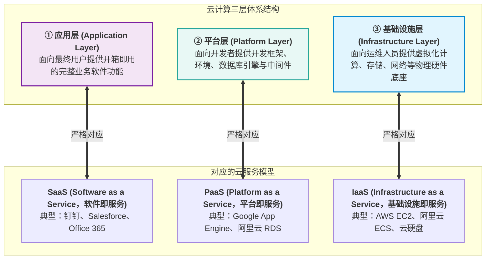

# 第 11 章 未来信息综合技术

> 目录骨架依据《系统架构设计师教程（第 2 版）》；按专题汇集概念、例题与辨析。

## 11.1 信息物理系统技术概述

### 11.1.1 信息物理系统的概念与本质特征
信息物理系统（Cyber-Physical Systems，CPS）作为计算进程和物理进程统一的综合体，是集成计算、通信与控制于一体的下一代智能系统。CPS 通过人机交互接口实现人、机、物的协同与交互，并在环境感知的基础上，深度融合计算、通信与控制等信息技术，构建起虚实融合、动态适应的复杂智能化工程系统。
- **CPS 的核心本质**：构建**物理世界与信息世界之间的闭环数据流动通道**（状态感知 $\to$ 实时分析 $\to$ 科学决策 $\to$ 精准执行）。

#### CPS 三层结构与航空器功能映射

[考查：案例分析（体系结构分层与功能归类）]

题目所说的**感知层—网络层—控制层**是 CPS 的组成结构，不等同于 11.1.2 的单元级、系统级、SoS 级规模层次。

| CPS 结构层 | 职责 | 航空器示例 | 常见安全威胁 |
|---|---|---|---|
| 感知层 | 采集物理状态，并通过执行器作用于设备 | 转速传感器、火警探测、步进电机控制、发电机控制 | 传感器数据伪造/篡改、节点物理捕获或执行器被操纵 |
| 网络层 | 连接设备并传送测量值、状态和控制信息 | 传感器总线 | 窃听、重放、拒绝服务、通信数据篡改 |
| 控制层 | 汇聚处理状态信息，管理子系统并发出协调指令 | 飞行传感器管理、显控、环控、配电管理 | 恶意代码注入、未授权访问或控制指令篡改 |

飞行员是人机协同的外部参与者，不属于题目所列 CPS 三层。实际分层时，功能名称带“控制”并不自动归控制层：步进电机、发电机控制属于感知层中的物理执行设备。

### 11.1.2 CPS 三级体系架构与核心层级职能（单元级 vs 系统级 vs SoS级）⭐⭐⭐

[考查：综合知识 / 架构设计]

根据工信部《信息物理系统建设指南》与官方架构师教程，CPS 自下而上划分为三大层级：

#### 一、CPS 三级体系架构全景对比表

| CPS 层级 | 英文名称 | 典型工程实体与映射 | 核心管辖作用域 | 核心法定特征与功能职责 | 考场高频命题判据 / 题眼 |
|:---|:---|:---|:---|:---|:---|
| **单元级 CPS** ⭐⭐⭐ | **Unit CPS** | 单台智能数控机床、工业六轴焊接机器人、智能传感器/变送器、AGV 小车 | **单机 / 不可分割的最小物理实体** | 具有**不可分割性**，在设备内部独立实现“感知-分析-决策-执行”的**基本数据自动流动闭环**。 | “**CPS 的最小单元**”<br>“具有**不可分割性**”<br>“基本的数据自动流动闭环” |
| **系统级 CPS** ⭐⭐⭐ | **System CPS** | 自动化柔性生产线、SMT 贴片车间、智能装配加工车间 | **局部制造资源集合**（车间/产线级） | 基于多个单元级 CPS 的互联互通与协同，实现了**局部制造资源的自组织、自配置、自决策、自优化**（四大“自”特征）。 | “**多个单元级CPS的组合**”<br>“**局部制造资源**”<br>“**自组织、自配置、自决策、自优化**” |
| **SoS级 CPS** ⭐⭐⭐ | **System of Systems CPS**<br>（系统之系统级） | 智能工厂、工业互联网云平台、集团级制造协同系统、跨供应链产业协同平台 | **跨系统 / 全价值链 / 企业级与产业级** | 基于多个系统级 CPS 的复合集成，实现跨系统的**数据深度汇聚、全价值链资产动态优化以及端到端的运营优化服务**。 | “**多个系统级CPS的组合**”<br>“跨系统/跨产业链”<br>“**数据汇聚、资产优化和运营优化服务**” |

> [!IMPORTANT]
> **CPS 三级架构极速秒杀口诀与排雷指南**：
> - **“单机闭环是单元，局部四自归系统；全局汇聚与运营，跨界协同属 SoS！”**
> 
> **极速排雷提醒**：
> 1. **抓取作用域（局部 vs 全局）**：
>    - 见“**局部制造资源**” + “**自组织、自配置、自决策、自优化**” $\implies$ **100% 锁定【系统级CPS】**！
>    - 见“**跨系统/全产业链**” + “**数据汇聚、资产优化、运营优化服务**” $\implies$ **唯一锁定【SoS级CPS】**！
> 2. **排除伪概念**：选项中出现的“物理级CPS”纯属根据字面臆造的干扰项，体系标准中根本不存在该层级。

  - 【题库章节练习】 题目 2（在CPS（信息物理系统）的体系架构中，哪个层级实现了局部制造资源的自组织、自配置、自决策、自优化 $\to$ 选【B. 系统级CPS】）。
  - 【题库章节练习】 题目 8（基于CPS的体系架构的认识，是具有不可分割性的CPS最小单元……多个的有机组合构成。例如，多个工序形成一个车间级的CPS或者形成整个工厂的CPS $\to$ 第二空选【D. 系统级CPS】）。

### 11.1.3 CPS 四大核心技术要素与实现体系（一硬、一软、一网、一平台）⭐⭐⭐

[考查：综合知识 / 体系架构]

根据工信部《信息物理系统建设指南》与官方架构师教程，信息物理系统的实现体系严格由**“一硬、一软、一网、一平台”**四大核心技术要素构成：

#### 一、CPS 四大核心技术要素全景对照表

| 技术要素 | 标准名称 | 典型工程实体与落地代表 | 法定功能与系统角色 | 核心地位与法定判据 ⭐⭐⭐ | 考场高频命题判据 / 题眼 |
|:---|:---|:---|:---|:---|:---|
| **一硬** ⭐⭐⭐ | **感知和自动控制** | 车间现场传感器、仪器仪表、PLC、DCS、数控机床（CNC）、工业机器人、执行机构 | 直接与物理世界环境/工件交互，负责物理信号的精准感知采集与控制指令的机械执行。 | **硬件支撑**<br>（物理世界的感官与手脚） | “**CPS实现的硬件支撑**”<br>“物理世界交互与感知控制”<br>“**严禁误将机房服务器算作一硬**” |
| **一软** ⭐⭐⭐ | **工业软件** | CAD/CAE/CAM 设计仿真、MES 制造执行、ERP 企业资源计划、SCADA、智能工艺与控制算法模型 | 将人类长期积累的工业工程机理、工艺知识和控制策略转化为代码模型，**固化了计算和数据流程的规则**。 | **CPS 的核心**<br>（系统的灵魂与主脑） | “**被认为是CPS的核心**”<br>“**固化了CPS计算和数据流程的规则**”<br>“承载工业机理与算法模型” |
| **一网** ⭐⭐⭐ | **工业网络** | 工业以太网、现场总线（CAN/Profibus）、TSN（时间敏感网络）、工业 5G、工业光网（PON） | 构建端-边-云泛在互联互通的高速通道，提供低时延、高确定性、高可靠的数据通信。 | **网络载体**<br>（信息流转的神经脉络） | “**互连互通和数据传输的网络载体**”<br>“低时延高确定性传输” |
| **一平台** ⭐⭐⭐ | **工业云和智能服务平台**<br>（工业互联网平台） | 工业互联网平台、工业大数据中心、工业云、工业 PaaS/SaaS 微服务平台 | 汇聚海量多源异构工业数据，提供大数据分析、资产建模与上层工业 APP 运行支撑，对外提供资源管控与能力服务。 | **支撑基础**<br>（赋能底座与服务中心） | “**数据汇聚和支撑上层解决方案的基础**”<br>“对外提供**资源管控和能力服务**” |

> [!IMPORTANT]
> **CPS 四大要素极速秒杀口诀与排雷指南**：
> - **“一硬是支撑（躯干），一网是载体（神经）；一平台是基础（底座），一软是核心（大脑与规则）！”**
> 
> **极速秒杀题眼**：
> 1. 见“**CPS的核心**” / “**固化了计算和数据流程的规则**” $\implies$ **唯一秒杀【一软（工业软件）】**！
> 2. 见“**硬件支撑**” / “**感知和自动控制**” $\implies$ **唯一秒杀【一硬】**（牢记：专指现场设备，不是 IT 机房服务器！）；
> 3. 见“**数据传输**” / “**互联互通网络载体**” $\implies$ **唯一秒杀【一网】**；
> 4. 见“**数据汇聚**” / “**支撑上层解决方案的基础**” / “**资源管控和能力服务**” $\implies$ **唯一秒杀【一平台】**。

  - 【题库章节练习】 题目 4（在CPS（信息物理系统）的四大核心技术要素中，哪一项被认为是CPS的核心，固化了CPS计算和数据流程的规则 $\to$ 选【B. 一软（工业软件）】）。

### 11.1.4 CPS 技术体系的三大分类（总体技术 vs 核心技术 vs 支撑技术）⭐⭐⭐

[考查：综合知识 / 体系架构]

根据《系统架构设计师教程（第2版）》与工信部信息物理系统规范，CPS 的技术体系自顶向下严格由三大支柱大类构成：

#### 一、CPS 技术体系三大支柱全景对照表

| 技术大类 | 层次定位 | 包含的关键技术代表 | 核心职能与系统职责 | 考场高频命题判据 / 题眼 |
|:---|:---|:---|:---|:---|
| **总体技术** ⭐⭐⭐ | **顶层宏观设计** | **系统架构技术**、<br>**异构系统集成技术**、<br>**安全技术**、<br>**试验验证技术** | 站在宏观视角掌控系统顶层设计、跨异构系统互联互通、全生命周期安全防御边界以及系统级仿真联调与试验测试。 | “**顶层设计技术**”<br>“系统架构与**异构系统集成**”<br>“安全技术与**试验验证**” |
| **核心技术** ⭐⭐⭐ | **虚实融合与控制中枢** | **工业以太网技术（工业网络）**、<br>**协同控制技术**、<br>**软件定义技术**、<br>**数字孪生技术（Digital Twin）** | 负责物理进程与计算进程之间的深度交互、精准映射、实时通信闭环与敏捷重构。（**数字孪生是虚实映射的核心抓手，绝非支撑技术**）。 | “虚实交互与动态双向闭环”<br>“工业网络与实时控制”<br>“**数字孪生**与软件定义” |
| **支撑技术** ⭐⭐⭐ | **底层赋能与信息底座** | **智能感知技术**、<br>**嵌入式计算技术**、<br>**大数据分析技术**、<br>**云计算技术**、<br>**人工智能技术** | 提供底层物理世界的原始信号采集感知，并利用通用 ICT 技术为系统提供海量存储、算力底座与高阶算法挖掘支持。 | “底层数据采集输入”<br>“**智能感知**与嵌入式计算”<br>“**大数据分析**与云计算/AI赋能” |

> [!IMPORTANT]
> **CPS 技术体系极速秒杀口诀与排雷指南**：
> - **“架构集成安全试（验），顶层设计是【总体】；网络控制孪生动，虚实融合属【核心】；感知嵌入大数据，底座赋能归【支撑】！”**
> 
> **极速排雷提醒**：
> 1. **严防“数字孪生”张冠李戴**：数字孪生负责构建物理世界与数字空间的双向闭环映射，直接解决 CPS 虚实融合的本质矛盾，在官方体系中**100% 属于【核心技术】**，切勿误选为外部的“支撑技术”！
> 2. **锁定总体技术四大法宝**：架构设计、异构集成、安全防御、试验验证，属于顶层宏观把控。

  - 【题库章节练习】 题目 5（根据CPS的技术体系划分，以下哪项技术属于CPS的总体技术 $\to$ 选【B. 异构系统集成技术】）。

### 11.1.5 信息物理系统的建设路径、本质目标与技术辨析（建设四阶段 vs 终极目标双向闭环 vs 工业互联网辨析）⭐⭐⭐

[考查：综合知识 / 体系架构 / 新技术选型]

信息物理系统（Cyber-Physical Systems，CPS）是智能制造与工业 4.0 的核心技术底座，其实施落地绝非单一软件或硬件采购，而是一项贯穿物理世界与赛博空间的系统工程。

#### 一、CPS 的理论起源与演进脉络

1. **术语起源与概念确立**：
   - 术语最早由**美国国家航空航天局（NASA）于 1992 年**提出；
   - 2006 年，美国国家科学基金会（NSF）科学家海伦·吉尔（Helen Gill）在国际研讨会上正式对 CPS 的科学内涵进行了系统化阐述。
2. **底层技术渊源**：
   - CPS 是传统**控制系统、嵌入式系统**向网络化、智能化方向的扩展与延伸；
   - 其传感器状态感知、实时通信交互、反馈控制算法等底层核心技术，**均源于对嵌入式技术、实时控制工程的应用与升华**。

#### 二、CPS 的本质目标与概念辨析矩阵 ⭐⭐⭐

软考命题高频设置“概念偷换”陷阱，将 CPS 的宏观本质目标狭隘化为某个单一网络或应用概念：

| 概念维度 | 核心法定定义与系统定位 | 考场高频设陷点（张冠李戴） ⭐⭐⭐ |
|:---|:---|:---|
| **CPS 的本质目标** ⭐⭐⭐ | **实现计算资源（赛博空间）与物理资源（物理世界）的紧密结合、深度双向融合与实时闭环控制**；具备物理实体的**自感知、自记忆、自认知、自决策、自执行**。 | **致命设陷**：声称“CPS的最终目的是实现工业互联网+”或“仅为了设备联网数据上云”。（工业互联网只是其网络应用载体，非终极目的！） |
| **CPS vs 物联网（IoT）** ⭐⭐⭐ | • **IoT**：偏重于“连接、传输与感知”，本质是开环的数据采集与网络互联；<br>• **CPS**：强调**“感知-分析-决策-执行”的双向实时动态闭环控制**，核心是信息对物理的反向驱动与自适应调节。 | 误认为“CPS与IoT完全一致，都是单向开环的数据采集系统”。 |
| **CPS vs 数字孪生（DT）** ⭐⭐⭐ | • **数字孪生**：物理对象在赛博空间的数字镜像与模型载体（使能技术）；<br>• **CPS**：包含了物理实体、数字孪生体以及两者之间的闭环交互控制系统（系统级工程）。 | 误认为“数字孪生脱离物理实体独立构成 CPS”。 |

#### 三、CPS 循序渐进的建设四阶段实施路径 ⭐⭐⭐

CPS 的建设具有高度的技术复杂性与工程演进性，**不可能一蹴而就，必须遵循自底向上、循序渐进的四大实施阶段**：

```
  ┌─────────────────────────────────────────────────────────────┐
  │  第 1 阶段：CPS 体系设计阶段 (总体架构顶层规划、标准体系定义)   │
  └──────────────────────────────┬──────────────────────────────┘
                                 │
                                 ▼
  ┌─────────────────────────────────────────────────────────────┐
  │  第 2 阶段：单元级 CPS 建设阶段 (单机/工序级感知控制闭环落地)   │
  └──────────────────────────────┬──────────────────────────────┘
                                 │
                                 ▼
  ┌─────────────────────────────────────────────────────────────┐
  │  第 3 阶段：系统级 CPS 建设阶段 (产线/车间级多设备互联协同四自) │
  └──────────────────────────────┬──────────────────────────────┘
                                 │
                                 ▼
  ┌─────────────────────────────────────────────────────────────┐
  │  第 4 阶段：SoS 级 CPS 建设阶段 (跨企业、跨产业链供应链数据汇聚)│
  └─────────────────────────────────────────────────────────────┘
```

1. **CPS 体系设计阶段**：统筹业务需求与工业机理，制定顶层系统架构设计、数据接口标准与安全规范；
2. **单元级 CPS 建设阶段**：针对单台数控机床、机器人等最小不可分割实体进行智能化改造，建立单机微观闭环；
3. **系统级 CPS 建设阶段**：打通产线/车间现场工业网络，实现多单元级 CPS 之间的协同联动与局部资源自组织自优化；
4. **SoS 级 CPS 建设阶段**：跨越企业组织边界，与供应链上下游、工业互联网云平台深度集成，实现全产业链价值协同。

> [!IMPORTANT]
> **CPS 本质与建设路径极速秒杀口诀与排雷指南**：
> - **“CPS 演进四阶段：顶层设计先立头，单元、系统、SoS 步步走；”**
> - **“虚实双向闭环转，计算物理共相融；”**
> - **“莫把工业互联加，当成终极大目标；”**
> - **“IoT 侧重单向连，CPS 必须闭环控！”**
> 
> **极速排雷提醒**：
> 1. 见题干说“**CPS 最终目的是实现工业互联网+**” $\implies$ **100% 判定为错误选项秒杀**！
> 2. 见“**建设路径分为体系设计、单元级、系统级、SoS级建设阶段**” $\implies$ **100% 为规范正确的标准表述**！

  - 【题库章节练习】 题目 10（以下关于CPS说法错误的是 $\to$ 选【B. CPS是多领域……其最终目的是实现工业互联网+】）。

## 11.2 人工智能技术概述

### 11.2.1 人工智能的概念与分类体系（弱AI vs 强AI、类人 vs 非类人、AI/ML/DL层级）⭐⭐⭐

[考查：综合知识 / 新技术认知]

人工智能（Artificial Intelligence，AI）是研究、开发用于模拟、延伸和扩展人的智能的理论、方法、技术及应用系统的一门新的技术科学。

#### 一、人工智能顶层哲学与学术分类（根据“能否真正实现推理、思考与解决问题”）

计算机科学与心智哲学界（如约翰·塞尔著名的“中文屋”思想实验）根据**系统是否能真正拥有心智、自我意识以及实现真正的推理与解决问题**，将人工智能严格划分为两大阵营：

| AI 类别 | 别名与英文 | 核心哲学假设与定义 | 认知机制与本质特征 | 现实落地代表与状态 | 考场标志性题眼 |
|:---|:---|:---|:---|:---|:---|
| **弱人工智能** ⭐⭐⭐ | **Weak AI**<br>狭隘 AI（Narrow AI）<br>应用型 AI | 认为计算机**不可能真正拥有心智与自我意识**；表面上的智能只是对人类特定行为的工具性模拟。 | 仅依靠预设规则、统计概率与参数拟合，在特定限定领域内处理符号、完成专门任务（如棋类博弈、人脸识别），**无法跨领域自主迁移，不具备通用推理心智**。 | **当今所有已落地的 AI 均属弱 AI**！<br>（AlphaGo、医疗影像诊断、GPT 大语言模型、自动驾驶等） | “**不能真正实现推理和解决问题**”<br>“特定领域的工具性模拟”<br>“无真正心智与意识” |
| **强人工智能** ⭐⭐⭐ | **Strong AI**<br>通用人工智能（AGI）<br>类人心智 | 认为适当编程的计算机**本身就是真正的心智（Mind）**，真正能够进行自主推理、反思、情感感知并解决通用问题。 | 具备通用的认知、抽象思维、常识理解与自主意识，能够像人类甚至超越人类一样自适应解决跨领域全新的复杂问题。 | **目前人类尚未实现（理想/科幻形态）** | “**真正能实现推理、思考和解决问题**”<br>“具备自主心智与知觉” |

#### 二、强人工智能内部的二次细分（类人智能 vs 非类人智能）

在强人工智能理论框架下，根据其思维运作模式**是否与人类心智机制相同**，进一步划分为：
1. **类人智能（Human-like AI）**：机器的思考过程、认知结构、情感反馈与直觉逻辑**与人类大脑心智完全相似**，以人类方式感知和认知世界。
2. **非类人智能（Non-human-like AI）**：机器真正具备独立思考、推理和意识，但其思维方式、认知逻辑和计算维度**完全不同于甚至远超人类认知模式**。

#### 三、人工智能技术从属层级关系（同心圆体系）

```text
┌────────────────────────────────────────────────────────┐
│  人工智能 (AI, 最广外圈：使机器展现智能行为的宏观科学)   │
│   ┌────────────────────────────────────────────────┐   │
│   │  机器学习 (Machine Learning, 从数据中自主学出模式) │   │
│   │   ┌────────────────────────────────────────┐   │   │
│   │   │  深度学习 (Deep Learning, 深层神经网络特例)│   │   │
│   │   └────────────────────────────────────────┘   │   │
│   └────────────────────────────────────────────────┘   │
└────────────────────────────────────────────────────────┘
```
- **人工智能（AI）**：范畴最广，包含符号主义（规则推理机、专家系统）、连接主义（神经网络）及行为主义等全部实现方法；
- **机器学习（ML）**：AI 的核心实现方法，强调不依赖人工硬编码规则，而是通过数学算法从海量数据中自动提取特征与规律；
- **深度学习（DL）**：机器学习的重要分支子集，基于多层深层神经网络模型（如 CNN、Transformer）进行高阶特征表征与训练。

> [!IMPORTANT]
> **人工智能概念分类极速秒杀口诀与排雷指南**：
> - **“能否真正会思考，弱强两分见分晓；强智深入分两类，类人非类算同胞；机器深度是技术，专家神经算学派！”**
> 
> **极速秒杀题眼**：
> 1. 见“**是否能真正实现推理、思考和解决问题**” $\implies$ **唯一秒杀【弱人工智能和强人工智能】**！
> 2. 见“**强人工智能内部细分**” $\implies$ **秒杀【类人智能和非类人智能】**；
> 3. 见“**现有落地的 AlphaGo、大模型、医疗诊断归属**” $\implies$ **100% 属于【弱人工智能】**！

  - 【题库章节练习】 题目 5（根据人工智能是否能真正实现推理、思考和解决问题，可以将人工智能分为以下哪两类 $\to$ 选【C. 弱人工智能和强人工智能】）。

### 11.2.2 人工智能的发展历程

### 11.2.3 人工智能关键技术

#### AI 芯片四大关键特征与微架构机理（新范式、训推双擎、大数据处理、可重构）⭐⭐⭐

[考查：综合知识 / 体系架构]

在人工智能技术体系中，算力是驱动模型演进的动力底座，AI 芯片是占据人工智能产业竞争制高点的战略核心。AI 芯片有别于传统通用处理器（CPU/DSP），其微架构专为高并发机器学习设计，严格具备以下**四大关键特征**：

##### 1. AI 芯片四大关键特征全景对照表

| 关键特征 | 官方权威定义与本质内涵 | 微架构设计机理与实现手段 | 解决的根本工程瓶颈 | 考场高频命题判据 / 题眼 |
|:---|:---|:---|:---|:---|
| **新型的计算范式** ⭐⭐⭐<br>（New Computing Paradigm） | AI 处理的内容往往是非结构化数据（视频、图像、语音、词嵌入）；运算以**大规模密集张量与线性代数（矩阵乘加 GEMM）**为主，控制流简单而参数量巨大。 | 摒弃传统通用 CPU 复杂的超标量乱序执行与深层分支预测，采用**脉动阵列（Systolic Array）、张量处理单元（TPU/Tensor Core）**等高并行数据流架构。 | 摆脱传统以复杂控制流为主的低效开销，大幅提升张量运算吞吐率与能效比。 | “**新型的计算范式**”<br>“非结构化数据处理”<br>“以密集线性代数运算为主”<br>“控制流简单而参数量大” |
| **训练和推断** ⭐⭐⭐<br>（Training and Inference） | AI 算法的完整生命周期涵盖两大阶段：<br>1. **训练（Training）**：在已有海量数据中反向梯度传播学习参数；<br>2. **推断（Inference）**：利用冻结权重对全新未知输入实时前向计算。 | • **训练芯片**：追求极高浮点精度（FP32/FP16/BF16）、超大显存与极高互联带宽；<br>• **推断芯片**：追求极低时延、极高能效比、低成本与量化计算（INT8/INT4/FP8）。 | 全生命周期闭环支持；芯片在架构上支持训推一体或专精于训练/推理加速。 | “**训练和推断**”<br>“已有数据学习与新数据预测”<br>“兼顾离线高吞吐与在线低时延” |
| **大数据处理能力** ⭐⭐⭐<br>（Big Data Processing） | 人工智能的性能高度依赖海量数据集，满足高效能机器学习的大数据吞吐与高速存取是 AI 芯片的首要设计考量。 | 引入**高带宽显存（HBM / GDDR）**、片上大容量高速分布式 SRAM 缓存阵列以及先进的 2.5D/3D Chiplet 封装与高速片间互联互通总线（如 NVLink）。 | **打破“冯·诺依曼内存墙（Memory Wall）”**，消除数据从内存搬运至计算核心的传输带宽瓶颈。 | “**大数据处理能力**”<br>“满足高效能数据处理要求”<br>“海量参数与高速存取” |
| **可重构的能力** ⭐⭐⭐<br>（Reconfigurable Capability） | 深度学习算法模型迭代演进迅猛（从 CNN/RNN 到 Transformer、扩散模型、MoE），而 ASIC 芯片研发流片周期长达 1~2 年。芯片必须具备适应新算法结构的弹性演进能力。 | 采用**粗粒度可重构计算阵列（CGRA）、现场可编程门阵列（FPGA）、软件定义硬件（SDH）**或指令集微码动态更新技术，支持算法算子动态映射。 | 避免专用芯片因算法快速迭代淘汰而沦为废铁，兼顾了 **ASIC 的超高性能** 与 **通用 CPU/GPU 的编程灵活性**。 | “**可重构的能力**”<br>“适应算法快速演进更迭”<br>“防止硬件刚流片就落后淘汰” |

> [!IMPORTANT]
> **AI 芯片四大关键特征极速秒杀口诀与排雷指南**：
> - **“算力跃迁新范式，训推双擎兼并蓄；海量吞吐大数据，算法速变可重构！”**
> 
> **极速排雷提醒（坚决识破出题人偷梁换柱设陷项）**：
> 1. 见“**信号处理能力**” $\implies$ 排除！那是传统 **DSP（数字信号处理器）** 的特征；
> 2. 见“**图像处理能力**” $\implies$ 排除！那是传统 **GPU 渲染显卡** 的单点特征，AI 芯片处理的是全模态张量数据；
> 3. 见“**专用开发工具 / 可定制性**” $\implies$ 排除！这属于通用的外围软件工程与商业模式术语，**绝非 AI 芯片的微架构法定特征**（核心第四项唯一是**【可重构的能力】**！）。

  - 【2021年下半年真题第19题】（人工智能技术已成为当前国际科技竞争的核心技术之一，AI芯片是占据人工智能市场的法宝。AI芯片有别于通用处理器芯片，它应具备四种关键特征。是AI芯片的关键特点 $\to$ 选【B. 新型的计算范式、训练和推断、大数据处理能力、可重构的能力】）。

#### 知识图谱问答：构建链路、语义解析与图存储

[考查：案例分析]

知识图谱以实体、关系及属性组织领域知识。问答先将源数据转为可检索知识，再将自然语言问题转成检索条件。关键词检索可以与图谱检索共存；采用图谱的主要理由是关系表达与语义查询，不能只用“数据量大”解释。

| 路径 | 核心职责 | 易混边界 |
|---|---|---|
| 采集→清洗 | 取得源材料、处理噪声和重复 | 爬到网页尚未形成领域知识 |
| schema 定义、知识获取、存储与管理 | 定义类型关系、获取事实并保存维护 | 实体与关系抽取只是知识获取的子任务 |
| 语句解析→知识检索→答案组织 | 识别实体和意图、链接节点、检索事实 | 意图识别管问什么，实体链接管指哪个节点 |

Scrapy 的 Engine 协调数据流；Scheduler 排队 Request；Downloader 获取网页；Spider 解析 Response 并产生 Items 或新 Requests；Item Pipeline 校验、清洗和持久化 Items。异步 I/O 可在网络等待时处理其他任务，适合 I/O 密集并发，不等于 CPU 运算自动加速。

图数据库的节点、边与属性适合表示知识图谱和关联查询。性能取决于查询、图结构和实现，分片与横向扩展须按产品判断；schema 灵活不表示不需要领域约束。

- **解题顺序**：容器职责→模块输入输出→选项字母核对。
- **技术依据**：[Scrapy 架构](https://docs.scrapy.org/en/latest/topics/architecture.html)、[Neo4j 图数据模型](https://neo4j.com/docs/getting-started/graph-database/)、[NebulaGraph 架构](https://nebula-graph.io/posts/nebula-graph-architecture-overview)。

## 11.3 机器人技术概述

### 11.3.1 机器人的概念

### 11.3.2 机器人的定义和发展历程

### 11.3.3 机器人 4.0 的核心技术

### 11.3.4 机器人的分类

## 11.4 边缘计算概述 ⭐⭐⭐

[考查：案例分析 / 综合知识]

### 11.4.1 边缘计算的概念与定义
边缘计算（Edge Computing）是指在靠近物或数据源头的网络边缘侧，融合网络、计算、存储、应用核心能力的分布式开放平台，就近提供边缘智能服务，满足行业数字化在敏捷联接、实时业务、数据优化、应用智能、安全与隐私保护等方面的关键需求。

### 11.4.2 边缘计算四大核心特点与架构内涵（联接性、数据第一入口、约束性、分布性）⭐⭐⭐

[考查：综合知识 / 体系架构 / 案例分析]

根据边缘计算产业联盟（ECC）与官方教程，边缘计算作为深入工业现场与物理世界的算力基础设施，严格具备四大核心特点以及相比传统集中式云计算的四大核心优势：

#### 一、边缘计算四大核心特点全景对照表 ⭐⭐⭐

| 核心特点 | 官方权威定义与技术定位 | 核心架构内涵与实现机制 | 解决的根本工程挑战 | 考场高频设陷点与排雷指南 ⭐⭐⭐ |
|:---|:---|:---|:---|:---|
| **联接性** ⭐⭐⭐<br>（Connectivity） | **边缘计算的基础**<br>（⚠️ 严禁误当成“核心”） | 针对物理现场极其复杂的硬件生态，提供**丰富的网络联接方式（5G、以太网、Wi-Fi、ZigBee、现场总线）与多源异构工业协议（Modbus、OPC-UA、Profinet 等）转换支持**。 | 消除物理设备通信壁垒，实现异构硬件无缝入网。 | 🚫 **双重设陷**：<br>1. 偷换为“联接性是边缘计算的核心”（错，是**基础**！）；<br>2. 将“提供桥梁作用”安在联接性上（错，桥梁属于数据第一入口）。 |
| **数据第一入口** ⭐⭐⭐<br>（Data First-Hop） | **物理世界通往数字世界的桥梁** | 边缘计算是海量现场数据流出的首站。承担就近数据采集、清洗校验、轻量预处理、无效过滤与格式归一化。 | 避免无序原始海量数据拥堵回传云端网络，实现毫秒级就近闭环控制。 | 🚫 **张冠李戴**：声称“数据第一入口要求具备丰富协议支持”（错，那是联接性的要求）。 |
| **约束性** ⭐⭐⭐<br>（Constraints） | **现场物理与经济条件的制约底线** | 边缘节点多直接挂载于恶劣工业生产现场或野外环境，面临**恶劣工作环境（高低温、强振动、粉尘电磁）、受限供电功耗（低功耗、无风扇自然散热）、受限物理空间以及有限的硬件部署成本**约束。必须采用轻量化软硬件方案。 | 倒逼软硬件实施深度裁剪、专用加固与能效极致优化。 | 选项描述：“**约束性体现为需适配恶劣环境的功耗和成本要求**”属于**客观正确原话**，考试放心选！ |
| **分布性** ⭐⭐⭐<br>（Distributed Architecture） | **边缘计算的分布式协同软件架构本质** | 边缘计算天然具备分布式形态。**绝不仅指“物理/地理位置上的分散部署”**，更核心的是要求架构上支持**分布式多节点协同计算、分布式存储、资源调度编排、边缘协同智能（Edge AI）以及协同安全机制**。 | 打破单点算力瓶颈与单点故障，构建去中心化的自治协同网络。 | 🚫 **头号以偏概全陷阱**：<br>声称“分布性**主要指地理位置上的分散部署**”必定错误！严重忽略了计算、存储与协同的架构本质。 |

> [!IMPORTANT]
> **边缘计算四大核心特点极速秒杀口诀**：
> - **“联接是基础支持多协议，入口作桥梁就近洗数据；”**
> - **“工况恶劣功耗成本多约束，分布不仅在地理关键看协同！”**

  - 【题库章节练习】 题目 6（关于边缘计算的核心特点，以下描述正确的是 $\to$ 选【C. 约束性特点体现在边缘计算需适配工业现场恶劣环境的功耗和成本要求】）。

#### 二、边缘计算的核心优势（相比集中式云计算）
1. **速度（极低时延）**：数据在边缘就近处理与推理（如人脸毫秒级比对），无需跨广域网长途传输，响应时延从百毫秒级降至毫秒级。
2. **安全（数据隐私与容灾）**：敏感数据（如生物特征、工业核心控制流）在本地闭环处理，不上公网，极大降低网络监听与数据泄露风险；分布式节点降低了单点被攻破瘫痪全网的风险。
3. **可扩展性（算力弹性解耦）**：通过增购低功耗边缘端设备即可实现算力横向弹性扩展，避免云端集中式数据中心面对海量物联网并发的计算与网络带宽瓶颈。
4. **可靠性（本地离线自治）**：边缘节点具备本地运行能力，当广域网发生抖动或完全中断时，边缘设备依然可基于本地缓存策略正常提供基础核心业务服务（弱网脱机自治）。

### 11.4.3 物联网核心通信协议：MQTT vs HTTP
- **MQTT（Message Queuing Telemetry Transport）**：基于 TCP/IP 的轻量级**发布/订阅（Pub/Sub）模式**传输协议。专为低带宽、高延迟、网络不可靠环境及受限硬件设计。固定报头仅 2 字节，支持三级 QoS 服务质量等级（0 最多一次、1 至少一次、2 只有一次），具备心跳与遗嘱消息（LWT），广泛用于端侧设备与边缘主机间的事件流交互。
- **HTTP/REST**：基于 TCP 的标准客户端/服务端**请求/响应模式**协议。头部开销较大，但生态成熟、跨语言兼容性强，适合用于 Web 管理后台交互、微服务接口调用及大体积文件（如 AI 深度学习模型权重、Docker 镜像）的分发与下载。

### 11.4.4 边云协同（Cloud-Edge Collaboration）六大维度全景深度解析 ⭐⭐⭐

[考查：综合知识 / 案例分析]

边缘计算与云计算是共生互补的统一整体。官方教材与边缘计算产业联盟（ECC）将边云协同严格规范为**六大协同维度**：

#### 一、边云协同六大维度全景对照表

| 协同维度 | 官方标准术语与别名 | 边缘侧（Edge）职责 | 云端（Cloud）职责 | 考场高频命题判据 / 核心题眼 |
|:---|:---|:---|:---|:---|
| **智能协同** ⭐⭐⭐ | **模型/算法协同**<br>（Intelligence Collaboration） | 利用轻量模型在近场执行**低时延在线推理、识别与自适应决策**；将长尾难例数据回传云端。 | 依托海量算力与全量历史数据，开展**深度学习大模型集中训练与调优**，并将模型剪枝量化后**下发到边缘节点**。 | “**云端进行模型训练**”<br>“**模型下发到边缘节点**”<br>“**边缘节点执行推理，实现分布式智能**” |
| **应用管理协同** ⭐⭐⭐ | **应用协同**<br>（Application Management） | 接收并运行容器化微服务实例；向云端上报容器运行状态与健康自愈指标。 | 统一负责边缘应用（容器镜像、微服务）的**开发、打包、调度分发、灰度部署、滚动升级与全生命周期管理**。 | “**应用的部署、运行和生命周期管理**”<br>“容器镜像与微服务分发升级”<br>“灰度发布与健康监控” |
| **数据协同** ⭐⭐⭐ | **数据流转协同**<br>（Data Collaboration） | 负责原始多源物联网数据的**就近实时采集、去重过滤、聚合脱敏与初步计算**，按需上传结构化高价值数据。 | 汇聚接收跨区域海量汇总数据，负责**全域长周期历史数据归档、跨域大数据深度挖掘、全局模型特征提取**与知识沉淀。 | “**数据采集、处理和传输**”<br>“**边缘就近过滤清洗，云端全局汇聚归档**” |
| **资源协同** ⭐⭐⭐ | **基础设施协同**<br>（Resource Collaboration） | 实时感知并向云端报告本地物理/虚拟资源状态（CPU利用率、内存余量、网络带宽、存储配额）。 | 将成千上万个离散边缘节点纳入统一资源池，根据业务负载策略实现**全局计算、存储与网络资源的动态弹性调度与编排**。 | “**涉及计算、存储、网络等基础设施资源的管理**”<br>“底层 IaaS 资源池化与算力调度” |
| **业务管理协同** ⭐⭐ | **业务逻辑协同**<br>（Business Management） | 接收并解析业务规则，实现本地生产或事件的**秒级敏捷响应、离线自治与本地闭环处理**。 | 负责企业全局跨域业务流程统筹、**顶层业务规则下发与业务逻辑编排**（如生产工单排产调度）。 | “企业顶层业务规则与业务逻辑编排”<br>“本地业务敏捷闭环响应” |
| **服务协同** ⭐⭐ | **服务治理协同**<br>（Service Collaboration） | 在边缘侧就近暴露轻量微服务接口，提供近场服务调用支持与故障自愈。 | 构建端到端全局微服务治理框架，统一负责**跨边端微服务的服务注册、服务发现、路由寻址、调用鉴权与接口开放**。 | “微服务接口暴露与路由调用”<br>“服务注册、服务发现与统一治理” |

> [!IMPORTANT]
> **边云协同六大维度极速秒杀口诀与排雷指南**：
> - **“算力网络管【资源】，就近清洗归【数据】；微服务生命属【应用】，云训边推必【智能】！”**
> 
> **极速排雷提醒（坚决避开常见词眼设陷）**：
> 1. **严防“GPU 诱导陷阱”**：题干出现“GPU 集群训练模型并下发”时，主线是“模型与算法训推”，**100% 属于【智能协同】**！切勿一看到 GPU 就条件反射误选“资源协同”；
> 2. **精准区分“模型下发”与“应用下发”**：
>    - 下发“AI 模型权重 / 神经网络算法” $\implies$ **智能协同**；
>    - 下发“容器镜像 / Docker / 微服务软件代码” $\implies$ **应用管理协同**。

  - 【题库章节练习】 题目 3（在边云协同的六个方面中，哪一项主要负责将模型下发到边缘节点并在云端进行模型训练 $\to$ 选【C. 智能协同】）。

- **实战大题案例精析**：[经典案例分析：基于边缘计算的智能门禁系统架构设计（25分）](https://github.com/Goodyzhang/ruankao.skill/blob/main/materials/%E7%B3%BB%E7%BB%9F%E6%9E%B6%E6%9E%84%E8%AE%BE%E8%AE%A1%E5%B8%88/%E6%A1%88%E4%BE%8B%E5%88%86%E6%9E%90/%E4%B8%93%E9%A2%98%E6%A1%88%E4%BE%8B/%E7%BB%8F%E5%85%B8%E6%A1%88%E4%BE%8B-%E5%9F%BA%E4%BA%8E%E8%BE%B9%E7%BC%98%E8%AE%A1%E7%AE%97%E7%9A%84%E6%99%BA%E8%83%BD%E9%97%A8%E7%A6%81%E7%B3%BB%E7%BB%9F%E6%9E%B6%E6%9E%84%E8%AE%BE%E8%AE%A1.md)

### 11.4.5 云原生架构体系与核心原则（七大原则：服/弹/观/韧/自动化/零信任/持续演进；不可变基础设施与声明式 API）⭐⭐⭐

[考查：综合知识 / 架构设计 / 案例分析]

云原生架构（Cloud Native Architecture）是基于云原生技术构建和运行应用程序的方法体系，其目标是最大化发挥云计算的弹性、分布式与自动化红利，降低软件交付周期，提升系统在不可预测环境下的鲁棒性。

#### 一、云原生架构七大核心原则全景对照表 ⭐⭐⭐

依据《系统架构设计师教程（第 2 版）》与 CNCF 官方定义，云原生架构遵循严格的七大核心原则：

| 云原生原则 | 英文名称 | 核心设计哲学与技术实现手段 | 解决的根本架构问题 | 考场高频设陷点（张冠李戴） ⭐⭐⭐ |
|:---|:---|:---|:---|:---|
| **1. 服务化原则** ⭐⭐⭐ | **Service-oriented** | 采用微服务（Microservices）架构，具备明确且向后兼容的接口契约（OpenAPI/gRPC），实现服务自治与独立发布。 | 消除单体应用耦合，支持敏捷演进。 | 混淆为“组件化原则”或“面向对象原则”。 |
| **2. 弹性原则** ⭐⭐⭐ | **Elasticity** | 依托容器编排（K8s HPA/VPA），根据业务负载波动（CPU、内存、QPS）实现秒级或分钟级自动横向扩缩容（Scale Out/In）。 | 应对流量潮汐与突发并发，提升资源利用率。 | 混淆为“可伸缩性质量属性”。 |
| **3. 可观测原则** ⭐⭐⭐ | **Observability** | 构建 **Metrics（度量指标）、Logging（结构化日志）、Tracing（分布式调用链）** 三位一体的无侵入监控体系。 | 解决微服务拓扑高度复杂下的黑盒排错与依赖梳理。 | 混淆为“可视化原则”或“监控原则”。 |
| **4. 韧性原则** ⭐⭐⭐ | **Resilience** | **面向故障设计（Design for Failure）**：引入熔断（Circuit Breaker）、限流（Rate Limiting）、降级（Fallback）、重试与舱壁隔离。 | 假定底层软硬件随时会挂，确保局部故障不演变为系统雪崩。 | **头号设陷**：偷换为“可修改原则”或“鲁棒性原则”。 |
| **5. 所有过程自动化原则** ⭐⭐⭐ | **Automation of all processes** | 构建端到端持续集成与持续交付流水线（CI/CD），涵盖代码静态检查、单元测试、镜像构建、灰度发布、巡检自愈全流程。 | 消除人为操作失误，实现高质量高频发布。 | **经典设陷**：以偏概全偷换为“自动化部署原则”或“自动化测试原则”。 |
| **6. 零信任原则** ⭐⭐⭐ | **Zero Trust** | **“持续验证，从不信任”**：假定网络边界已被攻破。服务间调用强制实施 mTLS 双向认证、细粒度 RBAC 鉴权与传输加密。 | 防范内网横向移动与内部权限滥用。 | **反向设陷**：声称“遵循有限信任原则”或“边界信任原则”。 |
| **7. 架构持续演进原则** ⭐⭐⭐ | **Evolutionary Architecture** | 拥抱变化，系统具备支持低成本业务试错、金丝雀灰度发布（Canary Release）与平滑替换能力。 | 避免架构技术债累积，支撑业务长期敏捷演化。 | 混淆为“可移植性原则”。 |

#### 二、支撑云原生原则的核心工程技术实践

1. **不可变基础设施（Immutable Infrastructure）**：
   - **铁律**：容器镜像与基础设施一旦部署上线，**严禁运维人员登录线上环境进行任何“就地修改（No In-place Modification）”**；
   - **变更方式**：修改代码/配置 $\to$ 重新走 CI/CD 构建新镜像 $\to$ 部署全新 Pod 替代旧 Pod。从根源上杜绝了环境配置漂移与“雪花服务器”。
2. **声明式 API（Declarative API）与调和循环（Reconciliation Loop）**：
   - 开发者仅声明系统的**“期望状态（Desired State）”**（如 `replicas: 3`），底层 Kubernetes 控制器通过后台死循环比对实际状态（Current State），自动触发动作自愈收敛到期望状态。
3. **服务网格（Service Mesh）与 Sidecar 边车模式**：
   - 将服务发现、负载均衡、流量调度、熔断限流和 mTLS 安全治理逻辑从业务应用中彻底剥离，下沉至轻量级 Sidecar 代理（如 Envoy），实现业务逻辑与网络治理的物理级彻底解耦。

> [!IMPORTANT]
> **云原生架构原则极速秒杀口诀与排雷指南**：
> - **“服弹观韧自动化，零信演进走天下！”**
> - **“服务化解耦自治，弹性秒级伸缩自如；”**
> - **“可观测指标日志链，韧性故障熔断降级保底线；”**
> - **“所有过程全自动（莫选自动化部署），从不信任零信任（莫选有限信任）！”**
> 
> **极速排雷提醒**：
> 1. 见选项出现“**可修改原则**” $\implies$ 100% 排除！那只是传统质量属性，非云原生七大原则；
> 2. 见“**有限信任**” $\implies$ 100% 排除！云原生安全唯一法则是 **零信任（Zero Trust）**；
> 3. 见“**自动化部署**” $\implies$ 100% 排除！官方规范全称为 **所有过程自动化原则**！

  - 【题库章节练习】 题目 1（云原生架构原则包括：服务化原则、弹性原则、可观测原则、等 $\to$ 选【C. 韧性原则】）。

### 11.4.6 边缘计算的三类典型落地业务形态（云边缘 vs 边缘云 vs 云化网关；形态 vs 机制辨析）⭐⭐⭐

[考查：综合知识 / 体系架构 / 边缘计算选型]

边缘计算的业务本质是**云计算在数据中心之外汇聚节点的延伸和演进**。在实际工程落地与系统拓扑中，边缘计算并非抽象概念，而是严格表现为**三大典型落地业务形态（Physical / Deployment Modalities）**：

#### 一、边缘计算三类落地业务形态全景对比矩阵 ⭐⭐⭐

| 落地形态 | 英文名称 | 核心物理定位与基础设施 | 控制面与自治能力 | 典型应用场景与落地代表 | 考场高频命题判据 / 核心题眼 |
|:---|:---|:---|:---|:---|:---|
| **1. 云边缘** ⭐⭐⭐ | **Cloud Edge** | **中心云能力的向外下沉延伸**；部署在 CDN 汇聚节点、运营商基站机房或区域网关处。 | **受中心云强管控**：本地通常仅保留轻量级计算运行时（如边缘容器 Pod），控制面完全托管于中心公有云或集中数据中心，依赖中心云统一下发与调度。 | CDN 视频分发与边缘转码、近场 API 缓存加速、中心云轻量容器批量下发与托管。 | “**中心云能力的延伸和下沉**”<br>“受中心云统一调度与管控”<br>“边缘不具备完整独立自治控制面” |
| **2. 边缘云** ⭐⭐⭐ | **Edge Cloud** | **在靠近用户现场独立构建的微型/小型分布式云平台**；部署在大型智慧园区、工厂 IDC 或地市边缘数据中心。 | **具备完整独立自治能力**：拥有完整的本地 IaaS 虚拟化或 PaaS 容器平台及**独立的本地控制面**，广域网中断时仍能 100% 独立离线闭环运营。 | 大型智慧工厂私有边缘云、智慧医院边缘数据中心、矿山/变电站本地自治微型云平台。 | “**在接入侧构建具备独立服务能力的微型云设施**”<br>“**具备独立控制面与离线自治能力**”<br>“厂区断网正常运行” |
| **3. 云化网关** ⭐⭐⭐ | **Cloudified Gateway** | **部署在最前哨现场物理设备侧的智能通信接入与计算硬件**；直接串接传感器、PLC、数控机床、摄像头等终端。 | **现场协议解析与策略承载**：负责现场复杂异构工业总线（Modbus、OPC-UA、CAN 等）向标准协议（MQTT/HTTP）的解析转换，承载轻量数据滤波与边缘规则执行。 | 工业物联网智能网关、智慧路灯杆边缘网关、车载边缘 T-Box、视频 AI 分析轻量边缘盒子。 | “**实现协议转换与边缘功能承载的关键枢纽**”<br>“工业总线协议转换”<br>“现场设备边缘接入” |

#### 二、概念正交防坑指南：落地形态（实物形式） vs 边云协同（交互机制）

出题人极常通过把“边云协同”混入落地形态中设置迷惑陷阱，必须严格划清概念维度边界：

```
  ┌─────────────────────────────────────────────────────────────┐
  │  【第一维度：落地业务形态 (Deployment Modalities)】           │
  │  • 云边缘 (中心下沉受控)                                     │
  │  • 边缘云 (本地完整独立微型云)                               │
  │  • 云化网关 (端侧协议转换智能硬件)                           │
  └──────────────────────────────┬──────────────────────────────┘
                                 │
                            两者深度配合
                                 │
                                 ▼
  ┌─────────────────────────────────────────────────────────────┐
  │  【第二维度：边云协同机制 (Collaboration Mechanisms)】        │
  │  • 资源协同、数据协同、智能协同、应用协同、业务协同、安全协同  │
  └─────────────────────────────────────────────────────────────┘
```

> [!IMPORTANT]
> **边缘计算三大落地形态极速秒杀口诀与排雷指南**：
> - **“边缘落地有三宝：云边、边云、云网关！”**
> - **“中心下沉【云边缘】，本地自治【边缘云】，前端协议【云网关】；”**
> - **“边云协同是【机制】，边缘智能是【能力】，莫把协同当形态！”**
> 
> **极速排雷提醒**：
> 1. 见题干问“**边缘计算主要包括三类落地形态**” $\implies$ 唯一秒杀包含 **云边缘、边缘云、云化网关** 的选项！
> 2. 凡选项中夹带 **“边云协同”**、**“边缘智能”** 或 **“云边端”** 的，一律作为偷换概念项果断排除！

  - 【题库章节练习】 题目 11（边缘计算的业务本质是云计算在数据中心之外汇聚节点的延伸和演进，主要包括三类落地形态 $\to$ 选【A. 云边缘、边缘云和云化网关】）。

## 11.5 数字孪生体技术概述

### 11.5.1 数字孪生体发展历程

### 11.5.2 数字孪生体的定义

### 11.5.3 数字孪生体的三项核心关键技术（建模技术 vs 仿真技术 vs 数字线程技术）⭐⭐⭐

[考查：综合知识 / 系统架构 / 新兴技术]

依据《系统架构设计师教程（第 2 版）》第 11 章 11.5 节，数字孪生体（Digital Twin）是物理实体在数字世界的完整虚实映射与闭环共生体。数字孪生体主要依托**三项核心关键技术**（建模技术、仿真技术、基于数据融合的数字线程技术），外加通用支撑技术（物联网、大数据、云计算等）：

#### 一、数字孪生体三项核心关键技术全景对比表 ⭐⭐⭐

| 核心技术名称 | 英文名称 | 本质定位与角色 | 官方教程法定核心职责 | 考场秒杀判据 / 题眼词 ⭐⭐⭐ | 设陷模式与防混淆指南 |
|:---|:---|:---|:---|:---|:---|
| **建模技术** | **Modeling** | 虚拟映射基础 | 负责对物理世界的认知进行**简化和模型化**表达，将物理实体的几何、物理力学、行为规则与业务机理转化为数字化数学模型。 | “**认知简化**”<br>“**模型化**”<br>“数字化表达” | 干扰项常将其与仿真混淆；牢记建模是“从无到有抽象表达模型”。 |
| **仿真技术** ⭐⭐⭐ | **Simulation** | 虚拟计算试验与试错检验 | 作为建模的伴生体，负责**验证和确认（V&V，Verification and Validation）对物理世界理解的正确性和有效性**，通过数值推演和计算试验模拟物理响应。 | “**验证和确认**”<br>“**正确性和有效性**”<br>“计算试验 / 虚拟试错” | 🚫 **核心命题题眼（本题考点）**：<br>只要题干出现“验证和确认对物理世界理解的正确性和有效性”，**唯一法定正解必为【仿真技术】**！ |
| **基于数据融合的数字线程技术** ⭐⭐⭐ | **Digital Thread** | 全生命周期协同数据纽带 | 构建跨越产品研发、制造、运维、报废等全生命周期的**统一数据流转通道**，实现多源异构数据在全周期、跨系统间的**流通、融合与协同闭环**。 | “**全生命周期**”<br>“**数据通道 / 纽带**”<br>“数据融合 / 协同闭环” | 🚫 **极高频混淆陷阱**：<br>容易因“数据融合”字面高大上误以为具有“验证”功能，数字线程本意是“穿针引线”，管的是“数据流通贯通”。 |

> [!IMPORTANT]
> **数字孪生体核心技术秒杀口诀**：
> - **“建模负责简化表达，仿真负责验证确认；”**  
> - **“线程负责穿针引线，全周期数据流动融！”**  
> - **“见『验证和确认正确性』必选仿真，见『全生命周期数据通道』必选数字线程！”**

  - 【题库章节练习】 题目 2（数字孪生体的三项核心技术中，负责验证和确认对物理世界理解的正确性和有效性的是 $\to$ 选【B. 仿真技术】）。

### 11.5.4 数字孪生生态系统参考架构与五层分工职能（共性应用层“描诊预决”）⭐⭐⭐

[考查：综合知识 / 未来信息综合技术 / 数字孪生生态架构]

数字孪生不仅是单一的软硬件系统，而是由物理实体、数据通道、机理算法、业务服务与垂直应用构成的综合生态系统。依据《系统架构设计师教程（第 2 版）》第 11 章及数字孪生体技术参考体系，**数字孪生生态系统**在纵向逻辑上划分为五层分工：

#### 一、数字孪生生态系统参考架构五层全景对比表 ⭐⭐⭐

| 层级名称 | 英文对应 | 层级本质定位与管辖范畴 | 法定核心职能与典型支撑技术 | 考场高频命题判据 / 核心题眼词 ⭐⭐⭐ | 常见设陷与防混淆指南 |
|:---|:---|:---|:---|:---|:---|
| **基础支撑层** | Infrastructure Layer | 物理与硬件底座 | 涵盖物理实体设备、工业传感器、PLC/SCADA、边缘网关与计算终端，负责物理世界实体的状态采样与执行控制。 | “**物理实体**”<br>“**传感器/执行机构**”<br>“边缘计算硬件” | 底层物理硬件与感知设备，考查相对直观。 |
| **数据互动层** ⭐⭐ | Data Interaction Layer | 虚实通信互联枢纽 | 承担物理世界与虚拟孪生体之间的**虚实双向数据流互通**；提供多源异构工业协议转换（OPC UA、MQTT、Modbus 等）、数据高速吞吐、清洗治理与数据融合。 | “**协议转换**”<br>“**虚实双向数据流**”<br>“数据交互 / 数据吞吐” | 🚫 **极高频混淆**：管“**数据流通管道**”，不负责上层具体机理运算与业务赋能。 |
| **模型构建与仿真分析层** ⭐⭐⭐ | Modeling & Simulation Layer | 数字化机理与算法底座 | 涵盖**模型构建**（几何、物理、行为、规则数字化建模）与**仿真分析**（多物理场联合数值求解引擎、机理推演计算与动力学数值分析）。 | “**多物理场仿真**”<br>“**数值求解引擎**”<br>“几何机理建模” | 🚫 **核心混淆陷阱**：负责**算法推演与数值求解**技术手段本身，而非面向业务人员的“描诊预决”业务形态！ |
| **共性应用层** ⭐⭐⭐ | Common Application Layer | 平台级通用业务使能 | 在底层数据与模型计算底座之上，通过平台化封装，为所有垂直业务系统提供标准化的赋能服务，明确涵盖**“描述、诊断、预测、决策”四个方面**。 | “**描述、诊断、预测、决策**”<br>“**通用使能服务**”<br>“共性能力平台” | 🚫 **命题头号题眼（本题必考）**：<br>只要题干出现“**包括描述、诊断、预测、决策四个方面**”，**唯一法定正解必选【共性应用层】**！ |
| **行业应用层** | Vertical Application Layer | 垂直业务落地载体 | 面向各特定垂直行业领域的最终业务系统落地，如核电主泵运维、航空航天故障排查、智慧流域防汛调度、高铁健康管理等。 | “**具体行业场景**”<br>“**行业落地业务系统**” | 垂直专用系统落地，依赖共性应用层提供的通用能力。 |

#### 二、共性应用层四大核心赋能形态解析（“描、诊、预、决”）

共性应用层将复杂的底层机理模型、仿真计算与实时工业数据流封装为业务层能够直接理解并操作的四大类服务能力：
1. **描述（Descriptive）**：过去与当下“**发生了什么**”（通过虚实镜像实时还原物理实体运行状态）；
2. **诊断（Diagnostic）**：为什么发生、“**原因是什么**”（结合机理模型与知识图谱快速定位故障根因）；
3. **预测（Predictive）**：未来“**将要发生什么**”（基于仿真推演算法和历史退化曲线预测剩余使用寿命与趋势）；
4. **决策（Prescriptive）**：如何应对、“**最佳策略是什么**”（通过虚拟多方案对比寻优给出自动化控制建议或人机协同策略）。

> [!IMPORTANT]
> **数字孪生生态系统五层分工秒杀口诀**：
> - **“数据互动管互联（协议转换双向流），模型仿真管机理（数值求解推演底）；”**  
> - **“共性应用管使能（描诊预决四业务），行业应用管落地（垂直系统专场景）！”**  
> - **“见『描述、诊断、预测、决策』四方面，百发百中直选【共性应用层】！”**

### 11.5.5 企业数字化转型成熟度模型与五个发展阶段（初始级、单元级、流程级、网络级、生态级）⭐⭐⭐

[考查：综合知识 / 体系架构 / 数字化转型]

随着新一代信息技术与实体经济深度融合，数字化转型已成为传统企业与现代工业发展的必然路径。依据国家标准《数字化转型 成熟度模型》（GB/T 23011-2022）及工信部相关规范，企业数字化转型划分为由低到高的**五个发展阶段（五阶成熟度）**：

#### 一、企业数字化转型五个发展阶段全景对比表 ⭐⭐⭐

| 成熟度阶段 | 阶段名称 | 核心管辖作用域 | 阶段核心特征与标志性行动 | 解决的核心业务挑战 | 考场高频设陷点与排雷指南 ⭐⭐⭐ |
|:---|:---|:---|:---|:---|:---|
| **第 1 阶段** | **初始级发展阶段** | 单一业务/局部探索 | 处于起步探索期；在单一职能范围内初步尝试数字化应用，**尚未对主营业务形成实质性的有效支撑**。 | 缺乏顶层规划，数据孤岛严重，零散自发尝试。 | 关键词：“**初步开展**”、“**尚未有效发挥支持作用**”。 |
| **第 2 阶段** | **单元级发展阶段** | 岗位 / 单一工位 / 单项职能 | 在主要或若干主营业务单一职能范围内开展新一代信息技术应用，**提升单项业务运行的规范性与效率**。 | 解决单一业务节点的“工具替代人工”效率问题。 | 关键词：“**单一职能范围**”、“**提升单项业务规范性和效率**”。 |
| **第 3 阶段** | **流程级发展阶段** ⭐⭐⭐ | **业务线 / 端到端主流程** | 通过流程级数字化和传感网网络化，**以业务流程为驱动**，实现关键业务流程及关键业务与设备设施、软硬件、人员活动的**集成优化与数据闭环**。 | 打破部门墙，实现研、产、供、销跨职能横向业务流程拉通。 | 🚫 **核心混淆**：极易被替换为 CPS 的“系统级”！牢记第三阶是**【流程级】**，以流程为驱动。 |
| **第 4 阶段** | **网络级发展阶段** ⭐⭐⭐ | **全企业 / 全组织范围** | 在全组织（企业）范围内，通过企业级数字化和工业互联网网络化，**推动企业内部全要素、全过程互联互通与动态优化**，实现以数据为驱动的业务模式创新。 | 实现全企业数据资产融合流动与全局最优智能调度。 | 关键词：“**全组织（企业）范围内**”、“**全要素、全过程互联互通**”、“数据驱动”。 |
| **第 5 阶段** | **生态级发展阶段** ⭐⭐⭐ | **跨企业 / 产业链生态圈** | 突破企业组织边界，在生态组织范围内，通过生态级数字化和泛在物联网网络化，**推动与生态伙伴之间的数据融通、能力共享与价值共创**，构建产业互联网平台与开放生态。 | 跨越单体企业限制，重构商业模式，形成产业共赢生态体系。 | 🚫 **头号陷阱**：<br>绝非传统软件 CMMI 的“优化级”！数字化转型终局必须是**【生态级】**！ |

#### 二、高频成熟度模型对比：数字化转型（GB/T 23011）vs 软件能力成熟度（CMMI）

考生极易将两者的第 5 级混为一谈，必须建立清晰的边界区隔：

```
  ┌─────────────────────────────────────────────────────────────┐
  │  【模型 A：企业数字化转型 (GB/T 23011)】                    │
  │  ① 初始级 ──> ② 单元级 ──> ③ 流程级 ──> ④ 网络级 ──> ⑤ 生态级  │
  │  （本质：从单机向外打破企业围墙，走向产业互联网与开放生态）    │
  └─────────────────────────────────────────────────────────────┘

  ┌─────────────────────────────────────────────────────────────┐
  │  【模型 B：软件过程成熟度 (CMMI)】                          │
  │  ① 初始级 ──> ② 已管理级 ──> ③ 已定义级 ──> ④ 定量管理级 ──> ⑤ 优化级 │
  │  （本质：企业内部软件研发工程过程的质量量化与持续自我优化）    │
  └─────────────────────────────────────────────────────────────┘
```

> [!IMPORTANT]
> **数字化转型五阶段极速秒杀口诀**：
> - **“初单流网生，终点在生态！”**
> - **“初始单项打基础，流程拉通业务线；”**
> - **“网络互联聚全企，生态跨界共价值！”**
> - **“见『优化级』直接排除，见『系统级』坚决剔除！”**

  - 【题库章节练习】 题目（企业数字化转型的五个发展阶段依次是 $\to$ 选【A. 初始级发展阶段、单元级发展阶段、流程级发展阶段、网络级发展阶段、生态级发展阶段】）。

## 11.6 云计算和大数据技术概述

### 11.6.1 云计算技术概述

[考查：综合知识 / 案例分析（云计算三层物理架构与服务模型映射 / IaaS、PaaS、SaaS、FaaS 责任边界与典型产品）]

#### 一、云计算三层体系架构与核心服务模型对应关系 ⭐⭐⭐

依据《系统架构设计师教程（第 2 版）》，云计算的体系架构由下至上划分为三层物理逻辑模型，分别与三类标准云服务模型一一严格对应：



##### 云计算 4 种服务模型责任边界与核心特征对照表

| 云服务模型 | 对应架构层级 | 租户（客户）管什么 | 云厂商管什么 | 典型代表产品 | 软考高频设陷点与防坑辨析 |
|:---|:---|:---|:---|:---|:---|
| **IaaS**<br>*(基础设施即服务)* | **基础设施层**（最底层） | **操作系统（OS）**、中间件、运行时环境、应用程序、业务数据 | **机房硬件、物理服务器、虚拟化层、网络与物理存储** | AWS EC2、阿里云 ECS、OpenStack、云存储卷 | 🚫 **核心陷阱**：断言“IaaS 厂商负责维护操作系统内核”大错特错！租户拥有 OS 完全控制权（Root），厂商只管硬件与虚拟化。 |
| **PaaS**<br>*(平台即服务)* | **平台层**（中间层） | **应用程序代码、业务数据** | **操作系统**、编程语言运行时、中间件、数据库管理系统、底层硬件 | Google App Engine、Heroku、阿里云 RDS、K8s 托管平台 | 🚫 **核心混淆**：极易与 IaaS 颠倒位置。PaaS 面向开发者，厂商锁定并托管 OS，开发者只交付代码。 |
| **SaaS**<br>*(软件即服务)* | **应用层**（最顶层） | **最终用户仅负责使用软件**及配置个人/企业基础账号数据 | **从底层硬件到顶层应用的全栈全托管** | 钉钉、企业微信、Salesforce、Office 365、在线协同文档 | 🚫 客户无需任何编程与底层维护，开箱即用。 |
| **FaaS / Serverless**<br>*(函数即服务)* | 细粒度事件驱动无服务器计算 | **业务逻辑函数代码**（按需调用执行） | **完全隐藏服务器与运行时**，自动触发、极致弹性伸缩、按调用计费 | AWS Lambda、阿里云函数计算 FC、腾讯云 SCF | 🚫 属于事件驱动的更高层无服务器抽象。 |

- **二、三层服务方式在“灵活性 vs 方便性”光谱上的权衡定理** ⭐⭐⭐：
  1. **IaaS（最底层）**：**灵活性最高，方便性最低**（用户自主装 OS 与任意软件，但底层环境搭建与补丁运维最为繁琐）；
  2. **SaaS（最顶层）**：**方便性最高，灵活性最低**（用户开箱即用、零运维，但功能与架构固化，难以定制开发）；
  3. **PaaS（中间层·最关键核心层）**：**在定制开发的“灵活性”与免底层运维的“方便性”之间取得了黄金平衡**，承上启下，被公认为**整个云计算体系中最关键的一层**！
  4. **严防跨维度分类混淆**：云计算的**服务方式**仅指 `IaaS / PaaS / SaaS`（SPI 模型）；而 `公有云 / 私有云 / 混合云 / 社区云` 属于**部署方式**。切勿因题干出现“取得了平衡”而误选属于部署方式的“混合云”（混合云平衡的是私有云的数据安全性与公有云的弹性低成本）。

- **三、审题秒杀口诀**：
  > **“S 是软件对应应用层，P 是平台对应平台层；”**  
  > **“I 是基建在最底，自顶向下莫颠倒！”**  
  > **“IaaS 最灵活（客户管OS），SaaS 最方便（开箱即用）；”**  
  > **“PaaS 居中掌枢纽，灵活方便两平衡，云中关键第一层！”**

  1. 【题库章节练习/真题回忆版】（第十一章 未来信息综合技术（新第2版）/ 第六节 云计算和大数据技术概述，题目 11）：题干“云计算服务体系结构如下图所示，图中①、②、③分别与SaaS、PaaS、IaaS相对应，图中①、②、③应为” $\to$ 正确项选 B. 应用层、平台层、基础设施层（错因多发：混淆 PaaS 与 IaaS 的层级位置，误选“应用层、基础设施层、平台层”）。
  2. 【题库章节练习】 题目 9（在云计算的三种服务方式中，哪一种在灵活性和方便性之间取得了平衡，被认为是整个云计算体系中最关键的一层 $\to$ 选【B. PaaS（平台即服务）】）。

#### 二、云计算部署模式与工业互联网混合云（Hybrid Cloud）架构分工原则 ⭐⭐⭐

在工业安全生产管理系统及大型集团企业数字化建设中，单一的公有云或私有云往往难以同时兼顾“核心数据安全/低时延控制”与“跨地域广域协作/弹性低成本”。因此普遍采用**混合云（Hybrid Cloud）**架构，实施严格的**分层解耦与敏非分离**：

##### 1. 混合云架构中“私有云 vs 公有云 vs 边缘控制”职责分工全景矩阵

| 部署层级 / 模式 | 核心管辖域 | 承载的核心业务场景 ⭐⭐⭐ | 关键架构质量属性 | 软考高频排雷警示 |
|:---|:---|:---|:---|:---|
| **私有云**<br>（Private Cloud） | **工厂内部 / 企业内网防火墙内** | • **工厂内部产品设计**（CAD/CAE 研发图纸、核心工艺配方）<br>• **工厂内部数据共享**<br>• **工厂内部生产集成管理**（MES/ERP 厂内集成） | **最高数据安全性**、**数据主权绝对控制权**、厂内局域网低时延 | 🚫 绝不可将内部核心产品设计放上公有云；<br>🚫 公有云不直接介入厂内生产集成管理。 |
| **公有云**<br>（Public Cloud） | **跨工厂 / 跨总部 / 外部互联网** | • **工厂间及总部间的业务管理**<br>• **跨地域供应链协调与统计分析**<br>• 对外客户协作与非敏感宏观大数据分析 | **极高弹性扩展性**、广域网泛在接入、**低建设与运维成本** | 🚫 绝不可颠倒为“私有云管厂际、公有云管厂内设计”。 |
| **本地边缘 / 设备层**<br>（Edge / Field Layer） | **车间工业现场总线 / 产线设备侧** | • **现场设备层实时控制**（PLC、传感器、阀门执行器、安全联锁） | **毫秒级确定性低时延**、断网独立生存能力、物理隔离安全 | 🚫 **重大禁忌**：绝不能由远端公有云跨公网直接负责底层设备层实时控制！ |

> [!IMPORTANT]
> **工业混合云分工极速秒杀口诀**：
> - **“私有驻厂内，核心设计加生产（产品设计、内部共享、生产集成——保安全、握主权）；”**
> - **“公有连厂外，跨厂协同做统计（厂间管理、总部协调、统计分析——重弹性、省成本）；”**
> - **“设备控制留现场，端边协同保毫厘！”**

  - 【题库章节练习】 题目 2（在基于混合云的工业安全生产管理系统中，关于公有云和私有云的应用场景，下列说法正确的是 $\to$ 选【B. 私有云用于工厂内部产品设计和数据共享，公有云用于工厂间业务管理和统计分析】）。

#### 三、云计算虚拟化技术（Hypervisor）与负载均衡集群技术辨析（KVM / Xen / Hyper-V vs LVS）⭐⭐⭐

[考查：综合知识 / 案例分析（云计算底层 IaaS 虚拟化技术栈 / 硬件级虚拟化 vs 容器虚拟化 vs 网络负载均衡）]

在云计算 IaaS 基础设施层中，**计算虚拟化技术（Hypervisor / VMM，虚拟机监控器）**是实现物理计算资源池化与多租户隔离的核心底座。考试常将“名字带有 Virtual（虚拟）的网络负载均衡或集群组件”混入虚拟化技术选项中设陷：

##### 1. 主流云计算虚拟化技术与易混网络技术全景对比表

| 技术名称 | 全称与阵营 | 架构归属与核心本质 ⭐⭐⭐ | 内核与资源隔离机制 | 典型应用场景与生态 | 考场高频设陷点与排雷指南 ⭐⭐⭐ |
|:---|:---|:---|:---|:---|:---|
| **KVM** ⭐⭐⭐ | Kernel-based Virtual Machine（Linux 开源） | **属于计算虚拟化技术**<br>（基于 Linux 内核的全虚拟化 Hypervisor） | 将 Linux 内核转化为 VMM，借助硬件辅助虚拟化（Intel VT-x / AMD-V），每台 VM 运行**独立的 Guest OS 内核**。 | OpenStack、阿里云、华为云、腾讯云等主流云平台最核心的底层虚拟化引擎。 | 属于标准虚拟化技术（常结合 QEMU 实现完整 I/O 虚拟化）。 |
| **Xen** ⭐⭐⭐ | Xen Hypervisor（剑桥开源 / Linux 基金会） | **属于计算虚拟化技术**<br>（Type-1 裸金属虚拟机监控器） | 直接运行在物理硬件之上（Dom0 管理域 + DomU 客户机域），同时支持**半虚拟化（PV）与硬件辅助全虚拟化（HVM）**，每台 VM 拥有**独立 Guest OS 内核**。 | 早期 AWS EC2、Citrix XenServer 及公有云底层虚拟化方案。 | 属于标准虚拟化技术。 |
| **Hyper-V** ⭐⭐⭐ | Microsoft Hyper-V（微软商业/Windows 生态） | **属于计算虚拟化技术**<br>（Type-1 裸金属 Hypervisor） | 微软研发的高性能裸金属虚拟化引擎（父分区 + 子分区），每台 VM 运行**独立的 Windows/Linux Guest OS 内核**。 | Windows Server 虚拟化、Microsoft Azure 公有云底层核心虚拟化底座。 | 🚫 **选项辨析**：名字含 `Hyper-`（源于 Hypervisor），切勿因平时少接触 Windows 服务端生态而误判为非虚拟化技术！ |
| **Docker / LXC** ⭐⭐ | Linux Containers（操作系统级虚拟化） | **属于轻量级容器虚拟化**<br>（OS 级虚拟化） | 无 Hypervisor 层，基于 Linux **Namespace**（视图隔离）与 **Cgroups**（资源配额），所有容器**共享宿主机 OS 内核**。 | 微服务架构、云原生 Kubernetes 编排、CI/CD 秒级弹性扩缩容。 | 区分“硬件级虚拟化（独立 Guest OS）”与“容器虚拟化（共享宿主机 OS 内核）”。 |
| **LVS** ⭐⭐⭐ | **Linux Virtual Server**<br>（章文嵩博士发起的开源项目） | **❌ 不属于虚拟化技术！**<br>（属于 **OSI 第四层传输层负载均衡技术**） | 基于 Linux 内核 Netfilter 框架的 **IPVS 模块**，支持 NAT、TUN（IP 隧道）、DR（直接路由）三种模式，只根据 IP+端口转发 TCP/UDP 流量，**不能切分硬件或创建虚拟机**。 | 高并发集群入口四层流量分发（常与七层 **Nginx** 组成 `LVS 四层入口 -> Nginx 七层 URL 路由 -> Docker 容器` 架构）。 | 🚫 **头号字面设陷（本题正解）**：被缩写中的 **Virtual（虚拟服务器）** 误导！LVS 的“虚拟”是指对外暴露单一虚拟 IP（VIP）隐藏后端多台真实服务器（Real Server），**100% 属于负载均衡而非虚拟化技术**！ |

> [!IMPORTANT]
> **云计算虚拟化 vs 负载均衡极速秒杀口诀**：
> - **“KVM、Xen、Hyper-V，还有 VMware ESXi，全是硬件级虚拟化（Hypervisor 切分物理机、跑独立 Guest OS）；”**
> - **“LVS 虽叫虚拟服务器（Linux Virtual Server），实为四层负载均衡器（NAT/DR/TUN 转流量），绝非虚拟化技术！”**
> - **“LVS 四层看端口，Nginx 七层认路径（URL）；Docker 容器享内核，轻量隔离秒启动！”**

### 11.6.2 大数据技术概述

#### 一、企业信息化核心系统（CRM vs ERP）职责边界与大数据客户价值挖掘 ⭐⭐⭐

[考查：综合知识（CRM 客户关系管理核心功能、三大类客户数据划分、数据挖掘模块 vs ERP 企业资源计划边界）]

在企业级大数据与信息化集成体系中，**CRM（Customer Relationship Management，客户关系管理）**与 **ERP（Enterprise Resource Planning，企业资源计划）**各自掌管截然不同的企业价值域，考场高频将 ERP 的核心定义混入 CRM 功能选项中设陷：

##### 1. CRM 核心功能支柱 vs ERP 职能边界全景对照表

| 维度 / 系统 | 核心管辖边界 | 法定核心功能与特征 ⭐⭐⭐ | 数据管理与智能挖掘特征 | 考场高频设陷点与排雷指南 ⭐⭐⭐ |
|:---|:---|:---|:---|:---|
| **CRM**<br>*(客户关系管理)* | **面向外部客户全生命周期**（市场营销、销售转化、售后服务） | 1. **三大业务自动化工具**：提供**销售、客户服务、营销**三个业务的自动化工具，具可扩展性与可复用性；<br>2. **多渠道整合能力**：整合电话、Web、邮件、门店等客户联系渠道；<br>3. **客户全方位统一管理与数据挖掘**：**系统必须实现基本的数据挖掘模块**（分析型 CRM），对客户信息进行全方位统一管理。 | 将客户数据严格划分为三大类：<br>① **描述性数据**（客户基本背景资料）；<br>② **促销性数据**（企业向客户发起的广告、优惠券、推介历史）；<br>③ **交易性数据**（客户购买订单、退换货、维修投诉等反应流水）。 | 🚫 **选项辨析**：看到“系统必须实现基本的数据挖掘模块”误以为绝对化表述而错选！实际上分析型 CRM 必须依靠**数据挖掘模块**进行客户分群、流失预警与交叉销售。 |
| **ERP**<br>*(企业资源计划)* | **面向企业内部后台资源**（人、财、物、产、供、销） | **识别和规划企业资源**，对**采购、生产、成本、库存**、销售、运输、**财务和人力资源**等进行全局规划和优化。 | 以物料需求计划（MRP）、主生产计划（MPS）和财务总账成本核算为核心。 | 🚫 **头号张冠李戴（本题选非正解）**：凡出现“**识别和规划企业资源**”、“**采购、生产、成本、库存、财务、人力资源**”，100% 属于 **ERP**，绝不属于 CRM！ |

> [!IMPORTANT]
> **CRM vs ERP 极速秒杀口诀**：
> - **“见『采购、生产、成本、库存、财务、人力』规划企业资源 $\implies$ 100% 是 ERP（选非题直接秒杀）！”**
> - **“CRM 四件套：『销服营』三自动化 + 『全渠道整合』 + 『描促交』三类数据 + 『基本数据挖掘模块』！”**
> - **“三类数据看方向：客户是谁【描述性】，企业推广【促销性】，客户下单反应【交易性】！”**

  - 【题库章节练习】 题目 8（CRM是一个集成化的信息管理系统，以下不属于CRM系统具备的主要功能的是 $\to$ 选【A. 能用于识别和规划企业资源，对采购、生产、成本、库存、销售、运输、财务和人力资源等进行规划和优化】）。

##### 2. ERP（企业资源规划）的管理灵魂（事前规划管理）与工程实施规律（BPR 高转化成本与高失败风险）⭐⭐⭐

1. **ERP 的四大系统特征**：
   - 集信息技术和先进管理思想于一身，是**统一的集成系统**、**面向业务流程的系统**、**模块化可配置的系统**、**开放的系统**。
2. **ERP 的全功能覆盖范围**：
   - 不仅包含传统的**财会管理**与**生产控制管理（制造）**，还全面扩展支持**物流配送管理**、**销售管理**与**人力资源管理（HR）**，并为组织提供了升级和简化其所用信息技术的机会（淘汰异构孤岛）。
3. **核心排雷点 ①：事前规划管理 vs 事后监控**：
   - ERP（Enterprise Resource **Planning**）的灵魂在于**“事前规划管理（事前计划与事中控制）”**！
   - 凡声称“ERP 的关键是**事后监控**企业的各项业务功能”的选项，**100% 是颠倒黑白的错误选项**！
4. **核心排雷点 ②：购买商业化 ERP 软件为何“转化成本高、失败风险大”？**
   - 虽然企业具有相似的基本业务，但由于不同企业具有**不同的规模、不同的部门设置和不同的业务流程**，简单购买使用一个商业化的 ERP 软件，必须伴随深度的**业务流程重组（BPR，Business Process Reengineering）**、二次定制与组织变革，因此**其转化成本高，且失败的风险也很大**（此为官方教材原话，切勿凭直觉误判为错项！）。

> [!IMPORTANT]
> **ERP 概念与实施排雷秒杀口诀**：
> - **“ERP 姓『P（Planning 规划）』：关键永远是【事前规划管理】，见『关键是事后监控』必选错！”**
> - **“上 ERP 必改流程（BPR）：直接买商业化 ERP 转化成本高、失败风险大（官方原话全对）！”**

  - 【题库章节练习】 题目 10（以下关于企业资源规划(ERP)的叙述中，错误的是 $\to$ 选【D. ERP的关键是事后监控企业的各项业务功能，使得质量、客户满意度、工作成果等可控】）。

## 11.7 未来信息综合技术（补充）：物联网（IoT）体系架构 ⭐⭐⭐

[考查：综合知识 / 案例分析（物联网标准三层体系架构 / 感知层 vs 网络传输层 vs 应用层 / 协议与分层防混淆）]

### 11.7.1 物联网的概念与标准三层体系架构（感知层、网络传输层、应用层）⭐⭐⭐

物联网（Internet of Things，IoT）是指通过信息传感设备，按约定的协议，将任何物体与网络相连接，物体通过信息传播媒介进行信息交换和通信，以实现智能化识别、定位、跟踪、监管等功能。物联网应用在架构上标准划分为**三层**（若细化出云计算与中间件数据处理平台，则可扩展为四层，即在网络层与应用层之间增加“平台层/处理层”）：

#### 一、物联网标准三层体系架构全景对照表 ⭐⭐⭐

| 架构层级 | 标准法定名称 | 人体类比 | 核心职责与系统定位 | 典型硬件设备与支撑技术 ⭐⭐⭐ | 考场高频设陷点与排雷指南 ⭐⭐⭐ |
|:---|:---|:---|:---|:---|:---|
| **第 1 层（底层）** | **感知层**<br>（Perception Layer） | 五官与皮肤 | 识别物体、采集物理世界中的状态与环境数据，并通过短距离延伸网将采集点就近汇聚至网关。 | • **采集技术**：RFID 电子标签与读写器、传感器（温湿度/压力/光照）、二维码/条形码、摄像头、GPS/北斗定位终端<br>• **短距自组网（WSN）**：ZigBee、蓝牙（Bluetooth）、Wi-Fi、UWB | 🚫 感知层不仅包含传感器/RFID 终端，还包含**短距离无线传感器网络（WSN）**。 |
| **第 2 层（中间层）** | **网络传输层**<br>（Network Layer，简称**网络层**） | 神经脉络与信息动脉 | 将感知层采集到的海量数据跨越广域空间可靠、安全、低时延地传输到应用层。 | • **移动通信网**：4G/5G、NB-IoT（窄带物联网）、eMTC<br>• **基础承载网**：互联网（Internet）、光纤接入网、卫星通信网、广域网关路由 | 🚫 **头号字面诱导陷阱**：<br>题干常出现“按约定的协议将物体与网络连接”，诱导考生误选**“协议层”**！牢记：协议贯穿于每一层内部（如 MQTT/CoAP/TCP-IP），中间层法定名称必为**【网络传输层 / 网络层】**！ |
| **第 3 层（顶层）** | **应用层**<br>（Application Layer） | 大脑与社会分工 | 结合垂直行业专业需求，对接收的数据进行存储、计算处理与智能分析，对外提供各类行业智能化服务。 | 智慧物流（冷链监控）、智能家居、智慧交通（车联网）、智能电网、智慧医疗、智慧农业、工业互联网监控系统 | 🚫 警惕将顶层篡改为“操作系统层”或“中间件层”（那是单机通用软件栈的分层视角，非物联网三层架构）。 |

> [!IMPORTANT]
> **物联网三层架构极速秒杀口诀与排雷指南**：
> - **“底感知（RFID/传感器/ZigBee 采数据），中网络（5G/NB-IoT/互联网传数据），顶应用（智慧行业用数据）！”**
> - **“题干虽提『约定协议』，分层绝无『协议层』；协议分布在三层，中间必选【网络传输层】！”**

  - 【2024年上半年真题第1题】（物联网是指通过信息传感设备，按约定的协议，将任何物体与网络相连接……物联网应用通常分为三层，分别是 $\to$ 选【D. 感知层、网络传输层和应用层】）。
