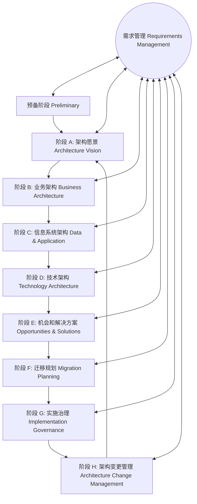

# 第 12 章 信息系统架构设计理论与实践

> 本笔记基于《系统架构设计师教程（第 2 版）》第 12 章核心知识体系，深度融合 2024~2026 软考最新真题与题库 82 道全量真题考点，形成考点速查、核心理论辨析、架构模型矩阵与历年真题映射。

---

## 核心考点速查与高频命题矩阵

| 序号 | 考点模块 | 核心概念 / 理论模型 | 命题高频考查点 / 题眼原话 | 掌握级别 |
|:---:|:---|:---|:---|:---:|
| 1 | **以架构为核心的软件开发方法** | ABSD 架构驱动开发 | 初期首要任务是**选择架构风格**；架构模型获得对**软件架构属性**的理解 | ⭐⭐⭐ |
| 2 | **企业信息基础设施** | 基础设施三大组成部分 | **技术基础设施**、**信息资源基础设施**、**管理与服务基础设施** | ⭐⭐⭐ |
| 3 | **企业架构 4A** | TOGAF 企业架构核心维度 | **业务架构 (BA)**、**数据架构 (DA)**、**应用架构 (AA)**、**技术架构 (TA)** | ⭐⭐⭐ |
| 4 | **Zachman 框架** | 6×6 企业架构矩阵分类法 | 5 个角色视角（所有者、设计师、构建者等）× 6 个焦点（数据 What、功能 How、网络 Where、人员 Who、时间 When、动机 Why） | ⭐⭐⭐ |
| 5 | **湖仓一体架构 (Lakehouse)** | 新型开放式融合架构 | 融合数仓高性能与数据湖灵活性；**6 大特征**（存算分离、ACID事务、BI直读、防数据沼泽等）；**3 种落地路径** | ⭐⭐⭐（论文高频） |
| 6 | **企业集成架构 (EIA)** | 五层信息集成模式 | 界面集成 $\to$ 数据集成 $\to$ 控制/应用系统集成（实现**互操作**） $\to$ 业务过程集成（实现**跨系统流程编排**） | ⭐⭐⭐ |
| 7 | **TOGAF 与 ADM 方法** | 开放企业架构与迭代循环 | ADM 是 TOGAF 的**核心**；阶段 A 建立**架构愿景**；阶段 E **机会和解决方案**是**第一个直接关注实施**的阶段；阶段 H **变更管理**；**需求管理**贯穿中心 | ⭐⭐⭐ |
| 8 | **ADM 迭代级别** | ADM 四大迭代级别 | **架构上下文 (Context)**、**架构定义 (Definition)**、**架构过渡演进 (Transition)**、**架构治理 (Governance)** | ⭐⭐ |
| 9 | **MIS 规划三大方法** | CSF vs SST vs BSP | **CSF（关键成功因素法）**：识别关键因素确定优先级；**SST（战略目标集转化法）**：将组织战略目标转化为 MIS 目标；**BSP（企业系统规划法）**：自上而下识别、自下而上实施、U/C 矩阵划分子系统 | ⭐⭐⭐ |
| 10 | **遗留系统演化四象限** | 业务价值 vs 技术含量矩阵 | 高技高业 $\to$ **继承**；低技高业 $\to$ **改造**；低技低业 $\to$ **淘汰**；高技低业 $\to$ **集成** | ⭐⭐⭐ |
| 11 | **价值驱动体系结构** | 价值模型三大基本形式 | **价值期望值**（需求内容与满意度）；**反作用力**（在实际部署环境中实现某种价值期望值的**难度**）；**变革催化剂**（引发变化的事件） | ⭐⭐ |
| 12 | **HL7 与 Web 服务** | 医疗卫生信息系统集成 | HL7 消息机制；传输层借助 **HTTP / HTTPS** 协议实现跨系统传递 | ⭐⭐ |

---

## 12.1 信息系统架构基本概念及发展

### 12.1.1 信息系统架构的概述
1. **信息系统的本质**：
   - 信息系统是由人员、硬件、软件、网络和数据资源组成的集成化人机交互系统，目的是收集、存储、处理和分发信息，以支持组织的决策、协调、分析与控制。
2. **架构在信息系统中的地位**：
   - 架构是信息系统的**顶层设计与蓝图**。它定义了系统的各个组成构件、外部可见属性以及各构件之间的相互关联。
   - 良好的信息系统架构能够解决“信息孤岛”、异构互联困难、复用率低下、维护演化成本失控等经典软件工程痛点。

### 12.1.2 信息系统架构的发展演进
信息系统架构历经了数十年计算范式的变迁：
1. **单机/主机集中式架构（Mainframe）**：
   - 计算和存储完全集中在大型主机（如 IBM 大型机），客户端为哑终端。高安全性与高可用性，但成本极其昂贵、缺乏灵活性。
2. **两层客户机/服务器架构（Client/Server, C/S）**：
   - 胖客户端承担业务逻辑与界面，数据库服务器负责数据持久化。响应迅速，但客户端维护分发成本高，难以应对跨网访问。
3. **三层/多层浏览器/服务器架构（Browser/Server, B/S）**：
   - 表示层（浏览器）、业务逻辑层（应用服务器）、数据访问层（数据库）。客户端零维护，跨平台能力大幅增强。
4. **面向服务架构（Service-Oriented Architecture, SOA）**：
   - 引入企业服务总线（ESB）、松耦合服务定义、标准化接口（WSDL/SOAP/REST），实现异构企业遗留系统与新系统的服务化集成。
5. **微服务与云原生架构（Microservices & Cloud Native）**：
   - 围绕业务领域模型拆分为自治微服务，借助容器化（Docker）、编排（K8s）、服务网格（Service Mesh）与无服务器计算（Serverless），实现高弹性与持续交付。

#### 核心考点：以架构为核心的软件开发方法（ABSD）
在系统开发初期，架构驱动开发（Architecture-Based Software Development）遵循以下根本准则：
- **首要任务**：**选择一个合适的架构风格（Architectural Style）**。架构风格决定了系统的基本组织范式和约束规则。
- **架构模型的作用**：开发人员通过架构模型，可以获得关于**软件架构属性（质量属性：性能、可用性、安全性、可修改性等）**的深刻理解。
- **演化基石**：架构模型为将来的**架构实现与演化过程建立了明确的目标**。

### 12.1.3 信息系统架构的定义与描述框架
1. **IEEE 1471 / ISO/IEC 42010 架构描述标准概念体系**：
   - **系统（System）**：为实现特定目的而协同工作的组件集合。
   - **环境（Environment）**：决定对系统发展、开发、运行环境的影响因素和上下文。
   - **利益相关者（Stakeholder）**：对系统具有利益关注的个人或团队（如用户、客户、开发者、架构师、运维人员）。
   - **关注点（Concern）**：利益相关者对系统开发、运行或其他重要特性的利益考量（如系统性能、安全、可靠性、演化能力）。
   - **架构视点（Viewpoint）**：建立一个视图的规范和准则，规定所采用的建模语言、符号和分析技术（面向特定关注点）。
   - **架构视图（View）**：从某个特定视点出发对整个系统架构的展现，由具体的架构模型构成。

---

## 12.2 信息系统架构

### 12.2.1 架构风格与分类
架构风格是描述某一特定应用领域中系统组织方式的惯用模式：
1. **经典架构风格分类**：
   - **数据流风格**：批处理作业、管道-过滤器。
   - **调用/返回风格**：主程序/子程序、面向对象、分层体系结构。
   - **独立构件风格**：进程通信、事件驱动系统（隐式调用）。
   - **虚拟机风格**：解释器、基于规则的系统。
   - **以数据为中心风格**：仓库风格、黑板风格。

### 12.2.2 信息系统架构分类（企业架构 4A 矩阵）
现代企业信息系统架构主要由四个相互支撑的架构维度构成（即 TOGAF 的 4A 体系）：
1. **业务架构（Business Architecture, BA）**：
   - 定义企业的商业战略、治理结构、关键业务流程以及组织职能边界，是所有技术架构设计的驱动力与出发点。
2. **数据/信息架构（Data Architecture, DA）**：
   - 描述企业的数据资产结构、逻辑实体关系、主数据管理、数据生命周期以及数据流向，保障数据一致性与权威性。
3. **应用架构（Application Architecture, AA）**：
   - 规划支持业务运行的应用系统清单、系统功能职责边界、应用间交互接口与集成模式。
4. **技术架构（Technology Architecture, TA）**：
   - 规划承载应用与数据所需的软硬件基础设施、网络拓扑、中间件、安全基础设施及云平台环境。

### 12.2.3 信息系统架构的一般原理
1. **高内聚、低耦合**：模块内部职责高度专一，模块间依赖最小化。
2. **分层与抽象**：隔离关注点，每一层仅依赖于相邻底层提供的抽象接口。
3. **接口与实现分离**：通过契约化接口解耦调用方与提供方。
4. **高可用与冗余设计**：无单点故障（SPOF），具备降级、容灾与自愈能力。

### 12.2.4 信息系统常用 4 种架构模型
1. **面向功能的模型（Function-Oriented Model）**：基于功能分解和结构化分析，自顶向下划分系统功能模块。
2. **面向数据的模型（Data-Oriented Model）**：以数据结构和数据流动为核心，关注概念数据模型（E-R 图）与关系数据库映射。
3. **面向过程的模型（Process-Oriented Model）**：聚焦于端到端的业务流程流转，采用工作流（Workflow）、BPMN 等工具进行建模。
4. **面向对象的模型（Object-Oriented Model）**：采用类、对象、封装、继承、多态，建立静态对象结构与动态行为交互模型（UML）。

### 12.2.5 企业信息系统的总体框架
#### 企业信息基础设施的三大核心支柱（⭐⭐⭐ 高频必考）
1. **技术基础设施（Technical Infrastructure）**：
   - 硬件服务器、存储网络、局域网/广域网、操作系统、数据库管理系统、应用中间件等底层物理与系统软件平台。
2. **信息资源基础设施（Information Resource Infrastructure）**：
   - 数据元标准、基础数据库、业务主题数据库、主数据字典、数据仓库、知识库等企业数字资产底座。
3. **管理与服务基础设施（Management and Service Infrastructure）**：
   - 信息化运维管理体系、IT 服务管理（ITIL）、安全规章制度、标准规范、组织机构与专业人才队伍。

#### Zachman 框架（Zachman Framework）深度解析（⭐⭐⭐ 经典必考）
Zachman 框架是企业架构领域最早且最具影响力的二维分类矩阵（6 行 × 6 列 = 36 个单元格）：
1. **行维度：利益相关者视角（抽象层次从顶向下递进）**：
   - **范围/规划者视角（Scope / Planner）**：概览球场视图，定义业务上下文与边界。
   - **业务模型/所有者视角（Business Model / Owner）**：企业实际运营者视角，描述业务流程与业务概念。
   - **系统模型/设计者视角（System Model / Designer）**：架构师视角，进行逻辑系统设计，连接业务与技术。
   - **技术模型/构建者视角（Technology Model / Builder）**：技术实现者视角，约束于具体物理实现技术。
   - **详细表示/分包商视角（Detailed Representations / Subcontractor）**：开发构件与供应商视点。
   - **运行系统（Functioning System）**：实际部署运行的现场环境。
2. **列维度：六大核心焦点（5W1H 疑问词）**：
   - **What（数据）**：系统处理的内容（实体、数据模型、存储模式）。
   - **How（功能）**：系统运作的逻辑（业务流程、应用功能、程序代码）。
   - **Where（网络/分布）**：系统的地理位置与拓扑分布（办公地点、物流网络、服务器节点）。
   - **Who（人员/组织）**：系统的操作者与受益者（组织架构、用户角色、权限分配）。
   - **When（时间）**：系统的生命周期与调度节拍（业务事件、业务循环、批处理时序）。
   - **Why（动机/目标）**：系统的战略意图与业务驱动力（企业愿景、商业目标、业务规则）。

### 12.2.6 新兴架构热点：湖仓一体架构（Lakehouse）（⭐⭐⭐ 论文与案例高频）
随着大数据与 AI 应用发展，传统“数据仓库（数仓·结构化规范但灵活性差）”与“数据湖（湖·廉价海量但易成数据沼泽）”分离割裂的弊端凸显，**湖仓一体（Lakehouse）**应运而生。

#### 1. 湖仓一体核心内涵
- 打通数据仓库和数据湖，将**数仓的高性能及数据管理能力**与**数据湖的灵活性与低成本**深度融合。
- 底层支持多种数据类型原地并存共享，上层统一封装接口，可同时支持实时查询与离线分析，支持数据原地计算，避免多副本数据流动的网络与算力开销。

#### 2. 湖仓一体的 6 大关键特征
1. **支持分析多种类型数据**：原生支持结构化、非结构化（文本、图像、音视频）及半结构化（JSON、XML）数据。
2. **数据可治理，避免数据沼泽**：支持星型、雪花等数仓模型，具备健全的数据血缘、治理与审计机制。
3. **事务支持（ACID）**：确保并发读写下的数据一致性与正确性（如 Delta Lake、Apache Iceberg、Apache Hudi）。
4. **BI 直接支持**：支持商业智能工具直接在源数据上分析，消除数据搬迁延迟。
5. **存算分离**：存储层与计算层独立伸缩，弹性扩展。
6. **开放性**：采用开放标准存储格式（Parquet、ORC），提供丰富的 API 供机器学习及 Python/R 库直接访问。

#### 3. 湖仓一体的三大落地实现路径
1. **路径一：基于 Hadoop 体系的数据湖向数仓能力扩展（“湖中建仓”）**：
   - 在低成本对象存储/HDFS 上引入事务与元数据层（以 Netflix、开源社区 Iceberg/Hudi 为代表）。
2. **路径二：基于云平台或对象存储搭建（各大云厂商）**：
   - 依托公有云 S3/OSS/Ceph 结合自研计算引擎构建托管湖仓一体（如 AWS Lake Formation、阿里云 MaxCompute+DLF）。
3. **路径三：以数据库技术为基础的自研分布式平台**：
   - 具备独立计算调度与存储引擎，注重实时高并发与统一 SQL 分析（如 Databricks、Snowflake）。

### 12.2.7 企业集成架构（EIA）与集成模式
企业集成是将具有不同功能和目的且独立运行的信息系统联合起来的系统工程。
1. **企业集成的 5 大层次**：
   - **技术平台集成**：透明化底层软硬件与网络通信差异。
   - **数据集成**：实现不同数据库之间的数据交换与共享（ETL、CDC、联邦查询）。
   - **控制集成 / 接口集成**：通过远程调用（RPC、API、服务）实现构件间方法调用。
   - **应用系统集成**：**实现不同系统之间的互操作**，使业务功能跨系统协作。
   - **业务过程集成**：**面向过程（Process-Oriented）**，在应用集成之上建立跨系统、跨部门的端到端自动化业务工作流（BPM、工作流引擎）。
2. **集成平台核心服务**：
   - **数据通信服务**：提供底层可靠消息路由与格式转换。
   - **信息集成服务**：提供不同异构数据库之间的数据同步、主数据映射与互操作。
   - **应用集成服务**：提供 API 注册中心、服务寻址、适配器集成。

---

## 12.3 信息系统架构设计方法

### 12.3.1 TOGAF 与 ADM 架构开发方法（⭐⭐⭐ 核心必考）
TOGAF（The Open Group Architecture Framework）是全球应用最广泛的企业架构框架。

#### 1. TOGAF 9 核心组件
- **ADM（架构开发方法，Architecture Development Method）**：TOGAF 的**核心**，提供开发企业架构的分步循环指南。
- **ADM 指南和技术**：支持 ADM 实施的指导原则与技术（如间隙分析、原则定义）。
- **架构内容框架（Architecture Content Framework）**：定义交付物、制品和架构构建块（ABB/SBB）。
- **企业连续系列（Enterprise Continuum）**：架构资产的分类与演进模型（从基础架构到行业特定架构）。
- **TOGAF 参考模型**：技术参考模型（TRM）与集成信息基础设施参考模型（III-RM）。
- **架构能力框架（Architecture Capability Framework）**：组织内部建立和运营架构实践所需的流程、技能与治理角色。

#### 2. ADM 核心迭代循环（各阶段考点提炼）


- **预备阶段（Preliminary Phase）**：确定架构能力范围，定义架构原则和治理结构。
- **阶段 A：架构愿景（Architecture Vision）**：创建架构愿景，验证业务上下文，确定利益相关者并获得立项批准。
- **阶段 B：业务架构（Business Architecture）**：开发基线与目标业务架构，进行差距分析。
- **阶段 C：信息系统架构（Information Systems Architectures）**：开发**数据架构**与**应用架构**。
- **阶段 D：技术架构（Technology Architecture）**：规划承载应用与数据的基础设施与软硬件平台。
- **阶段 E：机会和解决方案（Opportunities & Solutions）**：**第一个直接关注实施的阶段**，识别交付载具（项目、产品），制定候选路线图。
- **阶段 F：迁移规划（Migration Planning）**：确定项目优先级，估算成本与风险，制定详细的实施和迁移计划。
- **阶段 G：实施治理（Implementation Governance）**：对实施过程进行架构监督，确保项目落地符合架构规范。
- **阶段 H：架构变更管理（Architecture Change Management）**：确保架构变更处于受控管理之下，驱动架构进入下一轮生命周期。
- **需求管理（Requirements Management）**：贯穿于 ADM 的每个阶段，处于**核心中枢**地位，持续收集、验证和驱动架构需求。

#### 3. ADM 的四大迭代级别（Iteration Levels）
1. **架构上下文（Architecture Context）迭代**：明确企业背景、愿景、战略目标与治理边界。
2. **架构定义（Architecture Definition）迭代**：详细设计 B、C、D 阶段的架构模型。
3. **架构过渡演进（Transition Planning）迭代**：规划 E、F 阶段的路线图、过渡状态与迁移方案。
4. **架构治理（Architecture Governance）迭代**：执行 G、H 阶段的实施监控与变更治理。

### 12.3.2 信息化总体架构方法与战略规划（⭐⭐⭐ 经典必考）
管理信息系统（MIS）与企业信息化总体规划经历了三个主要发展阶段：
- **第一阶段（以数据处理为核心）**：围绕各职能部门具体业务，典型方法包括 **CSF**、**SST**、**BSP**。
- **第二阶段（以企业内部管理为核心）**：强调企业级模型集成，代表方法为战略数据规划法（SDP）。
- **第三阶段（以综合战略竞争为核心）**：面向价值链、敏捷重组与动态企业架构。

#### 规划三大经典方法深度辨析
| 方法名称 | 核心定义与操作方式 | 标志性特征 / 题眼原话 | 优缺点对比 |
|:---|:---|:---|:---|
| **关键成功因素法 (CSF)**<br>*(Critical Success Factors)* | 找出实现组织目标的**关键成功因素（少数关键领域）**，据此确定系统对这些因素的支持程度与**优先次序**。 | **通过识别影响目标实现的关键因素来确定开发优先次序**。 | 目标明确、抓主要矛盾；但容易受高层直觉主观影响。 |
| **战略目标集转化法 (SST)**<br>*(Strategy Set Transformation)* | 把组织的战略看成一个**“信息集合”**（由战略目标、战略使命、政策构成），然后将其**转化为管理信息系统的战略目标**。 | 将整个过程看成**“信息集合”**，并将组织战略目标转化为 MIS 战略目标。 | 反映组织全面意图，结构清晰；但转化过程主观性较强。 |
| **企业系统规划法 (BSP)**<br>*(Business System Planning)* | IBM 提出的经典方法。**自上而下识别系统目标与过程，自下而上设计与实现系统**；核心工具是 **U/C 矩阵**（过程与数据类划分业务子系统）。 | **自上而下识别、自下而上实施**；用 **U/C 矩阵**进行数据与过程关联。 | 系统全面、规范性强、数据与过程严密绑定；耗时长、成本高。 |

#### 国家信息化体系六要素
1. **信息资源**：国家信息化的**核心任务**，信息资源开发利用是基础。
2. **信息网络**：信息资源开发利用和信息技术应用的基础设施。
3. **信息技术应用**：国家信息化建设的**龙头**和核心。
4. **信息技术和产业**：国家信息化建设的**物质基础与实力象征**。
5. **信息化人才**：国家信息化的**成功之本**。
6. **信息化政策法规和标准规范**：国家信息化体系的**制度保障与规范基础**。

### 12.3.3 遗留系统演化策略四象限（⭐⭐⭐ 高频必考）
根据遗留系统的**技术含量**与**业务价值**两个维度，划分为四象限演化策略：

```
                高 ↑
                   │   【集成】 (高技低业)   │   【继承】 (高技高业)
                   │   技术含量高、业务价值低  │   技术含量高、业务价值高
    技 术 含 量    │   局部好但非核心业务     │   作为企业核心资产保留演进
                   │   策略：通过接口/服务集成  │   策略：持续重构与维护
                   ├─────────────────────────┼─────────────────────────
                   │   【淘汰】 (低技低业)   │   【改造】 (低技高业)
                   │   技术含量低、业务价值低  │   技术落后、但业务价值极高
                   │   维护成本高、无核心支撑  │   难以替代的核心业务系统
                   │   策略：直接废弃/重新开发 │   策略：重写核心逻辑/微服务改造
                低 ┴─────────────────────────┴─────────────────────────→
                   低                       业务价值                  高
```

- **低业务价值 + 低技术含量** $\to$ **淘汰**：直接废弃，由新商业软件或全新自研系统替代。
- **高业务价值 + 低技术含量** $\to$ **改造**：业务极其关键但系统架构老化，采用重构或封装改造。
- **高业务价值 + 高技术含量** $\to$ **继承**：充分利用现有资产，继续保持运行并平滑升级。
- **低业务价值 + 高技术含量** $\to$ **集成**：系统本身技术架构优秀，但对整体业务战略贡献有限，采用服务化接口或消息集成将其并入统一大平台。

---

## 12.4 信息系统架构案例分析

### 12.4.1 价值驱动的体系结构（Value-Driven Architecture）
价值驱动体系结构（如基于成本效益分析方法 CBAM 的思想）将商业策略、投资回报与架构决策紧密联系。
- **价值模型的三种基本形式**：
  1. **价值期望值（Value Expectation）**：表示对某一特定功能的需求，包括内容、满意度和不同级别质量的实用性。
  2. **反作用力（Counterforce）**：表示在系统部署实际环境中**实现某种价值期望值的难度**（如技术复杂性、环境限制、组织阻力）。
  3. **变革催化剂（Change Catalyst）**：环境中**导致价值期望值发生变化的某种事件**或驱动力（如政策法规突变、颠覆性技术出现、市场新竞争对手）。

### 12.4.2 Web 服务在 HL7 上的应用
HL7（Health Level 7）是国际医疗卫生信息传输与交换的行业标准。
1. **传输层的作用**：
   - 在 HL7 Web Services 实现中，传输层借助 **HTTP / HTTPS** 等标准化网络协议，**实现 HL7 消息在异构医疗系统之间的安全、可靠传递**。
2. **消息机制**：
   - 应用层将医疗业务实体（挂号、处方、检验报告）封装为 HL7 消息（XML / HL7 v3 CDA），利用 SOAP 协议打包，通过 WSDL 发布接口服务，实现跨医院系统松耦合互联。

### 12.4.3 以服务为中心的企业整合（航空公司案例）
某航空公司实施以服务为中心的企业整合（SOA Integration）：
1. **地面运行协调（Ramp Coordination）**：
   - 指飞机**从降落起到再次起飞过程（过站期间）**的全部地面业务活动协调（包括机位分配、旅客下机、行李装卸、机务检修、加油配餐、登机等）。
2. **业务建模的作用**：
   - 梳理多部门交织的复杂端到端流程，提取公用可重用业务能力，将流程节点服务化，为服务总线编排与跨系统集成做准备。

### 12.4.4 信息系统规划中的运筹决策（资源分配动态规划）
在企业资源规划与供应链调度中，合理分配有限稀缺资源（如服务器算力、原材料、投资预算）至各子系统以最大化利润，典型采用**动态规划（Dynamic Programming）**求解：
- **状态转移思想**：设 $f_k(x)$ 表示将 $x$ 吨材料分配给前 $k$ 个子公司所能获得的最大利润：
  $$f_k(x) = \max_{0 \le y \le x} \{ g_k(y) + f_{k-1}(x - y) \}$$
  其中 $g_k(y)$ 为第 $k$ 个公司分配 $y$ 吨材料的利润。通过分阶段递推可高效获得全局最优方案。

---

## 本章论文与案例真题考点串联

1. **案例分析常考点**：
   - 遗留系统处理策略四象限判断（淘汰、改造、继承、集成）。
   - TOGAF ADM 各阶段输出与核心关注点（阶段 A 愿景、阶段 E 实施起点、阶段 G 实施治理、阶段 H 变更管理）。
   - MIS 规划三大方法（CSF、SST、BSP）特点比对与适用场景。
   - 企业集成模式（数据集成 vs 过程集成 vs 应用集成）选型判断。
2. **论文命题常考点**：
   - 《论湖仓一体架构及其应用》（湖仓一体特征、三种落地途径、存算分离、ACID 与 BI 支持）。
   - 《论软件系统架构风格》（五大经典架构风格选型、场景权衡与质量属性保障）。
   - 《论企业集成架构设计及应用》（EIA 架构分层、ESB 建设、面向过程集成的流程编排落地）。
