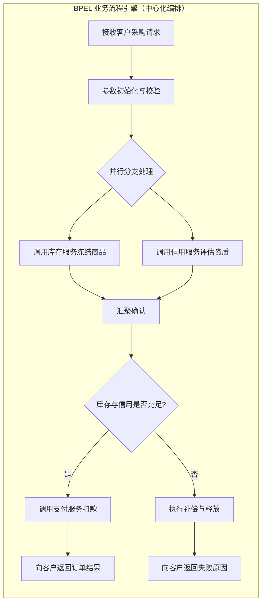
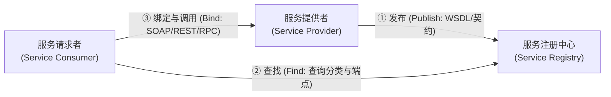
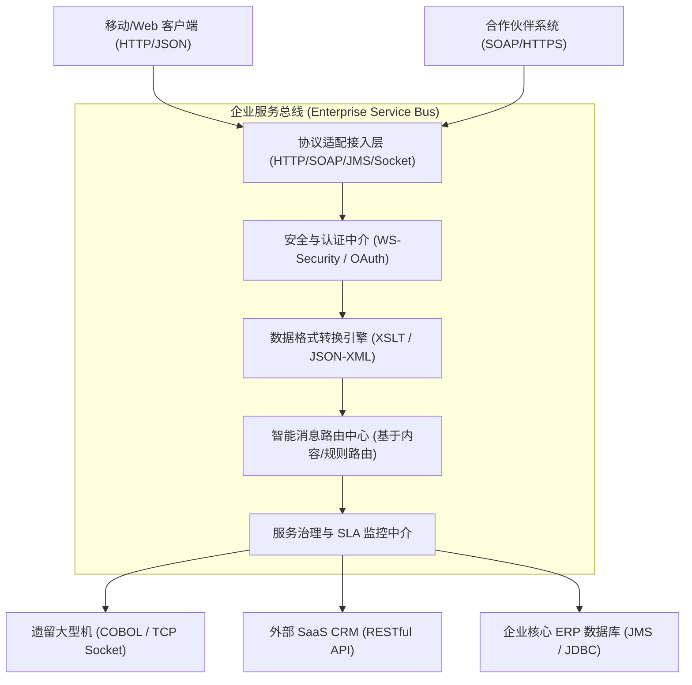

# 第 15 章 面向服务架构设计理论与实践

> 本笔记基于《系统架构设计师教程（第 2 版）》第 15 章核心知识体系，深度融合 2021~2026 软考最新真题及题库 109 道全量考题（88道客观选择题、13道案例分析题、8篇论文真题），构建考点速查、核心理论辨析、架构图解、微服务与 SOA 对比矩阵及论文高分论点库。

---

## 核心考点速查与高频命题矩阵

| 序号 | 考点模块 | 核心概念 / 理论模型 | 命题高频考查点 / 题眼原话 | 掌握级别 |
|:---:|:---|:---|:---|:---:|
| 1 | **SOA 定义与本质特征** | 面向服务架构的核心定义 | **粗粒度接口**、**松散耦合**、**协议中立/跨平台**、基于标准的接口定义（独立于硬件平台、操作系统与编程语言） | ⭐⭐⭐ |
| 2 | **SOA 八大设计原则** | Thomas Erl SOA 原则体系 | **标准契约**、**松耦合**、**服务抽象**、**可重用性**、**服务自治**、**无状态性**、**可发现性**、**可组合性**（口诀：约松抽重，治态现组） | ⭐⭐⭐（选择高频） |
| 3 | **SOA 角色交互模型** | 经典三角形协同架构 | **服务提供者 (Provider)**、**服务请求者 (Consumer)**、**服务注册中心 (Registry)**；三项操作：**发布 (Publish)**、**查找 (Find)**、**绑定/调用 (Bind)** | ⭐⭐⭐ |
| 4 | **Web Services 协议栈** | SOA 经典实现技术组合 | **UDDI**（注册发现：白页/黄页/绿页）；**WSDL**（接口描述契约）；**SOAP**（XML 封装传输消息，包含 Envelope/Header/Body/Fault）；**REST**（面向资源架构，HTTP 动词与 URI 统一标识） | ⭐⭐⭐ |
| 5 | **企业服务总线 (ESB)** | 异构系统总线集成模式 | **4 大核心能力**：**消息路由 (Routing)**、**数据转换 (Transformation)**、**协议适配 (Protocol Adaptation)**、**服务中介与编排 (Mediation & Orchestration)**；消除点对点紧耦合 | ⭐⭐⭐（案例必考） |
| 6 | **服务编排 vs 服务协同** | 跨服务流程整合范式 | **编排 (Orchestration)**：中心化流程引擎控制（**BPEL**），主动调度各参与方服务，可集中监控与补偿；<br>**协同 (Choreography)**：去中心化分布式交互（**WS-CDL**），各服务基于共享协议或事件驱动自主反应 | ⭐⭐⭐（选择/案例） |
| 7 | **服务粒度与无状态设计** | 服务设计关键权衡 | **服务粒度**：对外暴露以**粗粒度**为主（降低网络往返开销），内部组件以**细粒度**为主（提高代码重用性）；<br>**无状态设计**：服务自身不保存客户端上下文，状态外置于分布式缓存或数据库，实现水平弹性伸缩 | ⭐⭐⭐ |
| 8 | **SOA 与微服务对比** | 架构演进与技术范式对比 | 服务粒度（SOA 粗 vs 微服务 细）、通信机制（ESB 重量级 vs HTTP/gRPC 轻量级）、数据存储（共享数据库 vs 单服务自治独立数据库）、治理机制（集中式总线治理 vs 去中心化 API 网关/服务网格） | ⭐⭐⭐（案例高频） |
| 9 | **微服务核心特征口诀** | 微服务架构设计准则 | **“小细专轻松独”**：小（体积小）、细（粒度细）、专（聚焦单一业务业务职责）、轻（轻量级通信）、松（松耦合）、独（独立部署与自治） | ⭐⭐⭐（案例核心） |
| 10 | **分布式事务解决方案** | 跨服务数据一致性机制 | **刚性事务 (2PC/3PC)**：强一致性但性能差、易阻塞；<br>**柔性事务 (BASE)**：**TCC**（Try-Confirm-Cancel，性能高但业务侵入大）、**Saga**（长事务编排/协同，正向操作与补偿操作）、**本地消息表 / MQ 可靠消息**（最终一致性） | ⭐⭐⭐（案例/论文） |
| 11 | **遗留系统服务化改造** | 遗留系统资产复用策略 | 遗留系统集成模式：**黑盒包装（Adapter/Wrapper）**、**白盒重构**；演化策略：**扼杀者模式 (Strangler Fig)** 逐步替换旧模块 | ⭐⭐ |
| 12 | **ROA vs SOA 架构对比** | 面向资源 vs 面向服务 | **ROA (REST)**：以数据资源为核心，URI 统一寻址，HTTP 动词操作，JSON 文本表述，无状态上下文无关，开发轻量；<br>**SOA**：以业务功能操作为核心，RPC/SOAP 远程调用，复杂 XML 消息与多层协议栈，适用于复杂企业集成与长流程 | ⭐⭐⭐（案例经典） |

---

## 15.1 SOA 的相关概念

### 15.1.1 SOA 的定义与特征
1. **定义**：
   - **面向服务的架构（Service-Oriented Architecture, SOA）** 是一种粗粒度、松耦合的面向服务的分布式计算架构。它将企业应用程序的不同功能单元抽象为**服务（Service）**，服务之间通过定义良好的**接口和契约（Contract）**进行联系。
   - 接口是采用**中立的方式**进行定义的，独立于实现服务的硬件平台、操作系统和编程语言。这使得构建在各种不同异构系统中的服务能够以一种统一和通用的方式进行交互和协同。
2. **SOA 的四大核心本质特征**：
   - **松散耦合（Loose Coupling）**：服务请求者与服务提供者之间仅依赖接口契约，内部实现细节、编程语言、数据持久化机制完全透明解耦。一方变更只要契约保持兼容，不影响另一方。
   - **粗粒度接口（Coarse-Grained Interface）**：SOA 服务通常封装完整的业务逻辑操作（如“提交采购订单”而非细颗粒度的“设置商品数量”），减少跨网络的细碎调用，降低网络开销。
   - **标准化协议与接口契约（Standardized Contract）**：基于广泛接受的开放标准（如 XML、WSDL、SOAP、JSON、REST），实现真正的跨平台跨厂商互通。
   - **位置与平台透明性（Location & Platform Transparency）**：服务消费者通过服务注册中心（或服务总线）动态发现服务，无需硬编码服务提供者的物理 IP 或端口。

### 15.1.2 业务流程与 BPEL
1. **业务流程整合**：
   - 业务流程（Business Process）是由一组按照特定业务规则执行的活动组成的序列。SOA 的高级阶段是将原子服务按照业务流程进行灵活编排与重组，形成新的复合服务。
2. **BPEL（Business Process Execution Language，WS-BPEL）**：
   - **定义**：BPEL 是基于 XML 的业务流程执行语言，用于在 Web 服务环境中对业务流程进行形式化建模与执行。
   - **核心概念**：
     - **编排（Orchestration）**：由一个处于中心控制地位的流程引擎（BPEL Engine）驱动流程执行，协调并调用各参与服务的操作。流程引擎知晓全局流程状态与执行路径。
     - **活动（Activities）**：流程中的执行单元，包括原始活动（如 `<invoke>` 调用外部服务、`<receive>` 接收请求、`<reply>` 发送响应、`<assign>` 数据赋值）与结构化活动（如 `<sequence>` 顺序执行、`<flow>` 并行分支、`<while>` 循环条件、`<pick>` 事件选择）。
     - **补偿机制（Compensation）**：由于分布式业务流程往往跨越数分钟甚至数天，不能采用传统数据库的锁定型事务机制。BPEL 提供了 `<compensationHandler>`，当流程某步失败或被取消时，逆向执行已成功步骤的补偿逻辑（如执行“退款”补偿“扣款”），实现柔性事务回滚。



---

## 15.2 SOA 的发展历史与微服务演进

### 15.2.1 软件架构范式演进
软件体系结构历经了四个主要演进阶段：
1. **面向过程（Procedural）**：模块划分以功能函数和过程调用为核心，数据与行为分离。
2. **面向对象（Object-Oriented, OO）**：封装、继承、多态，以类和对象为单元组织代码。
3. **面向组件/构件（Component-Based）**：如 COM、DCOM、CORBA、EJB。提升了二进制级二进制复用，但依然受限于特定的厂商中间件与语言平台，跨异构网络协同极其困难。
4. **面向服务（Service-Oriented, SOA）**：以中立标准契约（XML/SOAP/WSDL）对外暴露服务，彻底破除平台、语言和底层网络的物理绑定。

### 15.2.2 国内 SOA 的发展现状与演进
- 早期以电信、金融、电力等大型国有企业为代表，通过采购商业级大型 ESB（如 IBM WebSphere MQ/Message Broker、Oracle SOA Suite）来打通庞大的老旧遗留系统（如核心账务、CRM、ERP）。
- 随着移动互联网与云原生时代的到来，传统的重量级 ESB 暴露出架构庞大、单点总线性能瓶颈、运维复杂、部署周期漫长等弊端，逐步向**轻量级微服务（Microservices）与服务网格（Service Mesh）**演进。

### 15.2.3 SOA 的微服务化发展
微服务本质上是 **SOA 架构思想在敏捷开发、容器化与云原生背景下的现代演化与精细化变体**：
- **共同追求**：松耦合、高内聚、服务复用、边界清晰。
- **演化驱动力**：高并发互联网业务对极致弹性扩缩容、快速持续交付（CI/CD）、去中心化组织架构（Conway 定律：两块披萨团队）的迫切需求。

---

## 15.3 SOA 的参考架构

### 15.3.1 经典“三角色与三操作”交互模型
SOA 的基础交互依托著名的三角形架构协作模型：
1. **三大角色**：
   - **服务提供者（Service Provider）**：创建服务，将服务描述（WSDL）发布到注册中心，并监听和响应服务请求。
   - **服务请求者 / 消费者（Service Consumer / Requester）**：根据需求在注册中心查找服务，获取服务接口契约并绑定调用服务。
   - **服务注册中心（Service Registry / Broker）**：充当服务发现的目录库，维护可用服务的元数据与端点地址。
2. **三项核心操作**：
   - **发布（Publish）**：服务提供者向注册中心注册其服务接口描述与访问端点。
   - **查找（Find）**：服务请求者向注册中心发出查询请求，检索满足业务功能要求的服务契约。
   - **绑定与调用（Bind）**：服务请求者解析服务描述，与服务提供者建立连接并完成运行时消息交互。



### 15.3.2 SOA 参考架构分层模型（5+1 层次体系）
在企业级 SOA 建设中，通常划分为清晰的垂直服务分层与横向治理支撑：
1. **业务流程层（Business Process Layer）**：
   - 负责组织跨系统的长生命周期工作流，运用编排（BPEL）调度下层服务，实现端到端业务闭环。
2. **服务层（Service Layer）**：
   - 将底层的技术实现抽象封装为企业级服务。包括复合业务服务、原子基础服务与通用技术服务。
3. **构件层（Component Layer）**：
   - 服务的具体软件实现单元。采用 Java、.NET、C++ 等编程语言开发的业务构件（如 Spring Bean、EJB）。
4. **业务逻辑 / 运营应用层（Operational Systems Layer）**：
   - 底层异构的现有应用资产（遗留核心系统、ERP、CRM、主数据数据库、外部第三方 API 等）。
5. **企业服务总线与消息中介层（ESB / Integration Layer）**：
   - 贯穿各系统的集成主干，承担路由、转换、适配与协议桥接。
6. **横向贯穿：服务质量、安全与治理层（QoS, Security & Governance）**：
   - 贯穿所有层级的全生命周期管控，包括身份认证、传输加密、访问鉴权、SLA 监控、审计日志。

---

## 15.4 SOA 主要协议和规范

### 15.4.1 UDDI 协议（通用描述、发现与集成规范）
1. **本质**：基于 SOAP 消息机制的分布式、标准化的 Web 服务信息注册库规范。
2. **核心数据结构（四大白皮书模型）**：
   - **白页（White Pages）**：包含服务提供商的企业名称、地址、联系方式及公认标识符。
   - **黄页（Yellow Pages）**：包含按照行业标准分类法（如 UNSPSC、NAICS 分类标准）划分的业务分类信息。
   - **绿页（Green Pages）**：包含如何调用具体 Web 服务的技术细节信息，指向 WSDL 契约规范。
   - **tModel（技术模型）**：用来代表规范、概念分类或接口指纹，提供对标准接口规范的唯一引用。

### 15.4.2 WSDL 规范（Web 服务描述语言）
WSDL 采用 XML 格式严格定义 Web 服务的接口契约。其核心结构由两大部分、六个核心元素组成：
1. **抽象定义（Abstract Definitions，与具体平台协议无关）**：
   - `<types>`：数据类型定义容器，采用 XML Schema (XSD) 语法定义消息所用的数据类型与实体。
   - `<message>`：通信数据的抽象定义，由一个或多个 `<part>`（参数）组成。
   - `<portType>`（WSDL 2.0 中改名为 `<interface>`）：操作（Operation）的抽象集合，相当于接口类，定义了服务支持的输入/输出消息模式（如 Request-Response、One-Way）。
2. **具体实现绑定（Concrete Bindings，与传输协议及网络端点绑定）**：
   - `<binding>`：将抽象的 `portType` 绑定到具体的通信协议（如 SOAP 1.1/1.2 over HTTP）与数据编码格式。
   - `<port>`（WSDL 2.0 中改名为 `<endpoint>`）：指定绑定的物理网络访问地址（URL 地址）。
   - `<service>`：服务的容器，聚合一组相关的 `<port>` 端点。

### 15.4.3 SOAP 协议（简单对象访问协议）
1. **协议本质**：建立在 XML 基础上的轻量级协议，用于在去中心化或分布式环境中交换结构化和类型化的信息。通常运行在 HTTP/HTTPS 或 SMTP/JMS 之上。
2. **SOAP 消息封装结构**：
   - **`<SOAP-ENV:Envelope>`（信封）**：根元素，强制必须存在，标识该 XML 文档为一条 SOAP 消息。
   - **`<SOAP-ENV:Header>`（报头）**：可选元素，携带与具体应用业务数据正交的控制信息（如安全认证令牌 WS-Security、事务上下文 WS-Transaction、路由信息 WS-Addressing）。
   - **`<SOAP-ENV:Body>`（正文）**：强制必须存在，包含实际调用的方法名称、输入参数或返回结果。
   - **`<SOAP-ENV:Fault>`（故障）**：位于 `<Body>` 内部的可选子元素，当处理 SOAP 消息发生错误时，承载错误代码（faultcode）、错误原因（faultstring）与详细堆栈（detail）。

```xml
<?xml version="1.0"?>
<soap:Envelope xmlns:soap="http://schemas.xmlsoap.org/soap/envelope/">
  <soap:Header>
    <auth:Token xmlns:auth="http://example.com/auth">Token_ABC123</auth:Token>
  </soap:Header>
  <soap:Body>
    <m:GetStockPrice xmlns:m="http://example.com/stock">
      <m:StockSymbol>600000</m:StockSymbol>
    </m:GetStockPrice>
  </soap:Body>
</soap:Envelope>
```

### 15.4.4 REST 规范（表述性状态转换）
1. **设计哲学**：由 Roy Fielding 博士在 2000 年博士论文中提出，是一种**面向资源（Resource-Oriented Architecture, ROA）**的架构风格。
2. **REST 六大架构约束**：
   - **客户端-服务器（Client-Server）分离**：界面与数据存储分离，提升各端演进独立性。
   - **无状态（Statelessness）**：每个请求必须包含服务器理解并处理请求所需的全部信息，服务器不保存会话状态。
   - **可缓存（Cacheable）**：响应显式或隐式标明是否可缓存，极大提升系统伸缩性与响应速度。
   - **分层系统（Layered System）**：客户端无法感知直连终端服务器还是中间代理网关/CDN。
   - **统一接口（Uniform Interface）**：核心原则，包括资源标识（URI）、通过表述操作资源、自描述消息、超媒体作为应用状态引擎（HATEOAS）。
   - **按需代码（Code-On-Demand，可选）**：服务器可临时下载代码（如 JavaScript）扩展客户端功能。
3. **HTTP 动词与资源操作标准映射**：
   - `GET`：幂等且安全，获取资源表述。
   - `POST`：非幂等且不安全，创建新资源或执行非标准化处理。
   - `PUT`：幂等且不安全，完整替换/更新指定资源。
   - `DELETE`：幂等且不安全，删除指定资源。
   - `PATCH`：非幂等（或有条件幂等），局部更新指定资源的部分属性。

---

## 15.5 SOA 设计的标准要求与服务质量（QoS）

### 15.5.1 文档标准化
- 所有服务必须有自描述的标准化机器可读文档（XML Schema / WSDL / OpenAPI Swagger），杜绝私有二进制契约。

### 15.5.2 通信协议标准与 WS-* 协议簇
- **WS-Security**：基于 XML 加密（XML Encryption）与 XML 数字签名（XML Signature），在消息层实现端到端安全，无惧网络中间路由节点的解密篡改。
- **WS-ReliableMessaging**：确保在网络不稳定、暂态故障下，消息跨异构系统能够“恰好送达一次（Exactly-Once）”或“至少送达一次”。
- **WS-Addressing**：将消息终结点引用与消息标识符直接封装进 SOAP 消息头，实现协议无关的端到端路由。
- **WS-Coordination & WS-AtomicTransaction**：支持跨多个 Web 服务的两阶段提交分布式强一致性事务。

### 15.5.3 应用程序统一登记与集成
- 建立统一的企业服务目录（Service Catalog），管理服务的元数据、版本生命周期、SLA 级别、依赖关系图谱。

### 15.5.4 服务质量（QoS）综合保障
1. **可用性（Availability）**：通过集群部署、负载均衡、主备容灾保证服务随时可用。
2. **可靠性（Reliability）**：采用超时重试、死信队列、断路器机制防止局部崩溃。
3. **性能（Performance）**：粗粒度传输、批量请求优化、异步消息解耦、分布式缓存降低延迟。
4. **事务完整性（Integrity）**：结合业务容忍度权衡采用刚性 2PC 还是最终一致性 Saga。

---

## 15.6 SOA 的作用与业务价值

1. **破除“信息孤岛”，实现企业应用集成（EAI）**：将以往垂直封闭的烟囱式系统转变为可跨部门互操作的共享服务资产。
2. **提高 IT 资产的可复用性**：统一沉淀用户、支付、风控等核心公共能力，避免重复开发与数据不一致。
3. **敏捷响应业务变革**：业务人员与架构师可通过业务流程编排（BPM），像搭积木一样重组已有服务，大幅压缩新业务上线周期。
4. **有效保护已有历史投资**：无需推倒重来，通过包装器（Wrapper）与适配器（Adapter）将传统大型机、遗留系统无缝接入现代 SOA 总线。

---

## 15.7 SOA 的八大设计原则（核心基石）

| 原则名称 | 英文名称 | 核心内涵与架构要求 | 软考题眼与考查陷阱 |
|:---|:---|:---|:---|
| **1. 标准化服务契约** | Standardized Service Contract | 服务依赖于正式的、独立的契约（WSDL/Schema/OpenAPI），接口优先于实现。 | 契约必须中立，不可绑定特定语言私有类型。 |
| **2. 松耦合** | Service Loose Coupling | 服务契约独立于内部实现；服务之间不存在强技术依赖和状态绑定。 | “解耦”不等于“不联系”，是通过中立接口保持最小化依赖。 |
| **3. 服务抽象** | Service Abstraction | 契约仅暴露必需的公共信息；技术细节、内部流程和数据库结构完全隐藏。 | 严格的信息隐藏原则；防止底层数据表直接泄露给外界。 |
| **4. 服务可重用性** | Service Reusability | 服务逻辑被设计为通用的业务功能，可被多个不同上下文的应用场景复用。 | 不能按单一系统的特定界面定制接口，必须抽象为通用领域服务。 |
| **5. 服务自治性** | Service Autonomy | 服务对自身底层的执行环境、逻辑和持久化拥有最高控制权与边界隔离。 | 自治性越强，服务独立演化与扩容能力越好，但要防过度隔离。 |
| **6. 服务无状态性** | Service Statelessness | 服务自身在调用间不保存客户端会话状态；状态通过参数传递或外部存储。 | **无状态是水平扩展的前提**；有状态会导致粘性会话与单点雪崩。 |
| **7. 服务可发现性** | Service Discoverability | 服务附带有效的元数据，可被注册到服务目录并被人类或机器自动化检索发现。 | 结合 UDDI 或服务注册表（Eureka/Nacos）实现动态发现。 |
| **8. 服务可组合性** | Service Composability | 服务无论自身大小，都具备充当构建块的能力，可被灵活编排进复杂的业务流程。 | 服务粒度适中与接口正交性是良好可组合性的先决条件。 |

---

## 15.8 SOA 的设计模式与微服务模式

### 15.8.1 服务注册表模式（Service Registry Pattern）
- 服务提供者启动时自动注册元数据与健康心跳；客户端通过查询注册表获取活跃实例列表并进行客户端/服务端负载均衡。

### 15.8.2 企业服务总线模式（ESB Pattern）
1. **ESB 的概念**：ESB 是基于传统面向消息中间件（MOM）演化而来的企业级基础设施，是 SOA 架构的**物理集成中枢**。
2. **ESB 的四大核心功能**：
   - **协议适配与转换（Protocol Bridging）**：支持 HTTP、SOAP、JMS、FTP、TCP 等异构协议之间的透明转换（如客户端发 HTTP REST，ESB 转换为 JMS 消息丢给后端大型机）。
   - **消息路由（Routing）**：基于内容路由（Content-Based Routing）、静态路由、动态路由或多播分发。
   - **数据格式转换与映射（Transformation）**：利用 XSLT、脚本或转换规则，在 XML、JSON、固定定长报文、CSV 等异构数据模型间自动转换。
   - **服务中介与安全管控（Mediation & Security）**：提供统一的认证授权、限流熔断、调用日志监控、SLA 监控与事务协调。



### 15.8.3 微服务模式（Microservices Architecture）
1. **微服务与传统 SOA 深度对比矩阵**：

| 对比维度 | 传统 SOA 架构 | 微服务架构 (Microservices) |
|:---|:---|:---|
| **服务粒度** | **较粗**（以系统级、企业业务域为服务单元） | **微小/极细**（围绕单个领域子域与单一职责原则划分） |
| **通信机制** | **重量级通信**（SOAP、XML、复杂 WS-* 栈） | **轻量级通信**（HTTP RESTful、gRPC、Protobuf） |
| **集成与中枢** | **厚总线（Smart Pipes）**：ESB 承载大量路由、转换与业务编排 | **哑管道（Dumb Pipes, Smart Endpoints）**：端点处理逻辑，总线退化为轻量 API 网关或 MQ |
| **数据管理** | **数据倾向于共享**（多个服务可共享底层企业大数据库） | **去中心化数据（Database-per-service）**：各微服务独占私有数据库，严禁跨库直连 |
| **分布式事务** | 倾向于强一致性，采用 **WS-AtomicTransaction / 2PC** | 接受最终一致性，采用 **BASE 理论、Saga、TCC、本地消息表** |
| **团队与组织** | 职能划分（前端组、后端组、DBA 组、中间件组） | 全功能跨职能特性团队（2~8 人，包含产品、前后端、测试、DevOps） |
| **部署与交付** | 整体打包部署于大型应用服务器（如 WebLogic、WebSphere），周期按月计 | 容器化（Docker/K8s），持续交付 CI/CD，秒级独立自动化部署上线 |

2. **微服务常见设计模式**：
   - **API 网关模式（API Gateway）**：统一入口、反向代理、路由分发、认证鉴权、限流降级、日志埋点。
   - **BFF 模式（Backend For Frontend）**：为不同终端（iOS、Android、Web、第三方开放平台）定制专用的前端聚合网关。
   - **CQRS 模式（命令查询职责分离）**：写操作（Command）与读操作（Query）在模型和数据存储上彻底解耦，写库优化事务，读库优化检索。
   - **断路器模式（Circuit Breaker）**：通过闭合（Closed）、打开（Open）、半开（Half-Open）三态流转，阻断微服务雪崩级联传播。

---

## 15.9 构建 SOA 架构时应该注意的问题

### 15.9.1 遗留系统的集成策略
1. **黑盒集成（包装器模式 Wrapper / Adapter）**：
   - 不修改遗留系统的内部代码与数据结构，在外部增加一层适配服务，将其专有协议转换为标准 Web 服务。开发周期短、风险极低，但受限于原系统性能瓶颈。
2. **白盒重构（Re-engineering）**：
   - 彻底梳理遗留系统的业务逻辑，重新设计数据库表与服务代码。投资大、风险高，但能获得最高的可维护性与架构纯洁度。
3. **扼杀者模式（Strangler Fig）**：
   - 在旧系统外围搭建新微服务架构，逐步将边角功能接管迁移，最后逐步侵蚀并安全替换旧系统核心，实现平滑演进。

### 15.9.2 服务粒度的权衡与无状态服务设计
1. **服务粒度的权衡决策**：
   - **过粗的粒度**：服务变成了庞大的“单体模块”，接口参数庞大复杂，降低了服务在其它业务流程中的重用机会。
   - **过细的粒度**：导致客户端完成一个业务操作需要进行频繁的网络跨进程调用（Chatty Communication），网络延迟剧增，系统吞吐量断崖式下跌。
   - **最佳实践**：**外部暴露粗粒度服务（Facade 外观模式聚合），内部协作细粒度服务**。
2. **无状态服务设计原则**：
   - **状态的危害**：如果在服务内存中保存会话上下文（Session），当该服务实例宕机或水平横向扩容时，请求调度到新节点将丢失状态，导致单点故障与无法弹性扩缩容。
   - **解决准则**：将业务状态抽取外置到分布式高可用存储（如 Redis 集群、分布式数据库、分布式文件系统），服务本身作为纯计算节点运行。

---

## 15.10 SOA 实施的过程与生命周期

### 15.10.1 服务建模的三大策略
1. **自顶向下法（Top-Down，业务流程驱动）**：
   - 从企业业务战略与全局业务流程出发，逐层分解为子流程，最后识别和定义所需的服务接口。保证服务与业务高度对齐，但落地周期长、对遗留系统兼容难度大。
2. **自底向上法（Bottom-Up，现有资产驱动）**：
   - 从现有遗留系统和数据库出发，将已有构件直接包装对外发布为服务。实施速度快、见效快，但往往导致服务粒度碎、缺乏统筹规划与业务复用性。
3. **综合折中法（Meet-in-the-Middle，混合迭代法，推荐实践）**：
   - 自顶向下分解核心业务架构，自底向上评估已有资产可用性，两者在中间汇聚，通过接口适配完成双向奔赴。

---

## 15.11 核心前沿专题与高分论文备战

### 15.11.1 分布式事务解决方案深度选型矩阵

| 方案类别 | 核心机制 | 一致性级别 | 性能与并发 | 业务侵入度 | 典型应用场景 |
|:---|:---|:---:|:---:|:---:|:---|
| **2PC / XA** | 协调者发起 Prepare 与 Commit 两阶段；强行锁定资源 | 强一致性 (ACID) | 极低（长事务锁表阻塞严重） | 无侵入（数据库驱动支持） | 单企业内部、跨库少、高安全性要求金融短事务 |
| **TCC** | 业务层拆分为 Try（预留）、Confirm（确认）、Cancel（释放补偿） | 最终一致性 (BASE) | 极高（不占用数据库连接锁） | 极高（每个接口必须手写三个阶段与防悬挂逻辑） | 核心交易、跨行扣款、高并发秒杀库存锁定 |
| **Saga** | 长事务由一系列本地事务组成；一旦某步失败，逆向执行补偿事务 | 最终一致性 (BASE) | 高（无全局资源锁定） | 中等（需编写正向与补偿服务） | 跨部门长生命周期流程、第三方支付与物流履约 |
| **本地消息表** | 业务与发消息在本地数据库同一事务写入；后台定时轮询补偿投递 | 最终一致性 (BASE) | 高（解耦主流程） | 中等（需维护本地消息持久化表） | 跨服务积分发放、优惠券派发、通知中心 |
| **可靠消息 (MQ)** | 基于 RocketMQ 等半消息（Half-message）与事务回查机制 | 最终一致性 (BASE) | 极高（异步吞吐量大） | 较低（依赖消息中间件能力） | 跨系统异步解耦集成、流量削峰 |

### 15.11.2 高频论文题官方写作提纲与高分论点矩阵

#### 论文专题一：《论面向服务架构设计及其应用》（或《论SOA在企业集成架构设计中的应用》）
1. **摘要写作要点（300字）**：
   - 简要介绍项目背景（如企业一体化运营平台、跨省异构业务集成工程），阐明面临的数据孤岛、接口协议异构、系统耦合度高、维护演化成本高昂等痛点。
   - 明确指出采用面向服务架构（SOA），依托企业服务总线（ESB）实现核心能力集成。
   - 总结实际应用成效（接口复用率、研发周期缩短、系统稳定性与高可用保障）。
2. **正文第一部分：项目概述与业务痛点（500字）**：
   - 阐述系统的规模、技术选型以及遗留系统现状（如原各分公司系统基于不同技术栈开发，跨系统交互困难）。
3. **正文第二部分：SOA 理论核心与架构设计方案（1000字）**：
   - **服务建模与划分**：采用混合法（自顶向下与自底向上结合），划分为实体服务、功能服务与编排流程服务。
   - **ESB 总线核心能力落地**：详细展开**协议适配**（HTTP、SOAP、JMS）、**消息转换**（XML/JSON 映射）、**基于内容的智能路由**与**服务监控中介**。
   - **Web Services 协议栈应用**：使用 WSDL 定义契约、SOAP/REST 通信、WS-Security 实现安全认证。
4. **正文第三部分：实施过程中遇到的挑战与解决方案（700字）**：
   - **问题 1：ESB 成为性能瓶颈与单点故障** $\to$ 方案：集群化部署、动静分离、大流量只读业务绕过总线直连缓存。
   - **问题 2：跨系统长事务一致性保证** $\to$ 方案：放弃重量级 2PC，采用 Saga 补偿模式或基于 MQ 的可靠消息最终一致性。
   - **问题 3：服务粒度过细导致网络开销激增** $\to$ 方案：设计粗粒度外观服务（Facade），批量聚合请求减少通信轮次。
5. **正文第四部分：效果评估与复盘结语（300字）**：
   - 总结系统上线后的运行状态、性能指标及技术演进思考（向微服务与服务网格平滑演进）。

#### 论文专题二：《论微服务架构及其应用》
1. **核心论点矩阵**：
   - **服务边界识别**：基于 DDD 领域驱动设计划分战略设计限界上下文（Bounded Context），遵循单一职责。
   - **通信治理机制**：同步调用采用 gRPC/REST，异步削峰解耦采用 Kafka/RocketMQ，对外通过 API 网关（Kong/Spring Cloud Gateway）统一鉴权与流控。
   - **数据自治原则**：坚持 Database-per-service，通过分布式事务机制（TCC/Saga/Seata）化解跨库强一致难题。
   - **高可用防护网**：引入熔断降级（Sentinel）、分布式链路追踪（SkyWalking/OpenTelemetry）、容器编排（K8s）保障高弹性。

---
