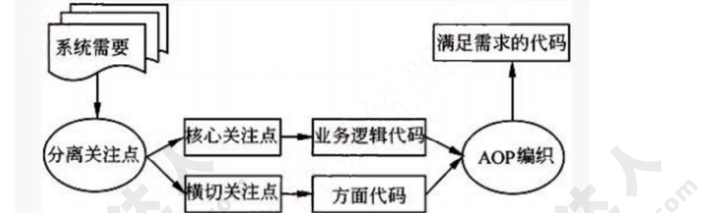
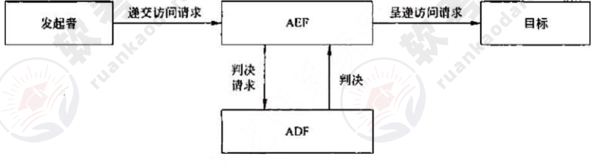
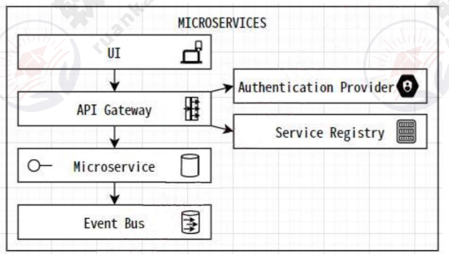
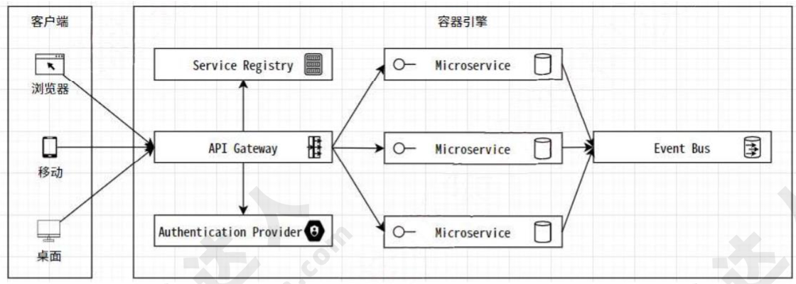

# 2021年下半年 系统架构设计师 · 论文题

> 卷面信息（题目卷首页）：考试时间 15:20~17:20 共 120 分钟。本试卷满分 75 分。请按下述要求正确填写答题纸：
> 1. 本试卷满分 75 分。
> 2. 在答题纸的指定位置填写你所在的省、自治区、直辖市、计划单列市的名称。
> 3. 在答题纸的指定位置填写准考证号、出生年月日和姓名。
> 4. 在试题号栏内用"O"圈住选答的试题号。
> 5. 答题纸上除填写上述内容外只能写解答。
> 6. 解答应分摘要和正文两部分。在书写时，请注意以下两点：① 摘要字数在 400 字以内，可以分条叙述，但不允许有图、表和流程图。② 正文字数为 2000 字至 3000 字，文中可以分条叙述，但不要全部用分条叙述的方式。
> 7. 解答时字迹务必清楚，字迹不清，将不评分。
>
> 卷面引文：从下列的 4 道试题（试题一至试题四）中任选 1 道解答。请在答卷上用"O"圈住选答的试题编号。若用"O"圈住的试题编号超过 1 道，则按题号最小的 1 道评分。

> 校核注：另源（2021.11系统架构设计师真题及解析.pdf 第30页）卷面引文作"从下列的 4 道试题（试题一至试题四）中任选 1 道解答。请在答题纸上的指定位置处将所选择试题的题号框涂黑。若多涂或者未涂题号框，则对题号最小的一道试题进行评分。"（涂黑题号框，与主来源"O 圈住"表述不同）。

## 题号目录

| 题号 | 论题 | 教程章节 |
|------|------|----------|
| Q1（试题一） | 论面向方面的编程技术及其应用（AOP） | — |
| Q2（试题二） | 论系统安全架构设计及其应用 | 18 安全架构设计 |
| Q3（试题三） | 论企业集成平台的理解与应用 | — |
| Q4（试题四） | 论微服务架构及其应用 | 14 云原生架构 |

## 原题转录（视觉核验）

---

## Q1（试题一：论面向方面的编程技术及其应用（AOP））

面向过程编程是一种自顶向下的编程方法，其实质是对软件进行功能性分解。它适用于小型软件系统，例如某一算法的实现。在大型应用系统中，自顶向下逐步求精的方法无论在系统体系结构的确立，系统的进化和维护，以及软件重用性方面都存在其不足之处。

请围绕"论面向方面的编程技术及其应用（AOP）"论题，依次从以下三个方面进行论述。

1. 概要叙述你所参与管理或开发的软件项目，以及你在其中所承担的主要工作。
2. 叙述在项目实践过程使用 AOP 技术开发的具体步骤。
3. 结合项目，论述使用 AOP 的原因，开发过程中存在的问题及所使用技术带来的实际应用效果。

> 校核注：另源（2021.11系统架构设计师真题及解析.pdf 第30页）本试题一题干引言与子问题措辞与主来源不同，作"针对应用开发所面临的规模不断扩大、复杂度不断提升的问题，面向方面的编程（Aspect Oriented Programming,AOP）技术提供了一种有效的程序开发方法。为了理解和完成一个复杂的程序，通常要把程序进行功能划分和封装。一般系统中的某些通用功能，如安全性、持续性、日志记录等等，其代码是分散的，较难实现模块化，不利于程序演变、维护和更新。AOP 技术将逻辑上关系松散的代码封装到一个具有某种公共行为的可重用模块，并将其命名为方面（Aspect）。"；三方面作"1.概要叙述你参与实施的应用 AOP 技术的软件项目以及你在其中所担任的主要工作。2.叙述在软件项目实践过程使用 AOP 技术开发的具体步骤。3.结合项目内容，论述该项目使用 AOP 技术的原因，开发过程中存在的问题和解决方法，以及使用 AOP 技术带来的实际应用效果。"

**来源所列答案**：论文题无标准答案；来源提供"写作要点"（照录如下）。

**来源解析（试题一 写作要点）**：

面向方向编程（AOP）包括以下三个主要的步骤：

（1）方面分解。分解需求提取出横切关注点和核心关注点。把核心模块级关注点和系统级的横切关注点进行分离。例如，对于一个信用卡系统，可以分解出三个关注点：核心的信用卡处理、日志和验证。

（2）关注点实现。各自独立地实现这些关注点，用 OOP（面向对象的程序设计）实现核心关注点，用 AOP 实现横切关注点。例如，可以用 OOP 实现信用卡处理单元，而用 AOP 实现日志单元和验证单元。

（3）方面的重新组合。方面集成器通过创建一个模块单元（方面）来制定重组的规则，重组过程也称为编织。

AOP（Aspect-Oriented Programming，面向方面编程），可以说是 OOP(Object-Oriented Programming，面向对象编程）的补充和完善。OOP 引入封装、继承和多态性等概念来建立一种对象层次结构，用以模拟公共行为的一个集合。当我们需要为分散的对象引入公共行为的时候，OOP 则显得无能为力。也就是说，OOP 允许你定义从上到下的关系，但并不适合定义从左到右的关系。例如日志功能，日志代码往往水平地散布在所有对象层次中，而与它所散布到的对象的核心功能毫无关系。对于其他类型的代码，如安全性、异常处理和透明的持续性也是如此。这种散布在各处的无关的代码被称为横切(cross-cutting)代码，在 OOP 设计中，它导致了大量代码的重复，而不利于各个模块的重用。

而 AOP 技术则恰恰相反，它利用一种称为"横切"的技术，剖解开封装的对象内部，并将那些影响了多个类的公共行为封装到一个可重用模块，并将其命名为"Aspect"，即方面。所谓"方面"，简单地说，就是将那些与业务无关，却为业务模块所共同调用的逻辑或责任封装起来，以减少系统的重复代码，降低模块间的耦合度，并有利于未来的可操作性和可维护性。AOP 代表的是一个横向的关系，如果说"对象"是一个空心的圆柱体，其中封装的是对象的属性和行为；那么面向方面编程的方法，就仿佛一把利刃，将这些空心圆柱体剖开，以获得其内部的消息。而剖开的切面，也就是所谓的"方面"了。然后它又以巧夺天工的妙手将这些剖开的切面复原，不留痕迹。

使用"横切"技术，AOP 把软件系统分为两个部分：核心关注点和横切关注点。业务处理的主要流程是核心关注点，与之关系不大的部分是横切关注点。横切关注点的一个特点是，他们经常发生在核心关注点的多处，而各处都基本相似，比如权限认证、日志、事务处理。AOP 的作用在于分离系统中的各种关注点，将核心关注点和横切关注点分离开来。

AOP 应用程序包括以下三个主要的开发步骤：

1. 将系统需求进行功能性分解，区分出普通关注点以及横切关注点，确定哪些功能是组件语言必须实现的，哪些功能可以以 aspect 的形式动态加入到系统组件中。
2. 单独完成每一个关注点的编码和实现，构造系统组件和系统 aspect。这里的系统组件，是实现该系统的基本模块，对于 OOP 语言，这些组件可以是类，对于过程化程序设计语言，这些组件可以是各种函数和 API。系统 aspect 是指用 AOP 语言实现的将横切关注点封装成的独立的模块单元。
3. 用联接器指定的重组规则，将组件代码和 aspect 代码进行组合，形成最终系统。为达到此目的，应用程序需要利用或创造一种专门指定规则的语言，用它来组合不同应用程序片断。这种用来指定联结规则的语言可以是一种已有编程语言的扩展，也可以是一种完全不同的全新语言。

**另源解析配图**（软考达人版第 30 页，主来源无图）：

---

## Q2（试题二：论系统安全架构设计及其应用）

信息安全的特征是为了保证信息的机密性、完整性、可用性、可控性和不可抵赖性。

信息系统的安全保障是以风险和策略为基础，在信息系统的整个生命周期中提供包括技术、管理、人员和工程过程的整体安全，在信息系统中保障信息的这些安全特征，并实现组织机构的使命。许多信息系统的用户需要提供一种方法和内容对信息系统的技术框架、工程过程能力和管理能力提出安全性要求，并进行可比性的评估、设计和实施。

请围绕"论系统安全架构设计及其应用"论题，依次从以下三个方面进行论述。

1. 概要叙述你所参与管理或开发的软件项目，以及你在其中所承担的主要工作。
2. 详细论述安全架构设计中鉴别框架和访问控制框架设计的内容，并论述鉴别和访问控制所面临的主要威胁，并说明其危害。
3. 阐述你在软件开发的过程中都遇到了哪些实际问题及解决方法。

> 校核注：另源（2021.11系统架构设计师真题及解析.pdf 第31页）本试题二题干引言与子问题措辞与主来源不同，引言作"随着社会信息化进程的加快，计算机及网络已经被各行各业广泛应用，信息安全问题也变得愈来愈重要。它具有机密性、完整性、可用性、可控性和不可抵赖性等特征。信息系统的安全保障是以风险和策略为基础，在信息系统的整个生命周期中提供包括技术、管理、人员和工程过程的整体安全，以保障信息的安全特征。"；三方面作"1.概要叙述你参与管理和开发的涉及安全架构设计的软件项目以及承担的主要工作。2.请详细论述安全架构设计中鉴别框架和访问控制框架设计的内容，并论述鉴别和访问控制所面临的主要威胁有哪些，说明其危害。3.请简要说明在你所参与项目的开发过程中，在鉴别框架和访问控制框架设计中存在的实际问题，以及是如何解决这些问题的。"

**来源所列答案**：论文题无标准答案；来源提供"写作要点"（照录如下）。

**来源解析（试题二 写作要点）**：

鉴别（Authentication）的基本目的，就是防止其他实体占用和独立操作被鉴别实体的身份。鉴别提供了实体声称其身份的保证，只有在主体和验证者的关系背景下，鉴别才是有意义的。鉴别有两种重要的关系背景：一是实体由申请者来代表，申请者与验证者之间存在着特定的通信关系（如实体鉴别）；二是实体为验证者提供数据项来源。

鉴别的方式主要基于以下 5 种。

（1）已知的，如一个秘密的口令。

（2）拥有的，如 1C 卡、令牌等。

（3）不改变的特性，如生物特征。

（4）相信可靠的第三方建立的鉴别（递推）。

（5）环境（如主机地址等）。

鉴别服务分为以下阶段：安装阶段；修改鉴别信息阶段；分发阶段；获取阶段；传送阶段；验证阶段；停活阶段；重新激活阶段；取消安装阶段。

在安装阶段，定义申请 AI 和验证 AI.修改鉴别信息阶段，实体或管理者申请 AI 和验证 AI 变更（如修改口令）。在分发阶段，为了验证交换 AI,把验证 AI 分发到各实体（如申请者或验证者）以供使用。在获取阶段，申请者或验证者可得到为鉴别实例生成特定交换 AI 所需的信息，通过与可信第三方进行交互或鉴别实体间的信息交换可得到交换 AI.例如，当使用联机密钥分配中心时，申请者或验证者可从密钥分配中心得到一些信息，如鉴别证书。在传送阶段，在申请者与验证者之间传送交换 AI.在验证阶段，用验证 AI 核对交换 AI.在停活阶段，将建立一种状态，使得以前能被鉴别的实体暂时不能被鉴别。在重新激活阶段，使在停活阶段建立的状态将被终止。在取消安装阶段，实体从实体集合中被拆除。

访问控制（AccessControl）决定开放系统环境中允许使用哪些资源、在什么地方适合阻止未授权访问的过程。在访问控制实例中，访问可以是对一个系统（即对一个系统通信部分的一个实体）或对一个系统内部进行的。

ACI（访问控制信息）是用于访问控制目的的任何信息，其中包括上下文信息。ADI（访问控制判决信息）是在做出一个特定的访问控制判决时可供 ADF 使用的部分（或全部）ACI。ADF（访问控制判决功能）是一种特定功能，它通过对访问请求、ADI 以及该访问请求的上下文使用访问控制策略规则而做出访问控制判决。AEF（访问控制实施功能）确保只有对目标允许的访问才由发起者执行。

涉及访问控制的有发起者、AEF、ADF 和目标。发起者代表访问或试图访问目标的人和基于计算机的实体。目标代表被试图访问或由发起者访问的，基于计算机或通信的实体。例如，目标可能是 OSI 实体、文件或者系统。访问请求代表构成试图访问部分的操作和操作数。

当发起者请求对目标进行特殊访问时，AEF 就通知 ADF 需要一个判决来做出决定。为了作出判决，给 ADF 提供了访问请求（作为判决请求的一部分）和下列几种访问控制判决信息（ADI)。

> 校核注：来源解析中"如 1C 卡"按原件照录（答案解析第 78 页），疑为"IC 卡"之误植。

**另源解析配图**（软考达人版第 32 页，主来源无图）：

---

## Q3（试题三：论企业集成平台的理解与应用）

企业信息集成是解决"孤岛"问题的需要，技术发展的同时也推动了集成架构等相关的研究。企业集成平台的核心是企业集成架构，包括信息、过程、应用集成的架构。

请围绕"论企业集成平台的理解与应用"论题，依次从以下三个方面进行论述。

1. 概要叙述你所参与管理或开发的软件项目，以及你在其中所承担的主要工作。
2. 给出至少 4 种企业集成平台应具有的基本功能，并对这 4 种功能内涵进行简述。
3. 阐述你在软件开发的过程中都遇到了哪些实际问题及解决方法。

> 校核注：另源（2021.11系统架构设计师真题及解析.pdf 第32页）本试题三题干引言与子问题措辞与主来源不同，引言作"企业集成平台（Enterprise Imtegation Plaform,EIP）是支特企业信息集成的像环境，其主要功能是为企业中的数据、系统和应用等多种对象的协同行提供各种公共服务及运行时的支撑环境。企业集成平台能够根据业务模型的变化快速地进行信息系统的配置和调整，保证不同系统、应用、服务或操作人员之同顺畅地相互操作，进而提高企业适应市场变化的能力，使企业能够在复杂多变的市场环境中生存。"（另源该段有多处转录错字，如"Imtegation Plaform""支特""像环境""协同行""之同"，按另源原样照录）；三方面作"1.概要叙述你参与管理和开发的、采用企业集成平台进行企业信息集成的软件项目以及你在其中所承担的主要工作。2.请给出至少 4 种企业集成平台应具有的基本功能，并对这 4 种功能的内涵进行简要阐述。3.具体阐述你参与管理和开发的项目是如何使用企业集成平台进行企业信息集成的，并围绕上述 4 种功能，详细论述在集成过程中遇到了哪些实际问题，是如何解决的。"

**来源所列答案**：论文题无标准答案；来源提供"写作要点"（照录如下）。

**来源解析（试题三 写作要点）**：

集成平台是支持企业集成的支撑环境，包括硬件、软件、软件工具和系统，通过集成各种企业应用软件形成企业集成系统。由于硬件环境和应用软件的多样性，企业信息系统的功能和环境都非常复杂，因此，为了能够较好地满足企业的应用需求，作为企业集成系统支持环境的集成平台，其基本功能要如下。

（1）通信服务

提供分布环境下透明的同步/异步通信服务功能，使用户和应用程序无需关心具体的操作系统和应用程序所处的网络物理位置，而以透明的函数调用或对象服务方式完成它们所需的通信服务要求。

（2）信息集成服务

为应用提供透明的信息访问服务，通过实现异种数据库系统之间数据的交换、互操作、分布数据管理和共享信息模型定义（或共享信息数据库的建立），使集成平台上运行的应用、服务或用户端能够以一致的语义和接口实现对数据（数据库、数据文件、应用交互信息）的访问与控制。

（3）应用集成服务

通过高层应用编程接口来实现对相应应用程序的访问，这些高层应用编程接口包含在不同的适配器或代理中，被用来连接不同的应用程序。这些接口以函数或对象服务的方式向平台的组件模型提供信息，使用户在无需对原有系统进行修改（不会影响原有系统的功能）的情况下，只要在原有系统的基础上加上相应的访问接口就可以将现有的、用不同的技术实现的系统互联起来，通过为应用提供数据交换和访问操作，使各种不同的系统能够相互协作。

（4）二次开发工具

是集成平台提供的一组帮助用户开发特定应用程序（如实现数据转换的适配器或应用封装服务等）的支持工具，其目的是简化用户在企业集成平台实施过程中（特定应用程序接口）的开发工作。

（5）平台运行管理工具

是企业集成平台的运行管理和控制模块，负责企业集成平台系统的静态和动态配置、集成平台应用运行管理和维护、事件管理和出错管理等。通过命名服务、目录服务、平台的动态静态配置，以及其中的关键数据的定期备份等功能来维护整个服务平台的系统配置及稳定运行。

---

## Q4（试题四：论微服务架构及其应用）

微服务提倡将单一应用程序划分成一组小的服务，服务之间互相协调、互相配合，为用户提供最终价值。每个服务运行在其独立的进程中，服务与服务间采用轻量级的通信机制互相沟通。在微服务架构中，每个服务都是一个相对独立的个体，每个服务都可以选择适合于自身的技术来实现。每个服务的部署都是独立的，这样就可以更快地对特定部分的代码进行部署。

请围绕"论微服务架构及其应用"论题，依次从以下三个方面进行论述。

1. 概要叙述你所参与管理或开发的软件项目，以及你在其中所承担的主要工作。
2. 简要描述微服务优点。
3. 具体阐述如何基于微服务架构进行软件设计实现的。

> 校核注：另源（2021.11系统架构设计师真题及解析.pdf 第34页）本试题四题干引言与子问题措辞与主来源不同，引言作"微服务架构（Microservices Architecture）是一种架构风格，它将一个复杂的应用拆分成多个独立自治的服务，服务与服务间通过松耦合的形式交互，在微服务架构中，服务是细粒度的，协议是轻量级的。这些服务通常按业务能力组织，有自身的技术堆栈。"；三方面作"1.概要叙述你参与管理和开发的、采用微服务架构的软件项目以及你在其中所承担的主要工作。2.请简要描述微服务架构的优点。3.具体阐述你参与管理和开发的项目是如何基于微服务架构进行件设计实现的。"（另源第 3 点"进行件设计实现"疑漏"软"字，按原样照录）。

**来源所列答案**：论文题无标准答案；来源提供"写作要点"（照录如下）。

**来源解析（试题四 写作要点）**：

微服务好处：高异构性，高性能，高弹性，高扩展，易部署，可组合性，可替代性

微服务优点：

- 通过应用"分而治之"的原则，持续交付和部署大型，复杂的应用程序
- 通过更易于理解，开发和测试系统来提高模块化
- 通过每个微服务具有较小的代码库来降低复杂性
- 允许更新功能，而对系统的其余部分没有影响或影响极小
- 使架构变得高度可扩展
- 大大减少了破坏系统无关部分的机会
- 可以独立交付和部署服务，而不必等待整个系统发布
- 允许部署到多个云和本地基础设施环境
- 在持续发展现有系统的同时持续融入和利用最新的技术
- 使同一时间在同一系统上工作的一组开发人员间的协作更可控

基于微服务的系统设计实现：

设计原则

- 围绕业务概念建模
- 实现自动化
- 隐藏内部实现细节
- 一切去中心化
- 独立部署
- 隔离失败
- 高度可观察

微服务 RESTful API：业务服务及通用服务

服务网关 API Gateway：客户端到微服务通信

服务注册 Service Registry：微服务注册，发现中心

事件总线 Event Bus：微服务到微服务通信

安全保护 Auth Provider：认证授权提供服务

**另源补充**（2021.11系统架构设计师真题及解析.pdf 第34页）：另源"微服务优点"在上述条目之后还多列 1 条："允许新的团队成员更快地提高生产力，他们可以开发新功能而不必学习整个系统"（主来源写作要点未列此条）。

**另源解析配图**（软考达人版第 35 页，主来源无图）：

