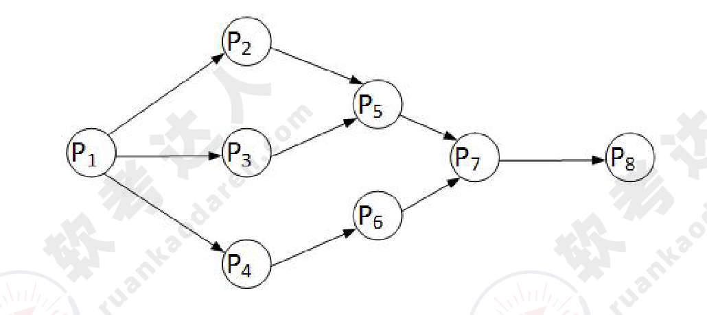
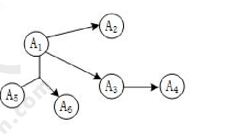
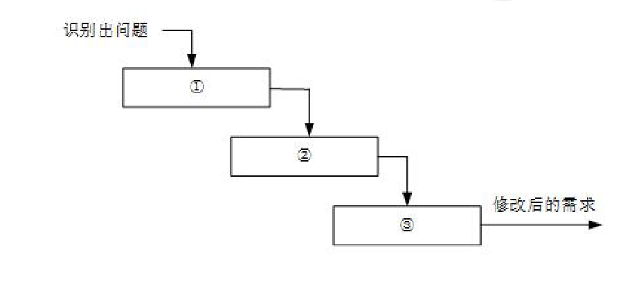
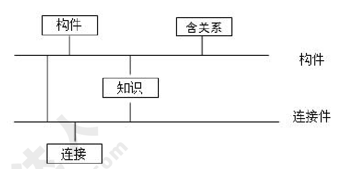
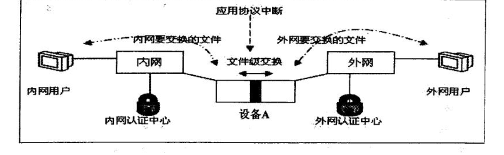
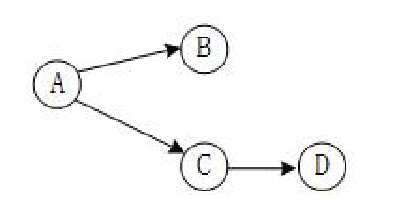

# 2017年下半年 系统架构设计师 · 上午题

> 卷面信息：考试时间 9:00～11:30，共 150 分钟。本试卷试题中共有 75 个空格，需要全部解答，每个空格 1 分，满分 75 分。每个空格对应一个序号，有 A、B、C、D 四个选项，请选择一个最恰当的选项作为解答。

## 题号目录

| 题号 | 空号 | 考点 | 教程章节 |
|------|------|------|----------|
| Q01 | (1)(2) | 流水线吞吐率与加速比 | |
| Q02 | (3) | DMA 直接存储器访问 | |
| Q03 | (4) | RISC 指令系统特点 | |
| Q04 | (5) | RTOS 实时操作系统 | |
| Q05 | (6) | 前趋图表示 | |
| Q06 | (7)(8) | 磁盘旋转调度与优化分布 | |
| Q07 | (9)(10) | 候选码与范式（1NF/2NF） | |
| Q08 | (11) | 元组演算（关系代数） | |
| Q09 | (12) | 分布式数据库两阶段提交 | |
| Q10 | (13) | 安全电子邮件协议 S/MIME | |
| Q11 | (14) | 网络逻辑结构设计内容 | |
| Q12 | (15) | 子网/超网与层次化路由 | |
| Q13 | (16)(17) | 计算机与数据库性能指标 | |
| Q14 | (18)(19) | 信息系统规划方法（CSF/SST/BSP） | |
| Q15 | (20)(21) | 组织信息化需求三层次 | |
| Q16 | (22) | 项目范围定义输入 | |
| Q17 | (23) | 配置项分类 | |
| Q18 | (24) | 需求陈述准则 | |
| Q19 | (25) | 需求变更管理流程 | |
| Q20 | (26)(27) | 软件过程与瀑布模型 | |
| Q21 | (28) | 敏捷方法 | |
| Q22 | (29) | 软件工具分类 | |
| Q23 | (30) | SCCS 版本控制工具 | |
| Q24 | (31) | 结构化程序设计控制结构 | |
| Q25 | (32)(33)(34) | OO 分析模型与设计模型 | |
| Q26 | (35) | 软件构件与对象区别 | |
| Q27 | (36) | 接口标准化 | |
| Q28 | (37)(38) | OMG IDL 元素 | |
| Q29 | (39)(40) | 逆向工程与再工程 | |
| Q30 | (41) | 系统移植阶段 | |
| Q31 | (42)(43) | 软件确认测试 | |
| Q32 | (44)(45)(46) | 基于体系结构的软件设计（ABSD） | |
| Q33 | (47) | 体系结构文档化输出 | |
| Q34 | (48)(49)(50) | 软件架构风格 | |
| Q35 | (51) | 规则系统架构风格 | |
| Q36 | (52) | 事件驱动架构风格 | |
| Q37 | (53) | C2 架构风格 | |
| Q38 | (54)(55)(56)(57) | 设计模式分类 | |
| Q39 | (58)~(63) | 质量属性场景与架构策略 | |
| Q40 | (64)(65) | 网闸与内外网隔离 | |
| Q41 | (66) | 美术作品原件权利 | |
| Q42 | (67) | 商标注册同日申请 | |
| Q43 | (68) | 盗版软件法律责任 | |
| Q44 | (69)(70) | 工程赶工与关键路径 | |
| Q45 | (71)~(75) | 英语阅读（架构设计需求） | |

## 原题转录（视觉核验）

---

## Q01

某计算机系统采用 5 级流水线结构执行指令，设每条指令的执行由取指令(2Δt)、分析指令(1Δt)、取操作数(3Δt)、运算(1Δt)和写回结果(2Δt)组成，并分别用 5 个子部完成，该流水线的最大吞吐率为（1)；若连续向流水线输入 10 条指令，则该流水线的加速比为（2)。

- (1) A. 1/9Δt  B. 1/3Δt  C. 1/2Δt  D. 1/1Δt
- (2) A. 1:10  B. 2:1  C. 5:2  D. 3:1

**来源所列答案**：(1) B；(2) C
**来源解析**：本题考查流水线计算。
(1) 流水线周期为：3t。
流水线的吞吐率为：指令条数/流水线执行时间。
即：n/(2t+1t+3t+1t+2t+(n-1)*3t)=n/(6t+3nt)
流水线的最大吞吐率就是上面的式子中，n 趋向于无穷大的结果。当 n 趋向于无穷大时，上式的结果为：1/3t。所以应该选 B。
(2) 流水线加速比＝不用流水线的执行时间/使用流水线的执行时间
10 条指令不用流水线的执行时间＝(2t+1t+3t+1t+2t) *10=90t。
10 条指令使用流水线的执行时间＝(2t+1t+3t+1t+2t) ＋ (10-1) *3t=36t。
所以加速比为：90t/36t=5:2。

---

## Q02

DMA（直接存储器访问）工作方式是在（3）之间建立起直接的数据通路。

- A. CPU 与外设
- B. CPU 与主存
- C. 主存与外设
- D. 外设与外设

**来源所列答案**：C
**来源解析**：直接主存存取（Direct Memory Access, DMA）是指数据在主存与 I/O 设备间的直接成块传送，即在主存与 I/O 设备间传送数据块的过程中，不需要 CPU 作任何干涉，只需在过程开始启动（即向设备发出"传送一块数据"的命令）与过程结束（CPU 通过轮询或中断得知过程是否结束和下次操作是否准备就绪）时由 CPU 进行处理，实际操作由 DMA 硬件直接完成，CPU 在传送过程中可做其它事情。

---

## Q03

RISC（精简指令系统计算机）的特点不包括：（4)。

- A. 指令长度固定，指令种类尽量少
- B. 寻址方式尽量丰富，指令功能尽可能强
- C. 增加寄存器数目，以减少访存次数
- D. 用硬布线电路实现指令解码，以尽快完成指令译码

**来源所列答案**：B
**来源解析**：RISC 与 CISC 的对比如表所示：

| 指令系统类型 | 指令 | 寻址方式 | 实现方式 | 其它 |
|------|------|------|------|------|
| CISC（复杂） | 数量多，使用频率差别大，可变长格式 | 支持多种 | 微程序控制技术（微码） | 研制周期长 |
| RISC（精简） | 数量少，使用频率接近，定长格式，大部分为单周期指令，操作寄存器，只有 Load/Store 操作内存 | 支持方式少 | 增加了通用寄存器；硬布线逻辑控制为主；适合采用流水线 | 优化编译，有效支持高级语言 |

---

## Q04

以下关于 RTOS（实时操作系统）的叙述中，不正确的是（5)。

- A. RTOS 不能针对硬件变化进行结构与功能上的配置及裁剪
- B. RTOS 可以根据应用环境的要求对内核进行裁剪和重配
- C. RTOS 的首要任务是调度一切可利用的资源来完成实时控制任务
- D. RTOS 实质上就是一个计算机资源管理程序，需要及时响应实时事件和中断

**来源所列答案**：A
**来源解析**：实时系统的正确性依赖于运行结果的逻辑正确性和运行结果产生的时间正确性，即实时系统必须在规定的时间范围内正确地响应外部物理过程的变化。
实时多任务操作系统是根据操作系统的工作特性而言的。实时是指物理进程的真实时间。实时操作系统是指具有实时性，能支持实时控制系统工作的操作系统。首要任务是调度一切可利用的资源来完成实时控制任务，其次才着眼于提高计算机系统的使用效率，重要特点是要满足对时间的限制和要求。
一个实时操作系统可以在不破坏规定的时间限制的情况下完成所有任务的执行。任务执行的时间可以根据系统的软硬件的信息而进行确定性的预测。也就是说，如果硬件可以做这件工作，那么实时操作系统的软件将可以确定性的做这件工作。
实时操作系统可根据实际应用环境的要求对内核进行裁剪和重新配置，根据不同的应用，其组成有所不同。

---

## Q05

前趋图(Precedence Graph)是一个有向无环图，记为：→={(Pi, Pj) | Pi must complete before Pj may strat}。假设系统中进程 P={P1, P2, P3, P4, P5, P6, P7, P8}，且进程的前趋图如下：

那么前驱图可记为：（6)。

- A. →={(P2,P1),(P3,P1),(P4,P1),(P6,P4),(P7,P5),（P7,P6),(P8,P7)}
- B. →={(P1,P2),(P1,P3),(P1,P4),(P2,P5),(P5,P7),(P6,P7),（P7,P8)}
- C. →={(P1,P2),(P1,P3),(P1,P4),(P2,P5),（P3,P5),(P4,P6),(P5,P7),(P6,P7),(P7,P8)}
- D. →={(P2,P1),(P3,P1),(P4,P1),(P5,P2),(P5,P2),(P5,P3),(P6,P4),(P7,P5),（P7,P6),(P8,P7)}

**来源所列答案**：C
**来源解析**：未提供（来源该题【解析】标题下无正文）。

---

## Q06

在磁盘上存储数据的排列方式会影响 I/O 服务的总时间。假设每磁道划分成 10 个物理块，每块存放 1 个逻辑记录。逻辑记录 R1, R2, …, R10 存放在同一个磁道上，记录的安排顺序如下表所示：

| 物理块 | 1 | 2 | 3 | 4 | 5 | 6 | 7 | 8 | 9 | 10 |
|------|------|------|------|------|------|------|------|------|------|------|
| 逻辑记录 | R1 | R2 | R3 | R4 | R5 | R6 | R7 | R8 | R9 | R10 |

假设磁盘的旋转速度为 30ms/周，磁头当前处在 R1 的开始处。若系统顺序处理这些记录，使用单缓冲区，每个记录处理时间为 6ms，则处理这 10 个记录的最长时间为（7)；若对信息存储进行优化分布后，处理 10 个记录的最少时间为（8)。

- (7) A. 189ms  B. 208ms  C. 289ms  D. 306ms
- (8) A. 60ms  B. 90ms  C. 109ms  D. 180ms

**来源所列答案**：(7) D；(8) B
**来源解析**：(7) 本题是一个较为复杂的磁盘原理问题，我们可以通过模拟磁盘的运行来进行分析求解。运作过程为：
1、读取 R1：耗时 3ms。读取完，磁头位于 R2 的开始位置。
2、处理 R1：耗时 6ms。处理完，磁头位于 R4 的开始位置。
3、旋转定位到 R2 开始位置：耗时 24ms。
4、读取 R2：耗时 3ms。读取完，磁头位于 R3 的开始位置。
5、处理 R2：耗时 6ms。处理完，磁头位于 R5 的开始位置。
6、旋转定位到 R3 开始位置：耗时 24ms。
……
从以上分析可以得知，读取并处理 R1 一共需要 9 毫秒。而从 R2 开始，多了一个旋转定位时间，R2 旋转定位到读取并处理一共需要 33 毫秒，后面的 R3 至 R10 与 R2 的情况一致。所以一共耗时：9+33*9=306 毫秒。
(8) 本题后面一问要求计算处理 10 个记录的最少时间。其实只要把记录间隔存放，就能达到这个目标。在物理块 1 中存放 R1，在物理块 4 中存放 R2，在物理块 7 中存放 R3，依此类推，这样可以做到每条记录的读取与处理时间之和均为 9ms，所以处理 10 条记录一共 90ms。

---

## Q07

给定关系模式 R(U, F)，其中：属性集 U={A1, A2, A3, A4, A5, A6}，函数依赖集 F={A1→A2, A1→A3, A3→A4, A1A5→A6}。关系模式 R 的候选码为（9)，由于 R 存在非主属性对码的部分函数依赖，所以 R 属于（10)。

- (9) A. A1A3  B. A1A4  C. A1A5  D. A1A6
- (10) A. 1NF  B. 2NF  C. 3NF  D. BCNF

**来源所列答案**：(9) C；(10) A
**来源解析**：要求关系模式的候选码，可以先将函数依赖画成图的形式：

从图很直观的可以看出，入度为零的结点是 A1 与 A5，从这两个结点的组合出发，能遍历全图，所以 A1A5 组合键为候选码。
题目后一问是一个概念性问题，2NF 的规定是消除非主属性对码的部分函数依赖。本题已明确告知未消除该依赖，说明未达到 2NF，只能选 1NF。

---

## Q08

给定元组演算表达式 R*={t | (∃u)(R(t)∧S(u)∧t[3]<u[2])}，若关系 R、S 如下图所示，则（11)。

关系 R（A B C）：

| A | B | C |
|------|------|------|
| 1 | 2 | 3 |
| 4 | 5 | 6 |
| 7 | 8 | 9 |
| 10 | 11 | 12 |

关系 S（A B C）：

| A | B | C |
|------|------|------|
| 3 | 7 | 11 |
| 4 | 5 | 6 |
| 5 | 9 | 13 |
| 6 | 10 | 14 |

- A. R\*={(3,7,11),(5,9,13),(6,10,14)}
- B. R\*={(3,7,11),(4,5,6),(5,9,13),(6,10,14)}
- C. R\*={(1,2,3),(4,5,6),(7,8,9)}
- D. R\*={(1,2,3),(4,5,6),(7,8,9),(10,11,12)}

**来源所列答案**：C
**来源解析**：本题考查的是数据库中的元组演算。式子的意思是：找出这样的元组 t（t 是 R 中的元组），t 要满足这样的条件：存在 u（u 是 S 关系中的元组），u 第 2 列值大于 t 的第 3 列值。t 关系中前 3 个元组都达到了要求，而第 4 个元组没有达到要求。第 4 个元组的第 3 列值是 12，而 u[2]的可能值为{7, 5, 9, 10}，没谁大于 12。

---

## Q09

分布式数据库两阶段提交协议中的两个阶段是指（12)。

- A. 加锁阶段、解锁阶段
- B. 获取阶段、运行阶段
- C. 表决阶段、执行阶段
- D. 扩展阶段、收缩阶段

**来源所列答案**：C
**来源解析**：二阶段提交(Two-phaseCommit)是指，在计算机网络以及数据库领域内，为了使基于分布式系统架构下的所有节点在进行事务提交时保持一致性而设计的一种算法(Algorithm)。通常，二阶段提交也被称为是一种协议(Protocol)。在分布式系统中，每个节点虽然可以知晓自己的操作时成功或者失败，却无法知道其他节点的操作的成功或失败。当一个事务跨越多个节点时，为了保持事务的 ACID 特性，需要引入一个作为协调者的组件来统一掌控所有节点(称作参与者)的操作结果并最终指示这些节点是否要把操作结果进行真正的提交（比如将更新后的数据写入磁盘等等）。因此，二阶段提交的算法思路可以概括为：参与者将操作成败通知协调者，再由协调者根据所有参与者的反馈情况决定各参与者是否要提交操作还是中止操作。
所谓的两个阶段是指：第一阶段：准备阶段(表决阶段)和第二阶段：提交阶段（执行阶段）。
准备阶段：事务协调者(事务管理器)给每个参与者(资源管理器)发送 Prepare 消息，每个参与者要么直接返回失败(如权限验证失败)，要么在本地执行事务，写本地的 redo 和 undo 日志，但不提交，到达一种万事俱备，只欠东风的状态。
提交阶段：如果协调者收到了参与者的失败消息或者超时，直接给每个参与者发送回滚(Rollback)消息；否则，发送提交(Commit)消息；参与者根据协调者的指令执行提交或者回滚操作，释放所有事务处理过程中使用的锁资源。（注意：必须在最后阶段释放锁资源）

---

## Q10

下面可提供安全电子邮件服务的是（13)。

- A. RSA
- B. SSL
- C. SET
- D. S/MIME

**来源所列答案**：D
**来源解析**：MIME(Multipurpose Internet Mail Extensions)中文名为：多用途互联网邮件扩展类型。Internet 电子邮件由一个邮件头部和一个可选的邮件主体组成，其中邮件头部含有邮件的发送方和接收方的有关信息。而 MIME 是针对邮件主体的一种扩展描述机制。它设定某种扩展名的文件用一种应用程序来打开的方式类型，当该扩展名文件被访问的时候，浏览器会自动使用指定应用程序来打开。多用于指定一些客户端自定义的文件名，以及一些媒体文件打开方式。所以这是与邮件内容直接相关的一个协议。
而 S/MIME (Secure Multipurpose Internet Mail Extensions)是对 MIME 在安全方面的扩展。它可以把 MIME 实体(比如数字签名和加密信息等)封装成安全对象。增强安全服务，例如具有接收方确认签收的功能，这样就可以确保接收者不能否认已经收到过的邮件。还可以用于提供数据保密、完整性保护、认证和鉴定服务等功能。S/MIME 只保护邮件的邮件主体，对头部信息则不进行加密，以便让邮件成功地在发送者和接收者的网关之间传递。

---

## Q11

网络逻辑结构设计的内容不包括（14)。

- A. 逻辑网络设计图
- B. IP 地址方案
- C. 具体的软硬件、广域网连接和基本服务
- D. 用户培训计划

**来源所列答案**：D
**来源解析**：利用需求分析和现有网络体系分析的结果来设计逻辑网络结构，最后得到一份逻辑网络设计文档，输出内容包括以下几点：1、逻辑网络设计图 2、IP 地址方案 3、安全方案 4、招聘和培训网络员工的具体说明 5、对软硬件、服务、员工和培训的费用初步估计。
物理网络设计是对逻辑网络设计的物理实现，通过对设备的具体物理分布、运行环境等确定，确保网络的物理连接符合逻辑连接的要求。输出如下内容：1、网络物理结构图和布线方案 2、设备和部件的详细列表清单 3、软硬件和安装费用的估算 4、安装日程表，详细说明服务的时间以及期限 5、安装后的测试计划 6、用户的培训计划。
由此可以看出 D 选项的工作是物理网络设计阶段的任务。

---

## Q12

某企业通过一台路由器上联总部，下联 4 个分支结构，设计人员分配给下级机构一个连续的地址空间，采用一个子网或者超网段表示。这样做的主要作用是（15)。

- A. 层次化路由选择
- B. 易于管理和性能优化
- C. 基于故障排查
- D. 使用较少的资源

**来源所列答案**：A
**来源解析**：层次化路由的含义是指对网络拓扑结构和配置的了解是局部的，一台路由器不需要知道所有的路由信息，只需要了解其管辖的路由信息，层次化路由选择需要配合层次化的地址编码。而子网或超网就属于层次化地址编码行为。

---

## Q13

对计算机评价的主要性能指标有时钟频率、（16)、运算精度和内存容量等。对数据库管理系统评价的主要性能指标有（17)、数据库所允许的索引数量和最大并发实物处理能力等。

- (16) A. 丢包率  B. 端口吞吐量  C. 可移植性  D. 数据处理速率
- (17) A. MIPS  B. 支持协议和标准  C. 最大连接数  D. 时延抖动

**来源所列答案**：(16) D；(17) C
**来源解析**：性能指标，是软、硬件的性能指标的集成。在硬件中，包括计算机、各种通信交换设备、各类网络设备等；在软件中，包括：操作系统、协议以及应用程序等。
1、计算机：对计算机评价的主要性能指标有：时钟频率（主频）；运算速度；运算精度；内存的存储容量；存储器的存取周期；数据处理速率 PDR（processingdatarate）；吞吐率；各种响应时间；各种利用率；RASIS 特性（即：可靠性 Reliability、可用性 Availability、可维护性 Serviceability、完整性和安全性 Integraity and Security）；平均故障响应时间；兼容性；可扩充性；性能价格比。
2、路由器：对路由器评价的主要性能指标有：设备吞吐量、端口吞吐量、全双工线速转发能力、背靠背帧数、路由表能力、背板能力、丢包率、时延、时延抖动、VPN 支持能力、内部时钟精度、队列管理机制、端口硬件队列数、分类业务带宽保证、RSVP、IP Diff Serv、CAR 支持、冗余、热插拔组件、路由器冗余协议、网管、基于 Web 的管理、网管类型、带外网管支持、网管粒度、计费能力／协议、分组语音支持方式、协议支持、语音压缩能力、端口密度、信令支持。
3、交换机：对交换机评价的主要性能指标有：交换机类型、配置、支持的网络类型、最大 ATM 端口数、最大 SONET 端口数、最大 FDDI 端口数、背板吞吐量、缓冲区大小、最大 MAC 地址表大小、最大电源数、支持协议和标准、路由信息协议 RIP、RIP2、开放式最短路径优先第 2 版、边界网关协议 BGP、无类域间路由 CIDR、互联网成组管理协议 IGMP、距离矢量多播路由协议 DVMRP、开放式最短路径优先多播路由协议 MOSPF、协议无关的多播协议 PIM、资源预留协议 RSVP、802.1p 优先级标记、多队列、路由、支持第 3 层交换、支持多层（4 到 7 层）交换、支持多协议路由、支持路由缓存、可支持最大路由表数、VLAN、最大 VLAN 数量、网管、支持网管类型、支持端口镜像、QoS、支持基于策略的第 2 层交换、每端口最大优先级队列数、支持基于策略的第 3 层交换、支持基于策略的应用级 QoS、支持最小／最大带宽分配、冗余、热交换组件（管理卡，交换结构，接口模块，电源，冷却系统、支持端口链路聚集协议、负载均衡。
4、网络：评价网络的性能指标有：设备级性能指标；网络级性能指标；应用级性能指标；用户级性能指标；吞吐量。
5、操作系统：评价操作系统的性能指标有：系统的可靠性、系统的吞吐率（量）、系统响应时间、系统资源利用率、可移植性。
6、数据库管理系统：衡量数据库管理系统的主要性能指标包括数据库本身和管理系统两部分，有：数据库的大小、数据库中表的数量、单个表的大小、表中允许的记录（行）数量、单个记录（行）的大小、表上所允许的索引数量、数据库所允许的索引数量、最大并发事务处理能力、负载均衡能力、最大连接数等等。
7、WEB 服务器：评价 Web 服务器的主要性能指标有：最大并发连接数、响应延迟、吞吐量。

---

## Q14

用于管理信息系统规划的方法有很多，其中（18）将整个过程看成是一个"信息集合"，并将组织的战略目标转变为管理信息系统的战略目标。（19）通过自上而下地识别企业目标、企业过程和数据，然后对数据进行分析，自下而上地设计信息系统。

- (18) A. 关键成功因素法  B. 战略目标集转化法  C. 征费法  D. 零线预算法
- (19) A. 企业信息分析与集成法  B. 投资回收法  C. 企业系统规划法  D. 阶石法

**来源所列答案**：(18) B；(19) C
**来源解析**：用于管理信息系统规划的方法很多，主要是关键成功因素法（Critical Success Factors, CSF）、战略目标集转化法（Strategy Set Transformation, SST）和企业系统规划法（Business System Planning, BSP）。其它还有企业信息分析与集成技术(BIAIT)、产出／方法分析(E/MA)、投资回收法（ROI）、征费法（chargout）、零线预算法、阶石法等。用得最多的是前面三种。
1. 关键成功因素法（CSF）：在现行系统中，总存在着多个变量影响系统目标的实现，其中若干个因素是关键的和主要的（即关键成功因素）。通过对关键成功因素的识别，找出实现目标所需的关键信息集合，从而确定系统开发的优先次序。关键成功因素来自于组织的目标，通过组织的目标分解和关键成功因素识别、性能指标识别，一直到产生数据字典。识别关键成功因素，就是要识别联系于组织目标的主要数据类型及其关系。不同的组织的关键成功因素不同，不同时期关键成功因素也不相同。当在一个时期内的关键成功因素解决后，新的识别关键成功因素又开始。关键成功因素法能抓住主要矛盾，使目标的识别突出重点。由于经理们比较熟悉这种方法，使用这种方法所确定的目标，因而经理们乐于努力去实现。该方法最有利于确定企业的管理目标。
2. 战略目标集转化法（SST）：把整个战略目标看成是一个"信息集合"，由使命、目标、战略等组成，管理信息系统的规划过程即是把组织的战略目标转变成为管理信息系统的战略目标的过程。战略目标集转化法从另一个角度识别管理目标，它反映了各种人的要求，而且给出了按这种要求的分层，然后转化为信息系统目标的结构化方法。它能保证目标比较全面，疏漏较少，但它在突出重点方面不如关键成功因素法。
3. 企业系统规划法（BSP）：信息支持企业运行。通过自上而下地识别系统目标、企业过程和数据，然后对数据进行分析，自下而上地设计信息系统。该管理信息系统支持企业目标的实现，表达所有管理层次的要求，向企业提供一致性信息，对组织机构的变动具有适应性。企业系统规划法虽然也首先强调目标，但它没有明显的目标导引过程。它通过识别企业"过程"引出了系统目标，企业目标到系统目标的转化是通过企业过程/数据类等矩阵的分析得到的。

---

## Q15

组织信息化需求通常包含三个层次，其中（20）需求的目标是提升组织的竞争能力，为组织的可持续发展提供支持环境。(21）需求包含实现信息化战略目标的需求、运营策略的需求和人才培养的需求三个方面。技术需求主要强调在信息层技术层面上对系统的完善、升级、集成和整合提出的需求。

- (20) A. 战略  B. 发展  C. 人事  D. 财务
- (21) A. 规划  B. 运作  C. 营销  D. 管理

**来源所列答案**：(20) A；(21) B
**来源解析**：一般说来，信息化需求包含 3 个层次，即战略需求、运作需求和技术需求。
一是战略需求。组织信息化的目标是提升组织的竞争能力、为组织的可持续发展提供一个支持环境。从某种意义上来说，信息化对组织不仅仅是服务的手段和实现现有战略的辅助工具；信息化可以把组织战略提升到一个新的水平，为组织带来新的发展契机。特别是对于企业，信息化战略是企业竞争的基础。
二是运作需求。组织信息化的运作需求是组织信息化需求非常重要且关键的一环，它包含三方面的内容：一是实现信息化战略目标的需要；二是运作策略的需要；三是人才培养的需要。
三是技术需求。由于系统开发时间过长等问题在信息技术层面上对系统的完善、升级、集成和整合提出了需求。也有的组织，原来基本上没有大型的信息系统项目，有的也只是一些单机应用，这样的组织的信息化需求，一般是从头开发新的系统。

---

## Q16

项目范围管理中，范围定义的输入包括（22)。

- A. 项目章程、项目范围管理计划、产品范围说明书和变更申请
- B. 项目范围描述、产品范围说明书、生产项目计划和组织过程资产
- C. 项目章程、项目范围管理计划、组织过程资产和批准的变更申请
- D. 生产项目计划、项目可交付物说明、信息系统要求说明和项目质量标准

**来源所列答案**：C
**来源解析**：在初步项目范围说明书中已文档化的主要的可交付物、假设和约束条件的基础上准备详细的项目范围说明书，是项目成功的关键。范围定义的输入包括以下内容：① 项目章程。如果项目章程或初始的范围说明书没有在项目执行组织中使用，同样的信息需要进一步收集和开发，以产生详细的项目范围说明书。② 项目范围管理计划。③ 组织过程资产。④ 批准的变更申请。

---

## Q17

项目配置管理中，产品配置是指一个产品在其生命周期各个阶段所产生的各种形式和各种版本的文档、计算机程序、部件及数据的集合。该集合中的每一个元素称为该产品配置中的一个配置项，（23）不属于产品组成部分工作成果的配置项。

- A. 需求文档
- B. 设计文档
- C. 工作计划
- D. 源代码

**来源所列答案**：C
**来源解析**：配置项是构成产品配置的主要元素，配置项主要有以下两大类：(1) 属于产品组成部分的工作成果：如需求文档、设计文档、源代码和测试用例等；(2) 属于项目管理和机构支撑过程域产生的文档：如工作计划、项目质量报告和项目跟踪报告等。这些文档虽然不是产品的组成部分，但是值得保存。所以设备清单不属于配置项。所以选项 C 的工作计划虽可充当配置项，但不属于产品组成部分工作成果的配置项。

---

## Q18

以下关于需求陈述的描述中，（24）是不正确的。

- A. 每一项需求都必须完整、准确地描述即将要开发的功能
- B. 需求必须能够在系统及其运行环境的能力和约束条件内实现
- C. 每一项需求记录的功能都必须是用户的真正的需要
- D. 在良好的需求陈述中，所有需求都应被视为同等重要

**来源所列答案**：D
**来源解析**：未提供（来源该题【解析】标题下无正文）。

---

## Q19

一个好的变更控制过程，给项目风险承担者提供了正式的建议变更机制。如下图所示的需求变更管理过程中，①②③处对应的内容应分别是（25)。

- A. 问题分析与变更描述、变更分析与成本计算、变更实现
- B. 变更描述与成本计算、变更分析、变更实现
- C. 问题分析与变更分析、成本计算、变更实现
- D. 变更描述、变更分析与变更实现、成本计算

**来源所列答案**：A
**来源解析**：在需求管理过程中需求的变更是受严格管控的，其流程为：
1、问题分析和变更描述。这是识别和分析需求问题或者一份明确的变更提议，以检查它的有效性，从而产生一个更明确的需求变更提议。
2、变更分析和成本计算。使用可追溯性信息和系统需求的一般知识，对需求变更提议进行影响分析和评估。变更成本计算应该包括对需求文档的修改、系统修改的设计和实现的成本。一旦分析完成并且确认，应该进行是否执行这一变更的决策。
3、变更实现。这要求需求文档和系统设计以及实现都要同时修改。如果先对系统的程序做变更，然后再修改需求文档，这几乎不可避免地会出现需求文档和程序的不一致。

---

## Q20

软件过程是制作软件产品的一组活动以及结果，这些活动主要由软件人员来完成，主要包括（26)。软件过程模型是软件开发实际过程的抽象与概括，它应该包括构成软件过程的各种活动。软件过程有各种各样的模型，其中（27）的活动之间存在因果关系，前一阶段工作的结果是后一段阶段工作的输入描述。

- (26) A. 软件描述、软件开发和软件测试
- B. 软件开发、软件有效性验证和软件测试
- C. 软件描述、软件设计、软件实现和软件测试
- D. 软件描述、软件开发、软件有效性验证和软件进化
- (27) A. 瀑布模型  B. 原型模型  C. 螺旋模型  D. 基于构建的模型

**来源所列答案**：(26) D；(27) A
**来源解析**：软件过程模型的基本概念：软件过程是制作软件产品的一组活动以及结果，这些活动主要由软件人员来完成，软件活动主要有：(1) 软件描述。必须定义软件功能以及使用的限制。(2) 软件开发。也就是软件的设计和实现，软件工程人员制作出能满足描述的软件。(3) 软件有效性验证。软件必须经过严格的验证，以保证能够满足客户的需求。(4) 软件进化。软件随着客户需求的变化不断地改进。
瀑布模型的特点是因果关系紧密相连，前一个阶段工作的结果是后一个阶段工作的输入。或者说，每一个阶段都是建筑在前一个阶段正确结果之上，前一个阶段的错漏会隐蔽地带到后一个阶段。这种错误有时甚至可能是灾难性的。因此每一个阶段工作完成后，都要进行审查和确认，这是非常重要的。历史上，瀑布模型起到了重要作用，它的出现有利于人员的组织管理，有利于软件开发方法和工具的研究。

---

## Q21

以下关于敏捷方法的叙述中，（28）是不正确的。

- A. 敏捷型方法的思考角度是"面向开发过程"的
- B. 极限编程是著名的敏捷开发方法
- C. 敏捷型方法是"适应性"而非"预设性"
- D. 敏捷开发方法是迭代增量式的开发方法

**来源所列答案**：A
**来源解析**：未提供（来源该题【解析】标题下无正文）。

---

## Q22

软件系统工具的种类繁多，通常可以按照软件过程活动将软件工具分为（29)。

- A. 需求分析工具、设计工具和软件实现工具
- B. 软件开发工具、软件维护工具、软件管理工具和软件支持工具
- C. 需求分析工具、设计工具、编码与排错工具和测试工具
- D. 设计规范工具、编码工具和验证工具

**来源所列答案**：B
**来源解析**：软件系统工具的种类繁多，很难有统一的分类方法。通常可以按软件过程活动将软件工具分为软件开发工具、软件维护工具、软件管理和软件支持工具。软件开发工具：需求分析工具、设计工具、编码与排错工具。软件维护工具：版本控制工具、文档分析工具、开发信息库工具、逆向工程工具、再工程工具。软件管理和软件支持工具：项目管理工具、配置管理工具、软件评价工具、软件开发工具的评价和选择。

---

## Q23

UNIX 的源代码控制工具（Source Code control System，SCCS）是软件项目开发中常用的（30)。

- A. 源代码静态分析工具
- B. 文档分析工具
- C. 版本控制工具
- D. 再工程工具

**来源所列答案**：C
**来源解析**：版本控制软件提供完备的版本管理功能，用于存储、追踪目录（文件夹）和文件的修改历史，是软件开发者的必备工具，是软件公司的基础设施。版本控制软件的最高目标，是支持软件公司的配置管理活动，追踪多个版本的开发和维护活动，及时发布软件。SCCS 是元老级的版本控制软件，也叫配置管理软件。

---

## Q24

结构化程序设计采用自顶向下、逐步求精及模块化的程序设计方法，通过（31）三种基本的控制结构可以构造出任何单入口单出口的程序。

- A. 顺序、选择和嵌套
- B. 顺序、分支和循环
- C. 分支、并发和循环
- D. 跳转、选择和并发

**来源所列答案**：B
**来源解析**：未提供（来源该题【解析】标题下无正文）。

---

## Q25

面向对象的分析模型主要由顶层架构图、用例与用例图和（32）构成；设计模型则包含以（33）表示的软件体系结构图、以交互图表示的用例实现图、完整精确的类图、描述复杂对象的（34）和用以描述流程化处理过程的活动图等。

- (32) A. 数据流模型  B. 领域概念模型  C. 功能分解图  D. 功能需求模型
- (33) A. 模型视图控制器  B. 组件图  C. 包图  D. 2 层、3 层或 N 层
- (34) A. 序列图  B. 协作图  C. 流程图  D. 状态图

**来源所列答案**：(32) B；(33) C；(34) D
**来源解析**：未提供（来源该题【解析】标题下无正文）。

---

## Q26

软件构件是一个独立可部署的软件单元，与程序设计中的对象不同，构件（35)。

- A. 是一个实例单元，具有唯一的标志
- B. 可以利用容器管理自身对外的可见状态
- C. 利用工厂方法（如构造函数）来创建自己的实例
- D. 之间可以共享一个类元素

**来源所列答案**：C
**来源解析**：本题考查构件与对象的概念。构件的特性是：(1) 独立部署单元；(2) 作为第三方的组装单元；(3) 没有（外部的）可见状态。一个构件可以包含多个类元素，但是一个类元素只能属于一个构件。将一个类拆分进行部署通常没什么意义。对象的特性是：(1) 一个实例单元，具有唯一的标志。(2) 可能具有状态，此状态外部可见。(3) 封装了自己的状态和行为。

---

## Q27

为了使一个接口的规范和实现该接口的构件得到广泛应用，需要实现接口的标准化。接口标准化是对（36）的标准化。

- A. 保证接口唯一性的命名方案
- B. 接口中消息模式、格式和协议
- C. 接口中所接收的数据格式
- D. 接口消息适用语境

**来源所列答案**：B
**来源解析**：接口标准化是对接口中消息的格式、模式和协议的标准化。它不是要将接口格式化为参数化操作的集合，而是关注输入输出的消息的标准化，它强调当机器在网络中互连时，标准的消息模式、格式、协议的重要性。这也是因特网（IP, UDP, TCP, SNMP, 等等）和 Web（HTTP, HTML, 等等）标准的主要做法。为了获得更广泛的语义，有必要在一个单一通用的消息格式语境中标准化消息模式。这就是 XML 的思想。XML 提供了一种统一的数据格式。

---

## Q28

OMG 接口定义语言 IDL 文件包含了六种不同的元素，（37）是一个 IDL 文件最核心的内容，（38）将映射为 Java 语言中的包（Package）或 C++语言中的命名空间(Namespace)。

- (37) A. 模块定义  B. 消息结构  C. 接口描述  D. 值类型
- (38) A. 模块定义  B. 消息结构  C. 接口描述  D. 值类型

**来源所列答案**：(37) D；(38) A
**来源解析**：未提供（来源该题【解析】标题下无正文）。

---

## Q29

应用系统构建中可以采用多种不同的技术，（39）可以将软件某种形式的描述转换为更高级的抽象表现形式，而利用这些获取的信息，（40）能够对现有系统进行修改或重构，从而产生系统的一个新版本。

- (39) A. 逆向工程（Reverse Engineering）  B. 系统改进（System Improvement）  C. 设计恢复（Design Recovery）  D. 再工程（Re-engineering）
- (40) A. 逆向工程（Reverse Engineering）  B. 系统改进（System Improvement）  C. 设计恢复（Design Recovery）  D. 再工程（Re-engineering）

**来源所列答案**：A（来源该处【答案】仅印一个字母"A"，对应 (39)(40) 两空）
**来源解析**：所谓软件的逆向工程就是分析已有的程序，寻求比源代码更高级的抽象表现形式。一般认为，凡是在软件生命周期内将软件某种形式的描述转换成更为抽象形式的活动都可称为逆向工程。与之相关的概念是：重构（restructuring)，指在同一抽象级别上转换系统描述形式；设计恢复（design recovery)，指借助工具从已有程序中抽象出有关数据设计、总体结构设计和过程设计的信息（不一定是原设计）；再工程（re-engineering)，也称修复和改造工程，它是在逆向工程所获信息的基础上修改或重构已有的系统，产生系统的一个新版本。

> ⚠️ 待核验：来源该题【答案】行仅印一个字母"A"，而 (39)(40) 为两空；按来源解析文字，(39) 应为 A（逆向工程），(40) 应为 D（再工程）。原件疑漏印第二个字母，待核验。

---

## Q30

系统移植也是系统构建的一种实现方法，在移植工作中，（41）需要最终确定移植方法。

- A. 计划阶段
- B. 准备阶段
- C. 转换阶段
- D. 验证阶段

**来源所列答案**：A
**来源解析**：移植工作大体上分为计划阶段、准备阶段、转换阶段、测试阶段、验证阶段。
1、计划阶段。在计划阶段，要进行现有系统的调查整理，从移植技术、系统内容（是否进行系统提炼等）、系统运行三个方面，探讨如何转换成新系统，决定移植方法，确立移植工作体制及移植日程。
2、准备阶段。在准备阶段要进行移植方面的研究，准备转换所需的资料。该阶段的作业质量将对以后的生产效率产生很大的影响。
3、转换阶段。这一阶段是将程序设计和数据转换成新机器能根据需要工作的阶段。提高转换工作的精度，减轻下一阶段的测试负担是提高移植工作效率的基本内容。
4、测试阶段。这一阶段是进行程序单元、工作单元测试的阶段。在本阶段要核实程序能否在新系统中准确地工作。所以，当有不能准确工作的程序时，就要回到转换阶段重新工作。
5、验证阶段。这是测试完的程序使新系统工作，最后核实系统，准备正式运行的阶段。

---

## Q31

软件确认测试也称为有效性测试，主要验证（42)。确认测试计划通常是在需求分析阶段完成的。根据用户的参与程度不同，软件确认测试通常包括（43)。

- (42) A. 系统中各个单元模块之间的协作性
- B. 软件与硬件在实际运行环境中能否有效集成
- C. 软件功能、性能及其它特性是否与用户需求一致
- D. 程序模块能否正确实现详细设计说明中的功能、性能和设计约束等要求
- (43) A. 黑盒测试和白盒测试
- B. 一次性组装测试和增量式组装测试
- C. 内部测试、Alpha、Beta 和验收测试
- D. 功能测试、性能测试、用户界面测试和安全性测试

**来源所列答案**：(42) C；(43) C
**来源解析**：软件确认测试一种针对需求的测试，是用户参与的测试。它主要验证软件功能、性能及其它特性是否与用户需求一致。软件确认测试包括：内部确认测试、Alpha、Beta 和验收测试。

---

## Q32

在基于体系结构的软件设计方法中，采用（44）来描述软件架构，采用（45）但来描述功能需求，采用（46）来描述质量需求。

- (44) A. 类图和序列图  B. 视角与视图  C. 构件和类图  D. 构件与功能
- (45) A. 类图  B. 视角  C. 用例  D. 质量场景
- (46) A. 连接件  B. 用例  C. 质量场景  D. 质量属性

**来源所列答案**：(44) B；(45) C；(46) C
**来源解析**：根据基于软件架构的设计的定义，基于软件架构的设计（Architecture Based Software Development, ABSD）强调由商业、质量和功能需求的组合驱动软件架构设计。它强调采用视角和视图来描述软件架构，采用用例和质量属性场景来描述需求。进一步来说，用例描述的是功能需求，质量属性场景描述的是质量需求（或侧重于非功能需求）。

---

## Q33

体系结构文档化有助于辅助系统分析人员和程序员去实现体系结构。体系结构文档化过程的主要输出包括（47)。

- A. 体系结构规格说明、测试体系结构需求的质量设计说明书
- B. 质量属性说明书、体系结构描述
- C. 体系结构规格说明、软件功能需求说明
- D. 多视图体系结构模型、体系结构验证说明

**来源所列答案**：A
**来源解析**：体系结构文档化过程的主要输出结果是体系结构规格说明和测试体系结构需求的质量设计说明书这两个文档。软件体系结构的文档要求与软件开发项目中的其他文档是类似的。文档的完整性和质量是软件体系结构成功的关键因素。文档要从使用者的角度进行编写，必须分发给所有与系统有关的开发人员，且必须保证开发者手上的文档是最新的。

---

## Q34

软件架构风格描述某一特定领域中的系统组织方式和惯用模式，反映了领域中众多系统所共有的（48）特征。对于语音识别、知识推理等问题复杂、解空间很大、求解过程不确定的这一类软件系统，通常会采用（49）架构风格。对于因数据输入某个构件，经过内部处理，产生数据输出的系统，通常会采用（50）架构风格。

- (48) A. 语法和语义  B. 结构和语义  C. 静态和动态  D. 行为和约束
- (49) A. 管道-过滤器  B. 解释器  C. 黑板  D. 过程控制
- (50) A. 事件驱动系统  B. 黑板  C. 管道-过滤器  D. 分层系统

**来源所列答案**：(48) B；(49) C；(50) C
**来源解析**：体系结构风格反映了领域中众多系统所共有的结构和语义特性，并指导如何将各个模块和子系统有效地组织成一个完整的系统。对软件体系结构风格的研究和实践促进对设计的重用，一些经过实践证实的解决方案也可以可靠地用于解决新的问题。例如，如果某人把系统描述为客户/服务器模式，则不必给出设计细节，我们立刻就会明白系统是如何组织和工作的。
语音识别是黑板风格的经典应用场景。
输入某个构件，经过内部处理，产生数据输出的系统，正是管道-过滤器中过滤器的职能，把多个过滤器使用管道相联的风格为管道-过滤器风格。

---

## Q35

某公司拟开发一个 VIP 管理系统，系统需要根据不同商场活动，不定期更新 VIP 会员的审核标准和 VIP 折扣系统。针对上述需求，采用（51）架构风格最为合适。

- A. 规则系统
- B. 过程控制
- C. 分层
- D. 管道-过滤器

**来源所列答案**：A
**来源解析**：未提供（来源该题【解析】标题下无正文）。

---

## Q36

某公司拟开发一个新闻系统，该系统可根据用户的注册兴趣，向用户推送其感兴趣的新闻内容，该系统应该采用（52）架构风格最为合适。

- A. 事件驱动系统
- B. 主程序-子程序
- C. 黑板
- D. 管道-过滤器

**来源所列答案**：A
**来源解析**：根据题目的意思，用户会注册自己的兴趣，然后系统也会把新闻按兴趣分类，如果某个新闻事件发生，可以通过事件来触发推送动作，将新闻推送给对其感兴趣的用户。这是典型的事件驱动系统应用场景。

---

## Q37

系统中的构件和连接件都有一个顶部和一个底部，构件的顶部应连接到某连接件的底部，构件的底部则应连接到某连接的顶部，构件和构件之间不允许直接连接，连接件直接连接时，必须由其中一个的底部连接到另一个的顶部。上述构件和连接件的组织规则所描述的是（53）架构风格。

- A. 管道-过滤器
- B. 分层系统
- C. C2
- D. 面向对象

**来源所列答案**：C
**来源解析**：C2 体系结构风格可以概括为：通过连接件绑定在一起按照一组规则运作的并行构件网络。C2 风格中的系统组织规则如下。①系统中的构件和连接件都有一个顶部和一个底部。②构件的顶部应连接到某连接件的底部，构件的底部则应连接到某连接件的顶部。而构件与构件之间的直接连接是不允许的。③一个连接件可以和任意数目的其他构件和连接件连接。④当两个连接件进行直接连接时，必须由其中一个的底部到另一个的顶部。

---

## Q38

按照设计模式的目的进行划分，现有的设计模式可以分为三类。其中创建型模式通过采用抽象类所定义的接口，封装了系统中对象如何创建、组合等信息，其代表有（54）模式等；（55）模式主要用于如何组合已有的类和对象以获得更大的结构，其代表有 Adapter 模式等；（56）模式主要用于对象之间的职责及其提供服务的分配方式，其代表有（57）模式等。

- (54) A. Decorator  B. Flyweight  C. Command  D. Singleton
- (55) A. 合成型  B. 组合型  C. 结构型  D. 聚合型
- (56) A. 行为型  B. 交互型  C. 耦合性  D. 关联型
- (57) A. Prototype  B. Facade  C. Proxy  D. Visitor

**来源所列答案**：(54) D；(55) C；(56) A；(57) D
**来源解析**：未提供（来源该题【解析】标题下无正文）。

---

## Q39

某公司欲开发一个在线交易网站，在架构设计阶段，公司的架构师识别出 3 个核心质量属性场景。其中"网站正常运行时，用户发起的交易请求应该在 3 秒内完成"主要与（58）质量属性相关，通常可采用（59）架构策略实现该属性；"在线交易主站宕机后，能够在 3 秒内自动切换至备用站点并恢复正常运行"主要与（60）质量属性相关，通常可采用（61）架构策略实现该属性；"系统应该具备一定的安全保护措施，从而能够抵挡恶意的入侵破坏行为，并对所有针对网站的攻击行为进行报警和记录"主要与（62）质量属性相关，通常可采用（63）架构策略实现该属性。

- (58) A. 可用性  B. 性能  C. 易用性  D. 可修改性
- (59) A. 抽象接口  B. 信息隐藏  C. 主动冗余  D. 资源调度
- (60) A. 可测试性  B. 易用性  C. 可用性  D. 互操作性
- (61) A. 记录/回放  B. 操作串行化  C. 心跳  D. 增加计算资源
- (62) A. 可用性  B. 安全性  C. 可测试性  D. 可修改性
- (63) A. 追踪审计  B. Ping/Echo  C. 选举  D. 维护现有接口

**来源所列答案**：(58) B；(59) D；(60) C；(61) C；(62) B；(63) A
**来源解析**：未提供（来源该题【解析】标题下无正文）。

---

## Q40

在网络规划中，政府内外网之间应该部署网络安全防护设备。在下图中部署的设备 A 是（64)，对设备 A 的作用描述错误的是（65)。

- (64) A. IDS  B. 防火墙  C. 网闸  D. UTM
- (65) A. 双主机系统，即使外网被黑客攻击瘫痪也无法影响到内网
- B. 可以防止外部主动攻击
- C. 采用专用硬件控制技术保证内外网的实时连接
- D. 设备对外网的任何响应都是对内网用户请求的应答

**来源所列答案**：(64) C；(65) C
**来源解析**：未提供（来源该题【解析】标题下无正文）。

---

## Q41

王某买了一幅美术作品原件，则他享有该美术作品的（66)。

- A. 著作权
- B. 所有权
- C. 展览权
- D. 所有权与其展览权

**来源所列答案**：D
**来源解析**：未提供（来源该题【解析】标题下无正文）。

---

## Q42

甲、乙软件公司同日就其财务软件产品分别申请"用友"和"用有"商标注册。两财务软件相似，且甲、乙第一次使用"用友"和"用有"商标时间均为 2015 年 7 月 12 日。此情形下，（67）能获准注册。

- A. "用友"
- B. "用友"与"用有"都
- C. "用有"
- D. 由甲、乙抽签结果确定谁

**来源所列答案**：D
**来源解析**：未提供（来源该题【解析】标题下无正文）。

---

## Q43

某人持有盗版软件，但不知道该软件是盗版的，该软件的提供者不能证明其提供的复制品有合法来源。此情况下，则该软件的（68）应承担法律责任。

- A. 持有者
- B. 持有者和提供者均
- C. 提供者
- D. 持有者和提供者均不

**来源所列答案**：C
**来源解析**：未提供（来源该题【解析】标题下无正文）。

---

## Q44

某工程包括 A、B、C、D 四个作业，其衔接关系、正常进度下所需天数和所需直接费用、赶工进度下所需的最少天数和每天需要增加的直接费用见下表。该工程的间接费用为每天 5 万元。据此，可以估算出完成该工程最少需要费用（69）万元，以此最低费用完成该工程需要（70）天。

| 作业 | 紧前作业 | 正常进度所需天数 | 共需直接费用/万元 | 赶工进度最少天数 | 每天需增加直接费用/万元 |
|------|------|------|------|------|------|
| A | —— | 3 | 10 | 1 | 4 |
| B | A | 7 | 15 | 3 | 2 |
| C | A | 4 | 12 | 2 | 4 |
| D | C | 5 | 18 | 2 | 2 |

- (69) A. 106  B. 108  C. 109  D. 115
- (70) A. 7  B. 9  C. 10  D. 12

**来源所列答案**：(69) A；(70) A
**来源解析**：本题是项目管理中，时间管理的关键路径问题。先将题目中的各个结点依赖关系画出来，如图所示：

通过结点依赖图，结合题目正常进度所需天数很容易看出 ACD 为关键路径。关键路径长度为 12 天。但这样得到的就是最短工期与最少花费吗？不是。因为题目指出间接花费是每天 5 万元，而赶工每天的费用仅 2-4 万。此时赶工完成部分任务，既能缩短工期，又能降低费用，是合适的解决方案，经过分析，赶工方案为：A 赶工 2 天，B 赶工 1 天，D 赶工 3 天。此时关键路径长度为 7 天，总花费为 106 万。

---

## Q45

The architecture design specifies the overall architecture and the placement of software and hardware that will be used. Architecture design is a very complex process that is often left to experienced architecture designers and consultants. The first step is to refine the (71) into more detailed requirements that are then employed to help select the architecture to be used and the software components to be placed on each device. In a (72), one also has to decide whether to use a two-tier, three-tier, or n-tier architecture. Then the requirements and the architecture design are used to develop the hardware and software specification. There are four primary types of nonfunctional requirements that can be important in designing the architecture. (73) specify the operating environment(s) in which the system must perform and how those may change over time. (74) focus on the nonfunctional requirements issues such as response time, capacity, and reliability. (75) are the abilities to protect the information system from disruption and data loss, whether caused by an intentional act. Cultural and political requirements are specific to the countries in which the system will be used.

- (71) A. functional requirements  B. nonfunctional requirements  C. system constraint  D. system operational environment
- (72) A. client-based architecture  B. server-based architecture  C. network architecture  D. client-server architecture
- (73) A. Operational requirements  B. Speed requirement  C. Access control requirements  D. Customization requirements
- (74) A. Environment requirements  B. Maintainability requirements  C. Performance requirements  D. Virus control requirements
- (75) A. Safety requirements  B. Security requirements  C. Data management requirements  D. System requirements

**来源所列答案**：(71) B；(72) D；(73) A；(74) C；(75) B
**来源解析**：架构设计指定了将要使用的软件和硬件的总体架构和布局。架构设计是一个非常复杂的过程，往往留给经验丰富的架构设计师和顾问。第一步是将（71）细化为更详细的要求，然后用于帮助选择要使用的体系结构以及要放置在每个设备上的软件组件。在（72）中，还必须决定是使用两层、三层还是 n 层架构。然后使用需求和体系结构设计来开发硬件和软件规范。有四种主要的非功能需求类型可能在设计架构时非常重要。（73）指定系统必须执行的操作环境以及这些操作环境如何随时间变化。（74）注重非功能性要求是特定于系统将被使用的国家。

> 校核注：来源解析原文在此将"在（72）中……（74）注重非功能性要求是特定于系统将被使用的国家。"这一段连续印了两遍（第二遍末尾为"（74）侧重于非功能性需求问题，如响应时间，容量和可靠性。（75）是否有能力保护信息系统免受故意行为造成的破坏和数据丢失。文化和政治要求是特定于系统将被使用的国家。"），疑为来源排版重复，照录并存。

在（72）中，还必须决定是使用两层、三层还是 n 层架构。然后使用需求和体系结构设计来开发硬件和软件规范。有四种主要的非功能需求类型可能在设计架构时非常重要。（73）指定系统必须执行的操作环境以及这些操作环境如何随时间变化。（74）侧重于非功能性需求问题，如响应时间，容量和可靠性。（75）是否有能力保护信息系统免受故意行为造成的破坏和数据丢失。文化和政治要求是特定于系统将被使用的国家。
71 A functional requirements（功能需求） B nonfunctional requirements（非功能需求） C system constraint（系统约束） D system operational environment（系统操作环境）
72 A client-based architecture（基于客户端的架构） B server-based architecture（基于服务器的架构） C network architecture（网络架构） D client-server architecture（客户端-服务器架构）
73 A operational requirements（操作要求） B speed requirements（速度要求） C Access control requirements（访问控制要求） D customization requirements（用户要求）
74 A environment requirements（环境要求） B Maintainability requirements（可维护性要求） C performance requirements（性能要求） D virus control requirements（病毒控制要求）
75 A safety requirements（安全要求） B security requirements（安全要求） C Data management requirements（数据管理要求） D system requirements（系统要求）

---

## 缺口清单

- 无缺题：Q01–Q45 题序完整，对应卷面 (1)–(75) 空号连续无缺失。
- Q05、Q18、Q21、Q24、Q25、Q28、Q35、Q38、Q39、Q40、Q41、Q42、Q43：来源未提供解析（【解析】标题下无正文），已标"未提供"。
- Q29：来源【答案】仅印一个字母"A"，疑漏印 (40) 的答案字母，已照录并加"待核验"（见该题）。
- Q45 解析：来源原文同一段落重复印两遍，已照录并存并加校核注。
