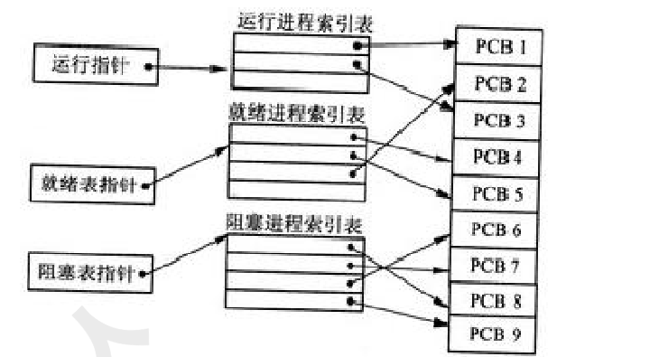

# 2018年下半年 系统架构设计师 · 上午题

> 卷面信息：考试时间 9:00～11:30 共 150 分钟。本试卷的试题中共有 75 个空格，需要全部解答，每个空格 1 分，满分 75 分。每个空格对应一个序号，有 A、B、C、D 四个选项，请选择一个最恰当的选项作为解答。卷面共 12 页。
> 卷面例题：2018 年下半年全国计算机技术与软件专业技术资格（水平）考试日期是 (88) 月 (89) 日。因为考试日期是"11 月 4 日"，故 (88) 选 C，(89) 选 A。

## 题号目录

| 题号 | 考点 | 教程章节 |
|------|------|----------|
| Q01–Q04 | 磁盘移臂/旋转调度、进程三态 PCB 组织、多级索引文件长度 | 02 计算机系统 |
| Q05–Q07 | 关系代数与等价 SQL、查询效率 | 06 数据库 |
| Q08 | 数据仓库特性（相对稳定性） | 19 大数据架构 |
| Q09–Q10 | DSP 哈佛结构、串行总线 | 02 计算机系统 |
| Q11 | 嵌入式软件低功耗设计 | 16 嵌入式 |
| Q12 | CPU 主频/外频/倍频 | 02 计算机系统 |
| Q13 | CRC 校验码计算 | 17 通信系统 |
| Q14–Q15 | DNS PTR 记录、DHCP Decline | 17 通信系统 |
| Q16–Q17 | 系统性能调整参数（数据库/应用系统） | 02 计算机系统 |
| Q18–Q21 | 霍尔三维结构（时间维/逻辑维/知识维） | 03 信息系统 |
| Q22–Q34 | 项目时间管理、文档、需求管理、变更控制、过程模型、软件开发环境、软件设计四活动 | 05 软件工程 |
| Q35–Q41 | 软件重用、EJB、构件组装、CORBA、J2EE 构件 | 07 系统架构设计 |
| Q42–Q43 | 动态/静态测试方法 | 05 软件工程 |
| Q44–Q46 | 4+1 视图、DSSA 领域分析/设计/实现 | 07 系统架构设计 |
| Q47–Q48 | ATAM/SAAM 架构评估 | 08 质量属性与评估 |
| Q49–Q53 | 仓库风格、架构风格选择、质量属性场景 | 07 系统架构设计 / 08 质量属性与评估 |
| Q54–Q57 | 设计模式分类（抽象工厂/Bridge/Command） | 07 系统架构设计 |
| Q58–Q63 | 质量属性（可用性/性能/安全性）与架构策略 | 08 质量属性与评估 |
| Q64–Q65 | 数字签名（摘要/加密目的） | 04 信息安全 |
| Q66–Q68 | 软件著作权（委托开发、保护期限、职务作品） |  |
| Q69–Q70 | 指派问题、线性规划极小值 |  |
| Q71–Q75 | 数据存储架构（Master/Look-up files、Legacy/Network DB、referential integrity） | 06 数据库 |

## 原题转录（视觉核验）

---

## Q01

在磁盘调度管理中，应先进行移臂调度，再进行旋转调度。假设磁盘移动臂位于 21 号柱面上，进程的请求序列如下表所示。如果采用最短移臂调度算法，那么系统的响应序列应为 (1)。

| 请求序列 | 柱面号 | 磁头号 | 扇区号 |
|------|------|------|------|
| ① | 17 | 8 | 9 |
| ② | 23 | 6 | 3 |
| ③ | 23 | 9 | 6 |
| ④ | 32 | 10 | 5 |
| ⑤ | 17 | 8 | 4 |
| ⑥ | 32 | 3 | 10 |
| ⑦ | 17 | 7 | 9 |
| ⑧ | 23 | 10 | 4 |
| ⑨ | 38 | 10 | 8 |

- A. ②⑧③④⑤①⑦⑥⑨
- B. ②③⑧④⑥⑨①⑤⑦
- C. ①②③④⑤⑥⑦⑧⑨
- D. ②⑧③⑤⑦①④⑥⑨

**来源所列答案**：D
**来源解析**：未提供（答案卷仅有【解析】标题，无正文）

---

## Q02

某计算机系统中的进程管理采用三态模型，那么下图所示的 PCB（进程控制块）的组织方式采用 (2)，图中 (3)。

- A. 顺序方式
- B. 链接方式
- C. 索引方式
- D. Hash 方式

**第 (3) 空选项**：

- A. 有 1 个运行进程，2 个就绪进程，4 个阻塞进程
- B. 有 2 个运行进程，3 个就绪进程，3 个阻塞进程
- C. 有 2 个运行进程，3 个就绪进程，4 个阻塞进程
- D. 有 3 个运行进程，2 个就绪进程，4 个阻塞进程

**来源所列答案**：(2) C；(3) C
**来源解析**：未提供（答案卷仅有【解析】标题，无正文）

---

## Q03

（承 Q02 题干与图）

**来源所列答案**：C
**来源解析**：未提供（答案卷仅有【解析】标题，无正文）

> 校核注：Q02 与 Q03 共用一个题干与插图，源答案卷将两空答案合并列作"【答案】C C"，即 (2)=C、(3)=C。本库按题号拆分归入。

---

## Q04

某文件系统采用多级索引结构，若磁盘块的大小为 4K 字节，每个块号需占 4 字节，那么采用二级索引结构时的文件最大长度可占用 (4) 个物理块。

- A. 1024
- B. 1024×1024
- C. 2048×2048
- D. 4096×4096

**来源所列答案**：B
**来源解析**：未提供（答案卷仅有【解析】标题，无正文）

---

## Q05

给定关系 R(A,B,C,D,E) 与 S(A,B,C,F,G)，那么与表达式 $\pi_{1,2,4,6,7}(\sigma_{1<6}(R \bowtie S))$ 等价的 SQL 语句如下：SELECT (5) FROM R,S WHERE (6);

- A. R.A，R.B，R.E，S.C，G
- B. R.A，R.B，D，F，G
- C. R.A，R.B，R.D，S.C，F
- D. R.A，R.B，R.D，S.C，G

**来源所列答案**：B
**来源解析**：未提供（答案卷仅有【解析】标题，无正文）

> 校核注：原卷中 $\sigma_{1<6}(R \bowtie S)$ 部分为手写体批注（印刷版表达式中 $\pi$ 下标 1,2,4,6,7 为印刷体，$\sigma$ 部分系手写补全），按可见内容照录。

---

## Q06

（承 Q05 题干）

- A. R.A=S.A OR R.B=S.B OR R.C=S.C OR R.A<S.F
- B. R.A=S.A OR R.B=S.B OR R.C=S.C OR R.A<S.B
- C. R.A=S.A AND R.B=S.B AND R.C=S.C AND R.A<S.F
- D. R.A=S.A AND R.B=S.B AND R.C=S.C AND R.A<S.B

**来源所列答案**：C
**来源解析**：未提供（答案卷仅有【解析】标题，无正文）

---

## Q07

在关系 R（A1，A2，A3）和 S（A2，A3，A4）上进行关系运算的 4 个等价的表达式 E1、E2、E3 和 E4 如下所示：

- A. $E_1 = \pi_{A_1,A_4}(\sigma_{A_2<'2018' \wedge A_4='95'}(R \bowtie S))$
- B. $E_2 = \pi_{A_1,A_4}(\sigma_{A_2<'2018'}(R) \bowtie \sigma_{A_4='95'}(S))$
- C. $E_3 = \pi_{A_1,A_4}(\sigma_{A_2<'2018' \wedge R.A_2=S.A_2 \wedge A_4='95'}(R \times S))$
- D. $E_4 = \pi_{A_1,A_4}(\sigma_{R.A_2=S.A_2}(\sigma_{A_2<'2018'}(R) \times \sigma_{A_4='95'}(S)))$

如果严格按照表达式运算顺序执行，则查询效率最高的是表达式 (7)。

**来源所列答案**：D
**来源解析**：未提供（答案卷仅有【解析】标题，无正文）

---

## Q08

数据仓库中，数据 (8) 是指数据一旦进入数据仓库后，将被长期保留并定期加载和刷新，可以进行各种查询操作，但很少对数据进行修改和删除操作。

- A. 面向主题
- B. 集成性
- C. 相对稳定性
- D. 反映历史变化

**来源所列答案**：C
**来源解析**：未提供（答案卷仅有【解析】标题，无正文）

---

## Q09

目前处理器市场中存在 CPU 和 DSP 两种类型处理器，分别用于不同场景，这两种处理器具有不同的体系结构，DSP 采用 (9)。

- A. 冯.诺伊曼结构
- B. 哈佛结构
- C. FPGA 结构
- D. 与 GPU 相同结构

**来源所列答案**：B
**来源解析**：未提供（答案卷仅有【解析】标题，无正文）

---

## Q10

以下关于串行总线的说法中，正确的是 (10)。

- A. 串行总线一般都是全双工总线，适宜于长距离传输数据
- B. 串行总线传输的波特率是总线初始化时预先定义好的，使用中不可改变
- C. 串行总线是按位（bit）传输数据的，其数据的正确性依赖于校验码纠正
- D. 串行总线的数据发送和接收是以软件查询方式工作

**来源所列答案**：B
**来源解析**：未提供（答案卷仅有【解析】标题，无正文）

---

## Q11

嵌入式系统设计一般要考虑低功耗，软件设计也要考虑低功耗设计，软件低功耗设计一般采用 (11)。

- A. 结构化、编译优化和代码优化
- B. 软硬件协同设计、开发过程优化和环境设计优化
- C. 轻量级操作系统、算法优化和仿真实验
- D. 编译优化技术、软硬件协同设计和算法优化

**来源所列答案**：D
**来源解析**：未提供（答案卷仅有【解析】标题，无正文）

---

## Q12

CPU 的频率有主频、倍频和外频。某处理器外频是 200MHz，倍频是 13，该款处理器的主频是 (12)。

- A. 2.6GHz
- B. 1300MHz
- C. 15.38Mhz
- D. 200MHz

**来源所列答案**：A
**来源解析**：未提供（答案卷仅有【解析】标题，无正文）

---

## Q13

若信息码字为 111000110，生成多项式 G(x)=x⁵+x³+x+1，则计算出的 CRC 校验码为 (13)。

- A. 01101
- B. 11001
- C. 001101
- D. 011001

**来源所列答案**：B
**来源解析**：未提供（答案卷仅有【解析】标题，无正文）

---

## Q14

在客户机上运行 nslookup 查询某服务器名称时能解析出 IP 地址，查询 IP 地址时却不能解析出服务器名称，解决这一问题的方法是 (14)。

- A. 清除 DNS 缓存
- B. 刷新 DNS 缓存
- C. 为该服务器创建 PTR 记录
- D. 重启 DNS 服务

**来源所列答案**：C
**来源解析**：未提供（答案卷仅有【解析】标题，无正文）

---

## Q15

如果发送给 DHCP 客户端的地址已经被其他 DHCP 客户端使用，客户端会向服务器发送 (15) 信息包拒绝接受已经分配的地址信息。

- A. DhcpAck
- B. DhcpOffer
- C. DhcpDecline
- D. DhcpNack

**来源所列答案**：C
**来源解析**：未提供（答案卷仅有【解析】标题，无正文）

---

## Q16

为了优化系统的性能，有时需要对系统进行调整。对于不同的系统，其调整参数也不尽相同。例如，对于数据库系统，主要包括 CPU/内存使用状况、(16)、进程/线程使用状态、日志文件大小等。对于应用系统，主要包括应用系统的可用性、响应时间、(17)、特定应用资源占用等。

- A. 数据丢包率
- B. 端口吞吐量
- C. 数据处理速率
- D. 查询语句性能

**来源所列答案**：D
**来源解析**：未提供（答案卷仅有【解析】标题，无正文）

---

## Q17

（承 Q16 题干）

- A. 并发用户数
- B. 支持协议和标准
- C. 最大连接数
- D. 时延抖动

**来源所列答案**：A
**来源解析**：未提供（答案卷仅有【解析】标题，无正文）

---

## Q18

系统工程利用计算机作为工具，对系统的结构、元素、(18) 和反馈等进行分析，以达到最优 (19)、最优设计、最优管理和最优控制的目的。霍尔（A.D.Hall）于 1969 年提出了系统方法的三维结构体系，通常称为霍尔三维结构，这是系统工程方法论的基础。霍尔三维结构以时间维、(20) 维、知识维组成的立体结构概括性地表示出系统工程的各阶段、各步骤以及所涉及的知识范围。其中时间维是系统的工作进程，对于一个具体的工程项目，可以分为 7 个阶段，在 (21) 阶段会做出研制方案及生产计划。

- A. 知识
- B. 需求
- C. 文档
- D. 信息

**来源所列答案**：D
**来源解析**：未提供（答案卷仅有【解析】标题，无正文）

---

## Q19

（承 Q18 题干，第 (19) 空）

- A. 战略
- B. 规划
- C. 实现
- D. 处理

**来源所列答案**：B
**来源解析**：未提供（答案卷仅有【解析】标题，无正文）

---

## Q20

（承 Q18 题干，第 (20) 空）

- A. 空间
- B. 结构
- C. 组织
- D. 逻辑

**来源所列答案**：D
**来源解析**：未提供（答案卷仅有【解析】标题，无正文）

---

## Q21

（承 Q18 题干，第 (21) 空）

- A. 规划
- B. 拟定
- C. 研制
- D. 生产

**来源所列答案**：B
**来源解析**：未提供（答案卷仅有【解析】标题，无正文）

---

## Q22

项目时间管理中的过程包括 (22)。

- A. 活动定义、活动排序、活动的资源估算和工作进度分解
- B. 活动定义、活动排序、活动的资源估算、活动历时估算、制定计划和进度控制
- C. 项目章程、项目范围管理计划、组织过程资产和批准的变更申请
- D. 生产项目计划、项目可交付物说明、信息系统要求说明和项目度量标准

**来源所列答案**：B
**来源解析**：未提供（答案卷仅有【解析】标题，无正文）

---

## Q23

文档是影响软件可维护性的决定因素。软件系统的文档可以分为用户文档和系统文档两类。其中，(23) 不属于用户文档包括的内容。

- A. 系统设计
- B. 版本说明
- C. 安装手册
- D. 参考手册

**来源所列答案**：A
**来源解析**：未提供（答案卷仅有【解析】标题，无正文）

---

## Q24

需求管理是一个对系统需求变更、了解和控制的过程。以下活动中，(24) 不属于需求管理的主要活动。

- A. 文档管理
- B. 需求跟踪
- C. 版本控制
- D. 变更控制

**来源所列答案**：A
**来源解析**：未提供（答案卷仅有【解析】标题，无正文）

---

## Q25

下面关于变更控制的描述中，(25) 是不正确的。

- A. 变更控制委员会只可以由一个小组担任
- B. 控制需求变更与项目的其他配置管理决策有着密切的联系
- C. 变更控制过程中可以使用相应的自动辅助工具
- D. 变更的过程中，允许拒绝变更

**来源所列答案**：A
**来源解析**：未提供（答案卷仅有【解析】标题，无正文）

---

## Q26

软件开发过程模型中，(26) 主要由原型开发阶段和目标软件开发阶段构成。

- A. 原型模型
- B. 瀑布模型
- C. 螺旋模型
- D. 基于构件的模型

**来源所列答案**：A
**来源解析**：未提供（答案卷仅有【解析】标题，无正文）

---

## Q27

系统模块化程度较高时，更适合于采用 (27) 方法，该方法通过使用基于构件的开发方法获得快速开发。(28) 把整个软件开发流程分成多个阶段，每一个阶段都由目标设定、风险分析、开发和有效性验证以及评审构成。

- A. 快速应用开发
- B. 瀑布模型
- C. 螺旋模型
- D. 原型模型

**来源所列答案**：A
**来源解析**：未提供（答案卷仅有【解析】标题，无正文）

---

## Q28

（承 Q27 题干，第 (28) 空）

- A. 原型模型
- B. 瀑布模型
- C. 螺旋模型
- D. V 模型

**来源所列答案**：C
**来源解析**：未提供（答案卷仅有【解析】标题，无正文）

---

## Q29

软件开发环境应支持多种集成机制。其中，(29) 用于存储与系统开发有关的信息，并支持信息的交流与共享；(30) 是实现过程集成和控制集成的基础。

- A. 算法模型库
- B. 环境信息库
- C. 信息模型库
- D. 用户界面库

**来源所列答案**：B
**来源解析**：未提供（答案卷仅有【解析】标题，无正文）

---

## Q30

（承 Q29 题干，第 (30) 空）

- A. 工作流与日志服务器
- B. 进程通信与数据共享服务器
- C. 过程控制与消息服务器
- D. 同步控制与恢复服务器

**来源所列答案**：C
**来源解析**：未提供（答案卷仅有【解析】标题，无正文）

---

## Q31

软件概要设计包括设计软件的结构、确定系统功能模块及其相互关系，主要采用 (31) 描述程序的结构。

- A. 程序流程图、PAD 图和伪代码
- B. 模块结构图、数据流图和盒图
- C. 模块结构图、层次图和 HIPO 图
- D. 程序流程图、数据流图和层次图

**来源所列答案**：C
**来源解析**：未提供（答案卷仅有【解析】标题，无正文）

---

## Q32

软件设计包括了四个既独立又相互联系的活动：高质量的 (32) 将改善程序结构和模块划分，降低过程复杂性；(33) 的主要目标是开发一个模块化的程序结构，并表示出模块间的控制关系；(34) 描述了软件与用户之间的交互关系。

- A. 程序设计
- B. 数据设计
- C. 算法设计
- D. 过程设计

**来源所列答案**：B
**来源解析**：未提供（答案卷仅有【解析】标题，无正文）

---

## Q33

（承 Q32 题干，第 (33) 空）

- A. 软件结构设计
- B. 数据结构设计
- C. 数据流设计
- D. 分布式设计

**来源所列答案**：A
**来源解析**：未提供（答案卷仅有【解析】标题，无正文）

---

## Q34

（承 Q32 题干，第 (34) 空）

- A. 数据架构设计
- B. 模块化设计
- C. 性能设计
- D. 人机界面设计

**来源所列答案**：D
**来源解析**：未提供（答案卷仅有【解析】标题，无正文）

---

## Q35

软件重用可以分为垂直式重用和水平式重用，(35) 是一种典型的水平式重用。

- A. 医学词汇表
- B. 标准函数库
- C. 电子商务标准
- D. 网银支付接口

**来源所列答案**：B
**来源解析**：未提供（答案卷仅有【解析】标题，无正文）

---

## Q36

EJB 是企业级 Java 构件，用于开发和部署多层结构的、分布式的、面向对象的 Java 应用系统。其中，(36) 负责完成服务端与客户端的交互；(37) 用于数据持久化来简化数据库开发工作；(38) 主要用来处理并发和异步访问操作。

- A. 会话型构件
- B. 实体型构件
- C. COM 构件
- D. 消息驱动构件

**来源所列答案**：A
**来源解析**：未提供（答案卷仅有【解析】标题，无正文）

---

## Q37

（承 Q36 题干，第 (37) 空）

- A. 会话型构件
- B. 实体型构件
- C. COM 构件
- D. 消息驱动构件

**来源所列答案**：B
**来源解析**：未提供（答案卷仅有【解析】标题，无正文）

---

## Q38

（承 Q36 题干，第 (38) 空）

- A. 会话型构件
- B. 实体型构件
- C. COM 构件
- D. 消息驱动构件

**来源所列答案**：D
**来源解析**：未提供（答案卷仅有【解析】标题，无正文）

---

## Q39

构件组装成软件系统的过程可以分为三个不同的层次：(39)。

- A. 初始化、互连和集成
- B. 连接、集成和演化
- C. 定制、集成和扩展
- D. 集成、扩展和演化

**来源所列答案**：C
**来源解析**：未提供（答案卷仅有【解析】标题，无正文）

---

## Q40

CORBA 服务端构件模型中，(40) 是 CORBA 对象的真正实现，负责完成客户端请求。

- A. 伺服对象（Servant）
- B. 对象适配器（Object Adapter）
- C. 对象请求代理（Object Request Broker）
- D. 适配器激活器（Adapter Activator）

**来源所列答案**：A
**来源解析**：未提供（答案卷仅有【解析】标题，无正文）

---

## Q41

J2EE 应用系统支持五种不同类型的构件模型，包括 (41)。

- A. Applet、JFC、JSP、Servlet、EJB
- B. JNDI、IIOP、RMI、EJB、JSP/Servlet
- C. JDBC、EJB、JSP、Servlet、JCA
- D. Applet、Servlet、JSP、EJB、Application Client

**来源所列答案**：D
**来源解析**：未提供（答案卷仅有【解析】标题，无正文）

---

## Q42

软件测试一般分为两个大类：动态测试和静态测试。前者通过运行程序发现错误，包括 (42) 等方法；后者采用人工和计算机辅助静态分析的手段对程序进行检测，包括 (43) 等方法。

- A. 边界值分析、逻辑覆盖、基本路径
- B. 桌面检查、逻辑覆盖、错误推测
- C. 桌面检查、代码审查、代码走查
- D. 错误推测、代码审查、基本路径

**来源所列答案**：A
**来源解析**：未提供（答案卷仅有【解析】标题，无正文）

---

## Q43

（承 Q42 题干，第 (43) 空）

- A. 边界值分析、逻辑覆盖、基本路径
- B. 桌面检查、逻辑覆盖、错误推测
- C. 桌面检查、代码审查、代码走查
- D. 错误推测、代码审查、基本路径

**来源所列答案**：C
**来源解析**：未提供（答案卷仅有【解析】标题，无正文）

---

## Q44

体系结构模型的多视图表示是从不同的视角描述特定系统的体系结构。著名的 4+1 模型支持从 (44) 描述系统体系结构。

- A. 逻辑视图、开发视图、物理视图、进程视图、统一的场景
- B. 逻辑视图、开发视图、物理视图、模块视图、统一的场景
- C. 逻辑视图、开发视图、构件视图、进程视图、统一的场景
- D. 领域视图、开发视图、构件视图、进程视图、统一的场景

**来源所列答案**：A
**来源解析**：未提供（答案卷仅有【解析】标题，无正文）

---

## Q45

特定领域软件架构（Domain Specific Software Architecture, DSSA）的基本活动包括领域分析、领域设计和领域实现。其中，领域分析的主要目的是获得领域模型。领域设计的主要目标是获得 (45)。领域实现是为了 (46)。

- A. 特定领域软件需求
- B. 特定领域软件架构
- C. 特定领域软件设计模型
- D. 特定领域软件重用模型

**来源所列答案**：B
**来源解析**：未提供（答案卷仅有【解析】标题，无正文）

---

## Q46

（承 Q45 题干，第 (46) 空）

- A. 评估多种软件架构
- B. 验证领域模型
- C. 开发和组织可重用信息，对基础软件架构进行实现
- D. 特定领域软件重用模型

**来源所列答案**：C
**来源解析**：未提供（答案卷仅有【解析】标题，无正文）

---

## Q47

体系结构权衡分析方法（Architecture Tradeoff Analysis Method，ATAM）包含 4 个主要的活动领域，分别是场景和需求收集、体系结构视图和场景实现、(47)、折中。基于场景的架构分析方法（Scenarios-based Architecture Analysis Method，SAAM）的主要输入是问题描述、需求声明和 (48)。

- A. 架构设计
- B. 问题分析与建模
- C. 属性模型构造和分析
- D. 质量建模

**来源所列答案**：C
**来源解析**：未提供（答案卷仅有【解析】标题，无正文）

---

## Q48

（承 Q47 题干，第 (48) 空）

- A. 问题说明
- B. 问题建模
- C. 体系结构描述
- D. 需求建模

**来源所列答案**：C
**来源解析**：未提供（答案卷仅有【解析】标题，无正文）

---

## Q49

在仓库风格中，有两种不同的构件，其中，(49) 说明当前状态，(50) 在中央数据存储上执行。

- A. 注册表
- B. 中央数据结构
- C. 事件
- D. 数据库

**来源所列答案**：B
**来源解析**：未提供（答案卷仅有【解析】标题，无正文）

---

## Q50

（承 Q49 题干，第 (50) 空）

- A. 独立构件
- B. 数据结构
- C. 知识源
- D. 共享数据

**来源所列答案**：A
**来源解析**：未提供（答案卷仅有【解析】标题，无正文）

---

## Q51

某公司欲开发一个大型多人即时战略游戏，游戏设计的目标之一是能够支持玩家自行创建战役地图，定义游戏对象的行为和对象之间的关系。针对该需求，公司应该采用 (51) 架构风格最为合适。在架构设计阶段，公司的架构师识别出 2 个核心质量属性场景。其中，"在并发用户数量为 10000 人时，用户的请求需要在 1 秒内得到响应"主要与 (52) 质量属性相关；"对游戏系统进行二次开发的时间不超过 3 个月"主要与 (53) 质量属性相关。

- A. 层次系统
- B. 解释器
- C. 黑板
- D. 事件驱动系统

**来源所列答案**：B
**来源解析**：未提供（答案卷仅有【解析】标题，无正文）

---

## Q52

（承 Q51 题干，第 (52) 空）

- A. 性能
- B. 吞吐量
- C. 可靠性
- D. 可修改性

**来源所列答案**：A
**来源解析**：未提供（答案卷仅有【解析】标题，无正文）

---

## Q53

（承 Q51 题干，第 (53) 空）

- A. 可测试性
- B. 可移植性
- C. 互操作性
- D. 可修改性

**来源所列答案**：D
**来源解析**：未提供（答案卷仅有【解析】标题，无正文）

---

## Q54

设计模式描述了一个出现在特定设计语境中的设计再现问题，并为它的解决方案提供了一个经过充分验证的通用方案，不同的设计模式关注解决不同的问题。例如，抽象工厂模式提供一个接口，可以创建一系列相关或相互依赖的对象，而无需指定它们具体的类，它是一种 (54) 模式；(55) 模式将类的抽象部分和它的实现部分分离开来，使它们可以独立变化，它属于 (56) 模式；(57) 模式将一个请求封装为一个对象，从而可用不同的请求对客户进行参数化，将请求排队或记录请求日志，支持可撤销的操作。

- A. 组合型
- B. 结构型
- C. 行为型
- D. 创建型

**来源所列答案**：D
**来源解析**：未提供（答案卷仅有【解析】标题，无正文）

---

## Q55

（承 Q54 题干，第 (55) 空）

- A. Bridge
- B. Proxy
- C. Prototype
- D. Adapter

**来源所列答案**：A
**来源解析**：未提供（答案卷仅有【解析】标题，无正文）

---

## Q56

（承 Q54 题干，第 (56) 空）

- A. 组合型
- B. 结构型
- C. 行为型
- D. 创建型

**来源所列答案**：D
**来源解析**：未提供（答案卷仅有【解析】标题，无正文）

> ⚠️ 待核验：来源答案将 (56) 列为 D（创建型）。Bridge 模式在通行的设计模式分类中属于结构型（B），且本题 (55) 已选 Bridge；来源解析为空，此处答案与通行分类矛盾，按原文照录，待核验。

---

## Q57

（承 Q54 题干，第 (57) 空）

- A. Command
- B. Facade
- C. Memento
- D. Visitor

**来源所列答案**：A
**来源解析**：未提供（答案卷仅有【解析】标题，无正文）

---

## Q58

某公司欲开发一个人员管理系统，在架构设计阶段，公司的架构师识别出 3 个核心质量属性场景。其中"管理系统遭遇断电后，能够在 15 秒内自动切换至备用系统并恢复正常运行"主要与 (58) 质量属性相关，通常可采用 (59) 架构策略实现该属性；"系统正常运行时，人员信息查询请求应该在 2 秒内返回结果"主要与 (60) 质量属性相关，通常可采用 (61) 架构策略实现该属性；"系统需要对用户的操作情况进行记录，并对所有针对系统的恶意操作行为进行报警和记录"主要与 (62) 质量属性相关，通常可采用 (63) 架构策略实现该属性。

- A. 可用性
- B. 性能
- C. 易用性
- D. 可修改性

**来源所列答案**：A
**来源解析**：未提供（答案卷仅有【解析】标题，无正文）

---

## Q59

（承 Q58 题干，第 (59) 空）

- A. 抽象接口
- B. 信息隐藏
- C. 主动冗余
- D. 影子操作

**来源所列答案**：C
**来源解析**：未提供（答案卷仅有【解析】标题，无正文）

---

## Q60

（承 Q58 题干，第 (60) 空）

- A. 可测试性
- B. 易用性
- C. 可用性
- D. 性能

**来源所列答案**：D
**来源解析**：未提供（答案卷仅有【解析】标题，无正文）

---

## Q61

（承 Q58 题干，第 (61) 空）

- A. 记录/回放
- B. 操作串行化
- C. 心跳
- D. 资源调度

**来源所列答案**：D
**来源解析**：未提供（答案卷仅有【解析】标题，无正文）

---

## Q62

（承 Q58 题干，第 (62) 空）

- A. 可用性
- B. 安全性
- C. 可测试性
- D. 可修改性

**来源所列答案**：B
**来源解析**：未提供（答案卷仅有【解析】标题，无正文）

---

## Q63

（承 Q58 题干，第 (63) 空）

- A. 追踪审计
- B. Ping/Echo
- C. 选举
- D. 维护现有接口

**来源所列答案**：A
**来源解析**：未提供（答案卷仅有【解析】标题，无正文）

---

## Q64

数字签名首先需要生成消息摘要，然后发送方用自己的私钥对报文摘要进行加密，接收方用发送方的公钥验证真伪。生成消息摘要的目的是 (64)，对摘要进行加密的目的是 (65)。

- A. 防止窃听
- B. 防止抵赖
- C. 防止篡改
- D. 防止重放

**来源所列答案**：C
**来源解析**：未提供（答案卷仅有【解析】标题，无正文）

---

## Q65

（承 Q64 题干，第 (65) 空）

- A. 防止窃听
- B. 防止抵赖
- C. 防止篡改
- D. 防止重放

**来源所列答案**：B
**来源解析**：未提供（答案卷仅有【解析】标题，无正文）

---

## Q66

某软件程序员接受 X 公司（软件著作权人）委托开发一个软件，三个月后又接受 Y 公司委托开发功能类似的软件，该程序员仅将受 X 公司委托开发的软件略作修改即完成提交给 Y 公司，此种行为 (66)。

- A. 属于开发者的特权
- B. 属于正常使用著作权
- C. 不构成侵权
- D. 构成侵权

**来源所列答案**：D
**来源解析**：未提供（答案卷仅有【解析】标题，无正文）

---

## Q67

软件著作权受法律保护的期限是（）。一旦保护期满，权利将自行终止，成为社会公众可以自由使用的知识。

- A. 10 年
- B. 25 年
- C. 50 年
- D. 不确定

**来源所列答案**：C
**来源解析**：未提供（答案卷仅有【解析】标题，无正文）

---

## Q68

谭某是 CZB 物流公司的业务系统管理员。任职期间，谭某根据公司的业务要求开发了"报关业务系统"，并由公司使用。以下说法正确的是 (68)。

- A. 报关业务系统 V1.0 的著作权属于谭某
- B. 报关业务系统 V1.0 的著作权属于 CZB 物流公司
- C. 报关业务系统 V1.0 的著作权属于谭某和 CZB 物流公司
- D. 报关业务系统 V1.0 的著作权不属于谭某和 CZB 物流公司

**来源所列答案**：B
**来源解析**：未提供（答案卷仅有【解析】标题，无正文）

---

## Q69

某企业准备将四个工人甲、乙、丙、丁分配在 A、B、C、D 四个岗位。每个工人由于技术水平不同，在不同岗位上每天完成任务所需的工时见下表。适当安排岗位，可使四个工人以最短的总工时 (69) 全部完成每天的任务。

| 工人 | A | B | C | D |
|------|---|---|---|---|
| 甲 | 7 | 5 | 2 | 3 |
| 乙 | 9 | 4 | 3 | 7 |
| 丙 | 5 | 4 | 7 | 5 |
| 丁 | 4 | 6 | 3 | 6 |

- A. 13
- B. 14
- C. 15
- D. 16

**来源所列答案**：B
**来源解析**：未提供（答案卷仅有【解析】标题，无正文）

---

## Q70

在如下线性约束条件下：2x+3y<=30；x+2y>=10；x>=y；x>=5；y>=0，目标函数 2x+3y 的极小值为（）。

- A. 16.5
- B. 17.5
- C. 20
- D. 25

**来源所列答案**：B
**来源解析**：未提供（答案卷仅有【解析】标题，无正文）

---

## Q71

Designing the data storage architecture is an important activity in system design. There are two main types of data storage formats: files and databases. Files are electronic of data that have been optimized to perform a particular transaction. There are several types of files that differ in the way they are used to support an application. (71) store core information that is important to the business and, more specifically, to the application, such as order information or customer mailing information.

- A. Master files
- B. Look-up files
- C. Transaction files
- D. History files

**来源所列答案**：A
**来源解析**：未提供（答案卷仅有【解析】标题，无正文）

---

## Q72

（承 Q71 英文题干）(72) contain static values, such as a list of valid codes or the names of cities. Typically, the list is used for validation.

- A. Master files
- B. Look-up files
- C. Audit files
- D. History files

**来源所列答案**：C
**来源解析**：未提供（答案卷仅有【解析】标题，无正文）

> ⚠️ 待核验：按英文题干语义（"contain static values...used for validation"），此空应为 Look-up files（B）；来源答案列为 C（Audit files），解析为空，疑来源答案有误，按原文照录，待核验。

---

## Q73

（承 Q71 英文题干）A database is a collection of groupings of information that are related to each other in some way. There are many different types of databases that exist on the market today. (73) is given to those databases which are based on older, sometimes outdated technology that is seldom used to develop new applications.

- A. Legacy database
- B. Backup database
- C. Multidimensional database
- D. Workgroup database

**来源所列答案**：A
**来源解析**：未提供（答案卷仅有【解析】标题，无正文）

---

## Q74

（承 Q71 英文题干）(74) are collections of records that are related to each other through pointers. In relational database, (75) can be used in ensuring that values linking the tables together through the primary and foreign keys are valid and correctly synchronized.

- A. Hierarchical database
- B. Workgroup database
- C. Linked table database
- D. Network database

**来源所列答案**：A
**来源解析**：未提供（答案卷仅有【解析】标题，无正文）

> ⚠️ 待核验：按英文题干语义（"collections of records that are related to each other through pointers"），此空通常指网状数据库（Network database, D）或层次数据库；来源答案列为 A（Hierarchical database），解析为空，待核验。

---

## Q75

（承 Q71 英文题干，第 (75) 空）

- A. identifying relationships
- B. normalization
- C. referential integrity
- D. store procedure

**来源所列答案**：C
**来源解析**：未提供（答案卷仅有【解析】标题，无正文）

---

## 缺口清单

- 无缺题：Q01–Q75 题目、选项、来源答案齐全。
- 来源解析：上午题 75 题在答案卷中均只有【解析】标题、无解析正文，统一标注"未提供"。
