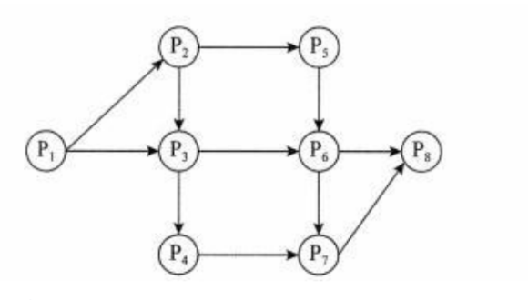
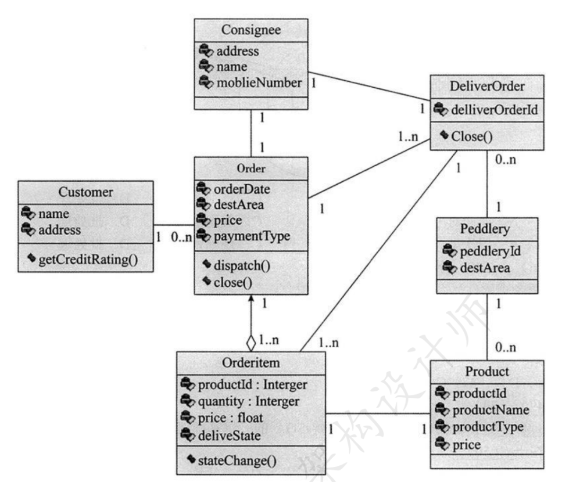
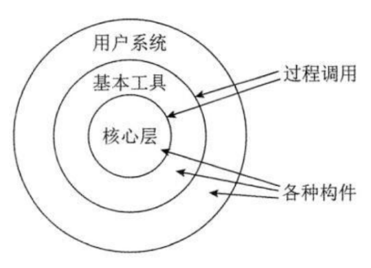
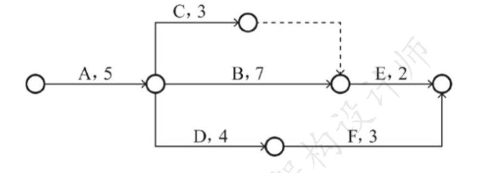

# 2019年下半年 系统架构设计师 · 上午题

> 卷面信息：考试时间 9:00~11:30 共 150 分钟。本试卷的试题中共有 75 个空格，需要全部解答，每个空格 1 分，满分 75 分。每个空格对应一个序号，有 A、B、C、D 四个选项，请选择一个最恰当的选项作为解答，在答题卡相应序号下填涂该选项。解答前务必阅读例题和答题卡上的例题填涂样式及填涂注意事项。解答时用正规 2B 铅笔正确填涂选项，如需修改，请用橡皮擦干净，否则会导致不能正确评分。
> 卷面例题：2019 年下半年全国计算机技术与软件专业技术资格（水平）考试日期是 (88) 月 (89) 日。（88）A.9 B.10 C.11 D.12；（89）A.5 B.6 C.7 D.8。因为考试日期是"11 月 5 日"，故 (88) 选 C，(89) 选 A，应在答题卡序号 88 下对 C 填涂，在序号 89 下对 A 填涂（参看答题卡）。

## 题号目录

| 题号 | 考点 | 教程章节 |
|------|------|----------|
| Q01–Q03 | 前趋图（Precedence Graph）、页面地址变换与页面淘汰 | 02 计算机系统 |
| Q04 | 网络操作系统中文件/文件夹共享对安全性的影响 | 02 计算机系统 |
| Q05–Q08 | 数据库存储过程安全、关系模式分解（无损连接/保持函数依赖）、分布式数据库模式结构 | 06 数据库 |
| Q09–Q10 | 安全攸关系统软件安全性需求获取 | 04 信息安全 |
| Q11–Q12 | 嵌入式实时调度算法（最晚截止期）、混成系统组成 | 16 嵌入式系统 |
| Q13–Q15 | TCP 端口号作用、Web 页面访问过程、DHCP 服务 | 17 通信系统 |
| Q16–Q17 | 性能评价程序与基准测试程序 | 02 计算机系统 |
| Q18–Q19 | 关键成功因素法（CSF） | 03 信息系统 |
| Q20–Q21 | 系统应用集成原则与四个层次服务 | 03 信息系统 |
| Q22–Q25 | 软件生命周期三阶段、需求变更管理过程 | 05 软件工程 |
| Q26–Q28 | 软件方法学（自顶向下/自底向上/形式化开发方法） | 05 软件工程 |
| Q29–Q34 | 软件开发工具、概要设计、结构化设计任务、模块化设计 | 05 软件工程 |
| Q35–Q38 | 构件分类方法（关键字/刻面/超文本）、构件组装技术 | 07 系统架构设计 |
| Q39–Q43 | 逆向工程抽象层次、重构工程、性能测试类型 | 05 软件工程 |
| Q44–Q45 | 4+1 视图、UML 类图（开发视图） | 07 系统架构设计 |
| Q46–Q48 | 经典体系结构风格分类（数据流/虚拟机/层次型） | 07 系统架构设计 |
| Q49–Q50 | ESB 与 SOA 基础架构 | 07 系统架构设计 |
| Q51–Q53 | ABSDM 基于架构的软件开发模型六个子过程 | 07 系统架构设计 |
| Q54–Q57 | 设计模式分类与创建型模式（Singleton/Prototype/Builder） | 07 系统架构设计 |
| Q58–Q63 | 质量属性（性能/可用性/安全性）场景与架构策略 | 08 系统质量属性与架构评估 |
| Q64–Q65 | 电子邮箱安全协议（MIME）、网络冗余设计 | 17 通信系统 |
| Q66–Q68 | 软件著作权（署名权保护期、侵权认定） | 知识产权 |
| Q69–Q70 | 数学模型灵敏性分析、关键路径（作业拖延天数） | 应用数学 / 项目管理 |
| Q71–Q75 | 英语题：数据组织与存储、数据冗余、E-R 图、规范化 | 06 数据库 |

## 原题转录（视觉核验）

---

## Q01

前趋图（Precedence Graph）是一个有向无环图，记为：→={ (P~i~,P~j~) | Pi must complete before Pj may Start }。假设系统中进程 P={P1,P2,P3,P4,P5,P6,P7,P8}，且进程的前趋图如下：

那么，该前趋图可记为 (1)。

- A. →={ (P1,P2)，(P1,P3)，(P1,P4)，(P2,P5)，(P3,P5)，(P4,P7)，(P5,P6)，(P6,P7)，(P6,P8)，(P7,P8) }
- B. →={ (P1,P2)，(P3,P1)，(P4,P1)，(P5,P2)，(P5,P3)，(P6,P4)，(P7,P5)，(P7,P6)，(P6,P8)，(P8,P7) }
- C. →={ (P1,P2)，(P1,P3)，(P1,P4)，(P2,P5)，(P3,P6)，(P4,P7)，(P5,P6)，(P6,P7)，(P6,P8)，(P7,P8) }
- D. →={ (P1,P2)，(P1,P3)，(P2,P3)，(P2,P5)，(P3,P6)，(P3,P4)，(P4,P7)，(P5,P6)，(P6,P7)，(P6,P8)，(P7,P8) }

**来源所列答案**：D
**来源解析**：(P1,Pj) 表示前驱图的一个进程之间的逻辑关系，该图一共有 11 个逻辑关系。记为：→={(P1,P2),(P1,P3),(P2,P3),(P2,P5),(P3,P6),(P3,P4),(P4,P7),(P5,P6),(P6,P7),(P6,P8),(P7,P8)}。

---

## Q02

进程 P 有 8 个页面，页号分别为 0～7，页面大小为 4K，假设系统给进程 P 分配了 4 个存储块，进程 P 的页面变换表如下所示。表中状态位等于 1 和 0 分别表示页面在内存和不在内存。若进程 P 要访问的逻辑地址为十六进制 5148H，则该地址经过变换后，其物理地址应为十六进制 (2)。

| 页号 | 页帧号 | 状态位 | 访问位 | 修改位 |
|------|--------|--------|--------|--------|
| 0 | - | 0 | 0 | 0 |
| 1 | 7 | 1 | 1 | 0 |
| 2 | 5 | 1 | 0 | 1 |
| 3 | - | 0 | 0 | 0 |
| 4 | - | 0 | 0 | 0 |
| 5 | 3 | 1 | 1 | 1 |
| 6 | - | 0 | 0 | 0 |
| 7 | 9 | 1 | 1 | 0 |

- A. 3148H
- B. 5148H
- C. 7148H
- D. 9148H

**来源所列答案**：A
**来源解析**：4KB=2^12B，也就是页面大小是 2^12B，这需要有 12 位二进制数表示，这 12 位二进制的数也是页内地址。逻辑地址为十六进制 5148H，其中的 148 可以分别用 4 位二进制的数表示，这里一共需要 12 位二进制的数。与页内地址的 12 位正好对应。而逻辑地址是由页号+页内地址组成的，既然 148 是页内地址，剩下的 5 就表示页号了。页号与页帧号的对应关系查表可得。

---

## Q03

（承 Q02 题干）如果进程 P 要访问的页面 6 不在内存，那么应该淘汰页号为 (3) 的页面。

- A. 1
- B. 2
- C. 5
- D. 9

**来源所列答案**：B
**来源解析**：淘汰页面首先考虑不在内存的页面（状态位），如果都在内存则看访问位为 0 的页面，根据局部性原理选择不经常访问的页面。如果所有页面都会被访问到，最后再看修改位为 0 的页面，选择没有被修改过的页面淘汰，避免数据不一致的问题。

> 校核注：另源（2019年11月系统架构设计师真题及解析.pdf 第12页）对本题解析更详：页面变换表中状态位等于 1 和 0 分别表示页面在内存或不在内存，所以 1、2、5 和 7 号页面在内存。当访问的页面 6 不在内存时，系统应该首先淘汰未被访问的页面，因为根据程序的局部性原理，最近未被访问的页面下次被访问的概率更小；如果页面最近都被访问过，应该先淘汰未修改过的页面，因为未修改过的页面内存与辅存一致，故淘汰时无须写回辅存，使系统页面置换代价更小。综上分析，1、5 和 7 号页面都是最近被访问过的，但 2 号页面最近未被访问过，故应该淘汰 2 号页面。

---

## Q04

在网络操作系统环境中，若用户 UserA 的文件或文件夹被共享后，则 (4)。

- A. UserA 的安全性与未共享时相比将会有所提高
- B. UserA 的安全性与未共享时相比将会有所下降
- C. UserA 的可靠性与未共享时相比将会有所提高
- D. UserA 的方便性与未共享时相比将会有所下降

**来源所列答案**：B
**来源解析**：在网络操作系统环境中，若 UserA 的文件或文件夹被共享后，则其安全性与未共享时相比将会有所下降，这是因为访问 UserA 的计算机或网络的人可能会读取、复制或更改共享文件夹中的文件。

---

## Q05

数据库的安全机制中，通过提供 (5) 供第三方开发人员调用进行数据更新，从而保证数据库的关系模式不被第三方所获取。

- A. 索引
- B. 视图
- C. 存储过程
- D. 触发器

**来源所列答案**：C
**来源解析**：存储过程（Stored Procedure）是在大型数据库系统中，一组为了完成特定功能的 SQL 语句集，它存储在数据库中，一次编译后永久有效，用户通过指定存储过程的名字并给出参数（如果该存储过程带有参数）来执行它。存储过程是数据库所提供的一种数据库对象，通过存储过程定义一段代码，提供给应用程序调用来执行。从安全性的角度考虑，更新数据时，通过提供存储过程让第三方调用，将需要更新的数据传入存储过程，而在存储过程内部用代码分别对需要的多个表进行更新，从而避免了向第三方提供系统的表结构，保证了系统的数据安全。

---

## Q06

给出关系 R（U，F），U={A,B,C,D,E}，F={A→BC,B→D,D→E}。以下关于 F 说法正确的是 (6)。

- A. F 蕴涵 A→B、A→C，但 F 不存在传递依赖
- B. F 蕴涵 E→A、A→C，故 F 存在传递依赖
- C. F 蕴涵 A→D、E→A、A→C，但 F 不存在传递依赖
- D. F 蕴涵 A→D、A→E、B→E，故 F 存在传递依赖

**来源所列答案**：D
**来源解析**：根据 Armstrong 公理的传递律，可以判断出 F 蕴涵 A→D、A→E、B→E，故 F 存在传递依赖。U1∩U2=B，B 可以唯一确定 U2 的 D、E。因此分解 ρ 是无损连接。U1 蕴含 A→BC，U2 蕴含 B→D，D→E。因此该分解也保持了函数依赖。

---

## Q07

（承 Q06 题干）若将关系 R 分解为 ρ={R1（U1，F1），R2（U2，F2）}，其中：U1={A,B,C}、U2={B,D,E}，则分解 ρ (7)。

- A. 无损连接并保持函数依赖
- B. 无损连接但不保持函数依赖
- C. 有损连接并保持函数依赖
- D. 有损连接但不保持函数依赖

**来源所列答案**：A
**来源解析**：（见 Q06 来源解析，两题解析合并列出。）

---

## Q08

分布式数据库系统除了包含集中式数据库系统的模式结构之外，还增加了几个模式级别，其中 (8) 定义分布式数据库中数据的整体逻辑结构，使得数据使用方便，如同没有分布一样。

- A. 分片模式
- B. 全局外模式
- C. 分布模式
- D. 全局概念模式

**来源所列答案**：D
**来源解析**：在分布式数据库中，局部 DBMS 中的内模式与概念模式与集中数据库是完全一致的，不同之处在于新增的全局 DBMS，而整个全局 DBMS，可以看作是相对于局部概念模式的外模式。由于外模式部分有一系列的分布模式、分片模式、全局概念模式和全局外模式，以及多级映射使得用户在使用分布式数据库时，可以使用集中式数据库同样的方式。（1）全局外模式：全局外模式是全局应用的用户视图，是全局概念模式的子集，该层直接与用户（或应用程序）交互。（2）全局概念模式：全局概念模式定义分布式数据库中数据的整体逻辑结构，数据就如同根本没有分布一样，可用传统的集中式数据库中所采用的方法进行定义。（3）分片模式：在某些情况下，需要将一个关系模式分解成为几个数据片，分片模式正是用于完成此项工作的。（4）分布模式：分布式数据库的本质特性就是数据分布在不同的物理位置。分布模式的主要职责是定义数据片段（即分片模式的处理结果）的存放节点。（5）局部概念模式：局部概念模式是局部数据库的概念模式。（6）局部内模式：局部内模式是局部数据库的内模式。

---

## Q09

安全攸关系统在软件需求分析阶段，应提出安全性需求。软件安全性需求是指通过约束软件的行为，使其不会出现 (9)。

- A. 不可接受的系统安全的行为
- B. 有可能影响系统可靠性的行为
- C. 不可接受的违反系统安全的行为
- D. 系统不安全的事故

**来源所列答案**：C
**来源解析**：生命攸关系统是指一个系统的失效或误动作会产生诸如：人员重伤或死亡，或者设备的严重毁损，或者环境的危害。通常在开发安全做关软件时，需求分析阶段必须考虑安全性需求，使其不会出现不可接受的违反系统安全的行为需求。软件安全需求的获取是根据已知的系统信息，如：软件危害条件等以及其他一些类似的系统数据和通用惯例，完成通用软件安全性需求的裁剪和特定软件安全性需求的获取工作。

> 校核注：来源解析首段"生命攸关系统"据原件照录（另源 2019年11月系统架构设计师真题及解析.pdf 第13页作"安全攸关（safety-critical）系统"）。

---

## Q10

（承 Q09 题干）软件安全需求的获取是根据已知的 (10)，如软件危害条件等以及其他一些类似的系统数据和通用惯例，完成通用软件安全性需求的裁剪和特定软件安全性需求的获取工作。

- A. 系统信息
- B. 系统属性
- C. 软件属性
- D. 代码信息

**来源所列答案**：A
**来源解析**：（见 Q09 来源解析，两题解析合并列出。）

---

## Q11

某嵌入式实时操作系统采用了某种调度算法，当某任务执行接近自己的截止期（Deadline）时，调度算法将把该任务的优先级调整到系统最高优先级，让该任务获取 CPU 资源运行。请问此类调度算法是 (11)。

- A. 优先级调度算法
- B. 抢占式优先级调度算法
- C. 最晚截止期调度算法
- D. 最早截止期调度算法

**来源所列答案**：C
**来源解析**：在嵌入式系统的应用开发中，采用嵌入式实时操作系统（简称 RTOS）能够支持多任务，使得程序开发更加容易，便于维护，同时能够提高系统的稳定性和可靠性。嵌入式实时操作系统存在多种调度算法：（1）优先级调度算法：系统为每个任务分配一个相对固定的优先顺序，调度程序根据任务优先级的高低程度，按时间顺序进行高优先级任务优先被调度。（2）抢占式优先级调度算法：在优先级调度算法的基础上，允许高优先级任务抢占低优先级任务而运行。（3）最晚截止期调度算法：是指系统按每个任务的最接近其截止期末端的时间进行调度，系统根据当前任务截止期的情况，选取最接近截止期的任务运行。（4）最早截止期调度算法：是指系统按每个任务的截止期时间，选取最早到截止期的头端时间的任务进行调度。

---

## Q12

混成系统是嵌入式实时系统的一种重要的子类。以下关于混成系统的说法中，正确的是 (12)。

- A. 混成系统一般由离散分离组件并行组成，组件之间的行为由计算模型进行控制
- B. 混成系统一般由离散分离组件和连续组件并行或串行组成，组件之间的行为由计算模型进行控制
- C. 混成系统一般由连续组件串行组成，组件之间的行为由计算模型进行控制
- D. 混成系统一般由离散分离组件和连续组件并行或串行组成，组件之间的行为由同步/异步事件进行管理

**来源所列答案**：B
**来源解析**：混成系统在工业控制和国防等领域大量存在。同时，现代计算机技术的高速发展和普及应用，为系统的模型化、优化控制和决策问题提供了强有力的技术支持。混成系统一般由离散分离组件和连续组件并行或串行组成，组件之间的行为由计算模型进行控制。

> 校核注：另源（2019年11月系统架构设计师真题及解析.pdf 第13-14页）对本题解析更详：混成系统定义：混成系统一般由离散分离组件和连续组件并行或串行组成，组件之间的行为由计算模型进行控制。混成系统一般由离散分离组件并行组成，组件之间的行为由计算模型进行控制缺少"连续组件"和"串行"；混成系统一般由连续组件串行组成，组件之间的行为由计算模型进行控制缺少"离散分离组件"和"并行"；混成系统一般由离散分离组件和连续组件并行或串行组成，组件之间的行为由同步/异步事件进行管理，"由同步/异步事件进行管理"是错误的，同步/异步事件是任务通信机制的一种，而不能替代计算模型。

---

## Q13

TCP 端口号的作用是 (13)。

- A. 流量控制
- B. ACL 过滤
- C. 建立连接
- D. 对应用层进程的寻址

**来源所列答案**：D
**来源解析**：网络中的计算机是通过 IP 地址来代表其身份的，但是它只能表示某台特定的计算机，而这台计算机上可能同时提供诸如 Web 服务、数据库服务等多种服务，此时可以使用端口号来区分相同计算机上的不同服务。起到对应用层进程的寻址的作用。

---

## Q14

web 页面访问过程中，在浏览器发出 HTTP 请求报文之前不可能执行的操作是 (14)。

- A. 查询本机 DNS 缓存，获取主机名对应的 IP 地址
- B. 发起 DNS 请求，获取主机名对应的 IP 地址
- C. 发送请求信息，获取将要访问的 web 应用
- D. 发送 ARP 协议广播数据包，请求网关的 MAC 地址

**来源所列答案**：C
**来源解析**：一个 Web 页面访问的过程如下：（1）浏览器首先查询本机的系统，获取主机名对应的 IP 地址。（2）若本机查询不到相应的 IP 地址，则会发起 DNS 请求，获取主机名对应的 IP 地址。（3）使用查询到的 IP 地址，直接访问目标服务器。（4）浏览器发送 HTTP 请求。（5）服务器从请求信息中获得客户机想要访问的主机名、Web 应用、Web 资源。（6）服务器读取相应的主机下的 Web 应用，Web 资源。并用读取到的 Web 资源数据，创建并回送一个 HTTP 响应。（7）客户机浏览器解析回送的资源，并显示结果。不难看出在浏览器发出 HTTP 请求报文之前是不可能发送请求信息，获取将要访问的 Web 应用。

---

## Q15

以下关于 DHCP 服务的说法中，正确的是 (15)。

- A. 在一个园区网中可以存在多台 DHCP 服务器
- B. 默认情况下，客户端要使用 DHCP 服务需指定 DHCP 服务器地址
- C. 默认情况下，DHCP 客户端选择本网段内的 IP 地址作为本地地址
- D. 在 DHCP 服务器上，DHCP 服务功能默认开启

**来源所列答案**：A
**来源解析**：DHCP（Dynamic Host Configuration Protocol，动态主机配置协议）通常被应用在大型的局域网络环境中，主要作用是集中的管理、分配 IP 地址，使网络环境中的主机动态的获得 IP 地址、网关地址、DNS 服务器地址等信息，并能够提升地址的使用率。DHCP 协议采用 UDP 作为传输协议，客户端发送广播消息到服务器的 68 号端口，服务器回应广播消息给客户端的 67 号端口。DHCP 客户端从 DHCP 服务器获取 IP 地址，主要通过：发现、提供、选择、确认，四个阶段进行。如果网络中有多个 DHCP 服务器发送 OFFER 报文，客户端只根据第一个收到的 OFFER 报文，返回 REQUEST 报文。在网络范围内可能存在多个 DHCP 服务器，各自负责不同的网段，也可能由同一个 DHCP 服务器，负责多个不同网段的地址分配。

---

## Q16

通常用户采用评价程序来评价系统的性能，评测准确度最高的评价程序是 (16)。在计算机性能评估中，通常将评价程序中用得最多、最频繁的 (17) 作为评价计算机性能的标准程序，称其为基准测试程序。

- A. 真实程序
- B. 核心程序
- C. 小型基准程序
- D. 核心基准程序

**来源所列答案**：A
**来源解析**：通常用户采用评价程序来评价系统的性能。评价程序一般有专门的测量程序、仿真程序等，而评测准确度最高的评价程序是真实程序。在计算机性能评估中，通常将评价程序中用得最多、最频繁的那部分核心程序作为评价计算机性能的标准程序，称其为基准测试程序。

---

## Q17

（承 Q16 题干）在计算机性能评估中，通常将评价程序中用得最多、最频繁的 (17) 作为评价计算机性能的标准程序，称其为基准测试程序。

- A. 真实程序
- B. 核心程序
- C. 小型基准程序
- D. 核心基准程序

**来源所列答案**：B
**来源解析**：（见 Q16 来源解析，两题解析合并列出。）

---

## Q18

信息系统规划方法中，关键成功因素法通过对关键成功因素的识别，找出实现目标所需要的关键信息集合，从而确定系统开发的 (18)。关键成功因素来源于组织的目标，通过组织的目标分解和关键成功因素识别、(19) 识别，一直到产生数据字典。

- A. 系统边界
- B. 功能指标
- C. 优先次序
- D. 性能指标

**来源所列答案**：C
**来源解析**：关键成功因素法是由 John Rockart 提出的一种信息系统规划方法。该方法能够帮助企业找到影响系统成功的关键因素，通过分析来确定企业的信息需求，从而为管理部门控制信息技术及其处理过程提供实施指南。关键成功因素法通过对关键成功因素的识别，找出实现目标所需要的关键信息集合，从而确定系统开发的优先次序。关键成功因素来源于组织的目标，通过组织的目标分解和关键成功因素识别、性能指标识别，一直到产生数据字典。

---

## Q19

（承 Q18 题干）关键成功因素来源于组织的目标，通过组织的目标分解和关键成功因素识别、(19) 识别，一直到产生数据字典。

- A. 系统边界
- B. 功能指标
- C. 优先次序
- D. 性能指标

**来源所列答案**：D
**来源解析**：（见 Q18 来源解析，两题解析合并列出。）

---

## Q20

系统应用集成构建统一标准的基础平台，在各个应用系统的接口之间共享数据和功能，基本原则是保证应用程序的 (20)。系统应用集成提供了四个不同层次的服务，最上层服务是 (21) 服务。

- A. 独立性
- B. 相关性
- C. 互操作性
- D. 排他性

**来源所列答案**：A
**来源解析**：应用集成是指两个或多个应用系统根据业务逻辑的需要而进行的功能之间的相互调用和互操作。应用集成需要在数据集成的基础上完成。应用集成在底层的网络集成和数据集成的基础上实现异构应用系统之间语用层次上的互操作。它们共同构成了实现企业集成化运行最顶层会聚集成所需要的，技术层次上的基础支持。系统应用集成构建统一标准的基础平台，在各个应用系统的接口之间共享数据和功能，基本原则是保证应用程序的独立性。系统应用集成提供了 4 个不同层次的服务，最上层服务是流程控制服务。

---

## Q21

（承 Q20 题干）系统应用集成提供了四个不同层次的服务，最上层服务是 (21) 服务。

- A. 通信
- B. 信息传递与转化
- C. 应用连接
- D. 流程控制

**来源所列答案**：D
**来源解析**：（见 Q20 来源解析，两题解析合并列出。）

---

## Q22

按照传统的软件生命周期方法学，可以把软件生命周期划分为软件定义、软件开发、(22) 三个阶段。其中，可行性研究属于 (23) 阶段的主要任务。

- A. 软件运行与维护
- B. 软件对象管理
- C. 软件详细设计
- D. 问题描述

**来源所列答案**：A
**来源解析**：结构化范型也称软件生命周期方法学，属于传统方法学。把软件生命周期划分成若干个阶段，每个阶段的任务相对独立，而且比较简单，便于不同人员分工协作，从而降低了整个软件开发过程的困难程度。在传统的软件工程方法中，软件的生存周期分为定义时期、开发时期、运行和维护时期这几个阶段。可行性研究属于软件定义阶段的主要任务。

---

## Q23

（承 Q22 题干）其中，可行性研究属于 (23) 阶段的主要任务。

- A. 软件定义
- B. 软件开发
- C. 软件评估
- D. 软件运行与维护

**来源所列答案**：A
**来源解析**：（见 Q22 来源解析，两题解析合并列出。）

---

## Q24

需求变更管理是需求管理的重要内容。需求变更管理的过程主要包括问题分析和变更描述、(24)、变更实现。具体来说，在关于需求变更管理的描述中，(25) 是不正确的。

- A. 变更调研
- B. 变更判定
- C. 变更定义
- D. 变更分析和成本计算

**来源所列答案**：D
**来源解析**：需求变更管理是需求管理的重要内容。需求变更管理的过程主要包括问题分析和变更描述、变更分析和成本计算、变更实现。具体来说，需求变更是因为需求发生变化，根据软件工程思想，需求说明书一般要经过论证，如果在需求说明书经过论证后，需要在原有需求基础上追加和补充新的需求或对原有需求进行修改和削减，均属于需求变更。因此，需求变更必然会带来相应的问题，绝不是百利而无一害的。

---

## Q25

（承 Q24 题干）具体来说，在关于需求变更管理的描述中，(25) 是不正确的。

- A. 需求变更要进行控制，严格防止因失控而导致项目混乱，出现重大风险
- B. 需求变更对软件项目开发有利无弊
- C. 需求变更通常按特定的流程进行
- D. 在需求变更中，变更审批由 CCB 负责审批

**来源所列答案**：B
**来源解析**：（见 Q24 来源解析，两题解析合并列出。）

---

## Q26

软件方法学是以软件开发方法为研究对象的学科。其中，(26) 是先对最高层次中的问题进行定义、设计、编程和测试，而将其中未解决的问题作为一个子任务放到下一层次中去解决。(27) 是根据系统功能要求，从具体的器件、逻辑部件或者相似系统开始，通过对其进行相互连接、修改和扩大，构成所要求的系统。(28) 是建立在严格数学基础上的软件开发方法。

- A. 面向对象开发方法
- B. 形式化开发方法
- C. 非形式化开发方法
- D. 自顶向下开发方法

**来源所列答案**：D
**来源解析**：软件方法学是软件开发全过程的指导原则与方法体系。其另一种含义是以软件方法为研究对象的学科。从开发风范上看，软件方法有自顶向下的开发方法、自底向上的开发方法。在实际软件开发中，大都是自顶向下与自底向上两种方法的结合，只不过是以何者为主而已。自顶向下是指将一个大问题分化成多个可以解决的小问题，然后逐一进行解决。每个问题都会有一个模块去解决它，且每个问题包括抽象步骤和具体步骤。形式化方法是指采用严格的数学方法，使用形式化规约语言来精确定义软件系统。非形式化的开发方法是通过自然语言、图形或表格描述软件系统的行为和特性，然后基于这些描述进行设计和开发，而形式化开发则是基于数学的方式描述、开发和验证系统。

---

## Q27

（承 Q26 题干）(27) 是根据系统功能要求，从具体的器件、逻辑部件或者相似系统开始，通过对其进行相互连接、修改和扩大，构成所要求的系统。

- A. 自底向上开发方法
- B. 形式化开发方法
- C. 非形式化开发方法
- D. 原型开发方法

**来源所列答案**：A
**来源解析**：（见 Q26 来源解析，三题解析合并列出。）

---

## Q28

（承 Q26 题干）(28) 是建立在严格数学基础上的软件开发方法。

- A. 自底向上开发方法
- B. 形式化开发方法
- C. 非形式化开发方法
- D. 自顶向下开发方法

**来源所列答案**：B
**来源解析**：（见 Q26 来源解析，三题解析合并列出。）

---

## Q29

软件开发工具是指用于辅助软件开发过程活动的各种软件，其中，(29) 是辅助建立软件系统的抽象模型的，例如 Rose、Together、WinA&D、(30) 等。

- A. 编程工具
- B. 设计工具
- C. 测试工具
- D. 建模工具

**来源所列答案**：D
**来源解析**：软件开发工具是指用于辅助软件开发过程活动的各种软件。其中，软件建模工具是辅助建立软件系统的抽象模型的。常见的软件建模工具包括 Rational Rose、Together、WinA&D、QuickUML、EclipseUML 等。

---

## Q30

（承 Q29 题干）例如 Rose、Together、WinA&D、(30) 等。

- A. LoadRunner
- B. QuickUML
- C. Delphi
- D. WinRunner

**来源所列答案**：B
**来源解析**：（见 Q29 来源解析，两题解析合并列出。）

---

## Q31

软件概要设计将软件需求转化为软件设计的 (31) 和软件的 (32)。

- A. 算法流程
- B. 数据结构
- C. 交互原型
- D. 操作接口

**来源所列答案**：B
**来源解析**：从工程管理角度来看，软件设计可分为概要设计和详细设计两个阶段。概要设计也称为高层设计或总体设计，即将软件需求转化为数据结构和软件的系统结构；详细设计也称为低层设计，即对结构图进行细化，得到详细的数据结构与算法。

---

## Q32

（承 Q31 题干）软件概要设计将软件需求转化为软件设计的 (31) 和软件的 (32)。

- A. 系统结构
- B. 算法流程
- C. 内部接口
- D. 程序流程

**来源所列答案**：A
**来源解析**：（见 Q31 来源解析，两题解析合并列出。）

---

## Q33

软件结构化设计包括 (33) 等任务。

- A. 架构设计、数据设计、过程设计、原型设计
- B. 架构设计、过程设计、程序设计、原型设计
- C. 数据设计、过程设计、交互设计、程序设计
- D. 架构设计、接口设计、数据设计、过程设计

**来源所列答案**：D
**来源解析**：软件结构化设计包括架构设计、接口设计、数据设计和过程设计等任务。它是一种面向数据流的设计方法，是以结构化分析阶段所产生的成果为基础，进一步自顶而下、逐步求精和模块化的过程。

---

## Q34

关于模块化设计，(34) 是错误的。

- A. 模块是指执行某一特定任务的数据结构和程序代码
- B. 模块的接口和功能定义属于其模块自身的内部特性
- C. 每个模块完成相对独立的特定子功能，与其他模块之间的关系最简单
- D. 模块设计的重要原则是高内聚、低耦合

**来源所列答案**：B
**来源解析**：模块化设计是将一个待开发的软件分解成为若干小的简单部分——模块。具体来说，模块是指执行某一特定任务的数据结构和程序代码。通常将模块的结构和功能定义为其外部特性，将模块的局部数据和实现该模块的程序代码称为内部特性。模块独立是指每个模块完成相对独立的特定子功能，与其他模块之间的关系最简单。通常用内聚和耦合两个标准来衡量模块的独立性，其设计原则是"高内聚、低耦合"。

---

## Q35

基于构件的软件开发中，构件分类方法可以归纳为三大类：(35) 根据领域分析的结果将应用领域的概念按照从抽象到具体的顺序逐次分解为树形或有向无回路图结构；Facet 描述构件执行的功能、被操作的数据、构件应用的语境或任意其他特征；(36) 利用 (37) 使得检索者在阅读文档过程中可以按照人类的联想思维方式任意跳转到包含相关概念或构件的文档。

- A. 关键字分类法
- B. 刻面分类法
- C. 语义匹配法
- D. 超文本方法

**来源所列答案**：A
**来源解析**：基于构件的软件开发中，已有的构件分类方法可以归纳为三大类：（1）关键字分类法：根据领域分析的结果将应用领域的概念按照从抽象到具体的顺序逐次分解为树形或有向无回路图结构。（2）刻面分类法：利用 Facet（刻面）描述构件执行的功能、被操作的数据、构件应用的语境或任意其他特征。（3）超文本方法：基于全文检索技术，使得检索者在阅读文档过程中可以按照人类的联想思维方式任意跳转到包含相关概念或构件的文档。

---

## Q36

（承 Q35 题干）Facet 描述构件执行的功能、被操作的数据、构件应用的语境或任意其他特征；(36) 利用 (37) 使得检索者在阅读文档过程中可以按照人类的联想思维方式任意跳转到包含相关概念或构件的文档。

- A. 关键字分类法
- B. 刻面分类法
- C. 语义匹配法
- D. 超文本方法

**来源所列答案**：B
**来源解析**：（见 Q35 来源解析，三题解析合并列出。）

---

## Q37

（承 Q35 题干）(36) 利用 (37) 使得检索者在阅读文档过程中可以按照人类的联想思维方式任意跳转到包含相关概念或构件的文档。

- A. 关键字分类法
- B. 刻面分类法
- C. 语义匹配法
- D. 超文本方法

**来源所列答案**：D
**来源解析**：（见 Q35 来源解析，三题解析合并列出。）

---

## Q38

构件组装是指将库中的构件经适当修改后相互连接构成新的目标软件。(38) 不属于构件组装技术。

- A. 基于功能的构件组装技术
- B. 基于数据的构件组装技术
- C. 基于实现的构件组装技术
- D. 面向对象的构件组装技术

**来源所列答案**：C
**来源解析**：本题考查构件组装的基础知识。构件组装是将库中的构件经适当修改后相互连接，或者将它们与当前开发项目中的软件元素相连接，最终构成新的目标软件。构件组装技术大致可分为基于功能的组装技术、基于数据的组装技术和面向对象的组装技术。

---

## Q39

软件逆向工程就是分析已有的程序，寻求比源代码更高级的抽象表现形式。在逆向工程导出信息的四个抽象层次中，(39) 包括反映程序各部分之间相互依赖关系的信息；(40) 包括反映程序段功能及程序段之间关系的信息。

- A. 实现级
- B. 结构级
- C. 功能级
- D. 领域级

**来源所列答案**：B
**来源解析**：逆向工程过程能够导出过程的设计模型（实现级）、程序和数据结构信息（结构级）、对象模型、数据和控制流模型（功能级）以及 UML 状态图和部署图（领域级）。其中，结构级包括反映程序各部分之间相互依赖关系的信息；功能级包括反映程序段功能及程序段之间关系的信息。

---

## Q40

（承 Q39 题干）在逆向工程导出信息的四个抽象层次中，(39) 包括反映程序各部分之间相互依赖关系的信息；(40) 包括反映程序段功能及程序段之间关系的信息。

- A. 实现级
- B. 结构级
- C. 功能级
- D. 领域级

**来源所列答案**：C
**来源解析**：（见 Q39 来源解析，两题解析合并列出。）

---

## Q41

(41) 是在逆向工程所获取信息的基础上修改或重构已有的系统，产生系统的一个新版本。

- A. 逆向分析（Reverse Analysis）
- B. 重组（Restructuring）
- C. 设计恢复（Design Recovery）
- D. 重构工程（Re-engineering）

**来源所列答案**：D
**来源解析**：重组是指在同一抽象级别上转换系统描述形式；设计恢复是指借助工具从已有程序中抽象出有关数据设计、总体结构设计和过程设计等方面的信息；重构工程是指在逆向工程所获得信息的基础上，修改或重构已有的系统，产生系统的一个新版本。

> 校核注：另源（2019年11月系统架构设计师真题及解析.pdf 第7页）B 选项印作"重组（CRestructuring）"（括号内首字母 C 疑为该源排版瑕疵，主来源作 Restructuring）。

---

## Q42

软件性能测试有多种不同类型的测试方法，其中，(42) 用于测试在限定的系统资源下考查软件系统极限运行的情况，(43) 可用于测试系统同时处理的在线最大用户数量。

- A. 强度测试
- B. 负载测试
- C. 压力测试
- D. 容量测试

**来源所列答案**：A
**来源解析**：软件性能测试类型包括负载测试、强度测试和容量测试等。其中：（1）负载测试用于测试超负荷环境中程序是否能够承担；（2）强度测试是在系统资源特别低的情况下考查软件系统极限运行情况；（3）容量测试可用于测试系统同时处理的在线最大用户数量。

---

## Q43

（承 Q42 题干）(43) 可用于测试系统同时处理的在线最大用户数量。

- A. 强度测试
- B. 负载测试
- C. 压力测试
- D. 容量测试

**来源所列答案**：D
**来源解析**：（见 Q42 来源解析，两题解析合并列出。）

---

---

## Q44

一个完整的软件系统需从不同视角进行描述，下图属于软件架构设计中的 (44)，用于 (45) 视图来描述软件系统。

- A. 对象图
- B. 时序图
- C. 构件图
- D. 类图

**来源所列答案**：D
**来源解析**：软件系统需从不同的角度进行描述。其著名的 4+1 视角架构模型（The "4+1" View Model of Software Architecture）提出了一种用来描述软件系统体系架构的模型，这种模型是基于使用者的多个不同视角出发。这种多视角能够解决多个"利益相关者"关心的问题。利益相关者包括最终用户、开发人员、系统工程师、项目经理等，他们能够分别处理功能性和非功能性需求。4+1 视角架构模型的五个主要的视角为逻辑视图、开发视图、处理视图、物理视图和场景。其中逻辑视图通常包括类图，对象图，状态图和协作图。

---

## Q45

（承 Q44 题干）下图属于软件架构设计中的 (44)，用于 (45) 视图来描述软件系统。

- A. 进程
- B. 开发
- C. 物理
- D. 用户

**来源所列答案**：B
**来源解析**：（见 Q44 来源解析，两题解析合并列出。）

> 校核注：另源（2019年11月系统架构设计师真题及解析.pdf 第18页）对本题解析更详：4+1 视角架构模型的五个主要的视角为逻辑视图、开发视图、处理视图、物理视图和场景。五个视角中每个都是使用符号进行描述。这些视角都是使用以架构为中心场景驱动和迭代开发等方式实现设计的。其中，类图是从开发视角对软件系统进行的描述。

---

## Q46

对软件体系结构风格的研究和实践促进了对设计的复用。Garlan 和 Shaw 对经典体系结构风格进行了分类。其中，(46) 属于数据流体系结构风格；(47) 属于虚拟机体系结构风格；而下图描述的属于 (48) 体系结构风格。

- A. 面向对象
- B. 事件系统
- C. 规则系统
- D. 批处理

**来源所列答案**：D
**来源解析**：数据流体系结构包括批处理体系结构风格和管道-过滤器体系结构风格。虚拟机体系结构风格包括解释器体系结构风格和规则系统体系结构风格。图中描述的为层次型体系结构风格。

---

## Q47

（承 Q46 题干）其中，(46) 属于数据流体系结构风格；(47) 属于虚拟机体系结构风格；而下图描述的属于 (48) 体系结构风格。

- A. 面向对象
- B. 事件系统
- C. 规则系统
- D. 批处理

**来源所列答案**：C
**来源解析**：（见 Q46 来源解析，三题解析合并列出。）

---

## Q48

（承 Q46 题干）而下图描述的属于 (48) 体系结构风格。

- A. 层次型
- B. 事件系统
- C. 规则系统
- D. 批处理

**来源所列答案**：A
**来源解析**：（见 Q46 来源解析，三题解析合并列出。）

---

## Q49

(49) 是由中间件技术实现并支持 SOA 的一组基础架构，它提供了一种基础设施，其优势在于 (50)。

- A. ESB
- B. 微服务
- C. 云计算
- D. Multi-Agent System

**来源所列答案**：A
**来源解析**：面向服务的体系结构（Service-oriented Architecture，SOA）是一种软件系统设计方法，通过已经发布的和可发现的接口为终端用户应用程序或其他服务提供服务。企业服务总线（Enterprise Service Bus，ESB）是构建基于 SOA 解决方案时所使用基础架构的关键部分，是由中间件技术实现并支持 SOA 的一组基础架构功能。ESB 支持异构环境中的服务、消息，以及基于事件的交互，并且具有适当的服务级别和可管理性。简而言之，ESB 提供了连接企业内部及跨企业间新的和现有软件应用程序的功能，以一组丰富的功能启用管理和监控应用程序之间的交互。在 SOA 分层模型中，ESB 用于组件层以及服务层之间，它能够通过多种通信协议连接并集成不同平台上的组件将其映射成服务层的服务。

---

## Q50

（承 Q49 题干）它提供了一种基础设施，其优势在于 (50)。

- A. 支持了服务请求者与服务提供者之间的直接链接
- B. 支持了服务请求者与服务提供者之间的紧密耦合
- C. 消除了服务请求者与服务提供者之间的直接链接
- D. 消除了服务请求者与服务提供者之间的关系

**来源所列答案**：C
**来源解析**：（见 Q49 来源解析，两题解析合并列出。）

---

## Q51

ABSDM（Architecture-Based Software Design Model）把整个基于体系结构的软件过程划分为体系结构需求、体系结构设计、体系结构文档化、(51)、(52) 和体系结构演化等六个子过程。其中，(53) 过程的主要输出结果是体系结构规格说明和测试体系结构需求的质量设计说明书。

- A. 体系结构复审
- B. 体系结构测试
- C. 体系结构变更
- D. 体系结构管理

**来源所列答案**：A
**来源解析**：基于架构的软件开发模型（Architecture-Based Software Design Model，ABSDM）把整个基于架构的软件过程划分为架构需求、设计、文档化、复审、实现、演化等 6 个子过程。绝大多数的架构都是抽象的，由一些概念上的构件组成。例如，层的概念在任何程序设计语言中都不存在。因此，要让系统分析师和程序员去实现架构，还必须得把架构进行文档化。文档是在系统演化的每一个阶段，系统设计与开发人员的通信媒介，是为验证架构设计和提炼或修改这些设计（必要时）所执行预先分析的基础。架构文档化过程的主要输出结果是架构需求规格说明和测试架构需求的质量设计说明书这两个文档。生成需求模型构件的精确的形式化的描述，作为用户和开发者之间的一个协约。

---

## Q52

（承 Q51 题干）(51)、(52) 和体系结构演化等六个子过程。

- A. 体系结构实现
- B. 体系结构测试
- C. 体系结构建模
- D. 体系结构管理

**来源所列答案**：A
**来源解析**：（见 Q51 来源解析，三题解析合并列出。）

---

## Q53

（承 Q51 题干）其中，(53) 过程的主要输出结果是体系结构规格说明和测试体系结构需求的质量设计说明书。

- A. 体系结构设计
- B. 体系结构需求
- C. 体系结构文档化
- D. 体系结构测试

**来源所列答案**：C
**来源解析**：（见 Q51 来源解析，三题解析合并列出。）

---

## Q54

设计模式按照目的可以划分为三类，其中，(54) 模式是对对象实例化过程的抽象。例如 (55) 模式确保一个类只有一个实例，并提供了全局访问入口；(56) 模式允许对象在不了解要创建对象的确切类以及如何创建等细节的情况下创建自定义对象；(57) 模式将复杂对象的构建与其表示分离。

- A. 创建型
- B. 结构型
- C. 行为型
- D. 功能型

**来源所列答案**：A
**来源解析**：创建型模式是对对象实例化过程的抽象。例如 Singleton 模式确保一个类只有一个实例，并提供了全局访问入口；Prototype 模式允许对象在不了解要创建对象的确切类以及如何创建等细节的情况下创建自定义对象；Builder 模式将复杂对象的构建与其表示分离。结构型模式主要用于如何组合已有的类和对象以获得更大的结构，一般借鉴封装、代理、继承等概念将一个或多个类或对象进行组合、封装，以提供统一的外部视图或新的功能。行为型模式主要用于对象之间的职责及其提供的服务的分配，它不仅描述对象或类的模式，还描述它们之间的通信模式，特别是描述一组对等的对象怎样相互协作以完成其中任一对象都无法单独完成的任务。

---

## Q55

（承 Q54 题干）例如 (55) 模式确保一个类只有一个实例，并提供了全局访问入口。

- A. Facade
- B. Builder
- C. Prototype
- D. Singleton

**来源所列答案**：D
**来源解析**：（见 Q54 来源解析，四题解析合并列出。）

---

## Q56

（承 Q54 题干）(56) 模式允许对象在不了解要创建对象的确切类以及如何创建等细节的情况下创建自定义对象。

- A. Facade
- B. Builder
- C. Prototype
- D. Singleton

**来源所列答案**：C
**来源解析**：（见 Q54 来源解析，四题解析合并列出。）

---

## Q57

（承 Q54 题干）(57) 模式将复杂对象的构建与其表示分离。

- A. Facade
- B. Builder
- C. Prototype
- D. Singleton

**来源所列答案**：B
**来源解析**：（见 Q54 来源解析，四题解析合并列出。）

---

## Q58

某公司欲开发一个电子交易清算系统，在架构设计阶段，公司的架构师识别出 3 个核心质量属性场景。其中"数据传递时延不大于 1S，并提供相应的优先级管理"主要与 (58) 质量属性相关，通常可采用 (59) 架构策略实现该属性；"系统采用双机热备，主备机必须实时监测对方状态，以便完成系统的实时切换"主要与 (60) 质量属性相关，通常可采用 (61) 架构策略实现该属性；"系统应能够防止 99% 的黑客攻击"主要与 (62) 质量属性相关，通常可采用 (63) 架构策略实现该属性。

- A. 可用性
- B. 性能
- C. 安全性
- D. 可修改性

**来源所列答案**：B
**来源解析**：架构的基本需求主要是在满足功能属性的前提下，关注软件质量属性，结构设计则是为满足架构需求（质量属性）寻找适当的战术。根据题干描述，其中"数据传递时延不大于 1s，并提供相应的优先级管理"主要与性能质量属性相关，性能的战术有资源需求、资源管理和资源仲裁，此需求通常可采用资源仲裁架构策略实现该属性；"系统采用双机热备，主备机必须实时监测对方状态，以便完成系统的实时切换"主要与可用性质量属性相关，可用性的战术有错误检测、错误恢复和错误预防，此需求通常可采用错误检测中的心跳架构策略实现该属性；"系统应能够防止 99% 的黑客攻击"主要与安全性质量属性相关，安全性相关的战术有抵抗攻击、检测攻击和从攻击中恢复，此需求通常可采用检测攻击架构策略实现该属性。

---

## Q59

（承 Q58 题干）通常可采用 (59) 架构策略实现该属性。

- A. 限制资源
- B. 引入并发
- C. 资源仲裁
- D. 限制访问

**来源所列答案**：C
**来源解析**：（见 Q58 来源解析，六题解析合并列出。）

---

## Q60

（承 Q58 题干）"系统采用双机热备，主备机必须实时监测对方状态，以便完成系统的实时切换"主要与 (60) 质量属性相关。

- A. 可用性
- B. 性能
- C. 安全性
- D. 可修改性

**来源所列答案**：A
**来源解析**：（见 Q58 来源解析，六题解析合并列出。）

---

## Q61

（承 Q58 题干）通常可采用 (61) 架构策略实现该属性。

- A. 记录/回放
- B. 操作串行化
- C. 心跳
- D. 资源调度

**来源所列答案**：C
**来源解析**：（见 Q58 来源解析，六题解析合并列出。）

---

## Q62

（承 Q58 题干）"系统应能够防止 99% 的黑客攻击"主要与 (62) 质量属性相关。

- A. 可用性
- B. 性能
- C. 安全性
- D. 可修改性

**来源所列答案**：C
**来源解析**：（见 Q58 来源解析，六题解析合并列出。）

---

## Q63

（承 Q58 题干）通常可采用 (63) 架构策略实现该属性。

- A. 检测攻击
- B. Ping/Echo
- C. 选举
- D. 权限控制

**来源所列答案**：A
**来源解析**：（见 Q58 来源解析，六题解析合并列出。）

---

## Q64

下列协议中与电子邮箱安全无关的是 (64)。

- A. SSL
- B. HTTPS
- C. MIME
- D. PGP

**来源所列答案**：C
**来源解析**：SSL（Secure Sockets Layer，安全套接层）及其继任者 TLS（Transport Layer Security，传输层安全）是为网络通信提供安全及数据完整性的一种安全协议，在传输层对网络连接进行加密。在设置电子邮箱时使用 SSL 协议，会保障邮箱更安全。HTTPS 协议是由 HTTP 加上 TLS/SSL 协议构建的可进行加密传输、身份认证的网络协议，主要通过数字证书、加密算法、非对称密钥等技术完成互联网数据传输加密，实现互联网传输安全保护。MIME 是设定某种扩展名的文件用一种应用程序来打开的方式类型，当该扩展名文件被访问的时候，浏览器会自动使用指定应用程序来打开。它是一个互联网标准，扩展了电子邮件标准，使其能够支持：非 ASCII 字符文本；非文本格式附件（二进制、声音、图像等）；由多部分（Multiple Parts）组成的消息体；包含非 ASCII 字符的头信息（Header Information）。PGP 是一套用于消息加密、验证的应用程序，采用 IDEA 的散列算法作为加密与验证之用。PGP 加密由一系列散列、数据压缩、对称密钥加密，以及公钥加密的算法组合而成。每个公钥均绑定唯一的用户名和/或者 E-Mail 地址。因此，上述选项中 MIME 是扩展了电子邮件标准，不能用于保障电子邮件安全。

---

## Q65

以下关于网络冗余设计的叙述中，错误的是 (65)。

- A. 网络冗余设计避免网络组件单点失效造成应用失效
- B. 备用路径与主路径同时投入使用，分担主路径流量
- C. 负载分担是通过并行链路提供流量分担来提高性能的
- D. 网络中存在备用链路时，可以考虑加入负载分担设计

**来源所列答案**：B
**来源解析**：网络冗余设计的目的就是避免网络组件单点失效造成应用失效；备用路径是在主路径失效时启用，其和主路径承担不同的网络负载；负载分担是网络冗余设计中的一种设计方式，其通过并行链路提供流量分担来提高性能；网络中存在备用链路时，可以考虑加入负载分担设计来减轻主路径负担。

---

## Q66

著作权中，(66) 的保护期不受期限限制。

- A. 发表权
- B. 发行权
- C. 展览权
- D. 署名权

**来源所列答案**：D
**来源解析**：发表权也称公开作品权，指作者对其尚未发表的作品享有决定是否公之于众的权利，发表权只能行使一次，且只能为作者享有。著作权的发行权，主要是指著作权人许可他人向公众提供作品原件或者复制件。而发行权可以行使多次，并且不仅仅为作者享有。传播权指著作权人享有向公众传播其作品的权利，传播权包括表演权、播放权、发行权、出租权、展览权等内容。署名权是作者表明其身份，在作品上署名的权利，它是作者最基本的人身权利。根据《中华人民共和国著作权法》的规定，作者的署名权、修改权、保护作品完整权的保护期不受限制。

---

## Q67

以下关于计算机软件著作权的叙述中，正确的是 (67)。

- A. 软件著作权自软件开发完成之日生效
- B. 非法进行拷贝、发布或更改软件的人被称为软件盗版者
- C. 开发者在单位或组织中任职期间所开发软件的著作权应归个人所有
- D. 用户购买了具有版权的软件，则具有对该软件的使用权和复制权

**来源所列答案**：A
**来源解析**：著作权是知识产权中的例外，因为著作权的取得无须经过个别确认，这就是人们常说的"自动保护"原则。软件经过登记后，软件著作权人享有发表权、开发者身份权、使用权、使用许可权和获得报酬权。软件著作权自软件开发完成之日起产生。自然人的软件著作权，保护期为自然人终生及其死亡后 50 年，截止于自然人死亡后第 50 年的 12 月 31 日；软件是合作开发的，截止于最后死亡的自然人死亡后第 50 年的 12 月 31 日。法人或者其他组织的软件著作权，保护期为 50 年，截止于软件首次发表后第 50 年的 12 月 31 日，但软件自开发完成之日起 50 年内未发表的不予保护。未经软件著作权人许可，修改、翻译、复制、发行著作人的软件的，属于侵权行为，应承担相应的民事、行政和刑事责任。B 选项中的"软件盗版者"在法律条文中并无定义，有定义的是"侵权行为"。而根据《计算机软件保护条例》第十七条"为了学习和研究软件内含的设计思想和原理，通过安装、显示、传输或者存储软件等方式使用软件的，可以不经软件著作权人许可，不向其支付报酬。"因此 B 选项有误。

---

## Q68

如果 A 公司购买了一个软件的源程序，A 公司将该软件源程序中的所有标识符做了全面修改后，作为该公司的产品销售，这种行为 (68)。

- A. 尚不构成侵权
- B. 侵犯了著作权
- C. 侵犯了专利权
- D. 属于不正当竞争

**来源所列答案**：B
**来源解析**：仅对源程序的标识符进行修改，如将数组名"arr"修改为"Arr"，程序其他部分不变属于侵犯软件著作权的行为。

---

## Q69

数学模型常带有多个参数，而参数会随环境因素而变化。根据数学模型求出最优解或满意解后，还需要进行 (69)，对计算结果进行检验，分析计算结果对参数变化的反应程度。

- A. 一致性分析
- B. 准确性分析
- C. 灵敏性分析
- D. 似然性分析

**来源所列答案**：C
**来源解析**：实际问题的数学模型往往都是近似的，常带有多个参数，而参数会随环境因素而变化。根据数学模型求出最优解或满意解后，还需要进行灵敏性分析，对计算结果进行检验，分析计算结果对参数变化的反应程度。如果对于参数的微小变化引发计算结果的很大变化，那么这种计算结果并不可靠，并且不可信。

---

## Q70

某工程项目包括六个作业 A～F，各个作业的衔接关系以及所需时间见下表。作业 D 最多能拖延 (70) 天，而不会影响该项目的总工期。

| 作业 | A | B | C | D | E | F |
|------|---|---|---|---|---|---|
| 紧前作业 | - | A | A | A | B,C | D |
| 时间/天 | 5 | 7 | 3 | 4 | 2 | 3 |

- A. 0
- B. 1
- C. 2
- D. 3

**来源所列答案**：C
**来源解析**：关键路径（所需天数最多的路径）：ABE，总工期=5 天+7 天+2 天=14 天。

作业 D、F 与作业 B、E 可并行实施，为不影响总工期，作业 D、F 可以在 7 天+2 天=9 天内完成，所以作业 D 最多可以延迟 2 天。

---

---

## Q71

During the systems analysis phase, you must decide how data will be organized, stored, and managed. A (71) is a framework for organizing, storing, and managing data. Each file or table contains data about people, places, things, or events. One of the potential problems existing in a file process environment is (72), which means that data common to two or more information systems is stored in several places. In a DBMS, the linked tables form a unified data structure that greatly improves data quality and access. A(n) (73) is a model that shows the logical relationships and interaction among system entities. It provides an overall view of the system and a blueprint for creating the physical data structures. (74) is the process of creating table designs by assigning specific fields or attributes to each table in the database. A table design specifies the fields and identifies the primary key in a particular table or file. The three normal forms constitute a progression in which (75) represents the best design. Most business-related databases must be designed in that form.

- A. data entity
- B. data structure
- C. file collection
- D. data definition

**来源所列答案**：B
**来源解析**：参考译文：在系统分析阶段，必须决定如何组织、存储和管理数据。数据结构是组织、存储和管理数据的一个框架。每个文件或表都包含有关人物、地点、事物或事件的数据。文件处理环境中存在的潜在问题之一是数据冗余，这意味着两个或多个信息系统共用的数据存储在多个不同位置。在数据库管理系统（DBMS）中，相互连接的表形成了一个统一的数据结构，极大地提高了数据质量和访问能力。实体关系图是显示系统实体之间的逻辑关系和交互的模型。它提供了系统的总体视图和用于创建物理数据结构的蓝图。规范化是通过为数据库中的每个表分配特定字段或属性来创建表设计的过程。表设计指定字段并标识特定表或文件中的主键。三种范式构成了一个渐进过程，其中第三范式代表了好的设计。大部分与业务相关的数据库都必须以这种形式设计。

---

## Q72

（承 Q71 题干）One of the potential problems existing in a file process environment is (72), which means that data common to two or more information systems is stored in several places.

- A. data integrity
- B. the rigid data structure
- C. data redundancy
- D. the many-to-many relationship

**来源所列答案**：C
**来源解析**：（见 Q71 来源解析，五题解析合并列出。）

---

## Q73

（承 Q71 题干）A(n) (73) is a model that shows the logical relationships and interaction among system entities.

- A. entity relationship diagram
- B. data dictionary
- C. database schema
- D. physical database model

**来源所列答案**：A
**来源解析**：（见 Q71 来源解析，五题解析合并列出。）

---

## Q74

（承 Q71 题干）(74) is the process of creating table designs by assigning specific fields or attributes to each table in the database.

- A. Normalization
- B. Replication
- C. Partitioning
- D. Optimization

**来源所列答案**：A
**来源解析**：（见 Q71 来源解析，五题解析合并列出。）

---

## Q75

（承 Q71 题干）The three normal forms constitute a progression in which (75) represents the best design.

- A. standard notation form
- B. first normal form
- C. second normal form
- D. third normal form

**来源所列答案**：D
**来源解析**：（见 Q71 来源解析，五题解析合并列出。）

---

## 缺口清单

- 无。本卷 Q01–Q75 题目、选项、答案、解析均已从来源页视觉转录，题号连续，无缺题、缺答案、缺图情况。

## 合并来源核对说明

- 合并来源《2019年11月系统架构设计师真题及解析.pdf》（软考达人 ruankaodaren.com 水印版，题答合订，共 37 页）已逐页视觉阅读：第 1 页为广告页；第 2–11 页为综合知识（上午题）试卷题目；第 11–23 页为综合知识答案解析；第 24–33 页为案例分析试题一～五及答案；第 33–37 页为论文写作试题一～四（含"文老师点评"，属网友整理版点评，非试卷原文）。
- 上午题 Q01–Q75：题目文字、选项、答案字母与主来源逐题核对一致（答案区间 Q01–Q75 全区间一致）。
- 差异（不构成本文冲突，已按题加"校核注"或说明）：
  - Q41：另源 B 选项印作"重组（CRestructuring）"，主来源作"重组（Restructuring）"，以主来源为正文。
  - Q03、Q09、Q12、Q45：另源解析较主来源更详，相关补充已在对应题"校核注"中摘要标明来源页码。
  - Q71–Q75：另源对每题各附同一段解析文字（重复粘贴痕迹），主来源给一段完整参考译文，以主来源为正文，无实质冲突。
- 另源所含案例分析、论文写作内容超出本卷（上午题）范围，未并入本文件。
