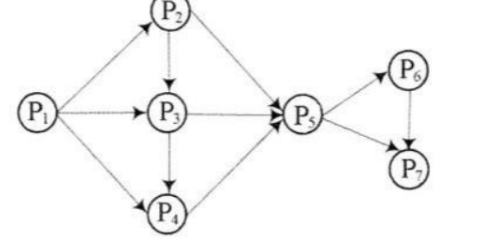
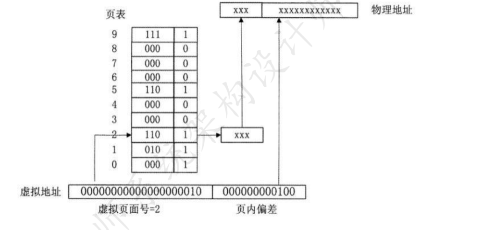

# 2020年下半年 系统架构设计师 · 上午题

> 卷面信息：考试时间 9:00～11:30 共 150 分钟。本试卷的试题中共有 75 个空格，需要全部解答，每个空格 1 分，满分 75 分。每个空格对应一个序号，有 A、B、C、D 四个选项，请选择一个最恰当的选项作为解答，在答题卡相应序号下填涂该选项。解答前务必阅读例题和答题卡上的例题填涂样式及填涂注意事项。解答时用正规 2B 铅笔正确填涂选项，如需修改，请用橡皮擦干净，否则会导致不能正确评分。卷面例题：2020 年下半年全国计算机技术与软件专业技术资格（水平）考试日期是（88）月（89）日，选项（88）A.9 B.10 C.11 D.12，（89）A.5 B.6 C.7 D.8。因为考试日期是"11 月 5 日"，故（88）选 C，（89）选 A，应在答题卡序号 88 下对 C 填涂，在序号 89 下对 A 填涂（参看答题卡）。

## 题号目录

| 题号 | 考点 | 教程章节 |
|------|------|----------|
| Q01–Q04 | 前趋图（Precedence Graph）、多线程资源共享、位示图（bitmap）计算、实时操作系统 | 02 计算机系统 |
| Q05–Q08 | 派生属性、函数依赖闭包与候选关键字、分布式数据库透明性 | 06 数据库 |
| Q09–Q11 | 微内核架构特征、分页地址翻译、段页式内存管理 | 02 计算机系统 |
| Q12 | 分层架构脆弱性（嵌入式系统软件架构） | 16 嵌入式 |
| Q13 | 区块链"挖矿"与双花攻击 | 11 未来信息综合技术 |
| Q14–Q17 | Linux DNS 配置、网络延迟、系统监视方式 | 02 计算机系统 / 17 通信系统 |
| Q18–Q21 | 电子政务领域（G2G/G2B/G2C/B2G） | 03 信息系统 |
| Q22–Q25 | 软件文档分类、需求基线与需求约定 | 05 软件工程 |
| Q26–Q41 | 软件过程活动、开发工具、软件设计四活动、信息隐蔽、构件分类、中间件功能、开发模型、敏捷方法、测试脚本 | 05 软件工程 |
| Q42–Q43 | 自动化测试脚本类型 | 05 软件工程 |
| Q44–Q47 | 架构视角与视图（静态/动态视角、逻辑视图） | 07 系统架构设计 |
| Q48–Q50 | 敏感点与权衡点 | 08 质量属性与评估 |
| Q51–Q53 | 三层 C/S 架构 | 07 系统架构设计 |
| Q54–Q58 | 设计模式分类与创建型模式 | 07 系统架构设计 |
| Q59–Q63 | 质量属性场景识别与架构策略 | 08 质量属性与评估 |
| Q64–Q65 | SYN Flooding 攻击、Kerberos 认证 | 04 信息安全 |
| Q66–Q68 | 软件著作权与商业秘密、著作人身权保护期 |  |
| Q69–Q70 | 蒙特卡洛法求体积、盈亏平衡点计算 |  |
| Q71–Q75 | 英语：系统设计（应用架构、DFD、系统建议） |  |

## 原题转录（视觉核验）

---

## Q01

前趋图（Precedence Graph）是一个有向无环图，记为：→={ (Pi, Pj) | Pi must complete before Pj may Start }。假设系统中进程 P={P1,P2,P3,P4,P5,P6,P7}，且进程的前趋图如下：

那么，该前趋图可记为（1）。

- A. →= {(P1,P2),(P3,P1),(P4,P1),(P5,P2),(P5,P3),(P6,P4),(P7,P5),(P7,P6),(P5,P6),(P4,P5),(P6,P7)}
- B. →= {(P1,P2),(P1,P3),(P1,P4),(P2,P3),(P2,P5),(P3,P4),(P3,P5),(P4,P5),(P5,P6),(P5,P7),(P6,P7)}
- C. →= {(P1,P2),(P1,P3),(P1,P4),(P2,P5),(P2,P3),(P3,P4),(P5,P3),(P4,P5),(P5,P6),(P7,P5),(P6,P7)}
- D. →= {(P1,P2),(P1,P3),(P2,P3),(P2,P5),(P3,P6),(P3,P4),(P4,P7),(P5,P6),(P6,P7),(P6,P5),(P7,P5)}

**来源所列答案**：B
**来源解析**：按"先大后小"原则找出箭头表示的 11 对逻辑关系：P1P2，P1P3，P1P4，P2P3，P2P5，P3P4，P3P5，P4P5，P5P6，P5P7，P6P7，经核对 B 项正确；A 项中，P3P1、P4P1 等逻辑关系反了，排除；C 项中，也存在逻辑关系反的情况如 P5P3、P7P5 等，排除；D 项中，P4P7 并不存在，并且也有逻辑关系反的情况如 P6P5、P7P5 等，排除。

---

## Q02

在支持多线程的操作系统中，假设进程 P 创建了线程 T1、T2 和 T3，那么下列说法正确的是（2）。

- A. 该进程中已打开的文件是不能被 T1、T2 和 T3 共享的
- B. 该进程中 T1 的栈指针是不能被 T2 共享的，但可被 T3 共享
- C. 该进程中 T1 的栈指针是不能被 T2 和 T3 共享的
- D. 该进程中某线程的栈指针是可以被 T1、T2 和 T3 共享的

**来源所列答案**：C
**来源解析**：同一进程创建的不同线程之间是相互隔离的，因此只有 C 选项正确；A 选项描述错误，进程已打开的文件是能被 T1/T2/T3 共享的，排除；B 选项描述错误，进程内不同的线程之间资源无法共享，排除；D 选项描述错误，进程内不同的线程之间资源无法共享，排除；

> 校核注：另源《2020年系统架构设计师真题及解析.pdf》（软考达人版）第 3 页本题题干作"假设进程 P 创建了线程 T2、T2 和 T3"（T2 重复、无 T1，疑为另源排版笔误，其选项仍引 T1），正文以主来源转录。

---

## Q03

假设某计算机的字长为 32 位，该计算机文件管理系统磁盘空间管理采用位示图（bitmap）记录磁盘的使用情况。若磁盘的容量为 300GB，物理块的大小为 4MB，那么位示图的大小（3）个字。

- A. 2400
- B. 3200
- C. 6400
- D. 9600

**来源所列答案**：A
**来源解析**：∵300G=300*1024M，又∵物理块大小为 4M，∴300G 占用块数为：300*1024/4=76800，∴32 位的计算机需要 76800/32=2400 个字，才能管理 300G 的磁盘。

---

## Q04

实时操作系统主要用于有实时要求的过程控制等领域。因此，在实时操作系统中，对于来自外部的事件必须在（4）。

- A. 一个时间片内进行处理
- B. 一个周转时间内进行处理
- C. 一个机器周期内进行处理
- D. 被控对象允许的时间范围内进行处理

**来源所列答案**：D
**来源解析**：实时操作系统（Real Time Operating System，简称 RTOS）是指当外界事件或数据产生时，能够接受并以足够快的速度予以处理，其处理的结果又能在规定的时间之内来控制生产过程或对处理系统做出快速响应，调度一切可利用的资源完成实时任务，并控制所有实时任务协调一致运行的操作系统。提供及时响应和高可靠性是其主要特点。

---

## Q05

通常在设计关系模式时，派生属性不会作为关系中的属性来存储。按照这个原则，假设原设计的学生关系模式为 Students（学号，姓名，性别，出生日期，年龄，家庭地址），那么该关系模式正确的设计应为（5）。

- A. Students（学号，性别，出生日期，年龄，家庭地址）
- B. Students（学号，姓名，性别，出生日期，年龄）
- C. Students（学号，姓名，性别，出生日期，家庭地址）
- D. Students（学号，姓名，出生日期，年龄，家庭地址）

**来源所列答案**：C
**来源解析**：根据出生日期，可以推出年龄，因此"出生日期"与"年龄"是派生关系，应予以合并。

---

## Q06

给出关系 R（U, F），U={A, B, C, D, E}，F={A→B，D→C，BC→E，AC→B}，求属性闭包的等式成立的是（6）。R 的候选关键字为（7）。

- A. $(A)_F^+ = U$
- B. $(B)_F^+ = U$
- C. $(AC)_F^+ = U$
- D. $(AD)_F^+ = U$

**来源所列答案**：D
**来源解析**（与 Q07 共用）：设 X 是函数依赖集，被 X 逻辑蕴涵的函数依赖全体构成的集合，称为函数依赖集 X 的闭包。简言之，闭包本质上就是这些属性能直接或间接推出的属性集的集合。不难求出，(A)=AB，(B)=B，(AC)=ABC，(AD)=ABCDE，因此 D 选项正确。AD 能推出 U 的所有属性，因此 AD 即为 R 的候选关键字。

---

## Q07

（承 Q06 题干：给出关系 R（U, F），U={A, B, C, D, E}，F={A→B，D→C，BC→E，AC→B}。）

- A. AD
- B. AB
- C. AC
- D. BC

**来源所列答案**：A
**来源解析**：见 Q06（同一解析：AD 能推出 U 的所有属性，因此 AD 即为 R 的候选关键字）。

---

## Q08

在分布式数据库中有分片透明、复制透明、位置透明和逻辑透明等基本概念。其中，（8）是指用户无需知道数据存放的物理位置。

- A. 分片透明
- B. 逻辑透明
- C. 位置透明
- D. 复制透明

**来源所列答案**：C
**来源解析**：题干关键词"物理位置"推知，只有 C 选项才符合，其他选择均不符合。

---

## Q09

以下关于操作系统微内核架构特征的说法，不正确的是（9）。

- A. 微内核的系统结构清晰，利于协作开发
- B. 微内核代码量少，系统具有良好的可移植性
- C. 微内核有良好的伸缩性、扩展性
- D. 微内核的功能代码可以互相调用，性能很高

**来源所列答案**：D
**来源解析**：从操作系统中去掉尽可能多的东西，而只留下一个最小的核心，称之为微内核。微内核技术的主要优点如下：统一的接口，在用户态和核心态之间无需进程识别。可伸缩性好，能适应硬件更新和应用变化。可移植性好，所有与具体机器特征相关的代码，全部隔离在微内核中，如果操作系统要移植到不同的硬件平台上，只需修改微内核中极少代码即可。实时性好，微内核可以方便地支持实时处理。安全可靠性高，微内核将安全性作为系统内部特性来进行设计，对外仅使用少量应用编程接口。支持分布式系统，支持多处理器的体系结构和高度并行的应用程序。微内核的缺点：一是难以进行良好的整体优化，二是进程间互相通信的开销大、内核功能代码不能被相互调用而带来服务的效率低。但总体而言，微内核在效率上的损失小于其在结构上获得的收益。

---

## Q10

分页内存管理的核心是将虚拟内存空间和物理内存空间皆划分成大小相同的页面，并以页面作为内存空间的最小分配单位。下图给出了内存管理单元的虚拟地址到物理地址的翻译过程，假设页面大小为 4KB，那么 CPU 发出虚拟地址 0010000000000100 后，其访问的物理地址是（10）。

- A. 1100000000000100
- B. 0100000000000100
- C. 1100000000000000
- D. 1100000000000010

**来源所列答案**：A
**来源解析**：分页内存管理的地址结构为：页号+内页地址（偏移量）。∵页面大小为 4KB = 2²*2¹⁰ = 2¹²，可知页内地址（偏移量）为 12 位，∴虚拟地址 0010000000000100 的前 4 位为页号（0010，第 2 页），后 12 位为偏移量。查表知，第 2 页的物理地址为 110，而页内地址不变。∴物理地址为：1100000000000100，选项 A 正确。

> 校核注：主来源本题卷第 17 页同一插图重复排版出现两次（源件如此），裁剪保留第二幅；另源《2020年系统架构设计师真题及解析.pdf》第 6 页仅出现一次，图形一致。

---

## Q11

以下关于计算机内存管理的描述中，（11）属于段页式内存管理的描述。

- A. 一个程序就是一段，使用基址极限对来进行管理
- B. 一个程序分为许多固定大小的页面，使用页表进行管理
- C. 程序按逻辑分为多段，每一段内又进行分页，使用段页表来进行管理
- D. 程序按逻辑分成多段，用一组基址极限对来进行管理。基址极限对存放在段表里

**来源所列答案**：C
**来源解析**：段页式存储管理的基本思想是将段式存储管理与分页存储管理结合起来，段页式存储管理将作业分成若干段，每个段分成若干页，每段赋予一个段名，为了实现地址转换，必须为每个作业配置一张段表和若干张页表。内存的分配与回收以页为单位进行。作业的逻辑地址是二维的，包括段号和段内地址，其中段内地址又包含页号和页内地址两部分。显然，只有 C 选项符合。

---

## Q12

软件脆弱性是软件中存在的弱点（或缺陷），利用它可以危害系统安全策略，导致信息丢失、系统价值和可用性降低。嵌入式系统软件架构通常采用分层架构，它可以将问题分解为一系列相对独立的子问题，局部化在每一层中，从而有效地降低单个问题的规模和复杂性，实现复杂系统的分解。但是，分层架构仍然存在脆弱性。常见的分层架构的脆弱性包括（12）等两个方面。

- A. 底层发生错误会导致整个系统无法正常运行、层与层之间功能引用可能导致功能失效
- B. 底层发生错误会导致整个系统无法正常运行、层与层之间引入通信机制势必造成性能下降
- C. 上层发生错误会导致整个系统无法正常运行、层与层之间引入通信机制势必造成性能下降
- D. 上层发生错误会导致整个系统无法正常运行、层与层之间功能引用可能导致功能失效

**来源所列答案**：B
**来源解析**：此题实际上考察的是分层架构的缺点，分层架构缺点主要有：●级联修改问题。当业务流程发生变化时，所有层都需要修改。●性能问题。整个系统中层层传递，势必造成性能的下降，同时也加大的开发的复杂度。●层层依赖问题。基础层（底层）被其他层依赖，它处于最核心的位置，一旦出错，必然影响上层的调用，从而可能导致系统异常，严重的甚至崩溃。

---

## Q13

以下关于区块链应用系统中"挖矿"行为的描述中，错误的是（13）。

- A. 矿工"挖矿"取得区块链的记账权，同时获得代币奖励
- B. "挖矿"本质上是在尝试计算一个 Hash 碰撞
- C. "挖矿"是一种工作量证明机制
- D. 可以防止比特币的双花攻击

**来源所列答案**：D
**来源解析**：挖矿，是指利用电脑硬件计算出比特币的位置并获取的过程。简单的说，挖矿就是一个记账的过程，矿工是记账员，区块链就是账本。每隔一个时间点，通过哈希（Hash）算法，将过去一段时间内未经比特币全网认可的交易信息收集、整理，对全网所有节点进行广播，最终被所有节点承认并得到比特币的过程。比特币系统会在系统节点上生成一个随机代码，互联网中的所有计算机都可以去寻找此代码，谁找到此代码，就会产生一个区块，随即得到一个比特币，这个过程就是人们常说的挖矿。计算这个随机代码需要大量的 GPU 运算，于是矿工们采购海量显卡用以更快速的获得比特币获利。同时，挖矿是发行新币的唯一方式，对于发行新币、维系比特币支付功能、保证系统安全，有着举足轻重的影响。挖矿本身并不能防止双花（同一笔数字资产因不当操作被重复使用的情况）攻击。由于挖矿越来越难，耗电量也越来越大，我国已明文禁止。

---

## Q14

在 Linux 系统中，DNS 的配置文件是（14），它包含了主机的域名搜索顺序和 DNS 服务器的地址。

- A. /etc/hostname
- B. /dev/host.conf
- C. /etc/resolv.conf
- D. /dev/name.conf

**来源所列答案**：C
**来源解析**：resolv.conf 是多种操作系统（如 Linux、Unix、Mac 等）的域名系统解析器（DNSResolver）的配置文件。

---

## Q15

下面关于网络延迟的说法中，正确的是（15）。

- A. 在对等网络中，网络的延迟大小与网络中的终端数量无关
- B. 使用路由器进行数据转发所带来的延迟小于交换机
- C. 使用 Internet 服务能够最大限度地减小网络延迟
- D. 服务器延迟的主要影响因素是队列延迟和磁盘 IO 延迟

**来源所列答案**：D
**来源解析**：造成网络延迟的因素有很多，比如物理线路的带宽、网络之间的跳数、排队时延、服务器的处理性能（如队列、数据的读写、磁盘 IO 等），如果不考虑网络环境，服务器的延迟的主要因素是队列延迟和磁盘 IO 延迟。对等网络（peer-to-peer）中，每一个节点的地位都是对等的，既当服务器，同时也享有其他节点提供的服务，因此 P2P 网络的延迟与终端数量是有关的，排除 A 选项；由于二层交换机按 mac 地址寻址，比三层路由器寻址少一层，因而同样速率的交换机比路由器速度更快，排除 B；Internet 中服务器越多，之间的跳数越多，延迟就越高，排除 C。

---

## Q16

进行系统监视通常有三种方式：一是通过（16），如 UNIX／Linux 系统中的 ps、last 等；二是通过系统记录文件查阅系统在特定时间内的运行状态；三是集成命令、文件记录和可视化技术的监控工具，如（17）。

- A. 系统命令
- B. 系统调用
- C. 系统接口
- D. 系统功能

**来源所列答案**：A
**来源解析**（与 Q17 共用）：Linux 中 ps(processstatus) 命令用于显示当前进程的状态，last 命令用于显示用户最近登录信息。netstat、iptables、top 均为系统命令，只有 Perfmon 才是可视化工具。

---

## Q17

（承 Q16 题干：进行系统监视通常有三种方式……）

- A. Windows 的 netstat
- B. Linux 的 iptables
- C. Windows 的 Perfmon
- D. Linux 的 top

**来源所列答案**：C
**来源解析**：见 Q16（同一解析：netstat、iptables、top 均为系统命令，只有 Perfmon 才是可视化工具）。

---

## Q18

与电子政务相关的行为主体主要有三类，即政府、企（事）业单位及居民。因此，政府的业务活动也主要围绕着这三类行为主体展开。政府与政府、政府与企（事）业单位以及政府与居民之间的互动构成了 5 种不同的、却又相互关联的领域。其中人口信息采集、处理和利用业务属于（18）领域；营业执照的颁发业务属于（19）领域；户籍管理业务属于（20）领域；参加政府工程投标活动属于（21）领域。

- A. 政府对企（事）业单位（G2B）
- B. 政府与政府（G2G）
- C. 企业对政府（B2G）
- D. 政府对居民（G2C）

**来源所列答案**：B
**来源解析**（与 Q19–Q21 共用）：按照政府、公众和企业三种主体之间的相互关系，可以将电子政务分为 G2G、G2C、C2G、G2B、B2G 五种体系。●G2G 是指政府与政府之间的电子政务，即上下级政府、不同地方政府和不同政府部门之间实现的电子政务活动。●G2C 是政府通过电子网络系统为公民提供各种服务。●C2G 是居民对政府的活动除了包括个人应向政府缴纳的各种税款和费用，按政府要求应该填报的各种信息和表格，以及缴纳各种罚款等外，更重要的是开辟居民参政、议政的渠道，使政府的各项工作不断得以改进和完善。政府需要利用这个渠道来了解民意，征求群众意见，以便更好地为人民服务。此外，报警服务（盗贼、医疗、急救、火警等）即在紧急情况下居民需要向政府报告并要求政府提供的服务，也属于这个范围。●G2B 指政府与企业之间的电子政务，也是 G2G、G2B 和 G2C 电子政务模式的基础。G2B 电子政务主要是利用 Intranet 建立起有效的行政办公和企业管理体系，为提高政府工作效率。●B2G 指的是企业对政府的电子政务体系，主要是企业从政府获得订单合同，其实际应用为政府电子采购。

---

## Q19

（承 Q18 题干：与电子政务相关的行为主体主要有三类……）

- A. 政府对企（事）业单位（G2B）
- B. 政府与政府（G2G）
- C. 企业对政府（B2G）
- D. 政府对居民（G2C）

**来源所列答案**：A
**来源解析**：见 Q18。

---

## Q20

（承 Q18 题干：与电子政务相关的行为主体主要有三类……）

- A. 政府对企（事）业单位（G2B）
- B. 政府与政府（G2G）
- C. 企业对政府（B2G）
- D. 政府对居民（G2C）

**来源所列答案**：D
**来源解析**：见 Q18。

---

## Q21

（承 Q18 题干：与电子政务相关的行为主体主要有三类……）

- A. 政府对企（事）业单位（G2B）
- B. 政府与政府（G2G）
- C. 企业对政府（B2G）
- D. 政府对居民（G2C）

**来源所列答案**：C
**来源解析**：见 Q18。

---

## Q22

软件文档是影响软件可维护性的决定因素。软件的文档可以分为用户文档和（22）两类。其中，用户文档主要描述（23）和使用方法，并不关心这些功能是怎样实现的。

- A. 系统文档
- B. 需求文档
- C. 标准文档
- D. 实现文档

**来源所列答案**：A
**来源解析**（与 Q23 共用）：软件系统的文档可以分为用户文档和系统文档两类。用户文档主要描述系统功能和使用方法，并不关心这些功能是怎样实现的；系统文档描述系统设计、实现和测试等各方面的内容。

---

## Q23

（承 Q22 题干：软件文档是影响软件可维护性的决定因素……）

- A. 系统实现
- B. 系统设计
- C. 系统功能
- D. 系统测试

**来源所列答案**：C
**来源解析**：见 Q22。

---

## Q24

软件需求开发的最终文档经过评审批准后，就定义了开发工作的（24），它在客户和开发者之间构筑了产品功能需求和非功能需求的一个（25），是需求开发和需求管理之间的桥梁。

- A. 需求基线
- B. 需求标准
- C. 需求用例
- D. 需求分析

**来源所列答案**：A
**来源解析**（与 Q25 共用）：软件需求开发的最终文档经过评审批准后，则定义了开发工作的需求基线（baseline）。这个基线在客户和开发者之间构筑了计划产品功能需求和非功能需求的一个约定（agreement）。需求约定是需求开发和需求管理之间的桥梁。

---

## Q25

（承 Q24 题干：软件需求开发的最终文档经过评审批准后……）

- A. 需求用例
- B. 需求管理标准
- C. 需求约定
- D. 需求变更

**来源所列答案**：C
**来源解析**：见 Q24。

---

## Q26

软件过程是制作软件产品的一组活动及其结果。这些活动主要由软件人员来完成，软件活动主要包括软件描述、（26）、软件有效性验证和（27）。其中，（28）定义了软件功能以及使用的限制。

- A. 软件模型
- B. 软件需求
- C. 软件分析
- D. 软件开发

**来源所列答案**：D
**来源解析**（与 Q27、Q28 共用）：软件过程是制作软件产品的一组活动以及结果，这些活动主要由软件人员来完成，软件活动主要包括如下。●软件描述。必须定义软件功能以及使用的限制。●软件开发。也就是软件的设计和实现，软件工程人员制作出能满足描述的软件。●软件有效性验证。软件必须经过严格的验证，以保证能够满足客户的需求。●软件进化。软件随着客户需求的变化不断改进。

---

## Q27

（承 Q26 题干：软件过程是制作软件产品的一组活动及其结果……）

- A. 软件分析
- B. 软件测试
- C. 软件演化
- D. 软件开发

**来源所列答案**：C
**来源解析**：见 Q26。

---

## Q28

（承 Q26 题干：软件过程是制作软件产品的一组活动及其结果……）

- A. 软件分析
- B. 软件测试
- C. 软件描述
- D. 软件开发

**来源所列答案**：C
**来源解析**：见 Q26（●软件描述。必须定义软件功能以及使用的限制。）。

---

## Q29

对应软件开发过程的各种活动，软件开发工具有需求分析工具、（29）、编码与排错工具、测试工具等。按描述需求定义的方法可将需求分析工具分为基于自然语言或图形描述的工具和基于（30）的工具。

- A. 设计工具
- B. 分析工具
- C. 耦合工具
- D. 监控工具

**来源所列答案**：A
**来源解析**（与 Q30 共用）：对应软件开发过程的各种活动，软件开发工具有需求分析工具、设计工具、编码与排错工具、测试工具等。按描述需求定义的方法可将需求分析工具分为基于自然语言或图形描述的工具和基于形式化需求定义语言的工具。

---

## Q30

（承 Q29 题干：对应软件开发过程的各种活动……）

- A. 用例
- B. 形式化需求定义语言
- C. UML
- D. 需求描述

**来源所列答案**：B
**来源解析**：见 Q29。

---

## Q31

软件设计包括四个既独立又相互联系的活动：（31）、软件结构设计、人机界面设计和（32）。

- A. 用例设计
- B. 数据设计
- C. 程序设计
- D. 模块设计

**来源所列答案**：B
**来源解析**（与 Q32 共用）：软件设计包括四个既独立又相互联系的活动，即数据设计、软件结构设计、人机界面设计和过程设计，这四个活动完成以后就得到了全面的软件设计模型。●结构设计：定义软件系统各主要部件之间的关系。●数据设计：将模型转换成数据结构的定义。好的数据设计将改善程序结构和模块划分，降低过程复杂性。●人机界面设计：软件内部，软件和操作系统间以及软件和人之间如何通信。●过程设计：系统结构部件转换成软件的过程描述。

---

## Q32

（承 Q31 题干：软件设计包括四个既独立又相互联系的活动……）

- A. 接口设计
- B. 操作设计
- C. 输入输出设计
- D. 过程设计

**来源所列答案**：D
**来源解析**：见 Q31。

---

## Q33

信息隐蔽是开发整体程序结构时使用的法则，通过信息隐蔽可以提高软件的（33）、可测试性和（34）。

- A. 可修改性
- B. 可扩充性
- C. 可靠性
- D. 耦合性

**来源所列答案**：A
**来源解析**（与 Q34 共用）：信息隐蔽是开发整体程序结构时使用的法则，即将每个程序的成分隐蔽或封装在一个单一的设计模块中，定义每一个模块时尽可能少地显露其内部的处理。在设计时首先列出一些可能发生变化的因素，在划分模块时将一个可能发生变化的因素隐蔽在某个模块的内部，使其他模块与这个因素无关。在这个因素发生变化时，只需修改含有这个因素的模块，而与其他模块无关。信息隐蔽原则对提高软件的可修改性、可测试性和可移植性都有重要的作用。

---

## Q34

（承 Q33 题干：信息隐蔽是开发整体程序结构时使用的法则……）

- A. 封装性
- B. 安全性
- C. 可移植性
- D. 可交互性

**来源所列答案**：C
**来源解析**：见 Q33。

---

## Q35

按照外部形态，构成一个软件系统的构件可以分为五类，其中，（35）是指可以进行版本替换并增加构件新功能。

- A. 装配的构件
- B. 可修改的构件
- C. 有限制的构件
- D. 适应性构件

**来源所列答案**：B
**来源解析**：如果把软件系统看成构件的集合，那么从构件的外部形态来看，构成一个系统的构件可分为 5 类：●独立而成熟的构件。独立而成熟的构件得到了实际运行环境的多次检验，该类构件隐藏了所有接口，用户只需用规定好的命令进行使用。例如，数据库管理系统和操作系统等。●有限制的构件。有限制的构件提供了接口，指出了使用的条件和前提，这种构件在装配时，会产生资源冲突、覆盖等影响，在使用时需要加以测试。例如，各种面向对象程序设计语言中的基础类库等。●适应性构件。适应性构件进行了包装或使用了接口技术，处理了不兼容性、资源冲突等，可以直接使用。这种构件可以不加修改地使用在各种环境中，例如 ActiveX 等。装配的构件。装配的构件在安装时，已经装配在操作系统、数据库管理系统或信息系统不同层次上，使用胶水代码（gluecode）就可以进行连接使用。目前一些软件商提供的大多数软件产品都属这一类。●可修改的构件。可修改的构件可以进行版本替换。如果对原构件修改错误、增加新功能，可以利用重新"包装"或写接口来实现构件的替换。这种构件在应用系统开发中使用得比较多。

---

## Q36

中间件是提供平台和应用之间的通用服务，这些服务具有标准的程序接口和协议。中间件的基本功能包括：为客户端和服务器之间提供（36）；提供（37）保证交易的一致性；提供应用的（38）。

- A. 连接和通信
- B. 应用程序接口
- C. 通信协议支持
- D. 数据交换标准

**来源所列答案**：A
**来源解析**（与 Q37、Q38 共用）：中间件是一种独立的系统软件或服务程序，中间件位于操作系统之上，管理计算资源和网络通信，实现应用之间的互操作。具体来说，中间件的基本功能包括以下 6 个方面：●负责客户机与服务器之间的连接和通信，客户机与应用层之间的高效率通信机制。●提供应用层不同服务之间的互操作机制，应用层与数据库之间的连接和控制机制。●提供一个多层架构的应用开发和运行的平台，一个应用开发框架，支持模块化的应用开发。●屏蔽硬件、操作系统、网络和数据库的差异。●提供应用的负载均衡和高可用性、安全机制与管理功能，以及交易管理机制，保证交易的一致性。●提供一组通用的服务去执行不同的功能，避免重复的工作和使应用之间可以协作。

---

## Q37

（承 Q36 题干：中间件是提供平台和应用之间的通用服务……）

- A. 安全控制机制
- B. 交易管理机制
- C. 标准消息格式
- D. 数据映射机制

**来源所列答案**：B
**来源解析**：见 Q36。

---

## Q38

（承 Q36 题干：中间件是提供平台和应用之间的通用服务……）

- A. 基础硬件平台
- B. 操作系统服务
- C. 网络和数据库
- D. 负载均衡和高可用性

**来源所列答案**：D
**来源解析**：见 Q36。

---

## Q39

应用系统开发中可以采用不同的开发模型，其中，（39）将整个开发流程分为目标设定、风险分析、开发和有效性验证、评审四个部分；（40）则通过重用来提高软件的可靠性和易维护性，程序在进行修改时产生较少的副作用。

- A. 瀑布模型
- B. 螺旋模型
- C. 构件模型
- D. 对象模型

**来源所列答案**：B
**来源解析**（与 Q40 共用）：常见的软件开发模型有瀑布模型、演化模型、原型模型、螺旋模型、喷泉模型、V 模型和基于可重用构件的模型、RAD 模型、统一过程、敏捷方法等。螺旋模型将整个开发流程分为目标设定、风险分析、开发和有效性验证、评审四个过程；构件是可以独立部署的单元，通过复用构件可以提高软件的可靠性和易维护性。

---

## Q40

（承 Q39 题干：应用系统开发中可以采用不同的开发模型……）

- A. 瀑布模型
- B. 螺旋模型
- C. 构件模型
- D. 对象模型

**来源所列答案**：C
**来源解析**：见 Q39。

---

## Q41

关于敏捷开发方法的特点，不正确的是（41）。

- A. 敏捷开发方法是适应性而非预设性
- B. 敏捷开发方法是面向过程的而非面向人的
- C. 采用迭代增量式的开发过程，发行版本小型化
- D. 敏捷开发中强调开发过程中相关人员之间的信息交流

**来源所列答案**：B
**来源解析**：敏捷方法的核心思想主要有下面三点：●敏捷方法是适应型，而非可预测型。与传统方法不同，敏捷方法拥抱变化，也可以说它的初衷就是适应变化的需求，利用变化来发展、改变、完善自己。●敏捷方法是以人为本，而非以过程为本。传统方法以过程为本，强调充分发挥人的特性，不去限制它，强调面对面沟通。并且软件开发在无过程控制和过于严格繁琐的过程控制中取得一种平衡，以保证软件的质量。●迭代增量式的开发过程。敏捷方法以原型开发思想为基础，采用迭代增量式开发，发行版本小型化。它根据客户需求的优先级和开发风险，制定版本发行计划，每一发行版都是在前一成功发行版的基础上进行功能需求扩充，最后满足客户的所有功能需求。

---

## Q42

自动化测试工具主要使用脚本技术来生成测试用例，其中，（42）是录制手工测试的测试用例时得到的脚本；（43）是将测试输入存储在独立的数据文件中，而不是在脚本中。

- A. 线性脚本
- B. 结构化脚本
- C. 数据驱动脚本
- D. 共享脚本

**来源所列答案**：A
**来源解析**（与 Q43 共用）：当前流行的自动化测试工具主要使用脚本技术来生成测试用例。脚本是一组测试工具执行的指令集合，其作用是通过回放的方式来模拟手工测试所执行的操作，生成的脚本必须是可读、可编辑的，并且应提供控制指令的支持，使工具能够复用所编写的脚本。好的脚本应该编写注释、功能独立，结构清晰、可读，文档完整。脚本的基本结构主要有以下 5 种：●线性脚本。线性脚本是录制手工测试的测试用例时得到的脚本，这些脚本是未做修改的。●结构化脚本。结构化脚本具有各种逻辑结构，包括选择型结构、分支结构、循环迭代结构，而且具有函数调用功能。结构化脚本具有很好的可用性和灵活性，易于维护。●共享脚本。共享脚本是指一个脚本可以被多个测试用例使用，即脚本语言允许一个脚本调用另一个脚本。●数据驱动脚本。数据驱动脚本是指将测试输入存储在独立的数据文件中，而不是脚本中。这样，脚本可以针对不同的数据输入实现多个测试用例。●关键字驱动脚本。关键字驱动脚本是数据驱动脚本的逻辑扩展，它用测试文件描述测试用例，它说明测试用例做什么，而不是如何做。关键字驱动脚本允许使用描述性的方法，只需要提供测试用例的描述，即可生成测试用例。

---

## Q43

（承 Q42 题干：自动化测试工具主要使用脚本技术来生成测试用例……）

- A. 线性脚本
- B. 结构化脚本
- C. 数据驱动脚本
- D. 共享脚本

**来源所列答案**：C
**来源解析**：见 Q42。

---

## Q44

考虑软件架构时，重要的是从不同的视角（perspective）来检查，这促使软件设计师考虑架构的不同属性。例如，展示功能组织的（44）能判断质量特性，展示并发行为的（45）能判断系统行为特性。选择的特定视角或视图也就是逻辑视图、进程视图、实现视图和（46）。使用（47）来记录设计元素的功能和概念接口，设计元素的功能定义了它本身在系统中的角色，这些角色包括功能、性能等。

- A. 静态视角
- B. 动态视角
- C. 多维视角
- D. 功能视角

**来源所列答案**：A
**来源解析**（与 Q45–Q47 共用）：考虑体系结构时，重要的是从不同的视角（perspective）来检查，这促使软件设计师考虑体系结构的不同属性。例如，展示功能组织的静态视角能判断质量特性，展示并发行为的动态视角能判断系统行为特性。选择的特定视角或视图也就是逻辑视图、进程视图、实现视图和配置视图。使用逻辑视图来记录设计元素的功能和概念接口，设计元素的功能定义了它本身在系统中的角色，这些角色包括功能性能等。

---

## Q45

（承 Q44 题干：考虑软件架构时，重要的是从不同的视角……）

- A. 开发视角
- B. 动态视角
- C. 部署视角
- D. 功能视角

**来源所列答案**：B
**来源解析**：见 Q44。

---

## Q46

（承 Q44 题干：考虑软件架构时，重要的是从不同的视角……）

- A. 开发视图
- B. 配置视图
- C. 部署视图
- D. 物理视图

**来源所列答案**：B
**来源解析**：见 Q44。

---

## Q47

（承 Q44 题干：考虑软件架构时，重要的是从不同的视角……）

- A. 逻辑视图
- B. 物理视图
- C. 部署视图
- D. 用例视图

**来源所列答案**：A
**来源解析**：见 Q44。

---

## Q48

在软件架构评估中，（48）是影响多个质量属性的特性，是多个质量属性的（49）。例如，提高加密级别可以提高安全性，但可能要耗费更多的处理时间，影响系统性能。如果某个机密消息的处理有严格的时间延迟要求，则加密级别可能就会成为一个（50）。

- A. 敏感点
- B. 权衡点
- C. 风险决策
- D. 无风险决策

**来源所列答案**：B
**来源解析**（与 Q49、Q50 共用）：敏感点（sensitivitypoint）和权衡点（tradeoffpoint）。敏感点和权衡点是关键的体系结构决策。敏感点是一个或多个构件（和/或构件之间的关系）的特性。研究敏感点可使设计人员或分析员明确在搞清楚如何实现质量目标时应注意什么。权衡点是影响多个质量属性的特性，是多个质量属性的敏感点。例如，改变加密级别可能会对安全性和性能产生非常重要的影响。提高加密级别可以提高安全性，但可能要耗费更多的处理时间，影响系统性能。如果某个机密消息的处理有严格的时间延迟要求，则加密级别可能就会成为一个权衡点。

---

## Q49

（承 Q48 题干：在软件架构评估中……）

- A. 敏感点
- B. 权衡点
- C. 风险决策
- D. 无风险决策

**来源所列答案**：A
**来源解析**：见 Q48。

---

## Q50

（承 Q48 题干：在软件架构评估中……）

- A. 敏感点
- B. 权衡点
- C. 风险决策
- D. 无风险决策

**来源所列答案**：B
**来源解析**：见 Q48。

---

## Q51

针对二层 C／S 软件架构的缺点，三层 C／S 架构应运而生。在三层 C／S 架构中，增加了一个（51）。三层 C／S 架构是将应用功能分成表示层、功能层和（52）三个部分。其中（53）是应用的用户接口部分，担负与应用逻辑间的对话功能。

- A. 应用服务器
- B. 分布式数据库
- C. 内容分发
- D. 镜像

**来源所列答案**：A
**来源解析**（与 Q52、Q53 共用）：针对二层 C/S 体系结构的缺点，三层 C/S 体系结构应运而生。在三层 C/S 体系结构中，增加了一个应用服务器。三层 C/S 体系结构是将应用功能分成表示层、功能层和数据层三个部分。表示层是应用的用户接口部分担负与应用逻辑间的对话功能。它用于用户从工作站输入的数据，并显示应用输出的数据。为使用户能直观地进行操作，一般要使用图形用户界面（GraphicUserInterface，GUI），在变更用户界面时，只需改写显示控制和数据检查程序，而不影响业务逻辑。●功能层是应用的本体，它负责具体的业务处理逻辑，例如在制作订购合同时要计算合同金额。表示层和功能层之间的数据互交要尽可能简洁。例如，用户检索数据时，要将有关检索要求的信息一次性地传送给功能层，检索结果数据也由功能层一次性地传送给表示层。●数据层通常是数据库管理系统，负责管理对数据库数据的读写。数据库系统必须能迅速执行大量数据的更新和检索。●三层 C/S 的解决方案对这三层进行明确分割，不同层构件相互独立，层间的接口简洁，适合复杂事务处理。

---

## Q52

（承 Q51 题干：针对二层 C／S 软件架构的缺点……）

- A. 硬件层
- B. 数据层
- C. 设备层
- D. 通信层

**来源所列答案**：B
**来源解析**：见 Q51。

---

## Q53

（承 Q51 题干：针对二层 C／S 软件架构的缺点……）

- A. 表示层
- B. 数据层
- C. 应用层
- D. 功能层

**来源所列答案**：A
**来源解析**：见 Q51。

---

## Q54

经典的设计模式共有 23 个，这些模式可以按两个准则来分类：一是按设计模式的目的划分，可分为（54）型、结构型和行为型三种模式；二是按设计模式的范围划分，可以把设计模式分为类设计模式和（55）设计模式。

- A. 创建
- B. 实例
- C. 代理
- D. 协同

**来源所列答案**：A
**来源解析**（与 Q55 共用）：设计模式主要用于得到简洁灵活的系统设计，GoF 的书中共有 23 个设计模式，这些模式可以按两个准则来分类：一是按设计模式的目的划分，可分为创建型、结构型和行为型三种模式；二是按设计模式的范围划分，即根据设计模式是作用于类还是作用于对象来划分，可以把设计模式分为类设计模式和对象设计模式。

---

## Q55

（承 Q54 题干：经典的设计模式共有 23 个……）

- A. 包
- B. 模板
- C. 对象
- D. 架构

**来源所列答案**：C
**来源解析**：见 Q54。

---

## Q56

创建型模式支持对象的创建，该模式允许在系统中创建对象，而不需要在代码中标识特定类的类型，这样用户就不需要编写大量、复杂的代码来初始化对象。在不指定具体类的情况下，（56）模式为创建一系列相关或相互依赖的对象提供了一个接口。（57）模式将复杂对象的构建与其表示相分离，这样相同的构造过程可以创建不同的对象。（58）模式允许对象在不了解要创建对象的确切类以及如何创建等细节的情况下创建自定义对象。

- A. Prototype
- B. AbstractFactory
- C. Builder
- D. Singleton

**来源所列答案**：B
**来源解析**（与 Q57、Q58 共用）：AbstractFactory 模式在不指定具体类的情况下，这种模式为创建一系列相关或相互依赖的对象提供了一个接口。根据给定的相关抽象类，AbstractFactory 模式提供了从一个相匹配的具体子类集创建这些抽象类的实例的方法。Builder 模式将复杂对象的构建与其表示相分离，这样相同的构造过程可以创建不同的对象。通过只指定对象的类型和内容，Builder 模式允许客户端对象构建一个复杂对象。客户端可以不受该对象构造的细节的影响。这样通过定义一个能够构建其他类实例的类，就可以简化复杂对象的创建过程。Prototype 模式允许对象在不了解要创建对象的确切类以及如何创建等细节的情况下创建自定义对象。使用 Prototype 实例，便指定了要创建的对象类型，而通过复制这个 Prototype，就可以创建新的对象。

---

## Q57

（承 Q56 题干：创建型模式支持对象的创建……）

- A. Prototype
- B. AbstractFactory
- C. Builder
- D. Singleton

**来源所列答案**：C
**来源解析**：见 Q56。

---

## Q58

（承 Q56 题干：创建型模式支持对象的创建……）

- A. Prototype
- B. AbstractFactory
- C. Builder
- D. Singleton

**来源所列答案**：A
**来源解析**：见 Q56。

---

## Q59

某公司欲开发一个在线教育平台。在架构设计阶段，公司的架构师识别出 3 个核心质量属性场景。其中"网站在并发用户数量 10 万的负载情况下，用户请求的平均响应时间应小于 3 秒"这一场景主要与（59）质量属性相关，通常可采用（60）架构策略实现该属性；"主站宕机后，系统能够在 10 秒内自动切换至备用站点并恢复正常运行"主要与（61）质量属性相关，通常可采用（62）架构策略实现该属性；"系统完成上线后，少量的外围业务功能和界面的调整与修改不超过 10 人·月"主要与（63）质量属性相关。

- A. 性能
- B. 可用性
- C. 易用性
- D. 可修改性

**来源所列答案**：A
**来源解析**（与 Q60–Q63 共用）：软件的质量属性反映软件产品某一方面质量的特征或特性。常见的质量属性有：性能（Performance）、安全性（Security）、可用性（Availability）、可扩展性（Scalability）、易用性（Usability）、可靠性（Reliability）、可移植性（Portability）、可修改性（Modifiability）、可维护性（Maintainability）。本题中"网站在并发用户数量 10 万的负载情况下，用户请求的平均响应时间应小于 3 秒"属于性能，通常可采用提高计算效率、减少计算开销、引入并发控制、控制资源使用、资源调度、负载均衡等架构策略实现该属性；"主站宕机后，系统能够在 10 秒内自动切换至备用站点并恢复正常运行"属于可用性，通常可采用 Ping/Echo、心跳、异常检测、主动冗余、被动冗余、检查点等架构策略实现该属性；"系统完成上线后，少量的外围业务功能和界面的调整与修改不超过 10 人·月"属于可修改性。

---

## Q60

（承 Q59 题干：某公司欲开发一个在线教育平台……）

- A. 抽象接口
- B. 信息隐藏
- C. 主动冗余
- D. 资源调度

**来源所列答案**：D
**来源解析**：见 Q59。

---

## Q61

（承 Q59 题干：某公司欲开发一个在线教育平台……）

- A. 性能
- B. 可用性
- C. 易用性
- D. 可修改性

**来源所列答案**：B
**来源解析**：见 Q59。

---

## Q62

（承 Q59 题干：某公司欲开发一个在线教育平台……）

- A. 记录/回放
- B. 操作串行化
- C. 心跳
- D. 增加计算资源

**来源所列答案**：C
**来源解析**：见 Q59。

---

## Q63

（承 Q59 题干：某公司欲开发一个在线教育平台……）

- A. 性能
- B. 可用性
- C. 易用性
- D. 可修改性

**来源所列答案**：D
**来源解析**：见 Q59。

---

## Q64

SYN Flooding 攻击的原理是（64）。

- A. 利用 TCP 三次握手，恶意造成大量 TCP 半连接，耗尽服务器资源，导致系统拒绝服务
- B. 操作系统在实现 TCP／IP 协议栈时，不能很好地处理 TCP 报文的序列号紊乱问题，导致系统崩溃
- C. 操作系统在实现 TCP／IP 协议栈时，不能很好地处理 IP 分片包的重叠情况，导致系统崩溃
- D. 操作系统协议栈在处理 IP 分片时，对于重组后超大的 IP 数据包不能很好地处理，导致缓存溢出而系统崩溃

**来源所列答案**：A
**来源解析**：SYNFlooding 攻击利用了 TCP 协议实现上的一个缺陷，通过向网络服务所在端口发送大量的伪造源地址的攻击报文，就可能造成目标服务器中的半连接队列被占满，从而阻止其他合法用户进行访问。这种攻击早在 1996 年就被发现，但至今仍然显示出强大的生命力。很多操作系统，甚至防火墙、路由器都无法有效地防御这种攻击，而且由于它可以方便地伪造源地址，追查起来非常困难。

---

## Q65

下面关于 Kerberos 认证的说法中，错误的是（65）。

- A. Kerberos 是在开放的网络中为用户提供身份认证的一种方式
- B. 系统中的用户要相互访问必须首先向 CA 申请票据
- C. KDC 中保存着所有用户的账号和密码
- D. Kerberos 使用时间戳来防止重放攻击

**来源所列答案**：B
**来源解析**：Kerberos 是一个用于鉴定身份（authentication）的协议，它采取对称密钥加密（symmetric-keycryptography），这意味着密钥不会在网络上传输。在 Kerberos 中，未加密的密码（unencryptedpassword）不会在网络上传输，因此攻击者无法通过嗅探网络来偷取用户的密码。Kerberos 协议中有三个角色，分别是：●客户端（client）：发送请求的一方 ●服务端（Server）：接收请求的一方 ●密钥分发中心（KeyDistributionCenter，KDC），而密钥分发中心一般又分为两部分，分别是：①AS（AuthenticationServer）：认证服务器，专门用来认证客户端的身份并发放客户用于访问 TGS 的 TGT（票据授予票据）②TGS（TicketGrantingTicket）：票据授予服务器，用来发放整个认证过程以及客户端访问服务端时所需的服务授予票据（Ticket）。Kerberos 认证流程可简化为两大步：1）客户端向 KDC 请求获取想要访问的目标服务的服务授予票据（Ticket）；2）客户端拿着从 KDC 获取的服务授予票据（Ticket）访问相应的网络服务。

---

## Q66

某软件公司根据客户需求，组织研发出一套应用软件，并与本公司的职工签订了保密协议，但是本公司某研发人员将该软件中的算法和部分程序代码公开发表。该软件研发人（66），该软件公司丧失了这套应用软件的（67）。

- A. 与公司共同享有该软件的著作权，是正常行使发表权
- B. 与公司共同享有该软件的著作权，是正常行使信息网络传播权
- C. 不享有该软件的著作权，其行为涉嫌侵犯公司的专利权
- D. 不享有该软件的著作权，其行为涉嫌侵犯公司的软件著作权

**来源所列答案**：D
**来源解析**（与 Q67 共用）：本题中，研发人员参与开发的该软件是职务作品，该软件著作权属于公司。由于该研发人员公开发表了算法和部分程序代码，导致公司丧失了该软件的商业秘密。

---

## Q67

（承 Q66 题干：某软件公司根据客户需求……）

- A. 计算机软件著作权
- B. 发表权
- C. 专利权
- D. 商业秘密

**来源所列答案**：D
**来源解析**：见 Q66。

---

## Q68

按照《中华人民共和国著作权法》的权利保护期，（68）受到永久保护。

- A. 发表权
- B. 修改权
- C. 复制权
- D. 发行权

**来源所列答案**：B
**来源解析**：按照《中华人民共和国著作权法》第二十二条作者的署名权、修改权、保护作品完整权的保护期不受限制。

---

## Q69

为近似计算 XYZ 三维空间内由三个圆柱 $x^2+y^2 \le 1$，$y^2+z^2 \le 1$，$x^2+z^2 \le 1$ 相交部分 V 的体积，以下四种方案中，（69）最容易理解，最容易编程实现。

- A. 在 z=0 平面中的圆上 $x^2+y^2 \le 1$，近似计算二重积分
- B. 画出 V 的形状，将其分解成多个简单形状，分别计算体积后，再求和
- C. 将 V 看作多个区域的交集，利用有关并集、差集的体积计算交集体积
- D. V 位于某正立方体 M 内，利用 M 内均匀分布的随机点落在 V 中的比例进行计算

**来源所列答案**：D
**来源解析**：选项 D 本质上是用蒙特卡洛方法计算三维体积。在计算机上利用伪随机数，很容易取得正立方体（x，y，z）在区间[-1,1]内均匀分布的随机点，也很容易判断该点是否位于 V 内。对大量的随机点，很容易统计在该正立方体中的随机点位于 V 中的比例。该比例值的 8 倍就近似地等于 V 的体积。

---

## Q70

某厂生产的某种电视机，销售价为每台 2500 元，去年的总销售量为 25000 台，固定成本总额为 250 万元，可变成本总额为 4000 万元，税率为 16%，则该产品年销售量的盈亏平衡点为（70）台（只有在年销售量超过它时才能盈利）。

- A. 5000
- B. 10000
- C. 15000
- D. 20000

**来源所列答案**：A
**来源解析**：①根据题意计算出每台电视机的可变成本：4000*10000/25000=1600（元） ②设盈亏平衡点为 X 台，则有：收益=单价*数量*(100%-税率)=2500*X*(100%-16%)，成本=固定成本+可变成本=250*10000+1600*X，收益=成本时，盈亏平衡，因此 2500*X*(100%-16%)=250*10000+1600*X ③解上述方程得，X=5000。

---

## Q71

The purpose of systems design is to specify a(n)（71）, which defines the technologies to be used to build the proposed information systems. This task is accomplished by analyzing the data models and process models that were initially created during（72）. The（72）is used to establish physical processes and data stores across a network. To complete this activity, the analyst may involve a number of system designers and（74）, which maybe involved in this activity to help address business data, process, and location issues. The key inputs to this task are the facts, recommendations, and opinions that are solicited from various sources and the approved（75）from the decision analysis phase.

- A. physical model
- B. prototype system
- C. database schema
- D. application architecture

**来源所列答案**：D
**来源解析**（与 Q72–Q75 共用）：参考译文：系统设计的目的是确定一种应用架构，该架构定义了用于构建所提议的信息系统的技术。该任务通过分析最初在需求分析期间创建的数据模型和流程模型来完成。数据流图用于在网络上建立物理流程和数据存储。为了完成这个活动，分析人员可能包含许多系统设计人员和系统用户，他们参与其中，帮助处理业务数据、流程和定位问题。此任务的关键输入是从各种来源获取的事实、建议和意见，以及决策分析阶段批准的系统建议。

> 校核注：主来源本题卷第 24 页本段第二个空印刷为"（72）"（与前一空重号，按原文照录）；另源《2020年系统架构设计师真题及解析.pdf》第 22 页该处作"（73）"（其后选项亦编号至 (75)），以主来源为正文。

---

## Q72

（承 Q71 题干：The purpose of systems design……）

- A. requirement analysis
- B. problem analysis
- C. cause-effect analysis
- D. decision analysis

**来源所列答案**：A
**来源解析**：见 Q71。

---

## Q73

（承 Q71 题干：The purpose of systems design……）

- A. entity-relationship diagram
- B. physical data flow diagram
- C. data flow diagram
- D. physical database model

**来源所列答案**：B
**来源解析**：见 Q71。

> 校核注：主来源本段文字中该空印作"（72）"（见 Q71 校核注），此处为选项 (73)，按主来源题面照录。

---

## Q74

（承 Q71 题干：The purpose of systems design……）

- A. system users
- B. system analyst
- C. system owner
- D. project manager

**来源所列答案**：A
**来源解析**：见 Q71。

---

## Q75

（承 Q71 题干：The purpose of systems design……）

- A. system architecture
- B. system proposal
- C. technical model
- D. business procedure

**来源所列答案**：B
**来源解析**：见 Q71。

---

## 合并来源核对说明

- 合并来源《2020年系统架构设计师真题及解析.pdf》（软考达人 ruankaodaren.com 版，43 页题答合订）上午部分位于该 PDF 第 2–22 页（"上午基础知识"，试题与解析合排）；第 23–43 页为案例分析/论文，不属本卷，未并入。
- 题号区间 Q01–Q75：两源题目正文一致（Q02 题干另源笔误、Q71–Q75 第二空编号差异，已分别在该题下以校核注标明）；答案 Q01–Q75 两源完全一致（另源参考答案逐题比对无差异）。
- 主来源答案解析（hj_da 第 28–41 页）与另源解析文字风格不同但结论一致，正文采用主来源解析照录。

## 缺口清单

无。Q01–Q75 题目、选项、来源答案、来源解析齐全，图片均清晰可辨。
