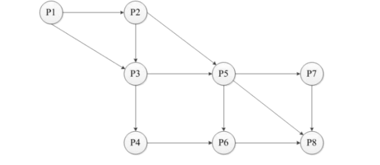
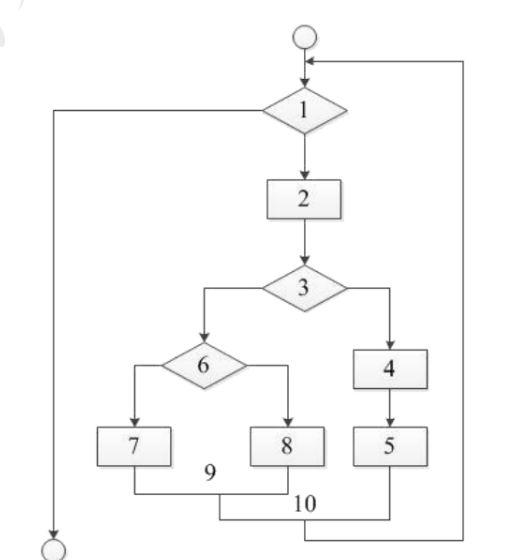
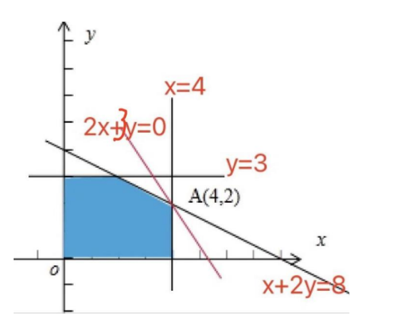
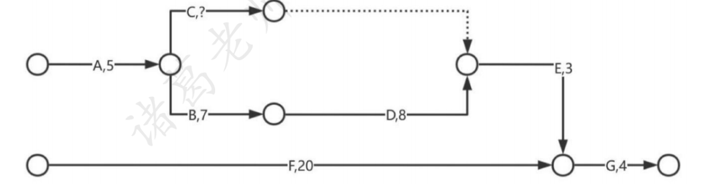

# 2021年下半年 系统架构设计师 · 上午题

> 卷面信息（来源 hj_zs 第 26 页卷首）：
> - 标题：全国计算机技术与软件专业技术资格（水平）考试 **2021 年 系统架构设计师 上午试卷**
> - 考试时间 9:00~11:30 共 150 分钟。
> - 本试卷的试题中共有 75 个空格，需要全部解答，每个空格 1 分，满分 75 分。每个空格对应一个序号，有 A、B、C、D 四个选项，请选择一个最恰当的选项作为解答，在答题卡相应序号下填涂该选项。解答前务必阅读例题和答题卡上的例题填涂样式及填涂注意事项。解答时用正规 2B 铅笔正确填涂选项，如需修改，请用橡皮擦干净，否则会导致不能正确评分。
> - 卷首例题（88）（89）：2021 年下半年全国计算机技术与软件专业技术资格（水平）考试日期是__(88)__月__(89)__日。（88）A. 9　B. 10　C. 11　D. 12；（89）A. 5　B. 6　C. 7　D. 8。因为考试日期是"11 月 5 日"，故（88）选 C，（89）选 A，应在答题卡序号 88 下对 C 填涂，在序号 89 下对 A 填涂（参看答题卡）。（例题非计分题，未编号入 Q01–Q75。）

## 题号目录

| 题号 | 考点 | 教程章节 |
|------|------|----------|
| Q01–Q04 | 操作系统：前趋图 / 页面地址变换 / 文件索引节点 / 银行家算法安全性 | — |
| Q05–Q08 | 数据库：E-R 图结构冲突 / 自然连接与关系代数 | — |
| Q09–Q11 | SoC 概念 / 嵌入式实时操作系统 / 网络数据库 NDB | — |
| Q12–Q15 | AI 芯片特征 / 交换机 MAC 地址表 / Internet 交换方式 / SDN 架构 | — |
| Q16–Q17 | Web 服务器性能指标与评测方法 | — |
| Q18–Q20 | 企业数字化转型阶段 / 信息化建设 / 组织信息化需求三层次 | — |
| Q21–Q25 | 软件产品管理办法 / CMMI / 产品配置 / 需求管理 / 需求跟踪 | — |
| Q26–Q30 | 软件生命周期 / 敏捷方法 / RUP 工作流 / 版本控制 / 结构化设计工具 | — |
| Q31–Q34 | 耦合与内聚 / UML 模型 / McCabe 环形复杂度 | — |
| Q35–Q41 | 软件构件 / COM 组装 / 网络安全威胁类型 | — |
| Q42–Q47 | 静态黑盒测试 / ABSD / 4+1 视图 | — |
| Q48–Q50 | 架构风格（物联网）/ DSSA 垂直域水平域 | — |
| Q51–Q57 | 规则系统架构 / 性能与可用性 / 安全性分类 | — |
| Q58–Q63 | 架构评估：场景 / 敏感点与权衡点 / 三层 C/S | — |
| Q64–Q68 | 著作权与商标 / 委托开发 / CA 数字证书 | — |
| Q69–Q70 | 线性规划求最值 / 关键路径与三点估算 | — |
| Q71–Q75 | 英语：客户机/服务器计算（C/S、瘦客户、胖客户、数据库服务器、Web 服务器） | — |

## 原题转录（视觉核验）

---

## Q01

前趋图（Precedence Graph）是一个有向无环图，记为：→ = {(Pi, Pj) | Pi must complete before Pj may start}，假设系统中进程 P={P1, P2, P3, P4, P5, P6, P7, P8}，且进程的前趋图如下：

那么，该前趋图可记为__(1)__。

- A. →={( P1,P2), (P3, P1), (P4, P1), (P5, P2), (P5, P3), (P6, P4), (P7, P5), (P7, P6), (P5, P6), (P4, P5), (P6, P7), (P7, P6)}
- B. →={( P1, P2), (P1, P3), (P2, P5), (P2, P3), (P3, P4), (P3, P5), (P4, P5), (P5, P6), (P5, P7), (P8, P5), (P6, P7), (P7, P8)}
- C. {( P1, P2), (P1, P3), (P2, P3), (P2, P5), (P3, P4), (P3, P5), (P4, P6), (P5, P6), (P5, P7), (P5, P8), (P6, P8), (P7, P8)}
- D. {( P1, P2), (P1, P3), (P2, P3), (P2, P5), (P3, P6), (P3, P4), (P4, P7), (P5, P6), (P6, P7), (P6, P5), (P7, P5), (P7, P8)}

**来源所列答案**：C
**来源解析**：按数字"先小后大"原则找出箭头表示的 12 对逻辑关系，记为→={（P1，P2），(P1，P3)，(P2，P3)，(P2，P5)，(P3，P4)，(P3，P5)，(P4，P6)，(P5，P6)，(P5，P7)，(P5，P8)，(P6，P8)，(P7，P8)}，经核对只有 C 正确。选项 A、B、D 中均含有不存在的逻辑关系（P6，P7)，排除。

> 校核注：另源（2021.11系统架构设计师真题及解析，第 2–3 页）选项 A–D 文字与主来源基本一致（个别括号、逗号排版差异），答案同为 C。

---

## Q02

某计算机系统页面大小为 4K，进程 P1 的页面变换表如下图示，看 P1 要访问数据的逻辑地址为十六进制 1B1AH，那么该逻辑地址经过变换后，其对应的物理地址应为十六进制__(2)__。

| 页号 | 物理块号 |
|------|----------|
| 0 | 1 |
| 1 | 6 |
| 2 | 3 |
| 3 | 8 |

- A. 1B1AH
- B. 3B1AH
- C. 6B1AH
- D. 8B1AH

**来源所列答案**：C
**来源解析**：页面大小 $4K=2^2 \times 2^{10}=2^{12}$，页内地址有 12 位，由于十六进制转换为二进制为"一分四"，因此 1B1AH 的后三位 B1AH 即为页内地址，逻辑地址中的 1 就是页号，通过查表可知对应的物理块号是 6，物理地址为 6B1AH。

> 校核注：来源解析中公式排版为"4K=2\*2\*1024=22\*210=212"，即 $2^2 \times 2^{10} = 2^{12}$ 之上标排版失真，此处按原意以 LaTeX 还原。

---

## Q03

某文件系统文件存储采用文件索引节点法。每个文件索引节点中有 8 个地址项，每个地址项大小为 4 字节，其中 5 个地址项为直接地址索引，2 个地址项是一级间接地址索引，1 个地址项是二级间接地址索引。磁盘索引块和磁盘数据块大小均为 1KB。若要访问 iclsClient.dll 文件的逻辑块号分别为 1、518，则系统应分别采用__(3)__。

- A. 直接地址索引和直接地址索引
- B. 直接地址索引和一级间接地址索引
- C. 直接地址索引和二级间接地址索引
- D. 一级间接地址索引和二级间接地址索引

**来源所列答案**：C
**来源解析**：直接地址索引有 5 个地址项，对应逻辑块号 0～4。一级间接索引有 2 个地址项，每个地址项对应 1KB/4B=1024B/4B=256 个物理块，对应逻辑块号范围是 5～516。二级间接索引有一个地址项，对应 256×256=65536 个物理块，对应逻辑块号范围是 517 以上。

> 校核注：另源（第 3 页）此题题干额外给出"iaddr[0]~iaddr[7]""iaddr[0]~iaddr[4] 为直接地址索引，iaddr[5]、iaddr[6] 是一级间接地址索引，iaddr[7] 是二级间接地址索引"等下标细节，并明确"访问 iclsClient.dll 文件的逻辑块号分别为 1、518，则系统应分别采用（）"，选项为完整句式（如"A. 直接地址索引、直接地址索引"），答案同为 C。

---

## Q04

假设系统中互斥资源 R 的可用数为 25。T0 时刻进程 P1、P2、P3、P4 对资源 R 的最大需求数、已分配资源数和尚需资源数的情况如表 1 所示，若 P1 和 P3 分别申请资源 R 数为 1 和 2，则系统__(4)__。

表 1 T0 时刻进程对资源的需求情况

| 进程 | 最大需求数 | 已分配资源数 | 尚需资源数 |
|------|------------|--------------|------------|
| P1 | 10 | 6 | 4 |
| P2 | 11 | 4 | 7 |
| P3 | 9 | 7 | 2 |
| P4 | 12 | 6 | 6 |

- A. 只能先给 P1 进行分配，因为分配后系统状态是安全的
- B. 只能先给 P3 进行分配，因为分配后系统状态是安全的
- C. 可以同时给 P1、P3 进行分配，因为分配后系统状态是安全的
- D. 不能给 P3 进行分配，因为分配后系统状态是不安全的

**来源所列答案**：B
**来源解析**：R 的可用数初始为 25，目前已经给 4 个进程分配出去 6+4+7+6=23 个资源，R 剩余 2 个资源只能分配给尚需资源数最少的 P3，使之可以顺利运行，分配后系统也是安全的。

> 校核注：另源（第 4 页）此题表格标题作"表 A T0 时刻进程对资源的需求情况"，选项 C 作"可以同时给 P1、P3 进行分配"（主来源为"可以同时时给 P1、P3 进行分配"，多一"时"字，系来源排版笔误），答案同为 B。

---

## Q05

某企业开发信息管理系统平台进行 E-R 图设计，人力部门定义的是员工实体具有属性：员工号、姓名、性别、出生日期、联系方式和部门，培训部门定义的培训师实体具有属性：培训师号、姓名和职称，其中职称={初级培训师，中级培训师，高级培训师}，这种情况属于__(5)__，在合并 E-R 图时，解决这一冲突的方法是__(6)__。

- A. 属性冲突
- B. 结构冲突
- C. 命名冲突
- D. 实体冲突

**来源所列答案**：B（第 5 题）；C（第 6 题）
**来源解析**："同一实体在不同 E-R 图中属性个数和排列次序不同"属于结构冲突，可以在员工实体中加入职称属性，删除培训师实体。

> 校核注：Q05、Q06 在原卷中合印于一个题干（空号 (5)(6)），本卷按空号拆为两题，选项分别归属：第 5 题选项为 A 属性冲突 / B 结构冲突 / C 命名冲突 / D 实体冲突；第 6 题选项为 A 员工实体和培训师实体均保持不变 / B 保留员工实体、删除培训师实体 / C 员工实体中加入职称属性、删除培训师实体 / D 将培训师实体所有属性并入员工实体，删除培训师实体。另源（第 4 页）将两题合印为"5&6"并合并列选项，答案同为 B、C。

---

## Q06

（承 Q05 题干）在合并 E-R 图时，解决这一冲突的方法是__(6)__。

- A. 员工实体和培训师实体均保持不变
- B. 保留员工实体、删除培训师实体
- C. 员工实体中加入职称属性、删除培训师实体
- D. 将培训师实体所有属性并入员工实体，删除培训师实体

**来源所列答案**：C
**来源解析**：（见 Q05，来源将 (5)(6) 合并解析。）

---

## Q07

若关系 R、S 如下图所示，则关系 R 与 S 进行自然连接运算后的元组个数和属性列数分别为__(7)__；关系代数表达式 π1,5(σ2=5(R×S)) 与关系代数表达式__(8)__等价。

| R | | | |
|---|---|---|---|
| A | B | C | D |
| 6 | 6 | 1 | 5 |
| 6 | 1 | 5 | 1 |
| 6 | 1 | 5 | 4 |
| 6 | 3 | 7 | 4 |

| S | |
|---|---|
| B | C |
| 6 | 1 |
| 1 | 5 |
| 6 | 3 |

- （7）A. 6 和 7　B. 4 和 4　C. 4 和 3　D. 3 和 4
- （8）A. πA,B(σC=D(R×S))
- B. πA,R.B(σS.B=R.B(R×S))
- C. πA,S.B(σR.B=S.B(R×S))
- D. πR.A,R.B(σS.C=S.B(R×S))

**来源所列答案**：C（第 7 题）；C（第 8 题）
**来源解析**：自然连接是在等值连接的基础上去掉重复的属性列，而等值连接又要求 R 和 S 有相等的属性才能连接。自然连接的结果是 6615、6151、6154。R×S 的六个属性为 R.A、R.B、R.C、R.D、S.B 和 S.C，"π1,5(σ2=5(R×S)）表示为 R 与 S 笛卡尔积之后，先做 R.B 等于 S.B 的选择运算，后做第一列、第五列的投影运算。

> 校核注：另源（第 5 页）此题题干表述作"自然连接运算后的**属性列数和元组个数**分别为（7)"（问法顺序与主来源相反），且 (8) 的题干表达式与四个选项在该来源中均"暂缺"（原文标注"(8）暂缺""第二问暂缺表达式"，表达式处被红色遮盖），其答案仍列为 C、C。两处差异以主来源为准。

---

## Q08

（承 Q07 题干）关系代数表达式 π1,5(σ2=5(R×S)) 与关系代数表达式__(8)__等价。

- A. πA,B(σC=D(R×S))
- B. πA,R.B(σS.B=R.B(R×S))
- C. πA,S.B(σR.B=S.B(R×S))
- D. πR.A,R.B(σS.C=S.B(R×S))

**来源所列答案**：C
**来源解析**：（见 Q07，来源将 (7)(8) 合并解析。）

---

## Q09

一般说来，SoC 称为系统级芯片，也称片上系统，它是一个有专用目标的集成电路产品，以下关于 SoC 不正确的说法是__(9)__。

- A. SoC 是一种技术，是以实际的、确定的系统功能开始，到软/硬件划分，并完成设计的整个过程
- B. SoC 是一款具有运算能力的处理器芯片，可面向特定用途进行定制的标准产品
- C. SoC 是信息系统核心的芯片集成，是将系统关键部件集成在一块芯片上，完成信息系统的核心功能
- D. SoC 是将微处理器、模拟 IP 核、数字 IP 核和存储器（或片外存储控制接口）集成在单一芯片上，是面向特定用途的标准产品

**来源所列答案**：B
**来源解析**：SoC（System on Chip）的定义多种多样，由于其内涵丰富、应用范围广，很难给出准确定义。一般说来，SoC 称为系统级芯片，也有称片上系统，意指它是一个产品，是一个有专用目标的集成电路，其中包含完整系统并有嵌入软件的全部内容。同时它又是一种技术，用以实现从确定系统功能开始，到软/硬件划分，并完成设计的整个过程。A 选项描述正确。从狭义角度讲，它是信息系统核心的芯片集成，是将系统关键部件集成在一块芯片上。C 选项正确。从广义角度讲，SoC 是一个微小型系统，如果说中央处理器（CPU）是大脑，那么 SoC 就是包括大脑、心脏、眼睛和手的系统。国内外学术界一般倾向将 SoC 定义为将微处理器、模拟 IP（Intellectual Property）核、数字 IP 核和存储器（或片外存储控制接口）集成在单一芯片上，它通常是客户定制的，或是面向特定用途的标准产品。D 选项正确。

---

## Q10

嵌入式实时操作系统与一般操作系统相比，具备许多特点。以下不属于嵌入式实时操作系统特点的是__(10)__。

- A. 可剪裁性
- B. 实时性
- C. 通用性
- D. 可固化性

**来源所列答案**：C
**来源解析**：嵌入式实时操作系统（Embedded Real-time Operation System，RTOS）。嵌入式系统是"用于控制、监视或者辅助操作机器和设备的装置"，兼具嵌入式 OS 和实时 OS 的特点，不是通用 OS。

---

## Q11

基于网络的数据库系统（Netware Database System，NDB）是基于 4G/5G 的移动通信之上，在逻辑上可以把嵌入式设备看作远程服务器的一个客户端。以下有关 NDB 的描述中，不正确的是__(11)__。

- A. NDB 主要由客户端、通信协议和远程服务器等三部分组成
- B. NDB 的客户端主要负责提供接口给嵌入式程序，通信协议负责规范客户端与远程服务器之间的通信，远程服务器负责维护服务器上的数据库数据
- C. NDB 具有客户端小、无需支持可剪裁性、代码可重用等特点
- D. NDB 是以文件方式存储数据库数据。即数据按照一定格式储存在磁盘中，使用时由应用程序通过相应的驱动程序甚至直接对数据文件进行读写

**来源所列答案**：C
**来源解析**：NDB 需要支持可剪裁性、代码可重用。

---

## Q12

人工智能技术已成为当前国际科技竞争的核心技术之一，AI 芯片是占据人工智能市场的法宝。AI 芯片有别于通常处理器芯片，它应具备四种关键特征。__(12)__是 AI 芯片的关键特点。

- A. 新型的计算范式、信号处理能力、低精度设计、专用开发工具
- B. 新型的计算范式、训练和推断、大数据处理能力、可重构的能力
- C. 训练和推断、大数据处理能力、可定制性、专用开发工具
- D. 训练和推断、低精度设计、新型的计算范式、图像处理能力

**来源所列答案**：B
**来源解析**：AI 芯片的关键特点有：新型计算范式、训练和推断、大数据处理能力、数据精度、可重构能力、软件工具。A、D 选项有"低精度设计"，排除；C 选项的"专用开发工具"，排除。

---

## Q13

以下关于以太网交换机转发表的叙述中，正确的是__(13)__。

- A. 交换机的初始 MAC 地址表为空
- B. 交换机接收到数据帧后，如果没有相应的表项，则不转发该帧
- C. 交换机通过读取输入帧中的目的地址添加相应的 MAC 地址表项
- D. 交换机的 MAC 地址表项是静态增长的，重启时地址表清空

**来源所列答案**：A
**来源解析**：MAC 地址表是交换机的一个核心组成部分，交换机主要是根据 MAC 地址表来进行帧的转发的。交换机对帧的转发操作行为一共有 3 种：泛洪（Flooding）、转发（Forwarding）和丢弃（Discarding）。在不涉及 VLAN 的情况下，交换机的转发原理可以概括地描述为：(1) 如果进入交换机的是一个单播帧，则交换机会去 MAC 地址表中查找这个帧的目的 MAC 地址，如果查不到这个 MAC 地址，则交换机将对该帧执行泛洪操作；如果查到了这个 MAC 地址，则比较这个 MAC 地址在 MAC 地址表中对应的端口是不是这个帧进入交换机的那个端口，如果不是，则交换机将对该帧执行转发操作，如果是，则交换机将对该帧执行丢弃操作。(2) 如果进入交换机的是一个广播帧，则交换机不会去查 MAC 地址表，而是直接对该帧执行泛洪操作。(3) 如果进入交换机的是一个组播帧，则交换机的处理行为比较复杂。B 错误，因为交换机接收到数据帧后，如果没有相应的表项，交换机会采用 ARP 泛洪操作，即广播方式进行转发。C 错误，因为交换机通过读取输入帧中的源地址添加相应的 MAC 地址表项。D 选项错误，交换机的 MAC 地址表项是动态增长的。所以选 A。

---

## Q14

Internet 网络核心采取的交换方式为__(14)__。

- A. 分组交换
- B. 电路交换
- C. 虚电路交换
- D. 消息交换

**来源所列答案**：A
**来源解析**：Internet 网络核心协议是 TCP/IP 协议，而 TCP/IP 协议是一种分组交换的协议，分组交换也叫包（Packet）交换，它将所接收的分组先进行存储再进行转发。分组交换技术的优点：无需建立连接。线路利用率较高。简化了存储管理（相较于报文交换）。加速传输。减少了出错概率和重发数据量。分组交换的缺点如下：存在传输时延，但比报文交换的传输时延要少。需要传输额外的信息量。当分组交换需要数据报服务时，可能会出现失序、丢失、重复分组问题。

---

## Q15

SDN（Software Defined Network）的网络架构中不包含__(15)__。

- A. 逻辑层
- B. 控制层
- C. 转发层
- D. 应用层

**来源所列答案**：A
**来源解析**：SDN（Software Defined Network）软件定义网络，本质是将网络软件化，这样就可以像升级、安装软件一样对网络进行修改，方便更多的应用程序能快速部署到网络上。SDN 网络架构有三层，分别是：(1) 应用层。对应用户不同的业务和应用。(2) 控制层。主要负责处理数据平面资源的编排，维护网络拓扑、状态信息等。(3) 数据转发层。负责用户数据的转发。

---

## Q16

在 Web 服务器的测试中，反映其性能的指标不包括：__(16)__，常见的 Web 服务器性能评测方法有基准性能测试、压力测试和__(17)__。

- （16）A. 链接正确跳转　B. 最大并发连接数　C. 响应延迟　D. 吞吐量

**来源所列答案**：A（第 16 题）；D（第 17 题）
**来源解析**：Web 服务器主要性能指标有最大并发连接数、响应延迟、吞吐量、QPS（Queries Per Second）、TPS（Transactions Per Second）、RPS（Requests Per Second）等。常见的 Web 服务器性能评测方法有基准性能测试、压力测试和可靠性测试。

> 校核注：Q16、Q17 在原卷中合印于一个题干（空号 (16)(17)），本卷按空号拆为两题；第 16 题选项为 A 链接正确跳转 / B 最大并发连接数 / C 响应延迟 / D 吞吐量；第 17 题选项为 A 功能测试 / B 黑盒测试 / C 白盒测试 / D 可靠性测试。另源（第 7 页）答案同为 A、D。

---

## Q17

（承 Q16 题干）常见的 Web 服务器性能评测方法有基准性能测试、压力测试和__(17)__。

- A. 功能测试
- B. 黑盒测试
- C. 白盒测试
- D. 可靠性测试

**来源所列答案**：D
**来源解析**：（见 Q16，来源将 (16)(17) 合并解析。）

---

## Q18

企业数字化转型的五个发展阶段依次是__(18)__。

- A. 初始级发展阶段、单元级发展阶段、流程级发展阶段、网络级发展阶段、生态级发展阶段
- B. 初始级发展阶段、单元级发展阶段、系统级发展阶段、网络级发展阶段、生态级发展阶段
- C. 初始级发展阶段、单元级发展阶段、流程级发展阶段、网络服发展输段、优化级发展阶段
- D. 初始级发展阶段、流程级发展阶段、系统级发展阶段、网络级发展阶段、生态级发展阶段

**来源所列答案**：A
**来源解析**：企业数字化转型的五个发展阶段依次是：初始级发展阶段（主要任务是数码化 Digitization）、单元级发展阶段（主要任务为数量化 Datafication）、流程级发展阶段（任务为数字化 Digitalization）、网络级发展阶段（主要任务为数模化 Digifax）、生态级发展阶段（主要任务为数用化 DigiMarketing）。

> 校核注：主来源第 18 题选项 C 中"网络服发展输段"疑为"网络级发展阶段"之排版错误；来源解析中"网络级发展险段"同疑为"阶段"之误，均照录原意。

---

## Q19

从信息化建设的角度出发，以下说法错误的是__(19)__。

- A. 有效开发利用信息资源
- B. 大力发展信息产业
- C. 充分建设信息化政策法规和标准规范
- D. 信息化的主体是程序员和项目经理

**来源所列答案**：D
**来源解析**：信息化的主体是全体社会成员，包括政府、企业、事业、团体和个人等。

---

## Q20

政府、企业等对信息化的需求是能织信息化的原动力，它决定了组织信息化的价值取向和成果效益水平，而需求本身又是极为复杂的，它是一个系统的、多层次的目和体系、组织信息化需求通常包含线个层次，即__(20)__，三个层次的需求并不是相互孤立的，而是有着内在的联系。

- A. 战略需求，运作需求，功能需求
- B. 战略需术，运作需求，技术需求
- C. 市场需求，技术需求，用户需求
- D. 市场需求，技术需求，领域需求

**来源所列答案**：B
**来源解析**：信息化需求包含三个层次，即战略需求、运作需求和技术需求。(1) 战略需求。组织信息化的目标是提升组织的竞争能力，为组织的可持续发展提供一个支持环境。(2) 运作需求。组织信息化的运作需求是组织信息化需求非常重要且关键的一环，它包含三方面的内容：一是实现信息化战略目标的需要；二是运作策略的需要；三是人才培养的需要。(3) 技术需求。由于系统开发时间过长等问题在信息技术层面上对系统的完善、升级、集成和整合提出了需求。

> 校核注：题干中"能织信息化""一个系统的、多层次的目和体系""包含线个层次""战略需术"等字句疑为原卷排版失真（当为"组织信息化""目标和体系""包含三个层次""战略需求"），照录原样并标注。

---

## Q21

为了加强软件产品管理，促进我国软件产业的发展，原信息产业部颁布了《软件产品管理办法》，"办法"规定，软件产品的开发，生产，销售，进出口等活动遵守我国有关法律，法规和标准规范，任何单位和个人不得开发，生产，销售，进出口含有以下内容的软件产品__(21)__。

①侵犯他人的知识产权②含有计算机病毒③可能危害计算机系统安全④含有国家规定禁止传播的内容⑤不符合我国软件标准规范⑥未经国家正式批准

- A. ①②③⑥
- B. ①②③④⑥
- C. ①②③④⑤
- D. ①②③④⑤⑥

**来源所列答案**：C
**来源解析**：根据《软件产品管理办法》第四条 软件产品的开发、生产、销售、进出口等活动应遵守我国有关法律、法规和标准规范。任何单位和个人不得开发、生产、销售、进出口含有以下内容的软件产品：（一）侵犯他人知识产权的；（二）含有计算机病毒的；（三）可能危害计算机系统安全的；（四）含有国家规定禁止传播的内容的；（五）不符合我国软件标准规范的。国家准许软件的进出口；但是，法律、行政法规另有规定的除外。属于禁止出口的技术，不得出口。无介质的软件属于技术进出口，实体进出口则直接报关，技术进出口没有"进出关境"的实体行为，不需要报关，但是为了统计和收付汇需要则需办理合同备案。

---

## Q22

某软件企业在项目开发过程中目标明确，实施过程遵守既定的计划与流程，资源准备充分，权责到人，对整个流程进行严格的监测，控制与审查，符合企业管理体系与流程制度。因此，该企业达到了 CMMI 评估的__(22)__。

- A. 可重复级
- B. 已定义级
- C. 量化级
- D. 优化级

**来源所列答案**：B
**来源解析**：CMMI 评估分为五个等级，自低向高分别为一、二、三、四、五级，分别对应初始级、管理级、定义级、定量管理级和优化级。初始级（Initial）：软件过程是无序的，有时甚至是混乱的，对过程几乎没有定义，成功取决于个人努力。管理是反应式的。管理级（Managed）：建立了基本的项目管理过程来跟踪费用、进度和功能特性。制定了必要的过程纪律，能重复早先类似应用项目取得的成功经验。定义级（Defined）：已将软件管理和工程两方面的过程文档化、标准化，并综合成该组织的标准软件过程。所有项目均使用经批准、剪裁的标准软件过程来开发和维护软件，软件产品的生产在整个软件过程是可见的。定量管理级（Q-Managed）：分析对软件过程和产品质量的详细度量数据，对软件过程和产品都有定量的理解与控制。管理有一个作出结论的客观依据，管理能够在定量的范围内预测性能。优化级（Optimizing）：过程的量化反馈和先进的新思想、新技术促使过程持续不断改进。在 CMMI 的已定义级中，开发过程，包括技术工作和管理工作，均已实现标准化、文档化。建立了完善的培训制度和专家评审制度，全部技术活动和管理活动均可控制，对项目进行中的过程、岗位和职责均有共同的理解。

---

## Q23

产品配置是指一个产品在其生命周期各个阶段所产生的各种形式（机器可读或人工可读）和各种版本的__(23)__的集合。

- A. 需求规格说明、设计说明、测试报告
- B. 需求规格说明、设计说明、计算机程序
- C. 设计说明、用户手册、计算机程序
- D. 文档、计算机程序、部件及数据

**来源所列答案**：D
**来源解析**：产品配置是指一个产品在其生命周期各个阶段所产生的各种形式（机器可读或人工可读）和各种版本的文档、计算机程序、部件及数据的集合。该集合中的每一个元素称为该产品配置中的一个配置项（Configuration Item, CI），配置项主要有以下两大类。●属于产品组成部分的工作成果，如需求文档、设计文档、源代码和测试用例等。●属于项目管理和机构支撑过程域产生的文档，如工作计划、项目质量报告、项目跟踪报告等。这些文档虽然不是产品的组成部分，但是值得保存。每个配置项的主要属性有名称、标识符、文件状态、版本、作者和日期等。所有配置项都被保存在配置库里，确保不会混淆、丢失。配置项及其历史记录反映了项目产品的演化过程。置于配置管理之下的工作产品包括将交付给顾客的产品、指定的内部工作产品、采办的产品、工具和其他用于创建和描述这些工作产品的实体。

---

## Q24

需求管理的主要活动包括__(24)__。

- A. 变更控制、版本控制、需求跟踪、需求状态跟踪
- B. 需求获取、变更控制、版本控制、需求跟踪
- C. 需求获取、需求建模、变更控制、版本控制
- D. 需求获取、需求建模、需求评审、需求跟踪

**来源所列答案**：A
**来源解析**：需求管理包括变更控制、版本控制、需求跟踪、需求状态跟踪。（来源解析中附图"图 5-5 需求管理的主要活动"结构图：需求管理下分变更控制、版本控制、需求跟踪、需求状态跟踪四项及其子要点；该图为知识性附图，文字已可完整转写，未裁剪。）

---

## Q25

__(25)__包括编制每个需求与系统元素之间的联系文档，这些元素包括其它需求、体系结构、设计部件、源代码模块、测试、帮助文件和文档等。

- A. 需求描述
- B. 需求分析
- C. 需求获取
- D. 需求跟踪

**来源所列答案**：D
**来源解析**：需求跟踪包括编制每个需求与系统元素之间的联系文档，这些元素包括其它需求、体系结构、设计部件、源代码模块、测试、帮助文件和文档等。

---

## Q26

根据传统的软件生命周期方法学，可以把软件生命周期划分为__(26)__。

- A. 软件定义、软件开发、软件测试、软件维护
- B. 软件定义、软件开发、软件运行、软件维护
- C. 软件分析、软件设计、软件开发、软件维护
- D. 需求获取、软件设计、软件开发、软件测试

**来源所列答案**：B
**来源解析**：传统的软件生命周期（software life cycle）是指软件产品从形成概念（构思）开始，经过定义、开发、使用和维护，直到最后被废弃（不能再使用）为止的全过程。按照传统的软件生命周期方法学，可以把软件生命周期划分为软件定义、软件开发、软件运行与维护三个阶段。

> 校核注：来源解析称"三个阶段"，而题目选项均为四段式表述，答案 B（软件定义、软件开发、软件运行、软件维护）与解析对应照录。

---

## Q27

以下关于敏捷方法的描述中，不属于敏捷方法核心思想的是__(27)__。

- A. 敏捷方法是适应型，而非可预测型
- B. 敏捷方法以过程为本
- C. 敏捷方法是以人为本，而非以过程为本
- D. 敏捷方法是迭代代增量式的开发过程

**来源所列答案**：B
**来源解析**：敏捷方法的核心思想主要有下面三点：●敏捷方法是适应型，而非可预测型。与传统方法不同，敏捷方法拥抱变化，也可以说它的初衷就是适应变化的需求，利用变化来发展、改变、完善自己。●敏捷方法是以人为本，而非以过程为本。传统方法以过程为本，强调充分发挥人的特性，不去限制它，强调面对面沟通。并且软件开发在无过程控制和过于严格繁琐的过程控制中取得一种平衡，以保证软件的质量。●迭代增量式的开发过程。敏捷方法以原型开发思想为基础，采用迭代增量式开发，发行版本小型化。它根据客户需求的优先级和开发风险，制定版本发行计划，每一发行版都是在前一成功发行版的基础上进行功能需求扩充，最后满足客户的所有功能需求。

---

## Q28

RUP（Rational Unified Process）软件开发生命周期是一个二维的软件开发模型，其中，RUP 的 9 个核心工作流中不包括__(28)__。

- A. 业务建模
- B. 配置与变更管理
- C. 成本
- D. 环境

**来源所列答案**：C
**来源解析**：RUP（Rational Unified Process）软件开发生命周期是一个二维的软件开发模型，RUP 的 9 个核心工作流有：●业务建模：理解待开发系统所在的机构及其商业运作，确保所有参与人员对待开发系统所在的机构有共同的认识，评估待开发系统对所在机构的影响。●需求：定义系统功能及用户界面，使客户知道系统的功能，使开发人员理解系统的需求，为项目预算及计划提供基础。●分析与设计：把需求分析的结果转化为分析与设计模型。●实现：把设计模型转换为实现结果，对开发的代码做单元测试，将不同实现人员开发的模块集成为可执行系统。●测试：检查各子系统的交互与集成，验证所有需求是否均被正确实现，对发现的软件质量上的缺陷进行归档，对软件质量提出改进建议。●部署：打包、分发、安装软件，升级旧系统，培训用户及销售人员，并提供技术支持。●配置与变更管理：跟踪并维护系统开发过程中产生的所有制品的完整性和一致性。●项目管理：为软件开发项目提供计划、人员分配、执行、监控等方面的指导，为风险管理提供框架。●环境：为软件开发机构提供软件开发环境，即提供过程管理和工具的支持。

---

## Q29

在软件开发和维护过程中，一个软件会有多个版本，__(29)__工具用来存储、更新、恢复和管理一个软件的多个版本。

- A. 软件测试
- B. 版本控制
- C. UML 建模
- D. 逆向工程

**来源所列答案**：B
**来源解析**：在软件开发和维护过程中一个软件会有多个版本，版本控制工具用来存储、更新、恢复和管理一个软件的多个版本。

---

## Q30

结构化设计是一种面向数据流的设计方法，以下不属于结构化设计工具的是__(30)__。

- A. 盒图
- B. HIPO 图
- C. 顺序图
- D. 程序流程图

**来源所列答案**：C
**来源解析**：N-S 图，也被称为盒图或 NS 图（Nassi Shneiderman 图）。是结构化设计中的一种可视化建模。HIPO 图（Hierarchy plus Input-Process-Output, HIPO）是 IBM 公司于 20 世纪 70 年代中期在层次结构图的基础上推出的一种描述系统结构和模块内部处理功能的工具。HIPO 图由层次结构图和 IPO 图两部分构成，前者描述整个系统的设计结构以及各类模块之间的关系，后者描述某个特定模块内部的处理过程和输入/输出关系。顺序图是一种 UML 图，主要用于面向对象设计。

---

## Q31

软件设计过程中，可以用耦合和内聚两个定性标准来衡量模块的独立程度，耦合衡量不同模块彼此间互相依赖的紧密程度，应采用以下设计原则__(31)__，内聚衡量一个模块内部各个元素彼此结合的紧密程度，以下属于高内聚的是__(32)__。

- （31）A. 尽量使用内容耦合、少用控制耦合和特征耦合、限制公共环境耦合的范围、完全不用数据耦合
- B. 尽量使用数据耦合、少用控制耦合和特征耦合、限制公共环境耦合的范围、完全不用内容耦合
- C. 尽量使用控制耦合、少用数据耦合和特征耦合、限制公共环境耦合的范围、完全不用内容耦合
- D. 尽量使用特征耦合、少用数据耦合和控制耦合、限制公共环境耦合的范围、完全不用内容耦合

**来源所列答案**：B（第 31 题）；C（第 32 题）
**来源解析**：耦合表示模块之间联系的程度。紧密耦合表示模块之间联系非常强，松散耦合表示模块之间联系比较弱，非耦合则表示模块之间无任何联系，是完全独立的。模块的耦合类型通常分为 7 种，根据耦合度从高到低依次排序为：内容耦合、公共耦合、外部耦合、控制耦合、特征/标记耦合、数据耦合、非直接耦合。内容耦合耦合性最强，模块的独立性最弱，因此不应该使用内容耦合。根据题干信息，数据耦合在这里耦合性最弱，尽量使用数据耦合。内聚表示模块内部各成分之间的联系程度，是从功能角度来度量模块内的联系，一个好的内聚模块应当恰好做目标单一的一件事情。模块的内聚类型通常也可以分为 7 种，根据内聚度从高到低依次排序为：功能内聚、顺序内聚、通信内聚、过程内聚、瞬时/时间内聚、逻辑内聚、偶然/巧合内聚。功能内聚内聚性最强，模块独立性也最强。

> 校核注：Q31、Q32 在原卷中合印于一个题干（空号 (31)(32)）；第 32 题选项为 A 偶然内聚 / B 时间内聚 / C 功能内聚 / D 逻辑内聚。另源（第 11 页）答案同为 B、C。

---

## Q32

（承 Q31 题干）以下属于高内聚的是__(32)__。

- A. 偶然内聚
- B. 时间内聚
- C. 功能内聚
- D. 逻辑内聚

**来源所列答案**：C
**来源解析**：（见 Q31，来源将 (31)(32) 合并解析。）

---

## Q33

UML（Unified Modeling Language）是面向对象设计的建模工具，独立于任何具体程序设计语言，以下__(33)__不属于 UML 中的模型。

- A. 用例图
- B. 协作图
- C. 活动图
- D. PAD 图

**来源所列答案**：D
**来源解析**：UML 图分为结构图和行为图。●结构图分为类图、轮廓图、组件图、组合结构图、对象图、部署图、包图。●行为图又分活动图、用例图、状态机图和交互图。交互图又分为序列图、时序图、通讯图、交互概览图。9 种常见的 UML 图，如下图所示。（来源解析中附"UML 图分类"结构图，属知识性附图，文字已可完整转写，未裁剪。）PAD 图用于结构化设计的工具。

---

## Q34

使用 McCabe 方法可以计算程序流程图的环形复杂度，下图的环形复杂度为__(34)__。

- A. 3
- B. 4
- C. 5
- D. 6

**来源所列答案**：B
**来源解析**：McCabe 度量法是通过定义环路复杂度，建立程序复杂度的度量，它是基于一个程序模块的程序图中环路的个数。计算 G 的环路复杂度有两种方法：① V(G)=m-n+2（m 值是有向弧数，也就是箭头的个数，n 指的是结点个数）；②就是闭合区域的个数+1。本题中，采用第二种方法相对比较简单，即：环路复杂度等于闭环个数+1=4。

---

## Q35

以下关于软件构件的叙述中，错误的是__(35)__。

- A. 构件的部署必须能跟它所在的环境及其他构件完全分离
- B. 构件作为一个部署单元是不可拆分的
- C. 在一个特定进程中可能会存在多个特定构件的拷贝
- D. 对于不影响构件功能的某些属性可以对外部可见

**来源所列答案**：C
**来源解析**：构件的特性如下。●独立部署单元。一个构件是独立可部署的，意味着它必须能跟它所在的环境及其他构件完全分离。因此，构件必须封装自己的全部内部特征。并且，构件作为一个部署单元，具有原子性，是不可拆分的，排除 A、B。●作为第三方的组装单元。如果第三方厂商能将一个构件和其他构件组装在一起，那么这个构件不但必须具备足够好的内聚性，还必须将自己的依赖条件和所提供的服务说明清楚。换句话说，构件必须封装它的实现，并且只通过良好定义的接口与外部环境进行交互。●没有（外部的）可见状态。这要求构件不能与自己的拷贝有所区别，给定一个进程（或者其他的语境），至多会存在一个特定构件的拷贝，排除 D，选项 C 描述错误。在一个特定进程中只能存在一个特定构件的拷贝。

> 校核注：**答案冲突**——另源（2021.11系统架构设计师真题及解析，第 12 页）此题答案作 **D**，其解析为"构件的特性是：(1) 独立部署单元；(2) 作为第三方的组装单元；(3) 没有（外部的）可见状态。D 不符合第 3 条。"与主来源（答案 C，理由"至多会存在一个特定构件的拷贝"）矛盾。按任务规则以主来源为正文，此冲突已记入 ledger conflicts。

---

## Q36

面向构件的编程目前缺乏完善的方法学支持，构件交互的复杂性带来了很多问题，其中__(36)__问题会产生数据竞争和死锁现象。

- A. 多线程
- B. 异步
- C. 封装
- D. 多语言支持

**来源所列答案**：A
**来源解析**：当若干个进（线）程竞争使用资源时，如果每个进（线）程都占有了一定的资源，又申请使用已被另一个进（线）程占用、且不能抢占的资源，则所有这些进（线）程都纷纷进入阻塞状态，不能继续运行，即系统中两个或两个以上的进（线）程无限期地等待永远不会发生的条件，系统处于一种停滞状态，这种现象就称为死锁。死锁的产生的原因之一有系统资源竞争，而多线程会争夺系统资源。

---

## Q37

为实现对象重用，COM 支持两种形式的对象组装。在__(37)__重用形式下，一个外部对象拥有指向一个内部对象的唯一引用，外部对象只是把请求转发给内部对象；在__(38)__重用形式下，直接把内部对象的接口引用传给外部对象的客户，而不再转发请求。

- （37）A. 聚集　B. 包含　C. 链接　D. 多态

**来源所列答案**：B（第 37 题）；D（第 38 题）
**来源解析**：为实现对象重用，COM 支持两种形式的对象组装：包含（Containment）和聚集（Aggregation）。包含就是一种简单的对象组装技术，其含义是一个对象拥有指向另一个对象的唯一引用。聚集是直接把内部对象的接口引用传给外部对象的客户，而不再转发请求。

> 校核注：Q37、Q38 在原卷中合印于一个题干（空号 (37)(38)）；第 38 题选项为 A 引用 / B 转发 / C 包含 / D 聚集。另源（第 12 页）答案同为 B、D，其解析另载有 COM 不支持实现继承、包含与聚集概念等补充说明（见该源第 12–13 页）。

---

## Q38

（承 Q37 题干）在__(38)__重用形式下，直接把内部对象的接口引用传给外部对象的客户，而不再转发请求。

- A. 引用
- B. 转发
- C. 包含
- D. 聚集

**来源所列答案**：D
**来源解析**：（见 Q37，来源将 (37)(38) 合并解析。）

---

## Q39

信息系统面临多种类型的网络安全威胁。其中，信息泄露是指信息被泄露或透露给某个非授权的实体；__(39)__是指数据被非授权地进行增删、修改或破坏而受到损失；__(40)__是指对信息或其他资源的合法访问被无条件地阻止；__(41)__是指通过对系统进行长期监听，利用统计分析方法对诸如通信频度、通信的信息流向、通信总量的变化等参数进行研究，从而发现有价值的信息和规律。

- （39）A. 非法使用　B. 破环信息的完整性　C. 授权侵犯　D. 计算机病毒

**来源所列答案**：B（第 39 题）；A（第 40 题）；D（第 41 题）
**来源解析**：信息的完整性是指信息在传输、交换、存储和处理过程中，保持信息不被破坏或修改、不丢失和信息未经授权不能改变的特性，也是最基本的安全特征。拒绝服务攻击由攻击者向服务器发送大量垃圾信息或干扰信息的方式，导致服务器无法向正常用户提供服务。陷阱门是编程人员在进行程序设计时建立的，在程序正常运行时，通过某些按键和参数可以绕过正常的安全检查和错误跟踪检查。旁路攻击会绕过对加密算法的繁琐分析，利用密码算法的硬件实现的运算中泄露的信息，如执行时间、功耗、电磁辐射等，结合统计理论快速的破解密码系统。欺诈者采用某种手段欺骗合法的用户或系统自愿地放弃敏感信息等。

> 校核注：Q39–Q41 在原卷中合印于一个题干（空号 (39)(40)(41)）。三个空各自的选项为——(39) A 非法使用 / B 破环信息的完整性 / C 授权侵犯 / D 计算机病毒（"破环"照录主来源，当为"破坏"）；(40) A 拒绝服务 / B 陷阱门 / C 旁路控制 / D 业务欺骗；(41) A 特洛伊木马 / B 业务欺骗 / C 物理侵入 / D 业务流分析。另源（第 13 页）答案同为 B、A、D。

---

## Q40

（承 Q39 题干）__(40)__是指对信息或其他资源的合法访问被无条件地阻止。

- A. 拒绝服务
- B. 陷阱门
- C. 旁路控制
- D. 业务欺骗

**来源所列答案**：A
**来源解析**：（见 Q39，来源将 (39)(40)(41) 合并解析。）

---

## Q41

（承 Q39 题干）__(41)__是指通过对系统进行长期监听，利用统计分析方法对诸如通信频度、通信的信息流向、通信总量的变化等参数进行研究，从而发现有价值的信息和规律。

- A. 特洛伊木马
- B. 业务欺骗
- C. 物理侵入
- D. 业务流分析

**来源所列答案**：D
**来源解析**：（见 Q39，来源将 (39)(40)(41) 合并解析。）

---

## Q42

软件测试是保障软件质量的重要手段。__(42)__是指被测试程序不在机器上运行，而采用人工监测和计算机辅助分析的手段对程序进行监测。__(43)__也称为功能测试，不考虑程序的内部结构和处理算法，只检查软件功能是否能按照要求正常使用。

- （42）A. 静态测试　B. 动态测试　C. 黑盒测试　D. 白盒测试

**来源所列答案**：A（第 42 题）；C（第 43 题）
**来源解析**：静态测试是指被测试程序不在机器上运行，而采用人工检测和计算机辅助静态分析的手段对程序进行检测。动态测试是通过运行程序发现错误。动态测试可以采用黑盒测试和白盒测试。白盒测试也称为结构测试，要根据程序内部逻辑结构设计测试用例，检测程序中的主要执行通路是否都能按预定要求正常工作。主要用于软件单元测试阶段。黑盒测试也称为功能测试，不考虑程序的内部结构和处理算法，只检查软件功能是否能按照要求正常使用。主要用于集成测试、确认测试和系统测试阶段。

> 校核注：Q42、Q43 在原卷中合印于一个题干（空号 (42)(43)）；第 43 题选项为 A 系统测试 / B 集成测试 / C 黑盒测试 / D 白盒测试。另源（第 13 页）第 43 题选项 D 误排作"自众测试"（当为"白盒测试"），答案同为 A、C。

---

## Q43

（承 Q42 题干）__(43)__也称为功能测试，不考虑程序的内部结构和处理算法，只检查软件功能是否能按照要求正常使用。

- A. 系统测试
- B. 集成测试
- C. 黑盒测试
- D. 白盒测试

**来源所列答案**：C
**来源解析**：（见 Q42，来源将 (42)(43) 合并解析。）

---

## Q44

基于架构的软件设计（Architecture-Based Software Design，ABSD）方法是架构驱动的方法，该方法是一个__(44)__的方法，软件系统的架构通过该方法得到细化，直到能产生__(45)__。

- （44）A. 自顶向下　B. 自底向上　C. 原型　D. 自顶向下和自底向上结合

**来源所列答案**：A（第 44 题）；C（第 45 题）
**来源解析**：ABSD 方法是一个自顶向下，递归细化的方法，软件系统的体系结构通过该方法得到细化，直到能产生软件构件和类。

> 校核注：Q44、Q45 在原卷中合印于一个题干（空号 (44)(45)）；第 45 题选项为 A 软件质量属性 / B 软件连接性 / C 软件构件或模块 / D 软件接口。另源（第 13–14 页）答案同为 A、C。

---

## Q45

（承 Q44 题干）软件系统的架构通过该方法得到细化，直到能产生__(45)__。

- A. 软件质量属性
- B. 软件连接性
- C. 软件构件或模块
- D. 软件接口

**来源所列答案**：C
**来源解析**：（见 Q44，来源将 (44)(45) 合并解析。）

---

## Q46

4+1 视图模型可以从多个视图或视角来描述软件架构。其中，__(46)__用于捕捉设计的并发和同步特证；__(47)__描述了在开发环境中软件的静态组织结构。

- （46）A. 逻辑视图　B. 开发视图　C. 过程视图　D. 物理视图

**来源所列答案**：C（第 46 题）；B（第 47 题）
**来源解析**：逻辑视图：也称为设计视图，它表示了设计模型中在架构方面具有重要意义的部分，即类、子系统、包和用例实现的子集。用于建模系统的组成部分以及各组成部分之间的交互方式。通常包括类图，对象图，状态图和协作图。进程（过程）视图：是可执行线程和进程作为活动类的建模，它是逻辑视图的一次执行实例，描述了开发与同步结构。描述了系统中的进程，当可视化系统中一定会发生的事情时，此视图特别有用。实现（开发）视图：对组成基于系统的物理代码的文件和构件进行建模。描述系统的各部分如何被组织为模块和组件即开发环境中软件的静态组织结构。该视图通常包含包图和组件图。部署视图：把构件部署到一组物理节点上，表示软件到硬件的映射和分布结构。展示了抽象部分如何映射到最终部署的系统中。用例视图：用例视图是最基本的需求分析模型。

> 校核注：Q46、Q47 在原卷中合印于一个题干（空号 (46)(47)）；第 47 题选项为 A 类视图 / B 开发视图 / C 过程视图 / D 用例视图。另源（第 14 页）答案同为 C、B，其解析指出"并发和同步显然是进程视图（过程视图）……架构的 4+1 视图不同于 UML 的 4+1 视图，最大的区别就在于描述静态组织结构，架构视图里是在开发视图描述的，而 UML 视图是在逻辑视图描述的"。

---

## Q47

（承 Q46 题干）__(47)__描述了在开发环境中软件的静态组织结构。

- A. 类视图
- B. 开发视图
- C. 过程视图
- D. 用例视图

**来源所列答案**：B
**来源解析**：（见 Q46，来源将 (46)(47) 合并解析。）

---

## Q48

软件架构风格是描述某一特定应用领域中系统组织方式的惯用模式，按照软件架构风格，物联网系统属于__(48)__软件架构风格。

- A. 层次型
- B. 事件系统
- C. 数据线
- D. C2

**来源所列答案**：A
**来源解析**：物联网属于层次型架构，分为：1）感知层：负责信息采集和物物之间的信息传输。2）网络层：利用无线和有线网络对采集的数据进行编码、认证和传输。3）应用层：实现应用。

---

## Q49

特定领域软件架构（Domam Specifie Sottware Architecture，DSSA）是指特定应用领域中为一组应用提供组织结构参考的标准软件架构。从功能覆盖的范围角度，__(49)__定义了一个特定的系统族，包含整个系使族内的多个系统，可作为该领域系统的可行解决方案的一个通用软件架构；__(50)__定义了在多个系统和多个系统族中功能区域的共有部分，在子系统级上涵盖多个系统族的特定部分功能。

- （49）A. 垂直域　B. 水平域　C. 功能域　D. 属性域

**来源所列答案**：A（第 49 题）；B（第 50 题）
**来源解析**：特定领域的架构可以分为：(1) 垂直域：定义了一个特定的系统族，包含整个系统族内的多个系统，结果是在该领域中可作为系统的可行解决方案的一个通用软件体系结构。(2) 水平域：定义了在多个系统和多个系统族中功能区域的共有部分。在子系统级上涵盖多个系统族的特定部分功能。

> 校核注：Q49、Q50 在原卷中合印于一个题干（空号 (49)(50)），题干中"Domam Specifie Sottware Architecture""整个系使族内"系原卷排版失真（当为 Domain Specific Software Architecture / 整个系统族内），照录并标注；第 50 题选项同为 A 垂直域 / B 水平域 / C 功能域 / D 属性域。另源（第 14 页）答案同为 A、B。

---

## Q50

（承 Q49 题干）__(50)__定义了在多个系统和多个系统族中功能区域的共有部分，在子系统级上涵盖多个系统族的特定部分功能。

- A. 垂直域
- B. 水平域
- C. 功能域
- D. 属性域

**来源所列答案**：B
**来源解析**：（见 Q49，来源将 (49)(50) 合并解析。）

---

## Q51

某公司拟开发一个个人社保管理系统，该系统的主要功能需求是根据个人收入、家庭负担、身体状态等情况，预估计算个人每年应支付的社保金，该社保金的计算方式可能随着国家经济的变化而动态改变，针对上述需求描述，该软件系统适宜采用__(51)__架构风格设计，该风格的主要特点是__(52)__。

- （51）A. Layered system　B. Data flow　C. Event system　D. Rule-based system

**来源所列答案**：D（第 51 题）；A（第 52 题）
**来源解析**：社保金的计算方式不是固定的，可以采用 Rule-based system（基于规则的系统）实现。基于规则的系统中的规则引擎负责对规则进行解释实现，能够将业务规则跟应用程序分离开来，减少了运维的工作。

> 校核注：Q51、Q52 在原卷中合印于一个题干（空号 (51)(52)）；第 52 题选项为 A 将业务逻辑中频繁变化的部分定义为规则 / B 各构件间相互独立 / C 支持并发 / D 无数据不工作。另源（第 15 页）第 52 题选项标号误作"A…B…C…E. 无数据不工作"（当为 D），答案同为 D、A。

---

## Q52

（承 Q51 题干）该风格的主要特点是__(52)__。

- A. 将业务逻辑中频繁变化的部分定义为规则
- B. 各构件间相互独立
- C. 支持并发
- D. 无数据不工作

**来源所列答案**：A
**来源解析**：（见 Q51，来源将 (51)(52) 合并解析。）

---

## Q53

在架构评估过程中，评估人员所关注的是系统的质量属性。其中，__(53)__是指系统的响应能力，即要经过多长时间才能对某个事件做出响应，或者在某段时间内系统所能处理的事件的__(54)__。

- （53）A. 安全性　B. 性能　C. 可用性　D. 可靠性

**来源所列答案**：B（第 53 题）；A（第 54 题）
**来源解析**：安全性是系统向合法用户提供服务并阻止非法用户的能力。性能是指系统的响应能力，即要经过多长时间才能对某个事件做出响应，或者在某段时间内系统所能处理的事件的个数。可用性是指系统能够正常运行的时间比例。经常用两次故障之间的时间长度或在出现故障时系统能够恢复正常的速度来表示。可靠性是软件系统在应用或系统错误面前，在意外或错误使用的情况下维持软件系统的功能特性的基本能力。

> 校核注：Q53、Q54 在原卷中合印于一个题干（空号 (53)(54)）；第 54 题选项为 A 个数 / B 速度 / C 消耗 / D 故障率。另源（第 15 页）答案同为 B、A。

---

## Q54

（承 Q53 题干）或者在某段时间内系统所能处理的事件的__(54)__。

- A. 个数
- B. 速度
- C. 消耗
- D. 故障率

**来源所列答案**：A
**来源解析**：（见 Q53，来源将 (53)(54) 合并解析。）

---

## Q55

在一个分布式软件系统中，一个构件失去了与另一个远程构件的连接。在系统修复后，连接于 30 秒之内恢复，系统可以重新正常工作。这一描述体现了软件系统的__(55)__。

- A. 安全性
- B. 可用性
- C. 兼容性
- D. 可移植性

**来源所列答案**：B
**来源解析**：可用性是系统能够正常运行的时间比例。经常用两次故障之间的时间长度或在出现故障时系统能够恢复正常的速度来表示。"在系统修复后，连接于 30 秒之内恢复 … …"这属于可用性的特征。

---

## Q56

安全性是根据系统可能受到的安全威胁的类型来分类的。其中，__(56)__保证信息不泄露给未授权的用户、实体或过程；__(57)__保证信息的完整和准确，防止信息被篡改。

- （56）A. 可控性　B. 机密性　C. 安全审计　D. 健壮性

**来源所列答案**：B（第 56 题）；B（第 57 题）
**来源解析**：1、保密性。也称机密性，是不将有用信息泄漏给非授权用户的特性。可以通过信息加密、身份认证、访问控制、安全通信协议等技术实现，信息加密是防止信息非法泄露的最基本手段，主要强调有用信息只被授权对象使用的特征。2、完整性。是指信息在传输、交换、存储和处理过程中，保持信息不被破坏或修改、不丢失和信息未经授权不能改变的特性，也是最基本的安全特征。3、可用性。也称有效性，指信息资源可被授权实体按要求访问、正常使用或在非正常情况下能恢复使用的特性（系统面向用户服务的安全特性）。在系统运行时正确存取所需信息，当系统遭受意外攻击或破坏时，可以迅速恢复并能投入使用。是衡量网络信息系统面向用户的一种安全性能，以保障为用户提供服务。4、可控性。指网络系统和信息在传输范围和存放空间内的可控程度。是对网络系统和信息传输的控制能力特性。5、不可否认性。又称拒绝否认性、抗抵赖性，指网络通信双方在信息交互过程中，确信参与者本身和所提供的信息真实同一性，即所有参与者不可否认或抵赖本人的真实身份，以及提供信息的原样性和完成的操作与承诺。

> 校核注：Q56、Q57 在原卷中合印于一个题干（空号 (56)(57)）；第 57 题选项为 A 可控性 / B 完整性 / C 不可否认性 / D 安全审计。另源（第 15–16 页）答案同为 B、B。

---

## Q57

（承 Q56 题干）__(57)__保证信息的完整和准确，防止信息被篡改。

- A. 可控性
- B. 完整性
- C. 不可否认性
- D. 安全审计

**来源所列答案**：B
**来源解析**：（见 Q56，来源将 (56)(57) 合并解析。）

---

## Q58

在架构评估中，场景是从__(58)__的角度对与系统交互的描述，一般采用__(59)__三方面来对场景进行描述。

- （58）A. 系统设计者　B. 系统开发者　C. 风险承担者　D. 系统测试者

**来源所列答案**：C（第 58 题）；C（第 59 题）
**来源解析**：在进行体系结构（架构）评估时，一般首先要精确地得出具体的质量目标，并以之作为判定该体系结构优劣的标准。我们把为得出这些目标而采用的机制叫做场景。场景是从风险承担者的角度对与系统的交互的简短描述。在体系结构评估中，一般采用刺激、环境和响应三方面来对场景进行描述。刺激是场景中解释或描述风险承担者怎样引发与系统的交互部分。例如，用户可能会激发某个功能，维护可能会做某个更改，测试人员可能会执行某种测试这些都属于对场景的刺激。环境描述的是刺激发生时的情况。例如，当前系统处于什么状态？有什么特殊的约束条件？系统的负载是否很大？某个网络通道是否出现了阻塞等。响应是指系统是如何通过体系结构对刺激作出反应的例如，用户所要求的功能是否得到满足？维护人员的修改是否成功？测试人员的测试是否成功等。

> 校核注：Q58、Q59 在原卷中合印于一个题干（空号 (58)(59)）；第 59 题选项为 A 刺激源、制品、响应 / B 刺激、制品、响应 / C 刺激、环境、响应 / D 刺激、制品、环境。另源（第 16 页）答案同为 C、C。

---

## Q59

（承 Q58 题干）一般采用__(59)__三方面来对场景进行描述。

- A. 刺激源、制品、响应
- B. 刺激、制品、响应
- C. 刺激、环境、响应
- D. 刺激、制品、环境

**来源所列答案**：C
**来源解析**：（见 Q58，来源将 (58)(59) 合并解析。）

---

## Q60

在架构评估中，__(60)__是一个或多个构件（和／或构件之间的关系）的特性。改变加密级别的设计决策属于__(61)__，因为它可能会对安全性和性能产生非常重要的影响。

- （60）A. 敏感点　B. 非风险点　C. 权衡点　D. 风险点

**来源所列答案**：A（第 60 题）；C（第 61 题）
**来源解析**：敏感点是一个或多个构件（和／或构件之间的关系）的特性。改变加密级别的设计决策属于权衡点，因为它可能会对安全性和性能产生非常重要的影响。

> 校核注：Q60、Q61 在原卷中合印于一个题干（空号 (60)(61)）；第 61 题选项同为 A 敏感点 / B 非风险点 / C 权衡点 / D 风险点。另源（第 16 页）答案同为 A、C。

---

## Q61

（承 Q60 题干）改变加密级别的设计决策属于__(61)__，因为它可能会对安全性和性能产生非常重要的影响。

- A. 敏感点
- B. 非风险点
- C. 权衡点
- D. 风险点

**来源所列答案**：C
**来源解析**：（见 Q60，来源将 (60)(61) 合并解析。）

---

## Q62

在三层 C/S 架构中，__(62)__是应用的用户接口部分，负责与应用逻辑间的对话功能；__(63)__是应用的本体，负责具体的业务处理逻辑。

- （62）A. 表示层　B. 感知层　C. 设备层　D. 业务逻辑层

**来源所列答案**：A（第 62 题）；C（第 63 题）
**来源解析**：三层 C/S 架构将应用系统分成表示层、功能层和数据层三个部分：(1) 表示层。表示层是系统的用户接口部分，担负着用户与系统之间的对话功能。它用于检查用户从键盘等输入的数据，显示输出的数据。(2) 功能层。功能层也称为业务逻辑层，是将具体的业务处理逻辑编入程序中。(3) 数据层。数据层相当于二层 C/S 架构中的服务器，负责对 DBMS 的管理和控制。

> 校核注：Q62、Q63 在原卷中合印于一个题干（空号 (62)(63)）；第 63 题选项为 A 数据层 / B 分发层 / C 功能层 / D 算法层。另源（第 16 页）答案同为 A、C。

---

## Q63

（承 Q62 题干）__(63)__是应用的本体，负责具体的业务处理逻辑。

- A. 数据层
- B. 分发层
- C. 功能层
- D. 算法层

**来源所列答案**：C
**来源解析**：（见 Q62，来源将 (62)(63) 合并解析。）

---

## Q64

赵某购买了一款有注册商标的应用 App，擅自复制成光盘出售，其行为是侵犯__(64)__的行为。

- A. 注册商标专用权
- B. 软件著作权
- C. 光盘所有权
- D. 软件专利权

**来源所列答案**：B
**来源解析**：此行为为侵犯了软件的著作权，如果是在复制品上申请了相同或相似的商标则属于侵犯商标权。

---

## Q65

下列关于著作权归属的表述，正确的是__(65)__。

- A. 改编作品的著作权归属于改编人
- B. 职务作品的著作权都归属于企业法人
- C. 委托作品的著作权都归属于委托人
- D. 合作作品的著作权归属于所有参与和组织创作的人

**来源所列答案**：A
**来源解析**：根据《中华人民共和国著作权法》第十二条规定，改编、翻译、注释、整理已有作品而产生的作品，其著作权由改编、翻译、注释、整理人享有，但行使著作权时不得侵犯原作品的著作权。一般职务作品，作者享有著作权，单位享有优先使用作品的权利；特殊职务作品的著作权归单位，作者享有署名权，排除 B。委托作品的著作权通过合同约定，合同未明确或未签订的著作权属于受托人，排除 C。合作作品的著作权归属于所有参与人不含组织创作的人，排除 D。

---

## Q66

X 公司接受 Y 公司的委托开发了一款应用软件，双方没有订立任何书面合同。在此情形下，__(66)__享有该软件的著作权。

- A. X、Y 公司共同
- B. X 公司
- C. Y 公司
- D. X、Y 公司均不

**来源所列答案**：B
**来源解析**：根据《中华人民共和国著作权法》第十九条 受委托创作的作品，著作权的归属由委托人和受托人通过合同约定。合同未作明确约定或者没有订立合同的，著作权属于受托人。

---

## Q67

某 Web 网站向 CA 申请了数字证书。用户登录过程中可通过验证__(67)__确认该数字证书的有效性，以__(68)__。

- （67）A. CA 的签名　B. 网站的签名　C. 会话密钥　D. DES 密码

**来源所列答案**：A（第 67 题）；D（第 68 题）
**来源解析**：CA 证书是一种数字证书，既可以验证网站的身份，又可以对敏感信息进行加密，这样任何密码、地址或信用卡号都不会被预期接收者以外的任何人拦截或读取。部署 CA 证书后，可以通过验证 HTTPS 中的 CA 证书信息，确认网站的真实身份，增强用户识别正确网站信息，避免用户点击了假冒网站而上当受骗。通过 CA 证书加密层，也可以对传输的数据进行加密和解密，确保数据在传输过程中的安全，保障数据的完整性。用户可以使用 CA 的公钥对证书上的签名进行验证，一旦验证通过，该证书就被认为是有效的，从而该验证网站的真伪，并不能验证用户的真伪。

> 校核注：Q67、Q68 在原卷中合印于一个题干（空号 (67)(68)）；第 68 题选项为 A 向网站确认自己的身份 / B 获取访问网站的权限 / C 和网站进行双向认证 / D 验证该网站的真伪。另源（第 17 页）答案同为 A、D。

---

## Q68

（承 Q67 题干）以__(68)__。

- A. 向网站确认自己的身份
- B. 获取访问网站的权限
- C. 和网站进行双向认证
- D. 验证该网站的真伪

**来源所列答案**：D
**来源解析**：（见 Q67，来源将 (67)(68) 合并解析。）

---

## Q69

非负变量 x 和 y，在 x≤4，y≤3 和 x+2y≤8 的约束条件下，目标函数 2x+3y 的最大值为__(69)__。

- A. 13
- B. 14
- C. 15
- D. 16

**来源所列答案**：B
**来源解析**：本题为线性规划问题。

根据题意，画出可行域，如上图阴影部分。目标函数 z=2x+3y，变形为 y=-2x/3+z/3，则该直线过 A 点时，纵截距最大，此时，x+2y=8，且 x=4，联立得 x=4，y=2。∴ 目标函数 2x+3y 的最大值=2*4+3*2= 14。

> 校核注：主来源题目页（第 39 页）该题选项行误印为"（67）A. 13 B. 14 C. 15 D. 16"，与题干空号 (69) 不一致（系原卷排印错误），按题序与答案册归属定为 Q69；另源（第 17 页）此题选项编号正确作 (69)，答案同为 B。

---

## Q70

某项目包括 A~G 七个作业，各作业之间的衔接关系和所需时间如下表：

| 作业 | A | B | C | D | E | F | G |
|------|---|---|---|---|---|---|---|
| 紧前作业 | -- | A | A | B | C、D | -- | E、F |
| 所需天数 | 5 | 7 | （空） | 8 | 3 | 20 | 4 |

其中，作业 C 所需的时间，乐观估计为 5 天，最可能为 14 天，保守估计为 17 天。假设其他作业都按计划进度实施，为使该项目按进度计划如期全部完成。作业 C__(70)__。

- A. 必须在期望时间内完成
- B. 必须在 14 天内完成
- C. 比期望时间最多可拖延 1 天
- D. 比期望时间最多可拖延 2 天

**来源所列答案**：D
**来源解析**：绘制项目网络图如下所示：

作业 C 的期望时间=（乐观时间+4×最可能时间+保守时间）÷6=13。项目的总工期，即关键路径为 ABDEG=5+7+8+3+4=27（天），活动 C 所在的路径 ACEG=5+13（用期望值）+3+4=25（天），因此活动 C 比期望时间最多可拖延 27-25=2（天）。

---

## Q71

The prevailing distributed computing model of the current era is called client/server computing. A __(71)__ is a solution in which the presentation, presentation logic, application logic, data manipulation and data layers are distributed between client PCs and one or more servers. A __(72)__ is a personal computer that does not have to be very powerful in terms of processor speed and memory because it only presents the interface to the user. A __(73)__ is a personal computer, notebook computer, or workstation that is typically more powerful in terms of processor speed, memory, and storage capacity. A __(74)__ hosts one or more shared database but also executes all database commands and services for information systems. A(n) __(75)__ hosts Internet or intranet Web sites, it communicates with clients by returning to them documents and data.

- （71）A. Client/Server system　B. Client-side　C. Serve-sider　D. Database

**来源所列答案**：A（第 71 题）；D（第 72 题）；C（第 73 题）；B（第 74 题）；C（第 75 题）
**来源解析**：参考译文：当前主流的分布式计算模型是所谓的客户/服务器计算。客户/服务器系统是一种解决方案，其中表示层、表示逻辑层、应用逻辑、数据操作、数据层分布在客户的 PC 端与一个或多个服务器端之间。瘦客户机是一种个人计算机，它在处理器速度和内存方面不需要非常强大，因为它只向用户呈现界面。胖客户端是指在处理器速度、内存和存储容量方面通常更强大的个人计算机、笔记本电脑或工作站。数据库服务器承载一个或多个共享数据库，同时也为信息系统执行所有数据库命令和服务。web 服务器托管 Internet 或 intranet 网站，它通过向客户端返回文档和数据与客户端进行通信。

> 校核注：Q71–Q75 在原卷中为同一篇英文短文挖 5 空。各空选项——(71) A Client/Server system / B Client-side / C Serve-sider / D Database（"Serve-sider"照录主来源，当为 Server-side）；(72) A Serve-sider / B Browser / C Fat client / D Thin client；(73) A Cloud platform / B Cluster system / C Fat client / D Thin client；(74) A Transaction server / B Database server / C Application server / D Message server；(75) A Database server / B Message server / C Web server / D Application server。答案册（第 72 页上半）另附各选项中译：(71) A CS系统 B 客户端 C 服务端 D 数据库；(72) A 服务端 B 浏览器 C 胖客户 D 瘦客户；(73) A 云平台 B 集群系统 C 胖客户 D 瘦客户；(74) A 交易服务器 B 数据库服务器 C 应用服务器 D 消息服务器；(75) A 数据库服务器 B 消息服务器 C web 服务器 D 应用服务器。另源（第 18 页）英文原文拼写残缺较多（如"ctiem servarcomputing""shamad database"），答案同为 A、D、C、B、C。

---

## Q72

（承 Q71 题干）A __(72)__ is a personal computer that does not have to be very powerful in terms of processor speed and memory because it only presents the interface to the user.

- A. Serve-sider
- B. Browser
- C. Fat client
- D. Thin client

**来源所列答案**：D
**来源解析**：（见 Q71，来源将 (71)–(75) 合并解析。）

---

## Q73

（承 Q71 题干）A __(73)__ is a personal computer, notebook computer, or workstation that is typically more powerful in terms of processor speed, memory, and storage capacity.

- A. Cloud platform
- B. Cluster system
- C. Fat client
- D. Thin client

**来源所列答案**：C
**来源解析**：（见 Q71，来源将 (71)–(75) 合并解析。）

---

## Q74

（承 Q71 题干）A __(74)__ hosts one or more shared database but also executes all database commands and services for information systems.

- A. Transaction server
- B. Database server
- C. Application server
- D. Message server

**来源所列答案**：B
**来源解析**：（见 Q71，来源将 (71)–(75) 合并解析。）

---

## Q75

（承 Q71 题干）A(n) __(75)__ hosts Internet or intranet Web sites, it communicates with clients by returning to them documents and data.

- A. Database server
- B. Message server
- C. Web server
- D. Application server

**来源所列答案**：C
**来源解析**：（见 Q71，来源将 (71)–(75) 合并解析。）

---

## 缺口清单

- 无缺题：Q01–Q75 全部转录，题号连续，每题均含来源所列答案与来源解析（合并小题按空号拆分为独立题，解析在首题照录全文，其余题标注"见 Qxx"）。
- 插图 4 幅已裁剪嵌入：Q01（前趋图）、Q34（程序流程图）、Q69（线性规划可行域图解）、Q70（项目网络图）。答案解析中的两幅知识性附图（第 61 页"图 5-5 需求管理的主要活动"、第 64 页"UML 图分类"）因文字已可完整转写，按契约未裁剪。
- 原件排版问题（照录并标注，不影响作答）：Q20 题干"能织信息化/目和体系/线个层次/战略需术"；Q49 题干"Domam Specifie Sottware Architecture/整个系使族内"；Q69 选项行误印为"（67）"；Q71 选项 C"Serve-sider"；Q39 选项 B"破环信息的完整性"；Q18 选项 C"网络服发展输段"及解析"网络级发展险段"。
- 冲突 1 处：Q35 答案主来源（答案解析PDF）作 C，另源（2021.11 真题及解析）作 D，已按规则以主来源为正文并在该题记校核注，ledger 已记 conflicts。
