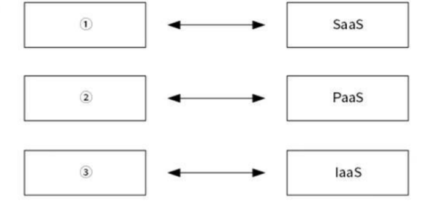
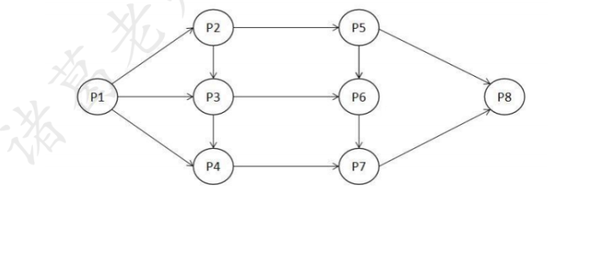
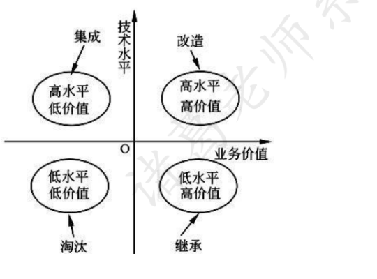
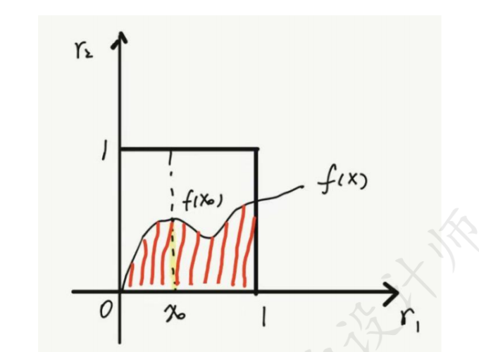
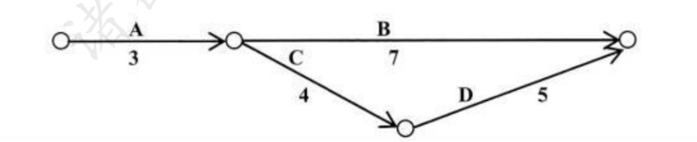

# 2022年下半年 系统架构设计师 · 上午题

> 卷面信息：考试时间 9:00～11:30 共 150 分钟。本试卷的试题中共有 75 个空格，需要全部解答，每个空格 1 分，满分 75 分。每个空格对应一个序号，有 A、B、C、D 四个选项，请选择一个最恰当的选项作为解答，在答题卡相应序号下填涂该选项。解答前务必阅读例题和答题卡上的例题填涂样式及填涂注意事项。解答时用正规 2B 铅笔正确填涂选项，如需修改，请用橡皮擦干净，否则会导致不能正确评分。
> 卷面例题：2022 年下半年全国计算机技术与软件专业技术资格（水平）考试日期是_(88)_月_(89)_日。（88）A. 9 B. 10 C. 11 D. 12；（89）A. 5 B. 6 C. 7 D. 8。因为考试日期是"11 月 5 日"，故（88）选 C，（89）选 A。

## 题号目录

| 题号 | 考点 | 教程章节 |
|------|------|----------|
| Q01 | 云计算服务体系（IaaS/PaaS/SaaS 与三层模型对应） |  |
| Q02 | 前趋图（Precedence Graph）的逻辑关系集合 |  |
| Q03 | 文件写回掉电对系统的影响（目录/FCB） |  |
| Q04 | 磁盘移臂调度（最短移臂时间优先） |  |
| Q05 | 数据库三级模式与聚簇索引（内模式） |  |
| Q06 | 数据库转储方式（动态全局转储） |  |
| Q07 | Armstrong 公理系统分解规则 |  |
| Q08 | 关系代数：自然连接与笛卡尔积+选择的等价 |  |
| Q09 | 鸿蒙操作系统架构（微内核/分布式） |  |
| Q10 | GPU 峰值性能 |  |
| Q11 | AI 芯片技术架构（GPU/FPGA/ASIC） |  |
| Q12 | 消息中间件特征 |  |
| Q13 | HTTPS 与 HTTP 协议 |  |
| Q14–Q15 | 电子邮件发送（SMTP/端口 25） |  |
| Q16–Q17 | 可靠性度量指标与可靠度 |  |
| Q18 | 数据资产的特征 |  |
| Q19 | DCMM 数据管理能力成熟度（8 个能力域） |  |
| Q20–Q21 | 信息安全三类措施、技术措施 |  |
| Q22 | 增量式开发对比瀑布模型 |  |
| Q23 | CMMI 体系文件四层塔型结构 |  |
| Q24 | 信息建模方法基本工具（E-R 图） |  |
| Q25 | 需求抽取（迭代过程） |  |
| Q26 | 模型驱动开发 MDA（平台无关模型） |  |
| Q27 | 中间件两类支持 |  |
| Q28 | 工作流描述工具（活动图/BPMN/Petri-Net） |  |
| Q29 | 软件配置管理工具功能 |  |
| Q30 | UML 2.0 基础结构（元模型） |  |
| Q31 | 领域驱动设计（领域模型） |  |
| Q32 | 微服务架构 vs SOA 管理方式的对比 |  |
| Q33–Q34 | UML 2.0 顺序图（序列片段、消息类型） |  |
| Q35 | 构件特征（不正确的说法） |  |
| Q36 | 构件定义：接口 |  |
| Q37 | 服务端构件模型（EJB 与 COM+） |  |
| Q38 | 构件演化（不正确的说法） |  |
| Q39 | 软件复杂性度量（环路数） |  |
| Q40 | 白盒测试覆盖强度 |  |
| Q41 | 黑盒测试方法（判定表） |  |
| Q42 | 回归测试目的 |  |
| Q43 | 遗留系统演化策略（集成） |  |
| Q44–Q45 | 多视图/4+1 模型（关注点分离、场景） |  |
| Q46–Q47 | ABSD 方法（商业+质量+功能需求 → 构件和类） |  |
| Q48–Q49 | 批处理风格数据传递、基于规则的系统组成 |  |
| Q50–Q51 | 软件复用类型（机会复用/资产复用/计划复用） |  |
| Q52 | 软件复用过程主要阶段 |  |
| Q53 | DSSA 领域模型（领域分析阶段） |  |
| Q54–Q55 | 质量属性（可维护性、可伸缩性） |  |
| Q56–Q57 | 质量属性场景六部分、易用性场景刺激 |  |
| Q58 | 架构评估：权衡点 |  |
| Q59 | ATAM 效用树结构 |  |
| Q60 | MTTF 与 MTBF 关系 |  |
| Q61–Q62 | 信息安全要素（机密性、可控性） |  |
| Q63 | 架构评估场景（风险承担者角度） |  |
| Q64 | 5G 网络切片技术 |  |
| Q65 | WiFi 认证方式（WPA2/AES） |  |
| Q66 | 软件著作权侵权判定 |  |
| Q67 | 软件著作权产生时间 |  |
| Q68 | 知识产权（专利权未提及） |  |
| Q69 | 蒙特卡罗方法求定积分 |  |
| Q70 | 项目赶工进度最低成本（关键路径+费用优化） |  |
| Q71–Q75 | 英语：微服务架构好处（微服务技术短文填空） |  |

## 原题转录（视觉核验）

---

## Q01

云计算服务体系结构如下图所示，图中①、②、③分别与 SaaS、PaaS、IaaS 相对应，图中①、②、③应为_(1)_。

- A. 应用层、基础设施层、平台层
- B. 应用层、平台层、基础设施层
- C. 平台层、应用层、基础设施层
- D. 平台层、基础设施层、应用层

**来源所列答案**：B
**来源解析**：PaaS（Platform as a Service），平台即服务；SaaS（Software as a Service），软件（应用）即服务；IaaS（Infrastructure as a Service），基础设施即服务。

> 校核注：另源（《2022年系统架构师考试科目一：综合知识真题及解析.pdf》第2页）答案同为 B，其解析按资源层次展开——IaaS 向用户提供计算机能力、存储空间等基础设施方面的服务，需要较大的基础设施投入和长期运营管理经验；PaaS 向用户提供虚拟的操作系统、数据库管理系统、Web 应用等平台化的服务，重点在于构建和形成紧密的产业生态；SaaS 向用户提供应用软件（如 CRM、办公软件等）、组件、工作流等虚拟化软件的服务。该来源另含"总评"（y2022m_yj 第2页）：此卷选择题超纲题不少（云计算、5G、鸿蒙 OS、AI、DCMM 等），案例题前两题简单、后三题较难，论文题出乎意料。

---

## Q02

前趋图（Precedence Graph）是一个有向无环图，记为：→={(Pi, Pj) | Pi must complete before Pj may start}，假设系统中进程 P={P1, P2, P3, P4, P5, P6, P7, P8}，且进程的前趋图如下图所示。那么，该前趋图可记为_(2)_。

- A. →={(P1,P2), (P1,P3), (P1,P4), (P2,P5), (P3,P5), (P4,P7), (P5,P6), (P5,P7), (P7,P6), (P4,P5), (P6,P7), (P7,P8)}
- B. →={(P1,P2), (P1,P3), (P1,P4), (P2,P3), (P2,P5), (P3,P4), (P3,P6), (P4,P7), (P5,P6), (P5,P8), (P6,P7), (P7,P8)}
- C. →={(P1,P2), (P1,P3), (P1,P4), (P2,P3), (P2,P5), (P3,P4), (P3,P5), (P4,P6), (P5,P7), (P5,P8), (P6,P7), (P7,P8)}
- D. →={(P1,P2), (P1,P3), (P2,P3), (P2,P5), (P3,P4), (P3,P6), (P4,P7), (P5,P6), (P5,P8), (P6,P7), (P6,P8), (P7,P8)}

**来源所列答案**：B
**来源解析**：按数字先小后大原则找出箭头表示的 12 对逻辑关系：{（P1，P2），（P1，P3），（P1，P4），（P2，P3），（P2，P5），（P3，P4），（P3，P6），（P4，P7），（P5，P6），（P5，P8），（P6，P7），（P7，P8）}，经核对只有 B 为正确选项。A、C 选项均有（P3，P5），而图中无此逻辑，显然不对，排除；D 选项缺（P1，P4），排除。

> 校核注：另源（y2022_zs 第3页）选项文字与主来源一致（其 D 选项同样缺（P1,P4)），答案同为 B。

---

## Q03

若系统正在将_(3)_文件修改的结果写回磁盘时系统发生掉电，则对系统影响相对较大。

- A. 系统目录
- B. 空闲块
- C. 用户程序
- D. 用户数据

**来源所列答案**：A
**来源解析**：一般情况下，系统不会去回写用户程序、用户数据，即便系统去写了这两部分也不会对系统本身造成较大的影响。只有系统对系统本身的目录或关键文件回写异常，才有可能导致较大的影响，严重的会导致系统崩溃。举个例子，linux 系统下 root 账号回写/etc/resolv.conf 异常时，可能会导致系统 DNS 服务异常。目录其实就是文件控制块的集合，文件控制块记录了文件各种信息，如果出现问题影响很大。

> 校核注：另源（y2022_zs 第3页）答案同为 A，解析仅有"目录其实就是文件控制块的集合……"一句。

---

## Q04

在磁盘调度管理中，应先进行移臂调度，再进行旋转调度。假设磁盘移动臂位于 20 号柱面上，进程的请求序列如下表所示。如果采用最短移臂调度算法，那么系统的响应序列应为_(4)_。

| 请求序列 | 柱面号 | 磁头号 | 扇区号 |
|------|------|------|------|
| ① | 18 | 8 | 6 |
| ② | 16 | 6 | 3 |
| ③ | 16 | 9 | 6 |
| ④ | 21 | 10 | 5 |
| ⑤ | 18 | 8 | 4 |
| ⑥ | 21 | 3 | 10 |
| ⑦ | 18 | 7 | 6 |
| ⑧ | 16 | 10 | 4 |
| ⑨ | 22 | 10 | 8 |

- A. ②⑧③④⑤①⑦⑥⑨
- B. ②③⑧④⑥⑨①⑤⑦
- C. ④⑥⑨⑤⑦①②⑧③
- D. ④⑥⑨⑤⑦①②③⑧

**来源所列答案**：C
**来源解析**：移臂就是找柱面，旋转则找扇区，它们均按找最近原则调度。首先，根据题干，距离当前移臂位置 20 号柱面最近的显然是 21 号柱面，对应的请求序列为④、⑥，排除 A、B 选项；其次，对于 16 号柱面，序列②⑧③访问扇区 3、4、6 的路基最优；因此只有 C 选项才符合。

> 校核注：另源（y2022_zs 第3-4页）答案同为 C，其解析给出移动顺序 20→21→22→18→16，"然后再根据扇区号从小到大，应该先读 4 号扇区，再是 6 号扇区"。

---

## Q05

采用三级模式结构的数据库系统中，如果对一个表创建聚簇索引，那么改变的是数据库的_(5)_。

- A. 外模式
- B. 模式
- C. 内模式
- D. 用户模式

**来源所列答案**：C
**来源解析**：内模式定义的是存储记录的类型、存储域的表示、存储记录的物理顺序，指引元、索引和存储路径等数据的存储组织。

> 校核注：另源（y2022_zs 第4页）答案同为 C，其解析称"在三级结构/两级映像体系结构中，对一个表创建聚簇索引，改变的是数据库的内模式（即内部视图层次上的数据特性）；通过创建视图，构建的是外模式（即用户视图层次上的数据特性）和外模式/模式映像"。

---

## Q06

假设系统中有正在运行的事务，若要转储全部数据库，则应采用_(6)_方式。

- A. 静态全局转储
- B. 动态增量转储
- C. 静态增量转储
- D. 动态全局转储

**来源所列答案**：D
**来源解析**：动态备份是指备份期间允许对数据库进行存取或修改，即备份和用户事务可以并发执行。

> 校核注：另源（y2022_zs 第4页）答案同为 D，其解析为"正在运行是动态，全部是全局"。

---

## Q07

给定关系模式 R（U，F），其中 U 为属性集，F 是 U 上的一组函数依赖，那么函数依赖的公理系统（Armstrong 公理系统）中的分解规则是指_(7)_为 F 所蕴涵。

- A. 若 X→Y，Y→Z，则 X→Y
- B. 若 Y⊆X⊆U，则 X→Y
- C. 若 X→Y，Z⊆Y，则 X→Z
- D. 若 X→Y，Y→Z，则 X→YZ

**来源所列答案**：C
**来源解析**：Armstrong 公理系统设关系模式 R<U，F>，其中 U 为属性集，F 是 U 上的一组函数依赖，那么有如下推理规则：①A1 自反律：若 Y⊆X⊆U，则 X→Y 为 F 所蕴含；②A2 增广律：若 X→Y 为 F 所蕴含，且 Z⊆U，则 XZ→YZ 为 F 所蕴含；③A3 传递律：若 X→Y，Y→Z 为 F 所蕴含，则 X→Z 为 F 所蕴含。根据上面三条推理规则，又可推出下面三条推理规则：④合并规则：若 X→Y，X→Z，则 X→YZ 为 F 所蕴含；⑤伪传递规则：若 X→Y，WY→Z，则 XW→Z 为 F 所蕴含；⑥分解规则：若 X→Y，Z⊆Y，则 X→Z 为 F 所蕴含。

> 校核注：另源（y2022_zs 第4页）答案同为 C，解析亦列出同样的六条规则。

---

## Q08

给定关系 R（A，B，C，D）和 S（A，C，E，F），以下_(8)_与 σR.B>S.E(R ⋈ S) 等价。

- A. σ2>7(R×S)
- B. π1,2,3,4,7,8(σ1=5∧2>7∧3=6(R×S))
- C. σ2>7′(R×S)
- D. π1,2,3,4,7,8(σ1=5∧2>7′∧3=6(R×S))

**来源所列答案**：B
**来源解析**：首先，R 与 S 中未提及具体值'7'，因此排除 C、D 选项；其次，A 选项未考虑自然连接，排除 A；最后，只有 B 选项中 R×S 做选择时，第一列与第五列（R.A=S.A）、第三列与第六列（R.C=S.C），才考虑了自然连接，B 选择符合。

> 校核注：C、D 选项中的"7′"（7 加撇号）为原件所印（三本来源均如此）。另源（y2022_zs 第4-5页）答案同为 B，其解析作："注意涉及到笛卡尔积和自然连接的转换即可，选项中是笛卡尔积，结果是 ABCDACEF，而题目是自然连接，结果是 ABCDEF，所以要选择笛卡尔积结果的第 123478 列同时相同列要相等，也就是 1=5 且 3=6，而题目中单独的条件 R.B 是 2，S.E 是 7，B 和 D 的区别在于引号，在数据库中，数字是不用加引号的，字符才要加。"即另源认为撇号是引号、用于排除 C、D；主来源解析则以"未提及具体值'7'"排除 C、D。两源结论一致，理由表述不同。

---

## Q09

以下关于鸿蒙操作系统的叙述中，不正确的是_(9)_。

- A. 鸿蒙操作系统整体架构采用分层的层次化设计，从下向上依次为：内核层、系统服务层、框架层和应用层
- B. 鸿蒙操作系统内核层采用宏内核设计，拥有更强的安全特性和低时延特点
- C. 鸿蒙操作系统架构采用了分布式设计理念，实现了分布式软总线、分布式设系统的虚拟化、分布式数据管理和分布式任务调度等四种分布式能力
- D. 架构的系统安全性主要体现在搭载 HarmonyOS 的分布式终端上，可以保证"正确的人，通过正确的设备，正确地使用数据"

**来源所列答案**：B
**来源解析**：HarmonyOS 是基于微内核的全场景分布式 OS。

> 校核注：另源（y2022_zs 第5页；y2022m_yj 第6页）答案同为 B，其解析称"鸿蒙 OS 是微内核"（y2022m_yj 注"超纲题，架构教材出版的时候还没有鸿蒙"）。选项 C 中"分布式设系统的虚拟化"照录原文，另源作"分布式设备虚拟化"。

---

## Q10

GPU 目前已广泛应用于各行各业，GPU 中集成了同时运行在 GHz 的频率上的成千上万个 core，可以高速处理图像数据。最新的 GPU 峰值性能可高达_(10)_以上。

- A. 100 TFlops
- B. 50 TFlops
- C. 10 TFlops
- D. 1 TFlops

**来源所列答案**：A
**来源解析**：最新的英伟达 GeForce RTX 4090 GPU 达到 100 TFLOPs 的算力。

> 校核注：另源（y2022_zs 第5页；y2022m_yj 第6-7页）答案同为 A，其解析（超纲题）补充："BR 100 通用 GPU 16 位浮点算力达到 1000T 以上、8 位定点算力达到 2000T 以上，单芯片峰值算力达到 PFLOPS 级别，FP32 算力超越英伟达在售旗舰 GPU 一个数量级。"

---

## Q11

AI 芯片是当前人工智能技术发展的核心技术，其能力要支持训练和推理。通常，AI 芯片的技术架构包括_(11)_等三种。

- A. GPU、FPGA、ASIC
- B. CPU、PPGA、DSP
- C. GPU、CPU、ASIC
- D. GPU、FPGA、SOC

**来源所列答案**：A
**来源解析**：常用的 AI 芯片的技术架构包括 GPU，FPGA，ASIC 和 TPU。

> 校核注：主来源选项 B 照录原件作"CPU、PPGA、DSP"（PPGA 疑为原卷误印）；另源（y2022_zs 第5页；y2022m_yj 第7页）该处均作"CPU、FPGA、DSP"。另源答案同为 A，其解析补充："AI 芯片主要有三种技术架构：第一种是 GPU，可以高效支持 AI 应用的通用芯片，但是相对于 FPGA 和 ASIC 来说，价格和功耗过高；第二种是 FPGA（现场可编程门阵列），可对芯片硬件层进行编程和配置，实现半定制化，相对于 GPU 有更低的功耗；第三种是 ASIC（专用集成电路），专门为特定的 AI 产品或者服务而设计，主要是侧重加速机器学习（尤其是神经网络、深度学习），它针对特定的计算网络结构采用了硬件电路实现的方式，能够在很低的功耗下实现非常高的能效比，这也是目前 AI 芯片中最多的形式。"

---

## Q12

通常，嵌入式中间件没有统一的架构风格，根据应用对象的不同可存在多种类型，比较常见的是消息中间件和分布式对象中间件。以下有关消息中间件的描述中，不正确的是_(12)_。

- A. 消息中间件是消息传输过程中保存消息的一种容器
- B. 消息中间件具有两个基本特点：采用异步处理模式、应用程序和应用程序调用关系为松耦合关系
- C. 消息中间件主要由一组对象来提供系统服务，对象间能够跨平台通信
- D. 消息中间件的消息传递服务模型有点对点模型和发布-订阅模型之分

**来源所列答案**：C
**来源解析**：消息中间件，用于在两个应用程序之间，或分布式系统中发送消息，进行异步通信。消息队列（Message queue，即 MQ）是在消息的传输过程中保存消息的容器。MQ 负责两个系统之间传递消息，这两个系统可以是异构的，处于不同硬件、不同操作系统、用不同语言编写，只需要简单配置、以及简单的调用几个 MQ 的 API，就可以互相通讯，不必考虑底层系统和网络的复杂性，MQ 能够应付多种异常情况。消息中间件支持点对点模式、订阅发布模式、推拉模式。

> 校核注：另源（y2022_zs 第5-6页；y2022m_yj 第7页）答案同为 C，其解析称"C 明显是分布式对象中间件，顾名思义"。

---

## Q13

以下关于 HTTPS 和 HTTP 协议的描述中，不正确的是_(13)_。

- A. HTTPS 协议使用加密传输
- B. HTTPS 协议默认服务端口号是 443
- C. HTTP 协议默认服务端端口是 80
- D. 电子支付类网站应使用 HTTP 协议

**来源所列答案**：D
**来源解析**：HTTP 协议是一种使用明文数据传输的网络协议，缺省端口 80。HTTPS 协议是在 HTTP 的基础上增加了 ssl 数据加密，缺省端口 443。

> 校核注：另源（y2022_zs 第6页；y2022m_yj 第7页）答案同为 D，其解析仅"常识"二字。

---

## Q14

电子邮件客户端通过发起对_(14)_服务器的_(15)_端口的 TCP 连接来进行邮件发送。

- A. POP3
- B. SMTP
- C. HTTP
- D. IMAP

**来源所列答案**：B（第14空）
**来源解析**：POP3，邮件接收协议，缺省端口 110；SMTP，邮件发送协议，缺省端口 25；HTTP，超文本传输协议，缺省端口 80；IMAP，交互式邮件存取协议，缺省端口 143。

---

## Q15

（承 Q14 题干：电子邮件客户端通过发起对_(14)_服务器的_(15)_端口的 TCP 连接来进行邮件发送。）

- A. 23
- B. 25
- C. 110
- D. 143

**来源所列答案**：B
**来源解析**：（见 Q14）

> 校核注：另源（y2022_zs 第6页；y2022m_yj 第8页）答案同为 B、B，其解析补充常见端口号表（y2022m_yj 以表格排版）：端口 20 文件传输协议（数据）；端口 21 文件传输协议（控制）；端口 23 Telnet 终端仿真协议；端口 67 DHCP（服务端）；端口 68 DHCP（客户端）；端口 25 SMTP 简单邮件发送协议；端口 53 域名服务器（DNS）；端口 80 超文本传输协议（HTTP）；端口 110 POP3 服务器（邮箱接收服务器）；端口 69 简单文件传输协议（TFTP）；端口 161 SNMP（轮询）；端口 162 SNMP（陷阱）。

---

## Q16

系统_(16)_是指在规定的时间内和规定的条件下能有效地实现规定功能的能力。它不仅取决于规定的使用条件等因素，还与设计技术有关。常用的度量指标主要有故障率（或失效率）、平均失效等待时间、平均失效间隔时间和可靠度等。其中，_(17)_是系统在规定工作时间内无故障的概率。

- A. 可靠性
- B. 可用性
- C. 可理解性
- D. 可测试性

**来源所列答案**：A（第16空）
**来源解析**：可靠性（Reliability）是指产品在规定的条件下和规定的时间内完成规定功能的能力。常用的度量指标主要有故障率（或失效率）、平均失效等待时间、平均失效间隔时间和可靠度等。可靠度就是软件系统在规定的条件下、规定的时间内不发生失效的概率。

---

## Q17

（承 Q16 题干：……其中，_(17)_是系统在规定工作时间内无故障的概率。）

- A. 失效率
- B. 平均失效等待时间
- C. 平均失效间隔时间
- D. 可靠度

**来源所列答案**：D
**来源解析**：（见 Q16，来源将 Q16/Q17 合并解析）

> 校核注：另源（y2022_zs 第6页；y2022m_yj 第8页）答案同为 A、D，其解析称"可靠性，可能会认为是可用性，但是后面有度量指标，涉及到故障、失效是可靠；另外，第二问注意问的是概率，只能是 A 或者 D，无故障当然是可靠的概率"。

---

## Q18

数据资产的特征包括_(18)_。

①可增值 ②可测试 ③可共享 ④可维护 ⑤可控制 ⑥可量化

- A. ①②③④
- B. ①②③⑤
- C. ①②④⑤
- D. ①③⑤⑥

**来源所列答案**：D
**来源解析**：数据资产的特性包括：可控制、可量化、可变现、虚拟性、共享性、时效性、安全性、交换性和规模性。

> 校核注：另源（y2022_zs 第6页；y2022m_yj 第8页）答案同为 D（y2022m_yj 注"超纲题，记住即可"）。

---

## Q19

数据管理能力成熟度评估模型（DCMM）是我国首个数据管理领域的国家标准，DCMM 提出了符合我国企业的数据管理框架，该框架将组织数据管理能力划分为 8 个能力域，分别为：数据战略、数据治理、数据架构、数据标准、数据质量、数据安全、_(19)_。

- A. 数据应用和数据生存周期
- B. 数据应用和数据测试
- C. 数据维护和数据生存周期
- D. 数据维护和数据测试

**来源所列答案**：A
**来源解析**：DCMM 评估内容包括数据战略、数据治理、数据架构、数据应用、数据安全、数据质量、数据标准和数据生存周期。

> 校核注：另源（y2022_zs 第7页；y2022m_yj 第8-9页）答案同为 A，其解析补充 8 个能力域的细分（主来源未提供）：数据战略——数据战略规划、数据战略实施、数据战略评估；数据治理——数据治理组织、数据制度建设、数据治理沟通；数据架构——数据模型、数据分布、数据集成与共享、元数据管理；数据应用——数据分析、数据开放共享、数据服务；数据安全——数据安全策略、数据安全管理、数据安全审计；数据质量——数据质量需求、数据质量检查、数据质量分析、数据质量提升；数据标准——业务数据、参考数据和主数据、数据元、指标数据；数据生存周期——数据需求、数据设计和开放、数据运维、数据退役。

---

## Q20

完整的信息安全系统至少包含三类措施，即技术方面的安全措施、管理方面的安全措施和相应的_(20)_。其中，信息安全的技术措施主要有：信息加密、数字签名、身份鉴别、访问控制、网络控制技术、反病毒技术、_(21)_。

- A. 用户需求
- B. 政策法律
- C. 市场需求
- D. 领域需求

**来源所列答案**：B（第20空）
**来源解析**：一个完整的信息安全系统至少包含三类措施：技术方面的安全措施，管理方面的安全措施和相应的政策法律。信息安全的技术措施主要有：信息加密、数字签名、数据完整性保护、身份鉴别、访问控制、数据备份和灾难恢复、网络控制技术、反病毒技术、安全审计、业务填充、路由控制机制、公证机制等。

---

## Q21

（承 Q20 题干：……信息安全的技术措施主要有：信息加密、数字签名、身份鉴别、访问控制、网络控制技术、反病毒技术、_(21)_。）

- A. 数据备份和数据测试
- B. 数据迁移和数据备份
- C. 数据备份和灾难恢复
- D. 数据迁移和数据测试

**来源所列答案**：C
**来源解析**：（见 Q20，来源将 Q20/Q21 合并解析）

> 校核注：另源（y2022_zs 第7页；y2022m_yj 第9页）答案同为 B、C，其解析称"技术、管理、法律法规，应该是比较好选的；信息安全的技术，备份和灾难恢复更合适，数据迁移和测试与安全无关"。

---

## Q22

与瀑布模型相比，_(22)_降低了实现需求变更的成本，更容易得到客户对于已完成开发工作的反馈意见，并且客户可以更早地使用软件并从中获得价值。

- A. 快速原型模型
- B. 敏捷开发
- C. 增量式开发
- D. 智能模型

**来源所列答案**：C
**来源解析**：增量式开发相比于瀑布模型的一些重要优点：降低了适应用户需求变更的成本。重新分析和修改文档的工作量较之瀑布模型要少很多。在开发过程中更容易得到用户对于已做的开发工作的反馈意见。用户可以评价软件的现实版本，并可以看到已经实现了多少。这比让用户从软件设计文档中判断工程进度要好很多。使更快地交付和部署有用的软件到客户方变成了可能，虽然不是所有的功能都已经包含在内。相比于瀑布模型，用户可以更早地使用软件并创造商业价值。

> 校核注：另源（y2022_zs 第7页；y2022m_yj 第9页）答案同为 C，其解析称"这个题目，文老师感觉部分学员可能会选 A，但是这里条件较多，尤其降低需求成本，客户对已开发完成的意见，应该是增量，因为增量就是先开发核心部分，再开发次核心，每次都能得到客户反馈，有变更放到下次开发即可"。

---

## Q23

CMMI 是软件企业进行多方面能力评价的、集成的成熟度模型，软件企业在实施过程中，为了达到本地化，应组织体系编写组，建立基于 CMMI 的软件质量管理体系文件，体系文件的层次结构一般分为四层，包括：

①顶层方针 ②模板类文件 ③过程文件 ④规程文件

按照自顶向下的塔型排列，以下顺序正确的是_(23)_。

- A. ①④③②
- B. ①④②③
- C. ①②③④
- D. ①③④②

**来源所列答案**：D
**来源解析**：软件过程构架结构由四个层次组成：方针、过程、规程和第四层的标准、规范、指南、模板、Checklist 等组成。1、方针为第一层文件，它是组织标准软件的高层次的抽象描述，它反映在公司的过程改进总体方针、政策中，由公司主管副总裁批准执行。2、过程为第二层文件，主要规定在项目开发中执行该过程时应当执行的各项活动及适用标准。过程定义文件及其相关文件制定必须符合方针的要求。3、规程为第三层文件，是对过程某些复杂活动的具体描述。4、标准、规范、指南、模板、Checklist、范例库等是对上级过程或规程提供细致的步骤、活动及说明的支持性文档，第四层的文件从属于上级过程。

> 校核注：另源（y2022_zs 第7页；y2022m_yj 第9-10页）答案同为 D，其解析仅"记住即可。这个考 CMMI 考的比较偏，但是有个自顶向下的顺序，也可以利用猜一下"。

---

## Q24

信息建模方法是从数据的角度对现实世界建立模型，模型是现实系统的一个抽象，信息建模方法的基本工具是_(24)_。

- A. 流程图
- B. 实体联系图
- C. 数据流图
- D. 数据字典

**来源所列答案**：B
**来源解析**：业务流图（TFD）是分析和描述现有系统的传统工具，是业务流程调查结果的图形化表示。实体联系图（E-R 图）它是描述概念世界，建立概念模型的实用工具。数据流图（DFD）是表达系统内数据的流动并通过数据流描述系统功能的一种方法。数据字典（DD）是在 DFD 的基础上，对 DFD 中出现的所有命名元素都加以定义，使得每个图形的名字都有一个确切的解释。

> 校核注：另源（y2022_zs 第8页；y2022m_yj 第10页）答案同为 B，其解析称"这里说信息建模，文老师感觉有的学员应该被迷惑了，其实信息就是数据，其实就是数据建模，用 ER 图"。

---

## Q25

_(25)_通常为一个迭代过程，其中的活动包括需求发现、需求分类和组织、需求协商、需求文档化。

- A. 需求确认
- B. 需求管理
- C. 需求抽取
- D. 需求规格说明

**来源所列答案**：C
**来源解析**：需求抽取和分析的过程包含：发现需求、需求分类和组织、需求优先级划分和协商、需求规格说明。

> 校核注：另源（y2022_zs 第8页，其题号编为 21；y2022m_yj 第10页）答案同为 C，其解析称"这里很明显属于需求开发过程，排除 B，其次 AD 都只是一个步骤片面了，用排除法可以选到 C"。

---

## Q26

使用模型驱动的软件开发方法，软件系统被表示为一组可以被自动转换为可执行代码的模型。其中，_(26)_在不涉及实现的情况下对软件系统进行建模。

- A. 平台无关模型
- B. 计算无关模型
- C. 实现相关模型
- D. 平台相关模型

**来源所列答案**：A
**来源解析**：按抽象到具体的次序，软件建模的三个层面：(1) 计算无关模型（CIM）：Computational Independent Model (2) 平台无关模型（PIM）：Platform Independent Model (3) 平台相关模型（PSM）：Platform Dependent Model，又称平台特定模型。

> 校核注：另源（y2022_zs 第8页；y2022m_yj 第10页）答案同为 A，其解析称"不涉及实现，顾名思义的话，应该是实现无关，而不是实现相关，所以要排除 D，这是混淆项，这里不涉及就是无关，在 AB 里，应该是 A 更合适"。

---

## Q27

在分布式系统中，中间件通常提供两种不同类型的支持，即_(27)_。

- A. 数据支持和交互支持
- B. 交互支持和提供公共服务
- C. 安全支持和提供公共服务
- D. 数据支持和提供公共服务

**来源所列答案**：B
**来源解析**：中间件是独立的系统级软件，连接操作系统层和应用程序层，将不同操作系统提供应用的接口标准化，协议统一化，屏蔽具体操作的细节，中间件一般提供如下功能：●通信支持。中间件为其所支持的应用软件提供平台化的运行环境，该环境屏蔽底层通信之间的接口差异，实现互操作，所以通信支持是中间件一个最基本的功能。●应用支持。中间件的目的就是服务上层应用，提供应用层不同服务之间的互操作机制。●公共服务。公共服务是对应用软件中共性功能或约束的提取。将这些共性的功能或者约束分类实现，并支持复用，作为公共服务，提供给应用程序使用。

> ⚠️ 待核验：答案归属两来源不一致——主来源（2019-2024答案解析.pdf 第87页）作 **B**；另源（y2022_zs 第8页，其题号编为 23；y2022m_yj 第10页，题号 27）均作 **D**，其解析仅"记住即可"。本卷按主来源照录 B，此题答案存在来源间冲突，建议人工复核教材表述（教材中"中间件为上层应用提供两类支持：交互支持（通信支持）与公共服务"的表述支持 B）。

---

## Q28

工作流表示的是业务过程模型，通常使用图形形式来描述，以下不可用来描述工作流的是_(28)_。

- A. 活动图
- B. BPMN
- C. 用例图
- D. Petri-Net

**来源所列答案**：C
**来源解析**：活动图可以用于描述系统的工作流程和并发行为，活动图其实可看作状态图的特殊形式，活动图中一个活动结束后将立即进入下一个活动。BPMN（Business Process Modeling Notation）指业务流程建模与标注，包括这些图元如何组合成一个业务流程图（Business Process Diagram）。Petri-Net 是所有流程定义语言之母。

> 校核注：另源（y2022_zs 第8页；y2022m_yj 第11页）答案同为 C，其解析称"考的是业务流程设计的工具，重点内容，用例图是用于面向对象分析的"。

---

## Q29

_(29)_的常见功能包括版本控制、变更管理、配置状态管理、访问控制和安全控制等。

- A. 软件测试工具
- B. 版本控制工具
- C. 软件维护工具
- D. 软件配置管理工具

**来源所列答案**：D
**来源解析**：软件配置管理工具是指支持完成配置项标识、版本控制、变化控制、审计和状态统计等任务的工具，主要有下述功能：(1)配置支持。配置是一组有共同目的的中间软件产品，其中每一个中间软件产品称为一个配置项。软件配置管理支持用户建立配置项之间的各种关系，并对这些关系加以维护，维护这些关系有助于完成某些特定任务(例如 Build)和标识某一变化对整个系统开发的影响。(2)版本控制。版本控制是软件配置管理的基本要求，它可以保证在任何时刻恢复任何一个版本、版本控制还记录每个配置项的发展历史，这样就保证了版本之间的可追踪性，也为查找错误提供了帮助，版本控制也是支持并行开发的基础。(3)变更控制。变更控制是指在整个软件生存周期中对软件变更的控制。变更控制系统记录每次变更的相关信息(变更的原因、变更的实施者以及变更的内容等)。这些信息有助于追踪出现的各种问题。(4)构造支持。软件系统往往由许多配置项构成，建立整个系统是个复杂和费时的过程，软件配置管理工具可以记录和追踪每个配置项信息，帮助用户自动和快速地建立系统，和版本控制结合在一起，可以有效地支持同时开发系统的多个版本。(5)过程支持。过程详细描述了各种人员在整个软件生存周期中如何使用整个系统，过程控制可以保证每一步都按照正确的顺序由合适的人员实施。过程控制本来是软件开发环境中一个独立的部分，软件配置管理也开始提供这部分功能。软件配置管理工具对过程的支持还很不够，而且支持方式差别也很大，许多管理只是提供一个预先定义好的生存周期模型，并保证开发的每一步都按照这个模型规定进行。(6)团队支持。团队支持是指多个开发人员同时开发一个软件系统。大多数软件系统都需要多个开发人员参与，有效的团队支持对开发人员是很有用的。团队支持主要包括工作区管理、并行开发管理和远程开发管理(某些软件配置管理工具还包括对开发人员支持)。

> 校核注：另源（y2022_zs 第8页；y2022m_yj 第11页）答案同为 D；其选项 D 文字作"配置管理工具"（主来源作"软件配置管理工具"），解析仅"这一看就只有配置管理才会有这么多了，而且中间还有个配置状态管理"。

---

## Q30

与 UML 1.x 不同，为了更清楚地表达 UML 的结构，从 UML 2 开始，整个 UML 规范被划分为基础结构和上层结构两个相对独立的部分，基础结构是 UML 的_(30)_，它定义了构造 UML 模型的各种基本元素；而上层结构则定义了面向建模用户的各种 UML 模型的语法、语义和表示。

- A. 元元素
- B. 模型
- C. 元模型
- D. 元元模型

**来源所列答案**：C
**来源解析**：OMG 在发布 2.0 修订信息需求之后，广泛听取了来自建模工具提供商、用户、学术团体、咨询机构以及其他标准化组织的 26 个响应者的建议，并于 2000 年年初发布了 UML2.0 的 4 个组成部分的提案需求(RFP)，分别是：基础结构(Infrastructure)、上层结构(Superstructure)、对象约束语言(OCL)和图交换(Diagram Interchange)的需求。其中基础结构和上层结构构成了 UML2.0 提案需求的主体部分。UML2.0 基础结构的设计目标是：定义一个元语言的核心 InfrastructureLibrary，通过对此核心的复用，除了可以定义一个自展的 UML 元模型，也可以定义其他元模型，包括 MOF 和 CWM(Common Warehouse Model，公共仓库模型)。UML2.0 上层结构的设计目标是：严格地复用基础结构 InfrastructureLibrary 包中的构造物；提高对基于构件开发和 MDA(Model Driven Architecture，模型驱动体系结构)的支持；优化构架规约的能力；增强行为图的可伸缩性、精确性、集成性等。

> 校核注：另源（y2022_zs 第9页；y2022m_yj 第11页）答案同为 C，其解析与主来源基本一致，另称"考的很偏了"。

---

## Q31

领域驱动设计提出围绕_(31)_进行软件设计和开发，该模型是由开发人员与领域专家协作构建出的一个反映深层次领域知识的模型。

- A. 行为模型
- B. 领域模型
- C. 专家模型
- D. 知识库模型

**来源所列答案**：B
**来源解析**：2004 年 Eric Evans 发表 Domain-Driven Design – Tackling Complexity in the Heart of Software（领域驱动设计），简称 Evans DDD。领域驱动设计分为两个阶段：①以一种领域专家、设计人员、开发人员都能理解的通用语言作为相互交流的工具，在交流的过程中发现领域概念，然后将这些概念设计成一个领域模型；②由领域模型驱动软件设计，用代码来实现该领域模型；由此可见，领域驱动设计的核心是建立正确的领域模型。

> 校核注：另源（y2022_zs 第9页；y2022m_yj 第11页）答案同为 B，其解析称"领域驱动设计，领域专家，很明显的领域模型"。

---

## Q32

以下关于微服务架构与面向服务架构的描述中，正确的是_(32)_。

- A. 两者均采用去中心化管理
- B. 两者均采用集中式管理
- C. 微服务架构采用去中心化管理，面向服务架构采用集中式管理
- D. 微服务架构采用集中式管理，面向服务架构采用去中心化管理

**来源所列答案**：C
**来源解析**：SOA 还是中心化集成老架构，ESB 是 SOA 架构的中心；而微服务架构倡导去中心化的服务管理和治理，尽量不设置中心化的管理服务。

> 校核注：另源（y2022_zs 第9页；y2022m_yj 第11-12页）答案同为 C，其解析仅"记住即可"。

---

## Q33

在 UML2.0（Unified Modeling Language）中，顺序图用来描述对象之间的消息交互，其中循环、选择等复杂交互使用_(33)_表示，对象之间的消息类型包括_(34)_。

- A. 嵌套
- B. 泳道
- C. 组合
- D. 序列片段

**来源所列答案**：D（第33空）
**来源解析**：UML2.0 添加了交互框(Interaction Frame)，交互框指途中的一块区域(Region)或片段(Fragment)，包含一个操作符(或称为标签)，并包含一个警戒。UML2.0 的消息类型有：简单消息、同步消息、异步消息、对象创建消息、对象销毁消息、无触发对象和无接收对象的消息。

---

## Q34

（承 Q33 题干：……对象之间的消息类型包括_(34)_。）

- A. 同步消息、异步消息、返回消息、动态消息、静态消息
- B. 同步消息、异步消息、动态消息、参与者创建消息、参与者销毁消息
- C. 同步消息、异步消息、静态消息、参与者创建消息、参与者销毁消息
- D. 同步消息、异步消息、返回消息、参与者创建消息、参与者销毁消息

**来源所列答案**：D
**来源解析**：（见 Q33）

> 校核注：另源（y2022_zs 第9页，题号 29；y2022m_yj 第12页，题号 33-34）答案同为 D、D，其解析称"顺序图，又称为序列图，其中的交互用序列片段表示，这里如果知道其另一个名字就好理解。序列图中的消息包括同步、异步、返回，这是文老师讲过的三种，根据这个基本就能锁定 AD，但是 D 也比较糊弄人，因为来了个参与者，可能有的学员想参与者是用例图的没选"。

---

## Q35

以下有关构件特征的的描述，说法不正确的是_(35)_。

- A. 构件是独立的部署单元
- B. 构件可作为第三方的组装单元
- C. 构件没有外部的可见状态
- D. 构件作为部署单元是可拆分的

**来源所列答案**：D
**来源解析**：构件作为可部署单元，具有原子性，是不可拆分的。

> 校核注：另源（y2022_zs 第9-10页；y2022m_yj 第12页）答案同为 D，其解析称"构件的特性是：(1)独立部署单元（也就是不能拆分）；(2)作为第三方的组装单元；(3)没有（外部的）可见状态。一个构件可以包含多个类元素，但是一个类元素只能属于一个构件。将一个类拆分进行部署通常没什么意义"。

---

## Q36

在构件的定义中，_(36)_是一个已命名的一组操作的集合。

- A. 接口
- B. 对象
- C. 函数
- D. 模块

**来源所列答案**：A
**来源解析**：构件的接口是一种服务提供者对消费者的承诺，即契约（contract），用契约确保一组构件之间的行为组合。

> 校核注：另源（y2022_zs 第10页；y2022m_yj 第12页）答案同为 A，其解析仅"常识"。

---

## Q37

在服务端构件模型的典型解决方案中，_(37)_较为适用于应用服务器。

- A. EJB 和 COM+模型
- B. EJB 和 servlet 模型
- C. COM+和 ASP 模型
- D. COM+和 servlet 模型

**来源所列答案**：A
**来源解析**：EJB（Enterprise Java Beans）是运行在独立服务器上的组件。COM+ 是 Microsoft 组件对象模型（COM）和 Microsoft Transaction Server（MTS）的演变。COM+ 可用于开发适用于 Windows 的企业范围、任务关键型分布式应用程序。Servlet（Server Applet）是 Java Servlet 的简称，称为小服务程序或服务连接器。ASP 即 Active Server Pages，是 Microsoft 公司开发的服务器端脚本环境，可用来创建动态交互式网页并建立强大的 web 应用程序。

> 校核注：另源（y2022_zs 第10页；y2022m_yj 第12页）答案同为 A，其解析仅"记住即可"。

---

## Q38

以下有关构件演化的描述中，说法不正确的是_(38)_。

- A. 安装新版本构件可能与现有系统发生冲突
- B. 构件通常也会经历一般软件产品具有的演化过程
- C. 解决遗留系统移植问题，还需要通过使用包裹器构件，更适配旧版软件
- D. 为安装新版本的构建，必须终止系统中所有已有版本构件后运行

**来源所列答案**：D
**来源解析**：此题采用排除法，ABC 显然都是正确的。另外，安装新版本构件时，有两种方式，一种是全量构建，另一种是增量构建，后一种不需要停止所有已有版本构件的运行只要升级增量部分即可。

> 校核注：主来源选项 D 照录原件（"构建""后运行"疑为原卷误排，另源 y2022_zs 第10页、y2022m_yj 第13页作"为安装新版本的构件，必须终止系统中所有现有版本构件的运行"）。另源答案同为 D，其解析称"D 是常识性错误，不可能因为安装新版本，终止当前系统所有构件运行"。

---

## Q39

软件复杂性度量中，_(39)_可以反映源代码结构的复杂度。

- A. 模块数
- B. 环路数
- C. 用户数
- D. 对象数

**来源所列答案**：B
**来源解析**：软件源码复杂度度量方法主要有三种：代码行、Helstead 方法、McCabe 方法（环形复杂度）。●代码行方法：是一种最简单的方法，该方法认为，代码行越多，软件越容易产生漏洞。●Helstead 方法：思路是根据程序中可执行代码行的操作符和操作数的数量来计算程序的复杂性。操作符和操作数的量越大，程序结构就越复杂。●McCabe 方法：环路复杂度用来定量度量程序的逻辑复杂度。

> 校核注：另源（y2022_zs 第10页；y2022m_yj 第13页）答案同为 B，其解析称"讲过计算环路复杂度，根据流程图来计算，就是反应代码复杂度的"。

---

## Q40

在白盒测试中，测试强度最高的是_(40)_。

- A. 语句覆盖
- B. 分支覆盖
- C. 判定覆盖
- D. 路径覆盖

**来源所列答案**：D
**来源解析**：路径覆盖实际上考虑了程序中各种判定结果的所有可能组合，是一种较强的覆盖标准。

> 校核注：另源（y2022_zs 第10页；y2022m_yj 第13页）答案同为 D，其解析仅"常识"。

---

## Q41

在黑盒测试中，_(41)_方法最适合描述在多个逻辑条件取值组合所构成的复杂情况下，分别要执行哪些不同的动作。

- A. 等价类
- B. 边界类
- C. 判定表
- D. 因果图

**来源所列答案**：C
**来源解析**：判定表最适合描述在多个逻辑条件取值的组合所构成的复杂情况下，分别要执行哪些不同的动作。

> 校核注：主来源选项 B 照录原件作"边界类"；另源（y2022_zs 第10页；y2022m_yj 第13页）均作"边界值"。另源答案同为 C，其解析称"这个考的偏了点，但是通过排除法比较容易选择，ABD 是重点讲解过的，明显跟题目描述对不上的"。

---

## Q42

_(42)_的目的是测试软件变更之后，变更部分的正确性和对变更需求的符合性，以及软件原有的、正确的功能、性能和其它规定的要求的不损害性。

- A. 验收测试
- B. Alpha 测试
- C. Beta 测试
- D. 回归测试

**来源所列答案**：D
**来源解析**：回归测试的目的是测试软件变更之后，变更部分的正确性和对变更需求的符合性，以及软件原有的、正确的功能、性能和其他规定的要求的不损害性。

> 校核注：另源（y2022_zs 第11页；y2022m_yj 第13页）答案同为 D，其解析称"纯定义"。

---

## Q43

在对遗留系统进行评估时，对于技术含量较高、业务价值较低且仅能完成某个部门的业务管理的遗留系统，一般采用的遗留系统演化策略是_(43)_策略。

- A. 淘汰
- B. 继承
- C. 集成
- D. 改造

**来源所列答案**：C
**来源解析**：遗留系统的演化策略如下图所示。

> 校核注：另源（y2022_zs 第11页；y2022m_yj 第14页）答案同为 C，其解析称"技术高，业务价值低，是集成"。y2022m_yj 第14页亦含同一张四象限图。

---

## Q44

在软件体系结构的建模与描述中，多视图是一种描述软件体系结构的重要途径，其体现了_(44)_的思想。其中，4+1 模型是描述软体系结的常用型，在该模型中，"1"指的是_(45)_。

- A. 关注点分离
- B. 面向对象
- C. 模型驱动
- D. UML

**来源所列答案**：A（第44空）
**来源解析**：Kruchten 在 1995 年提出了一个"4+1"的视图模型。"4+1"视图模型从 5 个不同的视角来描述软件架构，每个视图只关心系统的一个侧面，5 个视图结合在一起才能反映软件架构的全部内容，其思想即为关注点分离。其中，"4"为逻辑视图、开发视图、进程视图、物理视图；"1"为场景。

Q45 选项：
- A. 统一场景
- B. 开发视图
- C. 逻辑视图
- D. 物理视图

**来源所列答案（Q45）**：A

> 校核注：主来源题干"描述软体系结的常用型"照录原件（疑为"描述软件体系结构的常用模型"之误排；另源 y2022_zs 第11页、y2022m_yj 第14页均作"4+1 模型是描述软件体系结构的常用模型"）。另源答案同为 A、A，其解析称"第一问比较难，实际上分多个视图是为了关注点分离，也就是每个视图关注不同的东西；第二问很简单，1 是场景视图"。

---

## Q45

（承 Q44 题干）

**来源所列答案**：A
**来源解析**：（见 Q44）

> 校核注：Q44/Q45 为空格共享题干，第(44)、(45)空选项见 Q44 下方分列。

---

## Q46

基于体系结构的软件设计（Architecture-Based Software Design ABSD）方法是体系结构驱动，是指构成体系结构的_(46)_的组合驱动的。ABSD 方法是一个自顶向下、递归细化的方法，软件系统的体系结构通过该方法得到细化，直到能产生_(47)_。

- A. 产品、功能需求和设计活动
- B. 商业、质量和功能需求
- C. 商业、产品和功能需求
- D. 商业、质量和设计活动

**来源所列答案**：B（第46空）
**来源解析**：ABSD 方法是体系结构驱动，即指构成体系结构的商业、质量和功能需求的组合驱动的。ABSD 方法是一个自顶向下，递归细化的方法，软件系统的体系结构通过该方法得到细化，直到能产生软件构件和类。

Q47 选项：
- A. 软件产品和代码
- B. 软件构件和类
- C. 软件构件和连接件
- D. 类和软件代码

**来源所列答案（Q47）**：B

> 校核注：另源（y2022_zs 第11页；y2022m_yj 第14页）答案同为 B、B，其解析仅"考的偏了，书上原话，记住即可"。

---

## Q47

（承 Q46 题干）

**来源所列答案**：B
**来源解析**：（见 Q46）

> 校核注：Q46/Q47 为空格共享题干，第(46)、(47)空选项见 Q46 下方分列。

---

## Q48

软件体系结构风格是描述某一特定应用领域中系统组织方式的惯用模式。其中，在批处理风格软件体系结构中，每个处理步骤是一个单独的程序，每一步必须在前一步结束后才能开始，并且数据必须是完整的，以_(48)_的方式传递。基于规则的系统包括规则集、规则解释器、规则/数据选择器及_(49)_。

- A. 迭代
- B. 整体
- C. 统一格式
- D. 递增

**来源所列答案**：B（第48空）
**来源解析**：构件为一系列固定顺序的计算单元，构件之间只通过数据传递交互。每个处理步骤是一个独立的程序，每一步必须在其前一步结束后才能开始，数据必须是完整的，以整体的方式传递。基于规则的系统包括规则集、规则解释器、规则/数据选择器和工作内存，一般用在人工智能领域和 DSS 中。

Q49 选项：
- A. 解释引擎
- B. 虚拟机
- C. 数据
- D. 工作内存

**来源所列答案（Q49）**：D

> 校核注：另源（y2022_zs 第11-12页；y2022m_yj 第15页）答案同为 B、D，其解析称"批处理，数据整体传递，因为按顺序执行，不能回头，比较好理解。基于规则的系统：包括规则集、规则解释器、规则/数据选择器和工作内存，一般用在人工智能领域和 DSS 中。这个第二问考的很细，课件上是有的"。

---

## Q49

（承 Q48 题干）

**来源所列答案**：D
**来源解析**：（见 Q48）

> 校核注：Q48/Q49 为空格共享题干，第(48)、(49)空选项见 Q48 下方分列。

---

## Q50

在软件架构复用中，_(50)_是指开发过程中，只要发现有可复用的资产，就对其进行复用。_(51)_是指在开发之前，就要进行规划，以决定哪些需要复用。

- A. 发现复用
- B. 机会复用
- C. 资产复用
- D. 过程复用

**来源所列答案**：C（第50空）
**来源解析**：根据题干关键词"可复用的资产"，推知（50）为"资产复用"；根据题干关键词"规划"，推知（51）为"计划复用"。

Q51 选项：
- A. 预期复用
- B. 计划复用
- C. 资产复用
- D. 系统复用

**来源所列答案（Q51）**：B

> 校核注：另源（y2022_zs 第12页；y2022m_yj 第15页）答案同为 C、B，其解析称"顾名思义很好选了，可复用的资产是资产复用；做规划，是计划复用"。

---

## Q51

（承 Q50 题干）

**来源所列答案**：B
**来源解析**：（见 Q50）

> 校核注：Q50/Q51 为空格共享题干，第(50)、(51)空选项见 Q50 下方分列。

---

## Q52

软件复用过程的主要阶段包括_(52)_。

- A. 分析可复用的软件资产、管理可复用资产和使用可复用资产
- B. 构造/获取可复用的软件资产、管理可复用资产和使用可复用资产
- C. 构造/取可复用的软件资产和管理可复用资产
- D. 分析可复用的软件资产和使用可复用资产

**来源所列答案**：B
**来源解析**：软件复用过程包含：创建、复用、支持、管理 4 个过程。创建过程：界定和提供可复用资产，以满足复用者的需要；复用过程：利用可复用资产来生产应用软件产品；支持过程：全面支持可复用资产的获取、管理和维护工作；管理过程：执行计划、启动、资源、跟踪，并协调其他各个过程。

> 校核注：主来源选项 C 照录原件作"构造/取可复用的软件资产和管理可复用资产"（"构造/取"疑为"构造/获取"之漏排）。另源（y2022_zs 第12页；y2022m_yj 第15页）答案同为 B，其解析称"记住即可。实际上也有逻辑顺序，从开始到结束，先获取，然后管理，然后使用"。

---

## Q53

DSSA（Domain Specific Software Architecture）就是在一个特定应用领域中为一组应用提供组织结构参考的标准软件体系结构，实施 DSSA 的过程中包含了一临基本的活动。其中，领域模型是_(53)_阶段的主要目标。

- A. 领域设计
- B. 领域实现
- C. 领域分析
- D. 领域工程

**来源所列答案**：C
**来源解析**：领域分析的主要目标是获得领域模型。

> 校核注：主来源题干"包含了一临基本的活动"照录原件（"一临"疑为"一些"之误排；另源 y2022_zs 第12页、y2022m_yj 第15页作"包含了一些基本的活动"）。另源答案同为 C，其解析仅"送分题"。

---

## Q54

软件系统质量属性（Quality Attribute）是一个系统的可测量或者可测试的属性，它被用来描述系统满足利益相关者需求的程度，其中，_(54)_关注的是当需要修改缺陷、增加功能、提高质量属性时，定位修改点并实施修改的难易程度，_(55)_关注的是当用户数和数据量增加时，软件系统维持高服务质量的能力。

- A. 可靠性
- B. 可测试性
- C. 可维护性
- D. 可重用性

**来源所列答案**：C（第54空）
**来源解析**：软件质量特性包括功能性、可靠性、易用性、效率、可维护性、可移植性等 6 个方面，每个方面都包含若干个子特性。功能性：适合性、准确性、互操作性、依从性、安全性；可靠性：成熟性、容错性、易恢复性；易用性：易理解性、易学性、易操作性；效率：时间特性、资源特性；可维护性：易分析性、易改变性、稳定性、易测试性；可移植性：适应性、易安装性、遵循性、易替换性。

Q55 选项：
- A. 可用性
- B. 可扩展性
- C. 可伸缩性
- D. 可移植性

**来源所列答案（Q55）**：C

> 校核注：另源（y2022_zs 第12页；y2022m_yj 第16页）答案同为 C、C，其解析称"顾名思义理解，修改软件的难以成都是可维护；用户数量等增加系统能维持原有服务，也就是系统的伸缩性。这个质量属性考的比原来灵活了"。

---

## Q55

（承 Q54 题干）

**来源所列答案**：C
**来源解析**：（见 Q54）

> 校核注：Q54/Q55 为空格共享题干，第(54)、(55)空选项见 Q54 下方分列。

---

## Q56

为了精确描述软件系统的质量属性，通常采用质量属性场景（Quality Attribute Scenario）作为描述质量属性的手段。质量属性场景是一个具体的质量属性需求，是利益相关者与系统的交互的简短陈述，它由刺激源、刺激、环境、制品、_(56)_六部分组成。其中，想要学习系统特性、有效使用系统、使错误的影响最低、适配系统、对系统满意属于_(57)_质量属性场景的刺激。

- A. 响应和响应度量
- B. 系统和系统响应
- C. 依赖和响
- D. 响应和优先

**来源所列答案**：A（第56空）
**来源解析**：最常见的质量属性分别是：可用性（Availability）、可修改性（Modifiability）、性能（Performance）、安全性（Security）、可测试性（Testability）、易用性（Usability）。刻画质量属性的手段由六部分组成：刺激源、刺激、环境、制品、响应、响应度量。

Q57 选项：
- A. 可用性
- B. 性能
- C. 易用性
- D. 安全性

**来源所列答案（Q57）**：C

> 校核注：主来源选项 C 照录原件作"依赖和响"（疑为"依赖和响应"之漏排）。另源（y2022_zs 第12页；y2022m_yj 第16页）答案同为 A、C，其解析称"这个文老师之前讲的是三个方面，刺激，响应，环境，这里扩展到六个了，不过从题目里看缺的是响应。后面也是顾名思义定义理解，系统自学习，有效使用系统，易用性"。

---

## Q57

（承 Q56 题干）

**来源所列答案**：C
**来源解析**：（见 Q56）

> 校核注：Q56/Q57 为空格共享题干，第(56)、(57)空选项见 Q56 下方分列。

---

## Q58

改变加密级别可能会对安全性和性能产生非常重要的影响，因此在软件架构评估中，该设计决策是一个_(58)_。

- A. 敏感点
- B. 风险点
- C. 权衡点
- D. 非风险点

**来源所列答案**：C
**来源解析**：敏感点是一个或多个构件的特性。权衡点是影响多个质量属性的特性，是多个质量属性的敏感点。由题干知，改变加密级别会影响安全性和性能两个质量属性，因此属于权衡点。

> 校核注：另源（y2022_zs 第13页；y2022m_yj 第16页）答案同为 C，其解析称"涉及安全性、性能两个质量属性，是权衡点，送分题"。

---

## Q59

效用树是采用架构权衡分析方法（Architecture Tradeoff Analysis Method，ATAM）进行架构评估的工具之一，其树形结构从根部到叶子节点依次为_(59)_。

- A. 树根、属性分类、优先级、质量属性场景
- B. 树根、质量属性、属性分类、质量属性场景
- C. 树根、优先级、质量属性、质量属性场景
- D. 树根、质量属性、属性分类、优先级

**来源所列答案**：B
**来源解析**：质量属性效用树结构为：根——质量属性——属性求精（细分）——场景（叶）。

> 校核注：另源（y2022_zs 第13页；y2022m_yj 第16-17页）答案同为 B，其解析仅"送分题，质量属性效用树案例见得图太多了啊"。

---

## Q60

平均失效等待时间（mean time to failure，MTTF）和平均失效间隔时间（mean time between failure，MTBF）是进行系统可靠性分析时的要指标，在失效率为常数和修复时间很短的情况下，_(60)_。

- A. MTTF 远远小于 MTBF
- B. MTTF 和 MTBF 无法计算
- C. MTTF 远远大于 MTBF
- D. MTTF 和 MTBF 几乎相等

**来源所列答案**：D
**来源解析**：在失效率为常数和修复时间很短的情况下，MTTF 和 MTBF 几乎相等。

> 校核注：主来源题干"进行系统可靠性分析时的要指标"照录原件（疑漏"重"字，作"重要指标"）。另源（y2022_zs 第13页；y2022m_yj 第17页）答案同为 D，其解析补充推导："失效率为常数意味着不怎么失效，修复时间很短意味着失效后立马就能恢复，MTBF=MTTF+MTTR，MTTR 就是平均故障修复时间，这里的意思就是 MTTR 很小，所以 MTBF 就和 MTTF 很接近。"

---

## Q61

在进行软件系统安全性分析时，_(61)_保证信息不泄露给未授权的用户、实体或过程；完整性保证信息的完整和准确，防止信息被非法修改；_(62)_保证对信息的传播及内容具有控制的能力，防止为非法者所用。

- A. 完整性
- B. 不可否认性
- C. 可控性
- D. 机密性

**来源所列答案**：D（第61空）
**来源解析**：信息安全包括的要素有：1、机密性：确保信息不暴露给未授权的实体或进程。2、完整性：只有得到允许的人才能修改数据，并且能够判别出数据是否已被篡改。3、可用性：得到授权的实体在需要时可以访问数据，即攻击者不能占用所有的资源而阻碍授权者的工作。4、可控性：可以控制授权范围内的信息流向及行为方式。5、可审查性：对出现的网络安全问题提供调查的依据和手段。

Q62 选项：
- A. 完整性
- B. 安全审计
- C. 加密性
- D. 可控性

**来源所列答案（Q62）**：D

> 校核注：另源（y2022_zs 第13页；y2022m_yj 第17页）答案同为 D、D，其解析仅"送分题"。

---

## Q62

（承 Q61 题干）

**来源所列答案**：D
**来源解析**：（见 Q61）

> 校核注：Q61/Q62 为空格共享题干，第(61)、(62)空选项见 Q61 下方分列。

---

## Q63

在进行架构评估时，首先要明确具体的质量目标，并以之作为判定该架构优劣的标准。为得出这些目标而采用的机制叫做场景，场景是从_(63)_的角度对与系统的交互的简短描述。

- A. 用户
- B. 系统架构师
- C. 项目管理者
- D. 风险承担者

**来源所列答案**：D
**来源解析**：场景（scenarios）在进行体系结构评估时，一般首先要精确地得出具体的质量目标，并以之作为判定该体系结构优劣的标准。为得出这些目标而采用的机制做场景。场景是从风险承担者的角度对与系统的交互的简短描述。在体系结构评估中，一般采用刺激（stimulus）、环境（environment）和响应（response）三方面来对场景进行描述。

> 校核注：另源（y2022_zs 第13页；y2022m_yj 第17页）答案同为 D，其解析称"场景从风险承担者角度，记住即可"（y2022m_yj 作"这个文老师记得貌似往年考过原题"）。

---

## Q64

5G 网络采用_(64)_可将 5G 网络分割成多张虚拟网络，每个虚拟网络的接入、传输和核心网是逻辑独立的，任何一个虚拟网络发生故障都不会影响到其它虚拟网络。

- A. 网路切片技术
- B. 边缘计算技术
- C. 网络隔离技术
- D. 软件定义网路技术

**来源所列答案**：A
**来源解析**：5G 网络的切片技术是将 5G 网络分割成多张虚拟网络，从而支持更多的应用。就是将一个物理网络切割成多个虚拟的端到端的网络，每个虚拟网络之间，包括网络内的设备、接入、传输和核心网，是逻辑独立的，任何一个虚拟网络发生故障都不会影响到其它虚拟网络。在一个网络切片中，至少可分为无线网子切片、承载网子切片和核心网子切片三部分。

> 校核注：主来源选项 A、D 照录原件作"网路切片技术""软件定义网路技术"（"网路"疑为"网络"之误印；另源 y2022_zs 第13页、y2022m_yj 第17页均作"网络切片技术""软件定义网络技术"）。另源答案同为 A，其解析称"超纲了，09 年还没 5G，不过这个顾名思义很好理解，题目已经说了分割成，只有切片了"（y2022_zs 作"不过这个顾名思义很好理解，题目已经说了分割成，只有切片了"）。

---

## Q65

以下 wifi 认证方式中，_(65)_使用了 AES 加密算法，安全性更高。

- A. 开放式
- B. WPA
- C. WPA2
- D. WEP

**来源所列答案**：C
**来源解析**：wifi 加密技术常见的有：WEP、WPA/WPA2、WPA-PSK/WPA2-PSK，安全性依次递增。1、WEP 安全加密方式：WEP（有线等效保密），一种数据加密算法，用于提供等同于有线局域网的保护能力。它的安全技术源自于名为 RC4 的 RSA 数据加密技术，是无线局域网 WLAN 的必要的安全防护层。目前常见的是 64 位 WEP 加密和 128 位 WEP 加密，WEP 基本已被弃用。2、WPA 安全加密方式：WEP 之后，人们将期望转向了其升级后的 WPA，与之前 WEP 的静态密钥不同，WPA 需要不断的转换密钥。WPA 采用有效的密钥分发机制，可以跨越不同厂商的无线网卡实现应用，其作为 WEP 的升级版，在安全的防护上比 WEP 更为周密，主要体现在身份认证、加密机制和数据包检查等方面，而且它还提升了无线网络的管理能力。3、WPA2：WPA2 是 IEEE 802.11i 标准的认证形式，WPA2 实现了 802.11i 的强制性元素，特别是 Michael 算法被公认彻底安全的 CCMP（计数器模式密码块链消息完整码协议）讯息认证码所取代、而 RC4 加密算法也被 AES 所取代。简言之，WPA2 是 WPA 的增强版，安全性更高。

> 校核注：另源（y2022_zs 第13-14页；y2022m_yj 第18页）答案同为 C，其解析称"为无线网传输过程中的加密，安全级别从低到高分别为 WEP<WPA<WPA2。其中，WEP 使用 RC4 协议进行加密，并使用 CRC-32 校验保证数据的正确性。WPA 在此基础上增加了安全认证技术，使用了 802.1x 协议对用户的 MAC 地址进行认证；增大了密钥和初始向量的长度，以 128 比特的密钥和 48 位的初始向量（IV）用于 RC4 加密；采用了可以动态改变密钥的临时密钥完整性协议 TKIP，以更频繁地变换密钥来降低安全风险；强化了数据完整性保护，使用报文完整性编码来检测伪造的数据包，并且在报文认证码中包含有帧计数器，还可以防止重放攻击。WPA2 采用了 AES 对称加密算法"。

---

## Q66

程序员甲将其编写完成的某软件程序发给同事乙并进行讨论，之后甲放弃该程序并决定重新开发，后来乙将该程序稍加修改并署自己名在某技术论坛发布。以下说法中，正确的是_(66)_。

- A. 乙的行为侵犯了甲对该程序享有的软件著作权
- B. 乙行为未侵权，因其发布的场合是以交流学习为目的的技术论坛
- C. 乙的行为没有侵犯甲的软件著作权，因为甲已放弃该程序
- D. 乙对该程序进行了修改，因此乙享有该序的软件著作权

**来源所列答案**：A
**来源解析**：甲完成该软件的开发后就拥有了该软件的著作权，乙将该程序稍加修改就发布，侵犯了甲的软件著作权。

> 校核注：主来源选项 D 照录原件作"因此乙享有该序的软件著作权"（疑漏"程"字）。另源（y2022_zs 第14页；y2022m_yj 第18页）答案同为 A，其解析称"很明显的侵权，注意题目措辞，稍加修改并旦署名自己"（y2022_zs 作"稍加修改并且署名自己"）。

---

## Q67

以下关于软件著作权产生时间的叙述中，正确的是_(67)_。

- A. 软件著作权产生自软件首次公开发表时
- B. 软件著作权产生自开发者有开发意图时
- C. 软件著作权产生自软件开发完成之日起
- D. 软件著作权产生自软件著作权登记时

**来源所列答案**：C
**来源解析**：《中华人民共和国计算机软件保护条例》第十四条软件著作权自软件开发完成之日起产生。

> 校核注：另源（y2022_zs 第14页；y2022m_yj 第18页）答案同为 C，其解析称"著作权在开发完成就有，无论是否登记是否发表"。

---

## Q68

M 公司将其开发的某软件产品注册了商标，为确保公司可在市场竞争中占据优势地位，M 公司对员工进行了保密约束，此情形下，该公司不享有_(68)_。

- A. 软件著作权
- B. 专利权
- C. 商业秘密权
- D. 商标权

**来源所列答案**：B
**来源解析**：M 公司的软件产品开发完成时就自动享有软件著作权，注册了商标就享有了商标权，对员工签了保密协议就享有了商业秘密权。因此只有专利权未提及。

> 校核注：另源（y2022_zs 第14页；y2022m_yj 第18页）答案同为 B，其解析称"很明显的跟专利没任何关系"。

---

## Q69

计算机产生的随机数大体上能在（0，1）区间内均匀分布。假设某初等函数 f(x) 在（0，1）区间内取值也在（0，1）区间内，如果由计算机产生的大量的（M 个）随机数对（rl，r2）中，符合 r2≤f(rl) 条件的有 N 个，则 N/M 可作为_(69)_的近似计算结果。

- A. 求解方程 f(x)=x
- B. 求 f(x) 极大值
- C. 求 f(x) 的极小值
- D. 求积分 $\int_0^1 f(x)dx$

**来源所列答案**：D
**来源解析**：此题为蒙特卡罗方法（也称统计模拟法、统计试验法）的应用。蒙特卡罗是著名的赌城，该法通过构造一个与系统相近似的概率模型，然后在计算机上进行随机试验，通过对模型或过程的观察或抽样试验来计算这些参数或数字特征，最后求出近似值。它是一种用来模拟随机现象的数学方法，适用于对离散系统进行计算仿真试验。

∵ 随机数在（0，1）区间内均匀分布，M 可以视为正方形的面积又∵r2≤f(r1)，N 可以视为函数 f(x) 下方与正方形相交的面积（上图中阴影部分），而这恰好是函数 f(x) 在定积分的几何含义。

> 校核注：另源（y2022_zs 第14-15页；y2022m_yj 第19页）答案同为 D，其解析分别为"会不会做就随缘吧。答案：D"与"这个离谱了，不过按惯性大家应该猜最复杂的那个"。

---

## Q70

某项目包括 A、B、C、D 四道工序，各道工序之间的衔接关系、正常进度下各工序所需的时间和直接费用、赶工进度下所需的时间和直接费用如下表所示。该项目每天需要的间接费用为 4.5 万元。根据此表，以最低成本完成该项目需要_(70)_天。

| 工序代号 | 紧前工序 | 正常进度：所需时间（天） | 正常进度：直接费用（万元） | 赶工进度：至少需要时间（天） | 赶工进度：直接费用（万元） |
|------|------|------|------|------|------|
| A | - | 3 | 10 | 1 | 18 |
| B | A | 7 | 15 | 3 | 19 |
| C | A | 4 | 12 | 2 | 20 |
| D | C | 5 | 8 | 2 | 14 |

- A. 7
- B. 9
- C. 10
- D. 5

**来源所列答案**：D
**来源解析**：绘制正常进度计划网络图如下：

由上图可知，正常进度的关键路径为 A-C-D，总工期为 3+4+5=12 天，总费用为 12*4.5+10+15+12+8=99。要想缩短总工期，必须先缩短关键路径上的作业时间。①由于 A-B 路径需要 10 天，先尝试对 D 缩短 2 天，总工期就可以缩短 2 天。此时总费用为 10*4.5+10+15+12+14=96，总工期为 10 天，关键路径有两条：A-B 和 A-C-D。②然后尝试对作业 B 和作业 D 各缩短 1 天。关键路径不变，总工期为 9 天。此时，总费用为 9*4.5+10+19+12+14=95.5。③再尝试对作业 A 缩短 2 天，关键路径不变，总工期为 7 天。此时，总费用为 7*4.5+18+19+12+14=94.5。④B 还能缩短 3 天，C 还能缩短 2 天，总工期为 5 天。此时，总费用 5*4.5+18+19+20+14=93.5。至此，A、B、C、D 均已赶工到最大限度，总工期为 5 天，总费用为 93.5 万元，为最低成本。（来源解析中各步均配有红色标注的进度网络图，见 hj_da 第97页。）

> 校核注：第(70)题的选项在原卷中被误印为"(68) A. 7 B. 9 C. 10 D. 5"（任务单已提示，系原卷排版错误，此处照录并标注）。
> ⚠️ 待核验：本题答案两来源不一致——主来源（2019-2024答案解析.pdf 第96-98页）作 **D（5 天）**，并给出上述分步费用推导（最低成本 93.5 万元）；另源（y2022_zs 第15页，其题号编为 58；y2022m_yj 第19页，题号 70）均作 **A（7 天）**，其解析为纯文字推理："历年考过同样题型。这里原本是两条路径，AB 和 ACD，长度分别是 10 天和 12 天，关键路径就是 12 天，因为每天需要间接费用 4.5 万，因此凡是压缩一天成本小于 4.5 万的我们都应该压缩……最后方案应该是 A 压缩到 1 天，B 压缩到 3 天，D 压缩到 2 天，C 不压缩，还是 4 天，这样 AB 就是 4 天，ACD 就是 7 天。"且 y2022m_yj 自述"这个我没画图看，纯文字推理，有不同意见可私聊我看看"。按主来源照录 D，建议人工复核（按主来源第④步，B 再压缩 2 天、C 压缩 2 天后 ABD/ACD 均为 5 天，总费用 93.5 万 < 94.5 万，主来源推理自洽；另源止步于第③步的 7 天方案）。

---

## Q71

Micro-service is a software development technology, which advocates dividing a single application into a group of small services, which coordinates and cooperates with each other to provide ultimate value for users. The micro-service _(71)_ has many important benefits. First, it solves the problem of business complexity. It decomposes the original huge single application into a group of services. Although the total amount of functions remains the same, the application has been decomposed into manageable services. The development speed of a single service is much faster, and it is easier to understand and _(72)_. Second, this architecture allows each service to be _(73)_ independently by a team. Developers are free to choose any appropriate technology. Third, the micro-service architecture mode enables each service to be _(74)_ independently. Developers never need to coordinate the deployment of local changes to their services. These types of changes can be deployed immediately after testing. Finally, the micro-service architecture enables each service to _(75)_ independently.

- A. architecture
- B. software
- C. application
- D. technology

**来源所列答案**：A
**来源解析**：参考译文：微服务是一种软件开发技术，它主张将单个应用程序划分为一组小服务，相互协调合作，为用户提供终极价值。微服务架构（71）有许多重要的好处。首先，它解决了业务复杂性的问题。它将原来庞大的单个应用程序分解为一组服务，尽管功能的总数保持不变，但应用程序已被分解为可管理的服务。单个服务的开发速度要快得多，而且更容易理解和维护（72）；其次，这种架构允许每个服务由一个团队独立开发（73），开发人员可以自由选择任何适当的技术；再次，微服务架构模式允许各个服务独立部署（74），开发人员永远不需要协调对其服务的本地更改的部署，这些类型的更改可以在测试后立即部署；最后，微服务架构允许每个服务独立扩展（75）。（来源解析同时列出各空选项：(71) A.架构 B.软件 C.应用 D.技术；(72) A.开发 B.维护 C.使用 D.部署；(73) A.计划 B.开发 C.使用 D.部署；(74) A.使用 B.开发 C.测试 D.部署；(75) A.分析 B.使用 C.设计 D.扩展。）

> 校核注：另源（y2022_zs 第15-16页；y2022m_yj 第19-20页）答案同为 A、B、B、D、D，参考译文与主来源一致。

---

## Q72

（承 Q71 题干）

- A. develop
- B. maintain
- C. utilized
- D. deploy

**来源所列答案**：B
**来源解析**：（见 Q71 参考译文）

> 校核注：另源选项 C 作"utilize"（动词原形），主来源作"utilized"，词形略有差异，照录主来源。

---

## Q73

（承 Q71 题干）

- A. planned
- B. developed
- C. utilized
- D. deployed

**来源所列答案**：B
**来源解析**：（见 Q71 参考译文）

---

## Q74

（承 Q71 题干）

- A. utilized
- B. developed
- C. tested
- D. deployed

**来源所列答案**：D
**来源解析**：（见 Q71 参考译文）

---

## Q75

（承 Q71 题干）

- A. analyze
- B. use
- C. design
- D. expand

**来源所列答案**：D
**来源解析**：（见 Q71 参考译文）

---

## 缺口清单

- 无缺题：Q01–Q75 题目、选项、答案、解析齐全（主来源 hj_zs 第41-54页题目 75 题；hj_da 第82-98页解析覆盖试题(1)–(75)）。
- 原件排版问题（照录+校核注）：Q70 选项编号被原卷误印为"(68)"；Q11 选项 B"PPGA"、Q41 选项 B"边界类"、Q64 选项 A/D"网路"、Q38 选项 D"构建/后运行"、Q52 选项 C"构造/取"、Q53"一临基本的活动"、Q56 选项 C"依赖和响"、Q66 选项 D"该序"等均照录主来源原件，另源文字差异已在对应题内校核注标明。
- 来源冲突 2 处：Q27（主来源 B / 另源 D）、Q70（主来源 D / 另源 A），均加"⚠️ 待核验"并建议人工复核。
- 合并来源 y2022_zs 题号编排有错位（HTTPS 题与电子邮件题均编为"13"，其后题号较真实题号偏移 1–3），已按题目内容对应主来源题号，不影响内容合并。
