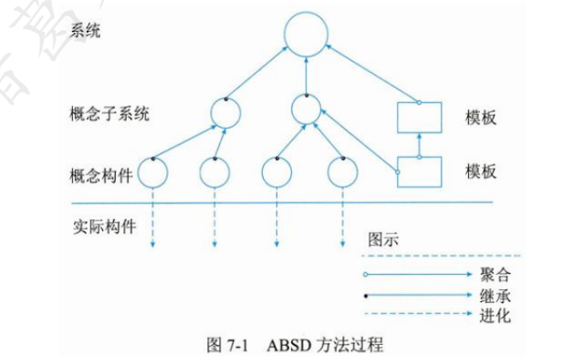

# 2023年下半年 系统架构设计师 · 上午题综合知识（回忆版）

> 卷面信息（来源第 55 页卷首）：
> - 标题：全国计算机技术与软件专业技术资格（水平）考试 **2023 下半年 系统架构设计师 综合知识**（软考诸葛老师整理）
> - 说明：**机考之后，不会再有完整版真题流出，以后只有知识点回忆版及模拟题，请知晓。**
> - 本卷仅有 (1)–(7) 七道考生回忆版完整题（含题干与选项），其后为"综合知识"考点清单（按原卷题号 1–75 逐条列出考点与所选项要点，无完整题干）。综合知识正常为 75 道选择题，本卷其余题目仅以此清单形式回忆。

## 题号目录

| 题号 | 考点 | 教程章节 |
|------|------|----------|
| Q01（原卷(1)） | 操作系统·内核功能（进程/内存/文件/设备管理） | 02 计算机系统 |
| Q02（原卷(2)） | 数据库·范式判定（员工姓名-工资级别-工资金额） | 06 数据库设计 |
| Q03（原卷(3)） | 嵌入式系统定义（功能、可靠性、成本、体积和功耗） | 16 嵌入式系统 |
| Q04（原卷(4)） | 软件架构风格定义（词汇表＋一组约束） | 07 系统架构设计 |
| Q05（原卷(5)） | ABSD 方法三个基础之"功能的分解" | 07 系统架构设计 |
| Q06（原卷(6)） | ABSD 最顶层分解（概念子系统＋软件模板） | 07 系统架构设计 |
| Q07（原卷(7)） | 体系结构需求来源（质量目标/业务目标/开发人员商业目标） | 07 系统架构设计 |
| 题号 1–75 考点清单 | 见下文"综合知识考点清单" | — |

## 原题转录（视觉核验）

---

## Q01

> 【考生回忆版】内核是指操作系统的核心部分，它负责管理和控制计算机系统的所有硬件和软件资源。它的作用包括提供基本的系统服务和功能__(1)__。

- A. 进程管理、内存管理、文件管理、设备管理
- B. 线程管理、IO 管理、资源管理、作业管理

**来源所列答案**：A
**来源解析**：真题缺失。

> 校核注：来源页仅列出 A、B 两个选项，C、D 选项缺（见文末缺口清单）。

---

## Q02

> 【考生回忆版】数据库设计
> 关系模型（员工姓名，工资级别，工资金额），其中员工姓名是主键，工资级别决定工资金额，请问满足__(2)__范式。

- A. 2NF
- B. 3NF
- C. BCNF
- D. 4NF

**来源所列答案**：A
**来源解析**：第一范式（1NF）：确保每列都是原子的，即不可再分。根据描述，此模型显然满足 1NF。
第二范式（2NF）：要求在 1NF 的基础上，所有非主属性完全依赖于整个主键，而不是主键的一部分。在这个模型中，"工资金额"依赖于"工资级别"，但题目说明"工资级别"是通过"员工姓名"这个主键间接决定的，因此"工资金额"实际上依赖于整个主键"员工姓名"，所以模型满足 2NF。
第三范式（3NF）：要求在 2NF 的基础上，所有非主属性不传递依赖于主键。这里的问题在于"工资金额"对"员工姓名"的依赖是通过"工资级别"传递的，这违反了 3NF 的要求，除非"工资级别"本身也是一个独立的属性，直接由"员工姓名"决定，而不是作为决定"工资金额"的中间变量。然而，题目并未明确说明这一点，仅提到"工资级别决定工资金额"，因此按照严格定义，此模型可能不直接满足 3NF。

---

## Q03

> 【考生回忆版】嵌入式系统及软件
> 嵌入式系统是以应用为中心，以现代计算机技术为基础，能够根据用户需求__(3)__灵活裁剪软硬件模块的专用计算机系统。

- A. 功能、可靠性、成本、体积和功耗
- B. 功能、可靠性、安全、体积和功耗
- C. 功能、可靠性、实时、体积和功耗
- D. 功能、可靠性、稳定、体积和功耗

**来源所列答案**：A
**来源解析**：（教材 P47）嵌入式系统是以应用为中心、以计算机技术为基础，并将可配置与可裁减的软、硬件集成于一体的专用计算机系统，需要满足应用对功能、可靠性、成本、体积和功耗等方面的严格要求。

---

## Q04

> 【考生回忆版】系统架构设计
> 软件架构风格描述某一特定应用领域中系统组织方式的惯用模式。架构风格定义一个系统家族，即一个体系结构定义__(4)__。

- A. 一组构件和一组约束
- B. 一组模块和一个连接件
- C. 一个词汇表和一组约束
- D. 一个系统和一组连接件

**来源所列答案**：C
**来源解析**：（教材 P259）软件体系结构风格是描述某一特定应用领域中系统组织方式的惯用模式。体系结构风格定义一个系统家族，即一个体系结构定义一个词汇表和一组约束。

---

## Q05

> 【考生回忆版】系统架构设计
> 基于架构的软件设计（Architecture-Based Software Design，ABSD）方法进行软件设计与开发。ABSD 方法有三个基础，分别是对系统进行__(5)__分解、采用合适的架构风格实现质量属性与商业需求、采用软件模板设计软件结构。

- A. 系统
- B. 模块
- C. 子系统
- D. 功能

**来源所列答案**：D
**来源解析**：（教材 P254）ABSD 方法有 3 个基础。第 1 个基础是功能的分解。在功能分解中，ABSD 方法使用已有的基于模块的内聚和耦合技术。第 2 个基础是通过选择体系结构风格来实现质量和商业需求。第 3 个基础是软件模板的使用，软件模板利用了一些软件系统的结构。
基于架构的软件设计（Architecture-Based Software Design，ABSD）是一个自顶向下，递归细化的软件开发方法，它以系统功能的分解为基础，通过选择架构风格实现质量和业务需求，并强调在架构设计过程中使用软件架构模板因此，正确答案是：D。

---

## Q06

> 【考生回忆版】系统架构设计
> ABSD 方法是一个自顶向下，递归细化的方法，ABSD 方法在最顶层，系统被分解为若干__(6)__和一个或者多个软件模板。

- A. 系统
- B. 构件
- C. 模块
- D. 概念子系统

**来源所列答案**：D
**来源解析**：（教材 P254）ABSD 方法中使用的设计元素如图 7-1 所示。在最顶层，系统被分解为若干概念子系统和一个或若干个软件模板。在第 2 层，概念子系统又被分解成概念构件和一个或若干个附加软件模板。

---

## Q07

> 【考生回忆版】系统架构设计
> 架构需求一般来自三个方面，分别是系统的质量目标、系统的业务目标和__(7)__。

- A. 系统开发人员的业务目标
- B. 公司的经济目标
- C. 公司的业务目标
- D. 需求人员的业务目标

**来源所列答案**：A
**来源解析**：（教材 P255）体系结构需求一般来自 3 个方面，分别是系统的质量目标、系统的商业目标和系统开发人员的商业目标。软件体系结构需求获取过程主要是定义开发人员必须实现的软件功能，使得用户能完成他们的任务，从而满足业务上的功能需求。与此同时，还要获得软件质量属性，满足一些非功能需求。

> 校核注：试题（7）解析跨答案解析 PDF 第 110–111 页，已合并转录。

---

## 综合知识考点清单（考生回忆，题号 1–75）

> 来源：2019-2024系统架构设计师真题-综合知识.pdf 第 56–59 页（软考诸葛老师整理）。以下按原卷题号逐条照录，括号内为当时所选/所答要点；**只有考点与答案要点回忆，无完整题干与选项**。

1-2. Mccabe 度量法（错误的是 V(g)=m-n+1、最大范围≤10）
3. 多线程任务通信方式（共享内存+消息传递）
4. 星型拓扑结构最多 2 跳
5. 数据库（A->B,B->C），属于 2NF
6. 数据库去除多值依赖属于 4NF
7. 不仅关注输入输出，也关注逻辑测试：灰盒测试
8. 数据库语句（having+group by）
9. web 新型测试：A/B 测试
10. SSL 不具备特性（不可抵赖性）
11-12. symsl 新增（需求图），其中（需求图）描绘了需求
13. 面向对象需求不断新增开发模型（喷泉模型）
14. 开发和测试同时进行（W 模型）
15. 阶段结束后输出物经过评审变为（软件配置项）
16. 敏捷开发说法不正确的是（以用例为中心）
17. 进度管理，数学题（选择 6 天）
18. 数学题，给定序列推导，说法不正确的是（参数取值 0.1-0.3）
19. 单 CPU 任务运行时（任务交替运行）
20. 通道是（CPU）连接外设的
21. 软件架构复用包括机会复用和（系统复用）
22. 数据库展示给用户的是（外模式）
23. 静态架构评估（static）
24-25. 可靠性计算，（MTTF 与 MTBF 时间几乎相等），包括（容错性和健壮性）
26. 不对称加密算法（RSA）
27-28. 质量属性（性能+可移植性）
29. 内核功能包括（进程管理+文件系统管理+设备驱动管理+内存管理）
30. 架构是（一组词汇表+约束）
31. 需求分析常用（petri 网）
32. PDCA 指的是（计划、执行、检查和处理）
33. （进程）是操作系统分配资源最小单位
34. 质量效用树结构（树根-质量属性-属性分类-质量属性场景
35-36. M2M 包含部分有（智能化机器+M2M 硬件+通信网络+中间件+应用），其中（应用）对获得的数据进行加工分析，提供决策依据
37. DSSA 说法正确的是（因为 DSSA 领域不同，所以使用互有差异）
38. D0178 包括（指导、目标、活动、证据）
39. CDN 和反向代理都是基于（缓存）
40. 专利许可不包括（特殊许可）
41. 关于局域网说法错误的是（非封闭性网络）
42. （两层胖客户端+瘦服务器）
43-44. ABSD 最顶层被分解为（概念子系统），ABSD 需求来源（开发人员商业目标）
45. 哪种类型不适合自动化测试（需求频繁变化的）
46. 嵌入式系统设计中要考虑的因素（可升级、可配置、易于操作、接口规范、重量、功耗、成本、开发周期）
47. C 语言机器学习算法题（blast）
48. NPU 说法正确的是（计算速度快，性能好）
49-50. 质量属性场景刺激发生的条件（环境），针对性能影响度量（吞吐量）
51. SAAM 主要输入的问题是问题描述、（需求说明）和架构描述文档
52. ABSD 方法进行软件开发时，需要经历架构需求、架构设计、架构文档化、架构复审、架构实现和架构（演化）
53-54. 领域分析阶段获得（领域模型），领域输出阶段获得（特定领域软件架构）
55. 数据库风格，对批处理和管道进行比较错误的是（管道节点并行）
56. 构件接口调用其他服务是（分层，不是叠加）
57. 变更管理顺序（提出变更申请、进行风险评估、进行变更批准、开展变更实施、变更验证、存档）
58-59. 代码覆盖率是（单元测试），链接测试点是（web）
60. 区块链没有（行业链）
61. 构件说法错误的是（构件没有外部可见状态）
62. （构件检索）需求列表，构件建立分类索引模式
63-64. 构件分别是（适应性构件）和（装配性构件）
65. 构建管理包括构件描述、（构件分类）、构件库组织等
66. 专利说法错误的是（专利一定是申请人、发明人的）
67. （契约式）接口开发
68-69. 构件（可组装性）所外部接口必须通过公开接口定义，和（可部署性）必须能作为一个独立实体在构件平台上运行
70. 某排序题
71-75. 层次式体系结构设计是将系统组成一个层次结构，每一层为上层服务，并作为下层客户。在（一些 some）层次系统中，除了一些精心挑选的输出函数外，内部的层接口只对相邻的层（可见 show）。连接件通过决定层间如何交互的协议来定义，拓扑约束包括对相邻层间交互的（约束 limiting）。由于每一层最多只影响两层，同时只要给相邻层提供相同的接口，可传递的系统级（抽象 abstrate）允许每层用不同的方法实现，同样为软件重用提供了强大的支持。在分层次体系结构中的组件被（划分 partition）成几个层，每个层代表应用的一个功能，都有自己特定的角色和职能。

> 校核注：另源《2023年软考系统架构师考题分享.pdf》第 2–7 页载有同一份清单（其标题误标为"上午案例知识"，内容实为综合知识选择题考点），并注明"答案仅供参考，不一定正确"。两处文字基本相同，差异：① 清单第 1-2 条该本作"最大范围<10"，本卷主来源作"最大范围≤10"；② 第 41 条该本作"非封闭性网"，主来源作"非封闭性网络"。本卷以主来源文字为准。
> 校核注：另源《2023年下半年系统架构设计师wen老师整理.pdf》第 2–3 页以连贯文字载有同一考点汇总（McCabe 度量法、多线程/共享内存与消息传递、星型拓扑、第 2 范式、灰盒测试、AB 测试、喷泉模型、软件配置项、敏捷模型、外模式、机会复用和系统复用、RSA、性能/可移植性、行业链、static、MTTF 与 MTBF、容错性和健壮性、构件分类、词汇表和一组约束、M2M、group by having、内核功能 4 大管理、SysML 需求图、PDCA、进程、质量属性效用树、DO178、ABSD 3 个基础功能的分解、领域设计阶段产出、演化、环境、吞吐量、缓存、SAAM 主要输入、特殊许可、非封闭性网络、多值依赖第四范式、M2M 组成、两层胖客户端瘦服务器、嵌入式系统因素、需求分析、机器学习算法特点、概念子系统、开发人员商业目标、自动化测试不适用场景、喷泉模型等），与主来源清单内容一致。

---

## 缺口清单

- **Q01（原卷(1)）**：来源页仅见 A、B 两个选项，C、D 选项缺失（原件即如此）。
- **题号 8–75**（即 (1)–(7) 之外的其余 68 题）：仅有上列"综合知识考点清单"式回忆（考点＋所答要点），无完整题干与选项；其中第 34 条原文即未闭合括号，第 62 条原文以分号结尾，均照录保留。
- 本卷为机考后考生回忆版，不存在完整版试卷；不以任何方式补造缺失题干、选项或答案。

## 附：另源下午案例/论文回忆（不属于本卷，供下午题卷参考）

> 以下为合并来源中超出本卷（上午综合知识）范围的内容，仅登记出处，不属本卷正文。

- 《2023年软考系统架构师考题分享.pdf》第 7–11 页：下午案例"大数据必选题"较完整回忆——某网奥运门户大数据平台案例，[问题1]（8 分）Lambda 与 Kappa 架构对比填空表，[问题2]（9 分）架构图（图 1）技术填空（a Nginx、b Hbase、c Spark Streaming、d Spark、e MapReduce、f ETL、g MemSQL、h HDFS、i Sqoop、j Flume、k 数据存储层、l kafka、m 业务逻辑层、n 数据采集层），[问题3]（8 分，每空 2 分）Lambda 三层填空；附参考答案（问题1：2/1/高/低/必要时进行全量计算计算开销相对较小/满足实时性/大/弱；问题2：d/e/k/g/h/l/j/f/n；问题3：批处理层/加速层/服务层，基于 Lambda 架构）。第 10 页含大数据架构图（图 1）。
- 《2023年软考系统架构师考题分享.pdf》第 11–13 页：JWT（JSON Web Token）介绍材料（称"教材没有的超纲内容"，含 Header/Payload/Signature 截图）；Hibernate 架构教材截图（图 13-14）；下午论文四题列表：可靠性分析与评价方法、面向对象分析（ooa）、多数据源、边云协同（附"前两个是可以写的"建议）。
- 《2023年下半年系统架构设计师wen老师整理.pdf》第 3–4 页：案例五题回忆要点（试题一 大数据 Lambda/Kappa 为考前押题原题；试题二 JWT 特点及图填空属嵌入式范畴、超纲不建议选；试题三 数据持久层/Redis 数据丢失/数据库读写分离建议选；试题四 Hibernate 架构超纲；试题五 SysML 七个关系填图，需求图与用例图考点），建议选 1、3、5；论文四题回忆（可靠性分析与评价方法、面向对象分析押中、多数据源、边云协同六协同：资源/数据/智能/应用管理/业务管理/服务）。
- 《2023年下半年系统架构设计师wen老师整理.pdf》第 1 页与《2023年软考系统架构师考题分享.pdf》第 1 页：软考达人广告页（二维码），不属于试卷内容。
