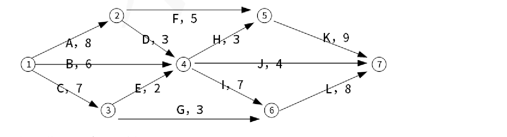

# 2024上半年 系统架构设计师 · 上午题综合知识

> 卷面信息：本卷为**网友回忆版**汇编，非正式试卷影印。主来源（DOCX）封面仅标注"24 年 5 月系统架构设计师真题(回忆) 一、综合知识"，无考试时间/分值说明；合并来源B（软考诸葛老师）封面说明："机考之后，不会再有完整版真题流出，只有考生回忆版、知识点及模拟题"。上午综合知识原卷共 75 题，本回忆卷实际覆盖 Q01–Q42（另附原卷 71-75 英文题考点提示），其余题目未回忆到，见文末缺口清单。其中 Q01–Q35 中的 31 题已补入软考诸葛老师《2024上半年 系统架构设计师 综合知识 答案解析》原文解析（答案解析册第112页下部–第120页上部，题内标注"答案解析册第N页，试题(N)"）；该解析册采用与软考诸葛老师题册相同的试题编号(1)–(31)。

## 题号目录

| 题号 | 考点 | 教程章节 |
|------|------|----------|
| Q01 | 净室软件工程 | 05 软件工程 |
| Q02 | 系统测试依据 | 05 软件工程 |
| Q03 | 敏捷开发核心思想 | 05 软件工程 |
| Q04 | DSSA 领域模型阶段 | 07 架构设计基础 |
| Q05 | 三层 C/S 结构 | 07 架构设计基础 |
| Q06 | 黑板体系结构风格 | 07 架构设计基础 |
| Q07 | ATAM 关注的 4 种质量属性 | 08 质量属性与评估 |
| Q08 | 构件概念 | 07 架构设计基础 |
| Q09 | 软件复用三阶段 | 07 架构设计基础 |
| Q10 | 质量属性按生命周期分类 | 08 质量属性与评估 |
| Q11 | REST 描述 | 07 架构设计基础 |
| Q12–Q13 | 质量属性场景六要素 | 08 质量属性与评估 |
| Q14–Q15 | 构件组装方式与接口不兼容 | 07 架构设计基础 |
| Q16–Q17 | 可用性/互操作性质量属性 | 08 质量属性与评估 |
| Q18 | 软件可靠性管理·需求分析 | 09 软件可靠性 |
| Q19 | 安全保护等级划分 | 04 信息安全 |
| Q20–Q21 | 安全性分类（机密性/不可否认性） | 04 信息安全 |
| Q22 | 关键路径/最短工期 | 03 信息系统基础 |
| Q23 | 嵌入式系统典型架构 | 16 嵌入式架构 |
| Q24 | 多道程序设计 | 02 计算机系统 |
| Q25 | 进程调度算法（先来先服务） | 02 计算机系统 |
| Q26 | 关系代数·笛卡尔积 | 06 数据库 |
| Q27 | 事务特性 | 06 数据库 |
| Q28 | 线性规划最优解 | 03 信息系统基础 |
| Q29 | 知识产权法律范畴 | 03 信息系统基础 |
| Q30 | 专利客体 | 03 信息系统基础 |
| Q31 | 企业应用集成 EAI 四层 | 12 信息系统架构 |
| Q32 | 物联网三层 | 11 未来信息技术 |
| Q33 | 数字孪生生态系统 | 11 未来信息技术 |
| Q34 | 软件测试说法 | 05 软件工程 |
| Q35 | UML 用例图关系 | 05 软件工程 |
| Q36 | 分页存储管理·页表 | 02 计算机系统 |
| Q37 | ATAM 需求模型折中 | 08 质量属性与评估 |
| Q38 | Web 服务描述 WSDL | 15 面向服务 |
| Q39 | 访问控制 RBAC 发展 | 04 信息安全 |
| Q40 | 可靠性指标 MTTF/MTTR | 09 软件可靠性 |
| Q41 | 关系范式 | 06 数据库 |
| Q42 | 数据库设计阶段·数据结构调整 | 06 数据库 |

> 原卷 71-75：英文题（主来源注：架构师和需求分析时的关系；合并来源B考点汇总：专业英语考"需求管理内容"）。仅考点提示，原题未回忆到，见文末缺口清单。

## 原题转录（视觉核验）

---

## Q01

以下关于净室软件工程的描述中，哪项是不正确的（ B ）。

- A. 净室软件工程是一种以合理成本开发高质量软件的方法
- B. 净室软件工程无需进行传统的模块测试
- C. 净室软件工程的理论基础主要是函数理论和抽样理论
- D. 采用正确性验证，使得净室项目的软件质量有了极大的提高

**来源所列答案**：B
**来源解析**：（答案解析册第114页，试题(7)）净室(Cleaning Room)软件工程是一种应用数学与统计学理论以经济的方式生产高质量软件的工程技术，力图通过严格的工程化的软件过程达到开发中的零缺陷或接近零缺陷。净室方法不是先制作一个产品，再去消除缺陷，而是要求在规约和设计中消除错误，然后以“净”的方式制作，可以降低软件开发中的风险，以合理的成本开发出高质量的软件。1、净室软件工程的理论基础主要是函数理论和抽样理论。2、净室软件工程中应用的技术手段主要有以下 4 种。①统计过程控制下的增量式开发；②基于函数的规范与设计；③正确性验证(正确性验证被认为是 CSE 的核心，正是由于采用了这一技术，净室项目的软件质量才有了极大的提高。)；④统计测试和软件认证。3、净室软件工程在使用的过程中，也显示出一些缺点。1) CSE 太理论化，需要更多的数学知识。其正确性验证的步骤比较困难且比较耗时。CSE 要求采用增量式开发、盒子结构、统计测试方法，普通工程师必须经过加强训练才能掌握，开发软件的成本比较高昂。2) CSE 开发小组不进行传统的模块测试，这是不现实的。工程师可能对编程语言和开发环境还不熟悉，而且编译器或操作系统的 bug 也可能导致未预期的错误。3) CSE 毕竟脱胎于传统软件工程，不可避免地带有传统软件工程的一些弊端。

> 校核注：希赛版（第2页第6题）同题同答案 B，一致。

---

## Q02

系统测试的依据是（ B ）。

- A. 软件详细设计说明书
- B. 软件需求规格说明书
- C. 软件概要设计说明书
- D. 软件用户手册

**来源所列答案**：B
**来源解析**：（答案解析册第115页，试题(9)）系统测试的依据是软件需求规格说明书。系统测试采用黑盒测试，以此来检查该系统是否符合软件需求。

> 校核注：希赛版（第2页第7题）同题同答案 B，一致。

---

## Q03

以下关于软件敏捷开发方法的核心思想说法错误的是（ C ）。

- A. 敏捷方法遵循迭代增量式开发过程
- B. 敏捷方法以原型开发思想为基础
- C. 敏捷方法是适应型、可预测型
- D. 敏捷方法以人为本而非以过程为本

**来源所列答案**：C
**来源解析**：（答案解析册第114页，试题(6)）敏捷方法是适应型，非可预测型。

> 校核注：希赛版（第2页第8题）同题同答案 C，一致。

---

## Q04

在特定应用领域软件体系结构的设计中，（ B ）阶段的主要目标是获得领域模型。

- A. 领域实现
- B. 领域设计
- C. 领域建模
- D. 领域分析

**来源所列答案**：B
**来源解析**：（答案解析册第117页，试题(18)）DSSA 的基本活动：1.领域分析——这个阶段的主要目标是获得领域模型。领域模型描述领域中系统之间的共同需求，即领域模型所描述的需求为领域需求。2.领域设计——这个阶段的主要目标是获得 DSSA。DSSA 描述在领域模型中表示的需求的解决方案，它不是单个系统的表示，而是能够适应领域中多个系统的需求的一个高层次的设计。3.领域实现——这个阶段的主要目标是依据领域模型和 DSSA 开发和组织可重用信息。这些可重用信息可能是从现有系统中提取得到，也可能需要通过新的开发得到。它们依据领域模型和 DSSA 进行组织，也就是领域模型和 DSSA 定义了这些可重用信息的重用时机，从而支持了系统化的软件重用。

> ⚠️ 待核验：合并来源（希赛版第2页第9题）同题标注答案为 **D（领域分析）**，与本来源（B 领域设计）冲突。按主来源为正文，差异照录于此。

---

> 校核注（答案解析册）：《2019-2024系统架构设计师真题-答案解析》第117页试题(18)参考答案为 **D（领域分析）**，解析明确“领域分析这个阶段的主要目标是获得领域模型”，支持希赛版答案，与主来源(DOCX)所标 B 冲突；本卷仍按契约照录主来源答案，备考建议按 D 掌握。
## Q05

与两层 C/S 结构相比，三层 C/S 结构增加了一个应用服务器。这时，整个应用逻辑驻留在应用服务器上，（ C ）存在于客户机上。

- A. 感知层
- B. 服务层
- C. 表示层
- D. 数据层

**来源所列答案**：C
**来源解析**：未提供

> 校核注：希赛版（第3页第10题）同题同答案 C，一致。

---

## Q06

在经典的体系结构风格分类中，黑板体系结构风格属于（ A ）的子风格。

- A. 以数据为中心风格
- B. 解释器风格
- C. 独立构件风格
- D. 虚拟机风格

**来源所列答案**：A
**来源解析**：未提供

> 校核注：希赛版（第3页第11题）同题同答案 A，一致。

---

## Q07

在 ATAM 评估方法设计之初，其主要关注的 4 种质量属性，分别为（ B ）。

- A. 性能、安全性、可修改性和可测试性
- B. 性能、安全性、可修改性和可用性
- C. 性能、可修改性、可用性和可测试性
- D. 安全性、可测试性、可用性和可测试性

**来源所列答案**：B
**来源解析**：（答案解析册第119页，试题(27)）架构权衡分析方法(Architecture Trade off Analysis Method，ATAM)是在 SAAM 的基础上发展起来的，主要针对性能、实用性、安全性和可修改性，在系统开发之前，对这些质量属性进行评价和折中。(其中实用性就是可用性)

> 校核注：希赛版（第3页第12题）同题同答案 B，一致。

---

## Q08

以下关于构件的描述中，（ C ）是不正确的。

- A. 构件是二进制形式，无需在部署前编译
- B. 构件元数据是构件本身相关的数据
- C. 构件是通用实体，不能对构件进行配置来适应应用系统
- D. 构件是一个独立的软件单元

**来源所列答案**：C
**来源解析**：未提供

> 校核注：希赛版（第3页第13题）同题同答案 C，一致。

---

## Q09

软件复用的基本过程可以划分为三个阶段，其中，（ A ）阶段主要是构造恰当的、可复用的资产。

- A. 获取可复用的资产
- B. 分析可复用资产
- C. 管理可复用资产
- D. 使用可复用资产

**来源所列答案**：A
**来源解析**：（答案解析册第117页，试题(17)）复用的基本过程主要包括 3 个阶段：首先构造/获取可复用的软件资产，其次管理这些资产，最后针对特定的需求，从这些资产中选择可复用的部分，以开发满足需求的应用系统。1.复用的前提：获取可复用的软件资产：首先需要构造恰当的、可复用的资产，并且这些资产必须是可靠的、可被广泛使用的、易于理解和修改的。2.管理可复用资产：该阶段最重要的是：构件库(Component Library)，由于对可复用构件进行存储和管理，它是支持软件复用的必要设施。构件库中必须有足量的可复用构件才有意义，构件库应提供的主要功能包括构件的存储、管理、检索以及库的浏览与维护等，以及支持使用者有效地、准确地发现所需的可复用构件。在这个过程中，存在两个关键问题：一是构件分类，构件分类是指将数量众多的构件按照某种特定方式组织起来；二是构件检索，构件检索是指给定几个查询需求，能够快速准确地找到相关构件。3.使用可复用资产：在最后阶段，通过获取需求，检索复用资产库，获取可复用资产，并定制这些可复用资产：修改、扩展、配置等，最后将它们组装与集成，形成最终系统。

> 校核注：希赛版（第4页第14题）同题同答案 A，一致。

---

## Q10

基于软件系统的生命周期，可以将软件系统的质量属性分为（ B ）两个部分。

- A. 需求分析期质量属性和设计期质量属性
- B. 开发期质量属性和运行期质量属性
- C. 设计期质量属性和开发期质量属性
- D. 设计期质量属性和运行期质量属性

**来源所列答案**：B
**来源解析**：（答案解析册第118页，试题(22)）软件系统质量属性(Quality Attribute)是一个系统的可测量或者可测试的属性，用来描述系统满足利益相关者(Stakeholders)需求的程度。基于软件系统的生命周期，可以将软件系统的质量属性分为开发期质量属性和运行期质量属性 2 个部分。开发期质量属性主要指在软件开发阶段所关注的质量属性，主要包含 6 个方面：易理解性、可扩展性、可重用性、可测试性、可维护性、可移植性。运行期质量属性主要指在软件运行阶段所关注的质量属性，主要包含 7 个方面：性能、安全性、可伸缩性、互操作性、可靠性、可用性、鲁棒性。

> 校核注：希赛版（第4页第15题）同题同答案 B，一致。

---

## Q11

以下关于 REST 的描述中，（ B ）是不正确的。

- A. REST 的状态转移是借助 HTTP 方法来实现
- B. URI 和资源是多对多关系
- C. REST 是一种设计风格而不是一个架构
- D. REST 是以资源为中心构建的

**来源所列答案**：B
**来源解析**：（答案解析册第116页，试题(16)）URI 和资源是一对一关系。

> 校核注：希赛版（第4页第16题）同题同答案 B，一致。

---

## Q12

为了精确描述软件系统的质量属性，通常采用（ A ）作为描述质量属性的手段。

- A. 质量属性场景
- B. 质量属性环境分析
- C. 质量属性效用树
- D. 质量属性需求用例分析

**来源所列答案**：A
**来源解析**：（答案解析册第119页，试题(25)(26)）为了精确描述软件系统的质量属性，通常采用质量属性场景作为描述质量属性的手段。其中，响应描述在激励到达后所采取的行动。

> 校核注：希赛版（第4页第17题第一空）同答案 A，一致。

---

## Q13

（承 Q12 题干）其中，（ C ）描述在激励到达后所采取的行动。

- A. 响应度量
- B. 制品
- C. 响应
- D. 刺激

**来源所列答案**：C
**来源解析**：（承 Q12，答案解析册第119页，试题(25)(26)同一条解析）为了精确描述软件系统的质量属性，通常采用质量属性场景作为描述质量属性的手段。其中，响应描述在激励到达后所采取的行动。

> 校核注：希赛版（第4页第17题第二空）同答案 C，一致。

---

## Q14

构件组装是指构件相互直接集成或是用"胶水代码"将其整合在一起来创造一个系统或另一个构件的过程。其中，构件组装常见的方式不包括（ D ）组装。

- A. 层次
- B. 叠加
- C. 顺序
- D. 循环

**来源所列答案**：D
**来源解析**：（答案解析册第115页，试题(10)(11)）构件组装是指构件相互直接集成或是用“胶水代码”将其整合在一起来创造一个系统或另一个构件的过程。常见的方式包括：顺序组装、层次组装、叠加组装。同时，构件组装中经常会面临接口不兼容的问题，如果一个构件的提供接口是另一个构件请求接口的一个子集，则属于操作不完备的情况。

> 校核注：希赛版（第5页第18题第一空）同答案 D，一致。

---

## Q15

（承 Q14 题干）同时，构件组装中经常会面临接口不兼容的问题，如果一个构件的提供接口是另一个构件请求接口的一个子集，则属于（ D ）的情况。

- A. 参数不兼容
- B. 操作不兼容
- C. 返回值不匹配
- D. 操作不完备

**来源所列答案**：D
**来源解析**：（承 Q14，答案解析册第115页，试题(10)(11)同一条解析）构件组装是指构件相互直接集成或是用“胶水代码”将其整合在一起来创造一个系统或另一个构件的过程。常见的方式包括：顺序组装、层次组装、叠加组装。同时，构件组装中经常会面临接口不兼容的问题，如果一个构件的提供接口是另一个构件请求接口的一个子集，则属于操作不完备的情况。

> 校核注：希赛版（第5页第18题第二空）同答案 D，一致。

---

## Q16

在软件系统质量属性(Quality Attribute)中，（ A ）关注系统在一定时间内正常工作的时间所占的比例。

- A. 可用性
- B. 可修改性
- C. 性能
- D. 安全性

**来源所列答案**：A
**来源解析**：（答案解析册第118-119页，试题(23)(24)）(1)性能：性能是指软件系统及时提供相应服务的能力，如速度、吞吐量和容量等的要求。(2)安全性：指软件系统同时兼顾向合法用户提供服务，以及阻止非授权使用的能力。(3)可伸缩性：指当用户数和数据量增加时，软件系统维持高服务质量的能力。例如，通过增加服务器来提高能力。(4)互操作性：指本软件系统与其他系统交换数据和相互调用服务的难易程度。(5)可靠性：软件系统在一定的时间内持续无故障运行的能力。(6)可用性：指系统在一定时间内正常工作的时间所占的比例。可用性会受到系统错误，恶意攻击，高负载等问题的影响。

> 校核注：希赛版（第5页第19题，题内标注原卷空号为(74)）同答案 A，一致；该题在原卷中的位置约为第 74-75 题。

---

## Q17

（承 Q16 题干）（ A ）关注软件系统与其他系统交换数据和相互调用服务的难易程度。

- A. 互操作性
- B. 可靠性
- C. 可伸缩性
- D. 易用性

**来源所列答案**：A
**来源解析**：（承 Q16，答案解析册第118-119页，试题(23)(24)同一条解析）其中，互操作性指本软件系统与其他系统交换数据和相互调用服务的难易程度（该解析将“可用性”“互操作性”等 6 项逐一释义，见 Q16）。

> ⚠️ 待核验：本来源标注答案为 A（互操作性）；合并来源（希赛版第5页第19题，原卷空号(75)）标注答案为 **C（互操作性）**——注意希赛版该题第二组选项排版为 A.可靠性 B.可伸缩性 C.互操作性 D.易用性，故其字母 C 对应文字"互操作性"，与主来源文字答案实为同一选项，仅字母排序不同，**文字答案一致，不视为实质冲突**。
> 校核注：另源（软考诸葛老师版第64页第(24)题）同题选项与主来源相同（A.可靠性 B.可伸缩性 C.互操作性 D.易用性），未给答案。

---

> 校核注（答案解析册）：《2019-2024系统架构设计师真题-答案解析》第118-119页试题(23)(24)参考答案 A、C，其选项排序与软考诸葛老师题册一致（“互操作性”为其 C），文字答案“互操作性”再次确认；主来源按题干(74)(75)原卷位置为约第 74-75 题。
## Q18

在软件可靠性管理过程中，以下工作不属于需求分析阶段应完成的是（ C ）。

- A. 分析可能影响可靠性的因素
- B. 确定软件的可靠性目标
- C. 可靠性建模
- D. 确定可靠性的验收标准

**来源所列答案**：C
**来源解析**：（答案解析册第119页，试题(28)）本题考查软件可靠性管理相关概念。需求分析的任务包括：①确定软件的可靠性目标；②分析可能影响可靠性的因素；③确定可靠性的验收标准；④制定可靠性管理框架；⑤制定可靠性文档编写规范；⑥制定可靠性活动初步计划；⑦确定可靠性数据收集规范。可靠性建模是测试阶段的任务，本题选择 C 选项。

> 校核注：希赛版（第5页第20题）同题同答案 C，一致。

---

## Q19

《计算机信息系统安全保护等级划分准则》把计算机信息安全划分为了 5 个等级，其中安全保护等级最高的是（ D ）。

- A. 安全标记保护级
- B. 结构化保护级
- C. 系统审计保护级
- D. 访问验证保护级

**来源所列答案**：D
**来源解析**：（答案解析册第116页，试题(14)）《计算机信息系统安全保护等级划分准则》把计算机信息安全划分为了 5 个等级，安全性从低到高依次为第 1 级：用户自主保护级(对应 TCSEC 的 C1 级)、第 2 级：系统审计保护级(对应 TCSEC 的 C2 级)、第 3 级：安全标记保护级(对应 TCSEC 的 Bi 级)、第 4 级：结构化保护级(对应 TCSEC 的 B2 级)和第 5 级：访问验证保护级(对应 TCSEC 的 B3 级)。

> 校核注：希赛版（第6页第21题）同题同答案 D，一致。

---

## Q20

安全性（security）是指系统在向合法用户提供服务的同时能够阻止非授权用户使用的企图或拒绝服务的能力。安全性可根据系统可能受到的安全威胁类型来分类。其中，（ D ）保证信息不泄露给未授权的用户、实体或过程。

- A. 可控性
- B. 完整性
- C. 不可否认性
- D. 机密性

**来源所列答案**：D
**来源解析**：（答案解析册第118页，试题(20)(21)）安全性(security)是指系统在向合法用户提供服务的同时能够阻止非授权用户使用的企图或拒绝服务的能力。安全性可根据系统可能受到的安全威胁类型来分类。其中，机密性保证信息不泄露给未授权的用户、实体或过程；不可否认性是指信息交换的双方不能否认其在交换过程中发送信息或接收信息的行为。

> 校核注：希赛版（第6页第22题第一空）同答案 D，一致。

---

## Q21

（承 Q20 题干）（ C ）是指信息交换的双方不能否认其在交换过程中发送信息或接收信息的行为。

- A. 完整性
- B. 机密性
- C. 不可否认性
- D. 可控性

**来源所列答案**：C
**来源解析**：（承 Q20，答案解析册第118页，试题(20)(21)同一条解析）安全性可根据系统可能受到的安全威胁类型来分类。其中，机密性保证信息不泄露给未授权的用户、实体或过程；不可否认性是指信息交换的双方不能否认其在交换过程中发送信息或接收信息的行为。

> 校核注：希赛版（第6页第22题第二空）同答案 C，一致。

---

## Q22

某项目包括 A~L 共 12 个作业，其实施的衔接关系如下图所示。图中各作业箭线旁标注了作业名称以及完成该作业所需的天数。

该项目的工期至少需要（ A ）天。

- A. 26
- B. 65
- C. 10
- D. 22

**来源所列答案**：A
**来源解析**：（答案解析册第116页，试题(12)）关键路径是项目中的最长路径，决定着项目的总工期(最短工期)，关键路径上的活动称为关键活动。这里从图中可以计算出，关键路径为 ADIL，工期为 8+3+7+8=26 天。

> 校核注：希赛版（第6-7页第23题）同题同答案 A，一致。主来源（DOCX 第8页）此题原图缺失（版面空白），图取自希赛版第6页。

---

## Q23

大多数嵌入式系统都具备实时特征，其典型架构可概括为（ C ）两种模型。

- A. 层次化模式架构和代理模式架构
- B. 层次化模式架构和点对点模式架构
- C. 层次化模式架构和递归模式架构
- D. 递归模式架构和点对点模式架构

**来源所列答案**：C
**来源解析**：（答案解析册第113页，试题(5)）大多数嵌入式系统都具备实时特征，其典型架构可以概括为层次化模式架构和递归模式架构。

> 校核注：希赛版（第7页第24题）同题同答案 C，一致。

---

## Q24

操作系统中采用多道程序设计技术可以提高 CPU 和外部设备的（ A ）。

- A. 利用率
- B. 可靠性
- C. 兼容性
- D. 稳定性

**来源所列答案**：A
**来源解析**：（答案解析册第112页，试题(1)）多道程序设计技术是指在内存同时放若干道程序，使它们在系统中并发执行，共享系统中的各种资源。当一道程序暂停执行时，CPU 立即转去执行另一道程序。简单来说就是有多个程序同时进入主存并行运行，在操作系统中采用多道程序设计方式能提高 CPU 和外部设备的利用效率。一般来说，为了实现多道程序设计，计算机需要有更大的内存。

> 校核注：希赛版（第7页第25题）同题同答案 A，一致。

---

## Q25

（ C ）进程调度算法每次从就绪队列中选择一个最先进入该队列的进程为其分配处理机，该进程一直运行到完成或发生阻塞后才放弃处理机。

- A. 高响应比优先
- B. 时间片轮转
- C. 先来先服务
- D. 短作业优先

**来源所列答案**：C
**来源解析**：（答案解析册第113页，试题(2)）高响应比优先：基本思想是把 CPU 分配给就绪队列中响应比最高的进程。高响应比优先调度算法既考虑作业的执行时间也考虑作业的等待时间，综合了先来先服务和最短作业优先两种算法的特点。时间片轮转：是一种常见的进程调度算法，其目的是确保所有进程都能公平地获得 CPU 时间片。每个进程被分配一个固定大小的时间片，当一个进程用尽其时间片后，调度器将其移到队列的末尾，然后选择下一个进程执行。先来先服务：按照进程到达的先后顺序进行调度，不考虑执行时间的长短。短作业优先：选择执行时间最短的进程来先执行。这可能导致长作业等待时间过长，也无法保证所有进程都能公平地获得 CPU 时间。

> 校核注：希赛版（第7页第26题）同题同答案 C，一致。

---

## Q26

若关系 R 有 m 个元组，关系 S 有 n 个元组，则 R 和 S 的笛卡尔积有（ D ）个元组。

- A. m
- B. n
- C. m+n
- D. m*n

**来源所列答案**：D
**来源解析**：（答案解析册第113页，试题(4)）笛卡尔积是指两个集合之间的每个元素对的组合。关系 R 有 m 个元组，关系 S 有 n 个元组，那么 R 和 S 的笛卡尔积将包含每个 R 中的元组与 S 中的每个元组的组合，即每一个 R 中的元组都会与 S 中的 n 个元组进行组合。对于 R 中的每个元组，都需要与 S 中的 n 个元组进行组合，所以笛卡尔积将会有 m*n 个元组。因此答案选择 D 选项。

> 校核注：希赛版（第7-8页第27题）同答案 D，但其选项 A、B 排版顺序为"A. n B. m"，与本来源（A. m B. n）不同，文字答案一致。

---

## Q27

事务是数据库系统中不可分割的逻辑工作单位，（ D ）不属于事务的特性。

- A. 持久性
- B. 原子性
- C. 一致性
- D. 并发性

**来源所列答案**：D
**来源解析**：（答案解析册第113页，试题(3)）事务是数据库系统中不可分割的逻辑工作单位，包括四个特性：原子性 A、一致性 C、隔离性 I、持久性 D。

> 校核注：希赛版（第8页第28题）同题同答案 D，一致。

---

## Q28

如果 X 和 Y 都是某线性规划问题的最优解，则当（ B ）时，λX+μY 一定也是其最优解。

- A. λ+μ=1
- B. λ,μ≥0, λ+μ=1
- C. λ,μ≥0
- D. λ,μ≥0, λ+μ=2

**来源所列答案**：B
**来源解析**：（答案解析册第120页，试题(31)）有定义：若 X、Y 是某线性规划问题的最优解，则 Z=λX+(1-λ)Y(0≤λ≤1)也是该问题的最优解。所以 μ=1-λ，因此应满足 λ+μ=1，又因为 0≤λ≤1，所以 0≤1-λ≤1，所以 λ，μ≥0。

> 校核注：希赛版（第8页第29题）同题同答案 B，一致。

---

## Q29

关于知识产权的地位，下列表述中正确的是（ D ）。

- A. 知识产权属于行政法的范畴
- B. 知识产权属于刑法的范畴
- C. 知识产权属于经济法的范畴
- D. 知识产权属于民法的范畴

**来源所列答案**：D
**来源解析**：（答案解析册第120页，试题(30)）知识产权法属于民法范畴，是民法中的特别法。《中华人民共和国民法典》第一百二十三条民事主体依法享有知识产权。知识产权是权利人依法就下列客体享有的专有的权利：(一)作品；(二)发明、实用新型、外观设计；(三)商标；(四)地理标志；(五)商业秘密；(六)集成电路布图设计；(七)植物新品种；(八)法律规定的其他客体。

> 校核注：希赛版（第8页第30题）同题同答案 D，一致。

---

## Q30

下列表述中不属于专利客体的的是（ D ）。（原文如此，"的的"为源文件笔误）

- A. 发明
- B. 实用新型
- C. 外观
- D. 商标

**来源所列答案**：D
**来源解析**：未提供

> 校核注：此题仅见于主来源（DOCX 第11页），希赛版与软考诸葛老师版均未收录。

---

## Q31

企业应用集成 EAI 构建统一标准的基础平台，将进程、软件、标准和硬件联合起来，提供 4 个层次的服务，从下至上依次为（ D ）。

- A. 通讯服务、信息传递与转化服务、流程控制服务、应用连接服务
- B. 通讯服务、流程控制服务、应用连接服务、信息传递与转化服务
- C. 通讯服务、应用连接服务、信息传递与转化服务、流程控制服务
- D. 通讯服务、信息传递与转化服务、应用连接服务、流程控制服务

**来源所列答案**：D
**来源解析**：（答案解析册第116页，试题(15)）企业应用集成(Enterprise Application Integration，EAI)是伴随着企业信息系统的发展而产生和演变的。EAI 技术是将进程、软件、标准和硬件联合起来，在两个或更多的企业信息系统之间实现无缝集成，使它们就像一个整体一样。EAI 提供 4 个层次的服务，从下至上依次为通讯服务、信息传递与转化服务、应用连接服务、流程控制服务，最上层是流程控制服务。

> 校核注：希赛版（第1页第1题）同题同答案 D，一致。

---

## Q32

物联网是指通过信息传感设备，按约定的协议，将任何物体与网络相连接，物体通过信息传播媒介进行信息交换和通信，以实现智能化识别、定位、跟踪、监管等功能。物联网应用通常分为三层，分别是（ D ）。

- A. 感知层、网络传输层和操作系统层
- B. 应用层、中间件和操作系统层
- C. 感知层、协议层和应用层
- D. 感知层、网络传输层和应用层

**来源所列答案**：D
**来源解析**：（答案解析册第118页，试题(19)）物联网可以分为三个层次，底层是用来感知数据的感知层，即利用传感器、二维码、RFID 等设备随时随地获取物体的信息。第二层是数据传输处理的网络层，即通过各种传感网络与互联网的融合，将对象当前的信息实时准确地传递出去。第三层则是与行业需求结合的应用层，即通过智能计算、云计算等将对象进行智能化控制。

> 校核注：希赛版（第1页第2题）同题同答案 D，一致。主来源该题小标题误标为"31、数字孪生"，题干实为物联网，照录原文并注明。

---

## Q33

在数字孪生生态系统中，（ D ）包括描述、诊断、预测、决策四个方面。

- A. 数据互动层
- B. 模型构建层
- C. 仿真分析层
- D. 共性应用层

**来源所列答案**：D
**来源解析**：（答案解析册第120页，试题(29)）数字孪生生态系统由基础支撑层、数据互动层、模型构建与仿真分析层、共性应用层和行业应用层组成。其中基础支撑层由具体的设备组成，包括工业设备、城市建筑设备、交通工具、医疗设备组成。数据互动层包括数据采集、数据传输和数据处理等内容。模型构建与仿真分析层包括数据建模、数据仿真和控制。共性应用层包括描述、诊断、预测、决策四个方面。行业应用层则包括智能制造、智慧城市在内的多方面应用。

> 校核注：希赛版（第1页第3题）同题同答案 D，一致。

---

## Q34

以下关于软件测试说法错误的是（ C ）。

- A. 每个测试用例都必须定义预期的输出或结果
- B. 测试用例中不仅要说明合法有效的输入条件，还应该描述那些不期望的、非法的输入条件
- C. 软件测试可以证明被测对象的正确性
- D. 80%的软件错误都可以在大概 20%的模块中找到根源

**来源所列答案**：C
**来源解析**：（答案解析册第114-115页，试题(8)）软件测试不可以证明被测对象的正确性。软件测试的目标是发现软件中的错误和缺陷，而不是证明软件是正确的。测试只能提供有限的覆盖范围和可靠性。即便通过了所有测试用例，软件也可能存在其他未被发现的错误。因此，测试只是尽可能地减少风险，而不能完全保证软件的正确性。C 选项错误。答案选 C。在软件测试中，优先测试那些最重要或最频繁使用的功能，80%软件错误都可以在大约 20% 模块中找到根源。A 选项正确。设计测试用例就是针对特定功能或组合功能设计测试方案，并编写成文档。测试用例的选择既要有一般情况，也应有极限情况以及最大和最小的边界值情况。因为测试的目的是暴露应用软件中隐藏的缺陷，所以在设计选取测试用例和数据时要考虑那些易于发现缺陷的测试用例和数据，结合复杂的运行环境中，在所有可能的输入条件和输出条件中确定测试数据，来检查应用软件是否都能产生正确的输出。B 选项正确。一个典型的测试用例应该包括下列组成部分。(1)测试用例标识。(2)被测对象。(3)测试环境及条件。(4)测试输入。(5)操作步骤。(6)预期输出。(7)判断输出结果是否符合标准。(8)测试对象的特殊需求。D 选项正确。

> 校核注：希赛版（第1页第4题）同题同答案 C，一致。

---

## Q35

在 UML 用例图中，不属于用例与用例之间关系的是（ B ）。

- A. 扩展关系
- B. 聚合关系
- C. 包含关系
- D. 继承关系

**来源所列答案**：B
**来源解析**：（答案解析册第116页，试题(13)）用例图展现了一组用例、参与者以及它们之间的关系。用例图通常包括用例和参与者以及它们之间的关系。用例之间有扩展关系和包含关系，参与者和用例之间有关联关系，用例与用例、参与者与参与者之间有泛化关系。

> 校核注：希赛版（第2页第5题）同题同答案 B，一致。

---

## Q36

在分页存储管理系统中，从页号到物理块号的地址映射是通过（ A ）完成的。

- A. 页表
- B. 段表
- C. PCB 表
- D. JCB 表

**来源所列答案**：A
**来源解析**：未提供

> 校核注：此题仅见于主来源（DOCX 第13页，小标题"35、数据库表"为源文件误标，题干实为操作系统分页存储）。希赛版与软考诸葛老师版均未收录。

---

## Q37

在 XXX 描述中，对需求模型进行折中（ D ）。

- A. XX
- B. RUP
- C. SAAM
- D. ATAM

**来源所列答案**：D
**来源解析**：未提供

> 校核注：此题仅见于主来源（DOCX 第14页）。题干中"XXX"为回忆人占位（原件回忆不全），A 选项"XX"同；该题所指应为 ATAM 评估中对质量属性目标进行折中（trade-off）分析。

---

## Q38

在 XX 中，对服务进行描述的是（ A ）。

- A. WSDL
- B. UDDI
- C. XXX
- D. XXX

**来源所列答案**：A
**来源解析**：未提供

> 校核注：此题仅见于主来源（DOCX 第14页）。题干"XX"与 C/D 选项"XXX"为回忆人占位（原件回忆不全），无法辨认原文字。

---

## Q39

RBAC 最早是在 XX 基础上发展而来的（ B ）。

- A. BAC
- B. OBAC
- C. TBAC
- D. RBAC

**来源所列答案**：B
**来源解析**：未提供

> 校核注：此题仅见于主来源（DOCX 第14页）。题干中"XX"为回忆人占位（原件回忆不全）。

---

## Q40

软件发生故障到下一次恢复的时间是（ A ）。

- A. MTTF
- B. MTTR
- C. MTTB
- D. MTTF+MTTR

**来源所列答案**：A
**来源解析**：未提供

> ⚠️ 待核验：按可靠性术语通行定义，"故障发生到恢复完成的时间"通常对应 MTTR（平均修复时间），本来源标注为 A（MTTF，平均无故障时间），疑似回忆答案有误，照录原文待核。

---

## Q41

有关系模型 R 属于 1NF，消除了非主属性对码的全部依赖关系（ D ）。

- A. 2NF
- B. 3NF
- C. 4NF
- D. BCNF

**来源所列答案**：D
**来源解析**：未提供

> ⚠️ 待核验：按范式定义，1NF 消除非主属性对码的部分依赖即达 2NF；题干表述（"全部依赖关系"疑为"部分依赖"之误）与所标答案 D（BCNF）存疑，照录原文待核。

---

## Q42

数据结构的调整是在哪个阶段完成（ B ）。

- A. 物理设计
- B. 概念设计
- C. 需求分析
- D. 逻辑设计

**来源所列答案**：B
**来源解析**：未提供

> 校核注：此题仅见于主来源（DOCX 第15页）。按数据库设计过程通行表述，数据结构（模式）调整多发生在逻辑设计阶段，本来源标 B（概念设计），照录原文，备考时留意。

---

## 附：合并来源B补充内容（软考诸葛老师版，2019-2024系统架构设计师真题-综合知识.pdf 第60-67页）

> 该来源封面标注"2024上半年 系统架构设计师 综合知识"，含考生回忆版题目 31 道（编号(1)-(31)，无答案），全部与正文 Q01–Q42 题目内容一致（其(10)(11)对应 Q14/Q15，(20)(21)对应 Q20/Q21，(23)(24)对应 Q16/Q17，(25)(26)对应 Q12/Q13）。另有"综合知识考点汇总"表（该来源第66-67页），转录如下：

| 章节 | 考分 | 考点 |
|------|------|------|
| 操作系统 | 4 | 进程调度算法、多道程序设计、三态图、页表 |
| 数据库设计 | 5 | 2NF 和部分依赖、笛卡尔积、事务四大特性、交集关系代数换算、反规范化设计 |
| 嵌入式系统 | 2 | 嵌入式系统屏蔽复杂性、嵌入式常见架构模式 |
| 计算机网络 | 5 | 奈奎斯特两倍定理、曼彻斯特编码、OSI 七层哪一层无安全服务、数据链路层、资源和 URI 对应 |
| 软件工程 | 13 | 面向对象分析无聚合用例、UML 构件图不是分析阶段、bridge 不属于创建型设计模式、敏捷开发、RUP+1 视图、可靠性建模不属于需求分析、净室软件工程、静态测试、灰盒测试、系统测试依据、软件测试判断、关键路径工期计算 |
| 信息安全基础 | 6 | 机密性、不可否认性、基于任务的访问控制模型、TSecY、安全等级(访问验证保护级)、灾难恢复级别 |
| 信息系统基础 | 1 | EAI |
| 系统架构设计 | 28 | 架构演化和构件、黑板风格、管道过滤器风格、层次架构风格、架构风格判断、事件驱动风格、物联网三层、SOA 的 UDDI 协议、构件管理资产、DSSA 领域模型、构件组装、构件二进制无接口、开发期和运行期质量属性、常用质量属性不包括可测试性、可用性、互操作性、场景、六要素之响应、效用树、SAAM、ATAM、性能参数和设计策略、可靠性 MTTD、健壮性、架构定义(视角与视图)、AD |
| 未来信息综合 | 2 | 云计算虚拟化、数字孪生 |
| 知识产权 | 3 | 专利法、商标法、知识产权权利要求说明书 |
| 数学与经济 | 1 | 线性规划 |
| 专业英语 | 5 | 需求管理内容 |

> 说明：上表"考分"为该来源作者按原卷 75 题统计的分值分布，合计 75 分；其中"计算机网络 5 分"及"专业英语 5 分（需求管理内容）"对应的回忆题未收录于本回忆卷（本卷仅 Q01–Q42，不含这两类题）。

## 缺口清单

- 原卷共 75 题，本回忆卷实际仅覆盖 Q01–Q42（约 42 题，其中 Q12/Q13、Q14/Q15、Q16/Q17、Q20/Q21 为主来源按双空合并编号拆出的单题）。**缺 Q43–Q70**，未回忆到。
- 原卷 **71-75 英文题**：主来源仅有考点提示（"架构师和需求分析时的关系"），无题干与选项；合并来源B考点汇总记"专业英语 5 分：需求管理内容"。原题未回忆到。
- 合并来源B考点汇总提及的"计算机网络 5 分"题目（奈奎斯特定理、曼彻斯特编码、OSI 安全服务、数据链路层、资源与 URI）在三个来源中均无题干，未收录。
- Q37、Q38、Q39 题干/选项含"XX/XXX"占位（回忆人未能回忆原文），无法辨认的部分照录占位符。
- Q05、Q06、Q08、Q30、Q36、Q37、Q38、Q39、Q40、Q41、Q42 共 11 题**仍缺解析**（答案解析册仅收录与软考诸葛老师题册(1)-(31)对应的题目，上述 11 题为 DOCX/希赛版独有题目，三来源均未提供解析；其中 Q37–Q39 题干含回忆占位符）。
- 本卷为网友回忆版，答案为来源所标，非官方发布。
