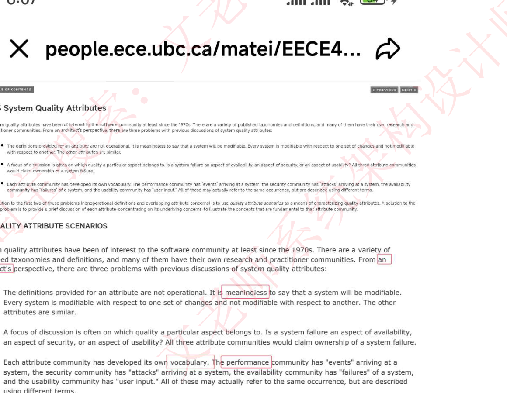

# 2025上半年 系统架构设计师 · 上午题

> 卷面信息：本卷为网友/学员回忆版，非正式试卷，无原版卷面说明。据来源第 1 页总结：选择题共 75 题；其中标红（偏的或超纲）24 题约 24 分；软件工程 27 分、系统架构 12 分为重点；英语固定 5 分（Q31–35 质量属性英文题）；信息系统基础 1 分；新技术 7 分。部分题为 2 分题（回忆者注明“这题 2 分”者共 2 处：Q19–20、Q27–28）。
>
> ⚠️ 本卷为回忆版：题干/选项多有缺漏，来源用红字、删除线、括号疑问记录回忆不确定处，本转录照实保留；答案均标“来源所列答案”，非官方答案。

## 题号目录

| 题号 | 考点 | 教程章节 |
|------|------|----------|
| Q01–Q03 | 操作系统位示图 / 调制解调 / CMMI 等级 | |
| Q04–Q06 | 保密期限 / 半双工通信 / 内聚排序 | |
| Q07–Q09 | 关系运算 / 数据流图加工 / AB 测试 | |
| Q10–Q15 | 芯片温度级别 / 线性规划 / 断路器状态 / C/S 架构 / 奈奎斯特公式 / PROM | |
| Q16–Q21 | 嵌入式实时操作系统 / Web 服务器性能评测 / ERP 三流 / 4+1 视图 / 净室软件工程 | |
| Q22–Q26 | 文件打开 FCB / 死锁资源计算 / 大模型代码架构 / 需求跟踪 / 逆向工程层级 | |
| Q27–Q30 | 数据库三级模式 / 架构风格脆弱性 / 数据流图互斥符号 | |
| Q31–Q35 | 英文题：系统质量属性（5 分） | |
| Q36–Q41 | 用例模型关系 / 螺旋模型 / 工期计算 / 继承类型 / 集合计算 / RESTful PATCH | |
| Q42–Q48 | 实时调度算法英文 / Scrum backlog / 单元测试依据 / 项目管理输出 / RUP 阶段 / 逻辑覆盖 / 软件著作权材料 | |
| Q49–Q54 | 发表权 / 工业大模型三层 / 监理四控 / 黑盒测试 / 边缘计算 / 可靠性子特性 | |
| Q55–Q60 | 调试与测试区别 / 结构化分析 / 状态机 / 可测试性度量 / Web 服务与网格 / 安全服务五要素 | |
| Q61–Q66 | 候选键 / WSDL / 数据中台 / 进程状态转换 / 双生命周期模型 / 黑板风格 | |
| Q67–Q72 | 组合计数 / 聚类算法 / 回归测试 / 敏感数据加密质量属性 / 影响软件质量三因素 / SOA 中间件 | |
| Q73–Q75 | 数据库内模式 / 领域驱动层次（缺）/ 缺 | |

## 原题转录（视觉核验）

---

## Q01
通过页内大小 4KB，存储内存 16GB，位示图占用（）kb【应该是 KB】

- a. 512
- b. 256
- c. 128
- d. 64

**来源所列答案**：未提供
**来源解析**：未提供

---

## Q02
调制解调技术是……

- A. 模拟信道传递模拟信号
- B. 模拟信道传递数字信号
- C. 数字信道传递模拟信号
- D. 数字信道传递数字信号

**来源所列答案**：B
**来源解析**：未提供

---

## Q03
cmmi 分为（）个阶段【应该是等级】，选数量（3/4/5/6）

**来源所列答案**：5 级
**来源解析**：未提供

> 校核注：来源原题把“等级”记成“阶段”，并自注【应该是等级】。

---

## Q04
国家秘密中，除特殊情况外，机密级保密期限一般不超过多少年（）

- A. 十年
- B. 二十年
- C. 三十年
- D. 四十年

**来源所列答案**：20（即 B 二十年）
**来源解析**：未提供

---

## Q05
要想实现半双工通讯，通信双方至少需要（）

- A. 1 个逻辑通道
- B. 2 个逻辑通道
- C. 1 个有线信道
- D. 2 个有线信道

**来源所列答案**：a. 1 个逻辑通道
**来源解析**（来源附讯飞星火作答截图，转录要点）：半双工通信允许数据在两个方向上传输，但同一时间仅能单向传输，其核心在于双方交替使用同一逻辑通道。半双工通信只需 1 个逻辑通道，双方通过同一逻辑通道交替发送和接收数据，无需同时占用两条物理链路。因此选项 a（1 个逻辑通道）正确。物理信道（如有线或无线）仅需 1 个即可支持半双工通信，但选项 c 明确限定为“有线信道”（如 Wi-Fi 属于无线），因此“有线”并非必要条件，选项 c 不严谨。选项 b（2 个逻辑通道）和 d（2 个有线信道）适用于全双工通信（需双向同时传输）。答案：a. 1 个逻辑通道。

---

## Q06
内聚类型排序从高到低

顺序　通信　过程　逻辑　功能　时间　（答案：顺 通 过）

**来源所列答案**：顺 通 过（来源自注：功能内聚最高，有个选项功能在最前）
**来源解析**：未提供

> ⚠️ 待核验：来源给的排序“顺 通 过”与高内聚在前矛盾（功能内聚才是最高），回忆者亦自注存疑，且未给全 6 种内聚的完整次序。

---

## Q07
关系运算不包括（）

选择　投影　删除　连接

**来源所列答案**：删除
**来源解析**：未提供

> 校核注：来源未给 A/B/C/D 选项字母，仅列出四个运算词并标红“删除”。

---

## Q08
数据流图中哪个标记进行数据加工和转换，不能同时处理流入和流出（有点印象这里描述的是加工的概念）

处理　还有哪些选项？

**来源所列答案**：处理（回忆者倾向）
**来源解析**：未提供

> ⚠️ 待核验：选项不全，回忆者自己标注“还有哪些选项？”，属不完整回忆。

---

## Q09
AB 测试（题干大意，回忆版）

- a. 在同一时间纬度，分别让分组成分相同或相似的访问群组随机的访问这些版本
- b. 在不同时间纬度，分别让分组成分互补的访问群组随机的访问这些版本
- c. 在同一时间纬度，分别让分组成分互补的访问群组随机的访问这些版本
- d. 在不同时间纬度，分别让分组成分相同的访问群组随机的访问这些版本

**来源所列答案**：a（来源以黄色高亮 a）
**来源解析**：未提供

---

## Q10
芯片 -45℃～85℃ 是什么级别的需求

- a. 军用级
- b. 民用级
- c. 通用级
- d. 工业级

**来源所列答案**：工业级
**来源解析**：【以为超纲，教程上竟然有：通常，我们把芯片分为民用级、工业级和军用级。民用级器件的工作温度范围是 0～70℃、工业级的是 -40～85℃、军用级的是 -55～150℃。】

---

## Q11
x-1>=0，x-y<=0，x+y-4>=0　约束　求 y/x 最大值（1/2/3/4）

**来源所列答案**：3
**来源解析**：未提供

---

## Q12
微服务断路器的状态（打开状态，关闭状态，熔断状态，挂载状态，休眠状态，半打开状态）选项里有个激活状态

- a. 激活状态，关闭状态，休眠状态
- b. 打开状态，关闭状态，熔断状态
- c. 打开状态，关闭状态，半打开状态　（熔断貌似就是关闭，答案更像是这个？）
- D. ？？　挂起状态

**来源所列答案**：未明确（来源在 b、c 间犹豫，自注“答案更像是 c？”）
**来源解析**：未提供

---

## Q13
cs 架构判断（后面几个选项没记全，补充下——这题选错误选项）

- a. B/S 架构是一种特殊的双层 C/S 架构
- b. 三层 C/S 比两层 C/S 架构多了一个应用服务器
- c.（忘了）好像是分层架构设计，易于扩展
- d. 三层 C/S 架构分为表现层、功能层、数据层

**来源所列答案**：未明确标字母。来源红字补充的选项原貌为：“a. bs 架构是一种特殊的三层 cs 架构；b. 与两层 cs 架构相比，三层 cs 架构多了一个应用服务器；c. 三层 cs 架构分为表示层、功能层、数据层；d. 三层 cs 有较高的可扩展性，软件脆弱性：从直接操作变为一层层引用，造成性能降低；有一个选项是 bs 是一个特殊的两层 cs 架构”。
**来源解析**：未提供

> ⚠️ 待核验：来源两处记录不一致（先记 a 为“双层”，后补记“有一个选项是 bs 是一个特殊的两层 cs 架构”），错误选项应是“bs 是一个特殊的两层 cs 架构”。

---

## Q14
信道 3000hz，信号状态 32 位，无干扰的情况下，最大传输多少 kbs

- A. 100
- B. 30
- C. 500
- D. 50

**来源所列答案**：B. 30
**来源解析**：根据奈奎斯特公式，无干扰条件下最大传输速率为：$C = 2 \times B \times \log_2(V)$，其中 $B = 3000\,\text{Hz}$，$V = 32$（信号状态数）。代入计算：$\log_2(32) = 5$，$C = 2 \times 3000 \times 5 = 30{,}000\,\text{bps} = 30\,\text{kbps}$。

---

## Q15
一次可编程只读存储器是哪一个（）

- A. ROM
- B. EPROM
- C. PROM
- D. EEPROM

**来源所列答案**：C. PROM
**来源解析**：一次可编程只读存储器（PROM）的特点是用户可一次性编程，且编程后无法修改。以下是对各选项的分析：A. ROM：掩模编程，出厂时内容已固定，用户无法编程，排除。B. EPROM：可多次擦除（紫外线）并重编程，不符合“一次可编程”，排除。C. PROM：出厂时无内容，用户可一次性编程，编程后不可修改，符合题意。D. EEPROM：可电擦除并多次编程，排除。

---

## Q16
哪个不是非实时嵌入式实时操作系统（）

- A. iOS
- B. VxWorks
- C. Android
- D. WinCE

**来源所列答案**：未提供
**来源解析**：未提供

> 校核注：题干表述为回忆版原文（“非实时嵌入式实时操作系统”语义不通，应为“非实时嵌入式操作系统/实时操作系统”之误）。

---

## Q17
不属于 Web 服务器性能评测方法是

- A. 基准性能测试
- B. 压力测试
- C. 可靠性测试
- D. UI 测试

**来源所列答案**：D. UI 测试
**来源解析**：未提供

---

## Q18
erp 企业资源三流是哪三流

- A. 物流，资金流，信息流
- B. 税务流、物流，资金流
- C.（和 D 选项都有个税务流）

**来源所列答案**：A（物流、资金流、信息流）
**来源解析**：未提供

> 校核注：C、D 选项内容回忆不全，仅知均含“税务流”。

---

## Q19
4+1 视图中，描述软件到硬件的映射是哪个视图？（这题 2 分？对的，我的试卷是最后两题就是这个）

- a. ? 
- b. ?
- c. 进程视图
- d. 物理视图

**来源所列答案**：d. 物理视图
**来源解析**：【这里采用了系分中的相关描述：进程视图侧重于系统的运行特性；物理视图在 UML 中被称为部署视图，主要考虑如何把软件映射到硬件上。】

---

## Q20
（承 Q19 题干）什么视图体现运行特征（关注运行状态的是哪个视图？）

- a. 逻辑视图
- b. 进程视图
- c. 实现视图
- d. 部署视图

**来源所列答案**：b. 进程视图
**来源解析**：（同 Q19 来源解析）进程视图侧重于系统的运行特性。

> 校核注：Q19 与 Q20 为同一 2 分题（来源注明“这题 2 分”），选项字母两套记录略有出入，照录原文。

---

## Q21
净室软件工程基于什么理论。

- A. 函数理论和抽样理论
- B. 概率统计

**来源所列答案**：A. 函数理论和抽样理论
**来源解析**：未提供

> 校核注：来源仅列出两个选项，原题应有四个选项，回忆不全。

---

## Q22
当用户首次打开一个文件的时候，系统（）

- A. 把文件内容读入内存
- B. 先读 FCB（File control block）
- C. 先读到缓冲区中

**来源所列答案**：B（来源先写“A. 先读入内存中”后划去，改为倾向“先读 FCB”）
**来源解析**：未提供

---

## Q23
进程：5 个进程需求方，每个进程最多需要 2 个资源，那么至少提供多少个资源不会死锁

- A. 5
- B. 6
- C. 8
- D. 10

**来源所列答案**：6
**来源解析**：未提供

---

## Q24
大模型的生成代码架构是什么

- A. knowledge map
- B. Data Flow
- C. rule base system
- D. Transformer

**来源所列答案**：D. Transformer
**来源解析**：未提供

> 校核注：来源题干写作“生-68成代码架构”（“68”为页内杂字），按语义整理为“生成代码架构”。

---

## Q25
需求跟踪，错误的是：正向跟踪的定义说错了

- 文档、代码在说明书中找到出处是正向跟踪
- 逆向跟踪
- 双向跟踪

**来源所列答案**：未明确字母。来源要点：错误的是“正向跟踪的定义”——“文档、代码在说明书中找到出处”实为逆向跟踪。
**来源解析**：未提供

> 校核注：选项为回忆的关键词列表，非完整选项。

---

## Q26
逆向工程，使用用户指导下的搜索与变换方法可导出哪两个层级：实现级　功能级　结构级　领域级，这题几分？1 分，选项是两两组合

- 实现级和结构级
- 领域级和功能级

**来源所列答案**：未提供
**来源解析**：未提供

> 校核注：四个层级中只回忆出两个组合选项，其余组合选项缺失。

---

## Q27
（与 Q28 同题，2 分）数据库的内模式，逻辑模式和外模式

第一空：表示数据类型、关系什么的指概念模式（我记得有与数据安全相关，不是内模式吗？）【描述记录间的联系、操作、数据的完整性和安全性等要求】

ps：我也有印象是说安全的，印象中也是选了内模式

**来源所列答案**：概念模式（就是模式）（来源自注“好像说的是数据之间的关联”，存疑）
**来源解析**：未提供

---

## Q28
（承 Q27 题干）第二空：表示用户使用的部分数据什么的指外模式

**来源所列答案**：外模式
**来源解析**：未提供

> ⚠️ 待核验：Q27 第一空在“概念模式/内模式”间反复，来源自己标注两次“印象中是选了内模式”，但结论写概念模式。

---

## Q29
哪一项不能体现架构风格的脆弱性？

- A. 管道过滤器（不能并发）
- B. 层次系统（降低性能）
- C. 事件驱动（触发事件顺序不可控）
- D. 黑板风格，无解时（可能找不到知识点）

**来源所列答案**：来源自己选“管道（说不能并行）”，并自注“是说哪句错误好像？”
**来源解析**：未提供

> ⚠️ 待核验：回忆者对题意（选“能体现”还是“不能体现”）与答案均不确定。

---

## Q30
数据流可以产生 b 数据和 c 数据但是不能同时产生 b 和 c，表示的符号是表示 ⊕（异或）

- A. +
- B. *
- C. ◯（数据存储）
- D. ⊕

**来源所列答案**：选 ⊕（D）
**来源解析**：在数据流图中，题目描述的“数据流可以产生 b 或 c，但不能同时产生”属于互斥选择关系。各选项符号的含义如下：A：+，通常表示数据流的合并，即多个数据流汇合后共同输入到同一处理过程，与互斥无关。B：*，在数据流图中无明确标准含义，可能表示重复或连接，但与题目要求的互斥逻辑无关。C：◯，代表数据存储（如文件、数据库），与数据流的逻辑关系无关。D：⊕，异或符号（XOR），表示互斥选择，即两个选项中只能选择一个，不能同时成立，完全符合题目要求。（异或符号 ⊕ 正确表示数据流 b 和 c 的互斥关系。）

---

## Q31–Q35
英文题考质量属性（architect's；meaningless；vocabulary；performance；scenarios），5 分

**来源所列答案**：未提供（回忆版仅给出挖空关键词与原文截图）
**来源解析**：未提供

> 校核注：5 道英文填空题共用上述网页原文截图（来源页左侧略有裁切，非转录裁剪所致）；挖空词即来源括号所列 architect's / meaningless / vocabulary / performance / scenarios。

---

## Q36
用例模型不包含哪种关系？

包含　扩展　泛化　聚合

**来源所列答案**：聚合
**来源解析**：未提供

> 校核注：来源未给选项字母，按顺序列词并标红“聚合”。

---

## Q37
以下哪个开发模式增加风险评估的环节（）？

- A. 瀑布模型
- B. 螺旋模型
- C. V 模型
- D. 增量模型

**来源所列答案**：B. 螺旋模型
**来源解析**：未提供

---

## Q38
计算题：工期延长后 D 延长 3 天，总工期情况会延长多少天（D 原来是 4 天）

**来源所列答案**：1 天
**来源解析**：来源原注：“（答案是 1 天）（这个有疑问，我记得最长的路径比这个要改的路径长一天，延长 3 天，实际应该延期 2 天）PS：D 是从非关键路径变成了关键路径。路径大概是 6 条，a 出发 3 条，b 有两条，c 有两条，有一条是 a 到 c。任务是 abcdefghj。”

> ⚠️ 待核验：来源对 1 天答案自注疑问，认为应延期 2 天；原题网络图未回忆出。

---

## Q39
面向对象一个类完全继承了一个父类，从其他类又继承了其他能力，具有父类的所有功能，这种类称之为什么继承

- 包含继承
- 特化继承
- 特别继承
- 取代继承

**来源所列答案**：来源内两处 AI 作答不一致——先作答“特化继承（Specialization Inheritance）”，后文又作答“包含继承”。
**来源解析**（来源附 AI 解析，完整转录）：
其一（作答特化继承）：在面向对象编程中，当一个类完全继承了父类的所有功能，并且可能从其他类中继承或组合其他能力时，这种继承方式最符合的术语是特化继承（Specialization Inheritance）。选项解析：包含继承（Inclusion Inheritance）：这个术语通常用于描述组合（Composition）或聚合（Aggregation），即一个类通过持有其他类的实例来复用其功能，而不是通过继承。它强调的是“has-a”关系，而非“is-a”，因此不符合题干中“完全继承父类”的描述。特化继承（Specialization Inheritance）：这是指子类作为父类的一个具体化版本，继承父类的所有属性和方法，并可能进行扩展或重写。这是典型的“is-a”关系，符合题干中“完全继承父类”的描述。即使该类还可能从其他类获取能力（如通过组合或接口实现），其继承父类的部分仍属于特化继承。特别继承：这不是一个标准的面向对象术语，可能是干扰项。取代继承（Replacement Inheritance）：这个术语有时用于描述子类覆盖父类方法的行为，强调的是方法的替代，而不是整个类的继承关系。它描述的是继承后的行为，而非继承本身的类型。结论：题干强调的是“完全继承父类的所有功能”，这正是特化继承的核心特征。即使类还可能通过其他方式（如组合、接口实现）获得其他能力，其对父类的继承仍属于特化继承。正确答案：特化继承。
其二（作答包含继承，另一 AI）：在面向对象编程中，若一个类完全继承了父类的所有功能，并且从其他类中继承了额外的能力，这种继承方式通常对应的是多重继承（Multiple Inheritance），多继承允许一个子类同时继承多个父类的属性和方法。然而，题目提供的选项中并未直接包含“多继承”，而是要求从四个非标准术语中选择答案。结合描述“完全继承父类并从其他类继承其他能力”，最接近的解释是：包含继承：可能指该类包含多个父类的功能，符合多继承的特征。其他选项如“特化继承”（强调子类更具体化，如资料[2]中“犬”与“中华田园犬”的关系）或“取代继承”（可能指方法重写）均不符合题干中“完全继承”的描述。因此，正确答案应为包含继承，暗示该类通过继承包含了多个父类的能力。答案：包含继承。

> ⚠️ 待核验：来源两处 AI 答案矛盾（特化继承 vs 包含继承），回忆者未做裁定，照录并存。

---

## Q40
计算题：100 个人会编程语言，55 个人会 Java，45 个人会 C 语言，53 个人会 Python，28 个人既会 Java 又会 C 语言，32 个人既会 C 又会 Python，20 个人既会 Java 又会 Python，xx 个人三门语言都会，算多少人啥都不会

**来源所列答案**：22 个人
**来源解析**：未提供

> 校核注：“三门语言都会”的人数回忆为“xx”（未记清）；按来源所给其余数字可推出该值应为 8（100-88=22）。

---

## Q41
restful 部分更新？

- a. Part
- b. POST
- c. PUT
- d. PATCH

**来源所列答案**：d. PATCH
**来源解析**：原因与解释：1. PATCH 方法的用途：PATCH 是 HTTP 协议中专门设计用于对资源进行部分更新的请求方法。客户端只需传递需要修改的字段，而不是完整的资源内容。服务器接收 PATCH 请求后，仅更新指定字段，其他字段保持不变。2. 与 PUT 的区别：PUT 用于替换整个资源，要求客户端提供完整的资源表示。如果缺少某些字段，服务器可能将其视为“清空”或覆盖为默认值。PATCH 则仅修改请求中指定的部分字段，无需传递完整资源。

---

## Q42
哪个英文是紧急优先调度算法（我咋记得说是满足强实时性要求）？全英选项

- frist in first deadline
- least Laxity first
- earlier deadline frist
- Rate Monotonic Scheduling

**来源所列答案**：未提供
**来源解析**：来源原注：“这个题目应该问的是哪个满足强实时性要求。（我记得应该是紧急优先）”

> ⚠️ 待核验：回忆者对考点（紧急优先 vs 强实时性）不确定；选项拼写照录原文（frist/frist 为原件拼写）。

---

## Q43
scrum backlog 是以什么为标准进行需求排序？

- A. 实现难易度
- B. 商业价值
- C. 最后期限
- D. 技术可行性（是技术成熟度）

**来源所列答案**：B. 商业价值
**来源解析**：未提供

---

## Q44
单元测试的依据是什么

- A. 概要设计
- B. 需求分析
- C. 详细设计
- D. 用户需求

**来源所列答案**：C. 详细设计
**来源解析**：未提供

---

## Q45
以下什么不属于项目管理和支撑组输出的内容？

- A. 源代码
- B. 工作计划
- C. 项目追踪
- D. 项目质量报告

**来源所列答案**：未明确（来源自注“我记得应该是 工作计划？”）
**来源解析**：未提供

> ⚠️ 待核验：回忆者在“源代码/工作计划”间犹豫，未标定答案。

---

## Q46
RUP 设计及确定体系结构及工作计划及资源配置是哪个阶段（）？

- A. 初始
- B. 细化（本环节是细化需求，详细设计，技术方案）
- C. 构造
- D. 移交

**来源所列答案**：未明确（来源标红 B“细化”，但附不同意见）
**来源解析**：来源原注：“不同意见：初始阶段是建模，细化阶段才是确定体系结构。ps：我论文练过 RUP，确定系统结构是细化阶段。ps2：制定工作计划是细化过程。”

---

## Q47
考条件覆盖，判定覆盖哪个强哪个弱，选项记不清了。

- a. 条件强于路径
- b. 语句强于路径
- c. 条件不一定覆盖判定，判定也不一定覆盖条件

这题没有路径相关的选择，不然直接选路径了。另两个选择是条件强于判定和判定强于条件。还有个选项是条件组合比什么……？

**来源所列答案**：未提供（来源以黄色高亮选项“组合条件覆盖要求每个判定中所有条件可能的组合均被测试”）
**来源解析**：未提供

> 校核注：选项回忆不全，高亮句为来源标记的疑似正确项。

---

## Q48
软件著作权申请需要提供哪些审查材料（原题不是这样的，好像是说确定归属权）

- a. 程序和文档
- b. 程序和软件著作权归属合同
- c. 程序和合同　或者　数据和文档
- d. 程序和数据

**来源所列答案**：a. 程序和文档
**来源解析**：来源原注：“代码和文档／代码和合同／代码和确定著作权归属合同。ps. 我记得好像不是代码，是程序。”

---

## Q49
软件著作权中，（）决定了用户具有公开内容的权利

- 发表权
- 专利权
- 发行权
- 新闻传播

**来源所列答案**：发表权
**来源解析**：未提供

> 校核注：来源未给选项字母，按顺序列词并标红“发表权”。

---

## Q50
工业大模型中间三层，处于基础设施层和应用层中间？

基座层　模型层　交互层

**来源所列答案**：未提供
**来源解析**：未提供

> 校核注：题干与三词均为关键词式回忆，题型（填空或选择）不明。

---

## Q51
在信息系统监理工程中，四控，三管，二什么，问题是四控指的是什么

题目的选项：成本管理、进度管理、质量管理、合同管理、变更管理

**来源所列答案**：未提供
**来源解析**：未提供

> 校核注：来源以红字列出 5 个候选（“四控”标准口径为投资控制、进度控制、质量控制、变更控制，此处选项用词为“管理”），未标定所选。

---

## Q52
不属于黑盒测试的方法（）

- 等价类划分法
- 因果图
- 路径覆盖
- 边界值分析

**来源所列答案**：路径覆盖
**来源解析**：未提供

---

## Q53
以下哪个不是边缘计算的特点？

- A. 降低功耗
- b. 提高带宽
- c. 低延迟
- d. 提高安全

**来源所列答案**：b. 提高带宽
**来源解析**：边缘计算的核心特点包括：1. 低延迟（C）：数据在本地处理，减少传输时间，适合实时场景。2. 减少带宽需求：通过本地处理数据，仅传输必要信息，降低对网络带宽的依赖，而非“提高带宽”。3. 提高安全性（D）：数据无需长距离传输，减少泄露风险。4. 分布式计算：缓解中心服务器压力，提升可靠性。选项分析：A. 降低功耗：边缘计算可能通过减少数据传输降低网络能耗，但对终端设备而言，本地处理可能增加功耗。此特点存在争议，但部分场景下可能成立。B. 提高带宽：边缘计算的作用是优化带宽使用，而非直接提高网络带宽（带宽是物理传输能力）。因此，这是正确答案。C. 低延迟和 D. 提高安全均为边缘计算的典型优势。综上，提高带宽（B）并非边缘计算的特点。

---

## Q54
下列哪一个不属于可靠性

- A. 容错性
- B. 成熟性
- C. 可恢复性
- D. 健壮性

**来源所列答案**：未明确字母。来源高亮注记：“这道题的第四个选项应该是‘稳定性’，因为在教材第 8 章，介绍可靠性时，有个小结介绍了可靠性包括了容错和健壮性。”
**来源解析**：来源附教材第 8 章照片（页 13），可见文字：“软件系统的质量就是‘软件系统与明确地和隐含地定义的需求相一致的程度’……根据 GB/T 16260.1 定义……可将影响软件质量的主要因素划分为 6 种维度特性：功能性（包括适合性、准确性、互操作性、安全性）、可靠性（包括容错性、易恢复性、成熟性）、易用性（包括易学性、易理解性、易操作性）、效率（包括资源特性和时间特性）、维护性（包括可测试性、可修改性、稳定性和易分析性）、可移植性（包括适应性、易安装性、一致性和可替换性）……”来源另注：“这里题目考了 2 回了，上次考的易用性。”

> 校核注：按教材原文，可靠性含容错性、易恢复性、成熟性；选项 D 回忆为“健壮性”但来源认为原卷应为“稳定性”，故“不属于可靠性”的答案取决于原卷 D 选项到底是健壮性还是稳定性，回忆版无法最终裁定。

---

## Q55
调试和测试的区别，选错的

**来源所列答案**：未提供
**来源解析**：来源原注（关键词式）：“调试在测试前面 xx，测试用于检查是否满足《需求 xx 书》，测试有明确流程可以预估测试周期，调试起始于不明确的条件不能预估，xx。”

> 校核注：选项未回忆出，仅录答题依据要点。

---

## Q56
以下属于结构化分析特点的是()

- A. 自底向上
- B. 面向数据流
- C. 非直接耦合
- D. 数据耦合

**来源所列答案**：B. 面向数据流
**来源解析**：来源原注：“好像有个数据耦合选项（结构化还是非结构化？）”

---

## Q57
数据流图中 xxx uml 图之类（），原子态不可分，没有内部状态变化啥啥的，耗时可以忽略

选项是四个 xx 状态

- 初始态
- 原子态
- 活动态
- 动作态

**来源所列答案**：未提供
**来源解析**：未提供

> 校核注：题干高度残缺，来源仅列出四个状态选项。

---

## Q58
下列哪项不属于可测试性的度量指标（）

- A. 平均故障恢复时间（来源注：这不是可用性相关吗）
- B. 故障发生的概率
- C. 测试准备时间
- D. 测试环境的准备时间

**来源所列答案**：来源内两处 AI 作答不一致——先作答案 B，后作答 A。
**来源解析**（来源附 AI 解析，完整转录）：
其一：可测试性（Testability）关注测试过程的效率和可行性，其度量指标通常包括：测试准备时间（C）：设计测试用例、规划测试流程所需的时间。测试环境的准备时间（D）：搭建测试环境（如硬件、软件配置）所需的时间。其他相关指标如测试覆盖率、自动化程度、结果分析难度等。选项 A（平均故障恢复时间）属于系统可靠性或可用性指标，反映故障修复效率，与测试过程的难易程度无关。选项 B（故障发生的概率）属于系统可靠性指标，描述系统自身故障发生的频率，而非测试的难易或效率。因此，B. 故障发生的概率是正确答案，因其属于系统可靠性范畴，而非可测试性度量指标。
其二（另一 AI）：在可测试性的度量指标中，选项 A. 平均故障恢复时间 不属于可测试性的度量指标。解析：可测试性的度量指标通常关注的是测试的难易程度和效率，例如：故障发生的概率（B）：与系统的缺陷密度或故障率相关，影响测试的覆盖范围和难度。测试准备时间（C）：测试用例、数据等的准备时间，直接反映测试的便捷性。测试环境的准备时间（D）：环境搭建的复杂度影响可测试性。而平均故障恢复时间（A）是可靠性或容错性的指标，衡量系统从故障中恢复的速度，与可测试性无直接关系。正确答案：A。根据可测试性度量指标的定义和相关文献，故障恢复时间（选项 A）不属于可测试性的度量指标，而是系统可靠性或故障恢复能力的评估指标。1. 可测试性度量指标的核心范畴：可测试性主要关注测试效率和测试成本，包括：测试准备时间（选项 C）：如测试用例设计、数据准备、工具配置等所需时间。测试环境准备时间（选项 D）：搭建硬件、软件和网络环境的时间。测试执行时间：如测试用例运行时长。测试覆盖率：代码或功能覆盖的百分比。可控制性与可观察性：能否灵活控制测试输入和观察输出。2. 选项分析：故障恢复时间（A）：属于系统可靠性或容错性指标（如平均故障修复时间 MTTR），用于评估系统从故障中恢复的速度，而非测试过程的难易程度。故障发生概率（B）：虽然属于可靠性领域（如故障率 λ(t)），但部分文献将其视为广义可测试性的间接指标（如故障检测率）。测试准备时间（C）和测试环境准备时间（D）：均属于测试效率的直接度量，是可测试性评估的关键部分。结论：正确答案为 A. 故障恢复时间。

> ⚠️ 待核验：来源两处 AI 答案矛盾（B vs A），回忆者未裁定，照录并存。

---

## Q59
web 服务 …… 网格，基于 webservice 的优势，…… 可以定义标准的规范和……，这题 2 分？这题是 1 分吧（这题一分，两两组合）

- ① 计算池模型
- ② 五层沙漏
- ③ 开放式 webservice
- ④ 网格服务化

**来源所列答案**：未明确字母。来源自注：“ps：这个是选 3、4 吧，印象中题目两个都提到了这两项的意思。”
**来源解析**：未提供

---

## Q60
开放系统的安全服务有哪 5 个

鉴别　身份鉴权？　认证　鉴权　访问控制　机密性服务　完整性服务　不可抵赖性服务

**来源所列答案**：未提供
**来源解析**：未提供

> 校核注：来源以红字罗列候选词，共 7 个词，标准“五要素”应为认证/鉴别、访问控制、机密性、完整性、不可抵赖（抗抵赖），回忆版未标定。

---

## Q61
数据库候选键，R（a,b,c,d），a->cd，c->b，候选码是哪个（）？

- A. a
- B. b
- C. c
- D. d

**来源所列答案**：未提供
**来源解析**：未提供

---

## Q62
下面哪个定义了服务器请求者和服务提供者之间的数据规范（）

- A. UUDI（原文拼写，应为 UDDI）
- B. SOAP
- C. WSDL
- D. XML

**来源所列答案**：来源先标红 B. SOAP，随后附文改判为 C. WSDL
**来源解析**：SOAP（Simple Object Access Protocol，简单对象访问协议）定义了服务请求者和服务提供者之间的消息传输规范。SOAP 用 XML 来格式化消息，用 HTTP 来传输。SOAP 是一种基于 XML 的消息传递协议，定义消息格式，但不单独定义服务数据结构。WSDL（Web Services Description Language，网络服务描述语言）是用来定义服务器请求者和服务提供者之间数据规范的标准。

---

## Q63
数据中台的应用场景不包括（）

- A. 风险控制
- B. 数据治理
- C. 数据库扩容
- D. 用户画像

**来源所列答案**：来源标题注“（B）”，但括号内自注“有争议？我觉得是选数据库扩容”，附文结论为“答案：C. 数据库扩容”。
**来源解析**：若题目要求选择“不属于应用场景”的选项，B（数据治理）和 C（数据库扩容）均符合条件。但根据常规分类，数据治理更明确属于功能而非场景，而数据库扩容属于技术操作。若需二选一，C（数据库扩容）更符合“非应用场景”的定义。

> ⚠️ 待核验：来源标答从 B 改为 C，自相矛盾，照录并存。

---

## Q64
进程怎么由运行状态变成就绪状态

- A. 主动让出 cpu（进就绪）
- B. 信号量执行 wait（）方法（阻塞）
- C. 缺页中断（阻塞）
- D. 请求磁盘（阻塞）
- （另回忆选项残片：键盘输入　缺页异常）

**来源所列答案**：A. 主动让出 cpu（进就绪）
**来源解析**：未提供

---

## Q65
双生命周期模型？

- 领域工程和应用工程
- 领域工程和企业工程
- 企业工程和应用工程
- 领域工程和管理工程

**来源所列答案**：领域工程和应用工程（第一项，来源标红）
**来源解析**：未提供

---

## Q66
黑板架构风格数据处理单元是什么？

- A. 中央数据结构
- B. 知识源
- C. 黑板
- D. 控制器

**来源所列答案**：A. 中央数据结构
**来源解析**：在黑板架构风格中，中央数据结构（Central Data Structure）起到了数据处理单元的作用。它是所有组件共享的数据存储区域，所有的知识源（Knowledge Sources）都会访问和更新这个中央数据结构。

---

## Q67
5 个对象，每个对象 2 个属性……。是 5 个对象，每个对象有两种取值，问所有取值都组合一遍，一共有多少种组合？

选项有：25，32，10

**来源所列答案**：32（来源自注“我选 32”，即 $2^5$；来源另写“2 的 32 次方”为笔误）
**来源解析**：未提供

---

## Q68
机器学习领域中，没有任何数据标识的数据（好像是根据数据本身的相似性，还是什么），用什么算法进行分类？

- A. 聚类算法
- B. 分类
- C. 主成分分析
- D. …

**来源所列答案**：A. 聚类算法
**来源解析**：未提供

> 校核注：D 选项未回忆出。

---

## Q69
回归测试的目的？

**来源所列答案**：找到因为修改 bug 产生的新问题
**来源解析**：未提供

---

## Q70
敏感数据密文（属于哪种质量属性？）

**来源所列答案**：安全性
**来源解析**：未提供

> 校核注：题干为关键词式回忆，完整题干未回忆出。

---

## Q71
影响软件质量的因素（有这道题），PS：后面还有句话：应该是从用户的角度来看

- a. 产品修改　产品转移　产品运行
- b. 产品运行　产品修改　产品重构

**来源所列答案**：产品修改　产品转移　产品运行（即 a）
**来源解析**：未提供

---

## Q72
SOA 中间件，问的大概是哪一个架构进一步解耦服务请求者和服务提供者，选项有

- a. webservice
- b. ESB
- c. ri
- D. 服务注册表

**来源所列答案**：未明确。来源标红为“b ESB”“c ri”两处（ri 疑为 ESB 相关组件缩写），并将 D 划去；又注“还差 5 题是啥？只差 3 道了 前面有 2 个是 2 分的”。
**来源解析**：未提供

> 校核注：回忆者标注混乱，倾向 b（ESB），但无法最终确认。

---

## Q73（原卷疑与上一题重号，实为两题）
（第一处记录，来源已划去并注明与 Q70 重复）用户认证数据加密存储，属于哪种质量属性？（70 题已经有了，这题是不是重复的）

**来源所列答案**：安全性
**来源解析**：未提供

---

## Q73（第二处记录）
数据库内模式描述的内容？

- A. 存储结构
- B. 索引
- C. 物理存储

**来源所列答案**：C. 物理存储（来源自注：“27 题 不是 27 那个　这个是问内模式的概念”）
**来源解析**：未提供

> 校核注：同一题号 73 出现两次，第一次记录被来源划去；按原卷题序应为 73 数据库内模式。选项仅回忆 3 项。

---

## Q74
领域驱动的中的层次（好像是）

**来源所列答案**：未提供
**来源解析**：未提供

> ⚠️ 待核验：本题仅有一行高亮标题，无任何题干选项内容（原件回忆缺失）。

---

## Q75
（来源仅注：“75. 暂无”）

**来源所列答案**：未提供
**来源解析**：未提供

> ⚠️ 待核验：据来源第 2 页总结表“75 暂无，也是架构”，即回忆者未能回忆起第 75 题内容，仅知属架构类考点。本题内容整体缺失。

---

## 缺口清单

- Q08：选项不全（仅“处理”）。
- Q12：答案在 b/c 之间未裁定。
- Q13：选项 c 内容遗忘，答案字母未标定。
- Q16：题干表述残缺（照录原文）。
- Q18：C、D 选项内容缺失。
- Q21：仅回忆 2 个选项。
- Q26：四个两两组合仅回忆 2 个。
- Q27/Q28：第一空在概念模式/内模式间存疑。
- Q29：题意（选“能/不能体现脆弱性”）与答案均不确定。
- Q39：来源两处 AI 答案矛盾（特化继承 vs 包含继承）。
- Q42：考点（紧急优先/强实时性）不确定。
- Q45：答案在源代码/工作计划间未裁定。
- Q46：答案（初始/细化）有不同意见。
- Q47：选项不全，答案未标定。
- Q51：选项 5 个均为红字候选，未标定“四控”所选。
- Q54：D 选项是“健壮性”还是“稳定性”存疑，答案无法裁定。
- Q55、Q57：题干/选项高度残缺。
- Q58：来源两处 AI 答案矛盾（A vs B）。
- Q59、Q60：答案未标定（仅有倾向）。
- Q62：标答从 B 改判 C（SOAP→WSDL）。
- Q63：标答 B 与 C 自相矛盾。
- Q68：D 选项缺失。
- Q72：标红混乱（b/c），未裁定。
- Q74：整题内容缺失（仅一行高亮标题）。
- Q75：整题内容缺失（来源注明“暂无”）。
