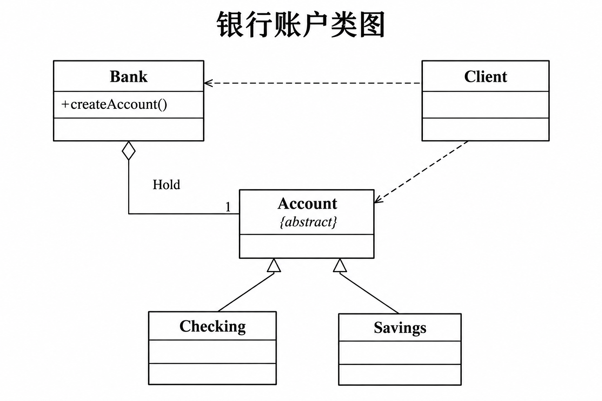
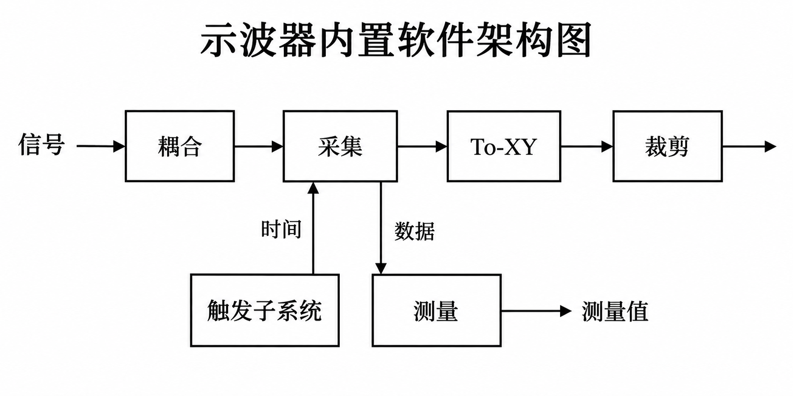
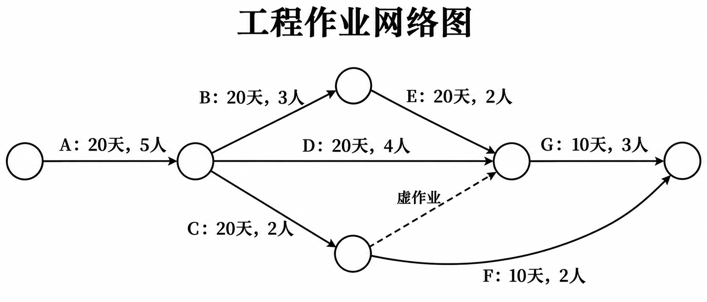
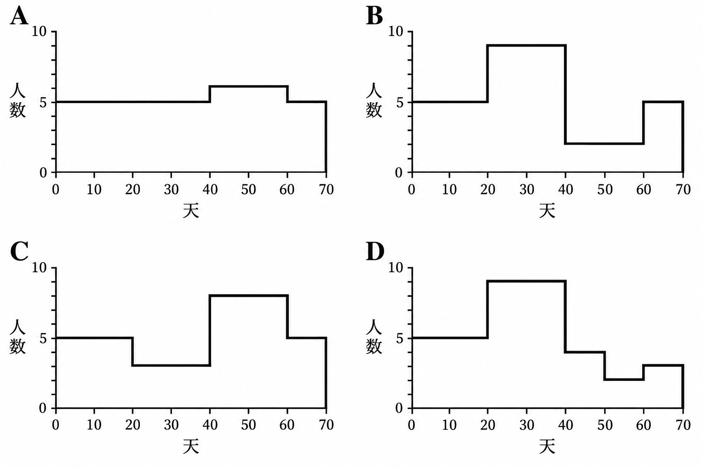
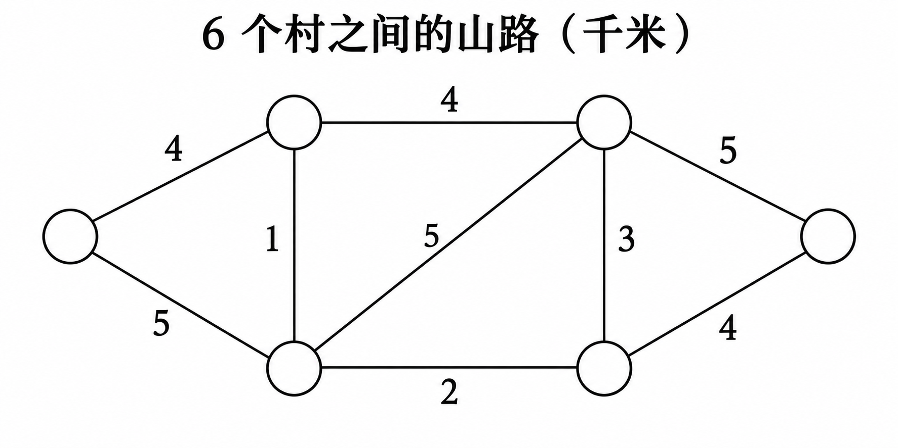
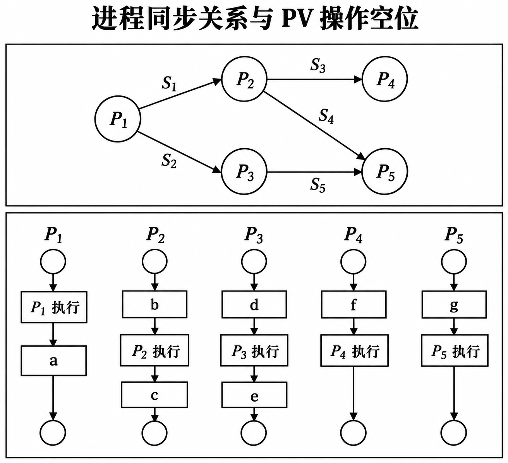
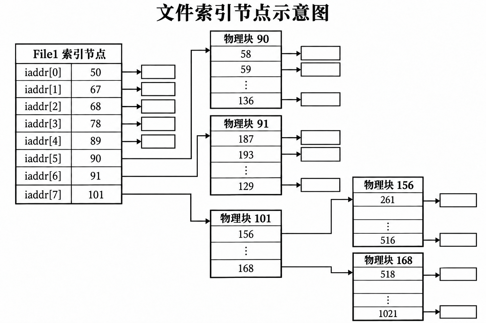
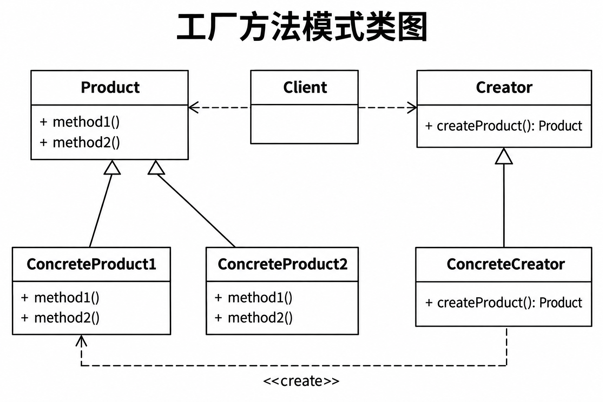

# 高级系统架构设计师上午押题密卷1

原件：[PDF](../../assets/7b41506476858463.pdf)。已勾选推荐正确选项并在每题后附带冲刺速记解析；卷末保留参考答案与原完整解析。

排印修订和原卷歧义见 转换记录。

## 题目

### 第 1 题

质量功能部署(QFD) 是一种将客户要求转化成软件需求的技术。 QFD 的目的是最大限度地提升软件工程过程中客户的满意度。为了这个目标， QFD 确认了3类需求，常规需求、 （　） 和意外需求。

- A. 期望需求
- B. 基础需求
- C. 显式需求
- D. 功能需求

> **【答案】** A
> **【速记解析】**
> - **为什么选 A**：QFD（质量功能部署）确认了3类需求：**常规需求**（理所当然的基本需求）、**期望需求**（客户明示的满意点，满足则满意度大增）和**意外需求**（超出预期的兴奋点）。
> - **为什么不选其他**：**B（基础需求）**：混淆了Kano模型日常用词；**C（显式需求）**、**D（功能需求）**：属于常规软件工程需求分类，非QFD客户满意度维度专有名词。
### 第 2～3 题共同题干

某磁盘盘组共有10个盘面，每个盘面上有100个磁道，每个磁道有32个扇区，假定物理块的大小为2个扇区，分配以物理块为单位。若使用位示图(Bitmap) 管理磁盘空间，则位图需要占用（2）字节空间。若采用空白文件管理磁盘空间，且空白文件目录的每个表项占用5个字节，则当空白文件数目大于 （3）时，空白文件目录占用的字节数大于位图占用的字节数。

### 第 2 题

- A. 32000
- B. 3200
- C. 2000
- D. 1600

> **【答案】** C
> **【速记解析】**
> - **为什么选 C**：1. 扇区总数 = $10 \times 100 \times 32 = 32000$ 个；2. 物理块大小为2个扇区，总物理块数 = $32000 / 2 = 16000$ 块；3. 位示图每 1 bit 对应一个物理块，总大小 = **$16000 \text{ bit} / 8 = 2000 \text{ 字节}$**。
> - **为什么不选其他**：**A（32000）**：错算为总扇区数；**B（3200）**：未除物理块大小或字节换算错误；**D（1600）**：把按字节换算除以8误算或除以10。
### 第 3 题

- A. 400
- B. 360
- C. 320
- D. 160

> **【答案】** A
> **【速记解析】**
> - **为什么选 A**：由第2题知位图占 **2000 字节**。空白文件目录每个表项占 5 字节，设空白文件数为 $N$，当 $5N > 2000$ 即 **$N > 400$** 时，空白文件目录占用字节数大于位图。
> - **为什么不选其他**：**B（360）**、**C（320）**、**D（160）**：计算 $5 \times N$ 均小于 2000 字节（如 $5 \times 320 = 1600 < 2000$），未达到临界阈值。
### 第 4 题

GJB 473-88(军用软件开发规范)是 （　）

- A. 国家标准
- B. 行业标准
- C. 地方标准
- D. 企业标准

> **【答案】** B
> **【速记解析】**
> - **为什么选 B**：**GJB** 是**国家军用标准**代号，在我国标准体系中归属于**行业标准**（国防军工行业）。
> - **为什么不选其他**：**A（国家标准）**：代号为 **GB/GB-T**；**C（地方标准）**：代号为 **DB** 开头；**D（企业标准）**：代号为 **Q/** 开头。
### 第 5～6 题共同题干

企业战略数据模型可分为两种类型： （5） 描述日常事务处理中的数据及其关系；6 描述企业管理决策者所需信息及其关系。

### 第 5 题

- A. 元数据模型
- B. 数据库模型
- C. 数据仓库模型
- D. 组织架构模型

> **【答案】** B
> **【速记解析】**
> - **为什么选 B**：**数据库模型**面向基层操作人员与日常事务处理（OLTP），描述日常事务处理中的操作型数据及其关系。
> - **为什么不选其他**：**A（元数据模型）**：描述数据本身结构与属性的数据字典；**C（数据仓库模型）**：面向中高层决策分析（第6题答案）；**D（组织架构模型）**：属于组织管理视图，非业务数据模型。
### 第 6 题

- A. 元数据模型
- B. 数据库模型
- C. 数据仓库模型
- D. 组织架构模型

> **【答案】** C
> **【速记解析】**
> - **为什么选 C**：**数据仓库模型**面向企业管理决策者，支持多维分析与联机分析处理（OLAP），具有面向主题、集成、非易失、随时间变化的特征。
> - **为什么不选其他**：**A（元数据模型）**：仅用于技术/业务元数据管理；**B（数据库模型）**：面向日常事务级操作（第5题答案）；**D（组织架构模型）**：非决策分析模型。
### 第 7 题

内存按字节编址，利用8K×4bit 的存储器芯片构成84000H～8FFFFH 的内存，共需 （　） 片。

- A. 6
- B. 8
- C. 12
- D. 24

> **【答案】** C
> **【速记解析】**
> - **为什么选 C**：1. 寻址空间 = $8FFFFH - 84000H + 1 = C000H = 12 \times 4096 = 48\text{K}$ 单元；2. 按字节编址总容量 = $48\text{K} \times 8\text{bit}$；3. 芯片为 $8\text{K} \times 4\text{bit}$，所需片数 = **$(48\text{K} \times 8) / (8\text{K} \times 4) = 6 \times 2 = 12$ 片**。
> - **为什么不选其他**：**A（6）**：只计算了字扩展（$48\text{K}/8\text{K}=6$），漏掉了 4bit 到 8bit 的 2 倍位扩展；**B（8）**、**D（24）**：地址空间容量计算错误。
### 第 8 题

依据《计算机软件保护条例》,对软件的保护包括 （　）

- A. 计算机程序，但不包括用户手册等文档
- B. 计算机程序及其设计方法
- C. 计算机程序及其文档，但不包括开发该软件的所用思想
- D. 计算机源程序，但不包括目标程序

> **【答案】** C
> **【速记解析】**
> - **为什么选 C**：《计算机软件保护条例》明确保护**计算机程序及其文档**；著作权保护的是**思想的表达形式**，**不延及开发软件所用的思想、处理过程、操作方法或数学概念**。
> - **为什么不选其他**：**A**：错误排除用户手册等文档（文档同受保护）；**B**：错误将“设计方法”（思想范畴）纳入保护；**D**：错误排除目标程序（源程序与目标程序受同等保护）。
### 第 9 题

数字签名的功能不包括 （　）

- A. 防止发送方和接收方的抵赖行为
- B. 发送方身份确认
- C. 接收方身份确认
- D. 保证数据的完整性

> **【答案】** C
> **【速记解析】**
> - **为什么选 C**：数字签名是发送方用**自己的私钥**签名、接收方用发送方公钥验签。它能实现**发送方身份确认、防抵赖和数据完整性**，但**不能直接确认接收方身份**（接收方身份需由接收方证书或鉴别协议确认）。
> - **为什么不选其他**：**A（防抵赖）**：私钥唯一性决定了发送方无法抵赖；**B（发送方确认）**：公钥解密成功即确认发送方；**D（完整性）**：解密出的摘要比对能保证原文未被篡改。
### 第 10 题

希赛公司的销售收入状态如表所示，该公司达到盈亏平衡点时的销售收入是 （　） (百万元人民币)。

**希赛公司的销售收入状态**

| 项目 | 金额(单位百万元人民币) |
| --- | --- |
| 销售收入 | 800 |
| 材料成本 | 300 |
| 分包费用 | 100 |
| 固定生产成本 | 130 |
| 毛利 | 270 |
| 固定销售成本 | 150 |
| 利润 | 120 |

- A. 560
- B. 608
- C. 615
- D. 680

> **【答案】** A
> **【速记解析】**
> - **为什么选 A**：1. **固定成本 $F$** = 固定生产成本(130) + 固定销售成本(150) = 280 百万元；2. **变动成本 $V$** = 材料(300) + 分包(100) = 400 百万元；3. **边际贡献率** = $1 - 400/800 = 50\%$；4. **保本收入** = **$280 / 0.5 = 560$ 百万元**。
> - **为什么不选其他**：**B（608）**：误将分包费用当成固定成本（$F=380$，$380/0.625=608$），但分包随业务量变动；**C（615）**、**D（680）**：成本归类混淆或公式分母计算错误。
### 第 11 题

计算机执行程序时，在一个指令周期的过程中，为了能够从内存中读指令操作码，首先是将（　） 的内容送到地址总线上。

- A. 程序计数器(PC)
- B. 指令寄存器(IR)
- C. 状态寄存器(SR)
- D. 通用寄存器(GR)

> **【答案】** A
> **【速记解析】**
> - **为什么选 A**：指令周期取指阶段的第一步：CPU 将**程序计数器 (PC)** 中存放的下一条指令地址送上**地址总线**，以便从内存读取指令操作码。
> - **为什么不选其他**：**B（IR，指令寄存器）**：存放已从内存取出的指令，取指后才装载；**C（SR，状态寄存器）**：存放运算状态标志（如进位、溢出）；**D（GR，通用寄存器）**：暂存操作数或中间结果。
### 第 12～14 题共同题干

“企业系统规划方法”和“信息工程”都推荐建立表示数据类(主题数据库)和过程之间关系的 CU 矩阵 M。其中若第 i 号过程产生第 k 号数据类，则 Mik=C; 若第 j 号过程使用第 k 号数据类，则 Mjk=U。矩阵 M 按照一定的规则进行调整后，可以给出划分系统的子系统方案，并可确定每个子系统相关的 （12） 和 （13）（　）；同时也可了解子系统之间的 （14） （　）

### 第 12 题

- A. 关系数据库
- B. 层次数据库
- C. 网状数据库
- D. 共享数据库

> **【答案】** D
> **【速记解析】**
> - **为什么选 D**：在 BSP 方法的 CU 矩阵中，由某个子系统产生并跨子系统被多个过程使用的数据类，对应规划为**共享数据库**。
> - **为什么不选其他**：**A（关系）**、**B（层次）**、**C（网状）**：属于数据库的逻辑数据结构分类，而非 BSP 矩阵按子系统归属划定的“共享/私有”管理属性分类。
### 第 13 题

- A. 关系数据库
- B. 网状数据库
- C. 专业(私有)数据库
- D. 子集数据库

> **【答案】** C
> **【速记解析】**
> - **为什么选 C**：由某个子系统产生且基本仅供该子系统内部使用的数据类，规划为该子系统的**专业（私有）数据库**。
> - **为什么不选其他**：**A（关系）**、**B（网状）**：同为逻辑存储结构；**D（子集数据库）**：非 BSP 标准体系术语。
### 第 14 题

- A. 过程引用
- B. 功能关系
- C. 数据存储
- D. 数据通信

> **【答案】** D
> **【速记解析】**
> - **为什么选 D**：CU 矩阵中若子系统 A 使用了子系统 B 产生的数据类（即跨子系统边界的 U 交叉），直接揭示了子系统之间的**数据通信**（数据接口与数据流动关系）。
> - **为什么不选其他**：**A（过程引用）**：矩阵行是数据类、列是过程，非过程调用过程；**B（功能关系）**：功能聚合在子系统内部；**C（数据存储）**：已由数据库划分体现，跨边界连线体现的是通信流动。
### 第 15 题

客户关系管理(CRM) 系统将市场营销的科学管理理念通过信息技术的手段集成在软件上，能够帮助企业构建良好的客户关系。以下关于 CRM 系统的叙述中，错误的是 （　）

- A. 销售自动化是 CRM 系统中最基本的模块
- B. 营销自动化作为销售自动化的补充，包括营销计划的编制和执行、计划结果分析等
- C. CRM 系统能够与 ERP 系统在财务、制造、库存等环节进行连接，但两者关系相对松散， 一般不会形成闭环结构
- D. 客户服务与支持是 CRM 系统的重要功能。目前，客户服务与支持的主要手段是通过呼叫中心和互联网来实现

> **【答案】** C
> **【速记解析】**
> - **为什么选 C**：在现代企业管理中，**CRM 与 ERP 深度集成并形成闭环结构**（CRM 端获取客户需求与销售订单驱动 ERP 生产排产，ERP 生产与库存进度实时回传 CRM 反馈客户），选项说“相对松散、不会形成闭环”是错误的。
> - **为什么不选其他**：**A**：销售自动化（SFA）确实是 CRM 核心最基础模块；**B**：营销自动化提供市场活动策划、线索跟进与ROI分析；**D**：呼叫中心与互联网门户是当前客户支持最关键的落地手段。
### 第 16 题

以下关于嵌入式系统硬件抽象层的叙述，错误的是 （　）

- A. 硬件抽象层与硬件密切相关，可对操作系统隐藏硬件的多样性
- B. 硬件抽象层将操作系统与硬件平台隔开
- C. 硬件抽象层使软硬件的设计与调试可以并行
- D. 硬件抽象层应包括设备驱动程序和任务调度

> **【答案】** D
> **【速记解析】**
> - **为什么选 D**：**任务调度是操作系统内核（OS Kernel）的核心职能**，绝对不属于硬件抽象层（HAL）。HAL 仅负责屏蔽底层硬件细节，提供统一的硬件访问接口与板级支持驱动。
> - **为什么不选其他**：**A**：HAL 直面底层硬件，对上隐藏差异；**B**：HAL 位于 OS 与硬件之间起到解耦作用；**C**：通过统一 HAL 规范，驱动软件与硬件研发可实现并行开发。
### 第 17 题

在开发一个企业管理信息系统时，首先要进行用户调查，调查中收集的主要信息包括 （　）

- A. 管理目标、人力资源、业务流程和数据流程信息
- B. 组织结构、功能体系、业务流程和数据流程信息
- C. 企业性质、客户资源、业务流程和数据流程信息
- D. 管理目标、功能体系、业务流程和数据流程信息

> **【答案】** B
> **【速记解析】**
> - **为什么选 B**：管理信息系统（MIS）调研分析的四大核心支柱是：**组织结构**（部门与岗位）、**功能体系**（业务职能分解）、**业务流程**（业务流转脉络）和**数据流程**（单据信息流动）。
> - **为什么不选其他**：**A、C、D**：分别混杂了“管理目标、人力资源、企业性质、客户资源”等战略经营宏观概念，偏离了软件工程业务建模的标准四要素。
### 第 18～19 题共同题干

软件开发环境是支持软件产品开发的软件系统，它由软件工具集和环境集成机制构成。环境集成机制包括：提供统一的数据模式和数据接口规范的数据集成机制；支持各开发活动之间通信、切换、调度和协同的 18 ;为统一操作方式提供支持的19。

### 第 18 题

- A. 操作集成机制
- B. 控制集成机制
- C. 平台集成机制
- D. 界面集成机制

> **【答案】** B
> **【速记解析】**
> - **为什么选 B**：软件开发环境集成机制标准模型中：**控制集成机制**负责支持各开发工具和活动之间的**通信、消息传递、流程切换、工具调度和协同工作**。
> - **为什么不选其他**：**A（操作集成）**、**C（平台集成）**：非标准机制名词；**D（界面集成）**：负责统一操作风格与用户界面（对应第19题）。
### 第 19 题

- A. 操作集成机制
- B. 控制集成机制
- C. 平台集成机制
- D. 界面集成机制

> **【答案】** D
> **【速记解析】**
> - **为什么选 D**：**界面集成机制（Presentation Integration）**负责统一操作方式与视觉界面风格，为用户提供一致的交互体验。
> - **为什么不选其他**：**A、C**：干扰项；**B（控制集成机制）**：负责工具调用与活动通信（第18题答案）。
### 第 20 题

需求管理是 CMM 可重复级中的6个关键过程域之一，其主要目标是 （　）。

- A. 对于软件需求，必须建立基线以进行控制，软件计划、产品和活动必须与软件需求保持一致
- B. 客观地验证需求管理活动符合规定的标准、程序和要求
- C. 策划软件需求管理的活动，识别和控制已获取的软件需求
- D. 跟踪软件需求管理的过程、实际结果和执行情况

> **【答案】** A
> **【速记解析】**
> - **为什么选 A**：CMM 2级（可重复级）中**需求管理（RM）的关键目标**为：**建立并维护软件需求基线以进行控制**，并使软件项目计划、工作产品和各项活动**与软件需求保持一致**。
> - **为什么不选其他**：**B**：属于**软件质量保证（SQA）**的核心目标；**C**：仅是过程策划的日常活动；**D**：属于**软件项目跟踪与监控（SPTO）**的目标。
### 第 21 题

网络系统设计过程中，逻辑网络设计阶段的任务是 （　）

- A. 依据逻辑网络设计的要求，确定设备的物理分布和运行环境
- B. 分析现有网络和新网络的资源分布，掌握网络的运行状态
- C. 根据需求规范和通信规范，实施资源分配和安全规划
- D. 理解网络应该具有的功能和性能，设计出符合用户需求的网络

> **【答案】** C
> **【速记解析】**
> - **为什么选 C**：**逻辑网络设计**的任务是根据需求规范和通信规范，选择网络架构，进行**拓扑设计、IP地址分配、路由协议选择、网络管理与安全规划**（不涉及具体硬件型号与施工）。
> - **为什么不选其他**：**A**：确定设备物理分布与环境属于**物理网络设计**；**B**：分析现有网络属于**需求分析/网络现状评估**；**D**：描述为网络工程整体宏观目标，非逻辑设计具体任务。
### 第 22 题

大型局域网通常划分为核心层、 汇聚层和接入层， 以下关于各个网络层次的描述中， 不正确的是 （　）。

- A. 核心层进行访问控制列表检查
- B. 汇聚层定义了网络的访问策略
- C. 接入层提供局域网络接入功能
- D. 接入层可以使用集线器代替交换机

> **【答案】** A
> **【速记解析】**
> - **为什么选 A**：**核心层的核心目标是高速、无阻塞的数据包转发**。复杂的访问控制列表（ACL）、包过滤或深度报文检查会消耗宝贵算力拖慢转发速度，**严禁部署在核心层**，应配置在**汇聚层**。
> - **为什么不选其他**：**B**：汇聚层负责定义与执行安全访问策略、路由聚合；**C**：接入层直接连接用户工作站提供接入；**D**：接入层在技术定义上可以使用集线器（Hub）等低成本设备代替交换机。
### 第 23～25 题共同题干

软件质量属性通常需要采用特定的设计策略实现。例如， 23 设计策略能提高该系统的可用性，24 设计策略能够提高该系统的性能， 25 设计策略能够提高该系统的安全性。

### 第 23 题

- A. 心跳机制
- B. 数据驱动
- C. 关注点分离
- D. 信息隐藏

> **【答案】** A
> **【速记解析】**
> - **为什么选 A**：**心跳机制（Heartbeat）**通过定期互发心跳报文监测节点是否存活，属于**可用性（Availability）**中“故障检测”的典型战术。
> - **为什么不选其他**：**B（数据驱动）**：可修改性架构模式；**C（关注点分离）**、**D（信息隐藏）**：属于**可修改性（Modifiability）**战术（高内聚低耦合、局部化修改）。
### 第 24 题

- A. 引入中间层
- B. 事务机制
- C. 主动冗余
- D. 优先级队列

> **【答案】** D
> **【速记解析】**
> - **为什么选 D**：**优先级队列（Priority Queue）**根据请求优先级进行资源调度与分配，确保核心关键请求优先得到响应，属于**性能（Performance）**架构战术。
> - **为什么不选其他**：**A（引入中间层）**：提高可扩展性但增加调用层级常牺牲性能；**B（事务机制）**：保证数据一致性/可靠性；**C（主动冗余）**：属于**可用性**战术。
### 第 25 题

- A. 信息隐藏
- B. 内置监控器
- C. 限制访问
- D. 检查点

> **【答案】** C
> **【速记解析】**
> - **为什么选 C**：**限制访问（Limit Access）**通过身份鉴别、访问控制列表（ACL）和权限隔离阻止非授权访问，属于**安全性（Security）**中“抵抗攻击”的核心战术。
> - **为什么不选其他**：**A（信息隐藏）**：可修改性战术；**B（内置监控器）**：可用性（故障检测）战术；**D（检查点 Checkpoint）**：可用性（故障恢复/容错）战术。
### 第 26 题

建筑物综合布线系统中的垂直子系统是指 （　）

- A. 由终端到信息插座之间的连线系统
- B. 楼层接线间的配线架和线缆系统
- C. 各楼层设备之间的互连系统
- D. 连接各个建筑物的通信系统

> **【答案】** C
> **【速记解析】**
> - **为什么选 C**：**垂直子系统（主干子系统）**位于垂直弱电竖井中，负责实现**主设备间与各楼层配线架/设备之间的互连**，提供建筑物垂直主干通信。
> - **为什么不选其他**：**A**：终端到信息插座之间是**工作区子系统**；**B**：信息插座到楼层配线架之间是**水平布线子系统**；**D**：连接多个建筑物的管网线缆是**建筑群子系统**。
### 第 27 题

对 ERP 项目最恰当的定位是 （　）

- A. 信息系统集成项目
- B. 管理变 o 革项目
- C. 技术改造项目
- D. 工作流实施项目

> **【答案】** B
> **【速记解析】**
> - **为什么选 B**：ERP（企业资源计划）的核心在于将先进管理思想与企业流程深度结合，涉及组织架构调整、权力利益重构与业务流程重组（BPR），因此**最恰当的定位是管理变革项目**（“三分技术，七分管理，十二分数据”）。
> - **为什么不选其他**：**A（系统集成）**、**C（技术改造）**、**D（工作流）**：单纯把 ERP 视作纯 IT 软件部署或技术改造，是导致 ERP 项目落地失败的最典型原因。
### 第 28～29 题共同题干

某银行系统采用 Factory Method 方法描述其不同账户之间的关系，设计出的类图如图所示。其中与 Factory Method 中的“Creator” 角色相对应的类是28 （　） ; 与 "Product,” 角色相对应的类是29。

工厂方法模式类图

### 第 28 题

- A. Bank
- B. Account
- C. Checking
- D. Savings

> **【答案】** A
> **【速记解析】**
> - **为什么选 A**：工厂方法模式中，**Creator（抽象创建者）**声明工厂方法以返回产品对象。在银行业务模型中，**Bank** 拥有创建各种账户的方法（如 `createAccount()`），对应 **Creator**。
> - **为什么不选其他**：**B（Account）**：为抽象产品接口（**Product**，对应第29题）；**C（Checking）**、**D（Savings）**：为具体产品实现类（**ConcreteProduct**）。
### 第 29 题

- A. Bank
- B. Account
- C. Checking
- D. Savings

> **【答案】** B
> **【速记解析】**
> - **为什么选 B**：**Account（账户类）**定义了工厂方法所创建对象的公共操作接口，在模式中对应抽象产品 **Product** 角色。
> - **为什么不选其他**：**A（Bank）**：工厂创建者（**Creator**）；**C（Checking，支票账户）**、**D（Savings，储蓄账户）**：具体产品（**ConcreteProduct**）。
### 第 30 题

系统间进行异步串行通信时，数据的串/并和并/串转换一般是通过 （　） 实现的。

- A. I/O 指令
- B. 专用的数据传送指令
- C. CPU 中有移位功能的数据寄存器
- D. 接口中的移位寄存器

> **【答案】** D
> **【速记解析】**
> - **为什么选 D**：系统间进行异步串行通信时，由通信接口芯片（如 UART）内部硬件配备的**移位寄存器（Shift Register）**在时钟脉冲配合下自动完成数据的**串转并**（接收）和**并转串**（发送）。
> - **为什么不选其他**：**A/B**：I/O 指令及专用传送指令只负责将字/字节写入或读出端口，无法自动生成串行时序脉冲；**C**：移位转换由外设接口硬件完成，以彻底释放 CPU 算力。
### 第 31～33 题共同题干

某计算机系统中有一个 CPU、一台扫描仪和一台打印机。现有3个图像任务，每个任务有3个程序段：扫描 Si, 图像处理 Ci 和打印 Pi(i=1,2,3)。 如图所示为3个任务各程序段并发执行的前驱图，其中， 31 可并行执行， 32 的直接制约， 33 的间接制约。

前趋图

### 第 31 题

- A. "C₁S₂","P₁C₂S₃","P₂C₃"
- B. "C₁S₁","S₂C₂P₂","C₃P₃"
- C. "S₁C₁P₁”,"S₂C₂P₂”,"S₃C₃P₃"
- D. "S₁S₂S₃","C₁C₂C₃","P₁P₂P₃"

> **【答案】** A
> **【速记解析】**
> - **为什么选 A**：根据前趋图与硬件并行机制（扫描仪、CPU、打印机为独立设备）：1. $S_1$ 完成后，$C_1$ 与 $S_2$ 互不冲突，**“$C_1, S_2$”可并行**；2. 接着 $P_1$（打印机）、$C_2$（CPU）、$S_3$（扫描仪）三者设备完全独立，**“$P_1, C_2, S_3$”可三者并行**；3. 随后 **“$P_2, C_3$”可并行**。符合 A 选项组合。
> - **为什么不选其他**：**B、C、D**：包含同一任务内部存在前后数据依赖的程序段（如 $S_1$ 与 $C_1$ 必须串行），或争用同一设备的程序段（如 $S_1, S_2$ 必须串行），绝不可并行。
### 第 32 题

- A. S₁ 受到 S₂ 和 S₃、C1 受到 C₂ 和 C3、P₁ 受到 P₂ 和 P₃
- B. S2 和 S₃ 受到 S1、C₂ 和 C₃ 受到 C₁、P₂ 和 P₃ 受到 P₁
- C. C1 和 P₁ 受到 S₁、C₂ 和 P₂ 受到 S₂、C₃ 和 P₃ 受到 S₃
- D. C₁ 和 S₁ 受到 P₁、C₂ 和 S₂ 受到 P₂、C₃ 和 S₃ 受到 P₃

> **【答案】** C
> **【速记解析】**
> - **为什么选 C**：**直接制约（同步/因果依赖）**源于**同一任务内部的数据流水线依赖**：只有先扫描完 $S_i$ 才能进行图像计算 $C_i$、计算完才能执行打印 $P_i$，因此 **$C_1, P_1$ 受到 $S_1$ 的直接制约**（同理 $C_2, P_2$ 受 $S_2$ 制约，$C_3, P_3$ 受 $S_3$ 制约）。
> - **为什么不选其他**：**A、D**：前后逻辑顺序完全颠倒（反向依赖）；**B**：不同任务间争用同类硬件设备产生的是**间接制约（互斥）**，并非直接因果制约。
### 第 33 题

- A. S₁ 受到 S2和 S₃、C1 受到 C₂和 C₃、P1 受到 P₂ 和 P₃
- B. S₂ 和 S3受到 S₁、C₂ 和 C₃ 受到 C₁、P₂ 和 P₃ 受到 P₁
- C. C1 和 P₁ 受到 S1、C₂ 和 P₂ 受到 S₂、C₃ 和 P₃ 受到 S₃
- D. C₁ 和 S1受到 P₁、C₂ 和 S₂ 受到 P₂、C₃ 和 S₃ 受到 P₃

> **【答案】** B
> **【速记解析】**
> - **为什么选 B**：**间接制约（互斥依赖）**源于**对共享临界资源的竞争**：系统中只有一台扫描仪、一个CPU和一台打印机，$S_2, S_3$ 因争用扫描仪**受到 $S_1$ 的间接制约**；$C_2, C_3$ 争用CPU受到 $C_1$ 间接制约；$P_2, P_3$ 争用打印机受到 $P_1$ 间接制约。
> - **为什么不选其他**：**A**：时间顺序倒置，先执行的 $S_1$ 不可能受后执行的 $S_2$ 制约；**C**：任务内部因果依赖属于**直接制约**（第32题答案）；**D**：逻辑混乱错误。
### 第 34 题

软件需求分析产生软件操作特征的规格说明，指明软件和其他系统元素的接口，建立软件必须满足的约束。下面对于软件需求分析的描述，不正确的是 （　）

- A. 分析员研究系统规约和软件项目计划，并在系统语境内理解软件和复审，从而生成计划软件范围的估算
- B. 需求分析使得系统工程师能够刻画出软件的功能和性能、指明软件和其他系统元素的接口、并建立软件必须满足的约束
- C. 经过仔细的需求分析活动，分析员能够得到详细的系统规约
- D. 需求分析能够为软件设计者提供可被翻译成数据、体系结构、界面和过程设计的模型

> **【答案】** C
> **【速记解析】**
> - **为什么选 C**：软件需求分析的最终产物是**软件需求规格说明书 (SRS)**。而**系统规约 (System Specification)** 是在此之前的“系统工程/可行性研究阶段”产生的更高层级文档（界定硬件、软件与人员的总体规约），需求分析是以系统规约为输入，不能反过来得到系统规约。
> - **为什么不选其他**：**A**：分析员确实需要基于系统规约在整体语境内理解软件范围；**B**：刻画软件功能、性能、接口和约束是需求分析的标准定义；**D**：需求分析建立的分析模型是后续架构与详细设计的输入源泉。
### 第 35 题

建立企业信息系统应该遵循一定的原则，以下原则不适当的是 （　）

- A. 必须支持企业的战略目标
- B. 应该自上而下地规划和实现
- C. 应该支持企业各个管理层的需求
- D. 应该向整个企业提供一致的信息

> **【答案】** B
> **【速记解析】**
> - **为什么选 B**：企业信息系统建设遵循**“自上而下地规划，自下而上地分步实现”**的原则。规划必须从企业战略出发自顶向下统一设计，而实施必须自底向上从基础业务与核心模块扎实推进。说“自上而下地实现”是不切实际的错误做法。
> - **为什么不选其他**：**A（正确原则）**：信息系统必须紧密对齐并服务于企业战略目标；**C（正确原则）**：必须兼顾战略决策层、管理战术层与业务操作层需求；**D（正确原则）**：统一企业数据模型，消除数据孤岛，保证信息一致性。
### 第 36 题

计算机系统中，在 （　） 的情况下一般应采用异步传输方式。

- A. CPU 访问内存
- B. CPU 与 I/O 接口交换信息
- C. CPU 与 PCI 总线交换信息
- D. I/O 接口与打印机交换信息

> **【答案】** D
> **【速记解析】**
> - **为什么选 D**：**I/O 接口与打印机**之间存在极大的**速度差异**。打印机作为典型的低速机械外设，数据准备与打印处理间隔不确定，一般采用基于字符起止标志或缓冲池的**异步传输方式**。
> - **为什么不选其他**：A（CPU 访问内存）、B（CPU 与 I/O 接口交换信息）、C（CPU 与 PCI 总线通信）均属于主机内部**高速部件之间**的数据交换，依赖严密同频同相的时钟脉冲控制以保证高吞吐，均采用**同步传输方式**。
### 第 37～39 题共同题干

进程 P1、P2、P3、P4、P5 的前趋图如图所示。

前趋图

若用 PV 操作控制进程并发执行的过程，则需要设置4个信号量 S1、S2、S3 和 S4, 且信号量初值都等于零。图1- 18中 a 和 b 应分别填写 37 _,c 和 d 应分别填写 38 _,e 和 f 应分别填写 39 （　）

操作控制过程PV

### 第 37 题

- A. P(S1) 和 P(S2)
- B. P(S1) 和 V(S2)
- C. V(S1) 和 V(S2)
- D. V(S1) 和 P(S2)

> **【答案】** C
> **【速记解析】**
> - **为什么选 C**：前趋图 PV 操作核心口诀为**“出度发信号执行 V 操作，入度等信号执行 P 操作”**。P1 和 P2 分别指向 P3（产生计算结果并唤醒后继），因此 P1 结束处 a 应发信号 **V(S1)**，P2 结束处 b 应发信号 **V(S2)**。
> - **为什么不选其他**：P 操作用于等待与申请资源，必须在进程开始前执行；A、B、D 选项中错误包含了 P 操作，若在任务结束处执行 P 会导致进程阻塞或信号量误扣减。
### 第 38 题

- A. P(S1)、P(S2) 和 V(S3)、V(S4)
- B. P(S1)、P(S2) 和 P(S3)、P(S4)
- C. V(S1)、V(S2) 和 P(S3)、P(S4)
- D. V(S1)、V(S2) 和 V(S3)、V(S4)

> **【答案】** A
> **【速记解析】**
> - **为什么选 A**：进程 P3 依赖前驱 P1 和 P2 的结果，必须在启动前测试并消耗完成信号，即入口 c 填写 **P(S1)、P(S2)**；P3 运行完毕后需发出通知唤醒后继进程 P4 和 P5，即出口 d 填写 **V(S3)、V(S4)**。
> - **为什么不选其他**：B、C、D 混淆了前驱依赖的等待（P 操作）与后继通知的释放（V 操作）——进程启动必须是 P 操作（排除 C/D），进程结束必须是 V 操作（排除 B）。
### 第 39 题

- A. P(S3) 和 P(S4)
- B. P(S3) 和 V(S4)
- C. V(S3) 和 V(S4)
- D. V(S3) 和 P(S4)

> **【答案】** A
> **【速记解析】**
> - **为什么选 A**：P4 和 P5 都是 P3 的后继节点，在开始执行前必须分别等待前驱 P3 发出的完成信号，因此 P4 入口 e 应填 **P(S3)**，P5 入口 f 应填 **P(S4)**。
> - **为什么不选其他**：B、C、D 选项中错误包含了 V 操作。V 操作是发送唤醒信号，后继节点在启动执行前只能使用 P 操作测试并等待前驱条件满足。
### 第 40～42 题共同题干

统一软件开发过程是一种基于面向对象技术的软件开发过程，其特点是“用例驱动，以架构为核心，迭代并增量”。统一软件开发过程定义了4种通用的开发阶段，它们按照过程顺序分别是：起始阶段、 （40）、构建阶段和 （41） _,其中在构建阶段主要产生的文档有42。 （　）

### 第 40 题

- A. 分析阶段
- B. 细化阶段
- C. 设计阶段
- D. 交付阶段

> **【答案】** B
> **【速记解析】**
> - **为什么选 B**：统一软件开发过程（UP/RUP）四大生命周期阶段的标准顺序为：**初始阶段（Inception）$\rightarrow$ 细化阶段（Elaboration）$\rightarrow$ 构建阶段（Construction）$\rightarrow$ 交付阶段（Transition）**。因此第 2 阶段是**细化阶段**。
> - **为什么不选其他**：A（分析阶段）、C（设计阶段）属于传统瀑布模型或 UP 中的**核心工作流/工程活动（Discipline）**，而非宏观生命周期阶段；D（交付阶段）是生命周期的第 4 个阶段。
### 第 41 题

- A. 分析阶段
- B. 细化阶段
- C. 设计阶段
- D. 交付阶段

> **【答案】** D
> **【速记解析】**
> - **为什么选 D**：UP 生命周期顺序的第 4 个阶段是**交付阶段（移交阶段）**，重点任务是开展 $\beta$ 测试、制作产品发布版本、培训用户以及将系统部署交付最终用户实际环境使用。
> - **为什么不选其他**：A（分析）、C（设计）是贯穿各阶段的工程活动；B（细化阶段）是第 2 阶段，用于架构基线定型与关键风险消除。
### 第 42 题

- A. 初始用户手册
- B. 用例模型
- C. 项目计划
- D. 设计模型

> **【答案】** D
> **【速记解析】**
> - **为什么选 D**：在统一软件开发过程中，**构建阶段**的核心任务是完成所有构件的开发、集成与测试，将架构基线扩充为完整系统，主要产出与代码紧密对应的**设计模型（Design Model）**及可运行构件产品。
> - **为什么不选其他**：A（初始用户手册）通常在初始阶段起草、交付阶段定稿；B（用例模型）主要在初始和细化阶段确立；C（项目计划）在初始阶段制定基线并在各阶段迭代微调，均非构建阶段核心专属产物。
### 第 43 题

提高计算机可靠性可以采用冗余技术，下面的例子中属于信息冗余的是（　）

- A. 软件备份
- B. CRC 校验
- C. 程序卷回
- D. 指令复执

> **【答案】** B
> **【速记解析】**
> - **为什么选 B**：**信息冗余**指在实现正常功能所必需的有效信息之外额外附加校验码以确保结果正确。**CRC 校验码（循环冗余校验）**、海明码、奇偶校验均属于典型的**信息冗余技术**。
> - **为什么不选其他**：A（软件备份）属于**软件冗余**；C（程序卷回）与 D（指令复执）都是出错后重新执行，属于以消耗额外运行时间为代价的**时间冗余**。
### 第 44 题

希赛公司欲对其内部的信息系统进行集成，需要实现在系统之间快速传递可定制格式的数据包，并且当有新的数据包到达时，接收系统会自动得到通知。另外还要求支持数据重传，以确保传输的成功。针对这些集成需求，应该采用 （　） 的集成方式。

- A. 远程过程调用
- B. 共享数据库
- C. 文件传输
- D. 消息传递

> **【答案】** D
> **【速记解析】**
> - **为什么选 D**：题目明确要求“快速传递可定制格式数据包”、“新数据到达自动通知（事件驱动/发布订阅）”、“支持数据重传以确保可靠成功”，完全契合**消息传递（Message-Oriented Middleware / 消息队列）**的异步解耦、事件通知和可靠投递机制。
> - **为什么不选其他**：A（远程过程调用 RPC）属于**紧耦合的同步点对点调用**，单点故障风险高且缺乏内置的自动通知与断点重传支持；B（共享数据库）和 C（文件传输）属于数据级批处理或被动轮询共享，**缺乏即时事件通知机制**，实时性较差。
### 第 45 题

以下关于 CISC(Complex Instruction Set Computer, 复杂指令集计算机)和RISC(Reduced Instruction Set Computer,精简指令集计算机)的叙述中，错误的是 （　）。

- A. 在 CISC 中，复杂指令都采用硬布线逻辑来执行
- B. 一般而言，采用 CISC 技术的 CPU, 其芯片设计复杂度更高
- C. 在 RISC 中，更适合采用硬布线逻辑执行指令
- D. 采用 RISC 技术，指令系统中的指令种类和寻址方式更少

> **【答案】** A
> **【速记解析】**
> - **为什么选 A**：叙述错误的是 A。CISC 包含大量复杂、变长且功能繁多的指令，硬件组合逻辑难以穷举实现，因此 CISC 普遍采用**微程序控制器（微码）**；而 RISC 追求指令简单、定长且单周期完成，才广泛采用**硬布线逻辑（组合逻辑）**来加速执行。
> - **为什么不选其他**：B 正确，CISC 指令译码电路复杂、芯片规整度差，芯片设计复杂度更高；C 正确，RISC 指令规整简单，极适合用硬布线逻辑执行；D 正确，RISC 核心思想就是精简指令集（保留最常用的 20% 指令）并大幅减少寻址方式。
### 第 46 题

关于 FTP 和 TFTP 的描述，正确的是 （　）。

- A. FTP 和 TFTP 都是基于 TCP
- B. FTP 和 TFTP 都是基于 UDP
- C. FTP 基于 TCP、TFTP 基于 UDP
- D. FTP 基于 UDP、TFTP 基于 TCP

> **【答案】** C
> **【速记解析】**
> - **为什么选 C**：**FTP（文件传输协议）**是面向连接的可靠传输，传输层基于 **TCP**（控制端口 21，数据端口 20）；**TFTP（简单文件传输协议）**追求轻量简洁，传输层基于无连接的 **UDP**（端口 69）。
> - **为什么不选其他**：A 错误忽略了 TFTP 的轻量性（基于 UDP）；B 错误忽略了标准 FTP 的可靠连接（基于 TCP）；D 恰好将二者的传输层协议颠倒。记忆考点：“小巧简单（TFTP）用 UDP，完整可靠（FTP）用 TCP”。
### 第 47 题

在客户机/服务器系统开发中，采用 （　） 时，应将数据层和数据处理层放置于服务器，应用逻辑层、表示逻辑层和表示层放置于客户机。

- A. 分布式表示结构
- B. 分布式应用结构
- C. 分布式数据和应用结构
- D. 分布式数据结构

> **【答案】** D
> **【速记解析】**
> - **为什么选 D**：在客户机/服务器分布式划分中，**分布式数据架构**的切分点位于应用逻辑与数据处理之间，**数据层与数据处理层放置于服务器**，而**应用逻辑层、表示逻辑层和表示层放置于客户机**（典型的传统胖客户机模式）。
> - **为什么不选其他**：A（分布式表示架构）仅将表示层及表示逻辑层置于客户机，应用逻辑及数据全在服务器（瘦客户机）；B（分布式应用架构）或 C（分布式数据和应用架构）通常将应用逻辑层独立部署于应用服务器（三层体系架构），客户机不承担完整业务逻辑。
### 第 48 题

MIPS (每秒百万次指令数)和 MFLOPS (每秒百万次浮点运算数)是衡量 CPU 性能的两个指标，其中 （　）。

- A. MIPS 适合衡量向量处理机的性能， MFLOPS 适合衡量标量处理机的性能
- B. MIPS 适合衡量标量处理机的性能， MFLOPS 适合衡量向量处理机的性能
- C. MIPS 反映计算机系统的峰值性能， MFLOPS 反映计算机系统的持续性能
- D. MIPS 反映计算机系统的持续性能， MFLOPS 反映计算机系统的峰值性能

> **【答案】** B
> **【速记解析】**
> - **为什么选 B**：MIPS（每秒百万条指令数）和 MFLOPS（每秒百万次浮点运算数）都是直接衡量**中央处理器（CPU）**计算处理速度与综合性能的核心经典指标。
> - **为什么不选其他**：A（运算器）只是 CPU 内部执行算术逻辑操作的子部件，宏观性能指标衡量的是整个 CPU；C（主存）的性能指标通常为存取周期、带宽（GB/s）、容量等；D（I/O 设备）的性能指标通常为数据传输率（bps、IOPS）、响应时间等。
### 第 49 题

我国标准分为强制性标准和推荐性标准，标准的编号由标准代号、标准发布顺序号和标准发布年代号构成， （　） 为推荐性行业标准的代号。

- A. DB11/T
- B. Q/T11
- C. GB/T
- D. SJ/T

> **【答案】** D
> **【速记解析】**
> - **为什么选 D**：我国国家标准的代号中，**GB** 代表国家**强制性标准**（“国标”拼音缩写），后缀加 **/T**（“推”拼音首字母）即 **GB/T**，代表**国家推荐性标准**。
> - **为什么不选其他**：A（GB）是**强制性**国家标准；B（Q）代表企业标准（“企”拼音首字母）；C（JB）代表机械行业标准（“机标”拼音首字母）。
### 第 50 题

系统输入设计中，采用内部控制方式以确保输入系统数据的有效性， 用于验证数据是否位于合法的取值范围。

- A. 数据类型检查
- B. 自检位
- C. 域检查
- D. 格式检查

> **【答案】** C
> **【速记解析】**
> - **为什么选 C**：**界限检查（Limit Check / 范围检查）**的核心定义是设置输入数据的合理上下限阈值，专门用于验证输入数据是否落在**预定的合理有效范围**之内（例如年龄处于 0~150 岁之间）。
> - **为什么不选其他**：A（格式检查）用于验证数据的字符类型、长度和格式模式（如纯数字、手机号规则）；B（逻辑检查）用于验证多个关联字段或前后数据之间的业务逻辑因果关系（如发货日期不能早于下单日期）；D（校验码检查）通过在代码末尾追加算法生成的校验位来防止转置或录入错误（如身份证末位校验）。
### 第 51 题

希赛公司欲为某种型号的示波器开发内置软件。该公司的架构师设计了如图所示的软件架构。在软件架构评审时，专家认为该架构存在的问题是 （　）

示波器内置软件架构图

- A. 在功能划分上将各个模块独立起来
- B. 在硬件构件的混合和替换方面不是很灵活
- C. 没有清晰地说明用户怎样与其交互
- D. 没有明确的层次关系，没有强调功能之间的交互

> **【答案】** C
> **【速记解析】**
> - **为什么选 C**：示波器软件作为典型仪器仪表嵌入式软件，人机交互（旋钮输入、按键响应、波形参数读取显示）是核心功能。架构设计图中仅对内部信号采集、滤波及波形转换等数据流水进行了建模，**完全缺失了用户交互界面与外部交互机制**。
> - **为什么不选其他**：A（功能模块独立封装是良好的模块化特性，不是缺陷）；B（图中使用构件隔离硬件，并非硬件替换不灵活）；D（内部数据流与管道层级清晰，其根本短板在于对外部**用户交互的严重缺失**）。
### 第 52 题

某工程包括7个作业(A～G., 各作业所需的时间和人数，以及互相衔接的关系如图所示(其中虚线表示不消耗资源的虚作业)。

各作业所需的时间和人数以及互相衔接的关系

如果各个作业都按最早可能时间开始，那么,正确描述该工程每一天所需人数的图为 （　）

- A. 图 A
- B. 图 B
- C. 图 C
- D. 图 D

> **【答案】** D
> **【速记解析】**
> - **为什么选 D**：按作业先后衔接与并行关系分析各阶段人力需求：
1. **第 1~20 天**：仅 A 运行，需 **5 人**；
2. **第 21~40 天**：B（3人）、C（4人）、D（2人）并行运行，人力峰值 $3+4+2 = \mathbf{9\text{人}}$；
3. **第 41~50 天**：E（2人）和 F（2人）并行，需 $2+2 = \mathbf{4\text{人}}$；
4. **第 51~60 天**：仅 E 运行，需 **2 人**；
5. **第 61~70 天**：仅 G 运行，需 **3 人**。
对应时段人数折线/阶梯图唯有 **D** 完全相符。
> - **为什么不选其他**：A、B、C 选项在不同时间区段的人力叠加或持续时间计算错误（如未将 21~40 天 B/C/D 三者并行计入 9 人峰值，或错算了 E 与 F 并行退出的时间节点）。
### 第 53 题

1 台服务器、3 台客户机和 2 台打印机构成了一个局域网（如下图）。在该系统中，服务器根据某台客户机的请求，将数据在一台打印机上输出。设服务器、各客户机及各打印机的可用性分别为 $a$、$b$、$c$，则该系统的可用性为（　）。

- A. $abc$
- B. $a(1-b)(1-c)$（原卷式）
- C. $a(1-b)(1-c)$（原卷式）
- D. $a[1-(1-b)^3][1-(1-c)^2]$

原卷校注：原页多处上标缺失，B、C 的现存表达式重复；本版保留其现存写法，D 按题设数量与解析恢复上标，未另造干扰项。

> **【答案】** D
> **【速记解析】**
> - **为什么选 D**：业务成功执行依赖“至少 1 台客户机可用” $\times$ “服务器必须可用” $\times$ “至少 1 台打印机可用”的**串-并联混合可靠性模型**：
- 3 台客户机并联可用度为 $1 - (1-b)^3$；
- 服务器串联可用度为 $a$；
- 2 台打印机并联可用度为 $1 - (1-c)^2$。
三者串联相乘，总系统可用性公式为 **$a[1-(1-b)^3][1-(1-c)^2]$**。
> - **为什么不选其他**：A（$abc$）将整个网络误当成所有单节点简单串联，忽略了客户机与打印机的冗余并联；B、C 选项混淆了并联可靠度公式（并联失效率为各失效率乘积，可用度应为 $1-\prod(1-R_i)$，而非直接写成失效率）。
### 第 54 题

某磁盘磁头从一个磁道移至另一个磁道需要10ms。 文件在磁盘上非连续存放，逻辑上相邻数据块的平均移动距离为10个磁道，每块的旋转延迟时间及传输时间分别为100ms 和 2ms, 则读取一个100块的文件需要 （　） ms 的时间。

- A. 10200
- B. 11000
- C. 11200
- D. 20200

> **【答案】** D
> **【速记解析】**
> - **为什么选 D**：读取非连续存放文件的单个数据块耗时 = **寻道时间**（$10\text{磁道}\times 10\text{ms/磁道} = 100\text{ms}$）+ **旋转延迟时间**（$100\text{ms}$）+ **传输时间**（$2\text{ms}$）= **$202\text{ms}$**。
读取 100 块该文件的总耗时为：$100 \times 202\text{ms} = \mathbf{20200\text{ms}}$。
> - **为什么不选其他**：A（10200ms）漏算了至关重要的寻道时间（仅计 $100+2$）；B（11000ms）或 C（11200ms）误将 10 个磁道的移动总距离算作单次 10ms，未乘上每磁道移动时间（$10\times 10$）导致大幅低估。
### 第 55 题

甲公司的某个注册商标是乙画家创作的绘画作品， 甲申请该商标注册时未经乙的许可， 乙认为其著作权受到侵害。 在乙可采取的以下做法中， 错误的是 （　）

- A. 向甲公司所在地人民法院提起著作权侵权诉讼
- B. 请求商标评审委员会裁定撤销甲的注册商标
- C. 首先提起诉讼，如对法院判决不服再请求商标评审委员会进行裁定
- D. 与甲交涉，采取许可方式让甲继续使用该注册商标

> **【答案】** C
> **【速记解析】**
> - **为什么选 C**：错误做法是 C。司法审判是民事纠纷的最终裁判机制。当事人若**对人民法院的一审判决不服，必须依法向上一级人民法院提起上诉**，而绝不能“降格”转而向行政机关（国家知识产权局商标评审委员会）请求撤销或重新裁定。
> - **为什么不选其他**：A 正确，侵犯著作权属于民事侵权，可依法向被告所在地或侵权行为地法院提起民事诉讼；B 正确，对于侵犯他人在先著作权的商标，在先权利人可依据《商标法》请求商评委裁定宣告该注册商标无效；D 正确，民事权利允许当事人自愿协商，可通过签订著作权许可合同化解纠纷。
### 第 56 题

山区某乡的6个村之间有山路如图所示，其中的数字标明了各条山路的长度(千米)。

6 个村之间的山路

乡政府决定沿山路架设电话线。 为实现村村通电话， 电话线总长至少为 （　） 千米。

- A. 11
- B. 14
- C. 18
- D. 33

> **【答案】** B
> **【速记解析】**
> - **为什么选 B**：本题考查**最小生成树（Kruskal 算法）**。连通 6 个村庄需要且仅需要 $6-1 = 5$ 条边。按边权值从小到大贪心选取且不形成回路：
依次选取权值为 **1（1条）、2（1条）、3（1条）、4（2条）** 的 5 条边，
总长度为 $1 + 2 + 3 + 4 + 4 = \mathbf{14\text{千米}}$。
> - **为什么不选其他**：A（11）边权和不足以使 6 个村庄全连通；C（18）选入了非最优的大权值边；D（33）为图中山路全部权值的无意义累加。
### 第 57 题

设有职务工资关系 P(职务，最低工资，最高工资),员工关系 EMP(员工号，职务，工资),要求任何一名员工，其工资值必须在其职务对应的工资范围之内，实现该需求的方法是 （　）。

- A. 建立“EMP 职务”向"P 职务”的参照完整性约束
- B. 建立"P 职务”向"EMP 职务"的参照完整性约束
- C. 建立 EMP 上的触发器程序审定该需求
- D. 建立 P 上的触发器程序审定该需求

> **【答案】** C
> **【速记解析】**
> - **为什么选 C**：工资值必须在职务对应的最低与最高区间内，属于**跨表、涉及数值动态范围比较的复杂业务完整性约束**，常规单表 Check 与外键无法支持。由于员工入职录入与调薪变动均发生在 **EMP 表**上，必须在 **EMP 表上建立 INSERT/UPDATE 触发器**来实时拦截不符合工资区间的操作。
> - **为什么不选其他**：A、B 的参照完整性（外键）仅能约束 EMP 中的职务必须存在于 P 表中，**完全无法校验具体的工资数值大小**；D 将触发器建在 P（职务表）上，无法捕获 EMP 表中日常员工入职或改动工资的行为。
### 第 58～60 题共同题干

进程 P1、P2、P3、P4 和 P5 的前趋图如图所示。

前趋图

若用 PV 操作控制进程 P1～P5 并发执行的过程，则需要设置5个信号量 s1、S2、S3、S4 和 S5,进程间同步所使用的信号量标注在图中的边上，且信号量 S1～S5 的初值都等于零，初始状态下进程P1开始执行。在如图所示的 PV 操作示意图中 a、b 和 c 处应分别填写 ;d 和 e 处应分别填写

（　） _,f 和 g 处应分别填写 （　）

PV 操作示意图

### 第 58 题

- A. V(S1)V(S2)、P(S1) 和 V(S3)V(S4)
- B. P(S1)V(S2)、P(S1) 和 P(S2)V(S1)
- C. V(S1)V(S2)、P(S1) 和 P(S3)P(S4)
- D. P(S1)P(S2)、V(S1) 和 P(S3)V(S2)

> **【答案】** A
> **【速记解析】**
> - **为什么选 A**：前趋图中：
1. P1 为初始执行进程，其完成后需唤醒 P2（信号量 S1）和 P3（信号量 S2），出口 a 执行 **V(S1)V(S2)**；
2. P2 需等待 P1 结束，入口 b 执行 **P(S1)**；
3. P2 完成后需通知后继 P4（S3）和 P5（S4），出口 c 执行 **V(S3)V(S4)**。
> - **为什么不选其他**：B、C、D 混淆了前驱完成的通知（V 操作）与启动执行的申请等待（P 操作），或者信号量对应错误（入口必须是 P，出口必须是 V）。
### 第 59 题

- A. P(S1) 和 V(S5)
- B. V(S1) 和 P(S5)
- C. P(S2) 和 V(S5)
- D. V(S2) 和 P(S5)

> **【答案】** C
> **【速记解析】**
> - **为什么选 C**：P3 依赖 P1 发出的信号量 S2，故在启动执行的入口 d 处需执行 **P(S2)** 进行等待；P3 执行完毕后需通过信号量 S5 唤醒后继进程 P5，故在出口 e 处需执行 **V(S5)**。
> - **为什么不选其他**：A、B 错误混淆了 P1 唤醒 P2 的信号量 S1；D 颠倒了入口测试等待（应为 P 原语）与出口释放通知（应为 V 原语）的规则。
### 第 60 题

- A. P(S3) 和 V(S4)V(S5)
- B. P(S3) 和 P(S4)P(S5)
- C. V(S3) 和 V(S4)V(S5)
- D. V(S3) 和 P(S4)P(S5)

> **【答案】** B
> **【速记解析】**
> - **为什么选 B**：P4 仅依赖 P2（通过 S3 驱动），入口 f 执行 **P(S3)**；P5 为最终汇聚进程，同时依赖 P2（S4）和 P3（S5）的完成，必须同时集齐两个前驱信号才能开始，因此入口 g 必须执行 **P(S4)P(S5)**。
> - **为什么不选其他**：A、C、D 选项在进程启动入口处错误包含了 V 操作（进程启动前必须通过 P 操作消耗信号量，绝不能在入口执行 V 释放）。
### 第 61～62 题共同题干

假设磁盘上每个磁道划分成9个物理块，每块存放1个逻辑记录。逻辑记录 R0,R1,...,R8 存放在同一个磁道上，记录的安排顺序如表所示。

**记录的安排顺序**

| 物理块 | （　） | 1 | 2 | 3 | 4 | 5 | 6 | 7 | 8 |
| --- | --- | --- | --- | --- | --- | --- | --- | --- | --- |
| 逻辑记录 | RO | R1 | R2 | R3 | R4 | R5 | R6 | R7 | R8 |

假定磁盘旋转一圈的时间为27ms,磁头当前处在 RO 的开始处。若系统顺序处理这些记录，使用单缓冲区，每个记录处理时间为3ms, 则处理这9个记录的最长时间为 （61） ;若对信息存储进行优化分布后，处理9个记录的最少时间为 （62） o

### 第 61 题

- A. 243ms
- B. 246ms
- C. 254ms
- D. 280ms

> **【答案】** B
> **【速记解析】**
> - **为什么选 B**：磁道 9 块每圈 27ms，每块读取耗时 $27/9 = 3\text{ms}$。读取 R0（3ms）后在单缓冲区处理 R0（3ms），此时磁盘已旋转滑过 R1，磁头停在 R2 开头。为读取 R1，磁盘必须额外旋转一整圈找回 R1 起点，每个后续记录的处理周期为**等待旋转 24ms + 读取 3ms + 处理 3ms = 30ms**（即每转一整圈 27ms + 处理 3ms）。前 8 条记录各需 30ms（共 240ms），最后一条记录 R8 处理无需再寻下条记录（读取 3ms + 处理 3ms = 6ms），总耗时为 $8 \times 30 + 6 = \mathbf{246\text{ms}}$。
> - **为什么不选其他**：A（243ms）漏算了最后一条记录的处理时间 3ms；C（254ms）和 D（280ms）错算了磁头转动周期或错误地将最后一条记录也追加了一整圈寻道等待。
### 第 62 题

- A. 30ms
- B. 36ms
- C. 54ms
- D. 60ms

> **【答案】** C
> **【速记解析】**
> - **为什么选 C**：优化分布的原则是：当一个记录处理完成时，磁头恰好旋转到下一个逻辑记录的物理块起点，实现**无旋转等待的流水线连续读取**。每个记录处理耗时固定为**读取 3ms + 处理 3ms = 6ms**，处理全部 9 个记录的最少时间为 $9 \times (3 + 3) = \mathbf{54\text{ms}}$。
> - **为什么不选其他**：A（30ms）和 B（36ms）远低于 9 个记录连续读取与处理的理论物理耗时下限（$9 \times 6\text{ms} = 54\text{ms}$）；D（60ms）错误多算了一次无谓的磁盘旋转。
### 第 63 题

某软件企业开发了一套能够同硬件结合以提高设备性能的软件产品，向国家专利局申请方法发明专利，获得了专利权，并为该软件产品冠以“昆仑”商品专用标识，但未进行商标注册上市销售。此情况下，该软件产品不可能得到我国 （　） 的保护。

- A. 著作权法
- B. 专利法
- C. 商标法
- D. 刑法

> **【答案】** C
> **【速记解析】**
> - **为什么选 C**：我国《商标法》实行**自愿注册原则**与**申请在先原则**，商业标识必须**经国家商标局依法核准注册后才能取得商标专用权**，从而受《商标法》保护。题干明确指明该商品标识“**未进行商标注册**”，因此不受商标法的注册专用权保护。
> - **为什么不选其他**：A（著作权法）自软件作品开发完成之日起自动受到保护；B（专利法）企业已依法申请并获得方法发明专利权，受专利法保护；D（刑法）若发生严重侵犯其著作权或专利权犯罪行为，依法受刑法追责。
### 第 64 题

网络隔离技术的目标是确保把有害的攻击隔离在可信网络之外，在保证可信网络内部信息不外泄的前提下，完成网间数据的安全交换。下列隔离方式中，安全性最好的是 （　）

- A. 多重安全网关
- B. 防火墙
- C. VLAN 隔离
- D. 人工方式

> **【答案】** D
> **【速记解析】**
> - **为什么选 D**：**人工方式隔离（物理单向摆渡/断网手工拷贝）**在内外网之间彻底切断物理电气连接与通信协议栈，**内外网在任何时刻均不发生物理直连**，从根本上消除了所有基于网络协议栈穿透的远程攻击路径，在所有隔离方式中**物理安全性最高**。
> - **为什么不选其他**：A（多重安全网关）、B（防火墙）、C（VLAN 隔离）均属于**逻辑隔离或基于网络互联的设备策略控制**，仍存在固件漏洞、配置错误、协议层穿透和提权绕过的风险，安全性均远低于物理人工隔离。
### 第 65 题

若对关系 $R(A,B,C,D)$ 和 $S(C,D,E)$ 进行关系代数运算，则表达式 $\pi_{3,4,7}(\sigma_{4<5}(R\times S))$ 与（　）等价。

- A. $\pi_{C,D,E}(\sigma_{D<C}(R\times S))$
- B. $\pi_{R.C,R.D,E}(\sigma_{R.D<S.C}(R\times S))$
- C. $\pi_{C,D,E}(\sigma_{R.D<S.C}(R\times S))$
- D. $\pi_{R.C,R.D,E}(\sigma_{D<C}(R\times S))$

> **【答案】** B
> **【速记解析】**
> - **为什么选 B**：在笛卡尔积 $R\times S$ 的 7 个属性列（依次为 $R.A, R.B, R.C, R.D, S.C, S.D, S.E$）中，**第 4 列为 $R.D$，第 5 列为 $S.C$**，选择条件 $\sigma_{4<5}$ 等价于 $\sigma_{R.D < S.C}$；投影 $\pi_{3,4,7}$ 选取**第 3 列 $R.C$、第 4 列 $R.D$、第 7 列 $E$**。由于 $R$ 和 $S$ 含有同名属性 $C$ 和 $D$，投影时必须添加表名前缀消除二义性，等价表达式为 **$\pi_{R.C, R.D, E}(\sigma_{R.D < S.C}(R\times S))$**。
> - **为什么不选其他**：A 与 D 在比较条件中未加表名前缀（写作 $D<C$），在存在同名属性的笛卡尔积中具有二义性语法错误；C 在投影列表中未指定属性归属表名（直接写 $C, D$），无法确定投影来源。
### 第 66 题

张某原是某软件公司的系统分析师， 一直从事计算机网络端口优化处理的研发工作。2007年5月张某退休。半年后，张某研发出网络端口优化处理程序，解决了提高计算机网络端口有效利用率这个技术问题，并以个人名义向专利局提出发明专利申请。该项发明创造应属于 （　） 所有。

- A. 软件公司
- B. 张某
- C. 张某和软件公司共同
- D. 社会公众

> **【答案】** A
> **【速记解析】**
> - **为什么选 A**：我国《专利法实施细则》明确规定：员工**退休、退职或者调动工作后 1 年内**作出的，**与其在原单位承担的本职工作或者原单位分配的任务有关**的发明创造，属于**职务发明创造**。张某退休仅半年（未满 1 年），研发内容与其在原单位长期从事的端口优化本职工作直接相关，因此专利申请权和专利权依法归属于**原软件公司**。
> - **为什么不选其他**：B（张某个人）与 C（张某与公司共有）混淆了职务发明的权属归属，发明人仅享有署名权及获得奖励报酬权，专利权属于单位；D（社会公众）属于公有领域技术，不适用于新发明成果。
### 第 67 题

系统测试将软件、硬件、网络等其他因素结合，对整个软件进行测试。 （　） 不是系统测试的内容。

- A. 路径测试
- B. 可靠性测试
- C. 安装测试
- D. 安全测试

> **【答案】** A
> **【速记解析】**
> - **为什么选 A**：**路径测试（覆盖控制流图中的独立路径）**属于典型的**白盒测试**技术，是在**单元测试（或模块集成测试）**阶段针对程序源代码内部控制结构进行的测试，**不属于面向整个软件系统黑盒行为的系统测试**。
> - **为什么不选其他**：B（可靠性测试）、C（安装测试）、D（安全测试）均是以整体系统为测试对象、根据系统需求规格说明书验证非功能性质量属性的典型**系统测试**内容。
### 第 68～69 题共同题干

假设文件系统采用索引节点管理，且索引节点有8个地址项 iaddr[0]～iaddr[7], 每个地址项大小为4字节， iaddr[0]～iaddr[4] 采用直接地址索引，iaddr[5] 和 iaddr[6] 采用一级间接地址索引， iaddr[7] 采用二级间接地址索引。假设磁盘索引块和磁盘数据块大小均为1KB 字节，文件 File1 的索引节点如图所示。若用户访问文件 File1 中逻辑块号为5和261的信息，则对应的物理块号分别为 （　）；101号物理块存放的是 （　）。

索引文件示意图

### 第 68 题

- A. 89 和90
- B. 89 和136
- C. 58 和187
- D. 90 和136

> **【答案】** C
> **【速记解析】**
> - **为什么选 C**：每个磁盘块 1KB = 1024B，每个地址项占 4B，每个间接索引块可容纳 $1024/4 = \mathbf{256}$ 个地址项。逻辑块号从 0 开始编址：
1. 直接索引 `iaddr[0]~iaddr[4]` 覆盖逻辑块 0~4（共 5 块）；
2. 一级间接索引 `iaddr[5]` 覆盖逻辑块 5~260，逻辑块 **5** 即为该一级索引块首项指向的数据物理块 **58**；
3. 一级间接索引 `iaddr[6]` 覆盖逻辑块 261~516，逻辑块 **261** 即为第二个一级索引块首项指向的数据物理块 **187**。故物理块号分别为 **58 和 187**。
> - **为什么不选其他**：A、B、D 选项混淆了一级索引块自身的物理块号（89、90、91）与索引块内存储的数据物理块号（58、187），或者在逻辑块寻址范围与偏移量计算上发生错误。
### 第 69 题

- A. File1 的信息
- B. 直接地址索引表
- C. 一级地址索引表
- D. 二级地址索引表

> **【答案】** D
> **【速记解析】**
> - **为什么选 D**：题干明确指出 `iaddr[7]` 采用**二级间接地址索引**。`iaddr[7]` 存储的指针直接指向 101 号物理块，因此 101 号块本身作为二级索引的顶层，存放的是指向各个一级索引块的地址指针，即**二级地址索引表**。
> - **为什么不选其他**：A（File1 的信息）是叶子节点实际存放的用户数据内容；B（直接地址索引表）在索引节点内部直接保存物理块号，无需二级块；C（一级地址索引表）是 101 号块内地址项所指向的下一级索引块，101 自身为二级间接地址索引表。
### 第 70 题

在嵌入式系统设计时，下面几种存储结构中对程序员透明的是 （　）

- A. 高速缓存
- B. 磁盘存储器
- C. 内存
- D. flash 存储器

> **【答案】** A
> **【速记解析】**
> - **为什么选 A**：在计算机系统体系结构中，**“透明”**表示客观存在但在逻辑上对程序员不可见、无需软件显式管理。**高速缓存（Cache）**位于 CPU 与主存之间，完全由硬件控制器自动完成数据命中判断、调块置换与地址映射，程序员在普通软件开发中无法也无需通过特定指令显式寻址或调度 Cache，因此对程序员是**透明的**。
> - **为什么不选其他**：B（磁盘存储器）和 D（Flash 闪存）属于外存设备，程序员在底层驱动、文件读写、闪存擦写扇区管理时必须显式调用指令控制；C（内存）需要程序员或编译器显式管理变量空间、指针寻址与动态申请释放（如 malloc/free），绝非透明。

## 参考答案与解析

### 第 1 题

**参考答案：第 1 题 A**

 QFD 确认了3类需求，分别是基本需求(常规需求)、期望需求和意外需求(兴奋需求)。其中期望需求指的是那些隐含在产品或系统中，可能由于非常基础以至于用户没有显式说明的需求。

### 第 2 题

**参考答案：第 2 题 C；第 3 题 A**

已知磁盘盘组共有10个盘面，每个盘面上有100个磁道，每个磁道有32个扇区，则一共有10×100×32=32000个扇区。试题又假定物理块的大小为2个扇区，分配以物理块为单位，即一共有16000个物理块。因此，位图所占的空间为16000/8=2000 字节。

若采用空白文件管理磁盘空间，且空白文件目录的每个表项占用5个字节，2000/5=400,因此，则当空白文件数目大于400时，空白文件目录占用的字节数大于位图占用的字节数。

### 第 4 题

**参考答案：第 4 题 B**

 GJB 是中国军用标准， 军用标准属于行业标准。

### 第 5 题

**参考答案：第 5 题 B；第 6 题 C**

企业中使用的数据模型分两大类，一类针对处理日常事务的应用系统，即数据库；另一类针对高层决策分析，即数据仓库。

### 第 7 题

**参考答案：第 7 题 C**

本题的题型在软考中较为常见，其难度在于计算时需要注意技巧，如果不注意技巧，将浪费大量时间于无谓的计算过程。8FFFFH-84000H+1=(8FFFFH+1)-84000H=90000H-84000H=C000H, 转换为十进制为48K。由于内存是按字节编址，所以存储容量为：48K×8bit, 48K×8bit/(8K×4bit)=12。

### 第 8 题

**参考答案：第 8 题 C**

《计算机软件保护条例》所保护的软件范围为计算机程序及其文档，不包括开发该软件的所用思想。

### 第 9 题

**参考答案：第 9 题 C**

数字签名技术是将摘要信息用发送者的私钥加密与原文一起传送给接收者。接收者只有用发送的公钥才能解密被加密的摘要信息，然后用 Hash 函数对收到的原文产生一个摘要信息，与解密的摘要信息对比。如果相同，则说明收到的信息是完整的，在传输过程中没有被修改，否则说明信息被修改过，因此数字签名能够验证信息的完整性。数字签名是个加密的过程，数字签名验证是个解密的过程。

数字签名技术是在网络系统虚拟环境中确认身份的重要技术，完全可以代替现实过程中的“亲笔签字”,在技术和法律上有保证。数字签名主要的功能是：保证信息传输的完整性、发送者的身份认证、防止交易中的抵赖发生。

### 第 10 题

**参考答案：第 10 题 A**

盈亏平衡点(又称保本点、盈亏分离点)是指企业经营处于不赢不亏状态所需达到的业务量(产量或销售量),即销售收入等于总成本，是投资或经营中一个很重要的数量界限。近年来，盈亏平衡分析在企业投资和经营决策中得到了广泛的应用。

因此，如果预期销售额与盈亏平衡点接近，则说明项目没有利润。盈亏平衡点越低，表明项目适应市场变化的能力越大，抗风险能力越强。

盈亏平衡点可以通过研究产品的单位售价(P)、 单位可变成本(VC) 和总固定成本(TFC) 来计算。可变成本是与产量水平成比例变化的要素，通常包括原材料、劳动力成本和利用成本。固定成本是不随数量变化的费用。通常包括租金、保险费和财产税。盈亏平衡点的计算公式如下：

BEP=TFC/(P-VC)

在本题中，固定生产成本为130,固定销售成本为150,因此，总固定成本 TFC 为280。假设年销售产品 x 件，则单位售价为 P=800/x, 单位可变成本为：

VC=(300+100)/x=400/x

所以

BEP=280/(800/x -4007x)=280x/400=0.7x

即该公司生产和销售0.7x 件商品就可达到盈亏平衡，又因为商品的单位售价为800/x, 因此，该公司达到盈亏平衡点时的销售收入是

(800/x)*0.7x=560

### 第 11 题

**参考答案：第 11 题 A**

本题考查指令的操作码。指令系统中的每一条指令都有一个操作码，它表示该指令应进行什么性质的操作。不同的指令用操作码这个字段的不同编码来表示，每一种编码代表一种指令。组成操作码字段的位数一般取决于计算机指令系统的规模。

程序计数器(PC) 用于记录需要执行的下一条指令操作码的地址，所以在读指令操作码时，应将程序计数器的内容送到地址总线上。

### 第 12 题

**参考答案：第 12 题 D；第 13 题 C；第 14 题 D**

 BSP 认为数据类和过程是定义企业信息系统总体结构的基础，应该建立它们之间的内在联系，并可清除在考虑定义和内容时所产生的问题。过程/数据类矩阵(M)是建立二者联系的工具。其中，行表示数据类，列表示过程，并以字母 C 和 U 来表示过程对数据类的产生和使用。在矩阵中，首先按关键资源的生命周期顺序放置过程，开始是计划过程，然后是度量和控制过程，以及直接涉及产品的过程，最后是管理支持资源的过程；其次是根据过程产生数据的顺序来安排数据，开始是由计划过程产生的数据，接着把它所有数据列入矩阵，并在适当的行列交叉处填上 C 和 U。填写规则是：若其中第1号过程产生第尼号数据类，则 Mik=C; 若第，号过程使用第 k 号数据类，则 Mjk=U。

这样，矩阵 M 按照一定的规则进行调整后，可以给出划分系统的子系统方案，并可确定每个子系统相关的共享数据库和专业(私有)数据库，同时也可了解子系统之间的数据通信。根据其对数据类的产生和使用特点，可将子系统分类如下：

- ①产生数据类但不使用其他数据类的子系统。

- ②使用其他数据类来产生一个数据类的子系统。

- ③使用数据类但不产生数据类的子系统。

### 第 15 题

**参考答案：第 15 题 C**

客户关系管理(cRM) 系统将市场营销的科学管理理念通过信息技术的手段集成在软件上，能够帮助企业构建良好的客户关系。在客户管理系统中，销售自动化是其中最为基本的模块，营销自动化作为销售自动化的补充，包括营销计划的编制和执行、计划结果分析等功能。客户服务与支持是 CRM 系统的重要功能。目前，客户服务与支持的主要手段有两种，分别是呼叫中心和互联网。CRM 系统能够与 ERP系统在财务、制造、库存等环节进行连接，两者之间虽然关系比较独立，但由于两者之间具有一定的关系，因此会形成一定的闭环反馈结构。

### 第 16 题

**参考答案：第 16 题 D**

针对不同的硬件平台，操作系统通常建立在一个抽象硬件层上，该抽象层位于底层硬件和内核之间，为内核提供各种方便移植的宏定义接口，在不同的平台间移植时，只需要修改宏定义即可。在硬件抽象层中，封装了与特定硬件有关的各种类型定义、数据结构和各种接口。硬件抽象层提供的接口包括I/O 接口、中断处理、异常处理、 Cache 处理和对称多处理等。

根据抽象程度的不同，硬件抽象层的结构可以分为以下三个级别。

- ①系统结构抽象层。该层抽象了 CPU 核的特征，包括中断的传递、异常处理、上下文切换和 CPU的启动等。

- ②处理器变种抽象层。该层抽象了 CPU 变种的特征，例如，Cache、 内存管理部件、浮点处理器和片上部件(存储器、中断控制器)等。

- ③平台抽象层。该层抽象了不同平台的特征，例如，片外器件定时器和 I/O 寄存器等。

每个 EOS 都有一个内核，大多数内核都包含调度器、内核对象和内核服务三个公共构件。其中调度器是 EOS 的心脏，提供一组算法决定何时执行哪个任务；内核对象是特殊的内核构件，帮助创建嵌入式应用；内核服务是内核在对象上执行的操作或通用操作。

### 第 17 题

**参考答案：第 17 题 B**

在开发一个企业管理信息系统时，首先要进行用户调查，调查的范围不仅仅局限于信息和数据，还应该包括企业的生产、经营、管理等各个方面。具体来讲，调查中收集的主要信息包括组织结构与功能业务、数据和数据流程、业务流程、决策方式及过程、可用资源与限制条件、现存问题及改进。

### 第 18 题

**参考答案：第 18 题 B；第 19 题 D**

软件开发环境(Software Development Environment)是支持软件产品开发的软件系统。它由软件工具集和环境集成机制构成，前者用来支持软件开发的相关过程、活动和任务；后者为工具集成和软件开发、维护和管理提供统一的支持，它通常包括数据集成、控制集成和界面集成。数据集成机制提供了存储或访问环境信息库的统一的数据接口规范；界面集成机制采用统一的界面形式，提供统一的操作方式；控制集成机制支持各开发活动之间的通信、切换、调度和协同工作。

### 第 20 题

**参考答案：第 20 题 A**

过程能力成熟度模型(Capability Maturity Model,CMM)在软件开发机构中被广泛用来指导软件过程改进。该模型描述了软件成立能力的5个成熟级别，每一级都包含若干关键过程域(Key Process.Areas,KPA)。

CMM 的第二级为可重复级，它包括6个关键过程域，分别是：需求管理、软件项目计划、软件项目跟踪和监督、软件分包合同管理、软件质量保证和软件配置管理。

需求管理的目标是为软件需求建立一个基线，提供给软件工程和管理使用；软件计划、产品和活动与软件需求保持一致。

### 第 21 题

**参考答案：第 21 题 C**

本题主要考查网络设计方面的基础知识。根据网络系统设计的一般规则，在逻辑网络设计阶段的任务通常是根据需求规范和通信规范，实施资源分配和安全规划。其他几个选项都不是逻辑网络设计阶段的任务。

### 第 22 题

**参考答案：第 22 题 A**

本题主要考查大型局域网的层次和各个层次的功能，大型局域网通常划分为核心层、汇聚层和接入层，其中核心层在逻辑上只有一个，它连接多个分布层交换机，通常是一个园区中连接多个建筑物的总交换机的核心网络设备；汇聚层定义的网络的访问策略；接入层提供局域网络接入功能，可以使用集线器代替交换机。

### 第 23 题

**参考答案：第 23 题 A；第 24 题 D；第 25 题 C**

本题考查提高质量属性的常见手段。

提高可用性的手段包括：命令/响应机制、心跳机制、异常处理机制、冗余机制等。

提高性能的手段包括：引入并发、维持数据或计算的多个副本、增加可用资源、控制采样频度、限制执行时间、固定优先级调度等。

提高安全性的手段包括：身份认证、限制访问、检测攻击、维护完整性等。

### 第 26 题

**参考答案：第 26 题 C**

综合布线分六大子系统。

1. 工作区子系统(Worklocation): 目的是实现工作区终端设备与水平子系统之间的连接，由终端设备连接到信息插座的连接线缆所组成。工作区常用设备是计算机、网络集线器(Hub 或 Mau)、电话、报警探头、摄像机、监视器、音响等。

2. 水平子系统(Horizontal): 目的是实现信息插座和管理子系统(跳线架)间的连接，将用户工作区引至管理子系统，并为用户提供一个符合国际标准，满足语音及高速数据传输要求的信息点出口。该子系统由一个工作区的信息插座开始，经水平布置到管理区的内侧配线架的线缆所组成。

3. 管理子系统(Administration): 本子系统由交连、互连配线架组成。管理间为连接其他子系统提供连接手段。交连和互连允许将通信线路定位或重定位到建筑物的不同部分，以便能更容易地管理通信线路，使在移动终端设备时能方便地进行插拔。互连配线架根据不同的连接硬件分楼层配线架(箱)IDF 和总配线架(箱)MDF,IDF 可安装在各楼层的干线接线间，MDF 一般安装在设备机房。

4. 垂直干线子系统(Backbone): 目的是实现计算机设备、程控交换机(PBX)、 控制中心与各管理子系统问的连接，是建筑物干线电缆的路由。该子系统通常是两个单元之间，特别是在位于中央点的公共系统设备处提供多个线路设施。系统由建筑物内所有的垂直干线多对数电缆及相关支撑硬件组成，以提供设备间总配线架与干线接线问楼层配线架之间的干线路由。常用介质是大对数双绞线电缆和光缆。

5. 设备室子系统(: Eq uipment): 本子系统主要由设备问中的电缆、连接器和有关的支撑硬件组成，作用是将计算机、PBX、 摄像头、监视器等弱电设备互连起来并连接到主配线架上。设备包括计算机系统、网络集线器(Hub)、 网络交换机(Switch)、 程控交换机(PBX)、 音响输出设备、闭路电视控制装置和报警控制中心等。

6. 建筑群子系统(Campus): 该子系统将一个建筑物的电缆延伸到建筑群的另外一些建筑物中的通信设备和装置上，是结构化布线系统的一部分，支持提供楼群之间通信所需的硬件。它由电缆、光缆和入楼处的过流过压电气保护设备等相关硬件组成，常用介质是光缆。

### 第 27 题

**参考答案：第 27 题 B**

简要地说，企业的所有资源包括三大流：物流、资金流和信息流。ERP 也就是对这3种资源进行全面集成管理的管理信息系统。概括地说，ERP 是建立在信息技术基础上，利用现代企业的先进管理思想，全面地集成了企业所有资源信息，并为企业提供决策、计划、控制与经营业绩评估的全方位和系统化的管理平台。ERP 系统是一种管理理论和管理思想，不仅仅是信息系统。它利用企业的所有资源，包括内部资源与外部市场资源，为企业制造产品或提供服务创造最优的解决方案，最终达到企业的经营目标。ERP 理论与系统是从 MRP-Ⅱ (制造资源计划工工)发展而来的，它的主线也是计划，但 ERP 己将管理的重心转移到财务上，在企业整个经营运作过程中贯穿了财务成本控制的概念。

在设计和开发 ERP 系统时，应该把握住一个中心、两类业务、三条干线的总体思路。一个中心就是以财务数据库为中心；两类业务就是计划与执行；三条干线则是指供应链管理、生产管理和财务管理。在 ERP 设计时常用的工具包括业务分析、数据流程图、实体关系图及功能模块图。

而实施 ERP 则是一场耗资大、周期长、涉及面广的系统工程。由于 ERP 软件原本是个实用性强、牵涉面较广的管理系统，在实施过程中应该采取规范的方法，严格按照 ERP 软件的实施方法论进行。ERP 实施方法论的核心是实现管理思想革命和管理信息化技术提升。实施可以分为以下3个时期：

- ①前期。主要是基础数据准备和标准化。

- ②中期。进行交接面界定，业务流程重组。

- ③后期。实施适应期，实行手工与计算机(或新旧系统)并行作业，逐步解决不适应性。

整个实施过程包括项目启动、组建团队、设计、编码、测试、数据准备、软件安装、软件调试、项目试运行、项目正式运行等环节。具体来说包括以下工作。

- ①明确观点、统一认识、建立实施团队。

- ②明确目标和制定实施计划。

- ③根据企业人员知识结构和技术水平组织培训。

- ④根据企业现状进行业务需求分析。

- ⑤根据需求分析结果建模和进行原型分析。

- ⑥根据实际业务流程和具体情况进行系统功能和参数配置，以及系统实施。

- ⑦根据业务原型进行试运行试验，制订技术解决方案。

- ⑧调试环境、培训和测试。

- ⑨上线准备、数据准备。

- ⑩系统上线，投入运行。

- ①系统优化、周期性系统运行审查。

同时，ERP 也随着管理思想、技术的提高而随之发展，其主要的发展趋势是：系统更加柔性化，从而更灵活地适应企业变化的需求；应用范围广泛化，渗透到各行各业；功能深度化；对供应链管理提供更好的支持；朝着 Intemet 技术靠拢；组件技术应用更加深入；安全保密性更高；成本更低、易用性更好，以及系统自助化。

### 第 28 题

**参考答案：第 28 题 A；第 29 题 B**

 Factory Method 模式的意图是，定义一个用于创建对象的接口，让子类决定实例化哪一个类。Factory Method 是一个类的实例化延迟到其子类。Factory Method 模式的类图如图所示。

工厂方法模式类图

其中，

-  类 Product 定义了 Factory Method 所创建的对象的接口。

-  类 ConcreteProduct 用于实现 Product 接口。

类 Creator 声明了工厂方法，该方法返回一个 Product 类型的对象。Creator 也可以定义一个工厂方法的默认实现，它返回一个默认的 ConcreteProduct 对象。

-  类 ConcreteCr eator 重定义了工厂方法，以返回一个 ConcreteProduct 实例。

对照两张类图可以看出，与“Creator” 角色相对应的类是 Bank; 与 "Product” 角色相对应的类是 Accout。

### 第 30 题

**参考答案：第 30 题 D**

一般来说，嵌入式系统通常采用接口中的移位寄存器来实现数据的串/并和并/串转换操作。

### 第 31 题

**参考答案：第 31 题 A；第 32 题 C；第 33 题 B**

本题考查前趋图的基础知识，请参看“1.1.3进程管理”中前趋图相关内容。

在图中，当 S₁ 执行完毕后，计算 C1与扫描 S₂ 可并行执行； C₁与 S₂ 执行完毕后，打印 P₁、计算 C₂与扫描 S₃ 可并行执行； P₁、C₂ 与 S₃ 执行完毕后，打印 P₂ 与计算 C₃可并行执行。

根据题意，系统中有3个任务，每个任务有3个程序段，从前趋图中可以看出，系统要先进行扫描 Si, 然后再进行图像处理 Ci, 最后进行打印 Pi, 所以，C1和 P₁ 受到 S1直接制约、C₂ 和 P₂受到 S₂ 的直接制约、C₃ 和 P₃ 受到 S₃ 的直接制约。

系统中有一台扫描仪，因此 S₂ 和 s₃ 不能运行是受到了 S1的间接制约。如果系统中有3台扫描仪，那么 S2和 S1能运行；同理， C₂ 和 C₃ 受到 C1的直接制约、 P₂ 和 P₃ 受到 P1的间接制约。

### 第 34 题

**参考答案：第 34 题 C**

需求分析使得系统工程师能够刻画出软件的功能和性能、指明软件和其他系统元素的接口、并建立软件必须满足的约束。需求分析能够为软件设计者提供可被翻译成数据、体系结构、界面和过程设计的模型。分析员研究系统规约和软件项目计划，并在系统语境内理解软件和复审，从而生成计划软件范围的估算。

### 第 35 题

**参考答案：第 35 题 B**

支持整个企业需求的信息系统规模都比较大，这样大的系统应该是自上而下地规划，并自下而上地分步实现。这样，信息系统就可以按部就班地以模块化的方式进行建设，并照顾到企业的重点部门和资金投入的能力。

### 第 36 题

**参考答案：第 36 题 D**

根据外部设备与 I/O 模块交换数据的方式，系统接口可以分为串行接口和并行接口两种。串行接口一次只能传送1位信息，而并行接口一次就可传送多位信息。

串行通信又可分为异步通信方式和同步通信方式两种。同步通信是一种连续串行传送数据的通信方式，一次通信只传送一帧信息。在异步通信中，数据通常以字符或者字节为单位组成字符帧传送。字符帧由发送端逐帧发送，通过传输线被接收设备逐帧接收。发送端和接收端可以由各自的时钟来控制数据的发送和接收，这两个时钟源彼此独立，互不同步。

异步通信在发送字符时，所发送的字符之间的时间间隔可以是任意的。接收端必须时刻做好接收的准备，发送端可以在任意时刻开始发送字符，因此必须在每一个字符的开始和结束的地方加上标志，即加上开始位和停止位，以便使接收端能够正确地将每一个字符接收下来。异步通信的好处是通信设备简单、便宜，但传输效率较低；同步通信要求收发双方具有同频同相的同步时钟信号，只需在传送报文的最前面附加特定的同步字符，使收发双方建立同步，此后，便在同步时钟的控制下逐位发送和接收。

在本题中，CPU 访问内存通常是同步方式， CPU 与 I/O 接口交换信息通常是同步方式，CPU 与 PCI总线交换信息通常是同步方式， I/O 接口与打印机交换信息则通常采用基于缓存池的异步方式。

### 第 37 题

**参考答案：第 37 题 C；第 38 题 A；第 39 题 A**

根据题意，进程 P3 等待 P1、P2 的结果，因此，当 P1、P2 执行完毕需要使用 V 操作来通知 P3, 即 a 处填 V(S1),b 处填 V(S2)。 进程 P3 的执行需要测试 P1、P2 有没有消息，应该在 c 处填 P(S1)、P(S2);当 P3 执行完毕后需要使用 V 操作通知 P4 和 P5, 即在 d 处填 v(S3)、V(S4)。 进程 P4 和 P5的执行需要测试 P3 有没有消息，故应该在 e 处填 P(S3), 在 f 处填 P(S4)。

### 第 40 题

**参考答案：第 40 题 B；第 41 题 D；第 42 题 D**

统一过程适合于大、中型项目的开发，可以分为4个顺序的阶段，分别是初始阶段、细化阶段、构建阶段和移交阶段。

初始阶段的任务是为系统建立业务模型并确定项目的边界。在初始阶段，必须识别所有与系统交互的外部实体，定义系统与外部实体交互的特性。在这个阶段中所关注的是整个项目的业务和需求方面的主要风险。对于建立在原有系统基础上的开发项目来说，初始阶段可能很短。

细化阶段的任务是分析问题领域，建立健全的架构基础，淘汰项目中最高风险的元素。在细化阶段，必须在理解整个系统的基础上，对架构做出决策，包括其范围、主要功能和诸如性能等非功能需求，同时为项目建立支持环境。在构建阶段，要开发所有剩余的构件和应用程序功能，把这些构件集成为产品，并进行详细测试。从某种意义上说，构建阶段是一个制造过程，其重点放在管理资源及控制操作，以优化成本、进度和质量。构建阶段的主要任务是通过优化资源和避免不必要的报废和返工，使开发成本降到最低；完成所有所需功能的分析、开发和测试，快速完成可用的版本；确定软件、场地和用户是否已经为部署软件做好准备。在构建阶段，开发团队的工作可以实现某种程度的并行。即使是较小的项目，也通常包括可以相互独立开发的构件，从而使各团队之间实现并行开发。

当基线已经足够完善，可以安装到最终用户实际环境中时，则进入交付阶段。交付阶段的重点是确保软件对最终用户是可用的。交付阶段的主要任务是进行β测试，制作产品发布版本；对最终用户支持文档定稿；按用户的需求确认新系统；培训用户和维护人员；获得用户对当前版本的反馈，基于反馈调整产品，如进行调试、性能或可用性的增强等。根据产品的种类，交付阶段可能非常简单，也可能非常复杂。例如，发布现有桌面产品的新发布版本可能十分简单，而替换一个国家的航空交通管制系统可能就非常复杂。交付阶段结束时也要进行技术评审，评审目标是否实现，是否应该开始演化过程，用户对交付的产品是否满意等。

### 第 43 题

**参考答案：第 43 题 B**

软件备份属于软件冗余范畴。信息冗余是在实现正常功能所需要的信息之外再添加一些信息，以保证运行的结果正确。所有的纠错码和检错码都属于信息冗余技术。程序卷回是从出错的地方重新执行程序，属于时间冗余技术。指令复执也是时间冗余技术，就是重新执行出错的指令。

### 第 44 题

**参考答案：第 44 题 D**

根据题干描述，该公司需要在应用集成后实现采用可定制的格式频繁地、立即地、可靠地、异步地传输数据包。远程过程调用一般是基于同步的方式，效率较低，而且容易失败；共享数据库和文件传输的集成方式在性能方面较差，系统不能保持即时数据同步，而且容易造成应用与数据紧耦合；消息传递的集成方式能够保证数据的异步、立即、可靠传输，恰好能够满足该公司的集成需求。

### 第 45 题

**参考答案：第 45 题 A**

在计算机系统结构发展的过程中，指令系统的优化设计有两个截然相反的方向，一个是增强指令的功能，设置一些功能复杂的指令，把一些原来由软件实现的、常用的功能改用硬件的指令系统来实现，这种计算机系统称为复杂指令系统计算机(Complex Instruction Set Computer,CISC); 另一个是尽量简化指令功能，只保留那些功能简单，能在一个节拍内执行完成指令，较复杂的功能用一段子程序来实现，这种计算机系统称为精简指令系统计算机(Reduced Instruction Set Computer,RISC)。

- ①CISC 指令系统的特点

CISC 指令系统的主要特点如下。

- 指令数量众多。指令系统拥有大量的指令，通常有100～250条左右。

- 指令使用频率相差悬殊。最常使用的是一些比较简单的指令，仅占指令总数的20%,但在程序中出现的频率却占80%。而大部分复杂指令却很少使用。

- 支持很多种寻址方式。支持的寻址方式通常有5～20种。

- 变长的指令。指令长度不是固定的，变长的指令增加指令译码电路的复杂性。

- 指令可以对主存单元中的数据直接进行处理。典型的 CISC 通常都有指令能够

直接对主存单元中的数据进行处理，其执行速度较慢。

- 以微程序控制为主。CISC 的指令系统很复杂，难以用硬布线逻辑(组合逻辑)电路实现控制器，通常采用微程序控制。

- ②目标程序的优化

目标程序是由指令直接组成的，是要在处理机中直接执行的，因此，面向目标程序优化的指令系统是提高计算机系统性能最直接的方法。优化目标程序的目的主要有两个：一个是缩短程序的长度，即减少程序的空间开销；另一个是缩短程序的执行时间，即减少程序的时间开销。

优化目标程序的主要途径是增强指令的功能，包括数据传送指令、运算类指令和程序控制指令。具体方法是，对大量的程序及其执行情况进行统计分析，找出那些使用频率高、执行时间长的指令和指令串。对于那些使用频率高的指令，用硬件加快其执行，就能缩短整个程序的执行时间。对于那些使用频率高的指令串，用一条新的指令来代替它，这样，不但能缩短整个程序的执行时间，而且能缩短整个程序的长度，从而减少程序的空间开销。

- ③对高级语言和编译程序的支持

高级语言和一般计算机的机器语言的语义差距比较大，通常用高级语言编写的程序经编译程序编译后生成的目标程序，与直接用机器语言或汇编语言编写的程序相比，时间和空间的开销都要大一个数量级。因此，改进指令系统，增加对高级语言和编译程序的支持，缩小高级语言与机器语言之间的差距，就能提高整个计算机系统的性能。

面向高级语言和编译程序增强指令系统的途径主要有两个： 一是增强对高级语言和编译程序支持的指令的功能，增强体系结构的规整性，减少体系结构中各种例外情况；二是设计高级语言计算机，在这种计算机中，用高级语言编写的程序不需要经过编译，直接由机器的硬件来执行。例如， LISP计算机和 PROLOG 计算机等。

- ④操作系统的优化实现

任何一种计算机系统都必须有操作系统的支撑才能工作，而操作系统又必须用指令系统来实现。所以操作系统的优化必须要通过指令系统的优化才能实现。

- ⑤CISC 指令系统的缺陷

CISC 指令系统主要存在如下三个方面的问题。

- 80-20规律。在 CISC 中，各种指令的使用频率相差很悬殊，大量的统计数字表明，大约有20%的指令使用频率比较大，占据了80%的处理机时间。换句话说，有80%的指令只在20%的处理机运行时间内才被用到。

- 超大规模(甚大规模、极大规模)集成电路技术的发展引起的问题。超大规模集成电路工艺要求规整性，而在 CISC 中，为了实现大量的复杂指令，控制逻辑极不规整，给超大规模集成电路工艺造成很大困难。在 CISC 中，大量使用微程序技术以实现复杂的指令系统。由于超大规模集成电路的集成度迅速提高，使得生产单芯片处理机成为可能。在单芯片处理机内，希望采用规整的硬布线控制逻辑，不希望用微程序。

- 软硬件的功能分配问题。在 CISC 中，为了支持目标程序的优化，支持高级语言和编译程序，增加了许多复杂的指令，用一条指令来代替一串指令。这些复杂指令简化了目标程序，缩小了高级语言与机器指令之间的语义差距。然而，为了实现这些复杂的指令，不仅增加了硬件的复杂程度，而且使指令的执行周期大大加长。例如，为了支持编译程序的对称性要求， 一般的运算类指令都能直接访问主存，从而使指令的执行周期数增加，数据的重复利用率降低。

RISC 不是简单地把指令系统进行简化，而是通过简化指令的途径使计算机的结构更加简单、合理，以减少指令的执行周期数，从而提高运算速度。

- ①RISC 指令系统的特点

RISC 要求指令系统简化，操作在单周期内完成，指令格式力求一致，寻址方式尽可能减少，并提高编译的效率，最终达到加快机器处理速度的目的。 RISC 指令系统的主要特点如下。

- 指令数量少。优先选取使用频率最高的一些简单指令和一些常用指令，避免使用复杂指令。只提供了 LOAD (从存储器中读数)和 STORE (把数据写入存储器)两条指令对存储器操作，其余所有的操作都在 CPU 的寄存器之间进行。

- 指令的寻址方式少。通常只支持寄存器寻址方式、立即数寻址方式和相对寻址方式。

- 指令长度固定，指令格式种类少。因为 RISC 指令数量少、格式少、相对简单，其指令长度固定，指令之间各字段的划分比较一致，译码相对容易。

-  以硬布线逻辑控制为主。为了提高操作的执行速度，通常采用硬布线逻辑(组合逻辑)来构建控制器。

- 单周期指令执行，采用流水线技术。因为简化了指令系统，很容易利用流水线技术，使得大部分指令都能在一个机器周期内完成。少数指令可能会需要多周期，例如， LOAD/STORE 指令因为需要访问存储器，其执行时间就会长一些。

- 优化的编译器：RISC 的精简指令集使编译工作简单化。因为指令长度固定、格式少、寻址方式少，编译时不必在具有相似功能的许多指令中进行选择，也不必为寻址方式的选择而费心，同时易于实现优化，从而可以生成高效率执行的机器代码。

- CPU 中的通用寄存器数量多， 一般在32个以上，有的可达上千个。

大多数 RISC 采用了 Cache 方案，使用 Cache 来提高取指令的速度。而且，有的 RISC 使用两个独立的 Cache 来改善性能。 一个称为指令 Cache, 另一个称为数据 Cache。 这样，取指令和取数据可以同时进行，互不干扰。

- ②RISC 的核心思想

计算机执行一个程序所用的时间可表示为：

P=I×CPI×T

其中，P 是执行这个程序所使用的总时间，工是这个程序所需执行的总的指令条数， CPI 是每条指令执行的平均周期数， T 是一个周期的时间长度。

- 由于 RISC 的指令都比较简单，CISC 中的一条复杂指令所完成的功能在 RISC 中可能要用几条指令才能实现。对于同一个源程序，分别编译后生成的动态目标代码，显然 RISC 的要比 CISC 的多。但是，由于 CISC 中复杂指令使用的频率很低，程序中使用的指令绝大多数都是与 RISC 一样的简单指令，因此，实际上的统计结果表明， RISC 的 I 长度只比 CISC 的长20%～40%。

- 由于 CISC 一般是用微程序实现的， 一条指令往往要用好几个周期才能完成， 一些复杂指令所要的周期数就更多。根据统计，大多数 CISC 的指令平均执行周期数 CPI 在4～10之间；而 RISC 的大多数指令都是单周期执行的，它们的 CPI 应该是1,但是，由于 RISC 中还有 LOAD 和 STORE 指令，也还有少数复杂指令，所以， CPI 要略大于1。

-  由于 RISC 一般采用硬布线逻辑实现，指令要实现的功能都比较简单，所以，CISC 的 T 通常是RIS C 的3倍左右。

综合以上三点，可以大致计算出， RISC 的处理速度要比同规模的 cISC 提高3～5倍。其中的关键在于 RISC 的指令平均执行周期数 CPI 减小了，这正是 RISC 设计思想的精华。减小 CPI 是多个方面共同努力的结果。在硬件方面，采用硬布线控制逻辑，减少指令和寻址方式的种类，使用固定的指令格式，采用 LOAD/STORE 结构，指令执行过程中设置多级流水线等，软件方面十分强调优化编译技术的作用。

- ③RISC 的关键技术

RISC 要达到很高的性能，必须有相应的技术支持。目前，在 RISC 处理机中采用的主要技术有如下几种。

- 延时转移技术。在 RISC 处理机中，指令一般采用流水线方式工作。流水线技术所面临的一个问题就是转移指令的出现，这时，有可能使流水线断流。其中一个解决办法是在转移指令之后插入一条有效的指令，而转移指令好像被延迟执行了，因此，把这种技术称为延迟转移技术。

- 指令取消技术。采用指令延时技术，遇到条件转移指令时，调整指令序列非常困难，在许多情况下找不到可以用来调整的指令。有些 RISC 处理机采用指令取消技术。在使用指令取消技术的处理机中，所有转移指令和数据变换指令都可以决定下面待执行的指令是否应该取消。如果指令被取消，其效果相当于执行了一条空操作指令，不影响程序的运行环境。为了提高程序的执行效率，应该尽量少取消指令，以保持指令流水线处于充满状态。

重叠寄存器窗口技术。在处理机中设置一个数量比较大的寄存器堆，并把它划分成很多个窗口。每个过程使用其中相邻的三个窗口和一个公共的窗口，而在这些窗口中，有一个窗口是与前一个过程共用，还有一个窗口是与下一个过程共用的。与前一个过程共用的窗口可以用来存放前一个过程传送给本过程的参数，同时也存放本过程传送给前一个过程的计算结果；与下一个过程共用窗口可以用来存放本过程传送给下一个过程的参数和存放下一个过程传送给本过程的计算结果。

- 指令流调整技术。为了使 RISC 处理机中的指令流水线高效率地工作，尽量不断流。编译器必须分析程序的数据流和控制流，当发现指令流有断流可能时，要调整指令序列。对有些可以通过变量重新命名来消除的数据相关，要尽量消除。这样，可以提高流水线的执行效率，缩短程序的执行时间。

- 逻辑实现以硬件为主，固件为辅。 R[SC 主要采用硬布线逻辑来实现指令系统。对于那些必须的复杂指令，也可用固件实现。

在实际应用中，商品化的 RISC 机器并不是纯粹的 RISC。 为了满足应用的需要，实用的 RISC 除了保持 RISC 的基本特色之外，还必须辅以一些必不可少的复杂指令，例如，浮点运算、十进制运算指令等。所以，这种机器实际上是在 RISC 基础上实现了 RISC 与 CISC 的完美结合。

本题考查 CISC 与 RISC 的区别，这是一种常见的考题，两者的区别总结如表所示。

**CISC 与 RISC 的区别**

| 指令系统类型 | 指令 | 寻址方式 | 实现方式 | 其他 |
| --- | --- | --- | --- | --- |
| CISC(复杂) | 数量多，使用频率差别大， | 支持多种 | 微程序控制技术 | ____ |

**CISC 与 RISC 的区别（续）**

| 指令系统类型 | 指令 | 寻址方式 | 实现方式 | 其他 |
| --- | --- | --- | --- | --- |
| RISC(精简) | 数量少，使用频率接近，定长格式，大部分为单周期指令，操作寄存器，只有 Load/Store 操作内存 | 支持方式少 | 增加了通用寄存器；硬布线逻辑控制为主；采用流水线 | ,优化编译，有效支持高级语言 |

### 第 46 题

**参考答案：第 46 题 C**

 FTP 是网络上两台计算机传送文件的协议，是通过 Intemet 把文件从客户机复制到服务器上的一种途径。FTP 基于 TCP。

TFTP 是用来在客户机与服务器之间进行简单文件传输的协议，提供不复杂、开销不大的文件传输服务。TFTP 设计的时候是进行小文件传输的。因此它不具备通常的 FTP 的许多功能，它只能从文件服务器上获得或写入文件，不能列出目录，不进行认证，它传输8位数据。 TFTP 基于 UDP。

### 第 47 题

**参考答案：第 47 题 D**

客户机/服务器系统开发时可以采用不同的分布式计算架构：分布式表示架构是将表示层和表示逻辑层迁移到客户机，应用逻辑层、数据处理层和数据层仍保留在服务器上；分布式数据架构是将数据层和数据处理层放置于服务器，应用逻辑层、表示逻辑层和表示层放置于客户机；分布式数据和应用架构数据层和数据处理层放置在数据服务器上，应用逻辑层放置在应用服务器上，表示逻辑层和表示层放置在客户机。

### 第 48 题

**参考答案：第 48 题 B**

 1.2系统性能评价”。

### 第 49 题

**参考答案：第 49 题 D**

标准的层次有国际标准(如 ISO)、 国家标准(中国标准以 GB 开头，英国标准以 BS 开头，美国标准以ANSI 开头)、地方标准(以 DB 开头，后接地方编号)、行业标准(如 IEEE)、 企业标准(以 Q 开头)。标准的类型有推荐性标准和强制性标准。推荐性标准用“/T”表示。

### 第 50 题

**参考答案：第 50 题 C**

系统输入设计中，通常通过内部控制的方式验证输入数据的有效性。数据类型检查确保输入了正确的数据类型；白检位用于对主关键字进行基于校验位的检查；域检查用于验证数据是否位于合法的取值范围：格式检查按照已知的数据格式对照检查输入数据的格式。

### 第 51 题

**参考答案：第 51 题 C**

本题主要考查架构评审和软件架构设计的应用。根据图中示波器的功能描述，结合示波器常见的功能和使用方式，可以看出图中仅有示波器内部处理的建模，而没有与外界的交互，如用户交互。而用户交互是示波器重要的功能，不能缺失，所以这是该架构存在的最大问题。

### 第 52 题

**参考答案：第 52 题 D**

从图中可以看出，在前20天时，只有 A 作业在运行，需要5人。在第21～40天，作业 B、C、D 并行运行，合计需要3+4+2=9人。在第41～50天，作业 E 和 F 并行，需要2+2=4人。在第51～60天，只有作业 E 在运行，需要2人。在第61～70天，只有作业 G 在运行，需要3人。

### 第 53 题

**参考答案：第 53 题 D**

在试题给出的系统中，客户机之间是并联的(任何一台客户机出现故障，对其他客户机没有影响),同理，打印机之间也是并联关系。然后，客户机、服务器、打印机之间组成一个串联关系。因此，我们可以把该系统简化为如图所示的形式。

简化后的系统

已知服务器、各客户机及各打印机的可用性分别为 a、b、c, 因此整个系统的可用性为R=(1-(1-b))a(1-(1-c))=a(1-(1-b))(1-(1-c))。

### 第 54 题

**参考答案：第 54 题 D**

在硬盘中，信息分布呈以下层次：记录面、圆柱面、磁道和扇区，如图所示。

硬盘信息分布示意图

一台硬盘驱动器中有多个磁盘片，每个盘片有两个记录面，每个记录面对应一个磁头，所以记录面号就是磁头号，如图(a) 所示。所有的磁头安装在一个公用的传动设备或支架上，磁头一致地沿盘面径向移动，单个磁头不能单独地移动。在记录面上，一条条磁道形成一组同心圆，最外圈的磁道为0号，往内则磁道号逐步增加，如图(b) 所示。在一个盘组中，各记录面上相同编号(位置)的各磁道构成一个柱面，如图(c) 所示。若每个磁盘片有 m 个磁道，则该硬盘共有 m 个柱面。

引入柱面的概念是为了提高硬盘的存储速度。当主机要存入一个较大的文件时，若一条磁道存不完，就需要存放在几条磁道上。这时，应首先将一个文件尽可能地存放在同一柱面中。如果仍存放不完，再存入相邻的柱面内。

通常将一条磁道划分为若干个段，每个段称为一个扇区或扇段，每个扇区存放一个定长信息块(例如，512个字节),如图(b) 所示。一条磁道划分多少扇区，每个扇区可存放多少字节，一般由操作系统决定。磁道上的扇区编号从1开始，不像磁头或柱面编号从0开始。

主机向硬盘控制器送出有关寻址信息，硬盘地址一般表示为：驱动器号、柱面(磁道)号、记录面(磁头)号、扇区号。通常，主机通过一个硬盘控制器可以连接几台硬盘驱动器，所以需送出驱动器号。调用磁盘常以文件为单位，故寻址信息一般应当给出文件起始位置所在的柱面号与记录面号(这就确定了具体磁道)、起始扇区号，并给出扇区数(交换量)。

硬盘标称的容量是指格式化容量，即用户实际可以使用的存储容量，而非格式化容量是指磁记录介质上全部的磁化单元数，格式化容量一般约为非格式化容量的60%～70%。格式化存储容量的计算公式是：

存储容量 =n×t×s×b

其中：n 为保存数据的总记录面数，t 为每面磁道数，s 为每道的扇区数，b 为每个扇区存储的字节数。

硬盘转速是硬盘主轴电机的旋转速度，它是决定硬盘内部传输速率的关键因素之一，在很大程度上直接影响到硬盘的速度。硬盘转速以每分钟多少转(RPM)来表示，RPM 值越大，内部传输速率就越快，访问时间就越短，硬盘的整体性能也就越好。

记录密度是指硬盘存储器上单位长度或单位面积所存储的二进制信息量，通常以道密度和位密度表示。道密度是指沿半径方向上单位长度中的磁道数目，位密度是指沿磁道方向上单位长度中所记录的二进制信息的位数。

硬盘的存取时间主要包括三个部分：第一部分是指磁头从原先位置移动到目的磁道所需要的时间，称为寻道时间或查找时间；第二部分是指在到达目的磁道以后，等待被访问的记录块旋转到磁头下方的等待时间；第三部分是信息的读/写操作时间。由于寻找不同磁道和等待不同记录块所花的时间不同，所以通常取它们的平均值。因为读/写操作时间比较快，相对于平均寻道时间 Ts 和平均等待时间 T 来说， 可以忽略不计。 所以， 磁盘的平均存取时间 Ta 为：

$$
T_a\approx T_s+T_w=\frac{t_{s\min}+t_{s\max}}{2}+\frac{t_{w\min}+t_{w\max}}{2}
$$

硬盘缓存存在的目的是为了解决硬盘内部与接口数据之间速度不匹配的问题，它可以提高硬盘的读/写速度。

硬盘的数据传输速率分为内部数据传输速率和外部数据传输速率。内部数据传输速率是指磁头与硬盘缓存之间的数据传输速率，它的高低是评价一个硬盘整体性能的决定性因素。外部数据传输速率指的是系统总线与硬盘缓存之间的数据传输速率，外部数据传输速率与硬盘接口类型和缓存大小有关。

硬盘接口是硬盘与主机系统之间的连接部件，不同的硬盘接口决定着硬盘与计算机之间的连接速度，在整个系统中，硬盘接口的优劣直接影响着程序运行的快慢和系统性能好坏。

在本题中，首先需要寻道，即将磁头定位于目标磁道，然后通过磁盘的旋转，定位于要读取的信息之上，最后读取并传输数据。所以读取每个数据需要耗费的平均时间为：10×10+100+2=202ms, 100块的文件需要20200ms。

### 第 55 题

**参考答案：第 55 题 C**

本题看似是考查著作权与商标权相关内容，但实际上是在考查一般争议处理的流程。对于任何争议基本上都是采取的先找主管行政管理部门进行仲裁，仲裁不成功再进行诉讼，而 C 选项的说法，刚好弄反了。

### 第 56 题

**参考答案：第 56 题 B**

该题考查最小生成树相关知识。解题时，可以采用克鲁斯卡尔算法，从图中，按边权值从小到大顺序来选择边，当选取的边会形成环路时，放弃该边的选择。选足 n-1 条边时(n 为图中的节点数),即为解。依据该原则，可选择左侧竖边 1、底边 2、右侧竖边 3、左外上边 4 和右外下边 4，组成一棵最小生成树。

最小生成图示意图

所以电话线总长为：1+2+3+4+4=14。

### 第 57 题

**参考答案：第 57 题 C**

数据库的完整性是指数据库中数据的正确性和相容性。数据库完整性由各种各样的完整性约束来保证，完整性约束可以通过 DBMS 或应用程序来实现，基于 DBMS 的完整性约束作为关系模式的一部分存入数据库中。

- ①完整性约束条件

保证数据完整性的方法之一是设置完整性检查，即对数据库中的数据设置一些约束条件，这是数据的语义体现。完整性约束条件是指对数据库中数据本身的某些语法或语义限制、数据之间的逻辑约束，以及数据变化时应遵守的规则等。所有这些约束条件一般均以谓词逻辑形式表示，即以具有真假值的原子公式和命题连接词(并且、或者、否定)所组成的逻辑公式表示。完整性约束条件的作用对象可以是关系、元组或属性三种。数据的完整性约束条件一般在关系模式中给出，并在运行时做检查，当不满足条件时立即向用户通报，以便采取措施。

数据库中数据的语法、语义限制与数据之间的逻辑约束称为静态约束，它反映了数据及其之间的固有逻辑特性，是最重要的一类完整性约束。静态约束包括静态属性级约束(对数据类型的约束、对数据格式的约束、对取值范围或取值集合的约束、对空值的约束、其他约束)、静态元组约束和静态关系约束(实体完整性约束、参照完整性约束、函数依赖约束、统计约束)。

数据库中的数据变化应遵守的规则称为数据动态约束，它反映了数据库状态变迁的约束。动态约束包括动态属性级约束(修改属性定义时的约束、修改属性值时的约束)、动态元组约束和动态关系约束。

完整性控制机制应该具有定义功能和检查功能，定义功能提供定义完整性约束条件的机制，检查功能检查用户发出的操作请求是否违背了完整性约束条件。如果发现用户的操作请求违背了约束条件，则采取一定的动作来保证数据的完整性。

- ②实体完整性

实体完整性要求主键中的任一属性不能为空，所谓空值是“不知道”或“无意义”的值。之所以要保证实体完整性，主要是因为在关系中，每个元组的区分是依据主键值的不同，若主键值取空值，则不能标明该元组的存在。例如，对于学生关系 S(Sno,Sname,Ssex), 其主键为 Sno, 在插入某个元组时，就必须要求 Sno 不能为空。更加严格的 DBMS,则还要求 Sno 不能与已经存在的某个元组的 Sno相同。

- ③参照完整性

若基本关系 R 中含有与另一基本关系 S 的主键 PK 相对应的属性组 FK(FK 称为 R 的外键),则参照完整性要求，对 R 中的每个元组在 FK 上的值必须是 S 中某个元组的 PK 值，或者为空值。参照完整性的合理性在于，R 中的外键只能对 S 中的主键引用，不能是 S 中主键没有的值。例如，对于学生关系 S(Sno, Sname,Ssex) 和选课关系 C(Sno,Cno,Grade) 两个关系，c 中的 Sno 是外键，它是 S 的主键，若 C中出现了某个 s 中没有的 Sno, 即某个学生还没有注册，却已有了选课记录，这显然是不合理的。

在实际应用中，对于参照完整性，需要明确外键能否接受空值的问题，以及在被参照关系中删除元组的问题。针对不同的应用，可以有不同的删除方式。

- 级联删除。将参照关系中所有外键值与被参照关系中要删除元组主键值相同的元组一起删除。如果参照关系同时又是另一个关系的被参照关系，则这种删除操作会继续级联下去。

- 受限删除。这是一般 DBMS 默认的删除方式。仅当参照关系中没有任何元组的外键值与被参照关系中要删除元组的主键值相同时，系统才可以执行删除操作，否则拒绝执行删除操作。

- 置空删除。删除被参照关系的元组，并将参照关系中相应元组的外键值置为空值。

同样，还需要考虑在参照关系中插入元组的问题，一般可以采用以下两种方式。

- 受限插入。仅当被参照关系中存在相应的元组时，其主键值与参照关系插入元组的外键值相同时，系统才执行插入操作，否则拒绝此操作。

- 递归插入。首先向被参照关系中插入相应的元组，其主键值等于参照关系插入元组的外键值，然后向参照关系插入元组。

- ④用户定义的完整性

实体完整性和参照完整性适用于任何关系型 DBMS。除此之外，不同的数据库系统根据其应用环境的不同，往往还需要一些特殊的约束条件。用户定义的完整性就是针对某一具体数据库的约束条件，反映某一具体应用所涉及的数据必须满足的语义要求。

如果在一条语句执行完后立即检查，则称立即执行约束；如果在整个事务执行结束后再进行检查，则称延迟执行约束。完整性规则的五元组表示为(D,0,A,C,P), 其中 D 表示约束作用的数据对缘，o 表示触发完整性检查的数据库操作，A 表示数据对象必须满足的断言或语义约束，C 表示选择A 作用的数据对象值的谓词，P 表示违反完整性规则时触发的过程。

- ⑤触发器

触发器是在关系型 DBMS 中应用得比较多的一种完整性保护措施，其功能比完整性约束要强得多。一般而言，在完整性约束功能中，当系统检查出数据中有违反完整性约束条件时，则仅给出必要提示以通知用户，仅此而已。而触发器的功能则不仅起到提示作用，还会引起系统自动进行某些操作，以消除违反完整性约束条件所引起的负面影响。

所谓触发器，其抽象的含义即是一个事件的发生必然触发(或导致)另外一些事件的发生，其中前面的事件称为触发事件，后面的事件称为结果事件。触发事件一般即为完整性约束条件的否定，而结果事件即为一组操作用于消除触发事件所引起的不良影响。目前，数据库中事件一股表示为数据的插入、修改、删除等操作。触发器除了有完整性保护功能外，还有安全性保护功能。

在本题中，需要达到的效果是 EMP 中的工资产生变化，则需要判断变化值是否在 P 关系规定的范围之内，三种完整性约束都无法达到目的，应在 EMP 上建立触发器。

### 第 58 题

**参考答案：第 58 题 A；第 59 题 C；第 60 题 B**

在多道程序系统中，由于资源共享与进程合作，使各进程之间可能产生两种形式的制约关系，一种是间接相互制约，例如，在仅有一台打印机的系统中，有两个进程 A 和 B, 如果进程 A 需要打印时，系统已将打印机分配给进程 B, 则进程 A 必须阻塞；一旦进程 B 将打印机释放，系统便将进程 A 唤醒，使之由阻塞状态变为就绪状态；另一种是直接相互制约，例如，输入进程 A 通过单缓冲区向进程 B 提供数据。当该缓冲区为空时，进程 B 不能获得所需的数据而阻塞， 一旦进程 A 将数据送入缓冲区中，进程 B就被唤醒。反之，当缓冲区满时，进程 A 就被阻塞，仅当进程 B 取走缓冲区中的数据时，才唤醒进程 A。

进程同步主要源于进程合作，是进程之间共同完成一项任务时直接发生相互作用的关系，为进程之间的直接制约关系。在多道程序系统中，这种进程间在执行次序上的协调是必不可少的；进程互斥主要源于资源共享，是进程之间的间接制约关系。在多道程序系统中，每次只允许一个进程访问的资源称为临界资源，进程互斥要求保证每次只有一个进程使用临界资源。在每个进程中访问临界资源的程序段称为临界区，进程进入临界区要满足一定的条件，以保证临界资源的安全使用和系统的正常运行。

信号量

信号量是一个二元组(S,Q), 其中 S 是一个整形变量，初值为非负数， Q 为一个初始状态为空的等待队列。在多道程序系统中，信号量机制是一种有效的实现进程同步与互斥的工具。信号量的值通常表示系统中某类资源的数目，若它大于0,则表示系统中当前可用资源的数量；若它小于0,则表示系统中等待使用该资源的进程数目，即在该信号量队列上排队的 PCB 的个数。信号量的值是可变的，由 PV 操作来改变。

PV 操作是对信号量进行处理的操作过程，而且信号量只能由 PV 操作来改变。P 操作是对信号量减1,意味着请求系统分配一个单位资源，若系统无可用资源，则进程变为阻塞状态； V 操作是对信号量加1,意味着释放一个单位资源，加1后若信号量小于等于0,则从就绪队列中唤醒一个进程，执行 V 操作的进程继续执行。

对信号量 S 进行 P 操作，记为 P(S); 对信号量 S 进行 V 操作，记为 V(S)。P(S) 和 V(S) 的处理过程如表所示。

**P(S)和 V(S)的处理过程**

| P(S) | V(S) |
| --- | --- |
| S=S-1;if(S<0){当前进程进入等待队列 Q;阻塞当前进程；}else 当前进程继续； | s=S+1;if(S<=0){从等待队列 Q 中取出一个进程 P;进程 P 进入就绪队列；当前进程继续；}else 当前进程继续； |

实现互斥模型使用信号量机制实现进程互斥时，需要为临界资源设置一个互斥信号量 s,其初值通常为1。在每个进程中将临界区代码置于 P(S) 和 V(S) 之间。必须成对使用 PV 原语，缺少 P 原语则不能保证互斥访问，缺少 V 原语则不能在使用临界资源之后将其释放。而且， PV 原语不能次序颠倒、重复或遗漏。实现同步模型使用信号量机制实现进程同步时，需要为进程设置一个同步信号量 s, 其初值通常为0。在进程需要同步的地方分别插入 P(S) 和 V(S)。 一个进程使用 P 原语时，则另一个进程往往使用 V 原语与之对应。具体怎么使用要根据实际情况决定，下面举个简单例子来加以说明。有两个进程 P1和 P2,P1 的功能是计算 x=a+b 的值，a 和 b 是常量，在 P1的前面代码中能得到； P2 的功能是计算 y=x+1 的值。若这两个进程在并发执行，则有同步关系： P2 要执行 y=x+1 时必须等到 P1已经执行完 x=a+b 语句。P2 进程可能会因为要等待 x 的值而阻塞，如果是这样的话，P1 进程就要在计算出x 的值后唤醒 P2进程。因此，为了使 P1和 P2正常运行，用信号量来实现其同步的过程如表所示。

**P1和 P2的同步过程**

| P1 | P2 |
| --- | --- |
| x=a+b;V(S);… | y=x+1; |

再举一个较为复杂的例子，以加深对 PV 操作的理解。设有两个并发进程 Read 和 Print,Read 负责从输入设备读入信息到一个容量为 N 的缓冲区，Print 负责从缓冲区中取出信息送打印机输出。设置信号量 mutex 的初值为1,empty 的初值为 N,full 的初值为0,则程序如表所示。在本题中，从题目的前趋图，可以得知以下约束关系：①P1执行完毕，P2 与 P3 才能开始；②P2执行完毕，P4 才能开始；③P2与 P3都执行完，P5才能开始。

**实现 Read 和 Print 的程序**

| Read | Print |
| --- | --- |
| beginP(empty);P(mutex);读入；V(mutex);V(full);end | beginP(full)P(mutex);输出 V(mutex);V(empty)end |

分析清楚这种制约关系，解题也就容易了。

- ①从“P1执行完毕， P2与 P3才能开始”可以得知：P2 与 P3中的 b 与 d 位置，分别应填 P(S1) 和P(S2), 以确保在 P1执行完毕以前，P2 与 P3 不能执行。当然当 P1执行完毕时，应该要对此解锁，所以 P1中的 a 位置应填 V(S1) 与 V(S2)。

- ②从“P2 执行完毕，P4 才能开始”可以得知：P4的 f 位置，应填 P(S3), 而 P2的结束位置 c 应有V(S3)。

- ③从“P2 与 P3 都执行完，P5 才能开始”可以得知：P5 的 g 位置，应填 P(S4) 与 P(S5), 而对应的P2的结束位置 c 应有 V(S4), 结合前面的结论可知，c 应填 V(S3) 与 V(S4)。 而 e 应填 V(S5)。

### 第 61 题

**参考答案：第 61 题 B；第 62 题 C**

因为系统使用的是单缓冲区，且顺序处理9个记录，每个记录处理时间为3ms, 加上读写时间，总的时间就超过3ms 了。而磁盘旋转一圈的时间为27ms, 也就是说，当系统读取第0个记录后，正在处理的过程中，磁盘已经旋过了第1个记录。那么,要读取第1个记录，就需要磁盘再次旋转到第1个记录(即磁盘旋转1圈后，27+3=30ms)。 同理，要读取第2个记录时，也需要等30ms。这样，要读取后面8个记录，需要8×30=240ms, 同时加上处理第0个记录的时间(3ms)和处理第8个记录的时间(3ms), 共需246ms。

要想节约时间，可以把记录错开存放，如表所示。

**表1-8错开存放的记录**

| 物理块 | （　） | ____ | 2 | 3 | 4 | 5 | 6 | 7 | 8 |
| --- | --- | --- | --- | --- | --- | --- | --- | --- | --- |
| 逻辑记录 | RO | R5 | R1 | R6 | R2 | R7 | R3 | R8 | R4 |

这样，就可以在磁盘旋转2圈内完成所有记录的处理，时间为54ms。要注意的是，最后处理的记录 R8 不是最后一个磁盘块，所以不需要旋转到最后1个物理块。也就是说，第2圈的旋转时间只需要24ms 就到达 R8了。但是，因为要加上 R8的处理时间3ms, 所以，总时间仍然为54ms。

### 第 63 题

**参考答案：第 63 题 C**

该企业在软件开发完成后就取得了著作权，该企业向国家专利局申请发明专利并获得了专利权，此时该软件就可以同时受到著作权法、专利法的保护。

在《刑法》中明确规定了严重侵犯知识产权的行为应当承担刑事责任。在《计算机软件保护条例》第24条中，规定对侵权行为触犯刑律的，依照刑法关于侵犯著作权罪、销售侵权复制品罪的规定，依法追究刑事责任。例如，《刑法》中第213条规定，未经注册商标所有人许可，在同一种商品上使用与其注册商标相同的商标，情节严重的，处3年以下有期徒刑或者拘役，并处或者单处罚金；情节特别严重的，处3年以上7年以下有期徒刑，并处罚金；216条规定对假冒他人专利，情节严重的，处3年以下有期徒刑或者拘役，并处或者单处罚金；217条规定对以营利为目的，未经著作权人许可，复制发行其计算机软件的，违法所得数额较大或者有其他严重情节的，处3年以下有期徒刑或者拘役，并处或者单处罚金；违法所得数额巨大或者有其他特别严重情节的，处3年以上7年以下有期徒刑，并处罚金；218条规定对以营利为目的，销售明知是本法第217条规定的侵权复制品，违法所得数额巨大的，处3年以下有期徒刑或者拘役，并处或者单处罚金。所以，该软件产品能够得到刑法的保护。商标权是商标所有人依法对其商标所享有的专有使用权。在我国，商标权的取得实行的是注册原则，即商标所有人只有依法将自己的商标注册后，商标注册人才能取得商标权，其商标才能得到法律的保护。该企业虽然对其软件产品已经冠以商品专用标识，但未进行商标注册，没有取得商标专用权，此时该软件产品就不能得到商标法的保护。

商标法虽然不能提供针对计算机软件的实质内容与表达的直接保护，却可以为软件提供商业化的保护。计算机软件的权利人可以通过商标法来实现对其所属软件的保护。首先，软件的权利人可以针对软件产品申请注册商标，并通过标注在其产品包装上的商标来表明其身份及商誉；其次，软件的权利人还可以通过技术措施在软件中设置其特有的商业标记，例如，通过技术手段将与注册商标相同的文字商标、图形商标或者其二者的结合出现在软件的界面上。这些措施不仅可以防止他人对商品化了的计算机软件实施侵权，也可以在遭受侵权后，利用商标法有效地打击侵权行为。尤其是当软件被盗版的时候，这些盗版软件经常是不标明商标、产地等，甚至是假冒商标，软件权利人可以依据商标法请求工商行政管理部门进行查处，在实践中，行政手段通常要比诉讼程序更简便、快捷，达到保护计算机软件的目的。当然，商标法还对侵犯软件商标权的行为应承担的民事及刑事责任进行了规定。

### 第 64 题

**参考答案：第 64 题 D**

无论采用什么形式的网络隔离，其实质都是数据或信息的隔离。网络隔离的重点是物理隔离。人工方式隔离的一个特征，就是内网与外网永不连接，内网和外网在同一时间最多只有一个同隔离设备建立非 TCP/IP 的数据连接。

### 第 65 题

**参考答案：第 65 题 B**

本题考查关系代数运算方面的基础知识。

题目要求计算关系代数表达式3,4,7(σ4<5(R×S)) 的结果集，其中，R×S 的属性列名分别为：R.A, R.B,R.C,R.D,s.c,S.D 和 S.E,04<5(R×S) 的含义是从 R×S 结果集中选取第4个分量(R.D) 小于第5个分量(S.C) 的元组，故 o4<5(R×S)与 σR.D<s.c(R×S)等价。3,4,7(σ4 <5(R×S)) 的含义是从σ4 <5(R×S) 结果集中选取第3列 R.C、 第4列 R.D 和第7列 S.E ( 或 E), 故3,4,7(04<5(R×S)) 与R.C,R.D,E(OR.D<s.c(R×S)) 等价。需要说明的是第3列 R.C 不能简写为 c, 因为关系 s 的第一列属性名也为 c, 故必须标上关系名加以区别；同样，第4列 R.D 也不能简写为 D, 因为关系 S 的第二列属性名也为 D, 故必须标上关系名加以区别。

### 第 66 题

**参考答案：第 66 题 A**

根据专利法实施细则，职务发明创造是指：

- ①在本职工作中做出的发明创造；

- ②履行本单位交付的本职工作之外的任务所做出的发明创造：

- ③退职、退休或者调动工作后1年内做出的，与其在原单位承担的本职工作或者原单位分配的任务有关的发明创造。

在本题中，因为张某是在退休后半年内研发出网络端口优化处理程序，所以，该项发明创造应属于张某原来所在的软件公司所有。

### 第 67 题

**参考答案：第 67 题 A**

系统测试是将已经确认的软件、计算机硬件、外设和网络等其他因素结合在一起，进行信息系统的各种集成测试和确认测试，其目的是通过与系统的需求相比较，发现所开发的系统与用户需求不符或矛盾的地方。系统测试是根据系统方案说明书来设计测试用例，常见的系统测试主要有功能测试、健壮性测试(可靠性测试)、性能测试、用户界面测试、安全性测试、安装与反安装测试等，其中，最重要的工作是进行功能测试与性能测试。功能测试主要采用黑盒测试方法，性能测试主要验证软件系统在承担一定负载的情况下所表现出来的特性是否符合客户的需要，主要指标有响应时间、吞吐量、并发用户数和资源利用率等。

从以上描述可以得知本题应选 A。A 选项所描述的路径测试是在单元测试阶段进行的一种白盒测试。

### 第 68 题

**参考答案：第 68 题 C；第 69 题 D**

文件物理结构(物理文件)是指文件在存储介质上的组织方式，它依赖于物理的存储设备和存储空间，可以看作是相关物理块的集合。由于物理结构决定了信息在存储设备上的存放位置和方式，因此，信息的逻辑位置到物理位置的映射关系也是由物理结构决定的。常用的文件物理结构有顺序结构、链接结构和索引结构。

- ①顺序结构(连续结构)。逻辑上连续的记录构成的文件分配到连续的物理块中。这种方式管理简单，存储速度快，空间利用率低，但文件记录插入或删除操作不方便，只能在文件末尾进行。

- ②链接结构(串联结构)。将信息存放在非连续的物理块中，每个物理块均设有一个指针，指向其后续的物理块，从而使得存放同一文件的物理块链接成一个串联队列。链接方式又分为显式链接和隐式链接两种。显式链接的链接指针在专门的链接表中，隐式链接的指针在存放信息的物理块中。链接结构空间利用率高，且易于文件扩充，但查找效率比较低。

- ③索引结构(随机结构)。为每个文件建立一个索引表，其中每个表项指出信息所在的物理块号，表目按逻辑记录编写顺序或按记录内某一关键字顺序排列。对于大文件，为检索方便，可以建立多级索引，还可以将文件索引表也作为一个文件(称为索引表文件)。该方式可以满足文件动态增长的要求且存取方便，但建立索引表增加了存储空间的开销，对于多级索引，访问时间开销较大。

例如，在 UNIX 系统中，文件的物理结构采用直接、一级、二级和三级间接索引技术，假如索引节点有13个地址项，并且规定地址项0～9采用直接寻址方法，地址项10采用一级间接寻址，地址项11采用二级间接寻址，地址项12采用三级间接寻址。每个盎块的大小为1KB, 每个盘块号占4B, 那么,对于访问文件的第356168B 处的数据来说，先进行简单换算356168/1024≈348KB, 由于地址项0～9可直接寻址10个物理盘块，每个物理块大小为1KB, 所以访问文件的前10KB 范围的数据时是直接寻址。地址项10采用一次间接寻址，即地址项10里存放的是一级索引表的地址，因为每个盘块号占4B, 故该索引表可存放1024/4=256个物理块的地址，所以当访问文件的10～266KB 之间的数据时是一次间接寻址。由于要访问的数据是348KB, 所以还有348-266=82KB。显然地址项11足够存取这些数据，因此，最多就在地址项11而无须存取地址项12,即只需要二级间接寻址。

在本题中，索引节点共有8个地址项，共分3个梯度：直接索引，一级间接索引，二级间接索引。现在要求确认逻辑块号为5与261对应的物理块号(注意：块号是从0开始编址的)。在直接索引中，索引节点对应的物理块用于直接存放文件内容，节点中存放的地址便是物理块号的首地址，如0号逻辑块，它所对应的物理块号为50;1号逻辑块对应的物理块号为67;但5号逻辑块就已经到了一级间接索引了。在一级间接索引中，索引节点所对应的物理块并不是用于存储文件内容，而是存放物理块的地址，物理块的地址占4字节，所以一个块可以存放1024/4=256个地址。5号逻辑块对应的是一级间接索引的第1个块，所以物理块号为58。依此类推，6号逻辑块对应的是59号物理块；由于5(直接索引的块数)+256(1级间接索引中，1个物理块可容地址数)=261,这说明第91号物理块中的第1个地址，对应的是261号逻辑块(第262个逻辑块),即187号物理块对应块号为261的逻辑块。

接下来的问题比前一问更容易，从示意图可以看出，101号物理块对应的空间存储着一系列地址，而这些地址对应的物理块中存储的仍然是地址，再到下一层才是文件内容，所以101号物理块存放的是二级地址索引表。

### 第 70 题

**参考答案：第 70 题 A**

四个选项中，高速缓存就是 Cache, 它处于内存与 CPU 之间，是为了提高访问内存时的速度而设置的，这个设备对于程序员的程序编写是完全透明的。

磁盘存储器与 flash 存储器都属于外设，在存储文件时，需要考虑到该设备的情况，因为需要将文件内容存于相应的设备之上。

内存是程序员写程序时需要考虑的，因为内存的分配与释放是经常要用到的操作。

## 本卷校订说明

- 第 31 题 A 项中间一组恢复为 `P₁C₂S₃`；依据本卷解析及卷 2 第 8 题的对应选项。
- 第 53 题公式处理方式见题下注。原卷 B、C 的上标不能唯一恢复，未猜写。
- 第 65 题依据卷 2 第 46 题的同题图式恢复为可编辑数学公式；投影列号 3、4、7 与笛卡尔积中的列次序对应。

- 第 52 题：原图作业 D 的标签缺失；按解析第 21～40 天 B、C、D 并行且总人数为 9 人恢复 D 为 20 天、4 人。
